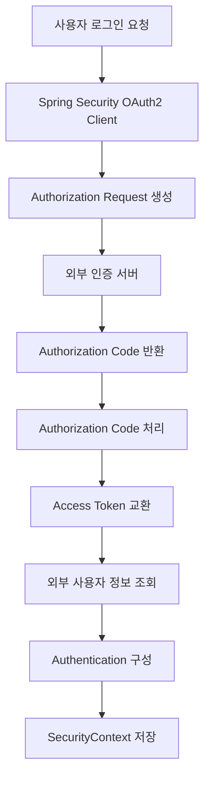
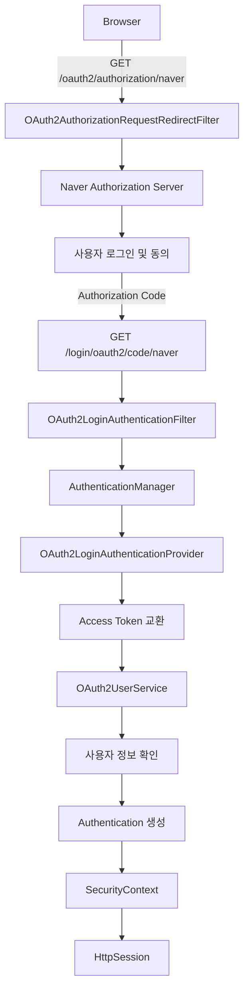
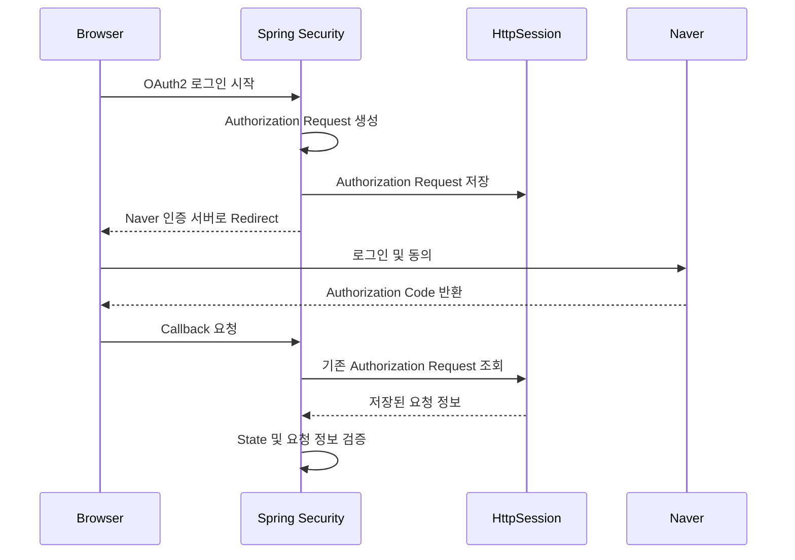
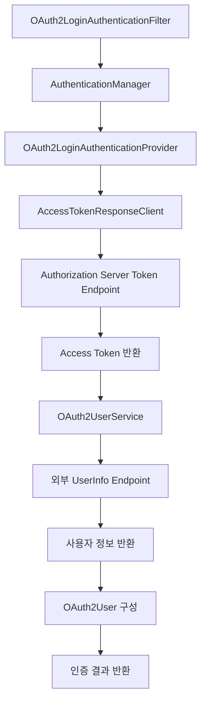
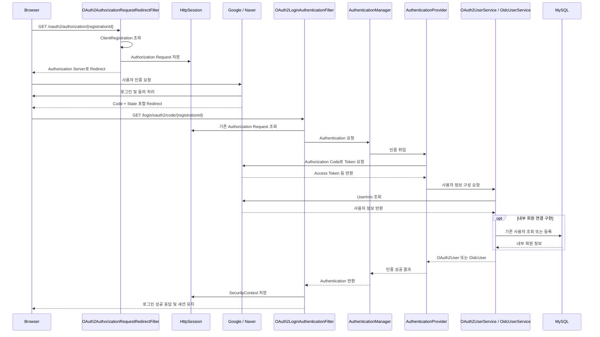
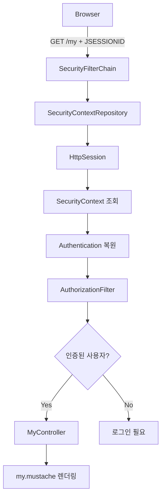
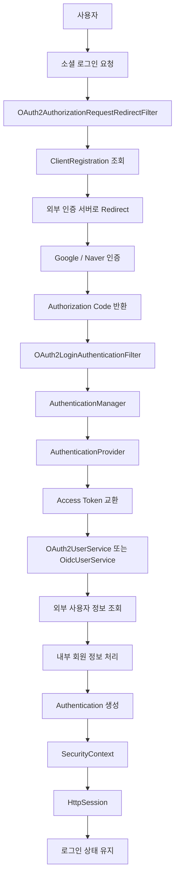

# 스프링 OAuth2 클라이언트 세션 - 3. 동작 모식도
[https://youtu.be/db85S6CmRzg?si=q9McsQr7XfNu5zdI](https://youtu.be/db85S6CmRzg?si=q9McsQr7XfNu5zdI)

# 스프링 OAuth2 클라이언트 세션 - 3. 동작 모식도
* toc
{:toc}

---

### Spring Security 6 OAuth2 소셜 로그인 내부 동작 원리: 핵심 필터, Authorization Code, OAuth2UserService와 세션 인증

Spring Security에서 OAuth2 Client를 이용하면 Google, Naver와 같은 외부 인증 제공자의 계정을 활용하여 소셜 로그인을 구현할 수 있다.

일반적인 아이디·비밀번호 로그인에서는 우리 서버가 사용자의 자격 증명을 직접 검증한다.

반면 OAuth2 소셜 로그인에서는 외부 인증 제공자가 사용자 인증을 담당하고, 우리 서버는 인증 결과와 사용자 식별 정보를 전달받아 자체 로그인 상태를 구성한다.

전체적인 흐름은 다음과 같다.

```text
사용자
    ↓
소셜 로그인 요청
    ↓
Spring Security OAuth2 Client
    ↓
외부 인증 서버로 이동
    ↓
Google / Naver 로그인
    ↓
Authorization Code 발급
    ↓
Spring Security Callback 처리
    ↓
Authorization Code를 Access Token으로 교환
    ↓
외부 사용자 정보 확인
    ↓
우리 서비스 사용자 계정 조회 또는 등록
    ↓
Authentication 생성
    ↓
SecurityContext 저장
    ↓
HttpSession을 통한 로그인 상태 유지
```

이러한 흐름을 처음 구현할 때는 모든 과정을 직접 작성해야 할 것처럼 느껴질 수 있다.

그러나 Spring Security는 OAuth2 로그인에 필요한 주요 필터와 인증 처리 구성요소를 이미 제공한다.

대표적으로 다음 두 필터가 있다.

- `OAuth2AuthorizationRequestRedirectFilter`
- `OAuth2LoginAuthenticationFilter`

첫 번째 필터는 사용자를 외부 인증 서버로 이동시키는 역할을 담당한다.

두 번째 필터는 외부 인증 서버에서 돌아온 Authorization Code를 처리하여 우리 서비스의 인증 절차를 완료하는 역할을 담당한다.

그 사이에서 Spring Security는 Authorization Code를 Access Token으로 교환하고, 사용자 정보를 조회하는 작업을 수행한다.

따라서 개발자는 모든 OAuth2 프로토콜 과정을 직접 구현하기보다, **외부 인증 제공자에 대한 설정과 우리 서비스의 사용자 정보 처리 로직에 집중할 수 있다.**

이번에는 Spring Boot 3.2.1과 Spring Security 6.2.1을 기준으로 OAuth2 로그인 내부 구조를 살펴본다.

---

### 개념

#### OAuth2 소셜 로그인에 등장하는 구성요소

OAuth2 로그인 과정을 이해하려면 먼저 각 구성요소의 역할을 알아야 한다.

| 구성요소 | 역할 |
|---|---|
| Browser | 소셜 로그인 요청 및 외부 인증 화면 처리 |
| Spring Boot | 우리 서비스 애플리케이션 |
| OAuth2 Client | 외부 인증 서버와 OAuth2 프로토콜 수행 |
| Authorization Server | 사용자 인증 및 Authorization Code, Access Token 발급 |
| Resource Server | Access Token을 이용한 사용자 정보 제공 |
| OAuth2UserService | 외부 사용자 정보 조회 및 OAuth2User 구성 |
| Authentication | Spring Security의 인증 결과 |
| SecurityContext | 현재 사용자 인증 정보 보관 |
| HttpSession | 여러 요청에 걸친 로그인 상태 유지 |

이러한 구성요소는 서로 다른 책임을 가진다.

특히 외부 인증 서버와 우리 서비스의 인증 상태를 구분하는 것이 중요하다.

예를 들어 Google 로그인에 성공했다고 가정하자.

Google은 사용자가 Google 계정의 소유자임을 확인한다.

하지만 우리 서비스에서는 별도로 확인해야 할 정보가 있다.

```text
이 사용자가 우리 서비스의 회원인가?

회원가입을 완료했는가?

계정이 정지된 상태인가?

일반 사용자 권한을 가지고 있는가?

관리자 권한이 있는가?
```

이러한 판단은 Google이 아니라 우리 서비스에서 수행해야 한다.

따라서 OAuth2 로그인은 크게 두 영역으로 구분할 수 있다.

**외부 사용자 인증**

```text
Google / Naver
    ↓
사용자 인증
    ↓
Access Token 발급
    ↓
사용자 식별 정보 제공
```

**내부 사용자 인증 상태 구성**

```text
외부 사용자 식별 정보
    ↓
우리 서비스 회원 조회
    ↓
서비스 권한 결정
    ↓
Authentication 생성
    ↓
SecurityContext 저장
    ↓
HttpSession 유지
```

두 영역을 연결하는 것이 Spring Security OAuth2 Client의 핵심 역할이다.

---

### 왜 사용하는가?

#### OAuth2 로그인 프로토콜을 직접 구현하지 않기 위해서

OAuth2 Authorization Code Grant를 직접 구현하려면 다양한 작업이 필요하다.

예를 들어 다음과 같다.

1. 외부 인증 서버의 Authorization Endpoint 확인
2. Client ID와 Redirect URI를 포함한 인증 요청 생성
3. CSRF 방어를 위한 State 생성 및 보관
4. 브라우저 리다이렉트 처리
5. Callback 요청의 Authorization Code 수신
6. State 검증
7. Authorization Code를 Access Token으로 교환
8. Access Token 응답 처리
9. 외부 사용자 정보 조회
10. 인증 성공 및 실패 처리

여기에 OIDC를 사용하는 경우 ID Token 검증과 같은 추가적인 처리가 필요하다.

모든 로직을 직접 구현하면 OAuth2 프로토콜의 보안 요구사항을 정확하게 반영해야 한다.

반면 Spring Security는 이러한 작업을 수행하기 위한 구성요소를 제공한다.



개발자는 Spring Security가 제공하는 기능을 활용하고 필요한 부분을 확장하면 된다.

Spring Security는 `oauth2Login()`을 통해 OAuth2 로그인에 필요한 설정과 확장 지점을 제공한다.

---

### 주요 특징

#### OAuth2 소셜 로그인에서 가장 중요한 두 개의 필터

Spring Security의 OAuth2 로그인 흐름에서 중요한 필터는 다음 두 가지다.

| 필터 | 주요 역할 | 기본 요청 경로 |
|---|---|---|
| `OAuth2AuthorizationRequestRedirectFilter` | 외부 인증 서버로 이동 | `/oauth2/authorization/{registrationId}` |
| `OAuth2LoginAuthenticationFilter` | Authorization Code 수신 및 인증 처리 | `/login/oauth2/code/{registrationId}` |

두 필터를 구분하면 OAuth2 로그인 흐름이 훨씬 명확해진다.

첫 번째 필터는 로그인을 **시작**한다.

두 번째 필터는 외부 인증을 마친 요청을 받아 로그인을 **완료**한다.

다음 구조를 살펴보자.



이 구조를 이해하면 OAuth2 로그인 과정에서 어떤 요청을 누가 처리하는지 구분할 수 있다.

다만 Google처럼 OIDC를 사용하는 경우에는 `OidcAuthorizationCodeAuthenticationProvider`와 `OidcUserService`가 인증 처리에 참여할 수 있다.

따라서 모든 제공자가 완전히 동일한 내부 구현체를 사용하는 것은 아니다.

---

### OAuth2AuthorizationRequestRedirectFilter란?

`OAuth2AuthorizationRequestRedirectFilter`는 OAuth2 인증을 시작하는 필터다.

사용자가 외부 소셜 로그인을 요청하면 이 필터가 요청을 처리한다.

대표적인 요청은 다음과 같다.

```http
GET /oauth2/authorization/naver HTTP/1.1
Host: localhost:8080
```

Google 로그인이라면 다음과 같다.

```http
GET /oauth2/authorization/google HTTP/1.1
Host: localhost:8080
```

여기서 `naver`와 `google`은 `registrationId`다.

#### registrationId란?

Spring Security에서는 외부 OAuth2 Client를 등록할 때 각 클라이언트를 구분할 이름을 지정한다.

예를 들어 다음과 같다.

```yaml
spring:
  security:
    oauth2:
      client:
        registration:
          google:
            client-id: ${GOOGLE_CLIENT_ID}
            client-secret: ${GOOGLE_CLIENT_SECRET}

          naver:
            client-id: ${NAVER_CLIENT_ID}
            client-secret: ${NAVER_CLIENT_SECRET}
```

이 설정에서 다음 값이 registrationId다.

```text
google

naver
```

Spring Security는 요청 경로에 포함된 registrationId를 이용해 어떤 외부 인증 제공자를 사용할지 판단한다.

```text
/oauth2/authorization/google
    ↓
registrationId = google
    ↓
Google ClientRegistration 조회
```

```text
/oauth2/authorization/naver
    ↓
registrationId = naver
    ↓
Naver ClientRegistration 조회
```

따라서 여러 인증 제공자를 지원하더라도 동일한 필터 구조를 사용할 수 있다.

---

### 첫 번째 필터의 내부 동작

사용자가 다음 주소로 요청한다고 가정하자.

```text
http://localhost:8080/oauth2/authorization/naver
```

요청은 Spring Security의 필터 체인에 진입한다.

이후 `OAuth2AuthorizationRequestRedirectFilter`가 요청을 처리한다.

처리 흐름은 다음과 같다.

```text
1. /oauth2/authorization/naver 요청 수신

2. registrationId 추출

3. ClientRegistrationRepository 조회

4. Naver ClientRegistration 획득

5. OAuth2AuthorizationRequest 생성

6. State 등 인증 요청 정보 관리

7. Naver Authorization Endpoint로 Redirect
```

이때 사용되는 구성요소 중 하나가 `ClientRegistrationRepository`다.

#### ClientRegistrationRepository

`ClientRegistrationRepository`는 등록된 OAuth2 Client의 설정 정보를 관리한다.

예를 들어 다음과 같은 설정을 보관할 수 있다.

```text
ClientRegistration
    │
    ├── registrationId
    ├── clientId
    ├── clientSecret
    ├── authorizationGrantType
    ├── redirectUri
    ├── scopes
    └── providerDetails
```

Spring Security는 이 정보를 이용해 외부 인증 요청을 생성한다.

일반적으로 Spring Boot에서 OAuth2 Client 설정을 등록하면 필요한 `ClientRegistration`과 Repository를 자동으로 구성할 수 있다.

따라서 개발자가 매번 `ClientRegistrationRepository`를 직접 구현할 필요는 없다.

---

### Authorization Request 생성

ClientRegistration을 찾으면 Spring Security는 외부 인증 서버로 전달할 Authorization Request를 구성한다.

Naver 로그인 요청을 예로 들면 다음과 같은 형태다.

```http
GET /oauth2.0/authorize?
    response_type=code&
    client_id=CLIENT_ID&
    redirect_uri=REDIRECT_URI&
    state=RANDOM_STATE
```

실제 요청은 하나의 URL로 구성되며 각 파라미터는 URL 인코딩된다.

주요 파라미터의 의미는 다음과 같다.

| 파라미터 | 역할 |
|---|---|
| `response_type` | Authorization Code 방식 지정 |
| `client_id` | 외부 인증 제공자에 등록된 애플리케이션 식별자 |
| `redirect_uri` | 인증 완료 후 돌아올 주소 |
| `state` | 인증 요청과 응답 연결 및 CSRF 방어 |
| `scope` | 요청할 접근 권한 범위 |

특히 `state`는 중요한 보안 요소다.

Spring Security는 인증 요청을 시작할 때 생성한 정보와 Callback으로 전달된 정보를 연결하여 검증할 수 있어야 한다.

네이버 로그인 API도 Authorization Code 방식에서 `state` 파라미터를 사용한다.

---

### AuthorizationRequestRepository란?

OAuth2 인증에서는 요청을 시작한 시점과 Callback을 처리하는 시점이 다르다.

예를 들어 다음과 같다.

```text
요청 1
    ↓
우리 서버에서 OAuth2 인증 시작
    ↓
Naver로 Redirect
```

```text
요청 2
    ↓
Naver 인증 완료
    ↓
우리 서버 Callback 호출
```

서로 다른 HTTP 요청이므로 최초 인증 요청의 정보를 기억할 방법이 필요하다.

이를 위해 Spring Security는 `AuthorizationRequestRepository`를 사용한다.

기본적인 세션 기반 OAuth2 로그인에서는 `HttpSessionOAuth2AuthorizationRequestRepository`를 활용하여 인증 요청 정보를 HttpSession에 저장할 수 있다.



여기서 중요한 사실이 있다.

**OAuth2 로그인에서 HttpSession은 로그인 성공 이후에만 사용되는 것이 아니다.**

로그인을 시작한 요청과 Callback 요청을 연결하기 위해 인증이 완료되기 전에도 세션을 활용할 수 있다.

다만 이는 기본적인 세션 기반 구현에 대한 설명이며, 별도의 AuthorizationRequestRepository를 구현하면 다른 저장 방식을 사용할 수도 있다.

---

### 외부 인증 서버에서 로그인 처리

첫 번째 필터가 Authorization Request를 생성하면 브라우저는 Naver 인증 서버로 이동한다.

이후 사용자는 Naver 계정으로 로그인한다.

필요하다면 사용자 정보 제공에 대한 동의 절차도 진행한다.

```text
Browser
    ↓
Naver 로그인 화면
    ↓
사용자 계정 인증
    ↓
정보 제공 동의
    ↓
Authorization Code 발급
```

여기서 주의해야 할 점은 인증 서버가 우리 Spring Boot 서버의 필터를 직접 호출하는 것이 아니라는 사실이다.

일반적인 Authorization Code 방식에서는 **브라우저 리다이렉트를 통해 Callback 요청이 우리 서버에 전달된다.**

따라서 사용자 브라우저가 외부 인증 서버와 우리 서버 사이를 이동한다.

---

### OAuth2LoginAuthenticationFilter란?

사용자가 외부 인증에 성공하면 인증 제공자는 등록된 Redirect URI로 브라우저를 이동시킨다.

기본적인 Callback URI는 다음과 같다.

```text
/login/oauth2/code/{registrationId}
```

Naver 로그인이라면 다음과 같다.

```text
http://localhost:8080/login/oauth2/code/naver
```

Google 로그인이라면 다음과 같다.

```text
http://localhost:8080/login/oauth2/code/google
```

Callback 요청에는 Authorization Code와 State 등이 포함된다.

예를 들어 다음과 같다.

```http
GET /login/oauth2/code/naver?
    code=AUTHORIZATION_CODE&
    state=RANDOM_STATE
```

이 요청은 `OAuth2LoginAuthenticationFilter`가 처리한다.

Spring Security의 기본 OAuth2 로그인 Callback 처리 경로는 `/login/oauth2/code/*`로 정의되어 있다.

---

### 두 번째 필터의 내부 동작

`OAuth2LoginAuthenticationFilter`는 외부 인증 제공자로부터 반환된 인증 결과를 처리한다.

주요 흐름은 다음과 같다.

```text
1. Callback 요청 수신

2. Authorization Code 및 State 추출

3. 기존 Authorization Request 조회

4. 요청과 응답의 연관성 확인

5. 인증 처리를 위한 Authentication 객체 생성

6. AuthenticationManager에 인증 위임

7. AuthenticationProvider에서 토큰 교환

8. 외부 사용자 정보 확인

9. 인증된 Authentication 반환

10. 로그인 성공 처리
```

여기서 핵심은 `OAuth2LoginAuthenticationFilter`가 모든 작업을 직접 구현하지 않는다는 점이다.

Spring Security의 일반적인 아이디·비밀번호 로그인과 마찬가지로 인증 처리를 다른 구성요소에 위임한다.

대표적으로 다음과 같다.

```text
OAuth2LoginAuthenticationFilter
    ↓
AuthenticationManager
    ↓
AuthenticationProvider
```

즉 OAuth2 로그인도 Spring Security의 인증 추상화 구조를 활용한다.

---

### OAuth2LoginAuthenticationProvider란?

`OAuth2LoginAuthenticationProvider`는 일반적인 OAuth2 Authorization Code 로그인에서 인증 처리를 담당하는 구성요소다.

대표적으로 다음 작업을 수행한다.

```text
Authorization Code 수신
    ↓
Token Endpoint에 Access Token 요청
    ↓
Access Token 응답 확인
    ↓
OAuth2UserService 실행
    ↓
외부 사용자 정보 획득
    ↓
인증 결과 반환
```

이 구조를 조금 더 자세하게 살펴보자.



Spring Security에서는 이러한 토큰 교환과 사용자 정보 조회 로직을 위한 기본 구현체를 제공한다.

따라서 일반적인 OAuth2 제공자를 사용할 때는 개발자가 HTTP 요청을 모두 직접 작성할 필요가 없다.

다만 외부 인증 제공자가 표준 구현과 다른 요청이나 응답 형식을 사용한다면 관련 구성요소를 확장해야 할 수 있다.

---

### Authorization Code를 Access Token으로 교환하는 과정

OAuth2 로그인에서 Authorization Code와 Access Token은 서로 다른 역할을 가진다.

Authorization Code는 사용자가 인증 및 동의 절차를 완료했다는 결과를 토큰 발급 단계로 전달하기 위한 값이다.

Access Token은 권한이 부여된 리소스에 접근할 때 사용한다.

두 값의 차이는 다음과 같다.

| 구분 | Authorization Code | Access Token |
|---|---|---|
| 주요 목적 | 토큰 발급 요청 | 보호된 리소스 접근 |
| 사용 위치 | Token Endpoint | Resource Server |
| 유효기간 | 일반적으로 매우 짧음 | 제공자 정책에 따름 |
| 재사용 | 일회성 사용을 전제로 설계 | 만료 및 폐기 정책에 따름 |
| 사용자 정보 조회 | 직접 사용하지 않음 | 사용 가능 |

Authorization Code를 받은 Spring Security는 외부 인증 서버의 Token Endpoint에 요청한다.

개념적으로 다음과 같다.

```http
POST /oauth2.0/token HTTP/1.1
Host: nid.naver.com
Content-Type: application/x-www-form-urlencoded

grant_type=authorization_code
&client_id=CLIENT_ID
&client_secret=CLIENT_SECRET
&code=AUTHORIZATION_CODE
&state=RANDOM_STATE
```

실제 파라미터 전달 위치와 Client 인증 방식은 외부 제공자에 따라 달라질 수 있다.

네이버 로그인 API는 인증 코드 교환 시 `client_id`, `client_secret`, `code`, `state` 등의 파라미터를 사용하도록 정의하고 있다.

정상적으로 인증 코드 교환이 완료되면 다음과 유사한 응답을 받을 수 있다.

```json
{
  "access_token": "ACCESS_TOKEN_VALUE",
  "refresh_token": "REFRESH_TOKEN_VALUE",
  "token_type": "bearer",
  "expires_in": 3600
}
```

여기서 `expires_in`은 Access Token의 유효기간을 초 단위로 나타낸다.

이렇게 Access Token을 획득하면 다음으로 외부 사용자 정보를 확인한다.

---

### OAuth2UserService란?

`OAuth2UserService`는 외부 인증 제공자의 사용자 정보를 조회하고 `OAuth2User` 객체를 구성하기 위한 인터페이스다.

Spring Security는 일반적인 OAuth2 사용자 정보 조회를 위해 `DefaultOAuth2UserService`를 제공한다.

핵심 메서드는 다음과 같다.

```java
public interface OAuth2UserService<
        R extends OAuth2UserRequest,
        U extends OAuth2User> {

    U loadUser(R userRequest)
            throws OAuth2AuthenticationException;
}
```

이 메서드는 사용자 정보를 조회할 때 호출된다.

여기서 `OAuth2UserRequest`에는 외부 인증 제공자로부터 발급받은 Access Token과 ClientRegistration 등의 정보가 포함된다.

```text
OAuth2UserRequest
    │
    ├── ClientRegistration
    │
    └── OAuth2AccessToken
```

이 정보를 이용해 UserInfo Endpoint를 호출할 수 있다.

예를 들어 Naver 사용자 정보 API는 다음과 같다.

```http
GET /v1/nid/me HTTP/1.1
Host: openapi.naver.com
Authorization: Bearer <NAVER_ACCESS_TOKEN>
```

정상적으로 조회하면 다음과 같은 응답을 받을 수 있다.

```json
{
  "resultcode": "00",
  "message": "success",
  "response": {
    "id": "naver-user-123",
    "nickname": "example",
    "email": "user@example.com"
  }
}
```

위 데이터는 구조를 설명하기 위한 예시다.

Naver에서 제공하는 `response.id`는 해당 애플리케이션에서 사용자를 식별하기 위한 값이며, 사용자의 실제 네이버 로그인 아이디를 의미하지 않는다.

---

### DefaultOAuth2UserService와 CustomOAuth2UserService

Spring Security에서는 사용자 정보 조회를 위한 기본 구현체를 제공한다.

```java
DefaultOAuth2UserService
```

하지만 외부 사용자 정보를 우리 서비스의 데이터베이스와 연결하려면 추가적인 로직이 필요할 수 있다.

예를 들어 다음과 같다.

```text
외부 사용자 정보 조회
    ↓
Provider별 사용자 식별 정보 추출
    ↓
우리 서비스 회원 조회
    ↓
기존 회원이면 로그인
    ↓
신규 회원이면 회원가입 처리
    ↓
서비스 권한 설정
    ↓
OAuth2User 반환
```

이러한 처리를 위해 `OAuth2UserService`를 커스터마이징할 수 있다.

예를 들어 다음과 같은 클래스를 작성할 수 있다.

```java
@Service
public class CustomOAuth2UserService
        implements OAuth2UserService<OAuth2UserRequest, OAuth2User> {

    private final DefaultOAuth2UserService delegate =
            new DefaultOAuth2UserService();

    @Override
    public OAuth2User loadUser(
            OAuth2UserRequest userRequest
    ) throws OAuth2AuthenticationException {

        OAuth2User oauth2User =
                delegate.loadUser(userRequest);

        String registrationId = userRequest
                .getClientRegistration()
                .getRegistrationId();

        Map<String, Object> attributes =
                oauth2User.getAttributes();

        // 제공자별 사용자 정보 해석 및 내부 회원 연결 지점
        // registrationId와 attributes를 이용해
        // 사용자 식별 정보를 정규화할 수 있다.

        return oauth2User;
    }
}
```

필요한 import는 다음과 같다.

```java
import java.util.Map;

import org.springframework.security.core.AuthenticationException;
import org.springframework.security.oauth2.client.userinfo.DefaultOAuth2UserService;
import org.springframework.security.oauth2.client.userinfo.OAuth2UserRequest;
import org.springframework.security.oauth2.client.userinfo.OAuth2UserService;
import org.springframework.security.oauth2.core.OAuth2AuthenticationException;
import org.springframework.security.oauth2.core.user.OAuth2User;
import org.springframework.stereotype.Service;
```

위 예제는 사용자 정보 조회에 대한 확장 지점을 보여준다.

아직 사용자 정보를 데이터베이스에 저장하거나 내부 권한을 연결하지는 않는다.

그리고 중요한 사실이 있다.

**OAuth2UserService가 직접 Spring Security의 HttpSession을 생성하는 것은 아니다.**

OAuth2UserService는 외부 사용자 정보 조회 및 `OAuth2User` 구성에 참여한다.

그 결과를 전달받아 Authentication을 완성하고 SecurityContext를 저장하는 작업은 Spring Security의 인증 처리 흐름에서 수행된다.

따라서 사용자 정보 처리와 인증 상태 저장의 책임을 구분하는 것이 중요하다.

---

### OAuth2User와 UserDetails는 같은 것일까?

일반적인 아이디·비밀번호 로그인에서는 `UserDetails`를 자주 사용한다.

예를 들어 다음과 같다.

```text
UsernamePasswordAuthenticationFilter
    ↓
AuthenticationManager
    ↓
DaoAuthenticationProvider
    ↓
UserDetailsService
    ↓
UserDetails
```

반면 OAuth2 로그인에서는 다음과 같은 구조를 사용한다.

```text
OAuth2LoginAuthenticationFilter
    ↓
AuthenticationManager
    ↓
OAuth2LoginAuthenticationProvider
    ↓
OAuth2UserService
    ↓
OAuth2User
```

두 구조를 비교하면 다음과 같다.

| 구분 | UserDetails | OAuth2User |
|---|---|---|
| 주요 용도 | 아이디·비밀번호 기반 인증 | OAuth2 사용자 정보 표현 |
| 사용자 정보 조회 | UserDetailsService | OAuth2UserService |
| 대표 정보 | username, password, authorities | attributes, authorities |
| 외부 제공자 정보 | 기본 계약에 없음 | 포함 가능 |
| Spring Security 인증에 사용 | 가능 | 가능 |

두 인터페이스는 역할이 유사한 부분이 있지만 동일하지 않다.

따라서 `OAuth2User`를 사용하는 구조에서 반드시 `UserDetails`까지 구현해야 하는 것은 아니다.

우리 서비스에서 일반 로그인과 소셜 로그인을 함께 지원한다면 두 인터페이스를 구현하는 공통 Principal을 설계할 수도 있다.

하지만 소셜 로그인만 사용하는 경우에는 `OAuth2User`를 중심으로 구성해도 된다.

---

### Google과 Naver의 내부 처리 차이

여기서 중요한 부분이 하나 있다.

Google과 Naver는 모두 OAuth2를 사용할 수 있지만, 사용자 인증 정보를 처리하는 세부 방식에는 차이가 있다.

이번 구조에서는 Google은 OIDC를 사용하고, Naver는 일반 OAuth2 사용자 정보 API를 사용하는 것으로 가정한다.

#### Google: OIDC 기반 로그인

Google 로그인에서 `openid` Scope를 요청하면 OpenID Connect 기반 인증을 수행할 수 있다.

```yaml
scope:
  - openid
  - profile
  - email
```

이 경우 ID Token을 이용해 사용자의 신원을 검증한다.

Spring Security에서는 다음 구성요소가 사용될 수 있다.

```text
OidcAuthorizationCodeAuthenticationProvider
    ↓
ID Token 검증
    ↓
OidcUserService
    ↓
OidcUser
```

#### Naver: 일반 OAuth2 사용자 정보 조회

Naver의 일반 OAuth2 로그인에서는 Access Token을 이용해 UserInfo API를 호출한다.

```text
OAuth2LoginAuthenticationProvider
    ↓
Access Token 교환
    ↓
OAuth2UserService
    ↓
Naver UserInfo API
    ↓
OAuth2User
```

두 구조를 비교하면 다음과 같다.

| 구분 | Google OIDC | Naver 일반 OAuth2 |
|---|---|---|
| 인증 관련 프로토콜 | OAuth2 + OIDC | OAuth2 |
| 주요 사용자 신원 정보 | ID Token의 Claim | UserInfo API 응답 |
| 사용자 정보 구성 | OidcUserService | OAuth2UserService |
| 주요 Principal 타입 | OidcUser | OAuth2User |
| 내부 회원 연결 | 별도 구현 가능 | 별도 구현 가능 |

Naver 역시 별도의 OIDC 기능을 제공하지만, 여기서는 일반 OAuth2 로그인 연동을 기준으로 살펴본다.

Spring Security는 OIDC 사용자 정보 처리를 위해 `OidcUserService`를 제공한다.

---

### 인증 완료 후 세션은 어떻게 생성될까?

외부 사용자 정보 조회까지 완료되었다면 Spring Security는 인증에 성공한 사용자 정보를 구성한다.

일반적인 OAuth2 로그인에서는 최종적으로 `OAuth2AuthenticationToken`을 사용할 수 있다.

```text
OAuth2AuthenticationToken
    │
    ├── Principal
    │     └── OAuth2User
    │
    ├── Authorities
    │     └── 사용자 권한
    │
    ├── Authorized Client Registration ID
    │     └── naver
    │
    └── Authenticated
          └── true
```

이후 인증된 Authentication을 SecurityContext에 등록한다.

```text
Authentication
    ↓
SecurityContext
    ↓
SecurityContextRepository
    ↓
HttpSession
```

이 구조에서 `SecurityContextRepository`는 SecurityContext의 저장과 복원을 담당하는 추상화다.

세션 기반 구성에서는 `HttpSessionSecurityContextRepository` 등을 통해 인증 정보를 세션에 저장할 수 있다.

Spring Security 6에서는 `SecurityContextHolderFilter`와 SecurityContextRepository의 역할을 구분하는 것이 중요하다.

`SecurityContextHolderFilter`는 SecurityContext를 로드하는 역할을 담당하고, 인증에 성공한 필터는 필요한 저장 처리를 수행한다.

따라서 **SecurityContextHolder에 Authentication을 설정했다는 사실만으로 모든 환경에서 세션 저장까지 자동으로 완료된다고 가정해서는 안 된다.**

기본 OAuth2 Login 흐름에서는 Spring Security가 인증 성공 후 필요한 SecurityContext 저장을 처리하도록 구성되어 있다.

---

### OAuth2 로그인 과정에서 세션이 필요한 두 가지 이유

OAuth2 로그인에서는 세션이 서로 다른 두 가지 목적에 사용될 수 있다.

#### 첫 번째: 인증 요청 상태 관리

```text
OAuth2 로그인 시작
    ↓
AuthorizationRequest 생성
    ↓
State 저장
    ↓
외부 인증 서버로 Redirect
    ↓
Callback에서 State 확인
```

이 과정은 외부 로그인 요청과 응답을 연결하기 위해 필요하다.

#### 두 번째: 로그인 완료 후 인증 상태 유지

```text
OAuth2 로그인 성공
    ↓
Authentication 생성
    ↓
SecurityContext 저장
    ↓
HttpSession
    ↓
다음 요청에서도 로그인 상태 유지
```

두 흐름 모두 세션을 사용할 수 있지만 목적은 다르다.

| 구분 | 인증 요청 상태 | 로그인 인증 상태 |
|---|---|---|
| 저장 대상 | OAuth2AuthorizationRequest | SecurityContext |
| 저장 시점 | 외부 로그인 시작 시 | 인증 성공 후 |
| 목적 | 요청과 Callback 연결 | 로그인 상태 유지 |
| 관련 구성요소 | AuthorizationRequestRepository | SecurityContextRepository |

이렇게 구분하면 OAuth2 로그인 과정에서 세션이 언제, 어떤 이유로 사용되는지 이해하기 쉽다.

---

### 예제

#### OAuth2 Client 프로젝트 구성

다음 환경을 기준으로 살펴보자.

| 항목 | 기술 |
|---|---|
| Java | 17 |
| Spring Boot | 3.2.1 |
| Spring Security | 6.2.1 |
| OAuth2 | Spring Security OAuth2 Client |
| 화면 처리 | Mustache |
| 데이터베이스 | MySQL |
| ORM | Spring Data JPA |
| 인증 상태 관리 | HttpSession |

프로젝트의 기본 구조는 다음과 같다.

```text
src/main/java/com/example/oauth2session
│
├── Oauth2SessionApplication.java
│
├── config
│   └── SecurityConfig.java
│
├── controller
│   ├── MainController.java
│   └── MyController.java
│
├── service
│   └── CustomOAuth2UserService.java
│
└── oauth2
    └── SocialUserInfo.java
```

다만 현재 단계에서는 전체 사용자 정보 처리 로직을 모두 구현할 필요는 없다.

먼저 OAuth2 설정을 통해 기본 필터가 어떻게 동작하는지 살펴본다.

---

### OAuth2 Client 의존성

Spring Security OAuth2 Client를 사용하려면 다음 의존성이 필요하다.

```gradle
implementation 'org.springframework.boot:spring-boot-starter-oauth2-client'
```

이 의존성에는 OAuth2 Client와 OAuth2 Login을 구현하는 데 필요한 주요 기능이 포함된다.

하지만 의존성을 추가했다고 해서 다음과 같은 설정이 자동으로 완성되는 것은 아니다.

```text
Google Client ID

Google Client Secret

Naver Client ID

Naver Client Secret

Redirect URI

Provider Endpoint
```

외부 제공자와 연동하려면 실제 ClientRegistration이 필요하다.

또한 사용자 정의 SecurityFilterChain을 사용하는 경우 OAuth2 로그인을 활성화하도록 설정해야 한다.

---

### SecurityConfig 구성

OAuth2 로그인을 활성화하는 기본적인 SecurityConfig는 다음과 같다.

```java
package com.example.oauth2session.config;

import org.springframework.context.annotation.Bean;
import org.springframework.context.annotation.Configuration;

import org.springframework.security.config.Customizer;
import org.springframework.security.config.annotation.web.builders.HttpSecurity;
import org.springframework.security.config.http.SessionCreationPolicy;
import org.springframework.security.web.SecurityFilterChain;

@Configuration
public class SecurityConfig {

    @Bean
    public SecurityFilterChain securityFilterChain(
            HttpSecurity http
    ) throws Exception {

        http
                .authorizeHttpRequests(auth -> auth

                        // 공개 경로
                        .requestMatchers(
                                "/",
                                "/error",
                                "/css/**",
                                "/js/**"
                        ).permitAll()

                        // 나머지 경로는 인증 필요
                        .anyRequest().authenticated()
                )

                // OAuth2 소셜 로그인 활성화
                .oauth2Login(Customizer.withDefaults())

                // 세션 기반 인증
                .sessionManagement(session -> session
                        .sessionCreationPolicy(
                                SessionCreationPolicy.IF_REQUIRED
                        )
                );

        return http.build();
    }
}
```

핵심은 다음 설정이다.

```java
.oauth2Login(Customizer.withDefaults())
```

이 설정을 적용하면 등록된 OAuth2 Client를 기반으로 로그인 기능을 구성할 수 있다.

또한 다음 설정을 사용했다.

```java
.sessionManagement(session -> session
        .sessionCreationPolicy(
                SessionCreationPolicy.IF_REQUIRED
        )
)
```

이는 인증 흐름에서 필요한 경우 세션을 생성할 수 있도록 하는 정책이다.

참고로 `IF_REQUIRED`는 Spring Security의 기본 세션 생성 정책이므로 반드시 명시해야 하는 것은 아니다.

이번에는 JWT Stateless 인증과의 차이를 보여주기 위해 명시했다.

세션 기반 브라우저 인증이므로 CSRF 보호는 기본 설정을 유지한다.

---

### Google과 Naver ClientRegistration 설정

다음으로 외부 인증 제공자의 정보를 등록해야 한다.

Spring Boot에서는 `application.yml`을 이용할 수 있다.

이번에는 Google과 Naver를 함께 설정하는 구조를 살펴보자.

```yaml
server:
  port: 8080

spring:
  security:
    oauth2:
      client:
        registration:

          google:
            client-id: ${GOOGLE_CLIENT_ID}
            client-secret: ${GOOGLE_CLIENT_SECRET}

            authorization-grant-type: authorization_code

            redirect-uri: "{baseUrl}/login/oauth2/code/{registrationId}"

            scope:
              - openid
              - profile
              - email

            client-name: Google

          naver:
            client-id: ${NAVER_CLIENT_ID}
            client-secret: ${NAVER_CLIENT_SECRET}

            client-authentication-method: client_secret_post

            authorization-grant-type: authorization_code

            redirect-uri: "{baseUrl}/login/oauth2/code/{registrationId}"

            client-name: Naver

        provider:

          naver:
            authorization-uri: https://nid.naver.com/oauth2.0/authorize

            token-uri: https://nid.naver.com/oauth2.0/token

            user-info-uri: https://openapi.naver.com/v1/nid/me

            user-name-attribute: response
```

이 설정에는 두 가지 종류의 정보가 있다.

**첫 번째는 Registration 정보다.**

```yaml
registration:
  google:
    # Google Client 정보

  naver:
    # Naver Client 정보
```

**두 번째는 Provider 정보다.**

```yaml
provider:
  naver:
    # Naver 인증 서버 정보
```

두 설정의 차이를 이해해야 한다.

또한 이 예제의 Naver 설정은 기본적인 OAuth2 Client 등록 구조를 보여준다.

실제 사용자 식별을 완성하려면 Naver의 중첩된 `response` 객체를 처리해야 하고, 제공자가 요구하는 Token Endpoint 요청 형식도 확인해야 한다.

---

### Registration 설정의 역할

Registration은 우리 서비스가 외부 인증 제공자에 등록한 Client 정보를 관리한다.

대표적인 설정 항목은 다음과 같다.

| 설정 | 설명 |
|---|---|
| client-id | 우리 애플리케이션의 OAuth2 Client ID |
| client-secret | Client 인증에 사용하는 Secret |
| authorization-grant-type | 사용할 OAuth2 인가 방식 |
| redirect-uri | 인증 결과를 받을 Callback URI |
| scope | 요청할 접근 권한 범위 |
| client-name | 사용자에게 표시할 Client 이름 |
| client-authentication-method | Token Endpoint에서 사용하는 Client 인증 방식 |

각 제공자에 필요한 값은 다를 수 있으므로 모든 항목을 반드시 동일하게 지정해야 하는 것은 아니다.

이번 구성에서는 Authorization Code Grant를 사용한다.

```yaml
authorization-grant-type: authorization_code
```

Redirect URI는 다음과 같다.

```yaml
redirect-uri: "{baseUrl}/login/oauth2/code/{registrationId}"
```

여기서 `{baseUrl}`은 현재 애플리케이션의 기본 주소로 확장된다.

`{registrationId}`는 등록된 OAuth2 Client의 이름으로 확장된다.

예를 들어 다음과 같다.

```text
{baseUrl}
    ↓
http://localhost:8080
```

```text
{registrationId}
    ↓
naver
```

최종 Redirect URI는 다음과 같다.

```text
http://localhost:8080/login/oauth2/code/naver
```

Google이라면 다음과 같다.

```text
http://localhost:8080/login/oauth2/code/google
```

Spring Security는 이러한 Redirect URI 템플릿을 지원한다.

---

### Provider 설정의 역할

Provider 설정은 외부 인증 서버가 제공하는 Endpoint 정보를 지정한다.

예를 들어 Naver는 다음과 같다.

```yaml
provider:
  naver:
    authorization-uri: https://nid.naver.com/oauth2.0/authorize

    token-uri: https://nid.naver.com/oauth2.0/token

    user-info-uri: https://openapi.naver.com/v1/nid/me

    user-name-attribute: response
```

각 항목의 의미는 다음과 같다.

| 설정 | 역할 |
|---|---|
| authorization-uri | 외부 로그인 인증 요청 주소 |
| token-uri | Authorization Code를 Access Token으로 교환하는 주소 |
| user-info-uri | 사용자 정보 조회 주소 |
| user-name-attribute | 사용자 식별 속성을 찾기 위한 응답 필드 |

여기서 Naver의 `user-name-attribute` 설정은 주의해야 한다.

Naver의 사용자 정보는 다음과 같이 중첩된 구조를 가진다.

```json
{
  "response": {
    "id": "naver-user-123",
    "email": "user@example.com"
  }
}
```

따라서 다음 설정만으로:

```yaml
user-name-attribute: response
```

`response.id`가 내부 사용자 식별자로 자동 변환되는 것은 아니다.

일반적으로 `response` 객체 전체를 반환 속성으로 지정한 상태이므로, 실제 사용자 ID를 사용하려면 중첩된 `id` 값을 추출하는 별도의 매핑이 필요하다.

이 작업은 CustomOAuth2UserService에서 수행할 수 있다.

---

### Google은 왜 Provider 설정이 없을까?

앞의 설정을 보면 Naver에는 Provider 설정이 존재한다.

하지만 Google에는 별도의 Provider 설정이 없다.

그 이유는 Spring Security가 Google과 같은 일부 OAuth2 제공자의 기본 정보를 미리 정의하고 있기 때문이다.

Spring Security의 `CommonOAuth2Provider`는 Google을 비롯한 주요 제공자의 기본 설정을 지원한다.

따라서 기본적인 Google OAuth2 Client 등록에서는 Client ID와 Client Secret만으로 시작할 수 있다.

반면 Naver는 별도의 Provider 설정을 지정해야 한다.

```text
Google
    ↓
CommonOAuth2Provider
    ↓
기본 Endpoint 정보 활용
```

```text
Naver
    ↓
사용자 정의 Provider 설정
    ↓
Authorization URI
Token URI
UserInfo URI
```

이러한 차이 때문에 제공자마다 설정해야 하는 항목의 수가 달라진다.

Spring Security 공식 문서에서도 Google과 같은 기본 제공자의 설정을 간소화하는 기능을 설명하고 있다.

---

### 두 가지 기본 경로 정리

OAuth2 로그인을 구현할 때 반드시 기억해야 할 경로는 두 가지다.

#### 첫 번째: 로그인 시작 경로

```text
/oauth2/authorization/{registrationId}
```

예를 들어 다음과 같다.

```text
/oauth2/authorization/google
```

```text
/oauth2/authorization/naver
```

이 경로는 `OAuth2AuthorizationRequestRedirectFilter`에서 처리한다.

#### 두 번째: 인증 완료 Callback 경로

```text
/login/oauth2/code/{registrationId}
```

예를 들어 다음과 같다.

```text
/login/oauth2/code/google
```

```text
/login/oauth2/code/naver
```

이 경로는 `OAuth2LoginAuthenticationFilter`에서 처리한다.

두 경로를 비교하면 다음과 같다.

| 구분 | 로그인 시작 | 인증 Callback |
|---|---|---|
| 기본 경로 | `/oauth2/authorization/{registrationId}` | `/login/oauth2/code/{registrationId}` |
| 처리 필터 | OAuth2AuthorizationRequestRedirectFilter | OAuth2LoginAuthenticationFilter |
| 요청 목적 | 외부 인증 시작 | 인증 결과 수신 |
| 주요 작업 | Authorization Request 생성 | Authorization Code 처리 |
| 다음 단계 | 외부 인증 서버 | AuthenticationManager |

이 두 경로는 Spring Security에서 제공하는 기본값이며 필요하면 변경할 수 있다.

---

### OAuth2 기본 경로 변경하기

서비스 요구사항에 따라 로그인 시작 경로와 Callback 경로를 변경할 수 있다.

예를 들어 로그인 시작 경로를 다음과 같이 변경한다고 생각해보자.

```text
/connect/oauth2/{registrationId}
```

Callback 경로는 다음과 같이 변경한다.

```text
/login/oauth2/callback/{registrationId}
```

SecurityConfig에서는 다음과 같이 구성할 수 있다.

```java
.oauth2Login(oauth2 -> oauth2

        .authorizationEndpoint(authorization -> authorization
                .baseUri("/connect/oauth2")
        )

        .redirectionEndpoint(redirection -> redirection
                .baseUri("/login/oauth2/callback/*")
        )
)
```

이렇게 하면 OAuth2 인증 요청 경로가 변경된다.

하지만 주의할 점이 있다.

**Callback 경로를 변경했다면 ClientRegistration의 Redirect URI도 함께 변경해야 한다.**

예를 들어 다음과 같다.

```yaml
redirect-uri: "{baseUrl}/login/oauth2/callback/{registrationId}"
```

그리고 외부 인증 제공자에 등록된 Redirect URI도 일치시켜야 한다.

```text
Spring Security Callback URI
    =
ClientRegistration Redirect URI
    =
외부 제공자에 등록된 Redirect URI
```

세 설정이 일치하지 않으면 인증 흐름이 정상적으로 완료되지 않을 수 있다.

Spring Security는 `authorizationEndpoint().baseUri()`와 `redirectionEndpoint().baseUri()`를 통한 경로 변경을 지원한다.

---

### 구조

#### OAuth2 Client 전체 인증 흐름

지금까지 살펴본 내용을 하나의 시퀀스로 정리해보자.



이 구조를 이해할 때 중요한 사실은 다음과 같다.

외부 인증 제공자와 통신하는 과정에서 브라우저와 Spring Boot 서버는 서로 다른 역할을 수행한다.

브라우저는 외부 로그인 화면으로 이동하고 Callback 요청을 전달한다.

Spring Boot 서버는 Authorization Code를 Access Token으로 교환하고 사용자 정보를 처리한다.

그 결과로 만들어진 Authentication을 Spring Security가 관리한다.

---

### 로그인 성공 이후의 요청 처리

OAuth2 로그인에 성공하면 우리 서비스는 세션을 통해 로그인 상태를 유지할 수 있다.

예를 들어 다음과 같다.

```text
로그인 성공
    ↓
Authentication 생성
    ↓
SecurityContext 저장
    ↓
HttpSession에 인증 상태 저장
    ↓
브라우저에 세션 쿠키 전달
```

이후 사용자가 마이 화면에 접근한다고 생각해보자.

```http
GET /my HTTP/1.1
Host: localhost:8080
Cookie: JSESSIONID=SESSION_ID
```

Spring Security는 세션에 저장된 인증 정보를 복원한다.



이후 요청에서는 매번 Google이나 Naver의 로그인 API를 호출할 필요가 없다.

우리 서비스의 HttpSession에 저장된 인증 상태를 이용할 수 있기 때문이다.

이것이 OAuth2 소셜 로그인과 세션 기반 인증을 결합하는 이유다.

---

### 실무에서의 활용

#### 1. OAuth2 로그인 시작과 Callback 처리를 구분한다

OAuth2 로그인에서 가장 먼저 구분해야 할 것은 요청 경로다.

로그인을 시작하는 요청은 다음과 같다.

```text
/oauth2/authorization/naver
```

외부 인증을 마친 후 돌아오는 요청은 다음과 같다.

```text
/login/oauth2/code/naver
```

두 요청은 서로 다른 필터가 처리한다.

따라서 오류가 발생했을 때 어느 단계에서 실패했는지 먼저 확인해야 한다.

---

#### 2. ClientRegistration 설정을 하나의 관리 단위로 이해한다

OAuth2 Client 설정은 단순히 Client ID와 Secret만 저장하는 구조가 아니다.

인증 방식과 Redirect URI, Provider Endpoint 등이 함께 정의된다.

따라서 다음 요소를 하나의 ClientRegistration으로 관리해야 한다.

```text
Client ID

Client Secret

Authorization Grant Type

Redirect URI

Scope

Authorization Endpoint

Token Endpoint

UserInfo Endpoint
```

외부 제공자가 추가되면 새로운 registrationId를 등록하는 방식으로 확장할 수 있다.

---

#### 3. Client Secret은 반드시 안전하게 관리한다

OAuth2 Client Secret은 외부 인증 서버에서 우리 애플리케이션을 식별하고 인증하는 데 사용될 수 있다.

따라서 다음과 같이 환경변수로 관리하는 것이 좋다.

```yaml
client-secret: ${NAVER_CLIENT_SECRET}
```

운영 환경에서는 Secret Manager 등의 별도 비밀정보 관리 체계를 사용할 수 있다.

특히 Client Secret을 브라우저 JavaScript에 포함해서는 안 된다.

---

#### 4. State 검증을 생략하지 않는다

OAuth2 로그인에서는 인증 요청과 Callback 응답을 연결해야 한다.

이 과정에서 State 검증이 중요하다.

State 검증이 없다면 공격자가 자신의 인증 결과를 다른 사용자의 로그인 흐름에 주입하는 등의 문제가 발생할 수 있다.

따라서 AuthorizationRequestRepository를 임의로 구현할 때도 State 생성과 검증을 정확하게 처리해야 한다.

---

#### 5. Authorization Code를 로그에 남기지 않는다

Authorization Code는 Access Token을 발급받는 데 사용된다.

짧은 수명의 일회성 값이지만 민감한 인증 정보다.

따라서 다음과 같은 정보를 운영 로그에 그대로 남기지 않도록 주의해야 한다.

```text
Authorization Code

Access Token

Refresh Token

Client Secret
```

특히 Callback URI에는 Authorization Code가 Query Parameter로 전달될 수 있으므로 HTTP 접근 로그와 모니터링 시스템의 기록 정책을 확인해야 한다.

---

#### 6. OAuth2UserService가 직접 세션을 생성한다고 가정하지 않는다

CustomOAuth2UserService는 외부 사용자 정보를 처리하는 확장 지점이다.

실제 세션 인증 상태 저장은 Spring Security의 인증 처리 흐름에서 담당한다.

따라서 다음과 같이 역할을 구분해야 한다.

```text
CustomOAuth2UserService
    ↓
외부 사용자 정보 변환
    ↓
내부 회원 연결
    ↓
OAuth2User 반환
```

```text
Spring Security Authentication
    ↓
SecurityContext 구성
    ↓
SecurityContextRepository 저장
    ↓
HttpSession
```

이렇게 책임을 분리하면 인증 로직의 구조가 명확해진다.

---

#### 7. OAuth2UserService와 OidcUserService를 구분한다

Google OIDC 로그인과 Naver 일반 OAuth2 로그인에서는 서로 다른 사용자 정보 처리 경로가 사용될 수 있다.

따라서 Naver용 CustomOAuth2UserService를 등록했다고 해서 Google OIDC 사용자까지 같은 로직으로 처리된다고 가정해서는 안 된다.

두 제공자의 사용자 정보를 공통 회원 모델로 통합하려면 각각의 확장 지점을 고려해야 한다.

---

#### 8. 외부 사용자 정보를 서비스 내부 모델로 변환한다

Google과 Naver는 사용자 정보 응답 형식이 다르다.

예를 들어 다음과 같다.

```text
Google
    ↓
sub
```

```text
Naver
    ↓
response.id
```

이를 서비스 전체에서 직접 사용하면 외부 제공자별 분기 처리가 늘어난다.

따라서 다음과 같은 공통 DTO를 고려할 수 있다.

```java
public record SocialUserInfo(
        String provider,
        String providerUserId,
        String email,
        String name
) {
}
```

이렇게 하면 이후 사용자 서비스는 외부 응답의 구조를 직접 알 필요가 없다.

---

#### 9. 외부 사용자 식별자는 Provider와 함께 관리한다

소셜 로그인에서는 이메일만으로 사용자를 식별하지 않는 것이 좋다.

이메일은 변경되거나 제공되지 않을 수 있기 때문이다.

대신 다음 조합을 사용할 수 있다.

```text
provider + providerUserId
```

예를 들어 다음과 같다.

```text
google:12345
```

```text
naver:12345
```

두 값은 서로 다른 외부 계정을 의미한다.

이를 데이터베이스에서 관리할 때는 복합 유니크 제약을 적용할 수 있다.

---

#### 10. 외부 인증 성공과 내부 회원가입 완료를 구분한다

외부 인증 제공자가 사용자 인증에 성공했다고 해서 우리 서비스의 회원가입까지 완료된 것은 아닐 수 있다.

예를 들어 다음과 같은 절차가 필요할 수 있다.

```text
Google 로그인 성공
    ↓
외부 사용자 확인
    ↓
우리 서비스 회원 조회
    ↓
신규 회원
    ↓
추가 정보 입력
    ↓
약관 동의
    ↓
회원가입 완료
```

따라서 OAuth2 인증 성공과 서비스 회원 상태를 분리하여 관리하는 것이 좋다.

---

#### 11. 외부 인증 서버의 장애를 고려한다

OAuth2 로그인은 외부 인증 제공자에 의존한다.

따라서 다양한 실패 상황이 발생할 수 있다.

| 실패 위치 | 예시 |
|---|---|
| Authorization Endpoint | 인증 서버 연결 실패 |
| 사용자 인증 | 로그인 취소 |
| Callback | State 불일치 |
| Token Endpoint | Authorization Code 만료 |
| UserInfo Endpoint | 사용자 정보 조회 실패 |
| 내부 회원 처리 | 데이터베이스 저장 실패 |
| 세션 저장 | 세션 저장소 장애 |

오류가 발생하면 모든 상황을 단순한 로그인 실패로만 처리하기보다 내부적으로 실패 단계를 구분하여 기록하는 것이 좋다.

단, 민감한 토큰이나 사용자 정보를 로그에 과도하게 남겨서는 안 된다.

---

#### 12. Redirect URI 설정을 정확하게 관리한다

OAuth2 로그인에서는 Redirect URI가 매우 중요하다.

다음 세 설정이 일치해야 한다.

```text
외부 제공자에 등록된 Redirect URI

ClientRegistration의 redirect-uri

Spring Security의 redirectionEndpoint
```

예를 들어 다음과 같다.

```text
http://localhost:8080/login/oauth2/code/google
```

운영 환경에서 HTTPS와 Reverse Proxy를 사용한다면 외부에서 접근하는 주소와 내부 서버 주소가 다를 수 있다.

따라서 Proxy 환경에서는 Redirect URI가 실제 공개 주소로 생성되는지 확인해야 한다.

---

#### 13. 세션 저장소의 확장성을 고려한다

단일 Spring Boot 서버에서는 내장 HttpSession을 사용할 수 있다.

하지만 애플리케이션 서버가 여러 대로 확장되면 세션을 어떻게 공유할지 고민해야 한다.

```text
Load Balancer
    │
    ├── Application A
    │
    ├── Application B
    │
    └── Application C
```

사용자가 Application A에서 로그인한 뒤 Application B로 요청하면 세션 정보를 찾지 못할 수 있다.

따라서 Redis 기반 Spring Session 등을 이용한 공유 세션 저장소를 고려할 수 있다.

이때 Redis 장애 대응과 세션 만료 정책도 함께 설계해야 한다.

---

#### 14. 인증 요청 저장소와 로그인 세션 저장소를 구분한다

OAuth2 인증 요청을 저장하기 위한 AuthorizationRequestRepository와 로그인 상태를 저장하기 위한 SecurityContextRepository는 서로 다른 역할을 한다.

```text
AuthorizationRequestRepository
    ↓
OAuth2 인증 요청 상태 관리
```

```text
SecurityContextRepository
    ↓
로그인 인증 상태 저장 및 복원
```

둘 다 HttpSession을 이용할 수 있지만 저장 대상과 생명주기가 다르다.

따라서 세션 관련 문제가 발생하면 어떤 정보가 저장되지 않았는지 구분해야 한다.

---

#### 15. 사용자 권한은 내부 서비스에서 결정한다

Google이나 Naver 로그인이 성공했다고 해서 사용자에게 관리자 권한을 부여해서는 안 된다.

외부 인증은 사용자의 신원을 확인하는 역할을 수행한다.

우리 서비스의 권한은 내부 정책에 따라 결정해야 한다.

예를 들어 다음과 같다.

```text
외부 인증 성공
    ↓
내부 회원 조회
    ↓
계정 상태 확인
    ↓
ROLE_USER 또는 ROLE_ADMIN
    ↓
Authentication 구성
```

이렇게 하면 외부 인증 제공자와 내부 인가 정책을 분리할 수 있다.

---

#### 16. OAuth2 로그인 이후 JWT 발급으로 확장할 수 있다

이번 구조에서는 OAuth2 인증 이후 HttpSession을 이용한다.

하지만 OAuth2 로그인 이후 JWT를 발급하는 구조도 가능하다.

```text
OAuth2 로그인
    ↓
외부 사용자 정보 조회
    ↓
내부 회원 확인
    ↓
JWT 발급
    ↓
Authorization 헤더 또는 쿠키 기반 전달
```

즉 OAuth2 로그인과 JWT는 서로 대체되는 기술이 아니다.

OAuth2는 외부 인증 흐름을 처리하고, JWT는 인증 정보를 전달하는 토큰 형식으로 활용할 수 있다.

따라서 서비스 구조에 따라 세션 또는 JWT 방식 중 하나를 선택할 수 있다.

---

### OAuth2 로그인 오류 분석 방법

실제 구현 과정에서 문제가 발생하면 요청이 어느 단계까지 진행되었는지 확인하는 것이 중요하다.

다음과 같이 구분할 수 있다.

| 증상 | 우선 확인할 부분 |
|---|---|
| `/oauth2/authorization/naver` 요청 실패 | ClientRegistration, SecurityFilterChain |
| 외부 로그인 화면으로 이동하지 않음 | Authorization Endpoint 설정 |
| Redirect URI 불일치 | 외부 제공자 등록 정보 및 redirect-uri |
| Callback 이후 로그인 실패 | State, AuthorizationRequestRepository |
| Access Token 발급 실패 | Token Endpoint, Client 인증 방식 |
| 사용자 정보 조회 실패 | UserInfo Endpoint 및 Access Token |
| Naver 사용자 식별 오류 | `response.id` 매핑 |
| 로그인은 성공하지만 권한 없음 | Authorities 매핑 |
| 다음 요청에서 로그아웃 상태 | SecurityContextRepository, HttpSession |
| 여러 서버에서만 로그인 상태 유실 | 공유 세션 저장소 및 쿠키 설정 |

이러한 기준으로 문제를 분류하면 불필요하게 전체 OAuth2 인증 코드를 확인하는 일을 줄일 수 있다.

또한 Spring Security의 인증 필터 로그를 확인하면 실제 어느 단계에서 실패했는지 파악하는 데 도움이 된다.

개발 환경에서는 다음 설정을 활용할 수 있다.

```properties
logging.level.org.springframework.security=DEBUG
```

이 설정을 적용하면 Spring Security 내부 처리에 관한 로그가 더 자세하게 출력될 수 있다.

다만 DEBUG 로그는 운영 환경에서 불필요한 정보 노출과 로그 증가를 유발할 수 있으므로 필요한 환경에서 제한적으로 사용하는 것이 좋다.

---

### 정리

Spring Security OAuth2 Client는 외부 인증 제공자와 연동하기 위한 주요 기능을 제공한다.

이를 통해 개발자는 Authorization Code Grant의 모든 과정을 직접 구현하지 않고도 OAuth2 기반 소셜 로그인을 구성할 수 있다.

OAuth2 로그인에서 가장 중요한 필터는 다음 두 가지다.

**첫 번째는 `OAuth2AuthorizationRequestRedirectFilter`다.**

이 필터는 다음 경로를 처리한다.

```text
/oauth2/authorization/{registrationId}
```

사용자의 OAuth2 로그인 요청을 받으면 ClientRegistration을 조회하고 Authorization Request를 생성한다.

이후 브라우저를 외부 인증 서버로 이동시킨다.

**두 번째는 `OAuth2LoginAuthenticationFilter`다.**

이 필터는 다음 경로를 처리한다.

```text
/login/oauth2/code/{registrationId}
```

외부 인증이 완료된 이후 Authorization Code를 전달받아 인증 절차를 진행한다.

이 과정에서 AuthenticationManager와 AuthenticationProvider가 사용된다.

일반적인 OAuth2 인증에서는 다음 구조로 동작한다.

```text
OAuth2LoginAuthenticationFilter
    ↓
AuthenticationManager
    ↓
OAuth2LoginAuthenticationProvider
    ↓
Access Token 교환
    ↓
OAuth2UserService
    ↓
OAuth2User
```

OIDC 인증에서는 OIDC 전용 인증 처리와 `OidcUserService`가 사용될 수 있다.

사용자 정보 조회가 완료되면 Spring Security는 인증된 Authentication을 구성한다.

세션 기반 인증에서는 다음과 같이 로그인 상태를 유지할 수 있다.

```text
Authentication
    ↓
SecurityContext
    ↓
SecurityContextRepository
    ↓
HttpSession
    ↓
JSESSIONID
```

전체 흐름을 다시 정리하면 다음과 같다.



이번 내용에서 반드시 기억해야 할 핵심은 다음과 같다.

**첫째, OAuth2 로그인은 두 개의 주요 필터를 통해 시작과 완료 단계가 구분된다.**

**둘째, Authorization Code를 Access Token으로 교환하는 과정은 AuthenticationProvider 계층에서 처리된다.**

**셋째, 외부 사용자 정보는 OAuth2UserService 또는 OidcUserService를 통해 구성할 수 있다.**

**넷째, OAuth2UserService는 사용자 정보 처리에 참여하지만 직접 로그인 세션을 생성하는 것이 핵심 책임은 아니다.**

**다섯째, Spring Security의 기본 OAuth2 로그인은 외부 인증 결과를 Authentication으로 구성하고 세션 기반 로그인 상태로 연결할 수 있다.**

**여섯째, Google과 Naver의 설정 및 사용자 정보 구조가 다르므로 Provider별 정보를 정규화하는 과정이 필요할 수 있다.**

**일곱째, 외부 인증 성공과 우리 서비스의 회원가입 및 권한 부여는 서로 다른 문제다.**

이러한 구조를 이해하면 OAuth2 소셜 로그인을 단순히 외부 로그인 기능을 연결하는 작업이 아니라, **Spring Security의 인증 추상화와 외부 인증 제공자를 연결하고 그 결과를 우리 서비스의 인증 상태로 전환하는 과정**으로 이해할 수 있다.

#### 한 줄 요약

Spring Security 6의 OAuth2 소셜 로그인은 `OAuth2AuthorizationRequestRedirectFilter`가 `/oauth2/authorization/{registrationId}` 요청을 처리하여 외부 인증 서버로 사용자를 이동시키고, `OAuth2LoginAuthenticationFilter`가 `/login/oauth2/code/{registrationId}` Callback을 받아 Authorization Code 기반 인증을 진행하는 구조다. 이후 AuthenticationProvider가 Access Token을 교환하고 OAuth2UserService 또는 OidcUserService를 통해 사용자 정보를 구성하며, 최종적으로 인증된 Authentication을 SecurityContext에 등록하고 HttpSession에 저장하여 로그인 상태를 유지할 수 있다.
