# 스프링 OAuth2 클라이언트 세션 - 4. 변수 역할
[https://youtu.be/w3lXqNiHwik?si=FoNkrCN9naZ1XtAG](https://youtu.be/w3lXqNiHwik?si=FoNkrCN9naZ1XtAG)

# 스프링 OAuth2 클라이언트 세션 - 4. 변수 역할
* toc
{:toc}

---

### Spring Security 6 OAuth2 Client 설정 완벽 이해: Registration과 Provider, Client ID, Redirect URI, Scope의 역할

Spring Security에서 Google이나 Naver와 같은 외부 인증 제공자를 이용해 소셜 로그인을 구현하려면 OAuth2 Client 설정이 필요하다.

앞서 OAuth2 Authorization Code 방식의 전체적인 인증 흐름을 살펴보았다.

사용자가 소셜 로그인을 요청하면 Spring Security는 외부 인증 서버로 브라우저를 이동시키고, 인증에 성공하면 Authorization Code를 전달받는다.

이후 Authorization Code를 Access Token으로 교환하고, 해당 토큰을 이용해 사용자 정보를 확인한다.

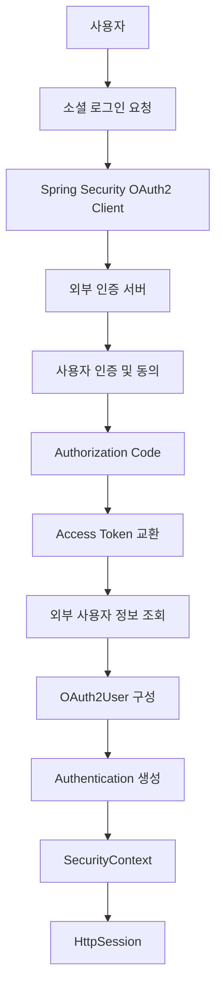

이러한 과정은 Spring Security에서 제공하는 OAuth2 Client 기능을 활용해 처리할 수 있다.

개발자가 Authorization Code를 직접 생성하거나, 외부 인증 서버의 로그인 화면을 직접 구현할 필요는 없다.

하지만 Spring Security가 이러한 작업을 수행하려면 필요한 정보가 있다.

예를 들어 다음과 같은 정보다.

- 어떤 외부 인증 제공자를 사용할 것인가?
- 우리 애플리케이션을 구분하는 Client ID는 무엇인가?
- Client Secret은 무엇인가?
- 인증이 완료되면 어느 주소로 돌아와야 하는가?
- 어떤 방식으로 인증을 진행할 것인가?
- 어떤 사용자 정보에 접근할 권한을 요청할 것인가?
- 외부 인증 서버와 사용자 정보 API의 주소는 무엇인가?

이러한 값들을 설정하는 곳이 바로 `application.yml` 또는 `application.properties`다.

대표적인 설정 구조는 다음과 같다.

```yaml
spring:
  security:
    oauth2:
      client:
        registration:
          naver:
            client-name: Naver
            client-id: ${NAVER_CLIENT_ID}
            client-secret: ${NAVER_CLIENT_SECRET}
            redirect-uri: "{baseUrl}/login/oauth2/code/{registrationId}"
            authorization-grant-type: authorization_code

        provider:
          naver:
            authorization-uri: https://nid.naver.com/oauth2.0/authorize
            token-uri: https://nid.naver.com/oauth2.0/token
            user-info-uri: https://openapi.naver.com/v1/nid/me
            user-name-attribute: response
```

설정 자체는 간단해 보일 수 있다.

하지만 각각의 설정이 어떤 역할을 하는지 이해하지 못하면 소셜 로그인 과정에서 오류가 발생했을 때 원인을 찾기 어렵다.

특히 `registration`과 `provider`는 이름이 비슷하지만 관리하는 정보와 역할이 다르다.

이번에는 Spring Boot 3.2.1과 Spring Security 6.2.1을 기준으로 OAuth2 Client 설정을 자세히 살펴본다.

---

### 개념

#### OAuth2 Client 설정은 무엇을 의미할까?

OAuth2 Client는 외부 인증 서버와 통신하는 애플리케이션을 의미한다.

이번 프로젝트에서는 Spring Boot 애플리케이션이 OAuth2 Client 역할을 담당한다.

반면 Google과 Naver는 외부 인증 제공자 역할을 수행한다.

이를 구조로 표현하면 다음과 같다.

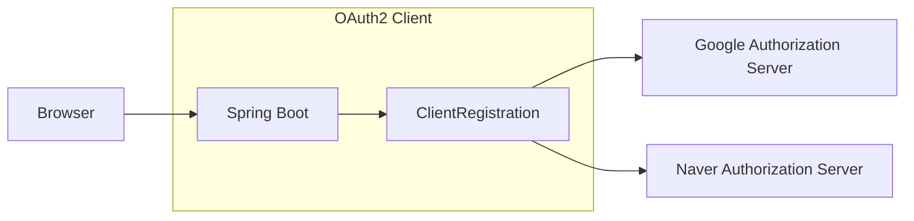

Spring Boot 애플리케이션은 외부 인증 제공자와 통신하기 위해 각 제공자의 정보를 알고 있어야 한다.

예를 들어 Google로 로그인할 때는 Google의 인증 서버 주소가 필요하다.

Naver로 로그인할 때는 Naver의 인증 서버 주소가 필요하다.

또한 외부 제공자는 어느 애플리케이션이 인증을 요청했는지 구분해야 한다.

이를 위해 Client ID와 Client Secret 같은 값을 사용한다.

Spring Security에서는 이러한 설정을 `ClientRegistration` 객체로 관리한다.

#### ClientRegistration이란?

`ClientRegistration`은 외부 OAuth2 제공자에 등록된 클라이언트의 정보를 표현하는 객체다.

개념적으로 다음 정보를 가진다.

```text
ClientRegistration
    │
    ├── registrationId
    │
    ├── clientName
    │
    ├── clientId
    │
    ├── clientSecret
    │
    ├── clientAuthenticationMethod
    │
    ├── authorizationGrantType
    │
    ├── redirectUri
    │
    ├── scopes
    │
    └── providerDetails
          │
          ├── authorizationUri
          ├── tokenUri
          ├── userInfoEndpoint
          └── jwkSetUri 등
```

Spring Security는 `ClientRegistration`에 포함된 정보를 이용해 OAuth2 인증 요청을 구성한다.

예를 들어 사용자가 다음 경로로 요청한다고 생각해보자.

```http
GET /oauth2/authorization/naver HTTP/1.1
Host: localhost:8080
```

Spring Security는 `naver`라는 registrationId를 기준으로 ClientRegistration을 조회한다.

그리고 해당 설정을 이용해 Naver 인증 서버로 브라우저를 이동시킨다.

```text
GET /oauth2/authorization/naver
    ↓
registrationId = naver
    ↓
ClientRegistrationRepository
    ↓
Naver ClientRegistration 조회
    ↓
Authorization Request 생성
    ↓
Naver 인증 서버로 Redirect
```

따라서 OAuth2 Client 설정은 단순한 문자열 설정이 아니라, Spring Security의 실제 인증 흐름을 구성하는 핵심 정보라고 이해해야 한다.

---

### 왜 사용하는가?

#### OAuth2 인증 요청을 자동으로 생성하기 위해서

OAuth2 로그인을 직접 구현한다면 다음과 같은 정보를 조합하여 인증 요청 URL을 만들어야 한다.

```http
GET /oauth2.0/authorize?
    response_type=code&
    client_id=CLIENT_ID&
    redirect_uri=REDIRECT_URI&
    state=STATE_VALUE
```

실제 요청에서는 파라미터가 URL 인코딩되어 전달된다.

또한 인증이 완료되면 Authorization Code를 이용해 Token Endpoint를 호출해야 한다.

```text
Authorization Code
    ↓
Token Endpoint 요청
    ↓
Access Token 발급
```

이후 Access Token으로 UserInfo Endpoint를 호출한다.

```text
Access Token
    ↓
UserInfo Endpoint
    ↓
사용자 정보 반환
```

Spring Security는 이러한 과정을 처리하기 위한 구성요소를 제공한다.

따라서 개발자는 외부 인증 서버의 주소와 우리 애플리케이션의 등록 정보를 제공하면 된다.

이러한 정보를 사용하기 위해 OAuth2 Client 설정을 두 영역으로 구분한다.

**첫 번째는 Registration이다.**

우리 애플리케이션이 외부 인증 제공자에 등록한 클라이언트 정보를 관리한다.

**두 번째는 Provider다.**

외부 인증 제공자가 제공하는 인증 서버 및 사용자 정보 API 주소를 관리한다.

두 영역의 관계를 이해하면 설정을 훨씬 쉽게 구성할 수 있다.

---

### 주요 특징

#### Registration과 Provider의 차이

Spring Boot에서는 OAuth2 Client 설정을 다음 두 영역으로 구분한다.

```yaml
spring:
  security:
    oauth2:
      client:

        registration:
          # 클라이언트 등록 정보

        provider:
          # 외부 인증 제공자 정보
```

두 영역은 다음과 같은 차이가 있다.

| 구분 | Registration | Provider |
|---|---|---|
| 의미 | 우리 애플리케이션의 OAuth2 Client 정보 | 외부 인증 제공자의 Endpoint 정보 |
| 주요 목적 | 클라이언트 식별 및 인증 요청 구성 | 외부 인증 서버와 통신 |
| 대표 설정 | Client ID, Client Secret | Authorization URI, Token URI |
| 변경 가능성 | 애플리케이션별로 다름 | 제공자의 API 정책에 따라 결정 |
| 관리 기준 | 등록된 Client | 인증 제공자 |
| 설정 위치 | `client.registration` | `client.provider` |

예를 들어 Naver에 우리 애플리케이션을 등록하면 Client ID와 Client Secret을 발급받는다.

이 정보는 우리 애플리케이션의 Registration에 해당한다.

반면 Naver의 인증 서버 주소는 Naver가 제공하는 값이다.

이 정보는 Provider에 해당한다.

구조를 표현하면 다음과 같다.

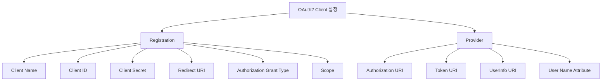

여기서 설정 항목을 무조건 여섯 개와 네 개로 제한해야 하는 것은 아니다.

`client-authentication-method`, `provider`, `issuer-uri` 등 상황에 따라 추가 설정이 필요할 수 있다.

다만 현재 프로젝트의 기본 구조에서는 위 항목들을 중심으로 이해하면 된다.

---

### Registration 설정

Registration은 외부 인증 제공자에 등록한 우리 애플리케이션의 정보를 관리한다.

다음과 같은 구조를 사용한다.

```yaml
spring:
  security:
    oauth2:
      client:
        registration:
          naver:
            client-name: Naver
            client-id: ${NAVER_CLIENT_ID}
            client-secret: ${NAVER_CLIENT_SECRET}
            redirect-uri: "{baseUrl}/login/oauth2/code/{registrationId}"
            authorization-grant-type: authorization_code
```

여기서 `naver`는 registrationId다.

이제 각각의 설정을 살펴보자.

#### registrationId

Registration 설정에서 가장 먼저 이해해야 하는 값은 registrationId다.

다음 설정을 보자.

```yaml
registration:
  naver:
```

여기서 `naver`가 registrationId다.

Spring Security는 해당 값을 기준으로 어떤 OAuth2 Client를 사용할지 구분한다.

예를 들어 다음과 같은 요청이 들어온다.

```http
GET /oauth2/authorization/naver
```

Spring Security는 요청 경로의 `naver`를 확인한다.

그리고 다음 설정을 조회한다.

```text
spring.security.oauth2.client.registration.naver
```

Google이라면 다음과 같다.

```http
GET /oauth2/authorization/google
```

이 요청은 다음 설정을 사용한다.

```text
spring.security.oauth2.client.registration.google
```

즉 registrationId는 Spring Security 내부에서 등록된 OAuth2 Client를 구분하는 식별자다.

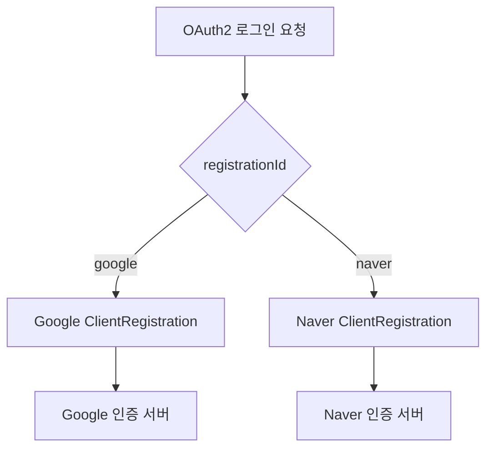

**registrationId는 외부 제공자가 발급한 Client ID와 다른 개념이다.**

registrationId는 Spring Security에서 사용하는 클라이언트 등록 식별자다.

Client ID는 외부 인증 제공자가 발급한 애플리케이션 식별자다.

---

### client-name

`client-name`은 등록된 OAuth2 Client를 사람이 알아보기 쉬운 이름으로 표현하는 설정이다.

```yaml
client-name: Naver
```

예를 들어 다음과 같이 설정할 수 있다.

```yaml
registration:
  naver:
    client-name: Naver Login
```

여기서 registrationId는 `naver`다.

반면 clientName은 `Naver Login`이다.

두 값은 반드시 같을 필요가 없다.

| 구분 | 예시 | 역할 |
|---|---|---|
| registrationId | `naver` | 내부 ClientRegistration 식별 |
| clientName | `Naver Login` | 표시용 이름 |
| clientId | 제공자가 발급한 값 | 외부 애플리케이션 식별 |

`client-name`은 Spring Security가 생성하는 기본 로그인 화면에서 외부 로그인 제공자의 이름을 표시할 때 활용될 수 있다.

예를 들어 다음과 같은 형태다.

```text
Login with Google

Login with Naver Login
```

하지만 `client-name`이 실제 OAuth2 인증 제공자를 결정하는 핵심 식별자는 아니다.

실제 등록된 클라이언트를 구분하는 값은 registrationId다.

---

### client-id

`client-id`는 외부 인증 제공자에 애플리케이션을 등록하면 발급받는 식별자다.

Naver에 애플리케이션을 등록하면 해당 애플리케이션을 구분하는 Client ID를 받을 수 있다.

```yaml
client-id: ${NAVER_CLIENT_ID}
```

Spring Security는 외부 인증 서버에 요청을 보낼 때 이 값을 사용한다.

예를 들어 다음과 같은 Authorization Request가 생성될 수 있다.

```http
GET /oauth2.0/authorize?
    response_type=code&
    client_id=CLIENT_ID&
    redirect_uri=REDIRECT_URI&
    state=STATE_VALUE
```

여기서 다음 파라미터에 해당한다.

```text
client_id=CLIENT_ID
```

외부 인증 제공자는 Client ID를 통해 어느 애플리케이션이 인증을 요청했는지 확인할 수 있다.

Client ID는 일반적으로 비밀정보 자체로 취급하지 않는다.

브라우저가 외부 인증 서버로 이동하는 Authorization Request에 포함될 수 있기 때문이다.

다만 Client ID만으로 클라이언트 인증이 완료되는 것은 아니다.

외부 인증 서버는 Redirect URI, Client 인증 방식, Authorization Code 등의 조건을 함께 검증한다.

---

### client-secret

`client-secret`은 외부 인증 제공자가 발급하는 클라이언트 인증용 비밀정보다.

```yaml
client-secret: ${NAVER_CLIENT_SECRET}
```

Client ID와 Client Secret은 이름이 비슷하지만 목적이 다르다.

| 구분 | Client ID | Client Secret |
|---|---|---|
| 주요 목적 | 클라이언트 식별 | 클라이언트 인증 |
| 비밀정보 여부 | 일반적으로 아님 | 예 |
| 외부 노출 | Authorization Request에 포함 가능 | 노출 금지 |
| 사용 위치 | Authorization 및 Token 요청 | 주로 Token Endpoint의 Client 인증 |
| 보관 방식 | 설정값 | 환경변수 또는 비밀정보 관리 시스템 |

예를 들어 사용자가 Naver 로그인에 성공하면 Authorization Code가 발급된다.

이후 Spring Boot 서버는 Authorization Code를 Access Token으로 교환한다.

```text
Authorization Code
    ↓
Spring Boot 서버
    ↓
Token Endpoint 요청
    ↓
Client ID 및 Client 인증 정보 확인
    ↓
Access Token 발급
```

이때 Client Secret이 사용될 수 있다.

다만 **Client Secret을 모든 OAuth2 요청에 항상 포함하는 것은 아니다.**

일반적인 브라우저 리다이렉트 기반 Authorization Request에는 Client Secret을 넣지 않는다.

Client Secret은 주로 서버와 Token Endpoint 사이에서 클라이언트를 인증하는 데 사용한다.

또한 Public Client처럼 Client Secret을 안전하게 보관할 수 없는 클라이언트는 다른 인증·보안 방식을 사용한다.

이번 프로젝트는 Spring Boot 서버가 Client Secret을 관리하는 Confidential Client 구조를 전제로 한다.

따라서 다음과 같이 환경변수를 이용한다.

```yaml
client-secret: ${NAVER_CLIENT_SECRET}
```

실제 Secret을 소스 코드에 직접 작성하지 않는 것이 좋다.

---

### client-authentication-method

`client-authentication-method`는 Token Endpoint에서 클라이언트를 인증할 때 사용할 방식을 지정한다.

현재 설정 항목을 이해할 때 함께 알아두면 유용한 값이다.

대표적인 방식은 다음과 같다.

| 방식 | 설명 |
|---|---|
| `client_secret_basic` | HTTP Basic 인증을 이용해 Client ID와 Secret 전달 |
| `client_secret_post` | 요청 본문에 Client ID와 Secret 전달 |
| `none` | Client Secret을 이용한 인증을 수행하지 않는 Public Client |
| `private_key_jwt` | 비대칭키 기반 JWT Client 인증 |

Naver 연동에서는 다음과 같은 설정을 사용할 수 있다.

```yaml
client-authentication-method: client_secret_post
```

이 경우 Token Endpoint 요청에서 Client ID와 Client Secret을 폼 파라미터로 전달하는 방식을 사용한다.

```http
POST /oauth2.0/token HTTP/1.1
Host: nid.naver.com
Content-Type: application/x-www-form-urlencoded

grant_type=authorization_code
&client_id=CLIENT_ID
&client_secret=CLIENT_SECRET
&code=AUTHORIZATION_CODE
```

위 요청은 Client 인증 방식의 차이를 설명하기 위한 개념적인 예시다.

Naver는 토큰 발급 요청에서 `state`도 요구하므로 실제 연동에서는 해당 파라미터를 포함하도록 추가 구성이 필요할 수 있다.

---

### redirect-uri

`redirect-uri`는 외부 인증 제공자에서 사용자 인증이 완료된 이후 브라우저가 돌아올 우리 서비스의 주소다.

OAuth2 로그인에서 매우 중요한 설정이다.

다음과 같이 지정할 수 있다.

```yaml
redirect-uri: "{baseUrl}/login/oauth2/code/{registrationId}"
```

여기서 `{baseUrl}`과 `{registrationId}`는 Spring Security가 지원하는 URI 템플릿 변수다.

예를 들어 애플리케이션이 다음 주소에서 실행된다고 생각해보자.

```text
http://localhost:8080
```

그러면 `{baseUrl}`은 다음 값으로 확장된다.

```text
http://localhost:8080
```

그리고 registrationId가 `naver`라면 다음과 같이 확장된다.

```text
{registrationId}
    ↓
naver
```

최종 Redirect URI는 다음과 같다.

```text
http://localhost:8080/login/oauth2/code/naver
```

Google이라면 다음과 같다.

```text
http://localhost:8080/login/oauth2/code/google
```

이 경로는 Spring Security의 `OAuth2LoginAuthenticationFilter`가 처리하는 기본 Callback 경로와 연결된다.

전체 흐름은 다음과 같다.

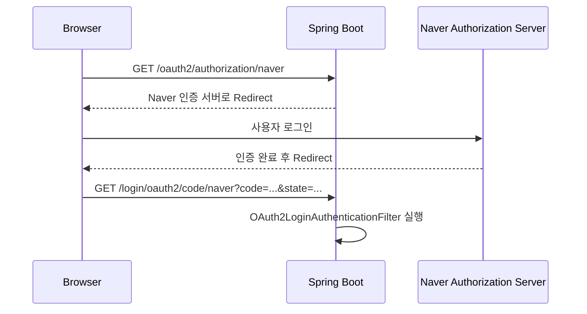

여기서 중요한 점은 외부 인증 서버가 Spring Boot의 Java 메서드를 직접 호출하는 것이 아니라는 사실이다.

일반적인 Authorization Code 방식에서는 브라우저 리다이렉트를 통해 Callback HTTP 요청이 전달된다.

#### Redirect URI 불일치 문제

다음 세 가지 설정이 서로 일치해야 한다.

```text
외부 제공자에 등록한 Callback URL

ClientRegistration의 redirect-uri

Spring Security가 처리하는 Callback 경로
```

예를 들어 Naver에 다음 주소를 등록했다고 생각해보자.

```text
http://localhost:8080/login/oauth2/code/naver
```

그런데 Spring Boot에서는 다음과 같이 설정했다.

```yaml
redirect-uri: "{baseUrl}/login/oauth2/callback/{registrationId}"
```

이 경우 실제 생성되는 Redirect URI가 다르다.

외부 인증 제공자가 요청을 거부하거나 Spring Security가 Callback을 처리하지 못할 수 있다.

따라서 Redirect URI는 임의로 변경하기보다 기본값부터 사용하는 것이 편리하다.

Spring Security의 기본 Redirect URI 템플릿도 다음과 같다.

```text
{baseUrl}/login/oauth2/code/{registrationId}
```

---

### authorization-grant-type

`authorization-grant-type`은 OAuth2에서 사용할 인가 방식을 지정한다.

이번 프로젝트에서는 다음과 같이 설정한다.

```yaml
authorization-grant-type: authorization_code
```

즉 Authorization Code Grant를 사용한다.

#### Authorization Code Grant란?

Authorization Code Grant는 외부 인증 서버가 먼저 Authorization Code를 발급하고, 클라이언트가 이를 Access Token으로 교환하는 방식이다.

```text
사용자 로그인 요청
    ↓
외부 인증 서버에서 사용자 인증
    ↓
Authorization Code 발급
    ↓
Spring Boot 서버가 Code 수신
    ↓
Token Endpoint 호출
    ↓
Access Token 발급
```

Spring Security의 OAuth2 Login은 Authorization Code Grant를 기반으로 동작한다.

과거 OAuth 2.0에서는 대표적으로 Authorization Code, Implicit, Resource Owner Password Credentials, Client Credentials 등의 Grant가 정의되었다.

하지만 이들이 모두 현재 소셜 로그인에서 권장되는 방식은 아니다.

특히 Implicit Grant와 Resource Owner Password Credentials Grant는 최신 보안 권고에서 사용을 지양하도록 안내하고 있다.

따라서 이번처럼 외부 인증 제공자를 이용한 사용자 로그인에서는 Authorization Code 기반 구조를 사용하는 것이 적절하다.

또한 보안 요구사항에 따라 PKCE를 함께 사용하는 구성을 고려해야 한다.

---

### scope

`scope`는 OAuth2 Client가 요청할 접근 권한의 범위를 지정하는 설정이다.

예를 들어 Google 로그인을 다음과 같이 구성할 수 있다.

```yaml
scope:
  - openid
  - profile
  - email
```

이 설정은 외부 인증 제공자에 어떤 권한을 요청할지 나타낸다.

각 값의 의미는 다음과 같다.

| Scope | 일반적인 의미 |
|---|---|
| `openid` | OpenID Connect 인증 사용 |
| `profile` | 기본 프로필 정보 요청 |
| `email` | 이메일 관련 정보 요청 |

여기서 중요한 점은 Scope가 단순히 반환받을 JSON 필드 목록을 지정하는 기능만은 아니라는 사실이다.

Scope는 클라이언트가 요청하는 접근 권한의 범위를 나타낸다.

실제 제공되는 정보는 외부 제공자의 정책과 사용자의 동의 여부, 애플리케이션에 부여된 권한 등에 따라 달라질 수 있다.

예를 들어 다음과 같이 설정했다고 생각해보자.

```yaml
scope:
  - email
```

이 설정을 했다고 해서 모든 환경에서 이메일이 반드시 반환되는 것은 아니다.

사용자가 동의하지 않았거나, 외부 제공자가 해당 정보에 대한 접근을 허용하지 않을 수 있다.

따라서 실제 사용자 정보 처리에서는 필요한 속성이 존재하는지 확인해야 한다.

#### Google과 Naver의 Scope 차이

여기서 Google과 Naver의 차이를 구분해야 한다.

Google은 OIDC를 지원하므로 다음과 같은 Scope를 일반적으로 사용할 수 있다.

```yaml
scope:
  - openid
  - profile
  - email
```

반면 Naver의 일반 로그인 API에서는 Google과 동일한 방식으로 Scope가 동작한다고 가정하면 안 된다.

Naver 로그인 API 명세에서는 인증 요청의 `scope` 파라미터를 필수 항목으로 요구하지 않으며, 일반 로그인에서 별도로 전송할 필요가 없다고 안내한다.

Naver에서 제공받을 수 있는 사용자 정보는 애플리케이션의 API 권한 설정과 사용자의 정보 제공 동의에 영향을 받는다.

따라서 Naver 연동에서는 다음 설정을 무조건 추가할 필요가 없다.

```yaml
scope:
  - name
  - email
```

Naver가 해당 값을 그대로 해석해 필요한 사용자 정보를 반환한다고 가정하는 것은 적절하지 않다.

**Scope는 OAuth2 표준의 공통 개념이지만, 실제 지원 범위와 동작 방식은 인증 제공자마다 다르다.**

---

### Provider 설정

이제 두 번째 설정 영역인 Provider를 살펴보자.

Provider는 외부 인증 제공자가 제공하는 Endpoint 정보를 관리한다.

다음과 같은 구조를 사용한다.

```yaml
spring:
  security:
    oauth2:
      client:
        provider:
          naver:
            authorization-uri: https://nid.naver.com/oauth2.0/authorize
            token-uri: https://nid.naver.com/oauth2.0/token
            user-info-uri: https://openapi.naver.com/v1/nid/me
            user-name-attribute: response
```

여기서 `naver`는 Provider 설정을 구분하는 이름이다.

Registration에 등록한 `naver`와 같은 이름을 사용하면 관련 설정을 연결할 수 있다.

다만 반드시 같은 이름이어야 하는 것은 아니다.

Registration에서 `provider` 속성을 사용하면 별도의 Provider 설정을 명시적으로 참조할 수 있다.

이 부분은 뒤에서 자세히 살펴본다.

---

### authorization-uri

`authorization-uri`는 외부 인증 제공자의 사용자 인증 및 동의 화면으로 이동하기 위한 Authorization Endpoint 주소다.

Naver의 경우 다음과 같다.

```yaml
authorization-uri: https://nid.naver.com/oauth2.0/authorize
```

사용자가 다음 요청을 보낸다고 생각해보자.

```http
GET /oauth2/authorization/naver
```

Spring Security의 `OAuth2AuthorizationRequestRedirectFilter`가 해당 요청을 처리한다.

그리고 Naver의 Authorization Endpoint로 브라우저를 이동시킨다.

```text
GET /oauth2/authorization/naver
    ↓
OAuth2AuthorizationRequestRedirectFilter
    ↓
ClientRegistration 조회
    ↓
authorization-uri 확인
    ↓
Naver Authorization Endpoint
```

여기서 다음 두 URI를 구분해야 한다.

| 구분 | 주소 | 역할 |
|---|---|---|
| 로그인 시작 경로 | `/oauth2/authorization/naver` | 우리 서버에서 OAuth2 로그인 시작 |
| Authorization URI | `https://nid.naver.com/oauth2.0/authorize` | Naver의 사용자 인증 및 동의 처리 |

두 주소는 같은 것이 아니다.

첫 번째 주소는 Spring Boot 서버의 경로다.

두 번째 주소는 외부 인증 제공자의 주소다.

이 차이를 이해하면 OAuth2 로그인 리다이렉트 흐름을 정확하게 파악할 수 있다.

---

### token-uri

`token-uri`는 Authorization Code를 Access Token으로 교환하기 위한 외부 인증 서버의 Token Endpoint 주소다.

Naver의 경우 다음과 같다.

```yaml
token-uri: https://nid.naver.com/oauth2.0/token
```

사용자가 Naver 로그인에 성공하면 Authorization Code가 발급된다.

이 코드는 다음과 같은 Callback 요청으로 전달된다.

```http
GET /login/oauth2/code/naver?code=AUTHORIZATION_CODE&state=STATE_VALUE
```

Spring Security는 Callback을 처리하면서 Authorization Code를 Token Endpoint에 전달한다.

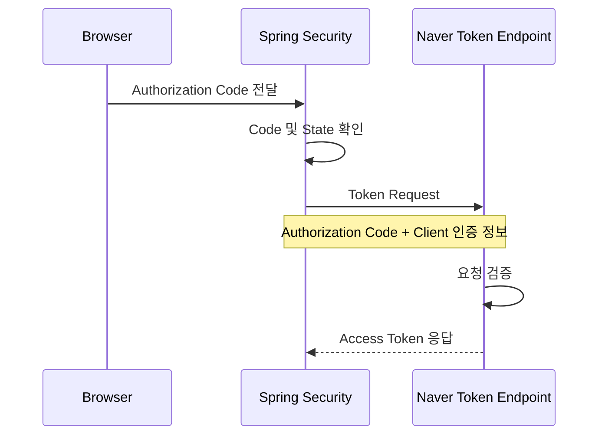

정상적으로 처리되면 다음과 유사한 응답을 받을 수 있다.

```json
{
  "access_token": "ACCESS_TOKEN_VALUE",
  "refresh_token": "REFRESH_TOKEN_VALUE",
  "token_type": "bearer",
  "expires_in": 3600
}
```

여기서 `expires_in`은 Access Token의 유효기간을 초 단위로 나타낸다.

이 과정에서 사용하는 `token-uri`는 사용자 정보 조회 주소와 다르다.

**Token Endpoint는 Access Token을 발급하는 곳이고, UserInfo Endpoint는 Access Token을 이용해 사용자 정보를 조회하는 곳이다.**

---

### user-info-uri

`user-info-uri`는 외부 인증 제공자의 사용자 정보를 조회하기 위한 API 주소다.

Naver의 경우 다음과 같다.

```yaml
user-info-uri: https://openapi.naver.com/v1/nid/me
```

Authorization Code를 Access Token으로 교환하는 데 성공했다면 해당 토큰으로 사용자 정보를 조회할 수 있다.

예를 들어 다음과 같은 요청이다.

```http
GET /v1/nid/me HTTP/1.1
Host: openapi.naver.com
Authorization: Bearer <NAVER_ACCESS_TOKEN>
```

정상적으로 인증되면 사용자 정보를 반환한다.

```json
{
  "resultcode": "00",
  "message": "success",
  "response": {
    "id": "naver-user-123",
    "name": "Example User",
    "nickname": "example",
    "email": "user@example.com"
  }
}
```

Spring Security는 일반적인 OAuth2 사용자 정보 조회를 위해 `DefaultOAuth2UserService`를 제공한다.

기본적인 처리 흐름은 다음과 같다.

```text
Access Token 획득
    ↓
OAuth2UserService
    ↓
UserInfo Endpoint 호출
    ↓
사용자 정보 응답
    ↓
OAuth2User 구성
```

여기서 주의할 점이 있다.

**OAuth2UserService가 Access Token을 직접 발급하는 것은 아니다.**

Access Token은 앞선 Token Endpoint 교환 과정에서 획득한다.

OAuth2UserService는 이미 발급받은 Access Token을 이용해 사용자 정보를 조회하는 역할을 담당한다.

---

### user-name-attribute

`user-name-attribute`는 외부 제공자가 반환한 사용자 정보에서 사용자 이름으로 사용할 속성의 이름을 지정한다.

Naver 연동 예제에서는 다음과 같이 설정하는 경우가 있다.

```yaml
user-name-attribute: response
```

이 설정을 이해하려면 Naver의 사용자 정보 구조를 먼저 살펴봐야 한다.

```json
{
  "resultcode": "00",
  "message": "success",
  "response": {
    "id": "naver-user-123",
    "nickname": "example",
    "email": "user@example.com"
  }
}
```

실제 사용자 식별자는 다음 위치에 존재한다.

```text
response.id
```

반면 `response`는 사용자 정보가 담긴 객체다.

따라서 `response`를 user-name-attribute로 지정했다고 해서 Spring Security가 자동으로 `response.id`를 사용자 ID로 변환하는 것은 아니다.

이 부분은 중요한 차이다.

#### Google의 사용자 식별 정보

Google OIDC에서는 일반적으로 `sub` Claim을 사용자 식별에 사용한다.

```json
{
  "sub": "google-user-123",
  "name": "Example User",
  "email": "user@example.com"
}
```

이 경우 사용자 식별 정보가 최상위 속성에 존재한다.

```text
sub
```

#### Naver의 사용자 식별 정보

Naver는 다음과 같은 중첩 구조를 반환한다.

```json
{
  "response": {
    "id": "naver-user-123"
  }
}
```

실제 사용자 ID는 다음 위치에 있다.

```text
response.id
```

따라서 실제 서비스에서 사용자 정보를 저장하거나 내부 회원을 식별하려면 별도의 처리 과정이 필요하다.

예를 들어 다음과 같은 구조를 사용할 수 있다.

```text
Naver 사용자 정보 응답
    ↓
response 객체 추출
    ↓
id 추출
    ↓
providerUserId 구성
    ↓
우리 서비스 회원 조회
```

Java 코드로 표현하면 다음과 같다.

```java
Map<String, Object> attributes =
        oauth2User.getAttributes();

Map<String, Object> response =
        (Map<String, Object>) attributes.get("response");

String providerUserId =
        (String) response.get("id");
```

위 코드는 응답 구조를 설명하기 위한 기본 예시다.

실제 구현에서는 `response`의 존재 여부와 자료형을 검증해야 한다.

또한 Naver의 `response.id`는 애플리케이션 단위의 사용자 식별자이며 실제 네이버 로그인 아이디가 아니다.

따라서 사용자 정보 처리 단계에서는 다음과 같은 공통 모델을 구성하는 것이 좋다.

```java
public record SocialUserInfo(
        String provider,
        String providerUserId,
        String email,
        String name
) {
}
```

이렇게 하면 Google과 Naver의 서로 다른 응답 구조를 내부 서비스에서 일관되게 사용할 수 있다.

---

### Registration과 Provider는 어떻게 연결될까?

지금까지 두 설정 영역을 각각 살펴봤다.

이제 둘이 어떻게 연결되는지 알아보자.

가장 단순한 설정은 다음과 같다.

```yaml
spring:
  security:
    oauth2:
      client:
        registration:
          naver:
            client-id: ${NAVER_CLIENT_ID}
            client-secret: ${NAVER_CLIENT_SECRET}
            authorization-grant-type: authorization_code
            redirect-uri: "{baseUrl}/login/oauth2/code/{registrationId}"

        provider:
          naver:
            authorization-uri: https://nid.naver.com/oauth2.0/authorize
            token-uri: https://nid.naver.com/oauth2.0/token
            user-info-uri: https://openapi.naver.com/v1/nid/me
            user-name-attribute: response
```

이 경우 Registration과 Provider의 이름이 동일하다.

```text
registration.naver

provider.naver
```

Spring Boot는 해당 이름을 이용해 관련 설정을 연결할 수 있다.

이를 구조로 표현하면 다음과 같다.

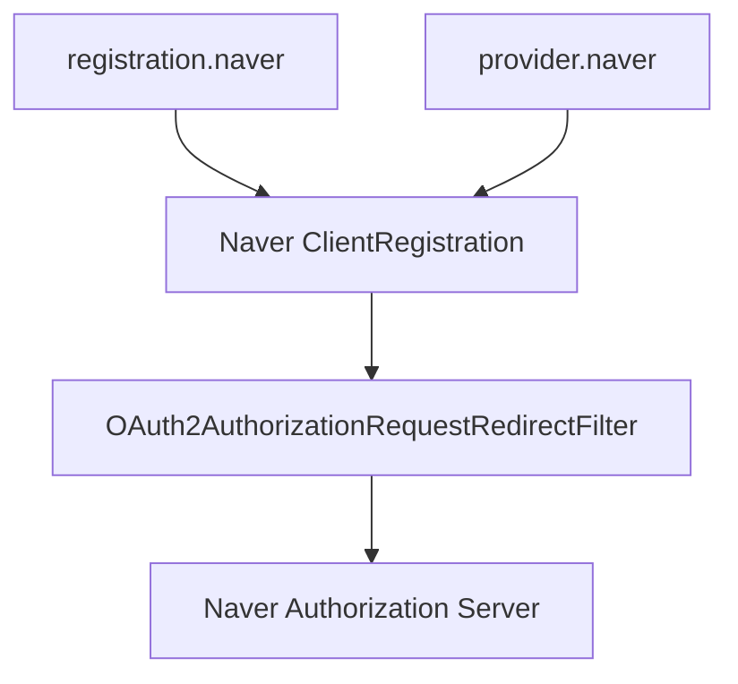

하지만 반드시 같은 이름을 사용해야 하는 것은 아니다.

다음과 같이 명시적인 Provider 참조를 사용할 수 있다.

```yaml
spring:
  security:
    oauth2:
      client:
        registration:
          naver-login:
            provider: naver
            client-id: ${NAVER_CLIENT_ID}
            client-secret: ${NAVER_CLIENT_SECRET}
            authorization-grant-type: authorization_code
            redirect-uri: "{baseUrl}/login/oauth2/code/{registrationId}"

        provider:
          naver:
            authorization-uri: https://nid.naver.com/oauth2.0/authorize
            token-uri: https://nid.naver.com/oauth2.0/token
            user-info-uri: https://openapi.naver.com/v1/nid/me
            user-name-attribute: response
```

이 설정에서는 registrationId가 다음과 같다.

```text
naver-login
```

반면 Provider 이름은 다음과 같다.

```text
naver
```

두 설정은 다음 속성으로 연결된다.

```yaml
provider: naver
```

따라서 로그인 시작 경로는 다음과 같다.

```text
/oauth2/authorization/naver-login
```

Callback 경로는 다음과 같다.

```text
/login/oauth2/code/naver-login
```

이처럼 registrationId와 Provider 이름은 반드시 동일해야 하는 값이 아니다.

`provider` 속성을 사용하면 서로 다른 이름으로도 연결할 수 있다.

---

### Google은 왜 Provider 설정을 생략할 수 있을까?

Spring Security에서는 일부 주요 OAuth2 제공자에 대한 기본 설정을 제공한다.

대표적으로 다음과 같은 제공자가 포함된다.

| 제공자 | 기본 Provider 설정 |
|---|---|
| Google | 지원 |
| GitHub | 지원 |
| Facebook | 지원 |
| Okta | 지원 |

Spring Boot에서는 등록 이름이 지원되는 기본 제공자와 일치하면 기본 Provider 정보를 활용할 수 있다.

따라서 Google 로그인은 다음과 같이 간단하게 설정할 수 있다.

```yaml
spring:
  security:
    oauth2:
      client:
        registration:
          google:
            client-id: ${GOOGLE_CLIENT_ID}
            client-secret: ${GOOGLE_CLIENT_SECRET}
            scope:
              - openid
              - profile
              - email
```

여기에는 다음 설정이 없다.

```yaml
provider:
  google:
```

Google의 기본 Provider 정보가 이미 제공되기 때문이다.

Spring Boot 공식 문서에서도 Google, GitHub, Facebook, Okta 등에 대한 기본 Provider 정보를 지원하며, 등록 이름을 통해 기본 설정을 추론할 수 있다고 설명한다.

반면 Naver는 일반적인 기본 Provider 목록에 포함되지 않는다.

따라서 필요한 Endpoint를 직접 등록한다.

```yaml
provider:
  naver:
    authorization-uri: https://nid.naver.com/oauth2.0/authorize
    token-uri: https://nid.naver.com/oauth2.0/token
    user-info-uri: https://openapi.naver.com/v1/nid/me
    user-name-attribute: response
```

정리하면 다음과 같다.

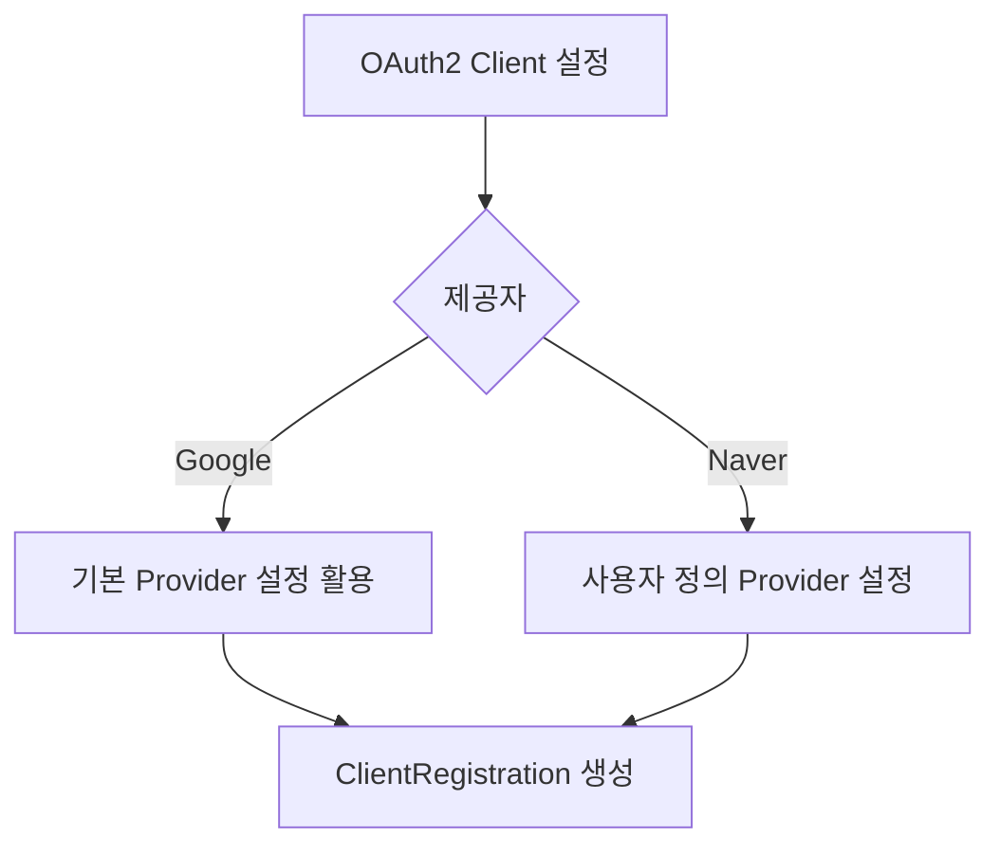

다만 기본 Provider가 존재하더라도 해당 제공자가 발급한 Client ID와 Client Secret은 별도로 준비해야 한다.

---

### 예제

#### 프로젝트 환경

이번 프로젝트에서는 다음 환경을 사용한다.

| 항목 | 버전 및 기술 |
|---|---|
| Java | 17 |
| Spring Boot | 3.2.1 |
| Spring Security | 6.2.1 |
| OAuth2 Client | Spring Security OAuth2 Client |
| Template Engine | Mustache |
| Database | MySQL |
| ORM | Spring Data JPA |
| 인증 상태 관리 | HttpSession |
| Build Tool | Gradle Groovy |

현재는 OAuth2 설정값의 역할을 확인하는 단계다.

따라서 사용자 정보를 데이터베이스에 저장하는 기능은 아직 구현하지 않는다.

기존 프로젝트에서 MySQL 연결을 준비하지 않았다면 JPA와 MySQL 의존성은 임시로 비활성화한 상태를 유지할 수 있다.

---

### build.gradle 설정

프로젝트에서 사용하는 주요 의존성은 다음과 같다.

```gradle
plugins {
    id 'java'
    id 'org.springframework.boot' version '3.2.1'
    id 'io.spring.dependency-management' version '1.1.4'
}

group = 'com.example'
version = '0.0.1-SNAPSHOT'

java {
    toolchain {
        languageVersion = JavaLanguageVersion.of(17)
    }
}

repositories {
    mavenCentral()
}

dependencies {

    // Spring Web
    implementation 'org.springframework.boot:spring-boot-starter-web'

    // Mustache
    implementation 'org.springframework.boot:spring-boot-starter-mustache'

    // Spring Security
    implementation 'org.springframework.boot:spring-boot-starter-security'

    // OAuth2 Client
    implementation 'org.springframework.boot:spring-boot-starter-oauth2-client'

    // Lombok
    compileOnly 'org.projectlombok:lombok'
    annotationProcessor 'org.projectlombok:lombok'

    // DB 연결 이후 활성화
    // implementation 'org.springframework.boot:spring-boot-starter-data-jpa'
    // runtimeOnly 'com.mysql:mysql-connector-j'

    testImplementation 'org.springframework.boot:spring-boot-starter-test'
    testImplementation 'org.springframework.security:spring-security-test'
}

tasks.named('test') {
    useJUnitPlatform()
}
```

가장 중요한 의존성은 다음과 같다.

```gradle
implementation 'org.springframework.boot:spring-boot-starter-oauth2-client'
```

이 의존성을 추가하면 Spring Security의 OAuth2 Client 기능을 사용할 수 있다.

다만 실제 로그인 기능을 사용하려면 등록 정보와 SecurityFilterChain 설정이 필요하다.

---

### application.yml 전체 설정

이번에는 Google과 Naver를 함께 등록하는 기본 설정을 살펴보자.

```yaml
server:
  port: 8080

spring:
  application:
    name: oauth2-session

  security:
    oauth2:
      client:
        registration:

          google:
            client-name: Google

            client-id: ${GOOGLE_CLIENT_ID}
            client-secret: ${GOOGLE_CLIENT_SECRET}

            authorization-grant-type: authorization_code

            redirect-uri: "{baseUrl}/login/oauth2/code/{registrationId}"

            scope:
              - openid
              - profile
              - email

          naver:
            client-name: Naver

            client-id: ${NAVER_CLIENT_ID}
            client-secret: ${NAVER_CLIENT_SECRET}

            client-authentication-method: client_secret_post

            authorization-grant-type: authorization_code

            redirect-uri: "{baseUrl}/login/oauth2/code/{registrationId}"

        provider:

          naver:
            authorization-uri: https://nid.naver.com/oauth2.0/authorize

            token-uri: https://nid.naver.com/oauth2.0/token

            user-info-uri: https://openapi.naver.com/v1/nid/me

            user-name-attribute: response
```

이 설정은 Google과 Naver의 주요 OAuth2 Client 변수를 비교하기 위한 기본 구성이다.

**Google은 OIDC 기반 로그인 설정으로 사용할 수 있지만, Naver는 위 설정만으로 모든 연동이 완료된다고 보장할 수 없다.**

Naver의 일반 로그인 API는 토큰 교환 요청에서 `state` 파라미터를 요구하며, UserInfo 응답도 중첩된 `response` 구조를 가진다.

따라서 Spring Security의 기본 토큰 요청 처리와 사용자 정보 변환만으로 해결되지 않는 부분은 Provider별 확장이 필요할 수 있다.

이 내용은 설정 변수의 기본 역할과 별개로 실제 연동 시 반드시 확인해야 할 사항이다.

---

### 설정값이 실제로 사용되는 과정

지금까지 작성한 설정을 실제 OAuth2 로그인 흐름에 연결해보자.

사용자가 다음 주소에 접근한다.

```text
http://localhost:8080/oauth2/authorization/naver
```

그러면 Spring Security는 `registration.naver`를 조회한다.

```text
registration.naver
    ↓
client-id
client-secret
redirect-uri
authorization-grant-type
scope
```

그리고 연결된 Provider 정보를 확인한다.

```text
provider.naver
    ↓
authorization-uri
token-uri
user-info-uri
user-name-attribute
```

이후 다음과 같은 처리 과정을 수행한다.

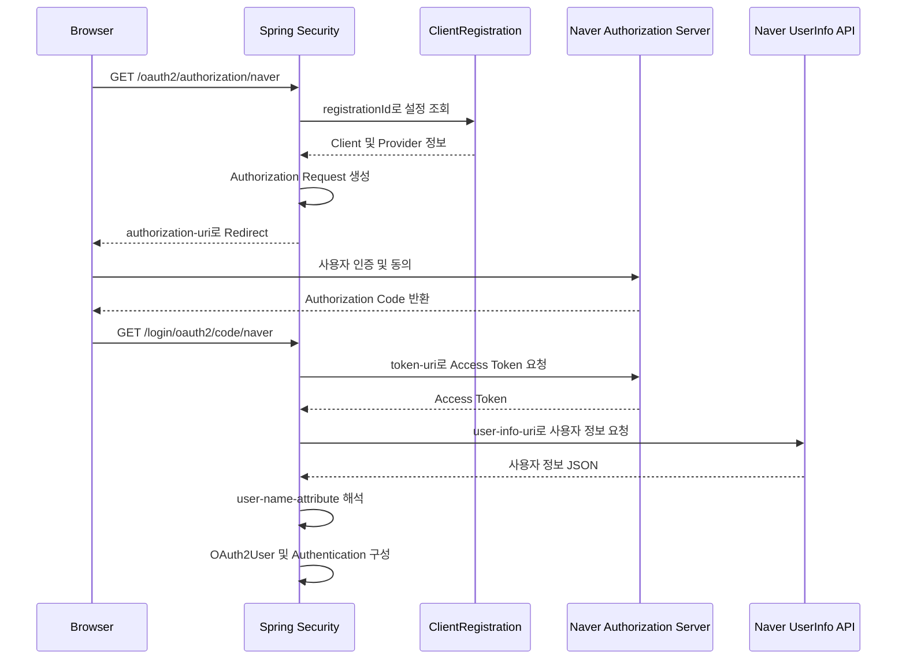

이 구조에서 각 설정이 사용되는 시점을 정리하면 다음과 같다.

| 설정값 | 사용 시점 | 사용 목적 |
|---|---|---|
| registrationId | 로그인 시작 | 사용할 OAuth2 Client 식별 |
| client-name | 설정 및 화면 구성 | 클라이언트 표시 이름 |
| client-id | 인증 요청 및 토큰 교환 | 애플리케이션 식별 |
| client-secret | 주로 토큰 교환 | Client 인증 |
| redirect-uri | 인증 요청 | 인증 완료 후 Callback 주소 |
| authorization-grant-type | 인증 요청 및 토큰 교환 | Authorization Code 방식 지정 |
| scope | 인증 요청 | 접근 권한 범위 지정 |
| authorization-uri | 로그인 시작 | 외부 인증 서버로 이동 |
| token-uri | Authorization Code 수신 이후 | Access Token 발급 |
| user-info-uri | Access Token 발급 이후 | 사용자 정보 조회 |
| user-name-attribute | 사용자 정보 조회 이후 | OAuth2User 이름 속성 결정 |

이 표를 이해하면 OAuth2 설정값이 각각 어느 단계에서 사용되는지 파악할 수 있다.

---

### SecurityConfig 설정

OAuth2 Client 설정만 등록했다고 해서 사용자 정의 SecurityFilterChain에서 모든 인증 기능이 자동으로 활성화되는 것은 아니다.

OAuth2 로그인을 사용하도록 다음 설정을 추가한다.

```java
.oauth2Login(Customizer.withDefaults())
```

기본적인 SecurityConfig는 다음과 같다.

```java
package com.example.oauth2session.config;

import org.springframework.context.annotation.Bean;
import org.springframework.context.annotation.Configuration;

import org.springframework.security.config.Customizer;
import org.springframework.security.config.annotation.web.builders.HttpSecurity;
import org.springframework.security.config.http.SessionCreationPolicy;
import org.springframework.security.web.SecurityFilterChain;

@Configuration
public class SecurityConfig {

    @Bean
    public SecurityFilterChain securityFilterChain(
            HttpSecurity http
    ) throws Exception {

        http
                .authorizeHttpRequests(auth -> auth

                        // 공개 경로
                        .requestMatchers(
                                "/",
                                "/error",
                                "/css/**",
                                "/js/**"
                        ).permitAll()

                        // 그 외의 요청은 인증 필요
                        .anyRequest().authenticated()
                )

                // OAuth2 로그인 활성화
                .oauth2Login(Customizer.withDefaults())

                // 세션 기반 인증
                .sessionManagement(session -> session
                        .sessionCreationPolicy(
                                SessionCreationPolicy.IF_REQUIRED
                        )
                );

        return http.build();
    }
}
```

이 설정을 사용하면 OAuth2 로그인 기능을 위한 필터들이 SecurityFilterChain에 구성된다.

특히 다음 두 필터가 중요하다.

```text
OAuth2AuthorizationRequestRedirectFilter

OAuth2LoginAuthenticationFilter
```

첫 번째 필터는 로그인 시작 요청을 처리한다.

두 번째 필터는 외부 인증 완료 후 Callback 요청을 처리한다.

여기서 `SessionCreationPolicy.IF_REQUIRED`는 필요한 경우 세션을 생성하도록 허용하는 정책이다.

세션 기반 OAuth2 로그인에서는 인증 요청 상태와 로그인 인증 상태를 관리하기 위해 세션을 사용할 수 있다.

---

### 로그인 링크 생성

현재 프로젝트는 Mustache 기반 SSR 구조다.

따라서 HTML에서 다음과 같이 OAuth2 로그인 링크를 생성할 수 있다.

`main.mustache` 파일을 수정한다.

```html
<!DOCTYPE html>
<html lang="ko">

<head>
    <meta charset="UTF-8">
    <meta name="viewport"
          content="width=device-width, initial-scale=1.0">

    <title>OAuth2 Login</title>
</head>

<body>

    <h1>OAuth2 소셜 로그인</h1>

    <div>
        <a href="/oauth2/authorization/google">
            Google 로그인
        </a>
    </div>

    <div>
        <a href="/oauth2/authorization/naver">
            Naver 로그인
        </a>
    </div>

</body>

</html>
```

여기서 중요한 부분은 다음 링크다.

```html
<a href="/oauth2/authorization/google">
    Google 로그인
</a>
```

```html
<a href="/oauth2/authorization/naver">
    Naver 로그인
</a>
```

이 링크를 클릭하면 Spring Security가 등록된 ClientRegistration을 조회하고 외부 인증 서버로 이동시킨다.

따라서 HTML에서 Google이나 Naver의 Authorization URI를 직접 구성할 필요가 없다.

---

### 환경변수 설정

실제 소셜 로그인을 사용하려면 외부 인증 제공자에서 발급받은 Client ID와 Client Secret이 필요하다.

개발 환경에서는 다음과 같이 환경변수로 설정할 수 있다.

```bash
export GOOGLE_CLIENT_ID="your-google-client-id"
export GOOGLE_CLIENT_SECRET="your-google-client-secret"

export NAVER_CLIENT_ID="your-naver-client-id"
export NAVER_CLIENT_SECRET="your-naver-client-secret"
```

각 명령은 현재 셸 환경에 환경변수를 등록한다.

| 환경변수 | 의미 |
|---|---|
| GOOGLE_CLIENT_ID | Google OAuth2 Client ID |
| GOOGLE_CLIENT_SECRET | Google OAuth2 Client Secret |
| NAVER_CLIENT_ID | Naver OAuth2 Client ID |
| NAVER_CLIENT_SECRET | Naver OAuth2 Client Secret |

Spring Boot는 `application.yml`에서 다음 구문을 이용해 환경변수를 참조한다.

```yaml
client-id: ${NAVER_CLIENT_ID}
```

```yaml
client-secret: ${NAVER_CLIENT_SECRET}
```

환경변수가 설정되어 있지 않으면 설정값을 해석하지 못하거나 애플리케이션 시작 과정에서 오류가 발생할 수 있다.

따라서 실제 사용할 제공자의 Client 정보를 미리 준비해야 한다.

---

### 애플리케이션 실행

이제 Spring Boot 애플리케이션을 실행한다.

```bash
./gradlew bootRun
```

명령어의 의미는 다음과 같다.

| 명령 | 의미 |
|---|---|
| `./gradlew` | Gradle Wrapper 실행 |
| `bootRun` | Spring Boot 애플리케이션 실행 |

정상적으로 실행되면 다음과 유사한 로그가 출력된다.

```text
Tomcat started on port 8080 (http)

Started Oauth2SessionApplication
```

이제 브라우저에서 다음 주소에 접근할 수 있다.

```text
http://localhost:8080/
```

OAuth2 로그인 시작 경로에도 접근할 수 있다.

```text
http://localhost:8080/oauth2/authorization/google
```

```text
http://localhost:8080/oauth2/authorization/naver
```

등록된 Client 정보가 정상적이라면 Spring Security는 해당 외부 인증 서버로 리다이렉트한다.

다만 외부 인증이 끝까지 성공하려면 제공자에 등록된 Redirect URI와 요청 권한, 토큰 교환 방식 등이 일치해야 한다.

---

### curl로 OAuth2 로그인 시작 요청 확인하기

OAuth2 로그인 시작 요청은 curl로도 확인할 수 있다.

Google 로그인 경로를 호출해보자.

```bash
curl -i \
  http://localhost:8080/oauth2/authorization/google
```

정상적으로 인증 요청이 생성되면 다음과 유사한 응답을 받을 수 있다.

```http
HTTP/1.1 302 Found
Location: https://accounts.google.com/o/oauth2/v2/auth?...
Set-Cookie: JSESSIONID=...
```

여기서 확인할 부분은 `Location` 헤더다.

Spring Security가 Google의 Authorization Endpoint로 브라우저를 이동시키기 위한 리다이렉트 응답을 생성한 것이다.

Naver도 동일하게 확인할 수 있다.

```bash
curl -i \
  http://localhost:8080/oauth2/authorization/naver
```

정상적인 경우 다음과 유사한 응답을 확인할 수 있다.

```http
HTTP/1.1 302 Found
Location: https://nid.naver.com/oauth2.0/authorize?...
Set-Cookie: JSESSIONID=...
```

여기서 `302`는 외부 인증 서버로 이동하도록 리다이렉트를 요청하는 HTTP 상태 코드다.

다만 이 응답만으로 실제 소셜 로그인이 완료되었다는 의미는 아니다.

**리다이렉트 요청이 정상적으로 생성되었는지 확인한 것과 외부 인증 및 Callback 처리가 성공했는지는 구분해야 한다.**

또한 실제 브라우저에서는 최초 인증 요청을 저장하기 위한 세션 쿠키가 사용될 수 있으므로, 브라우저의 일반적인 로그인 흐름으로 전체 과정을 확인하는 것이 필요하다.

---

### 구조

#### OAuth2 Client 설정과 내부 동작의 관계

지금까지 살펴본 변수와 Spring Security 내부 구성요소의 관계를 정리해보자.

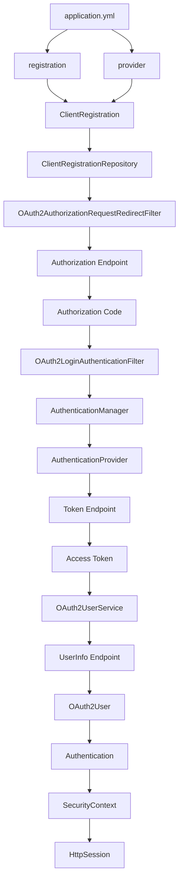

이 구조에서 개발자가 설정하는 Registration과 Provider는 Spring Security 내부에서 ClientRegistration을 구성하는 데 사용된다.

이후 인증 필터와 AuthenticationProvider가 해당 정보를 활용해 외부 인증 절차를 수행한다.

따라서 다음과 같이 구분할 수 있다.

**설정 영역**

```text
application.yml
    ↓
Registration
    ↓
Provider
    ↓
ClientRegistration
```

**Spring Security 인증 처리 영역**

```text
OAuth2AuthorizationRequestRedirectFilter
    ↓
OAuth2LoginAuthenticationFilter
    ↓
AuthenticationManager
    ↓
AuthenticationProvider
```

**사용자 정보 처리 영역**

```text
Access Token
    ↓
OAuth2UserService
    ↓
OAuth2User
    ↓
내부 회원 정보 처리
```

**로그인 상태 관리 영역**

```text
Authentication
    ↓
SecurityContext
    ↓
HttpSession
```

이렇게 역할을 나누면 각 설정값이 어느 계층에서 사용되는지 이해할 수 있다.

---

### 실무에서의 활용

앞서 설명한 내용은 OAuth2 Client 설정 변수의 기본 역할이다.

이제 실제 서비스를 구현할 때 추가로 고려해야 할 사항을 살펴보자.

아래 내용은 설정값의 의미를 넘어 Spring Security와 외부 인증 제공자를 운영 환경에서 연동할 때 필요한 확장 설계에 해당한다.

#### 1. Registration과 Provider를 분리하여 관리한다

Registration과 Provider는 서로 다른 책임을 가진다.

Registration은 우리 애플리케이션의 Client 정보를 관리한다.

Provider는 외부 인증 제공자가 제공하는 Endpoint 정보를 관리한다.

따라서 설정을 구성할 때 두 영역을 명확하게 구분해야 한다.

예를 들어 하나의 외부 Provider에 여러 Client를 등록해야 하는 경우에도 이러한 구조가 도움이 된다.

```text
Registration A
    ↓
Provider X
```

```text
Registration B
    ↓
Provider X
```

같은 Provider를 사용하더라도 Client ID와 Redirect URI는 서로 다를 수 있다.

따라서 ClientRegistration의 식별자와 Provider 설정을 독립적으로 관리하는 것이 확장에 유리하다.

---

#### 2. Client ID와 Client Secret의 보안 수준을 구분한다

Client ID는 클라이언트를 식별하는 값이다.

반면 Client Secret은 클라이언트 인증에 사용하는 비밀정보다.

따라서 Client Secret은 환경변수나 비밀정보 관리 시스템을 통해 관리해야 한다.

다음과 같이 설정하는 것이 좋다.

```yaml
client-secret: ${GOOGLE_CLIENT_SECRET}
```

반면 다음과 같이 실제 Secret을 코드에 직접 포함하는 것은 피해야 한다.

```yaml
client-secret: actual-secret-value
```

또한 Client Secret을 운영 로그에 남기거나 오류 응답에 포함해서는 안 된다.

---

#### 3. Redirect URI를 환경별로 관리한다

개발 환경과 운영 환경에서는 Redirect URI가 달라질 수 있다.

예를 들어 개발 환경에서는 다음 주소를 사용한다.

```text
http://localhost:8080/login/oauth2/code/google
```

운영 환경에서는 다음 주소를 사용할 수 있다.

```text
https://service.example.com/login/oauth2/code/google
```

따라서 환경별 설정이 필요하다.

이때 중요한 것은 외부 인증 제공자에 등록된 Redirect URI와 실제 애플리케이션의 Redirect URI가 일치해야 한다는 사실이다.

특히 Reverse Proxy나 API Gateway 환경에서는 내부 서버 주소와 외부에서 접근하는 주소가 다를 수 있다.

따라서 프록시 환경에서는 외부 공개 주소를 기준으로 Redirect URI가 생성되도록 설정해야 한다.

Spring Security도 OAuth2 Client가 프록시 뒤에 있는 경우 Redirect URI 생성과 관련된 프록시 구성을 확인하도록 안내하고 있다.

---

#### 4. Scope는 최소 권한 원칙에 따라 설정한다

OAuth2에서 Scope는 요청할 접근 권한의 범위를 나타낸다.

따라서 사용하지 않는 개인정보나 API 접근 권한을 불필요하게 요청할 필요는 없다.

예를 들어 Google 로그인에서 기본적인 사용자 식별과 이메일이 필요하다면 다음과 같이 구성할 수 있다.

```yaml
scope:
  - openid
  - profile
  - email
```

하지만 실제 서비스에서 필요하지 않은 권한까지 요청하면 사용자 동의 범위가 넓어지고 개인정보 처리 부담이 증가할 수 있다.

따라서 필요한 Scope만 요청하는 것이 적절하다.

---

#### 5. 모든 Provider가 동일한 Scope를 지원한다고 가정하지 않는다

Google에서는 `openid`, `profile`, `email`과 같은 Scope를 사용할 수 있다.

하지만 Naver에서는 일반 로그인 API의 권한 설정과 사용자 동의 방식이 다를 수 있다.

따라서 Google의 설정을 Naver에 그대로 적용해서는 안 된다.

특히 Naver는 애플리케이션의 API 권한 관리와 사용자 정보 제공 동의가 중요하다.

외부 제공자별로 어떤 Scope를 지원하고 실제 어떤 사용자 정보를 반환하는지 구분해야 한다.

---

#### 6. user-name-attribute는 실제 사용자 ID와 다를 수 있다

Naver의 응답 구조에서는 다음과 같은 차이가 있다.

```text
response
    ↓
사용자 정보 객체
```

```text
response.id
    ↓
실제 사용자 식별자
```

따라서 다음 설정만으로는 실제 Naver 사용자 ID 추출이 완료되지 않는다.

```yaml
user-name-attribute: response
```

실제 서비스에서는 CustomOAuth2UserService 등을 이용해 중첩된 사용자 식별자를 추출하는 구조를 고려해야 한다.

예를 들어 다음과 같다.

```java
Map<String, Object> response =
        (Map<String, Object>) attributes.get("response");

String providerUserId =
        (String) response.get("id");
```

이 과정에서 응답 구조에 대한 검증도 추가하는 것이 좋다.

---

#### 7. 외부 사용자 식별자와 내부 사용자 ID를 구분한다

Google과 Naver에서 전달하는 사용자 식별자는 외부 제공자의 식별자다.

하지만 우리 서비스에서는 내부 사용자 ID를 별도로 관리하는 것이 적절할 수 있다.

예를 들어 다음과 같다.

```text
Google
    ↓
providerUserId = google-123
```

```text
우리 서비스
    ↓
userId = 10001
```

이 구조에서는 외부 로그인 제공자가 변경되더라도 내부 사용자 ID를 유지할 수 있다.

특히 주문, 결제, 구독, 게시글 등 사용자 기반 도메인이 존재한다면 안정적인 내부 회원 식별자가 중요하다.

---

#### 8. 이메일을 유일한 사용자 식별자로 사용하지 않는다

Google과 Naver는 이메일 정보를 제공할 수 있다.

하지만 이메일은 변경될 수 있으며 사용자 동의 여부에 따라 제공되지 않을 수도 있다.

따라서 이메일만으로 외부 계정을 식별하는 것은 신중해야 한다.

일반적으로 다음 조합을 사용할 수 있다.

```text
provider + providerUserId
```

예를 들어 다음과 같다.

```text
google:12345
```

```text
naver:12345
```

두 계정의 외부 ID 문자열이 동일하더라도 Provider가 다르므로 서로 다른 계정이다.

---

#### 9. Provider별 사용자 정보 변환 로직을 분리한다

Google과 Naver의 사용자 정보 구조는 다르다.

Google은 다음과 같은 구조를 사용할 수 있다.

```json
{
  "sub": "google-123",
  "email": "user@example.com"
}
```

Naver는 다음과 같은 구조를 사용한다.

```json
{
  "response": {
    "id": "naver-123",
    "email": "user@example.com"
  }
}
```

따라서 서비스 전체에서 제공자별 JSON 구조를 직접 사용하면 유지보수가 어려워질 수 있다.

다음과 같은 공통 모델을 사용하는 것이 좋다.

```java
public record SocialUserInfo(
        String provider,
        String providerUserId,
        String email,
        String name
) {
}
```

제공자별 변환 로직은 별도의 구성요소로 분리할 수 있다.

```text
Google Response
    ↓
GoogleUserInfoMapper
    ↓
SocialUserInfo
```

```text
Naver Response
    ↓
NaverUserInfoMapper
    ↓
SocialUserInfo
```

이러한 구조는 새로운 소셜 로그인 제공자를 추가할 때 도움이 된다.

---

#### 10. 인증 성공과 회원가입 완료를 구분한다

외부 인증 제공자에서 로그인이 성공했다고 해서 우리 서비스의 회원가입이 완료된 것은 아닐 수 있다.

예를 들어 다음과 같은 추가 과정이 필요할 수 있다.

```text
외부 로그인 성공
    ↓
우리 서비스 회원 조회
    ↓
신규 회원 여부 확인
    ↓
추가 정보 입력
    ↓
서비스 약관 동의
    ↓
회원가입 완료
```

따라서 OAuth2UserService에서 외부 사용자 정보를 가져오는 것과 내부 회원가입 완료 여부를 관리하는 것은 구분하는 것이 좋다.

---

#### 11. Client Secret을 사용하는 환경에서도 PKCE를 고려한다

Authorization Code Grant에서는 Authorization Code가 브라우저 리다이렉트를 통해 전달된다.

이때 인증 코드를 탈취하거나 다른 인증 요청에 주입하는 공격을 방어하기 위한 방법 중 하나가 PKCE다.

PKCE는 Authorization Request에서 생성한 `code_challenge`와 Token Request에서 전달하는 `code_verifier`를 연결하여 인증 코드 교환을 보호한다.

따라서 Client Secret이 존재하는 서버 기반 애플리케이션에서도 PKCE 사용을 고려할 수 있다.

다만 외부 제공자가 PKCE를 지원하는지 확인해야 한다.

---

#### 12. State 검증을 임의로 생략하지 않는다

OAuth2 로그인에서는 인증 요청과 Callback 응답을 연결하기 위해 State를 사용한다.

예를 들어 다음과 같다.

```text
OAuth2 로그인 시작
    ↓
State 생성
    ↓
외부 인증 서버로 전달
    ↓
Callback에서 State 반환
    ↓
기존 State와 비교
```

이 과정은 로그인 CSRF와 같은 공격을 방어하는 데 중요하다.

따라서 AuthorizationRequestRepository를 커스터마이징하더라도 State 검증이 유지되도록 설계해야 한다.

---

#### 13. 외부 인증 제공자의 Endpoint 변경을 고려한다

Provider 설정은 외부 서비스가 제공하는 URI를 사용한다.

```yaml
authorization-uri: https://nid.naver.com/oauth2.0/authorize
```

```yaml
token-uri: https://nid.naver.com/oauth2.0/token
```

```yaml
user-info-uri: https://openapi.naver.com/v1/nid/me
```

이러한 값은 외부 제공자의 정책에 따라 변경될 수 있다.

따라서 운영 환경에서는 외부 인증 제공자의 API 변경이 로그인 기능에 영향을 줄 수 있다는 점을 고려해야 한다.

또한 Google처럼 OIDC Discovery를 지원하는 제공자는 표준화된 메타데이터를 활용할 수 있다.

반면 모든 Provider가 동일한 방식의 Discovery를 지원하는 것은 아니다.

---

#### 14. ClientRegistration 설정 오류를 빠르게 구분한다

OAuth2 로그인 오류가 발생하면 어떤 설정이 잘못되었는지 확인해야 한다.

대표적인 오류 상황은 다음과 같다.

| 증상 | 우선 확인할 설정 |
|---|---|
| 로그인 시작 경로가 동작하지 않음 | registrationId |
| 외부 로그인 화면으로 이동하지 않음 | authorization-uri |
| Invalid Client 오류 | client-id, client-secret |
| Redirect URI 불일치 | redirect-uri |
| Access Token 발급 실패 | token-uri, client-authentication-method |
| 사용자 정보 조회 실패 | user-info-uri |
| 사용자 이름 추출 실패 | user-name-attribute |
| 사용자 정보가 누락됨 | scope, Provider 권한 설정 |
| Callback 이후 인증 실패 | State, Redirect URI, Token Request |

이렇게 증상과 설정값을 연결하면 오류 분석 범위를 줄일 수 있다.

---

#### 15. Google과 Naver의 인증 구현체 차이를 고려한다

Google에서는 OIDC 로그인을 사용할 수 있다.

이 경우 Spring Security는 OIDC 전용 사용자 정보 처리 로직을 활용한다.

대표적으로 다음 구성요소가 있다.

```text
OidcUserService
```

반면 Naver의 일반 OAuth2 로그인에서는 다음 구성요소를 사용할 수 있다.

```text
DefaultOAuth2UserService
```

따라서 Google과 Naver에 동일한 CustomOAuth2UserService를 등록했다고 해서 모든 사용자 정보 처리 과정이 동일하게 동작하는 것은 아니다.

실무에서는 두 인증 경로를 구분하여 내부 사용자 모델로 통합하는 것이 적절하다.

---

#### 16. 외부 Token과 내부 Session의 역할을 구분한다

OAuth2 로그인에서는 외부 인증 제공자가 Access Token을 발급한다.

하지만 이번 프로젝트에서는 외부 Access Token을 클라이언트에 그대로 전달하여 우리 서비스의 인증에 사용하지 않는다.

대신 외부 사용자 정보를 조회한 뒤 내부 Authentication을 구성한다.

그리고 Spring Security의 세션 기반 인증을 활용한다.

```text
Google / Naver Access Token
    ↓
외부 사용자 정보 조회
    ↓
우리 서비스 Authentication
    ↓
SecurityContext
    ↓
HttpSession
```

따라서 외부 Access Token과 우리 서비스의 세션 쿠키는 서로 다른 목적을 가진다.

---

### 정리

Spring Security에서 OAuth2 Client를 이용해 소셜 로그인을 구현하려면 외부 인증 제공자에 대한 설정이 필요하다.

설정은 크게 Registration과 Provider로 구분한다.

**Registration은 우리 애플리케이션의 OAuth2 Client 정보를 관리한다.**

대표적으로 다음 설정이 있다.

```yaml
registration:
  naver:
    client-name: Naver

    client-id: ${NAVER_CLIENT_ID}

    client-secret: ${NAVER_CLIENT_SECRET}

    authorization-grant-type: authorization_code

    redirect-uri: "{baseUrl}/login/oauth2/code/{registrationId}"
```

여기서 registrationId는 `naver`다.

Client ID와 Client Secret은 외부 인증 제공자에 등록한 애플리케이션 정보다.

Redirect URI는 인증 완료 후 돌아올 우리 서비스의 주소다.

Authorization Grant Type은 사용할 OAuth2 인가 방식을 지정한다.

Scope는 요청할 접근 권한의 범위를 의미한다.

**Provider는 외부 인증 제공자의 Endpoint 정보를 관리한다.**

```yaml
provider:
  naver:
    authorization-uri: https://nid.naver.com/oauth2.0/authorize

    token-uri: https://nid.naver.com/oauth2.0/token

    user-info-uri: https://openapi.naver.com/v1/nid/me

    user-name-attribute: response
```

Authorization URI는 외부 로그인 인증 요청 주소다.

Token URI는 Authorization Code를 Access Token으로 교환하기 위한 주소다.

UserInfo URI는 Access Token으로 사용자 정보를 조회하기 위한 주소다.

User Name Attribute는 사용자 정보 응답에서 사용자 이름으로 사용할 속성을 지정한다.

다만 Naver는 중첩된 `response` 구조를 반환하므로 내부 사용자 ID를 사용하려면 `response.id`를 별도로 추출해야 한다.

그리고 Google처럼 Spring Security가 기본 Provider 정보를 제공하는 서비스는 Provider 설정을 생략할 수 있다.

전체 동작 구조는 다음과 같다.

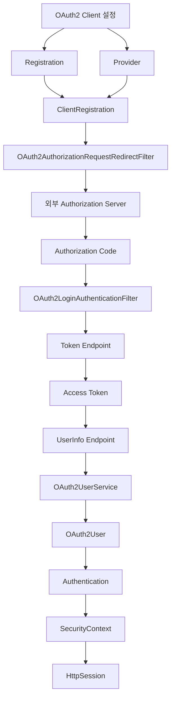

이번 내용에서 반드시 기억해야 할 핵심은 다음과 같다.

**첫째, Registration과 Provider는 서로 다른 역할을 가진다.**

Registration은 우리 애플리케이션 정보이고, Provider는 외부 인증 제공자의 서버 정보다.

**둘째, registrationId와 Client ID는 다른 개념이다.**

registrationId는 Spring Security 내부에서 OAuth2 Client를 식별하는 이름이고, Client ID는 외부 인증 제공자가 발급한 값이다.

**셋째, Redirect URI는 외부 인증이 완료된 이후 브라우저가 돌아오는 우리 서비스의 Callback 주소다.**

외부 제공자에 등록한 주소와 실제 Spring Security Callback 주소가 일치해야 한다.

**넷째, Authorization URI, Token URI, UserInfo URI는 서로 다른 Endpoint다.**

각 Endpoint는 사용자 인증, 토큰 발급, 사용자 정보 조회라는 서로 다른 역할을 담당한다.

**다섯째, Scope는 외부 API에 요청하는 접근 권한 범위를 의미한다.**

실제 지원되는 Scope와 사용자 정보 제공 방식은 외부 인증 제공자마다 다를 수 있다.

**여섯째, User Name Attribute는 실제 서비스의 사용자 ID와 반드시 일치하지 않는다.**

특히 Naver처럼 중첩된 JSON을 반환하는 제공자는 사용자 식별 정보를 정규화하는 과정이 필요하다.

**일곱째, Spring Security가 제공하는 기본 Provider 설정을 활용하면 일부 외부 인증 제공자의 설정을 간소화할 수 있다.**

하지만 외부 서비스가 요구하는 토큰 교환 파라미터나 사용자 정보 구조까지 모두 자동으로 해결되는 것은 아니다.

이러한 설정값의 역할을 이해하면 OAuth2 로그인 구현 과정에서 어떤 요청이 어느 서버로 전달되는지, 그리고 각 설정이 어느 단계에서 사용되는지 명확하게 파악할 수 있다.

#### 한 줄 요약

Spring Security 6의 OAuth2 Client 설정은 `registration`과 `provider`로 구성된다. `registration`은 Client ID, Client Secret, Redirect URI, Authorization Grant Type, Scope 등 우리 애플리케이션의 등록 정보를 관리하며, `provider`는 Authorization URI, Token URI, UserInfo URI, User Name Attribute 등 외부 인증 제공자의 정보를 관리한다. Spring Security는 이러한 설정을 ClientRegistration으로 구성하여 OAuth2 인증 요청과 Authorization Code 교환, 사용자 정보 조회를 처리한다. Google은 기본 Provider 설정을 활용할 수 있지만, Naver는 별도 Provider 설정과 중첩된 사용자 정보 매핑 등이 필요할 수 있다.
