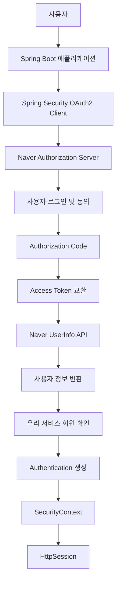
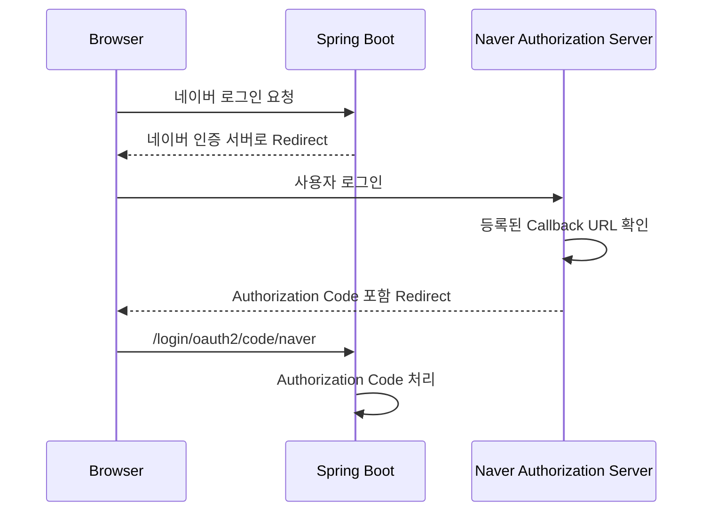
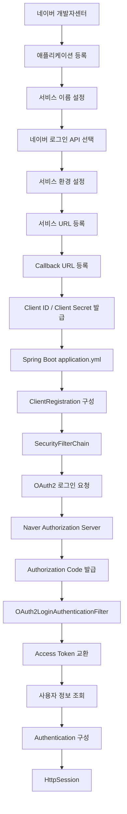
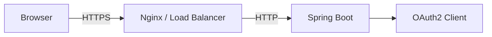
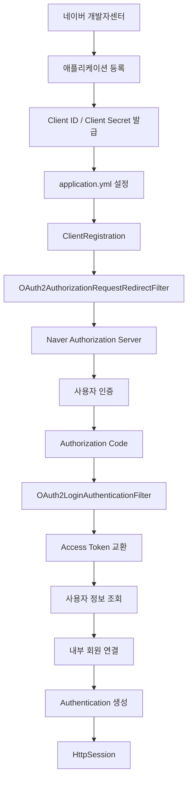

# 스프링 OAuth2 클라이언트 세션 - 6. 네이버 소셜 로그인 신청
[https://youtu.be/L8yAtjjOhDo?si=zf0BXXsos7--zNk7](https://youtu.be/L8yAtjjOhDo?si=zf0BXXsos7--zNk7)

# 스프링 OAuth2 클라이언트 세션 - 6. 네이버 소셜 로그인 신청
* toc
{:toc}

---

### Spring Security 6 OAuth2 네이버 소셜 로그인 신청 및 애플리케이션 등록

Spring Security OAuth2 Client를 이용해 네이버 소셜 로그인을 구현하려면 먼저 네이버 개발자센터에서 애플리케이션을 등록해야 한다.

앞서 Spring Boot 프로젝트를 생성하고, Spring Security의 `SecurityFilterChain`을 구성하여 OAuth2 로그인 기능을 활성화했다.

```java
.oauth2Login(Customizer.withDefaults())
```

이 설정은 Spring Security에서 OAuth2 로그인 기능을 사용할 수 있도록 구성한다.

하지만 이것만으로 네이버 소셜 로그인이 완성되는 것은 아니다.

Spring Security가 네이버 인증 서버와 통신하려면 네이버에서 발급한 애플리케이션 식별 정보가 필요하다.

대표적으로 다음과 같다.

- Client ID
- Client Secret
- 서비스 URL
- Callback URL
- 사용자 정보 제공 권한

이 중 Client ID와 Client Secret은 네이버 개발자센터에서 애플리케이션을 등록한 뒤 발급받을 수 있다.

또한 OAuth2 로그인에 사용할 서비스 URL과 Callback URL도 네이버 개발자센터에 등록해야 한다.

이번에는 네이버 소셜 로그인을 사용하기 위해 필요한 애플리케이션 등록 과정과 각 설정의 역할을 알아본다.

특히 **서비스 URL과 Callback URL의 차이, Client ID와 Client Secret의 역할, 개발 환경과 운영 환경의 구분, Spring Security의 OAuth2 설정 연결 방법**을 중심으로 살펴본다.

---

### 개념

#### 네이버 소셜 로그인이란?

네이버 소셜 로그인은 사용자가 기존 네이버 계정을 이용하여 다른 서비스에 로그인할 수 있도록 지원하는 인증 기능이다.

일반적인 회원가입에서는 사용자가 새로운 아이디와 비밀번호를 생성한다.

```text
사용자
    ↓
아이디 입력
    ↓
비밀번호 입력
    ↓
우리 서비스 회원가입
    ↓
데이터베이스 저장
    ↓
로그인
```

이러한 구조에서는 우리 서비스가 직접 사용자의 비밀번호를 관리해야 한다.

반면 네이버 소셜 로그인에서는 사용자 인증을 네이버에 위임할 수 있다.

```text
사용자
    ↓
네이버 로그인 선택
    ↓
네이버 인증 서버
    ↓
네이버 계정 인증
    ↓
Authorization Code 발급
    ↓
Spring Security OAuth2 Client
    ↓
Access Token 획득
    ↓
사용자 정보 확인
    ↓
우리 서비스 로그인
```

우리 서비스는 사용자의 네이버 비밀번호를 직접 전달받지 않는다.

대신 네이버가 제공하는 OAuth2 인증 절차를 통해 사용자의 신원을 확인할 수 있는 정보를 얻는다.

이후 우리 서비스의 회원 정보와 연결하여 인증 상태를 유지한다.

#### OAuth2 Client와 네이버의 관계

이번 프로젝트에서 Spring Boot 애플리케이션은 OAuth2 Client 역할을 담당한다.

네이버는 Authorization Server 및 Resource Server 역할을 담당한다.

각 구성요소의 역할은 다음과 같다.

| 구성요소 | 역할 |
|---|---|
| 사용자 | 네이버 계정으로 로그인을 요청 |
| Spring Boot | 우리 서비스의 OAuth2 Client |
| Naver Authorization Server | 네이버 사용자 인증 및 토큰 발급 |
| Naver Resource Server | Access Token 기반 사용자 정보 제공 |
| Spring Security | OAuth2 인증 흐름 및 내부 인증 상태 처리 |
| HttpSession | 로그인 완료 후 인증 상태 유지 |

이 관계를 구조로 나타내면 다음과 같다.



여기서 네이버 인증 서버는 처음부터 우리 Spring Boot 애플리케이션을 신뢰하고 모든 인증 요청을 허용하는 것이 아니다.

어떤 애플리케이션이 인증을 요청했는지 확인할 수 있어야 한다.

이를 위해 사전에 애플리케이션을 등록하고 Client ID와 Client Secret을 발급받는다.

---

### 왜 사용하는가?

#### 외부 인증 서버가 우리 애플리케이션을 식별할 수 있도록 하기 위해서

OAuth2 인증에서는 사용자뿐 아니라 인증을 요청하는 애플리케이션도 구분해야 한다.

예를 들어 서로 다른 두 서비스가 있다고 생각해보자.

```text
쇼핑몰 서비스 A

게시판 서비스 B
```

두 서비스 모두 네이버 소셜 로그인을 사용할 수 있다.

하지만 네이버는 각각의 서비스가 어떤 애플리케이션인지 구분해야 한다.

또한 사용자 인증이 완료된 이후 어느 주소로 돌아가야 하는지도 알아야 한다.

이를 위해 다음과 같은 등록 정보가 사용된다.

```text
애플리케이션 A
    │
    ├── Client ID A
    ├── Client Secret A
    ├── 서비스 URL A
    └── Callback URL A
```

```text
애플리케이션 B
    │
    ├── Client ID B
    ├── Client Secret B
    ├── 서비스 URL B
    └── Callback URL B
```

네이버는 등록된 클라이언트 정보를 바탕으로 OAuth2 인증 요청을 처리한다.

따라서 네이버 소셜 로그인을 구현하려면 먼저 애플리케이션 등록이 필요하다.

네이버 공식 등록 절차에서도 애플리케이션 등록 후 Client ID와 Client Secret을 발급받도록 안내한다.

---

### 주요 특징

#### 네이버 개발자센터에서 애플리케이션 등록하기

네이버 소셜 로그인을 사용하기 위한 첫 번째 작업은 애플리케이션 등록이다.

네이버 개발자센터에 접속한 뒤 애플리케이션 등록 메뉴로 이동한다.

[네이버 개발자센터](https://developers.naver.com/?utm_source=chatgpt.com)

기본적인 등록 절차는 다음과 같다.

**1단계. 네이버 개발자센터 접속**

네이버 개발자센터에 로그인한다.

**2단계. 애플리케이션 등록 메뉴 이동**

다음 메뉴로 이동한다.

```text
Application
    ↓
애플리케이션 등록
```

**3단계. 애플리케이션 정보 입력**

애플리케이션 이름과 사용 API를 설정한다.

**4단계. 서비스 환경 선택**

웹 애플리케이션이라면 PC 웹 또는 Mobile 웹 환경을 설정한다.

**5단계. 서비스 URL 및 Callback URL 입력**

실제로 인증 요청을 시작하는 서비스 주소와 인증 완료 후 돌아올 주소를 입력한다.

**6단계. 애플리케이션 등록 완료**

등록이 완료되면 Client ID와 Client Secret을 확인할 수 있다.

네이버 개발자센터의 실제 메뉴 이름과 입력 화면은 변경될 수 있지만, 등록에 필요한 핵심 개념은 동일하다.

---

### 애플리케이션 이름 설정

먼저 애플리케이션 이름을 지정한다.

예를 들어 다음과 같다.

```text
oauth2-session
```

또는 실제 서비스 이름을 사용할 수도 있다.

```text
Example Service
```

애플리케이션 이름은 단순히 개발자가 내부적으로 구분하기 위한 이름만은 아니다.

네이버 로그인 과정에서 사용자에게 노출되는 서비스 정보로 활용될 수 있다.

따라서 사용자에게 표시해도 자연스러운 이름을 지정하는 것이 좋다.

특히 실제 운영 서비스에서는 서비스 브랜드를 나타내는 이름을 사용하는 것이 적절하다.

네이버는 서비스와 무관하거나 네이버 공식 서비스처럼 오인할 수 있는 애플리케이션 이름을 사전 검수에서 제한할 수 있다.

#### 애플리케이션 이름과 Client ID의 차이

다음 세 값은 서로 다른 개념이다.

| 항목 | 의미 |
|---|---|
| 애플리케이션 이름 | 사용자에게 표시될 수 있는 서비스 이름 |
| Client ID | 네이버가 발급한 애플리케이션 식별자 |
| registrationId | Spring Security에서 OAuth2 Client를 구분하는 이름 |

예를 들어 다음과 같이 사용할 수 있다.

```text
애플리케이션 이름
    ↓
Example Service
```

```text
Client ID
    ↓
네이버에서 발급받은 값
```

```text
registrationId
    ↓
naver
```

Spring Security의 `registrationId`는 네이버가 발급하는 값이 아니다.

Spring Boot 애플리케이션에서 외부 OAuth2 Client를 구분하기 위해 지정하는 이름이다.

이 차이를 이해해야 이후 설정에서 혼동이 발생하지 않는다.

---

### 사용 API 선택

애플리케이션을 등록할 때는 어떤 네이버 API를 사용할지 선택해야 한다.

이번 프로젝트의 목적은 네이버 계정을 이용한 소셜 로그인이다.

따라서 사용 API에서 네이버 로그인 기능을 선택한다.

```text
Application
    ↓
애플리케이션 등록
    ↓
사용 API
    ↓
네이버 로그인
```

네이버 로그인은 사용자의 인증을 처리하고 동의받은 사용자 정보를 조회하는 데 사용된다.

이때 사용자에게 어떤 정보를 요청할 것인지 결정해야 한다.

예를 들어 다음과 같은 정보가 있다.

| 사용자 정보 | 활용 예시 |
|---|---|
| 이용자 식별자 | 내부 회원 식별 |
| 이름 | 사용자 프로필 |
| 이메일 | 알림 및 계정 연락 |
| 닉네임 | 화면 표시 이름 |
| 프로필 이미지 | 사용자 프로필 이미지 |
| 휴대전화번호 | 서비스 정책에 따른 본인 연락 정보 |

여기서 중요한 것은 **로그인 구현을 위해 모든 사용자 정보를 요청할 필요는 없다는 사실**이다.

단순히 소셜 로그인 사용자를 구분하려는 목적이라면 제공자의 사용자 식별자만으로도 기본적인 회원 연결 구조를 구현할 수 있다.

반면 이메일이나 이름 등이 필요한 서비스에서는 해당 정보를 요청할 수 있다.

하지만 사용자에게 요청하는 정보가 많아질수록 개인정보 처리에 대한 책임도 증가한다.

따라서 실제 서비스에서 사용할 정보만 요청하는 것이 좋다.

---

### 사용자 정보 제공 항목은 어떻게 설정해야 할까?

네이버 로그인을 이용하면 사용자 인증 이후 프로필 정보를 조회할 수 있다.

하지만 요청한 모든 정보가 항상 반환되는 것은 아니다.

사용자가 정보 제공에 동의하지 않았거나, 애플리케이션에 해당 정보의 조회 권한이 없을 수 있다.

따라서 사용자 정보 제공 항목은 서비스 요구사항에 맞게 결정해야 한다.

예를 들어 다음과 같은 서비스가 있다고 생각해보자.

**서비스 A**

```text
목적
    ↓
로그인한 사용자 식별

필요 정보
    ↓
이용자 식별자
```

**서비스 B**

```text
목적
    ↓
로그인 및 사용자 프로필 표시

필요 정보
    ↓
이용자 식별자
이름
프로필 이미지
```

두 서비스의 요구사항은 서로 다르다.

따라서 동일한 네이버 소셜 로그인이라도 요청해야 할 정보가 달라진다.

네이버의 사전 검수 기준에서도 기본 제공 정보 외에 추가 사용자 정보를 요청했다면 해당 정보를 실제 서비스에서 어떻게 사용하는지 확인한다.

#### 사용자 정보는 언제든 존재한다고 가정하면 안 된다

예를 들어 사용자 정보가 다음과 같이 반환될 수 있다.

```json
{
  "resultcode": "00",
  "message": "success",
  "response": {
    "id": "example-user-id",
    "email": "user@example.com",
    "name": "홍길동"
  }
}
```

하지만 실제 응답에서는 동의 및 제공 정책에 따라 일부 속성이 없을 수 있다.

따라서 다음과 같은 코드를 작성할 때 주의해야 한다.

```java
String email = (String) response.get("email");
```

이 코드는 `email`이 존재한다고 보장하지 않는다.

따라서 서비스에서 이메일이 필수라면 별도의 처리 정책이 필요하다.

예를 들어 다음과 같다.

```text
네이버 로그인 성공
    ↓
사용자 정보 조회
    ↓
이메일 존재 여부 확인
    ↓
이메일 존재
    ├── Yes → 회원 처리
    └── No  → 추가 정보 입력 또는 별도 정책
```

여기서 외부 인증 성공과 서비스 회원가입 완료를 구분하는 것이 중요하다.

---

### 서비스 환경 설정

다음으로 네이버 로그인을 사용할 서비스 환경을 선택한다.

네이버 로그인은 여러 환경에서 사용할 수 있다.

대표적으로 다음과 같다.

| 환경 | 설명 |
|---|---|
| PC 웹 | PC 브라우저에서 사용하는 웹 애플리케이션 |
| Mobile 웹 | 모바일 브라우저에서 사용하는 웹 애플리케이션 |
| Android | 안드로이드 애플리케이션 |
| iOS | iOS 애플리케이션 |
| Windows App | Windows 데스크톱 애플리케이션 |

이번 프로젝트는 Spring Boot와 Mustache를 이용한 웹 애플리케이션이다.

따라서 **PC 웹 환경을 선택하여 구성할 수 있다.**

여기서 주의할 점이 있다.

개발자가 Windows 운영체제에서 Spring Boot를 실행한다고 해서 Windows App 환경을 선택해야 하는 것은 아니다.

Windows App은 Windows용 데스크톱 애플리케이션을 대상으로 하는 환경이다.

반면 Spring Boot 서버가 HTML을 반환하고 브라우저에서 로그인한다면 웹 환경에 해당한다.

즉 서비스 환경은 개발자의 운영체제가 아니라 **실제로 사용자가 어떤 형태의 애플리케이션을 사용하는지**에 따라 결정한다.

---

### 서비스 URL이란?

서비스 URL은 사용자가 우리 서비스에 접근하는 기본 주소를 의미한다.

예를 들어 운영 중인 서비스가 다음 주소를 사용한다고 생각해보자.

```text
https://service.example.com
```

이 주소는 사용자가 웹 브라우저에서 서비스를 이용할 때 접근하는 주소다.

개발 환경에서는 다음과 같은 주소를 사용할 수 있다.

```text
http://127.0.0.1:8080
```

이번 프로젝트는 Spring Boot를 8080 포트에서 실행하는 구조다.

```properties
server.port=8080
```

따라서 로컬 개발 환경에서는 해당 주소로 애플리케이션에 접근할 수 있다.

다만 네이버 개발자센터에서 실제 등록 가능한 개발용 URL은 등록 화면의 검증 정책을 따라야 한다.

#### 서비스 URL의 역할

서비스 URL은 어떤 웹 서비스에서 네이버 로그인을 사용하는지 나타내는 주소다.

다음 구조를 생각해보자.

```text
사용자
    ↓
http://127.0.0.1:8080
    ↓
Spring Boot 애플리케이션
    ↓
네이버 로그인 버튼
```

사용자는 우리 서비스에 접근한다.

이후 네이버 로그인 버튼을 클릭하면 네이버 인증 서버로 이동한다.

이때 처음 접근한 우리 서비스의 주소가 서비스 URL과 관련된다.

하지만 서비스 URL 자체가 네이버 인증 결과를 전달받는 Callback URL은 아니다.

두 주소는 서로 다른 역할을 가진다.

---

### Callback URL이란?

Callback URL은 네이버 인증 서버에서 사용자 인증이 완료된 후 브라우저가 다시 우리 서비스로 돌아오는 주소다.

OAuth2 Authorization Code 방식에서는 사용자가 네이버에서 로그인을 완료하면 Authorization Code가 발급된다.

이 코드가 우리 애플리케이션의 Callback URL로 전달된다.

예를 들어 다음과 같다.

```text
http://127.0.0.1:8080/login/oauth2/code/naver
```

이 주소는 Spring Security OAuth2 Login의 기본 Callback 경로에 해당한다.

Spring Security는 기본적으로 다음 패턴을 사용한다.

```text
/login/oauth2/code/{registrationId}
```

`registrationId`가 `naver`라면 다음과 같이 된다.

```text
/login/oauth2/code/naver
```

따라서 최종 Callback URL은 다음과 같다.

```text
http://127.0.0.1:8080/login/oauth2/code/naver
```

#### 서비스 URL과 Callback URL 비교

| 구분 | 서비스 URL | Callback URL |
|---|---|---|
| 목적 | 서비스 접근 주소 | 인증 결과 수신 주소 |
| 사용 시점 | 사용자가 서비스에 접근할 때 | 외부 인증 완료 후 |
| 예시 | `http://127.0.0.1:8080` | `http://127.0.0.1:8080/login/oauth2/code/naver` |
| Spring Security 처리 | 일반적인 웹 요청 | OAuth2LoginAuthenticationFilter |
| Authorization Code 수신 | 아님 | 해당 |

두 주소는 동일한 것이 아니다.

서비스 URL을 Callback URL 자리에 그대로 입력하면 OAuth2 인증 완료 후 요청을 처리하지 못할 수 있다.

---

### Callback URL이 중요한 이유

Callback URL은 단순히 사용자를 이동시키는 주소 이상의 의미를 가진다.

OAuth2 인증에서 Authorization Code는 Access Token을 발급받는 데 사용된다.

따라서 인증 결과가 잘못된 주소로 전달되지 않도록 제한해야 한다.

예를 들어 정상적인 Callback URL이 다음과 같다고 생각해보자.

```text
https://service.example.com/login/oauth2/code/naver
```

그런데 공격자가 자신의 서버로 인증 결과를 전달하도록 요청할 수 있다면 보안 문제가 발생할 수 있다.

따라서 OAuth2 인증 제공자는 사전에 등록된 Redirect URI를 검증한다.



네이버는 인증 요청에 전달된 `redirect_uri`와 개발자센터에 등록된 Callback URL의 일치 여부를 검증한다.

따라서 프로토콜, 호스트, 포트, 경로 등을 포함한 실제 Callback URL을 정확하게 설정해야 한다.

특히 네이버 공식 안내에서는 Callback URL을 서비스 URL과 달리 세부 URL 요소까지 정확하게 비교한다고 설명한다.

---

### Client ID와 Client Secret 발급

애플리케이션 등록을 완료하면 네이버 개발자센터에서 Client ID와 Client Secret을 확인할 수 있다.

메뉴는 다음과 같다.

```text
Application
    ↓
내 애플리케이션
    ↓
등록한 애플리케이션 선택
    ↓
개요
    ↓
Client ID / Client Secret 확인
```

이 두 값은 Spring Security OAuth2 Client 설정에 사용된다.

#### Client ID

Client ID는 네이버가 우리 애플리케이션을 구분하기 위해 발급하는 식별자다.

예를 들어 다음과 같은 형태로 발급된다.

```text
NAVER_CLIENT_ID
```

실제 발급값은 애플리케이션마다 다르다.

Spring Boot에서는 다음과 같이 설정할 수 있다.

```yaml
client-id: ${NAVER_CLIENT_ID}
```

#### Client Secret

Client Secret은 네이버가 발급하는 클라이언트 인증용 비밀정보다.

```yaml
client-secret: ${NAVER_CLIENT_SECRET}
```

Client ID와 Client Secret의 차이를 정리하면 다음과 같다.

| 구분 | Client ID | Client Secret |
|---|---|---|
| 역할 | 애플리케이션 식별 | 클라이언트 인증 |
| 발급 주체 | 네이버 | 네이버 |
| 비밀정보 | 일반적으로 아님 | 예 |
| 브라우저 노출 | 인증 요청에 포함될 수 있음 | 노출 금지 |
| Spring 설정 | `client-id` | `client-secret` |

여기서 중요한 것은 Client Secret을 애플리케이션 소스 코드에 직접 작성하지 않는 것이다.

Client Secret이 외부에 노출되면 해당 값을 이용한 부정 사용 위험이 발생할 수 있다.

따라서 환경변수나 별도의 비밀정보 관리 시스템을 이용하는 것이 적절하다.

---

### 예제

#### Spring Boot OAuth2 Client와 네이버 애플리케이션 연결

이제 발급받은 Client ID와 Client Secret을 Spring Boot 프로젝트에 연결해보자.

현재 프로젝트의 기술 환경은 다음과 같다.

| 항목 | 기술 |
|---|---|
| Java | 17 |
| Spring Boot | 3.2.1 |
| Spring Security | 6.2.1 |
| OAuth2 Client | Spring Security OAuth2 Client |
| Template Engine | Mustache |
| 인증 방식 | Authorization Code |
| 로그인 상태 | HttpSession |
| 데이터베이스 | MySQL |

이번 단계에서는 네이버 애플리케이션 등록값을 Spring Boot 설정에 연결한다.

사용자 정보 저장과 CustomOAuth2UserService 구현은 별도의 단계로 확장할 수 있다.

---

### application.yml 설정

먼저 `application.yml` 파일을 작성한다.

파일 경로는 다음과 같다.

```text
src/main/resources/application.yml
```

설정은 다음과 같이 구성할 수 있다.

```yaml
server:
  port: 8080

spring:
  application:
    name: oauth2-session

  security:
    oauth2:
      client:
        registration:
          naver:
            client-name: Naver

            client-id: ${NAVER_CLIENT_ID}

            client-secret: ${NAVER_CLIENT_SECRET}

            client-authentication-method: client_secret_post

            authorization-grant-type: authorization_code

            redirect-uri: "{baseUrl}/login/oauth2/code/{registrationId}"

        provider:
          naver:
            authorization-uri: https://nid.naver.com/oauth2.0/authorize

            token-uri: https://nid.naver.com/oauth2.0/token

            user-info-uri: https://openapi.naver.com/v1/nid/me

            user-name-attribute: response
```

이 설정은 네이버 OAuth2 Client 등록에 필요한 주요 정보를 구성한 예제다.

다만 네이버의 실제 토큰 교환 요청 형식과 사용자 정보의 중첩 구조를 처리하는 추가 구현이 필요할 수 있으므로, **이 설정만으로 전체 로그인 성공을 보장하지는 않는다.**

각 설정을 살펴보자.

#### registration.naver

```yaml
registration:
  naver:
```

Spring Security에서 등록된 OAuth2 Client를 구분하는 이름이다.

이 값은 네이버가 발급한 Client ID와 다르다.

Spring Security는 다음 요청을 받으면 `naver` ClientRegistration을 조회한다.

```http
GET /oauth2/authorization/naver HTTP/1.1
Host: 127.0.0.1:8080
```

#### client-id

```yaml
client-id: ${NAVER_CLIENT_ID}
```

네이버 개발자센터에서 발급받은 Client ID다.

#### client-secret

```yaml
client-secret: ${NAVER_CLIENT_SECRET}
```

네이버 개발자센터에서 발급받은 Client Secret이다.

#### authorization-grant-type

```yaml
authorization-grant-type: authorization_code
```

OAuth2 Authorization Code Grant를 사용한다는 의미다.

#### redirect-uri

```yaml
redirect-uri: "{baseUrl}/login/oauth2/code/{registrationId}"
```

네이버 인증 완료 후 돌아올 Callback URL을 구성한다.

예를 들어 실제 접속 주소가 다음과 같다면:

```text
http://127.0.0.1:8080
```

최종 Redirect URI는 다음과 같다.

```text
http://127.0.0.1:8080/login/oauth2/code/naver
```

여기서 중요한 점은 **Spring Security가 실제로 생성한 Redirect URI와 네이버 개발자센터에 등록한 Callback URL이 일치해야 한다**는 것이다.

---

### Provider 설정

이제 네이버 인증 서버의 주소를 설정한다.

```yaml
provider:
  naver:
    authorization-uri: https://nid.naver.com/oauth2.0/authorize

    token-uri: https://nid.naver.com/oauth2.0/token

    user-info-uri: https://openapi.naver.com/v1/nid/me

    user-name-attribute: response
```

각 설정의 역할은 다음과 같다.

| 설정 | 역할 |
|---|---|
| authorization-uri | 사용자 로그인 및 동의를 처리하는 주소 |
| token-uri | Authorization Code를 Access Token으로 교환하는 주소 |
| user-info-uri | 사용자 정보를 조회하는 API 주소 |
| user-name-attribute | OAuth2User 이름을 구성할 때 참조하는 속성 |

이때 `registration`과 `provider`는 서로 다른 역할을 담당한다.

```text
registration
    ↓
우리 애플리케이션의 OAuth2 Client 정보
```

```text
provider
    ↓
네이버 인증 서버의 Endpoint 정보
```

Google은 Spring Security가 기본 Provider 설정을 제공하므로 일부 주소를 생략할 수 있다.

반면 Naver는 별도의 Provider 설정을 구성하는 방식으로 연동할 수 있다.

---

### Naver의 user-name-attribute 주의사항

Naver는 사용자 정보를 다음과 같은 구조로 반환한다.

```json
{
  "resultcode": "00",
  "message": "success",
  "response": {
    "id": "example-user-id",
    "name": "홍길동",
    "email": "user@example.com"
  }
}
```

여기서 실제 사용자 식별자는 다음 위치에 있다.

```text
response.id
```

하지만 앞의 설정에서는 다음과 같이 작성했다.

```yaml
user-name-attribute: response
```

이 설정은 `response` 속성을 참조하는 것이며, `response.id`를 자동으로 내부 사용자 식별자로 변환하지 않는다.

따라서 실제 서비스에서는 `response` 객체 내부의 `id`를 추출하는 추가 처리가 필요하다.

예를 들어 다음과 같다.

```java
Map<String, Object> attributes =
        oauth2User.getAttributes();

Object responseValue = attributes.get("response");

if (!(responseValue instanceof Map<?, ?> response)) {
    throw new IllegalStateException(
            "Naver 사용자 정보 형식이 올바르지 않습니다."
    );
}

Object idValue = response.get("id");

if (!(idValue instanceof String providerUserId)
        || providerUserId.isBlank()) {

    throw new IllegalStateException(
            "Naver 사용자 식별자가 존재하지 않습니다."
    );
}
```

위 코드는 중첩된 응답에서 사용자 식별자를 추출하는 기본적인 처리 예시다.

실제 구현에서는 사용자 정보의 정상 여부를 검증하고, OAuth2 인증 실패를 적절하게 처리하도록 구성해야 한다.

또한 네이버가 반환하는 `id`는 사용자의 실제 네이버 로그인 아이디가 아니다.

네이버는 애플리케이션별 사용자 식별자를 반환한다.

따라서 동일한 네이버 계정이라도 서로 다른 애플리케이션에서는 다른 식별자가 반환될 수 있다.

---

### Windows 환경에서 Client ID와 Client Secret 설정

Windows에서는 PowerShell을 이용해 환경변수를 설정할 수 있다.

예를 들어 다음과 같다.

```powershell
$env:NAVER_CLIENT_ID = "발급받은_CLIENT_ID"

$env:NAVER_CLIENT_SECRET = "발급받은_CLIENT_SECRET"
```

이렇게 설정한 환경변수는 현재 PowerShell 세션과 해당 세션에서 실행한 자식 프로세스에서 사용할 수 있다.

이후 Spring Boot를 실행한다.

```powershell
.\gradlew.bat bootRun
```

명령어의 의미는 다음과 같다.

| 명령어 | 역할 |
|---|---|
| `$env:NAVER_CLIENT_ID` | 현재 PowerShell 세션의 Client ID 설정 |
| `$env:NAVER_CLIENT_SECRET` | 현재 PowerShell 세션의 Client Secret 설정 |
| `.\gradlew.bat` | Windows 환경의 Gradle Wrapper 실행 |
| `bootRun` | Spring Boot 애플리케이션 실행 |

정상적으로 설정되어 있다면 Spring Boot는 `application.yml`에 정의된 환경변수를 읽을 수 있다.

다만 IntelliJ IDEA에서 직접 애플리케이션을 실행한다면 PowerShell에 설정한 환경변수가 자동으로 전달되지 않을 수 있다.

이 경우 IntelliJ의 Run Configuration에 환경변수를 별도로 지정할 수 있다.

또한 Client Secret을 명령어 기록이나 공개 로그에 노출하지 않도록 주의해야 한다.

---

### SecurityConfig 확인

OAuth2 로그인 기능이 활성화되어 있어야 네이버 로그인 요청을 처리할 수 있다.

이번 프로젝트에서는 다음과 같이 설정할 수 있다.

```java
package com.example.oauth2session.config;

import org.springframework.context.annotation.Bean;
import org.springframework.context.annotation.Configuration;

import org.springframework.security.config.Customizer;
import org.springframework.security.config.annotation.web.builders.HttpSecurity;
import org.springframework.security.config.annotation.web.configurers.AbstractHttpConfigurer;
import org.springframework.security.config.http.SessionCreationPolicy;
import org.springframework.security.web.SecurityFilterChain;

@Configuration
public class SecurityConfig {

    @Bean
    public SecurityFilterChain securityFilterChain(
            HttpSecurity http
    ) throws Exception {

        http
                // 일반 Form Login 비활성화
                .formLogin(AbstractHttpConfigurer::disable)

                // HTTP Basic 인증 비활성화
                .httpBasic(AbstractHttpConfigurer::disable)

                // OAuth2 로그인 활성화
                .oauth2Login(Customizer.withDefaults())

                // 세션 기반 인증
                .sessionManagement(session -> session
                        .sessionCreationPolicy(
                                SessionCreationPolicy.IF_REQUIRED
                        )
                )

                // 경로별 접근 권한
                .authorizeHttpRequests(auth -> auth

                        .requestMatchers(
                                "/",
                                "/error",
                                "/oauth2/authorization/**",
                                "/login/oauth2/code/**"
                        ).permitAll()

                        .anyRequest().authenticated()
                );

        return http.build();
    }
}
```

여기서 핵심은 다음 설정이다.

```java
.oauth2Login(Customizer.withDefaults())
```

이 설정을 통해 Spring Security는 OAuth2 Login을 처리하기 위한 기능을 구성한다.

그리고 다음 설정을 통해 세션 기반 인증을 허용한다.

```java
.sessionManagement(session -> session
        .sessionCreationPolicy(
                SessionCreationPolicy.IF_REQUIRED
        )
)
```

이번 프로젝트는 브라우저 쿠키를 이용한 세션 인증 구조이므로 CSRF 보호는 기본값을 유지한다.

---

### Mustache에서 네이버 로그인 버튼 연결하기

이제 메인 화면에서 네이버 로그인을 시작할 수 있도록 링크를 추가한다.

`main.mustache` 파일은 다음과 같이 작성할 수 있다.

```html
<!DOCTYPE html>
<html lang="ko">

<head>
    <meta charset="UTF-8">

    <title>OAuth2 소셜 로그인</title>
</head>

<body>

    <h1>메인 화면</h1>

    <p>
        Spring Security OAuth2 Client 로그인
    </p>

    <a href="/oauth2/authorization/naver">
        네이버 로그인
    </a>

</body>

</html>
```

여기서 가장 중요한 부분은 다음과 같다.

```html
<a href="/oauth2/authorization/naver">
    네이버 로그인
</a>
```

이 링크는 네이버 인증 서버의 주소를 직접 호출하는 것이 아니다.

Spring Security가 제공하는 OAuth2 로그인 시작 경로에 요청하는 것이다.

따라서 처리 흐름은 다음과 같다.

```text
네이버 로그인 버튼 클릭
    ↓
GET /oauth2/authorization/naver
    ↓
OAuth2AuthorizationRequestRedirectFilter
    ↓
ClientRegistration 조회
    ↓
Naver Authorization URI 확인
    ↓
네이버 인증 서버로 Redirect
```

이후 네이버 인증 서버에서 사용자 로그인과 동의 절차가 진행된다.

---

### 구조

#### 네이버 소셜 로그인 신청부터 인증까지 전체 흐름

지금까지 내용을 하나의 구조로 정리하면 다음과 같다.



여기서 중요한 점은 네이버 개발자센터의 애플리케이션 등록과 실제 Spring Security의 OAuth2 로그인 구현이 서로 다른 작업이라는 사실이다.

애플리케이션 등록은 네이버에서 우리 서비스를 OAuth2 Client로 식별할 수 있도록 준비하는 과정이다.

Spring Security 설정은 해당 등록 정보를 이용해 실제 사용자 인증을 처리하는 과정이다.

---

### 개발 환경에서 확인하기

네이버 애플리케이션 등록과 Spring Boot 설정이 완료되었다면 먼저 OAuth2 로그인 시작 요청이 정상적으로 생성되는지 확인한다.

#### 1. Spring Boot 실행

Windows PowerShell에서 다음 명령을 실행한다.

```powershell
.\gradlew.bat bootRun
```

애플리케이션이 정상적으로 실행되면 8080 포트에서 요청을 받을 수 있다.

#### 2. 브라우저에서 로그인 요청

다음 주소에 접근한다.

```text
http://127.0.0.1:8080/oauth2/authorization/naver
```

정상적인 경우 Spring Security는 네이버 인증 서버로 이동하도록 HTTP Redirect 응답을 생성한다.

#### 3. HTTP Redirect 확인

PowerShell에서는 다음과 같이 확인할 수 있다.

```powershell
curl.exe -i http://127.0.0.1:8080/oauth2/authorization/naver
```

정상적으로 Authorization Request가 생성되면 다음과 유사한 응답을 받을 수 있다.

```http
HTTP/1.1 302 Found

Location: https://nid.naver.com/oauth2.0/authorize?...
```

여기서 확인할 부분은 `Location` 헤더다.

`Location`에는 네이버 인증 서버로 이동하기 위한 주소가 포함된다.

또한 Authorization Request에는 Client ID와 Redirect URI, State 등의 파라미터가 포함될 수 있다.

#### 4. 확인 결과 해석

다음과 같이 구분해야 한다.

| 확인 결과 | 의미 |
|---|---|
| Spring Boot 실행 성공 | 기본 애플리케이션 구성 정상 |
| OAuth2 경로에서 302 응답 | 인증 요청 생성 및 리다이렉트 동작 |
| 네이버 로그인 화면 표시 | 외부 인증 서버 이동 성공 |
| 네이버 로그인 성공 | 외부 사용자 인증 완료 |
| Callback 요청 성공 | Authorization Code 전달 |
| Access Token 획득 | 토큰 교환 성공 |
| 사용자 정보 조회 성공 | 외부 사용자 식별 정보 확보 |
| 세션 인증 성공 | 우리 서비스 로그인 상태 구성 |

특히 **302 응답이 발생했다고 해서 네이버 소셜 로그인 전체가 완료된 것은 아니다.**

302 응답은 인증 요청을 시작하는 단계다.

실제 로그인까지 완료하려면 Authorization Code 수신, 토큰 교환, 사용자 정보 처리 등의 단계가 필요하다.

---

### 네이버 로그인 신청과 사전 검수의 차이

네이버 로그인에서는 애플리케이션 등록과 정식 서비스 운영을 위한 사전 검수를 구분해야 한다.

#### 애플리케이션 등록

애플리케이션 등록은 네이버 OAuth2 Client를 사용하기 위한 기본 설정 과정이다.

이 과정에서 다음 정보를 준비한다.

```text
애플리케이션 이름

사용 API

서비스 URL

Callback URL

Client ID

Client Secret
```

등록이 완료되면 개발 및 테스트를 진행할 수 있다.

#### 사전 검수

반면 사전 검수는 네이버 로그인을 일반 사용자에게 정식으로 제공하기 위한 절차다.

네이버의 현재 정책에 따르면 사전 검수를 통과하지 않은 상태에서도 등록자, 관리자 또는 테스터로 등록된 계정은 개발 테스트에 사용할 수 있다.

하지만 모든 일반 사용자에게 네이버 로그인을 제공하려면 사전 검수를 통과해야 한다.

두 작업의 차이를 정리하면 다음과 같다.

| 구분 | 애플리케이션 등록 | 사전 검수 |
|---|---|---|
| 목적 | OAuth2 Client 등록 | 정식 서비스 적용 확인 |
| 주요 작업 | Client ID 및 Secret 발급 | 서비스 동작 및 정책 검증 |
| 개발 테스트 | 등록 후 가능 | 통과 전에도 허용된 계정으로 가능 |
| 일반 사용자 이용 | 제한될 수 있음 | 승인 후 정식 제공 가능 |
| 주요 확인 사항 | 서비스 URL, Callback URL | 로그인 흐름, 개인정보 이용, 서비스 정책 |

따라서 **애플리케이션 등록을 완료했다고 해서 모든 사용자가 즉시 소셜 로그인을 사용할 수 있다고 가정하면 안 된다.**

실제 운영 서비스를 준비한다면 사전 검수까지 고려해야 한다.

---

### 실무에서의 활용

#### 1. 개발 환경과 운영 환경의 OAuth2 등록 정보를 구분한다

개발 환경에서는 로컬 주소를 사용할 수 있다.

```text
http://127.0.0.1:8080
```

운영 환경에서는 실제 서비스 도메인을 사용한다.

```text
https://service.example.com
```

이처럼 환경별로 서비스 URL과 Callback URL이 다를 수 있다.

따라서 환경 설정을 분리하는 것이 좋다.

예를 들어 다음과 같다.

```text
개발 환경
    ↓
개발용 Client 설정
    ↓
개발용 Callback URL
```

```text
운영 환경
    ↓
운영용 Client 설정
    ↓
운영용 Callback URL
```

가능하다면 개발과 운영에 서로 다른 Client를 사용하는 방식을 고려할 수 있다.

다만 네이버의 사용자 식별자는 애플리케이션마다 달라질 수 있으므로, Client를 변경할 때 기존 회원 데이터와의 연결에 영향을 줄 수 있다는 점도 고려해야 한다.

#### 2. Callback URL을 정확하게 관리한다

OAuth2 로그인에서 자주 발생하는 문제가 Redirect URI 불일치다.

예를 들어 다음 두 주소는 서로 다르다.

```text
http://127.0.0.1:8080/login/oauth2/code/naver
```

```text
http://localhost:8080/login/oauth2/code/naver
```

두 주소는 동일한 로컬 컴퓨터를 가리킬 수 있지만 OAuth2 Redirect URI 문자열로는 다르다.

따라서 네이버 개발자센터에 등록한 Callback URL과 Spring Security가 실제로 생성하는 Redirect URI를 일치시켜야 한다.

특히 개발 환경에서 `localhost`와 `127.0.0.1`을 혼용하면 예상하지 못한 문제가 발생할 수 있다.

#### 3. Reverse Proxy 환경에서는 외부 공개 주소를 기준으로 설정한다

운영 환경에서는 Spring Boot가 직접 HTTPS를 처리하지 않을 수 있다.

예를 들어 다음 구조를 사용할 수 있다.



외부에서는 HTTPS로 접근하지만 Spring Boot 내부에서는 HTTP 요청으로 처리할 수 있다.

이때 외부 주소 정보를 정확하게 전달하지 않으면 Redirect URI가 잘못 생성될 수 있다.

Spring Boot에서는 신뢰할 수 있는 프록시 환경에서 Forwarded Header 처리를 구성할 수 있다.

```yaml
server:
  forward-headers-strategy: framework
```

다만 이 설정을 사용하려면 프록시에서 전달하는 헤더를 신뢰할 수 있도록 네트워크와 프록시 구성을 함께 관리해야 한다.

그렇지 않으면 외부 요청에 의해 잘못된 호스트 정보가 전달될 수 있다.

#### 4. Client Secret을 소스 코드에 저장하지 않는다

Client Secret은 외부 인증 제공자와 통신할 때 중요한 비밀정보다.

따라서 다음과 같이 직접 작성하지 않는 것이 좋다.

```yaml
client-secret: actual-secret-value
```

대신 다음과 같이 환경변수를 사용한다.

```yaml
client-secret: ${NAVER_CLIENT_SECRET}
```

운영 환경에서는 비밀정보 관리 시스템을 활용할 수도 있다.

또한 Client Secret이 유출되었다면 기존 값을 교체하고 관련 시스템의 설정을 갱신해야 한다.

#### 5. 사용자 정보 제공 권한은 최소화한다

서비스에서 사용하지 않는 개인정보를 불필요하게 요청하지 않는다.

예를 들어 사용자 식별에 필요한 정보만으로 로그인이 가능하다면 휴대전화번호나 생일 등의 정보를 요청할 필요는 없다.

이 원칙은 단순한 보안 권장사항을 넘어 사전 검수에도 영향을 줄 수 있다.

네이버는 추가 정보 조회 권한을 요청한 경우 해당 정보가 실제 서비스에서 어떻게 활용되는지 확인할 수 있기 때문이다.

따라서 사용자 정보 제공 항목을 선택할 때는 각 항목의 사용 목적을 명확하게 정의하는 것이 좋다.

#### 6. 외부 사용자 ID와 내부 회원 ID를 분리한다

네이버는 사용자 정보를 조회할 때 애플리케이션별 사용자 식별자를 반환한다.

하지만 우리 서비스에서는 별도의 내부 회원 ID를 관리하는 것이 좋다.

예를 들어 다음과 같다.

```text
Naver User ID
    ↓
naver-user-123
```

```text
Internal User ID
    ↓
10001
```

이 두 값은 서로 다른 목적을 가진다.

네이버 사용자 ID는 외부 인증 계정을 식별한다.

내부 회원 ID는 우리 서비스의 사용자 데이터를 연결한다.

따라서 실제 서비스에서는 다음과 같은 구조를 고려할 수 있다.

```text
users
    │
    └── id
```

```text
social_accounts
    │
    ├── user_id
    ├── provider
    └── provider_user_id
```

이 구조를 사용하면 이후 Google이나 다른 소셜 로그인 제공자를 추가할 때도 동일한 내부 회원 체계를 유지할 수 있다.

#### 7. 이메일만으로 사용자를 식별하지 않는다

네이버에서 이메일 정보를 반환한다고 해서 이메일을 유일한 사용자 식별자로 사용하는 것은 주의해야 한다.

이메일은 변경될 수 있고, 제공되지 않을 수도 있다.

따라서 외부 계정 식별에는 다음 조합을 사용할 수 있다.

```text
provider + providerUserId
```

예를 들어 다음과 같다.

```text
naver:naver-user-123
```

이 값을 이용해 동일한 외부 사용자인지 확인할 수 있다.

데이터베이스에서는 다음과 같은 제약을 적용할 수 있다.

```sql
UNIQUE (provider, provider_user_id)
```

이를 통해 같은 소셜 계정이 중복 등록되는 문제를 줄일 수 있다.

#### 8. 애플리케이션 등록과 회원가입을 혼동하지 않는다

네이버 개발자센터의 애플리케이션 등록은 우리 서비스를 OAuth2 Client로 등록하는 작업이다.

반면 사용자 회원가입은 네이버 계정으로 인증된 사용자를 우리 서비스의 회원으로 등록하는 작업이다.

두 과정은 다음과 같이 구분된다.

```text
개발자 작업
    ↓
네이버 애플리케이션 등록
    ↓
Client ID 발급
```

```text
사용자 작업
    ↓
네이버 로그인
    ↓
사용자 정보 확인
    ↓
우리 서비스 회원가입
```

개발자가 애플리케이션을 등록했다고 해서 우리 서비스의 회원 계정이 자동으로 생성되는 것은 아니다.

사용자 인증 이후 내부 회원 정보를 연결하는 별도의 로직이 필요하다.

#### 9. 개발 중 상태의 사용자 접근 제한을 고려한다

네이버 로그인은 개발 중인 애플리케이션에서 일반 사용자 접근이 제한될 수 있다.

이때 개발자는 자신의 계정으로 로그인에 성공하지만 다른 사용자는 로그인하지 못하는 상황이 발생할 수 있다.

이러한 문제가 발생하면 무조건 Spring Security 설정 오류라고 판단해서는 안 된다.

먼저 네이버 개발자센터에서 애플리케이션의 검수 상태와 테스터 등록 여부를 확인해야 한다.

특히 개발 중 상태에서는 등록자와 허용된 테스트 계정을 이용해 기능을 검증하는 것이 좋다.

#### 10. 사전 검수에 필요한 서비스 흐름을 미리 고려한다

네이버 소셜 로그인은 단순히 인증 서버에서 토큰을 발급받는 것만으로 운영 준비가 끝나는 것은 아니다.

서비스가 정식으로 운영되려면 사용자가 로그인 버튼을 클릭한 뒤 회원가입이나 로그인을 완료하는 전체 과정이 자연스럽게 동작해야 한다.

또한 사용자 정보 제공 항목의 활용 목적이 명확해야 한다.

따라서 개발 단계부터 다음 흐름을 검증하는 것이 좋다.

```text
네이버 로그인 버튼
    ↓
네이버 사용자 인증
    ↓
사용자 정보 제공 동의
    ↓
우리 서비스 회원 조회
    ↓
신규 회원 등록 또는 기존 회원 로그인
    ↓
서비스 화면 이동
```

이러한 흐름은 사전 검수 준비뿐 아니라 사용자 경험을 개선하는 데에도 중요하다.

#### 11. OAuth2 인증 시작 경로와 Callback 경로를 구분한다

Spring Security에서는 두 가지 중요한 경로를 사용한다.

**로그인 시작 경로**

```text
/oauth2/authorization/naver
```

**로그인 완료 Callback 경로**

```text
/login/oauth2/code/naver
```

두 경로의 역할을 비교하면 다음과 같다.

| 구분 | 로그인 시작 | Callback |
|---|---|---|
| 목적 | 외부 인증 시작 | 인증 결과 처리 |
| 처리 필터 | OAuth2AuthorizationRequestRedirectFilter | OAuth2LoginAuthenticationFilter |
| 브라우저 이동 | 네이버 인증 서버로 이동 | 우리 서버로 복귀 |
| 주요 처리 | Authorization Request 생성 | Authorization Code 처리 |

Callback URL 등록 시에는 두 번째 주소를 사용해야 한다.

첫 번째 로그인 시작 경로를 Callback URL로 등록하면 의도한 인증 흐름과 달라진다.

#### 12. State 검증을 유지한다

OAuth2 Authorization Code 방식에서는 `state`가 사용된다.

State는 최초 인증 요청과 이후 Callback 응답을 연결하는 데 사용된다.

예를 들어 다음과 같다.

```text
OAuth2 로그인 시작
    ↓
State 생성
    ↓
네이버 인증 서버로 전달
    ↓
Authorization Code와 State 반환
    ↓
기존 요청과 비교
```

Spring Security는 이를 처리하기 위한 구성요소를 제공한다.

따라서 인증 요청 저장소를 커스터마이징할 때도 State 검증이 정상적으로 유지되도록 설계해야 한다.

#### 13. 사용자 정보 조회 권한 오류와 OAuth2 인증 오류를 구분한다

사용자 인증 자체는 성공했지만 사용자 정보 API 호출에서 오류가 발생할 수 있다.

예를 들어 다음과 같은 상황이다.

```text
네이버 로그인 성공
    ↓
Access Token 발급 성공
    ↓
사용자 정보 API 요청
    ↓
권한 오류
```

이 경우 로그인 요청의 Client ID와 Callback URL이 정상적일 수도 있다.

문제는 사용자 정보 조회 권한이나 사용자 동의 상태에 있을 수 있다.

따라서 OAuth2 인증 과정의 실패 지점을 구분해야 한다.

| 오류 단계 | 확인할 항목 |
|---|---|
| 로그인 시작 실패 | registrationId, ClientRegistration |
| 인증 서버 이동 실패 | Authorization URI |
| Callback 오류 | Redirect URI |
| 토큰 교환 오류 | Client ID, Client Secret, Token Endpoint |
| 사용자 정보 조회 실패 | UserInfo URI, API 권한 |
| 회원 연결 실패 | 내부 회원 조회 및 저장 로직 |
| 다음 요청에서 로그아웃 | SecurityContext, HttpSession |

#### 14. 동일한 네이버 계정이라도 애플리케이션별 식별자가 다를 수 있다

네이버 사용자 식별자는 애플리케이션마다 달라질 수 있다.

예를 들어 다음과 같은 상황이다.

```text
네이버 계정 A
    ↓
서비스 X의 네이버 애플리케이션
    ↓
사용자 식별자 X
```

```text
네이버 계정 A
    ↓
서비스 Y의 네이버 애플리케이션
    ↓
사용자 식별자 Y
```

동일한 네이버 계정이더라도 서로 다른 애플리케이션에서 동일한 사용자 식별자가 반환된다고 가정해서는 안 된다.

따라서 이미 운영 중인 네이버 로그인 애플리케이션을 다른 애플리케이션으로 변경하려면 기존 사용자 계정과의 연결 문제를 검토해야 한다.

#### 15. 네이버 로그인 이후의 세션은 우리 서비스에서 관리한다

네이버 인증에 성공하면 외부 Access Token을 얻을 수 있다.

하지만 이번 프로젝트에서는 네이버 Access Token을 모든 API 요청에 사용하지 않는다.

외부 사용자 정보를 확인한 뒤 우리 서비스의 인증 정보를 구성한다.

```text
Naver Access Token
    ↓
사용자 정보 조회
    ↓
내부 회원 확인
    ↓
Spring Security Authentication
    ↓
SecurityContext
    ↓
HttpSession
```

따라서 외부 Access Token과 우리 서비스의 세션은 서로 다른 역할을 가진다.

네이버 Access Token은 네이버의 보호된 API에 접근할 때 사용한다.

우리 서비스의 세션은 로그인한 사용자의 인증 상태를 유지하는 데 사용한다.

이처럼 외부 인증과 내부 세션 인증을 분리하면 사용자 정보와 권한 정책을 우리 서비스에서 관리할 수 있다.

---

### 정리

Spring Security OAuth2 Client를 이용해 네이버 소셜 로그인을 구현하려면 먼저 네이버 개발자센터에서 애플리케이션을 등록해야 한다.

등록 과정에서는 다음 정보를 설정한다.

| 항목 | 역할 |
|---|---|
| 애플리케이션 이름 | 등록된 서비스 이름 |
| 사용 API | 네이버 로그인 기능 선택 |
| 사용자 정보 제공 항목 | 접근할 프로필 정보 선택 |
| 서비스 환경 | PC 웹, Mobile 웹 등 |
| 서비스 URL | 우리 서비스의 기본 접근 주소 |
| Callback URL | 인증 완료 후 돌아올 주소 |
| Client ID | 네이버가 발급한 클라이언트 식별자 |
| Client Secret | 네이버가 발급한 클라이언트 인증용 비밀정보 |

이 중 가장 혼동하기 쉬운 부분은 서비스 URL과 Callback URL이다.

서비스 URL은 사용자가 우리 서비스에 접근하는 주소다.

```text
http://127.0.0.1:8080
```

Callback URL은 네이버 인증 완료 후 Authorization Code를 전달받는 주소다.

```text
http://127.0.0.1:8080/login/oauth2/code/naver
```

Spring Security의 기본 Callback 경로는 다음과 같다.

```text
/login/oauth2/code/{registrationId}
```

따라서 네이버 소셜 로그인을 사용하는 경우 `registrationId`를 `naver`로 지정할 수 있다.

애플리케이션 등록이 완료되면 Client ID와 Client Secret을 발급받는다.

그리고 Spring Boot의 OAuth2 Client 설정에 연결한다.

```yaml
spring:
  security:
    oauth2:
      client:
        registration:
          naver:
            client-id: ${NAVER_CLIENT_ID}

            client-secret: ${NAVER_CLIENT_SECRET}

            authorization-grant-type: authorization_code

            redirect-uri: "{baseUrl}/login/oauth2/code/{registrationId}"

        provider:
          naver:
            authorization-uri: https://nid.naver.com/oauth2.0/authorize

            token-uri: https://nid.naver.com/oauth2.0/token

            user-info-uri: https://openapi.naver.com/v1/nid/me

            user-name-attribute: response
```

이러한 등록 정보를 통해 Spring Security는 네이버 인증 서버와 OAuth2 인증 절차를 진행할 수 있다.

전체 흐름은 다음과 같다.



여기서 반드시 기억해야 할 점은 다음과 같다.

**첫째, 네이버 소셜 로그인은 네이버 개발자센터에서 애플리케이션을 등록해야 사용할 수 있다.**

**둘째, Client ID와 Client Secret은 네이버가 발급하며 Spring Security의 registrationId와는 다르다.**

**셋째, 서비스 URL과 Callback URL은 서로 다른 목적을 가진다.**

**넷째, Spring Security의 기본 Callback 경로는 `/login/oauth2/code/{registrationId}`다.**

**다섯째, 사용자 정보 제공 항목은 실제 서비스에서 필요한 범위로 제한해야 한다.**

**여섯째, 네이버가 반환하는 사용자 식별자는 실제 네이버 로그인 아이디가 아니며 애플리케이션마다 달라질 수 있다.**

**일곱째, 애플리케이션 등록과 정식 서비스 운영을 위한 사전 검수는 서로 다른 절차다.**

이러한 구성을 이해하면 네이버 소셜 로그인을 단순히 외부 로그인 버튼을 추가하는 작업이 아니라, **외부 인증 제공자에 우리 서비스를 등록하고 OAuth2 인증 결과를 내부 사용자 인증 시스템과 연결하는 과정**으로 이해할 수 있다.

#### 한 줄 요약

Spring Security 6에서 네이버 소셜 로그인을 구현하려면 먼저 네이버 개발자센터에서 애플리케이션을 등록하고 Client ID와 Client Secret을 발급받아야 한다. 이후 서비스 URL과 Callback URL을 설정하고, 발급받은 정보를 Spring Boot의 OAuth2 Client Registration에 등록한다. Spring Security는 이 설정을 이용해 네이버 인증 서버로 사용자를 이동시키고 Authorization Code를 전달받아 로그인 절차를 진행할 수 있다. 실제 서비스에서는 사용자 정보 제공 권한, Redirect URI 일치 여부, 내부 회원 연결 및 사전 검수까지 함께 고려해야 한다.
