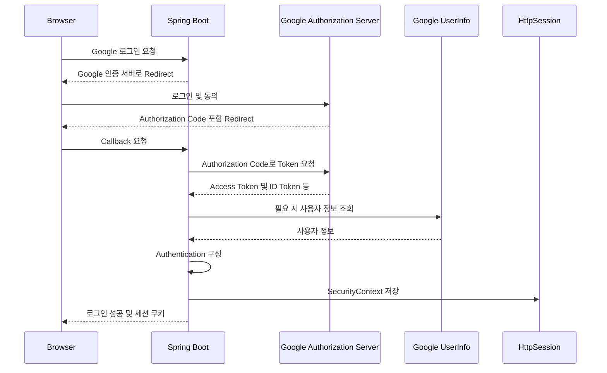
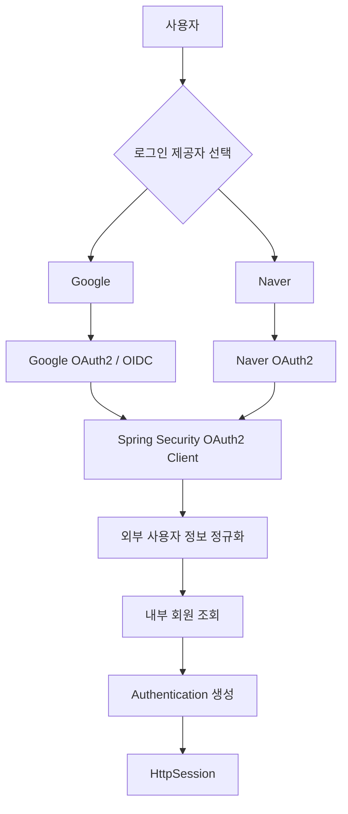
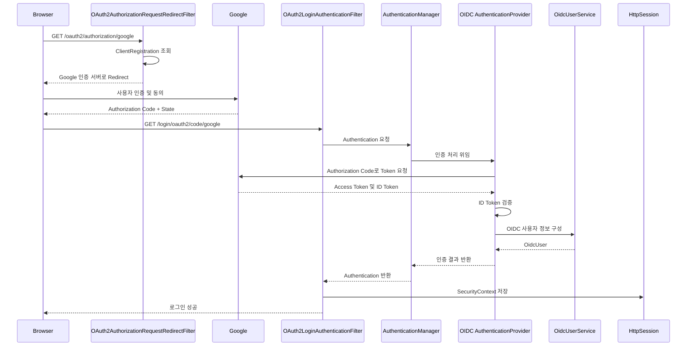
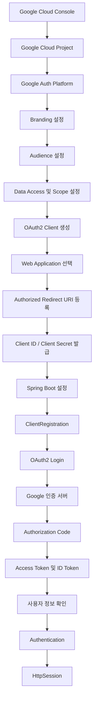

# 스프링 OAuth2 클라이언트 세션 - 7. 구글 소셜 로그인 신청
[https://youtu.be/L8yAtjjOhDo?si=zf0BXXsos7--zNk7](https://youtu.be/L8yAtjjOhDo?si=zf0BXXsos7--zNk7)

# 스프링 OAuth2 클라이언트 세션 - 7. 구글 소셜 로그인 신청
* toc
{:toc}

---


### Spring Security 6 OAuth2 구글 소셜 로그인 신청 및 설정

Spring Security OAuth2 Client를 사용하면 Google, Naver와 같은 외부 인증 제공자를 이용해 소셜 로그인을 구현할 수 있다.

앞서 네이버 소셜 로그인을 사용하기 위해 네이버 개발자센터에 애플리케이션을 등록하고, Client ID와 Client Secret을 발급받는 과정을 살펴보았다.

Google 소셜 로그인 역시 기본적인 원리는 동일하다.

먼저 Google에 우리 애플리케이션을 등록하고, OAuth2 Client 정보를 발급받아 Spring Boot 프로젝트에 설정해야 한다.

다만 Google은 네이버와 달리 **Google Cloud 프로젝트를 기반으로 OAuth2 Client를 관리한다.**

전체적인 흐름은 다음과 같다.

```text
Google Cloud 프로젝트 생성
    ↓
Google Auth Platform 설정
    ↓
OAuth 동의 화면 구성
    ↓
OAuth2 Client 생성
    ↓
Client ID 발급
    ↓
Client Secret 발급
    ↓
Redirect URI 등록
    ↓
Spring Boot OAuth2 Client 설정
    ↓
Google 소셜 로그인 요청
    ↓
Google 사용자 인증
    ↓
Authorization Code 발급
    ↓
Access Token 교환
    ↓
사용자 정보 확인
    ↓
Spring Security Authentication 생성
    ↓
HttpSession에 인증 상태 저장
```

이번 프로젝트는 다음 환경을 기준으로 구성한다.

| 구분 | 기술 |
|---|---|
| Java | 17 |
| Spring Boot | 3.2.1 |
| Spring Security | 6.2.1 |
| OAuth2 | Spring Security OAuth2 Client |
| 인증 프로토콜 | OAuth2 Authorization Code / OIDC |
| 화면 처리 | Mustache |
| 로그인 상태 유지 | HttpSession |
| 빌드 도구 | Gradle |
| 데이터베이스 | MySQL |

Google과 Naver는 모두 OAuth2 기반 소셜 로그인을 지원하지만 설정 방식에는 차이가 있다.

특히 Google은 Spring Security가 기본적으로 지원하는 OAuth2 Provider 중 하나다.

따라서 네이버와 달리 일부 Provider 설정을 직접 작성하지 않아도 된다.

이번에는 Google Cloud에서 OAuth2 Client를 발급받는 과정부터 Spring Security 설정과 실제 인증 요청이 처리되는 구조까지 알아본다.

---

### 개념

#### Google OAuth2 소셜 로그인이란?

Google OAuth2 소셜 로그인은 사용자가 자신의 Google 계정을 이용하여 우리 서비스에 로그인할 수 있도록 하는 기능이다.

일반적인 아이디·비밀번호 로그인에서는 우리 서비스가 사용자 인증을 직접 수행한다.

```text
사용자
    ↓
아이디 / 비밀번호 입력
    ↓
Spring Security
    ↓
UserDetailsService
    ↓
사용자 조회
    ↓
비밀번호 검증
    ↓
Authentication 생성
```

반면 Google 소셜 로그인에서는 Google이 사용자 인증을 수행한다.

```text
사용자
    ↓
Google 로그인 선택
    ↓
Google 인증 서버
    ↓
Google 계정 인증
    ↓
Authorization Code
    ↓
Spring Security OAuth2 Client
    ↓
Access Token 교환
    ↓
사용자 정보 확인
    ↓
Authentication 생성
```

이 구조에서는 우리 서비스가 사용자의 Google 비밀번호를 직접 전달받지 않는다.

대신 Google에서 인증된 사용자의 정보를 이용해 내부 로그인 상태를 구성한다.

전체 구조는 다음과 같다.



여기서 Google은 외부 사용자 인증을 담당한다.

하지만 우리 서비스의 사용자 권한과 회원 상태는 별도로 관리할 수 있다.

예를 들어 Google 인증에 성공했더라도 우리 서비스의 회원가입이 완료되지 않았거나 계정이 정지된 상태라면 접근을 제한할 수 있다.

따라서 **Google 인증 성공과 우리 서비스의 최종 로그인 허용은 서로 구분해야 한다.**

---

### 왜 사용하는가?

#### 1. 사용자 비밀번호를 직접 관리하지 않아도 된다

일반적인 아이디·비밀번호 인증에서는 우리 서비스가 사용자 자격 증명을 관리해야 한다.

따라서 비밀번호 해시 저장, 비밀번호 변경, 계정 복구 등의 기능이 필요하다.

반면 Google 소셜 로그인을 사용하면 Google이 사용자 계정 인증을 수행한다.

우리 서비스에서는 전달받은 사용자 식별 정보를 내부 회원과 연결하면 된다.

물론 내부 계정 관리와 서비스 권한에 대한 책임까지 없어지는 것은 아니다.

#### 2. 기존 Google 계정으로 간편하게 로그인할 수 있다

사용자는 새로운 아이디와 비밀번호를 생성하지 않고 Google 계정으로 로그인할 수 있다.

이미 Google에 로그인한 상태라면 계정 선택이나 동의만으로 인증을 진행할 수도 있다.

이러한 구조는 회원가입 및 로그인 과정의 사용자 부담을 줄이는 데 도움이 된다.

#### 3. 여러 소셜 로그인 제공자를 통합할 수 있다

이번 프로젝트에서는 Google과 Naver를 모두 지원할 예정이다.



서로 다른 외부 인증 제공자를 사용하더라도 우리 서비스의 사용자 모델과 권한 체계는 하나로 관리할 수 있다.

이러한 점에서 Google OAuth2 Client 등록은 단순한 외부 API 연결을 넘어 인증 시스템을 확장하기 위한 과정이다.

---

### 주요 특징

#### Google Cloud와 OAuth2 Client의 관계

Google 소셜 로그인을 구현하려면 Google에서 OAuth2 Client 정보를 발급받아야 한다.

이 작업은 Google Cloud Console에서 수행한다.

Google Cloud는 컴퓨팅, 데이터베이스, 네트워크 등 다양한 클라우드 서비스를 제공한다.

하지만 Google 소셜 로그인을 구현하기 위해 반드시 별도의 클라우드 서버나 데이터베이스를 구축해야 하는 것은 아니다.

이번 프로젝트에서는 Google Cloud의 **OAuth2 클라이언트 등록 및 인증 정보 관리 기능**을 사용한다.

```text
Google Cloud
    │
    ├── Google Cloud Project
    │
    └── Google Auth Platform
          │
          ├── Branding
          ├── Audience
          ├── Clients
          └── Data Access
```

각 구성요소의 역할은 다음과 같다.

| 구성요소 | 역할 |
|---|---|
| Google Cloud Project | OAuth 설정과 클라이언트 정보를 관리하는 프로젝트 |
| Branding | 애플리케이션 이름 등 사용자에게 표시할 정보 관리 |
| Audience | 애플리케이션 사용 대상 및 테스트 사용자 관리 |
| Clients | OAuth2 Client ID와 Client Secret 관리 |
| Data Access | 요청할 OAuth Scope 관리 |

Google 공식 설정 체계에서도 OAuth2 클라이언트와 사용자 동의 관련 설정을 Google Auth Platform에서 관리하도록 안내한다.

---

### Google Cloud 프로젝트 생성

먼저 Google Cloud Console에 접속한다.

Google Cloud Console 주소는 다음과 같다.

https://console.cloud.google.com/

Google 계정으로 로그인한 뒤 OAuth2 Client를 등록할 프로젝트를 생성한다.

#### 프로젝트란?

Google Cloud의 프로젝트는 관련 리소스와 설정을 관리하는 논리적인 단위다.

예를 들어 다음과 같은 프로젝트를 생성할 수 있다.

```text
Project Name

oauth2-session
```

프로젝트는 다음과 같은 구조로 관리된다.

```text
Google Cloud
    ↓
oauth2-session 프로젝트
    ↓
Google Auth Platform
    ↓
OAuth Client
    ↓
Client ID / Client Secret
```

프로젝트 생성 시 다음과 같은 정보를 설정한다.

| 항목 | 예시 |
|---|---|
| 프로젝트 이름 | oauth2-session |
| 프로젝트 ID | Google Cloud에서 생성하거나 지정한 고유 ID |
| 조직 | 개인 계정 또는 조직 설정에 따라 다름 |
| 위치 | 프로젝트가 속할 조직 또는 폴더 |

여기서 프로젝트 이름과 프로젝트 ID는 서로 다른 개념이다.

프로젝트 이름은 관리자가 알아보기 위한 이름이다.

반면 프로젝트 ID는 Google Cloud 내부에서 프로젝트를 구분하는 고유 식별자다.

또한 OAuth2 Client ID는 프로젝트 ID와도 다르다.

따라서 다음 세 값을 구분해야 한다.

```text
Google Cloud Project ID
    ↓
클라우드 프로젝트 식별자
```

```text
OAuth2 Client ID
    ↓
OAuth2 클라이언트 식별자
```

```text
Spring Security registrationId
    ↓
Spring Security 내부 클라이언트 식별자
```

이번 프로젝트에서는 Spring Security의 registrationId를 `google`로 설정한다.

---

### Google Auth Platform 설정

Google Cloud 프로젝트를 생성했다면 OAuth2 클라이언트를 발급받기 위한 설정을 진행한다.

기존 Google Cloud Console에서는 다음과 같은 메뉴를 통해 설정할 수 있었다.

```text
Google Cloud Console
    ↓
API 및 서비스
    ↓
OAuth 동의 화면
    ↓
사용자 인증 정보
```

현재는 Google Auth Platform을 통해 관련 설정을 관리하는 구조가 제공된다.

```text
Google Cloud Console
    ↓
Google Auth Platform
    │
    ├── Branding
    ├── Audience
    ├── Clients
    └── Data Access
```

두 구조는 완전히 다른 인증 기술을 의미하는 것이 아니다.

Google Cloud에서 OAuth2 관련 설정을 관리하는 화면 구성이 달라진 것이다.

따라서 이전 메뉴 구성을 찾기 어렵다면 Google Auth Platform에서 해당 항목을 확인하면 된다.

---

### Branding 설정

Branding은 사용자에게 표시할 애플리케이션 정보를 구성하는 영역이다.

Google 소셜 로그인을 진행하면 사용자는 Google이 제공하는 로그인 및 동의 화면을 거치게 된다.

이때 어떤 애플리케이션이 사용자 정보에 대한 접근을 요청하는지 표시할 수 있다.

대표적인 설정 항목은 다음과 같다.

| 항목 | 설명 |
|---|---|
| App Name | 애플리케이션 이름 |
| User Support Email | 사용자 문의를 위한 이메일 |
| App Logo | 애플리케이션 로고 |
| Homepage | 서비스 홈페이지 |
| Privacy Policy | 개인정보 처리방침 |
| Terms of Service | 서비스 이용약관 |
| Developer Contact | 개발자 연락처 |

개발 단계에서는 필수 항목을 중심으로 설정한다.

예를 들어 다음과 같다.

```text
App Name
    ↓
OAuth2 Session
```

```text
User Support Email
    ↓
개발자 또는 서비스 지원 이메일
```

```text
Developer Contact
    ↓
개발자 이메일
```

이러한 정보는 사용자에게 애플리케이션의 출처를 알려주는 역할을 한다.

실제 운영 서비스에서는 사용자에게 표시되는 애플리케이션 이름과 서비스의 브랜드가 일치하도록 관리하는 것이 좋다.

특히 Google은 애플리케이션의 브랜드 정보와 실제 서비스의 일관성을 검증할 수 있다.

---

### Audience 설정

다음은 Audience 설정이다.

Audience는 OAuth2 클라이언트를 어떤 사용자가 이용할 수 있는지 관리한다.

대표적으로 다음과 같은 사용자 유형을 선택할 수 있다.

| 구분 | Internal | External |
|---|---|---|
| 사용 대상 | 조직 내부 사용자 | Google 계정 사용자 |
| 대표적인 활용 | 회사 내부 시스템 | 일반 사용자 서비스 |
| 조직 설정 | Google Cloud 조직 환경 필요 | 일반적인 외부 서비스에 활용 가능 |
| 사용자 접근 | 조직 구성원 중심 | 공개 상태 및 정책에 따라 달라짐 |

이번 프로젝트는 일반 사용자가 Google 계정으로 로그인할 수 있는 구조를 구현한다.

따라서 일반적으로 External 유형을 선택한다.

#### Internal

Internal은 특정 조직 내부 사용자에게만 애플리케이션 접근을 허용할 때 사용한다.

예를 들어 회사 내부 관리 시스템에서 조직의 Google Workspace 계정으로만 로그인하도록 구성할 수 있다.

#### External

External은 조직 외부의 Google 계정 사용자도 이용할 수 있는 애플리케이션을 위한 설정이다.

하지만 External로 설정했다고 해서 반드시 모든 사용자가 즉시 접근할 수 있는 것은 아니다.

애플리케이션의 게시 상태와 테스트 사용자 설정에 따라 접근이 제한될 수 있다.

---

### Testing과 Production

Google OAuth2 애플리케이션에는 게시 상태가 존재한다.

대표적으로 다음 두 가지를 구분한다.

```text
Testing
```

```text
In production
```

#### Testing

Testing은 개발 및 테스트를 위한 상태다.

이 상태에서는 테스트 사용자 목록을 관리할 수 있다.

예를 들어 다음과 같다.

```text
OAuth2 Application
    ↓
Testing
    ↓
허용된 테스트 사용자
    ↓
OAuth2 로그인
```

일반적인 OAuth 권한을 요청하는 테스트 애플리케이션에는 테스트 사용자 수와 인증 유효기간 등의 제한이 적용될 수 있다.

다만 Google은 `openid`, 기본 프로필, 이메일 관련 Scope만 사용하는 로그인 애플리케이션 등에 별도 예외를 두고 있으므로 모든 테스트 애플리케이션에 동일한 제한이 적용되는 것은 아니다.

#### In production

정식 운영 상태에서는 애플리케이션의 사용 대상과 요청하는 Scope에 따라 검증 요구사항이 달라질 수 있다.

특히 민감하거나 제한된 Scope를 사용한다면 Google의 추가 검증이 필요할 수 있다.

반면 기본적인 Google 로그인 정보만 요청하는 구조와 Gmail, Google Drive 같은 민감한 데이터에 접근하는 구조는 검증 요구사항이 다를 수 있다.

따라서 **Google 로그인 기능만 사용한다는 이유로 모든 OAuth2 애플리케이션에 동일한 검수 절차가 필요하다고 이해해서는 안 된다.**

---

### Data Access와 Scope 설정

OAuth2에서 Scope는 클라이언트가 요청할 접근 권한의 범위를 의미한다.

이번 프로젝트에서는 Google 로그인에 필요한 기본적인 사용자 정보만 사용한다.

대표적인 Scope는 다음과 같다.

```text
openid

profile

email
```

각 Scope의 의미는 다음과 같다.

| Scope | 역할 |
|---|---|
| `openid` | OpenID Connect 사용자 인증 요청 |
| `profile` | 기본 사용자 프로필 정보 요청 |
| `email` | 이메일 관련 정보 요청 |

이 설정은 Google이 사용자에게 어떤 접근 권한을 요청하는지 판단할 때 사용된다.

예를 들어 다음과 같은 형태로 요청할 수 있다.

```http
GET /o/oauth2/v2/auth?response_type=code
    &client_id=CLIENT_ID
    &redirect_uri=REDIRECT_URI
    &scope=openid%20profile%20email
    &state=STATE_VALUE
```

실제 요청에서는 URL 인코딩을 적용하여 하나의 URL로 전달한다.

Google은 요청한 Scope와 애플리케이션 설정에 따라 사용자 인증 및 동의 절차를 진행한다.

여기서 중요한 점은 Scope가 단순히 JSON 응답에서 반환받을 필드 이름을 나열하는 설정이 아니라는 것이다.

Scope는 외부 서비스에서 허용할 접근 권한의 범위를 나타낸다.

따라서 실제 사용자 정보는 요청 Scope, 사용자 동의 및 Google의 정책에 영향을 받는다.

---

### OAuth2와 OpenID Connect의 차이

Google 소셜 로그인을 구현할 때는 OAuth2와 OpenID Connect의 관계를 이해하는 것이 중요하다.

OAuth2는 기본적으로 접근 권한 위임을 위한 프레임워크다.

반면 OpenID Connect는 OAuth2를 기반으로 사용자 인증을 표준화한 프로토콜이다.

두 기술의 차이는 다음과 같다.

| 구분 | OAuth2 | OpenID Connect |
|---|---|---|
| 핵심 목적 | 접근 권한 위임 | 사용자 인증 |
| 주요 토큰 | Access Token | ID Token, Access Token |
| 사용자 인증 표준 | 별도로 정의하지 않음 | ID Token을 이용해 정의 |
| 사용자 식별 | 제공자 API 등에 의존 | `sub` Claim 사용 |
| Spring Security 주요 객체 | OAuth2User | OidcUser |

Google은 OpenID Connect를 지원한다.

따라서 다음과 같은 Scope를 사용하면 OIDC 기반 로그인을 구성할 수 있다.

```yaml
scope:
  - openid
  - profile
  - email
```

이 경우 Google은 인증 절차에서 ID Token을 발급할 수 있다.

ID Token은 사용자 인증에 관한 Claim을 포함하는 JWT다.

대표적으로 다음과 같은 정보가 있다.

```json
{
  "iss": "https://accounts.google.com",
  "sub": "123456789012345678901",
  "aud": "GOOGLE_CLIENT_ID",
  "email": "user@example.com",
  "email_verified": true
}
```

위 JSON은 주요 Claim을 설명하기 위해 일부 필드만 표현한 예시다.

실제 ID Token에는 발급 시각과 만료 시간 등 추가적인 Claim이 포함된다.

이 중 사용자 식별에 중요한 값은 `sub`다.

`sub`는 Google에서 발급하는 사용자 식별자다.

이메일이나 표시 이름 대신 `sub`를 이용하면 외부 계정을 더 안정적으로 식별할 수 있다.

Google의 OpenID Connect 공식 문서에서도 `openid`, `profile`, `email`을 이용한 인증과 `sub`를 통한 사용자 식별을 설명한다.

---

### OAuth2 Client 생성

Branding과 Audience 등의 기본 설정을 완료했다면 OAuth2 Client를 생성한다.

현재 Google Cloud Console에서는 일반적으로 다음 경로를 이용한다.

```text
Google Cloud Console
    ↓
Google Auth Platform
    ↓
Clients
    ↓
Create Client
```

OAuth2 Client를 생성할 때는 애플리케이션 유형을 선택해야 한다.

대표적인 유형은 다음과 같다.

| 애플리케이션 유형 | 설명 |
|---|---|
| Web application | 웹 서버 및 웹 애플리케이션 |
| Android | Android 애플리케이션 |
| iOS | iOS 애플리케이션 |
| Desktop application | 데스크톱 애플리케이션 |

이번 프로젝트는 Spring Boot와 Mustache를 이용한 SSR 기반 웹 애플리케이션이다.

따라서 **Web application**을 선택한다.

여기서 Windows를 개발 운영체제로 사용한다고 해서 Desktop application을 선택하는 것은 아니다.

OAuth2 Client 유형은 개발 환경의 운영체제보다 실제 애플리케이션의 인증 구조를 기준으로 결정한다.

---

### Web Application 설정

OAuth2 Client 유형을 Web application으로 선택하면 클라이언트 이름과 허용할 URI 등을 설정할 수 있다.

대표적인 항목은 다음과 같다.

```text
Application Type
    ↓
Web application
```

```text
Name
    ↓
oauth2-session-web
```

```text
Authorized JavaScript Origins
    ↓
필요한 경우 등록
```

```text
Authorized Redirect URIs
    ↓
http://localhost:8080/login/oauth2/code/google
```

이번 프로젝트에서 가장 중요한 설정은 Authorized Redirect URIs다.

Google이 사용자 인증을 완료한 뒤 Authorization Code를 전달할 주소이기 때문이다.

---

### Authorized JavaScript Origins란?

Authorized JavaScript Origins는 브라우저에서 실행되는 JavaScript 기반 OAuth 관련 요청에 사용할 수 있는 Origin을 등록하는 설정이다.

Origin은 다음 세 요소로 구성된다.

```text
Scheme + Host + Port
```

예를 들어 다음과 같다.

```text
http://localhost:8080
```

각 요소는 다음과 같다.

| 요소 | 값 |
|---|---|
| Scheme | http |
| Host | localhost |
| Port | 8080 |

다음 두 주소는 서로 다른 Origin이다.

```text
http://localhost:8080
```

```text
http://localhost:3000
```

포트 번호가 다르기 때문이다.

하지만 이번 프로젝트는 브라우저 JavaScript에서 직접 Google OAuth 토큰을 처리하는 구조가 아니다.

Spring Security OAuth2 Client가 서버에서 Authorization Code를 교환한다.

따라서 **현재의 서버 측 Authorization Code 로그인 구조에서는 Authorized JavaScript Origins를 반드시 입력해야 하는 것은 아니다.**

Google Identity Services의 JavaScript SDK를 사용하는 경우에는 해당 설정이 중요해질 수 있다.

반면 Spring Boot 서버가 OAuth2 로그인 흐름을 처리하는 이번 구조에서는 Authorized Redirect URIs가 핵심이다.

이 차이를 명확하게 이해해야 한다.

---

### Authorized Redirect URIs란?

Authorized Redirect URIs는 Google 인증 서버에서 사용자 인증이 완료된 이후 브라우저가 돌아올 주소를 등록하는 설정이다.

Spring Security OAuth2 Login의 기본 Callback 경로는 다음과 같다.

```text
/login/oauth2/code/{registrationId}
```

이번 프로젝트에서는 registrationId를 `google`로 사용한다.

따라서 Callback 경로는 다음과 같다.

```text
/login/oauth2/code/google
```

Spring Boot를 8080 포트에서 실행한다면 전체 Redirect URI는 다음과 같다.

```text
http://localhost:8080/login/oauth2/code/google
```

이 주소를 Google Cloud Console의 Authorized Redirect URIs에 등록한다.

#### 로그인 시작 경로와 Callback 경로

두 주소를 반드시 구분해야 한다.

**로그인 시작 경로**

```text
http://localhost:8080/oauth2/authorization/google
```

**인증 완료 Callback 경로**

```text
http://localhost:8080/login/oauth2/code/google
```

두 주소는 서로 다른 역할을 가진다.

| 구분 | 로그인 시작 경로 | Callback 경로 |
|---|---|---|
| 경로 | `/oauth2/authorization/google` | `/login/oauth2/code/google` |
| 처리 필터 | OAuth2AuthorizationRequestRedirectFilter | OAuth2LoginAuthenticationFilter |
| 목적 | Google 인증 시작 | Authorization Code 수신 |
| 사용 시점 | 로그인 버튼 클릭 | Google 인증 완료 |
| Google에 Redirect URI로 등록 | 아니요 | 예 |

Google Cloud에 등록해야 하는 주소는 두 번째 Callback 경로다.

---

### Redirect URI가 일치해야 하는 이유

OAuth2 인증에서 Redirect URI는 보안상 중요한 역할을 가진다.

Google은 인증 요청에 포함된 `redirect_uri`가 등록된 주소와 일치하는지 확인한다.

예를 들어 Google Cloud에 다음 주소를 등록했다고 생각해보자.

```text
http://localhost:8080/login/oauth2/code/google
```

그런데 Spring Boot에서 다음 주소를 전달한다.

```text
http://127.0.0.1:8080/login/oauth2/code/google
```

두 주소는 동일한 컴퓨터를 가리킬 수 있다.

하지만 Redirect URI로는 서로 다른 문자열이다.

따라서 등록 정보와 일치하지 않으면 인증 요청이 거부될 수 있다.

특히 다음 요소에 주의해야 한다.

| 항목 | 예시 |
|---|---|
| Scheme | http와 https |
| Host | localhost와 127.0.0.1 |
| Port | 8080과 8081 |
| Path | `/login/oauth2/code/google` |
| Trailing Slash | 경로 마지막 `/` 유무 |

Google의 OAuth2 공식 문서에서도 Redirect URI가 등록된 값과 정확히 일치해야 하며, 그렇지 않을 경우 `redirect_uri_mismatch` 오류가 발생한다고 설명한다.

따라서 개발 단계에서는 하나의 호스트와 포트를 선택하여 일관되게 사용하는 것이 좋다.

---

### Client ID와 Client Secret 발급

OAuth2 Client 생성을 완료하면 Google에서 Client ID와 Client Secret을 발급한다.

각 값은 서로 다른 역할을 가진다.

#### Client ID

Client ID는 Google이 OAuth2 클라이언트를 식별하기 위해 발급하는 값이다.

Google의 Web Application Client ID는 다음과 유사한 형태를 가진다.

```text
123456789012-abcdefghijklmnopqrstuvwxyz.apps.googleusercontent.com
```

위 값은 형식을 설명하기 위한 예시다.

실제 Client ID는 Google Cloud Console에서 발급받은 값을 사용해야 한다.

#### Client Secret

Client Secret은 OAuth2 클라이언트 인증에 사용하는 비밀정보다.

Spring Boot와 Google의 Token Endpoint 사이에서 클라이언트 인증을 수행할 때 사용될 수 있다.

두 값의 차이를 정리하면 다음과 같다.

| 구분 | Client ID | Client Secret |
|---|---|---|
| 역할 | OAuth2 클라이언트 식별 | OAuth2 클라이언트 인증 |
| 발급 주체 | Google | Google |
| 비밀정보 여부 | 일반적으로 아님 | 예 |
| 브라우저 노출 | 인증 요청에 포함될 수 있음 | 노출 금지 |
| Spring Boot 설정 | client-id | client-secret |

여기서 중요한 것은 Client Secret을 브라우저에 노출하지 않는 것이다.

이번 프로젝트에서는 Spring Boot 서버가 Client Secret을 보관한다.

따라서 HTML이나 JavaScript 코드에 직접 포함할 필요가 없다.

---

### 예제

#### Spring Boot에 Google OAuth2 Client 설정하기

Google Cloud에서 Client ID와 Client Secret을 발급받았다면 Spring Boot 프로젝트에 연결한다.

현재 프로젝트에서는 다음 의존성을 사용한다.

```gradle
implementation 'org.springframework.boot:spring-boot-starter-oauth2-client'
```

이 의존성은 Spring Security OAuth2 Client 기능을 사용하기 위한 Starter다.

Spring Boot의 자동 설정을 이용하면 Google OAuth2 Client를 비교적 간단하게 등록할 수 있다.

---

### application.properties 설정

먼저 `application.properties`를 이용하는 방법을 살펴보자.

파일 경로는 다음과 같다.

```text
src/main/resources/application.properties
```

기본 설정은 다음과 같다.

```properties
# Google OAuth2 Client Registration
spring.security.oauth2.client.registration.google.client-name=google

spring.security.oauth2.client.registration.google.client-id=${GOOGLE_CLIENT_ID}

spring.security.oauth2.client.registration.google.client-secret=${GOOGLE_CLIENT_SECRET}

spring.security.oauth2.client.registration.google.redirect-uri=http://localhost:8080/login/oauth2/code/google

spring.security.oauth2.client.registration.google.authorization-grant-type=authorization_code

spring.security.oauth2.client.registration.google.scope=profile,email
```

위 설정은 Google OAuth2 Client의 주요 등록 항목을 보여준다.

여기서 각각의 설정이 어떤 역할을 담당하는지 살펴보자.

| 설정 | 역할 |
|---|---|
| client-name | 표시용 클라이언트 이름 |
| client-id | Google에서 발급한 Client ID |
| client-secret | Google에서 발급한 Client Secret |
| redirect-uri | Google 인증 완료 후 Callback 주소 |
| authorization-grant-type | OAuth2 인가 방식 |
| scope | 요청할 접근 권한 범위 |

하지만 현재 Google 소셜 로그인에서는 한 가지 추가로 고려할 부분이 있다.

바로 `openid` Scope다.

---

### Google 로그인에서 openid Scope를 사용하는 이유

앞의 설정에서는 다음과 같이 Scope를 지정했다.

```properties
spring.security.oauth2.client.registration.google.scope=profile,email
```

이 설정은 일반적인 OAuth2 방식으로 Google의 사용자 정보를 조회하는 데 사용할 수 있다.

그러나 Google은 OpenID Connect를 지원한다.

따라서 표준화된 사용자 인증을 활용하려면 `openid` Scope를 포함하는 것이 적절하다.

```properties
spring.security.oauth2.client.registration.google.scope=openid,profile,email
```

두 방식의 차이는 다음과 같다.

| 구분 | profile,email | openid,profile,email |
|---|---|---|
| 기본 프로토콜 | OAuth2 | OAuth2 + OIDC |
| Access Token | 사용 | 사용 |
| ID Token | OIDC ID Token을 요청하지 않음 | ID Token 사용 |
| Spring Security 사용자 처리 | 일반 OAuth2User 경로 | OidcUser 경로 |
| 사용자 신원 확인 | UserInfo API 등에 의존 | OIDC 표준 인증 정보 활용 |
| 주요 사용자 식별자 | 제공자 사용자 정보 | ID Token의 sub |

Spring Security에서는 `openid` Scope가 포함된 Google 로그인에서 OIDC 전용 인증 처리 경로가 사용될 수 있다.

대표적으로 다음과 같은 구성요소가 있다.

```text
OidcAuthorizationCodeAuthenticationProvider

OidcUserService

OidcUser
```

반면 일반 OAuth2 로그인에서는 다음 구성요소가 사용된다.

```text
OAuth2LoginAuthenticationProvider

DefaultOAuth2UserService

OAuth2User
```

따라서 **Google 소셜 로그인에서는 `openid`, `profile`, `email`을 사용한 OIDC 구성을 우선 고려하는 것이 좋다.**

이 설정은 이후 Google과 Naver 사용자 정보를 통합할 때도 중요한 차이가 된다.

---

### application.yml 설정

이번에는 YAML 형식으로 동일한 설정을 작성해보자.

```yaml
server:
  port: 8080

spring:
  application:
    name: oauth2-session

  security:
    oauth2:
      client:
        registration:
          google:
            client-name: Google

            client-id: ${GOOGLE_CLIENT_ID}

            client-secret: ${GOOGLE_CLIENT_SECRET}

            authorization-grant-type: authorization_code

            redirect-uri: "{baseUrl}/login/oauth2/code/{registrationId}"

            scope:
              - openid
              - profile
              - email
```

이 설정은 Google OAuth2 Client를 이용한 OIDC 로그인을 구성하는 예제다.

각 설정의 역할을 살펴보자.

#### registration.google

```yaml
registration:
  google:
```

여기서 `google`은 Spring Security의 registrationId다.

Spring Security는 다음 경로를 통해 Google OAuth2 로그인을 시작한다.

```text
/oauth2/authorization/google
```

#### client-id

```yaml
client-id: ${GOOGLE_CLIENT_ID}
```

Google에서 발급한 Client ID를 환경변수로 참조한다.

#### client-secret

```yaml
client-secret: ${GOOGLE_CLIENT_SECRET}
```

Google에서 발급한 Client Secret을 환경변수로 참조한다.

#### authorization-grant-type

```yaml
authorization-grant-type: authorization_code
```

Authorization Code Grant를 사용한다.

#### redirect-uri

```yaml
redirect-uri: "{baseUrl}/login/oauth2/code/{registrationId}"
```

이 설정은 현재 애플리케이션의 기본 주소와 registrationId를 이용하여 Callback URI를 구성한다.

예를 들어 다음과 같다.

```text
{baseUrl}
    ↓
http://localhost:8080
```

```text
{registrationId}
    ↓
google
```

따라서 최종 Redirect URI는 다음과 같다.

```text
http://localhost:8080/login/oauth2/code/google
```

#### scope

```yaml
scope:
  - openid
  - profile
  - email
```

Google 사용자 인증과 기본 프로필 및 이메일 관련 정보에 대한 접근을 요청한다.

---

### Google은 Provider 설정을 직접 작성하지 않아도 될까?

앞서 네이버 소셜 로그인을 구성할 때는 다음과 같은 Provider 설정이 필요했다.

```yaml
provider:
  naver:
    authorization-uri: https://nid.naver.com/oauth2.0/authorize

    token-uri: https://nid.naver.com/oauth2.0/token

    user-info-uri: https://openapi.naver.com/v1/nid/me

    user-name-attribute: response
```

반면 Google에서는 이러한 설정을 직접 작성하지 않아도 기본적인 OAuth2 로그인을 구성할 수 있다.

그 이유는 Spring Security의 `CommonOAuth2Provider`에 Google 관련 기본 설정이 제공되기 때문이다.

```text
CommonOAuth2Provider
    │
    ├── GOOGLE
    ├── GITHUB
    ├── FACEBOOK
    └── OKTA 등
```

Spring Security는 Google에 대한 주요 Endpoint 정보를 기본적으로 제공한다.

따라서 다음과 같은 정보를 직접 작성하지 않아도 된다.

```text
Authorization URI

Token URI

UserInfo URI

JWK Set URI

User Name Attribute
```

단, 직접 작성하지 않는다고 해서 해당 값이 존재하지 않는다는 의미는 아니다.

Spring Security가 기본 Provider 설정을 이용해 필요한 값을 구성하는 것이다.

Spring Security 공식 문서에서도 Google은 기본 Provider 설정이 제공되므로 Client ID와 Client Secret을 중심으로 등록할 수 있다고 설명한다.

---

### Google과 Naver 설정 비교

두 제공자의 OAuth2 Client 설정을 비교해보자.

| 설정 | Google | Naver |
|---|---|---|
| registrationId | google | naver |
| client-id | Google 발급 | Naver 발급 |
| client-secret | Google 발급 | Naver 발급 |
| authorization-grant-type | authorization_code | authorization_code |
| redirect-uri | `/login/oauth2/code/google` | `/login/oauth2/code/naver` |
| Provider 기본 지원 | 지원 | 별도 설정 필요 |
| 사용자 인증 | OIDC 사용 가능 | 일반 OAuth2 사용 가능 |
| 사용자 정보 구조 | sub 등 | response.id 등 |
| 사용자 정보 처리 | OidcUserService 등 | OAuth2UserService 등 |

Google과 Naver를 모두 사용하는 경우 다음과 같은 구조를 구성할 수 있다.

```text
Spring Security OAuth2 Client
    │
    ├── Google
    │     │
    │     ├── CommonOAuth2Provider
    │     ├── Authorization Code
    │     ├── OIDC
    │     └── OidcUser
    │
    └── Naver
          │
          ├── Custom Provider 설정
          ├── Authorization Code
          ├── UserInfo API
          └── OAuth2User
```

이처럼 외부 인증 제공자가 다르더라도 Spring Security는 동일한 인증 프레임워크 안에서 처리할 수 있다.

다만 실제 사용자 정보 처리 과정에서는 제공자별 차이를 고려해야 한다.

---

### Google과 Naver를 함께 등록하는 application.yml

기존 네이버 설정을 유지하면서 Google 설정을 추가할 수 있다.

```yaml
server:
  port: 8080

spring:
  application:
    name: oauth2-session

  security:
    oauth2:
      client:
        registration:

          google:
            client-name: Google
            client-id: ${GOOGLE_CLIENT_ID}
            client-secret: ${GOOGLE_CLIENT_SECRET}

            authorization-grant-type: authorization_code

            redirect-uri: "{baseUrl}/login/oauth2/code/{registrationId}"

            scope:
              - openid
              - profile
              - email

          naver:
            client-name: Naver
            client-id: ${NAVER_CLIENT_ID}
            client-secret: ${NAVER_CLIENT_SECRET}

            client-authentication-method: client_secret_post

            authorization-grant-type: authorization_code

            redirect-uri: "{baseUrl}/login/oauth2/code/{registrationId}"

        provider:

          naver:
            authorization-uri: https://nid.naver.com/oauth2.0/authorize

            token-uri: https://nid.naver.com/oauth2.0/token

            user-info-uri: https://openapi.naver.com/v1/nid/me

            user-name-attribute: response
```

이렇게 하면 두 개의 OAuth2 ClientRegistration을 구성할 수 있다.

```text
ClientRegistrationRepository
    │
    ├── google
    │
    └── naver
```

Spring Security는 요청 경로에 포함된 registrationId를 이용해 사용할 인증 제공자를 결정한다.

Google 로그인 요청은 다음과 같다.

```http
GET /oauth2/authorization/google HTTP/1.1
Host: localhost:8080
```

Naver 로그인 요청은 다음과 같다.

```http
GET /oauth2/authorization/naver HTTP/1.1
Host: localhost:8080
```

다만 Naver는 제공자별 토큰 교환 요청 형식과 중첩된 사용자 정보 구조에 대한 처리가 추가로 필요할 수 있으므로, 위 설정만으로 모든 소셜 로그인 절차가 완성되었다고 가정해서는 안 된다.

---

### Windows 환경에서 Google OAuth2 환경변수 설정하기

이번 프로젝트에서는 Client ID와 Client Secret을 소스 코드에 직접 작성하지 않는다.

대신 환경변수로 관리한다.

Windows PowerShell에서는 다음과 같이 설정할 수 있다.

```powershell
$env:GOOGLE_CLIENT_ID = "발급받은_CLIENT_ID"

$env:GOOGLE_CLIENT_SECRET = "발급받은_CLIENT_SECRET"
```

이렇게 설정한 환경변수는 현재 PowerShell 세션과 해당 세션에서 실행한 프로세스에서 사용할 수 있다.

이후 Spring Boot 애플리케이션을 실행한다.

```powershell
.\gradlew.bat bootRun
```

각 명령의 의미는 다음과 같다.

| 명령어 | 설명 |
|---|---|
| `$env:GOOGLE_CLIENT_ID` | Google Client ID 설정 |
| `$env:GOOGLE_CLIENT_SECRET` | Google Client Secret 설정 |
| `.\gradlew.bat` | Windows용 Gradle Wrapper 실행 |
| `bootRun` | Spring Boot 애플리케이션 실행 |

여기서 중요한 점은 PowerShell에 설정한 환경변수가 IntelliJ IDEA 실행 환경에 자동으로 전달되지 않을 수 있다는 사실이다.

IntelliJ에서 직접 실행한다면 Run Configuration에 환경변수를 등록하는 방법을 사용할 수 있다.

또한 Client Secret을 콘솔 출력, Git 저장소, 오류 로그 등에 노출하지 않도록 관리해야 한다.

---

### SecurityConfig 확인하기

Google OAuth2 Client를 등록했다면 Spring Security에서 OAuth2 Login이 활성화되어 있는지 확인해야 한다.

다음과 같이 설정할 수 있다.

```java
package com.example.oauth2session.config;

import org.springframework.context.annotation.Bean;
import org.springframework.context.annotation.Configuration;

import org.springframework.security.config.Customizer;
import org.springframework.security.config.annotation.web.builders.HttpSecurity;
import org.springframework.security.config.annotation.web.configurers.AbstractHttpConfigurer;
import org.springframework.security.config.http.SessionCreationPolicy;
import org.springframework.security.web.SecurityFilterChain;

@Configuration
public class SecurityConfig {

    @Bean
    public SecurityFilterChain securityFilterChain(
            HttpSecurity http
    ) throws Exception {

        http
                // 일반 아이디 / 비밀번호 로그인 비활성화
                .formLogin(AbstractHttpConfigurer::disable)

                // HTTP Basic 인증 비활성화
                .httpBasic(AbstractHttpConfigurer::disable)

                // Google / Naver OAuth2 로그인 활성화
                .oauth2Login(Customizer.withDefaults())

                // 세션 기반 인증
                .sessionManagement(session -> session
                        .sessionCreationPolicy(
                                SessionCreationPolicy.IF_REQUIRED
                        )
                )

                // 경로별 접근 권한
                .authorizeHttpRequests(auth -> auth

                        .requestMatchers(
                                "/",
                                "/error",
                                "/css/**",
                                "/js/**",
                                "/oauth2/authorization/**",
                                "/login/oauth2/code/**"
                        ).permitAll()

                        .anyRequest().authenticated()
                );

        return http.build();
    }
}
```

여기서 가장 중요한 설정은 다음과 같다.

```java
.oauth2Login(Customizer.withDefaults())
```

이 설정은 OAuth2 소셜 로그인 기능을 활성화한다.

현재 등록된 ClientRegistration을 이용해 Google과 Naver에 대한 로그인 요청을 처리할 수 있다.

또한 다음 설정을 사용했다.

```java
.sessionManagement(session -> session
        .sessionCreationPolicy(
                SessionCreationPolicy.IF_REQUIRED
        )
)
```

이번 프로젝트는 OAuth2 로그인 이후 HttpSession으로 인증 상태를 유지하는 구조다.

따라서 JWT Stateless 인증에서 사용했던 `STATELESS`와는 다른 세션 정책을 사용한다.

그리고 브라우저 세션 기반 인증이므로 CSRF 보호는 기본값을 유지한다.

---

### Mustache에서 Google 로그인 버튼 추가하기

이제 사용자가 Google 소셜 로그인을 시작할 수 있도록 HTML에 로그인 버튼을 추가한다.

파일 경로는 다음과 같다.

```text
src/main/resources/templates/main.mustache
```

전체 코드는 다음과 같이 작성할 수 있다.

```html
<!DOCTYPE html>
<html lang="ko">

<head>
    <meta charset="UTF-8">
    <meta name="viewport"
          content="width=device-width, initial-scale=1.0">

    <title>OAuth2 Social Login</title>
</head>

<body>

    <h1>Spring Security OAuth2 로그인</h1>

    <div>
        <a href="/oauth2/authorization/google">
            Google 로그인
        </a>
    </div>

    <div>
        <a href="/oauth2/authorization/naver">
            Naver 로그인
        </a>
    </div>

    <div>
        <a href="/my">
            마이 화면
        </a>
    </div>

</body>

</html>
```

여기서 Google 로그인에 해당하는 부분은 다음과 같다.

```html
<a href="/oauth2/authorization/google">
    Google 로그인
</a>
```

이 주소는 Google 인증 서버를 직접 호출하는 주소가 아니다.

Spring Security가 제공하는 OAuth2 로그인 시작 경로다.

따라서 다음 흐름으로 처리된다.

```text
Google 로그인 버튼 클릭
    ↓
GET /oauth2/authorization/google
    ↓
OAuth2AuthorizationRequestRedirectFilter
    ↓
ClientRegistrationRepository
    ↓
Google ClientRegistration
    ↓
Authorization Request 생성
    ↓
Google Authorization Server로 Redirect
```

Spring Security가 내부적으로 Google의 Authorization Endpoint를 이용하므로 개발자가 직접 인증 URL을 조합할 필요는 없다.

---

### Google OAuth2 인증 요청의 내부 동작

설정을 완료했다면 실제로 어떤 동작이 수행되는지 살펴보자.

사용자가 Google 로그인 버튼을 클릭한다.

```http
GET /oauth2/authorization/google HTTP/1.1
Host: localhost:8080
```

Spring Security의 `OAuth2AuthorizationRequestRedirectFilter`가 요청을 처리한다.

이후 등록된 ClientRegistration을 조회한다.

```text
registrationId = google
    ↓
ClientRegistrationRepository
    ↓
Google ClientRegistration
```

그다음 Authorization Request를 생성한다.

개념적인 요청은 다음과 같다.

```http
GET /o/oauth2/v2/auth HTTP/1.1
Host: accounts.google.com

response_type=code
client_id=GOOGLE_CLIENT_ID
redirect_uri=http://localhost:8080/login/oauth2/code/google
scope=openid profile email
state=RANDOM_STATE
```

위 코드는 요청의 주요 파라미터를 이해하기 위한 표현이다.

실제 브라우저는 해당 값들이 URL 인코딩된 Google 인증 URL로 이동한다.

여기서 중요한 값은 다음과 같다.

| 파라미터 | 역할 |
|---|---|
| response_type | Authorization Code 방식 지정 |
| client_id | Google OAuth2 Client ID |
| redirect_uri | 인증 완료 후 돌아올 주소 |
| scope | 요청할 접근 권한 |
| state | 인증 요청과 응답 연결 |

Google에서 사용자 인증이 완료되면 다음 경로로 돌아온다.

```http
GET /login/oauth2/code/google?code=AUTHORIZATION_CODE&state=RANDOM_STATE
```

이 요청은 `OAuth2LoginAuthenticationFilter`가 처리한다.

이후 Spring Security는 Authorization Code를 이용해 토큰을 교환하고 사용자 정보를 구성한다.

---

### 구조

#### Google OAuth2 로그인 전체 인증 흐름

전체 과정을 정리하면 다음과 같다.



이 구조에서 가장 중요한 점은 **Google 인증과 우리 서비스의 세션 인증을 구분하는 것**이다.

Google은 사용자 인증을 수행한다.

Spring Security는 그 결과를 이용해 우리 서비스의 Authentication을 구성한다.

그리고 세션 기반 인증을 사용하므로 HttpSession을 통해 로그인 상태를 유지할 수 있다.

따라서 이후 요청에서는 매번 Google에 다시 인증을 요청하지 않아도 된다.

---

### Google 로그인 완료 후 사용자 정보 확인

Google 소셜 로그인에 성공하면 Spring Security의 `Authentication`에서 사용자 정보를 확인할 수 있다.

예를 들어 다음과 같이 Controller를 작성할 수 있다.

```java
package com.example.oauth2session.controller;

import org.springframework.security.core.Authentication;
import org.springframework.stereotype.Controller;
import org.springframework.ui.Model;
import org.springframework.web.bind.annotation.GetMapping;

@Controller
public class MyController {

    @GetMapping("/my")
    public String my(
            Authentication authentication,
            Model model
    ) {

        String username = authentication.getName();

        model.addAttribute(
                "username",
                username
        );

        return "my";
    }
}
```

이 코드에서는 다음 메서드를 사용한다.

```java
authentication.getName();
```

이 메서드는 Spring Security에서 인증된 사용자의 이름을 반환한다.

Google OIDC 로그인에서는 일반적으로 `sub`와 같은 제공자 사용자 식별자가 반환될 수 있다.

따라서 이 값을 사용자 화면에 표시할 닉네임과 동일하게 생각해서는 안 된다.

실제 서비스에서는 Google 사용자 정보를 내부 회원 계정과 연결한 뒤 우리 서비스의 사용자 이름을 표시하는 구조가 적절할 수 있다.

Mustache에서는 다음과 같이 사용할 수 있다.

```html
<!DOCTYPE html>
<html lang="ko">

<head>
    <meta charset="UTF-8">
    <title>My Page</title>
</head>

<body>

    <h1>마이 화면</h1>

    <p>
        로그인 사용자:
        {{username}}
    </p>

</body>

</html>
```

이렇게 하면 현재 로그인한 사용자의 인증 식별자를 화면에 표시할 수 있다.

---

### 실행 및 확인

#### 1. 애플리케이션 실행

Windows PowerShell에서 다음 명령을 실행한다.

```powershell
.\gradlew.bat bootRun
```

정상적으로 실행되면 다음과 유사한 로그가 출력된다.

```text
Tomcat started on port 8080 (http)

Started Oauth2SessionApplication
```

#### 2. 메인 화면 접근

브라우저에서 다음 주소에 접근한다.

```text
http://localhost:8080/
```

메인 화면이 표시되면 Google 로그인 버튼을 확인할 수 있다.

#### 3. Google 로그인 요청

다음 주소에 접근한다.

```text
http://localhost:8080/oauth2/authorization/google
```

정상적으로 설정되어 있다면 Google 인증 화면으로 이동한다.

#### 4. Google 계정 인증

Google 계정으로 로그인한다.

애플리케이션 설정과 사용자 동의 상태에 따라 계정 선택 또는 정보 제공 동의 과정이 나타날 수 있다.

#### 5. Callback 처리

Google 인증이 완료되면 다음 주소로 돌아온다.

```text
http://localhost:8080/login/oauth2/code/google
```

이 요청은 Spring Security의 OAuth2LoginAuthenticationFilter가 처리한다.

#### 6. 인증된 사용자 확인

로그인이 완료된 뒤 다음 주소에 접근한다.

```text
http://localhost:8080/my
```

세션에 인증 정보가 정상적으로 저장되었다면 로그인된 사용자로 접근할 수 있다.

---

### curl로 Google 인증 리다이렉트 확인하기

실제 브라우저에서 로그인하기 전에 OAuth2 인증 요청이 정상적으로 생성되는지 확인할 수 있다.

Windows PowerShell에서는 다음 명령을 실행한다.

```powershell
curl.exe -i http://localhost:8080/oauth2/authorization/google
```

정상적으로 인증 요청이 생성되면 다음과 유사한 응답을 받을 수 있다.

```http
HTTP/1.1 302 Found

Location: https://accounts.google.com/o/oauth2/v2/auth?...
```

여기서 확인해야 할 부분은 `Location` 헤더다.

Spring Security가 Google의 Authorization Endpoint로 브라우저를 이동시키기 위한 리다이렉트 응답을 생성한 것이다.

다만 302 응답이 발생했다고 해서 전체 로그인이 성공한 것은 아니다.

실제 사용자 인증과 Authorization Code 교환, ID Token 검증, 세션 인증까지 완료해야 로그인이 정상적으로 처리된다.

---

### 실무에서의 활용

#### 1. Google Cloud Project와 OAuth2 Client를 구분한다

Google Cloud 프로젝트는 OAuth 설정을 관리하는 상위 단위다.

OAuth2 Client는 해당 프로젝트 안에서 생성되는 인증 클라이언트다.

하나의 Google Cloud 프로젝트에 여러 OAuth2 Client를 생성할 수 있다.

예를 들어 다음과 같다.

```text
Google Cloud Project
    │
    ├── Web OAuth2 Client
    │
    ├── Android OAuth2 Client
    │
    └── iOS OAuth2 Client
```

애플리케이션 유형별로 Client ID를 분리할 수 있으므로 프로젝트와 Client를 동일한 개념으로 생각해서는 안 된다.

#### 2. 개발 환경과 운영 환경의 OAuth2 Client를 분리한다

개발 환경에서는 다음과 같은 Redirect URI를 사용한다.

```text
http://localhost:8080/login/oauth2/code/google
```

운영 환경에서는 다음과 같은 주소를 사용할 수 있다.

```text
https://service.example.com/login/oauth2/code/google
```

OAuth2 Redirect URI는 정확한 주소 일치가 중요하다.

따라서 개발 환경과 운영 환경의 Client 정보를 분리하여 관리하는 것이 좋다.

이렇게 하면 개발 환경의 설정 변경이 운영 환경에 영향을 주는 것을 줄일 수 있다.

#### 3. Client Secret을 Git 저장소에 포함하지 않는다

Google OAuth2 Client Secret은 비밀정보다.

따라서 다음과 같이 실제 값을 소스 코드에 작성하지 않는다.

```properties
spring.security.oauth2.client.registration.google.client-secret=ACTUAL_SECRET
```

대신 환경변수나 비밀정보 관리 시스템을 이용한다.

```properties
spring.security.oauth2.client.registration.google.client-secret=${GOOGLE_CLIENT_SECRET}
```

특히 운영 환경에서는 Secret 교체와 접근 권한 관리까지 고려해야 한다.

#### 4. Redirect URI를 정확하게 설정한다

OAuth2 로그인에서 가장 흔하게 발생하는 오류 중 하나가 Redirect URI 불일치다.

다음 두 주소는 서로 다르다.

```text
http://localhost:8080/login/oauth2/code/google
```

```text
http://127.0.0.1:8080/login/oauth2/code/google
```

따라서 Google Cloud에 등록한 주소와 Spring Security가 실제로 전달하는 Redirect URI를 일치시켜야 한다.

또한 프록시 환경에서는 외부 HTTPS 주소가 올바르게 반영되는지도 확인해야 한다.

#### 5. Authorized JavaScript Origins와 Redirect URI를 혼동하지 않는다

두 설정은 서로 다른 목적을 가진다.

Authorized JavaScript Origins는 브라우저 기반 JavaScript OAuth 연동에서 중요하다.

반면 이번처럼 Spring Boot 서버가 Authorization Code를 처리하는 방식에서는 Authorized Redirect URIs가 핵심이다.

따라서 설정 항목의 이름이 비슷하다는 이유로 동일한 주소를 무조건 입력할 필요는 없다.

#### 6. Google OIDC 사용자 식별에는 sub를 활용한다

Google 사용자 정보에는 이름과 이메일 등이 포함될 수 있다.

하지만 이름은 중복될 수 있고 이메일은 변경될 수 있다.

따라서 Google OIDC 로그인에서는 `sub`를 사용자 식별에 활용하는 것이 좋다.

예를 들어 다음과 같다.

```text
Google User
    ↓
sub = google-user-id
```

우리 서비스에서는 해당 값을 내부 회원 ID와 연결할 수 있다.

```text
Google sub
    ↓
SocialAccount
    ↓
Internal User ID
```

이렇게 하면 외부 계정과 내부 회원을 분리하여 관리할 수 있다.

#### 7. Google과 Naver의 사용자 정보 구조를 통합한다

Google과 Naver는 사용자 정보 응답 구조가 다르다.

Google OIDC에서는 다음과 같은 정보를 활용할 수 있다.

```text
sub

email

name

picture
```

Naver에서는 다음과 같은 중첩 구조를 사용한다.

```text
response
    │
    ├── id
    ├── email
    ├── name
    └── nickname
```

따라서 공통 사용자 모델을 정의할 수 있다.

```java
public record SocialUserInfo(
        String provider,
        String providerUserId,
        String email,
        String name
) {
}
```

이 모델을 사용하면 서비스의 회원 처리 로직은 제공자별 JSON 구조를 직접 알 필요가 없다.

#### 8. Scope는 최소 권한 원칙에 따라 설정한다

이번 프로젝트에서는 Google 로그인을 위해 다음 Scope를 사용한다.

```text
openid

profile

email
```

하지만 실제 서비스에서 사용하지 않는 민감한 Google API 권한까지 요청할 필요는 없다.

요청 Scope가 늘어나면 사용자 동의 범위와 보안 책임이 증가할 수 있다.

또한 일부 Scope는 Google의 추가 검증이 필요할 수 있다.

따라서 필요한 권한만 요청해야 한다.

#### 9. Testing 상태와 사용자 접근 제한을 확인한다

Google OAuth2 Client 등록 후 특정 사용자만 로그인에 성공할 수 있다.

이 경우 Spring Security 문제가 아니라 Google Cloud의 Audience 설정과 관련된 문제일 수 있다.

따라서 애플리케이션의 게시 상태와 테스트 사용자 설정을 확인해야 한다.

특히 민감한 Scope를 사용하는 경우 기본 로그인 Scope만 사용하는 경우와 다른 제한이 적용될 수 있다.

#### 10. OAuth2 로그인 성공과 서비스 회원가입 완료를 구분한다

Google 인증이 성공하더라도 내부 회원가입이 완료되지 않았을 수 있다.

예를 들어 다음과 같은 구조다.

```text
Google 로그인 성공
    ↓
Google 사용자 식별
    ↓
우리 서비스 회원 조회
    ↓
회원 존재 여부 확인
    ↓
기존 회원
    ├── 로그인 완료
    │
    └── 신규 회원
          ↓
       추가 정보 입력
          ↓
       회원가입 완료
```

따라서 Google OAuth2 인증 결과를 내부 회원 데이터와 연결하는 과정이 필요하다.

#### 11. 세션 기반 인증에서는 CSRF 보호를 유지한다

이번 프로젝트에서는 Google 로그인 이후 HttpSession을 이용한다.

브라우저는 세션 쿠키를 자동으로 전송할 수 있으므로 CSRF 공격을 고려해야 한다.

따라서 JWT Stateless API에서 사용하던 CSRF 비활성화 설정을 그대로 적용할 필요는 없다.

이번 구조에서는 Spring Security의 기본 CSRF 보호를 유지한다.

#### 12. OAuth2 로그인과 Google API 사용을 구분한다

Google 소셜 로그인은 사용자의 Google 계정을 이용해 인증하는 기능이다.

반면 Google Drive나 Gmail 등의 API에 접근하는 것은 별도의 권한 위임 요구사항을 가진다.

예를 들어 다음과 같다.

```text
Google 로그인
    ↓
사용자 인증
```

```text
Google Drive API
    ↓
사용자의 파일 접근 권한 필요
```

두 기능은 같은 OAuth2 기반 기술을 사용할 수 있지만 요청하는 Scope와 서비스 정책은 다르다.

따라서 단순히 로그인만 구현하려는 프로젝트에서 불필요한 Google API 권한을 요청해서는 안 된다.

#### 13. Google의 인증 성공 후 내부 권한을 별도로 결정한다

Google 계정으로 인증에 성공했다고 해서 우리 서비스의 관리자 권한을 자동으로 부여해서는 안 된다.

예를 들어 다음과 같은 구조를 고려할 수 있다.

```text
Google 사용자 인증 성공
    ↓
내부 회원 조회
    ↓
회원 상태 확인
    ↓
서비스 권한 확인
    ↓
ROLE_USER / ROLE_ADMIN
    ↓
Authentication 구성
```

이때 외부 인증 제공자의 사용자 정보와 내부 서비스 권한은 서로 다른 책임을 가진다.

#### 14. 여러 서버에서 세션을 공유할 수 있도록 확장한다

이번 프로젝트는 HttpSession 기반 인증을 사용한다.

단일 서버에서는 기본적인 세션 구조로 로그인 상태를 유지할 수 있다.

하지만 여러 Spring Boot 서버를 운영한다면 세션 공유 방식을 고려해야 한다.

```text
Load Balancer
    │
    ├── Spring Boot A
    │
    ├── Spring Boot B
    │
    └── Spring Boot C
```

서버 간 세션이 공유되지 않으면 사용자가 로그인한 서버와 이후 요청을 처리하는 서버가 달라졌을 때 인증 상태를 찾지 못할 수 있다.

이 경우 Spring Session과 Redis 등을 이용한 공유 세션 구조를 고려할 수 있다.

#### 15. 외부 인증 서버 장애에 대응한다

Google 소셜 로그인은 외부 인증 서버에 의존한다.

따라서 다음과 같은 문제가 발생할 수 있다.

```text
Google 인증 서버 응답 지연

Authorization Code 만료

Token Endpoint 오류

사용자 동의 거부

UserInfo API 호출 실패
```

이러한 오류가 발생했을 때 원인을 구분하여 처리하는 것이 좋다.

특히 이미 발급받은 Client ID와 Client Secret이 정상적인지, Google Cloud 설정이 올바른지, Redirect URI가 일치하는지 순서대로 확인하면 문제 범위를 좁힐 수 있다.

#### 16. OAuth2 인증 정보를 로그에 남기지 않는다

OAuth2 로그인에서는 Authorization Code와 Access Token, Client Secret 등이 사용된다.

이러한 정보는 보안상 민감하다.

따라서 HTTP 접근 로그나 애플리케이션 로그에 그대로 남기지 않도록 주의해야 한다.

특히 OAuth2 Callback 요청에는 Authorization Code가 Query Parameter로 전달될 수 있다.

따라서 운영 환경에서는 해당 값을 로깅하지 않도록 관리해야 한다.

---

### Google 소셜 로그인 오류 분석

실제 구현 과정에서는 다양한 오류가 발생할 수 있다.

오류를 빠르게 해결하려면 어느 단계에서 실패했는지 확인해야 한다.

| 오류 및 증상 | 주요 원인 | 확인할 부분 |
|---|---|---|
| `redirect_uri_mismatch` | Redirect URI 불일치 | Google Cloud의 Authorized Redirect URIs |
| `invalid_client` | Client 인증 정보 오류 | Client ID, Client Secret |
| `access_denied` | 사용자 동의 거부 등 | Google 인증 응답 |
| 테스트 사용자 접근 오류 | Audience 설정 | 테스트 사용자 및 게시 상태 |
| OAuth2 Client 조회 실패 | registration 설정 오류 | `application.yml` |
| Google 로그인 화면 이동 실패 | OAuth2 Client 설정 오류 | SecurityFilterChain, ClientRegistration |
| Callback 이후 인증 실패 | Code 또는 State 검증 실패 | OAuth2 인증 요청 저장 상태 |
| UserInfo 조회 실패 | 토큰 또는 외부 API 오류 | OAuth2UserService |
| 다음 요청에서 로그아웃 상태 | 세션 저장 또는 쿠키 문제 | SecurityContext, HttpSession |
| 운영 환경에서만 실패 | 프록시 또는 도메인 설정 문제 | Redirect URI, Forwarded Header |

여기서 중요한 것은 **Google Cloud에서 클라이언트를 정상적으로 생성했다고 해서 Spring Security의 로그인 구현까지 자동으로 완료되는 것은 아니라는 점**이다.

Google Cloud 설정은 외부 인증 서버가 우리 애플리케이션을 식별할 수 있도록 준비하는 과정이다.

이후 Spring Security에서 실제 인증 흐름과 내부 사용자 정보 처리를 연결해야 한다.

---

### 정리

Spring Security OAuth2 Client를 이용해 Google 소셜 로그인을 구현하려면 먼저 Google Cloud에서 OAuth2 Client를 등록해야 한다.

전체적인 설정 과정은 다음과 같다.



Google Cloud에서 OAuth2 Client를 생성할 때는 Web application 유형을 선택한다.

그리고 Spring Security의 기본 Callback 주소를 Authorized Redirect URIs에 등록한다.

```text
http://localhost:8080/login/oauth2/code/google
```

Client ID와 Client Secret을 발급받았다면 Spring Boot에 등록한다.

```properties
spring.security.oauth2.client.registration.google.client-id=${GOOGLE_CLIENT_ID}

spring.security.oauth2.client.registration.google.client-secret=${GOOGLE_CLIENT_SECRET}

spring.security.oauth2.client.registration.google.redirect-uri=http://localhost:8080/login/oauth2/code/google

spring.security.oauth2.client.registration.google.authorization-grant-type=authorization_code

spring.security.oauth2.client.registration.google.scope=openid,profile,email
```

Google은 Spring Security에서 기본 Provider 정보를 제공하므로 일반적인 구성에서는 Authorization URI와 Token URI 등을 직접 지정하지 않아도 된다.

이후 사용자가 다음 경로에 접근하면 Google 로그인을 시작할 수 있다.

```text
/oauth2/authorization/google
```

Google 인증이 완료되면 다음 Callback 경로로 돌아온다.

```text
/login/oauth2/code/google
```

Spring Security는 Authorization Code를 이용해 토큰을 교환하고 인증 정보를 구성한다.

이번 프로젝트에서는 최종적으로 HttpSession을 이용해 로그인 상태를 유지한다.

이번 내용에서 중요한 핵심을 정리하면 다음과 같다.

**첫째, Google 소셜 로그인을 사용하려면 Google Cloud에서 OAuth2 Client를 생성해야 한다.**

**둘째, Google Cloud 프로젝트와 OAuth2 Client는 서로 다른 개념이다.**

**셋째, Web Application에서는 Authorized Redirect URIs를 정확하게 등록해야 한다.**

**넷째, Client ID는 클라이언트 식별자이며 Client Secret은 클라이언트 인증용 비밀정보다.**

**다섯째, Google은 Spring Security에서 기본 Provider 정보를 제공하므로 Naver보다 설정을 간소화할 수 있다.**

**여섯째, Google OIDC 로그인을 사용하려면 `openid` Scope를 포함하는 것이 적절하다.**

**일곱째, Google 사용자 식별에는 이메일보다 `sub` Claim을 활용하는 것이 좋다.**

**여덟째, Google 인증 성공과 우리 서비스의 회원가입 및 인가 정책은 구분해야 한다.**

**아홉째, OAuth2 로그인 이후에는 Spring Security의 세션 기반 인증을 이용해 로그인 상태를 유지할 수 있다.**

**열째, 운영 환경에서는 Client Secret 보호, Redirect URI 검증, OAuth Scope 최소화, 세션 보안 등을 함께 고려해야 한다.**

이러한 구조를 이해하면 Google 소셜 로그인을 외부 인증 버튼 하나를 추가하는 기능이 아니라, **외부 인증 제공자의 신원 확인 결과를 Spring Security의 내부 인증 및 세션 관리 체계로 연결하는 과정**으로 이해할 수 있다.

#### 한 줄 요약

Spring Security 6에서 Google 소셜 로그인을 구현하려면 Google Cloud에서 OAuth2 Web Application Client를 생성하고 Client ID, Client Secret, Redirect URI를 발급 및 등록해야 한다. Spring Boot에서는 `spring.security.oauth2.client.registration.google` 설정을 이용해 Google OAuth2 Client를 등록하고, `oauth2Login()`으로 소셜 로그인을 활성화한다. Google은 Spring Security가 기본 Provider 정보를 제공하므로 별도의 Endpoint 설정을 생략할 수 있으며, `openid`, `profile`, `email` Scope를 사용하면 OIDC 기반 사용자 인증을 구성할 수 있다. 최종적으로 외부 인증에 성공한 사용자의 정보를 Spring Security Authentication으로 구성하고 HttpSession에 저장하여 로그인 상태를 유지할 수 있다.
