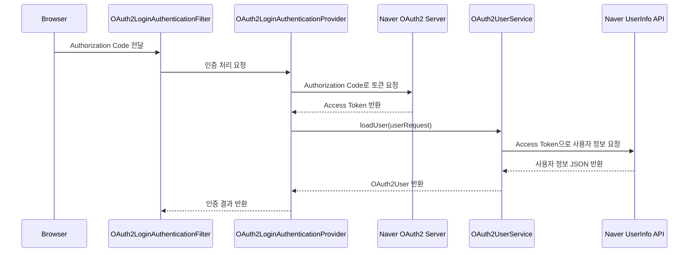
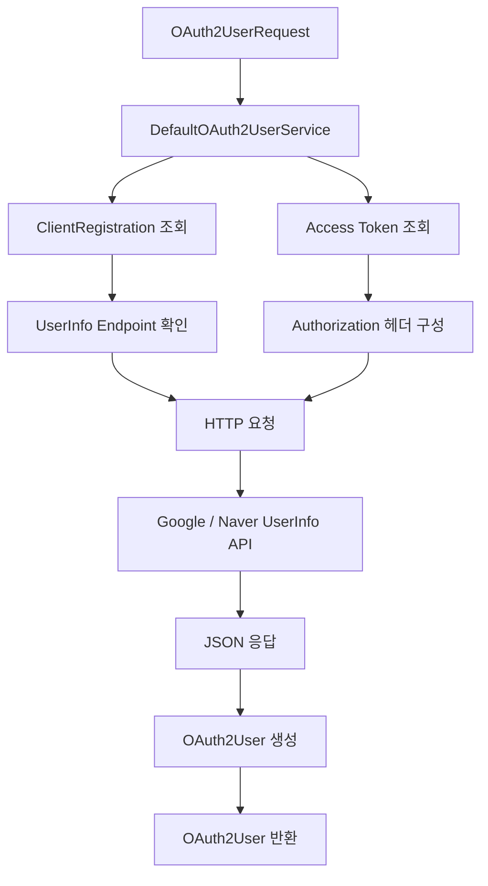
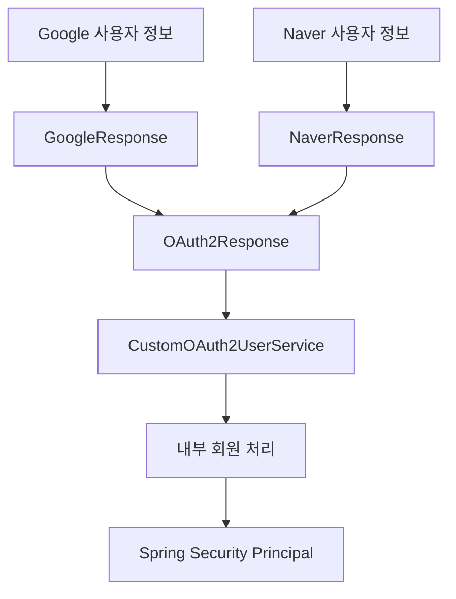
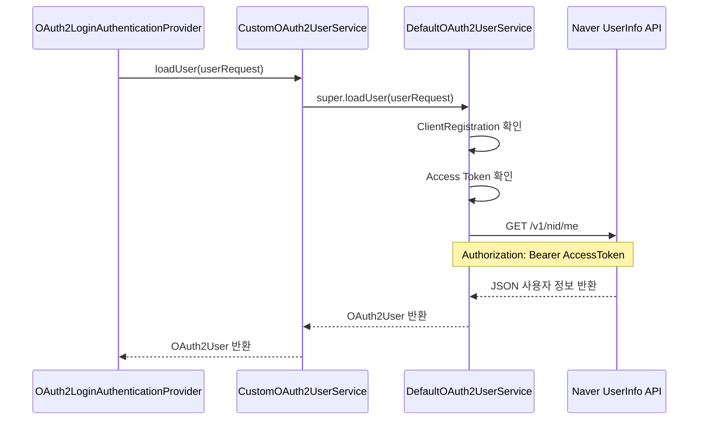
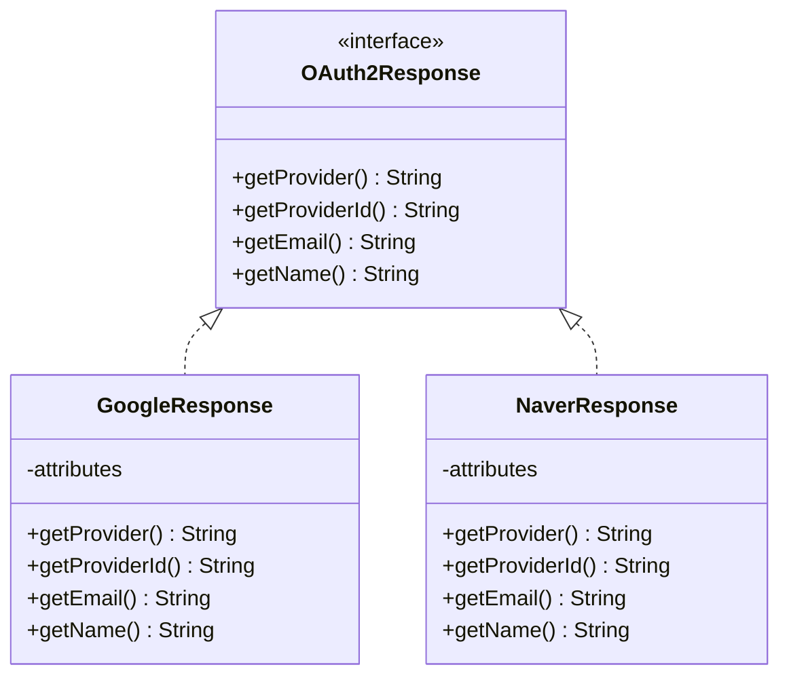
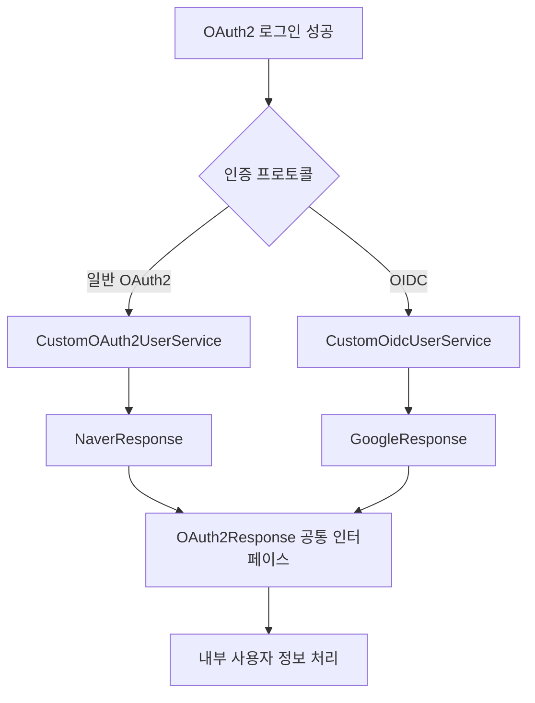
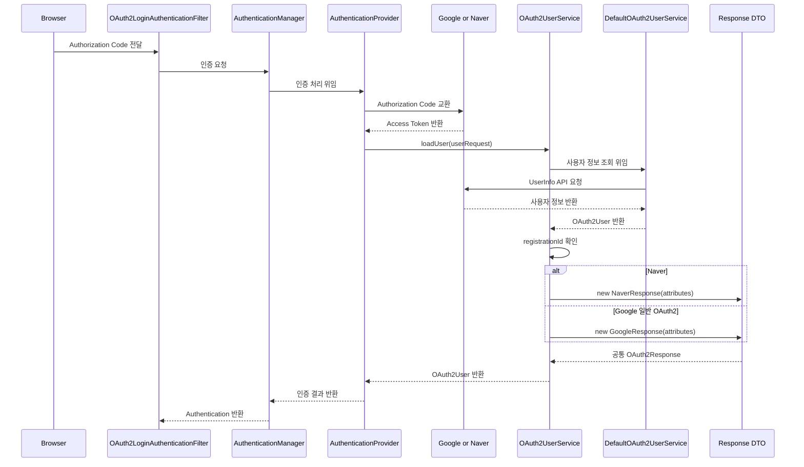
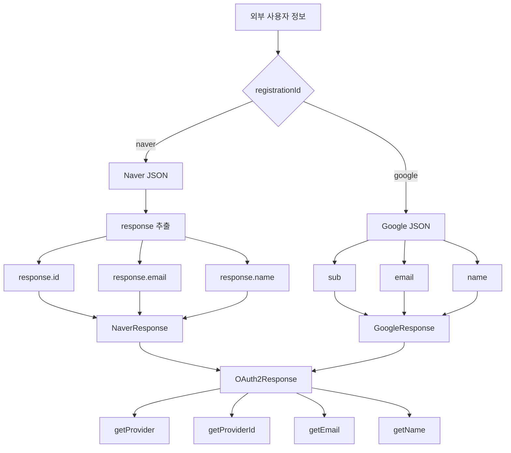
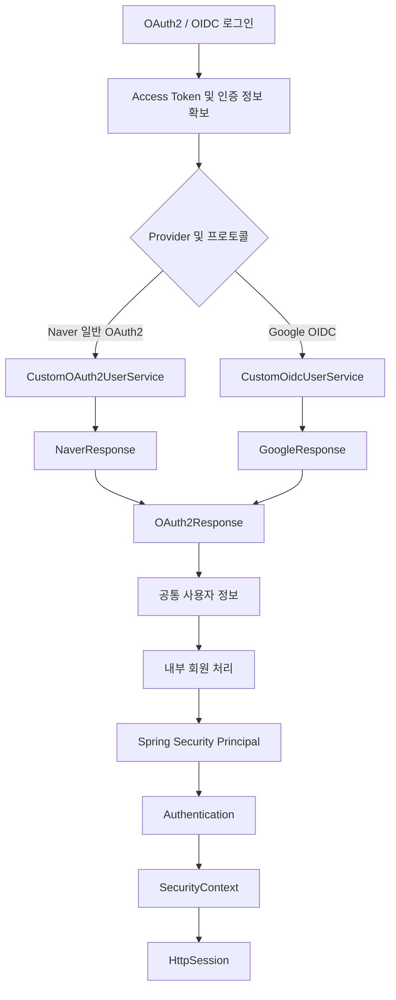

# 스프링 OAuth2 클라이언트 세션 - 8. OAuth2UserService 구현
[https://youtu.be/bMkYibr4BaM?si=6QQocLookJUedFKf](https://youtu.be/bMkYibr4BaM?si=6QQocLookJUedFKf)

# 스프링 OAuth2 클라이언트 세션 - 8. OAuth2UserService 구현
* toc
{:toc}

---

### Spring Security 6 OAuth2UserService 구현: Google·Naver 사용자 정보 조회 및 공통 DTO 설계

Spring Security OAuth2 Client를 이용하면 Google과 Naver 같은 외부 인증 제공자를 통해 소셜 로그인을 구현할 수 있다.

앞서 OAuth2 Client 프로젝트를 생성하고, SecurityConfig를 등록하여 OAuth2 로그인 기능을 활성화했다.

또한 Google과 Naver에서 OAuth2 Client ID와 Client Secret을 발급받아 `application.yml`에 등록하는 과정까지 살펴보았다.

이제 실제로 외부 인증 제공자에서 반환하는 사용자 정보를 받아 처리해야 한다.

OAuth2 인증 과정은 크게 다음과 같이 구성된다.

```text
사용자
    ↓
Google / Naver 소셜 로그인 요청
    ↓
외부 인증 서버
    ↓
사용자 인증 및 동의
    ↓
Authorization Code 발급
    ↓
Spring Security OAuth2 Client
    ↓
Access Token 교환
    ↓
외부 사용자 정보 조회
    ↓
OAuth2UserService
    ↓
서비스별 사용자 정보 변환
    ↓
OAuth2User 반환
    ↓
Authentication 생성
    ↓
SecurityContext
    ↓
HttpSession
```

이 중 이번에 집중할 부분은 다음 과정이다.

```text
Access Token 획득
    ↓
OAuth2UserService
    ↓
외부 사용자 정보 조회
    ↓
Google / Naver 응답 구조 분석
    ↓
공통 OAuth2Response 변환
    ↓
Spring Security 인증 흐름으로 반환
```

여기서 중요한 문제가 발생한다.

Google과 Naver는 모두 소셜 로그인 기능을 제공하지만, 사용자 정보를 반환하는 구조가 서로 다르다.

예를 들어 Google은 사용자 식별자를 `sub`라는 속성에 담아 반환한다.

반면 Naver는 `response`라는 객체 내부에 `id`를 포함하여 반환한다.

따라서 외부 인증 제공자의 사용자 정보를 그대로 서비스 내부에서 사용하면 제공자마다 다른 처리 로직이 필요해진다.

이러한 문제를 해결하기 위해 공통 인터페이스를 정의하고, Google과 Naver의 응답을 동일한 형태로 변환할 수 있다.

이번에는 Spring Boot 3.2.1과 Spring Security 6.2.1을 기준으로 다음 기능을 구현한다.

1. `OAuth2UserService`의 역할 이해
2. `DefaultOAuth2UserService`의 내부 처리 과정
3. `CustomOAuth2UserService` 구현
4. Google과 Naver의 사용자 정보 응답 형식 비교
5. `OAuth2Response` 공통 인터페이스 정의
6. `NaverResponse` 구현
7. `GoogleResponse` 구현
8. `registrationId`를 이용한 제공자 구분
9. `SecurityConfig`에 CustomOAuth2UserService 등록
10. Google OIDC 로그인과 일반 OAuth2 로그인의 차이 확인

이번 단계에서는 **외부 사용자 정보를 받아 공통 형태로 변환하는 것**에 집중한다.

내부 데이터베이스에 회원을 저장하거나 커스텀 Principal로 최종 인증 정보를 구성하는 부분은 별도의 확장 단계로 구분한다.

---

### 개념

#### OAuth2UserService란?

`OAuth2UserService`는 OAuth2 인증이 완료된 이후 외부 인증 제공자로부터 사용자 정보를 조회하고, 이를 Spring Security에서 사용할 수 있는 `OAuth2User` 객체로 반환하는 인터페이스다.

예를 들어 사용자가 Naver 로그인을 완료했다고 생각해보자.

Naver 인증 서버는 Authorization Code를 발급한다.

Spring Security는 해당 코드를 Access Token으로 교환한다.

이후 발급받은 Access Token으로 Naver의 사용자 정보 API를 호출한다.



여기서 `OAuth2UserService`가 담당하는 핵심 역할은 **외부 인증 제공자의 사용자 정보를 Spring Security에서 사용할 수 있도록 가져오는 것**이다.

Spring Security의 공식 API는 다음과 같은 형태로 정의되어 있다.

```java
public interface OAuth2UserService<
        R extends OAuth2UserRequest,
        U extends OAuth2User> {

    U loadUser(R userRequest)
            throws OAuth2AuthenticationException;
}
```

제네릭 타입을 살펴보면 다음과 같다.

| 타입 | 의미 |
|---|---|
| `R` | 사용자 정보 조회에 필요한 요청 객체 |
| `U` | 조회한 사용자 정보를 표현하는 객체 |
| `OAuth2UserRequest` | ClientRegistration, Access Token 등을 포함 |
| `OAuth2User` | 외부 인증 사용자 정보를 나타내는 Principal |

일반적인 OAuth2 사용자 정보 조회에서는 다음과 같은 형태가 사용된다.

```java
OAuth2UserService<OAuth2UserRequest, OAuth2User>
```

즉 `OAuth2UserRequest`를 전달받아 `OAuth2User`를 반환하는 구조다.

---

### 왜 사용하는가?

#### 외부 인증과 내부 사용자 정보 처리를 분리하기 위해서

일반적인 아이디·비밀번호 로그인에서는 `UserDetailsService`를 사용하여 내부 데이터베이스에서 사용자를 조회한다.

```text
UsernamePasswordAuthenticationFilter
    ↓
AuthenticationManager
    ↓
DaoAuthenticationProvider
    ↓
UserDetailsService
    ↓
UserRepository
    ↓
MySQL
```

반면 OAuth2 로그인에서는 외부 인증 제공자가 사용자 인증을 처리한다.

따라서 사용자 정보를 가져오는 과정도 다르다.

```text
OAuth2LoginAuthenticationFilter
    ↓
AuthenticationManager
    ↓
OAuth2LoginAuthenticationProvider
    ↓
OAuth2UserService
    ↓
Google / Naver UserInfo API
```

두 방식의 차이를 정리하면 다음과 같다.

| 구분 | 일반 로그인 | OAuth2 로그인 |
|---|---|---|
| 인증 정보 | 아이디·비밀번호 | Authorization Code |
| 사용자 인증 주체 | 우리 서비스 | 외부 인증 제공자 |
| 주요 Provider | DaoAuthenticationProvider | OAuth2LoginAuthenticationProvider |
| 사용자 조회 | UserDetailsService | OAuth2UserService |
| 사용자 정보 출처 | 내부 DB | 외부 UserInfo API |
| Principal | UserDetails | OAuth2User |
| 로그인 상태 유지 | 세션 사용 가능 | 세션 사용 가능 |

여기서 중요한 점은 `OAuth2UserService`가 `UserDetailsService`를 완전히 대체하는 것은 아니라는 사실이다.

두 인터페이스는 인증 방식에 따라 서로 다른 역할을 수행한다.

또한 OAuth2UserService가 직접 사용자의 로그인 세션을 생성하는 것도 아니다.

OAuth2UserService가 사용자 정보를 반환하면 Spring Security의 인증 처리 흐름에서 Authentication을 구성하고, 세션 기반 환경에서는 인증 상태를 저장한다.

---

### 주요 특징

#### DefaultOAuth2UserService란?

Spring Security는 OAuth2 사용자 정보 조회를 위한 기본 구현체를 제공한다.

해당 클래스는 다음과 같다.

```java
DefaultOAuth2UserService
```

패키지는 다음과 같다.

```java
org.springframework.security.oauth2.client.userinfo.DefaultOAuth2UserService
```

이 클래스는 `OAuth2UserService` 인터페이스의 구현체다.

```text
OAuth2UserService
    ↑
    │ implements
    │
DefaultOAuth2UserService
```

`DefaultOAuth2UserService`는 기본적으로 다음 작업을 수행한다.

1. OAuth2UserRequest에서 ClientRegistration 확인
2. OAuth2UserRequest에서 Access Token 확인
3. ClientRegistration의 UserInfo Endpoint 확인
4. Access Token을 포함하여 사용자 정보 API 호출
5. JSON 응답을 사용자 속성으로 변환
6. OAuth2User 생성 및 반환

Spring Security 공식 문서에 따르면 `DefaultOAuth2UserService`는 Access Token을 이용해 UserInfo Endpoint에서 사용자 속성을 조회하며, HTTP 요청에는 기본적으로 Bearer Token을 사용한다.

처리 구조는 다음과 같다.



따라서 개발자가 직접 `RestTemplate`이나 `WebClient`를 이용해 사용자 정보 API를 호출할 필요는 없다.

물론 외부 인증 제공자가 표준과 다른 요청 형식을 사용한다면 별도의 커스터마이징이 필요할 수 있다.

하지만 일반적인 OAuth2 UserInfo API를 사용하는 경우에는 기본 구현체를 활용할 수 있다.

---

### CustomOAuth2UserService가 필요한 이유

기본 구현체를 사용하면 외부 사용자 정보를 받아올 수 있다.

하지만 실제 서비스에서는 추가적인 처리가 필요하다.

예를 들어 다음과 같다.

```text
Google 사용자 정보
    ↓
{
  "sub": "google-user-123",
  "email": "user@example.com"
}
```

```text
Naver 사용자 정보
    ↓
{
  "response": {
    "id": "naver-user-123",
    "email": "user@example.com"
  }
}
```

두 응답은 서로 다른 구조를 가진다.

그렇다면 사용자 정보를 처리할 때마다 다음과 같은 분기문이 필요해질 수 있다.

```java
if (provider.equals("google")) {

    // Google 사용자 정보 처리

} else if (provider.equals("naver")) {

    // Naver 사용자 정보 처리
}
```

이러한 로직이 Controller와 Service 등 여러 계층에 반복되면 유지보수가 어려워진다.

따라서 외부 사용자 정보 조회 이후 공통 형태로 변환하는 구성요소가 필요하다.



이 구조를 사용하면 내부 서비스는 Google과 Naver의 응답 구조를 직접 알 필요가 없다.

---

### 프로젝트 구조

이번에는 다음과 같은 패키지 구조를 사용한다.

```text
src/main/java/com/example/oauth2session
│
├── Oauth2SessionApplication.java
│
├── config
│   └── SecurityConfig.java
│
├── controller
│   ├── MainController.java
│   └── MyController.java
│
├── service
│   └── CustomOAuth2UserService.java
│
└── dto
    └── oauth2
        ├── OAuth2Response.java
        ├── NaverResponse.java
        └── GoogleResponse.java
```

각 클래스의 역할은 다음과 같다.

| 클래스 | 역할 |
|---|---|
| CustomOAuth2UserService | 외부 OAuth2 사용자 정보 조회 및 변환 |
| OAuth2Response | 공통 사용자 정보 규격 |
| NaverResponse | Naver 사용자 정보 변환 |
| GoogleResponse | Google 사용자 정보 변환 |
| SecurityConfig | OAuth2UserService를 인증 흐름에 등록 |

이 구조에서는 사용자 정보 조회와 제공자별 응답 변환을 분리한다.

따라서 새로운 소셜 로그인 제공자를 추가할 때도 기존 서비스 로직의 변경을 최소화할 수 있다.

---

### 예제

#### 1. CustomOAuth2UserService 생성

먼저 `service` 패키지 아래에 다음 클래스를 생성한다.

```text
CustomOAuth2UserService.java
```

기본 구조는 다음과 같다.

```java
package com.example.oauth2session.service;

import org.springframework.security.oauth2.client.userinfo.DefaultOAuth2UserService;
import org.springframework.security.oauth2.client.userinfo.OAuth2UserRequest;
import org.springframework.security.oauth2.core.OAuth2AuthenticationException;
import org.springframework.security.oauth2.core.user.OAuth2User;
import org.springframework.stereotype.Service;

@Service
public class CustomOAuth2UserService
        extends DefaultOAuth2UserService {

    @Override
    public OAuth2User loadUser(
            OAuth2UserRequest userRequest
    ) throws OAuth2AuthenticationException {

        OAuth2User oauth2User =
                super.loadUser(userRequest);

        return oauth2User;
    }
}
```

이 코드에서 가장 중요한 부분은 다음과 같다.

```java
public class CustomOAuth2UserService
        extends DefaultOAuth2UserService
```

`DefaultOAuth2UserService`를 상속하면 Spring Security가 제공하는 기본 사용자 정보 조회 로직을 재사용할 수 있다.

그리고 필요한 부분만 확장할 수 있다.

---

### @Service의 역할

```java
@Service
public class CustomOAuth2UserService {

}
```

`@Service`는 해당 클래스를 Spring Bean으로 등록하는 데 사용한다.

정확히는 Spring의 컴포넌트 스캔을 통해 Bean으로 등록될 수 있도록 한다.

이렇게 등록된 Bean은 이후 SecurityConfig에서 생성자 주입으로 사용할 수 있다.

```text
@Service
    ↓
CustomOAuth2UserService
    ↓
Spring Container
    ↓
SecurityConfig에서 주입
```

여기서 주의해야 할 점이 있다.

`@Service`를 선언했다고 해서 CustomOAuth2UserService가 OAuth2 로그인에 자동으로 연결되는 것은 아니다.

실제로 OAuth2 인증 과정에서 사용하려면 `SecurityConfig`에 등록해야 한다.

---

### loadUser()의 역할

다음 메서드를 살펴보자.

```java
@Override
public OAuth2User loadUser(
        OAuth2UserRequest userRequest
) throws OAuth2AuthenticationException {

    OAuth2User oauth2User =
            super.loadUser(userRequest);

    return oauth2User;
}
```

`loadUser()`는 OAuth2 사용자 정보를 조회할 때 호출된다.

이때 인자로 전달되는 `OAuth2UserRequest`에는 다음과 같은 정보가 포함된다.

```text
OAuth2UserRequest
    │
    ├── ClientRegistration
    │     │
    │     ├── registrationId
    │     ├── clientId
    │     ├── clientSecret
    │     └── providerDetails
    │
    └── OAuth2AccessToken
          │
          ├── tokenValue
          ├── issuedAt
          ├── expiresAt
          └── scopes
```

이 정보를 이용해 어떤 인증 제공자를 사용했는지 확인할 수 있다.

또한 외부 사용자 정보를 조회하기 위한 Access Token도 사용할 수 있다.

---

### super.loadUser()는 무엇을 수행할까?

다음 코드는 단순한 부모 메서드 호출이 아니다.

```java
OAuth2User oauth2User =
        super.loadUser(userRequest);
```

이 메서드는 실제 외부 사용자 정보 조회 과정을 수행한다.

예를 들어 Naver를 사용한다면 다음과 같이 동작한다.



따라서 `super.loadUser()` 호출 이후에는 외부 인증 제공자의 사용자 정보를 확인할 수 있다.

```java
OAuth2User oauth2User =
        super.loadUser(userRequest);

Map<String, Object> attributes =
        oauth2User.getAttributes();
```

`getAttributes()`는 외부 사용자 정보의 속성을 `Map<String, Object>` 형태로 반환한다.

예를 들어 다음과 같은 값을 얻을 수 있다.

```text
{
    sub=google-user-123,
    name=Example User,
    email=user@example.com
}
```

Naver에서는 다음과 같은 구조가 될 수 있다.

```text
{
    resultcode=00,
    message=success,
    response={
        id=naver-user-123,
        name=Example User,
        email=user@example.com
    }
}
```

여기서 한 가지 주의해야 한다.

**운영 환경에서 `getAttributes()` 전체를 로그로 출력하는 것은 피하는 것이 좋다.**

이메일, 이름 등 개인정보가 포함될 수 있기 때문이다.

디버깅이 필요한 경우에도 필요한 항목만 제한적으로 확인하는 것이 적절하다.

---

### OAuth2User는 어떤 정보를 가지고 있을까?

`OAuth2User`는 외부 인증 사용자를 표현하기 위한 인터페이스다.

대표적인 메서드는 다음과 같다.

```java
public interface OAuth2User
        extends OAuth2AuthenticatedPrincipal {

}
```

`OAuth2AuthenticatedPrincipal`을 통해 다음 정보를 사용할 수 있다.

```java
oauth2User.getAttributes();
```

```java
oauth2User.getAuthorities();
```

```java
oauth2User.getName();
```

각 메서드의 의미는 다음과 같다.

| 메서드 | 역할 |
|---|---|
| getAttributes() | 외부 사용자 속성 반환 |
| getAuthorities() | 사용자에게 부여된 Authority 반환 |
| getName() | Principal 이름 반환 |

여기서 `getName()`이 반드시 사용자의 실명을 반환하는 것은 아니다.

Google에서는 사용자 식별자에 해당하는 `sub`가 사용될 수 있다.

Naver에서는 사용자 이름 속성 설정에 따라 다른 값이 반환될 수 있다.

따라서 외부 사용자 식별자와 화면에 표시할 이름은 구분하는 것이 좋다.

---

### 2. Google과 Naver의 사용자 정보 형식 비교

이제 외부 인증 제공자의 응답 구조를 살펴보자.

OAuth2UserService에서 공통 응답 DTO를 구성하려면 먼저 두 제공자의 차이를 이해해야 한다.

#### Naver 사용자 정보

Naver의 UserInfo API는 다음과 같다.

```text
https://openapi.naver.com/v1/nid/me
```

Access Token을 이용해 사용자 정보를 조회한다.

```http
GET /v1/nid/me HTTP/1.1
Host: openapi.naver.com
Authorization: Bearer NAVER_ACCESS_TOKEN
```

정상적으로 처리되면 다음과 유사한 JSON을 반환한다.

```json
{
  "resultcode": "00",
  "message": "success",
  "response": {
    "id": "naver-user-123",
    "nickname": "example",
    "name": "홍길동",
    "email": "user@example.com"
  }
}
```

실제 사용자 정보는 `response` 객체 내부에 존재한다.

```text
Naver Response
    │
    ├── resultcode
    │
    ├── message
    │
    └── response
          │
          ├── id
          ├── nickname
          ├── name
          └── email
```

이 구조에서 중요한 사용자 식별자는 다음과 같다.

```text
response.id
```

Naver 공식 문서에서는 이 `id`가 실제 네이버 로그인 아이디가 아닌 애플리케이션별 고유 사용자 식별자라고 설명한다.

즉 사용자 식별을 위해 이메일이나 닉네임을 사용할 필요는 없다.

---

### Google 사용자 정보

Google의 일반적인 사용자 정보는 다음과 같은 구조를 가진다.

```json
{
  "sub": "google-user-123",
  "name": "홍길동",
  "given_name": "길동",
  "family_name": "홍",
  "picture": "https://example.com/profile.jpg",
  "email": "user@example.com",
  "email_verified": true
}
```

Google은 Naver처럼 별도의 `response` 객체를 사용하지 않는다.

주요 속성이 최상위에 존재한다.

```text
Google Response
    │
    ├── sub
    ├── name
    ├── given_name
    ├── family_name
    ├── picture
    ├── email
    └── email_verified
```

여기서 중요한 사용자 식별자는 다음과 같다.

```text
sub
```

Google의 `sub`는 외부 계정을 구분하기 위한 안정적인 사용자 식별자다.

이메일은 변경될 수 있으므로 외부 계정을 식별하는 기본키로 사용하는 것은 적절하지 않다.

Google과 Naver의 응답을 비교하면 다음과 같다.

| 항목 | Google | Naver |
|---|---|---|
| 사용자 식별자 | `sub` | `response.id` |
| 이메일 | `email` | `response.email` |
| 이름 | `name` | `response.name` |
| 닉네임 | 별도 속성 또는 정책 | `response.nickname` |
| 최상위 응답 구조 | 사용자 정보 | 응답 메타데이터 |
| 중첩 객체 | 기본 사용자 정보에서는 불필요 | `response` |
| 사용자 정보 처리 | OAuth2User / OidcUser | OAuth2User |

이처럼 응답 구조가 서로 다르기 때문에 공통 DTO로 변환하는 작업이 필요하다.

---

### 3. OAuth2Response 인터페이스 생성

먼저 Google과 Naver에서 공통으로 사용할 사용자 정보 규격을 정의한다.

파일 경로는 다음과 같다.

```text
dto/oauth2/OAuth2Response.java
```

전체 코드는 다음과 같다.

```java
package com.example.oauth2session.dto.oauth2;

public interface OAuth2Response {

    // 외부 인증 제공자
    String getProvider();

    // 외부 인증 제공자의 사용자 식별자
    String getProviderId();

    // 이메일
    String getEmail();

    // 사용자 이름
    String getName();
}
```

이 인터페이스는 공통 사용자 정보의 계약을 정의한다.

각 메서드의 역할은 다음과 같다.

| 메서드 | 반환 정보 | 예시 |
|---|---|---|
| getProvider() | 인증 제공자 | google, naver |
| getProviderId() | 제공자 사용자 식별자 | google-user-123 |
| getEmail() | 이메일 | user@example.com |
| getName() | 사용자 이름 | 홍길동 |

Google과 Naver는 서로 다른 응답 구조를 가지고 있지만 내부 서비스에서는 동일한 메서드로 접근할 수 있다.

예를 들어 다음과 같다.

```java
OAuth2Response response = ...;

String provider =
        response.getProvider();

String providerId =
        response.getProviderId();

String email =
        response.getEmail();

String name =
        response.getName();
```

이 코드에서는 실제 구현체가 `GoogleResponse`인지 `NaverResponse`인지 알 필요가 없다.

이러한 구조가 인터페이스 기반 설계의 장점이다.

---

### 4. NaverResponse 구현

먼저 Naver 사용자 정보 응답을 처리할 클래스를 작성한다.

파일 경로는 다음과 같다.

```text
dto/oauth2/NaverResponse.java
```

Naver의 응답은 다음과 같이 구성된다.

```json
{
  "resultcode": "00",
  "message": "success",
  "response": {
    "id": "naver-user-123",
    "name": "홍길동",
    "email": "user@example.com"
  }
}
```

따라서 생성자에서 `response` 객체를 추출해야 한다.

전체 코드는 다음과 같다.

```java
package com.example.oauth2session.dto.oauth2;

import java.util.Map;

public class NaverResponse implements OAuth2Response {

    private final Map<?, ?> attributes;

    public NaverResponse(
            Map<String, Object> attributes
    ) {

        Object response = attributes.get("response");

        if (!(response instanceof Map<?, ?> responseMap)) {
            throw new IllegalArgumentException(
                    "Naver 사용자 정보 응답 형식이 올바르지 않습니다."
            );
        }

        this.attributes = responseMap;
    }

    @Override
    public String getProvider() {

        return "naver";
    }

    @Override
    public String getProviderId() {

        Object id = attributes.get("id");

        if (!(id instanceof String providerId)
                || providerId.isBlank()) {

            throw new IllegalArgumentException(
                    "Naver 사용자 식별자가 존재하지 않습니다."
            );
        }

        return providerId;
    }

    @Override
    public String getEmail() {

        Object email = attributes.get("email");

        return email instanceof String value
                ? value
                : null;
    }

    @Override
    public String getName() {

        Object name = attributes.get("name");

        return name instanceof String value
                ? value
                : null;
    }
}
```

이제 코드를 자세히 살펴보자.

---

### NaverResponse 생성자

가장 중요한 부분은 다음과 같다.

```java
public NaverResponse(
        Map<String, Object> attributes
) {

    Object response = attributes.get("response");

    if (!(response instanceof Map<?, ?> responseMap)) {
        throw new IllegalArgumentException(
                "Naver 사용자 정보 응답 형식이 올바르지 않습니다."
        );
    }

    this.attributes = responseMap;
}
```

`DefaultOAuth2UserService`가 반환한 사용자 정보는 `Map<String, Object>` 형태다.

하지만 Naver의 실제 사용자 정보는 `response` 객체 내부에 있다.

따라서 다음 값을 추출한다.

```java
attributes.get("response");
```

예를 들어 다음 구조를 생각해보자.

```text
attributes
    │
    ├── resultcode = 00
    │
    ├── message = success
    │
    └── response
          │
          ├── id
          ├── name
          └── email
```

생성자에서는 `response` 내부의 Map만 보관한다.

```text
NaverResponse.attributes
    │
    ├── id
    ├── name
    └── email
```

이렇게 하면 이후 사용자 식별자를 가져올 때 단순하게 접근할 수 있다.

```java
attributes.get("id");
```

#### 왜 instanceof로 검증할까?

다음과 같이 바로 캐스팅할 수도 있다.

```java
Map<String, Object> response =
        (Map<String, Object>) attributes.get("response");
```

하지만 `response`가 존재하지 않거나 예상한 자료형이 아니라면 예외가 발생할 수 있다.

또한 제네릭 타입 캐스팅에 대한 경고도 발생할 수 있다.

이번 예제에서는 다음 방식으로 검증한다.

```java
if (!(response instanceof Map<?, ?> responseMap)) {
    throw new IllegalArgumentException(
            "Naver 사용자 정보 응답 형식이 올바르지 않습니다."
    );
}
```

이렇게 하면 예상하지 못한 응답 형식을 조금 더 명확하게 처리할 수 있다.

실제 서비스에서는 이러한 예외를 OAuth2 인증 실패 처리와 연결할 수 있다.

---

### getProvider()

```java
@Override
public String getProvider() {

    return "naver";
}
```

이 메서드는 인증 제공자를 반환한다.

```text
naver
```

외부 사용자 식별자는 제공자마다 서로 다른 영역에서 관리된다.

따라서 내부 사용자 정보를 저장할 때는 제공자 이름을 함께 관리하는 것이 좋다.

예를 들어 다음과 같다.

```text
provider = naver

providerId = naver-user-123
```

---

### getProviderId()

```java
@Override
public String getProviderId() {

    Object id = attributes.get("id");

    if (!(id instanceof String providerId)
            || providerId.isBlank()) {

        throw new IllegalArgumentException(
                "Naver 사용자 식별자가 존재하지 않습니다."
        );
    }

    return providerId;
}
```

이 메서드는 Naver가 제공하는 사용자 식별자를 반환한다.

앞에서 `response` 객체를 추출했으므로 이제 `id`에 직접 접근할 수 있다.

```text
원본 응답
    ↓
response.id
```

```text
NaverResponse
    ↓
attributes.get("id")
```

이 값을 이용하면 동일한 Naver 사용자인지 구분할 수 있다.

다만 Naver의 사용자 식별자는 애플리케이션별로 다르게 발급될 수 있으므로, 다른 애플리케이션의 사용자 식별자와 무조건 동일하다고 가정해서는 안 된다.

---

### getEmail()과 getName()

```java
@Override
public String getEmail() {

    Object email = attributes.get("email");

    return email instanceof String value
            ? value
            : null;
}
```

```java
@Override
public String getName() {

    Object name = attributes.get("name");

    return name instanceof String value
            ? value
            : null;
}
```

이메일과 이름은 사용자 정보 제공 동의 및 애플리케이션 권한에 따라 제공 여부가 달라질 수 있다.

따라서 반드시 값이 존재한다고 가정하지 않는다.

반면 사용자 식별자 `id`는 회원 계정을 구분하는 데 필요한 핵심 정보이므로 누락된 경우 오류로 처리한다.

이러한 차이를 코드에 반영했다.

---

### 5. GoogleResponse 구현

이번에는 Google 사용자 정보 응답을 처리할 클래스를 작성한다.

파일 경로는 다음과 같다.

```text
dto/oauth2/GoogleResponse.java
```

Google의 사용자 정보는 다음과 같은 구조다.

```json
{
  "sub": "google-user-123",
  "name": "홍길동",
  "email": "user@example.com",
  "email_verified": true
}
```

Naver와 달리 별도의 `response` 객체가 존재하지 않는다.

따라서 전달받은 Map을 그대로 사용하면 된다.

```java
package com.example.oauth2session.dto.oauth2;

import java.util.Map;

public class GoogleResponse implements OAuth2Response {

    private final Map<String, Object> attributes;

    public GoogleResponse(
            Map<String, Object> attributes
    ) {

        this.attributes = attributes;
    }

    @Override
    public String getProvider() {

        return "google";
    }

    @Override
    public String getProviderId() {

        Object sub = attributes.get("sub");

        if (!(sub instanceof String providerId)
                || providerId.isBlank()) {

            throw new IllegalArgumentException(
                    "Google 사용자 식별자가 존재하지 않습니다."
            );
        }

        return providerId;
    }

    @Override
    public String getEmail() {

        Object email = attributes.get("email");

        return email instanceof String value
                ? value
                : null;
    }

    @Override
    public String getName() {

        Object name = attributes.get("name");

        return name instanceof String value
                ? value
                : null;
    }
}
```

NaverResponse와 비교하면 생성자에서 차이가 있다.

#### NaverResponse

```java
Object response = attributes.get("response");
```

#### GoogleResponse

```java
this.attributes = attributes;
```

Google은 사용자 정보가 최상위 속성에 있으므로 별도의 중첩 객체를 추출하지 않는다.

또한 사용자 식별자도 다르다.

#### Naver

```java
attributes.get("id");
```

#### Google

```java
attributes.get("sub");
```

하지만 두 클래스 모두 `OAuth2Response` 인터페이스를 구현했으므로 외부에서는 동일한 메서드를 사용할 수 있다.

```java
OAuth2Response response = ...;

response.getProvider();

response.getProviderId();

response.getEmail();

response.getName();
```

---

### 공통 인터페이스를 사용하는 이유

지금까지 `OAuth2Response`, `NaverResponse`, `GoogleResponse`를 구현했다.

이 구조의 핵심은 외부 응답 형식과 내부 사용자 정보 처리 로직의 결합도를 낮추는 것이다.

공통 인터페이스가 없다면 다음과 같은 구조가 될 수 있다.

```text
CustomOAuth2UserService
    │
    ├── Google
    │     ├── sub 추출
    │     ├── email 추출
    │     └── name 추출
    │
    └── Naver
          ├── response 추출
          ├── id 추출
          ├── email 추출
          └── name 추출
```

하지만 공통 인터페이스를 적용하면 다음과 같이 구성할 수 있다.



내부 서비스에서는 `OAuth2Response`만 사용한다.

이렇게 하면 새로운 인증 제공자를 추가하더라도 공통 사용자 처리 로직을 재사용할 수 있다.

예를 들어 Kakao 로그인까지 지원한다면 다음과 같은 구현체를 추가할 수 있다.

```text
OAuth2Response
    │
    ├── GoogleResponse
    │
    ├── NaverResponse
    │
    └── KakaoResponse
```

각 제공자의 응답 구조는 구현체 내부에서 처리한다.

공통 로직은 `OAuth2Response` 인터페이스만 의존한다.

이는 객체지향 설계에서 중요한 **다형성과 의존성 역전 원칙**을 활용하는 방식이다.

---

### 6. CustomOAuth2UserService에서 제공자 구분하기

이제 작성한 DTO들을 CustomOAuth2UserService에 연결한다.

먼저 어떤 인증 제공자를 이용했는지 확인해야 한다.

이 정보는 `OAuth2UserRequest`에서 가져올 수 있다.

```java
String registrationId = userRequest
        .getClientRegistration()
        .getRegistrationId();
```

이 코드는 다음과 같이 동작한다.

```text
OAuth2UserRequest
    ↓
getClientRegistration()
    ↓
ClientRegistration
    ↓
getRegistrationId()
    ↓
google 또는 naver
```

예를 들어 Google 로그인이라면 다음 값이 반환된다.

```text
google
```

Naver 로그인이라면 다음 값이 반환된다.

```text
naver
```

이 값을 이용해 적절한 DTO를 생성할 수 있다.

```java
OAuth2Response response;

if ("naver".equals(registrationId)) {

    response = new NaverResponse(
            oauth2User.getAttributes()
    );

} else if ("google".equals(registrationId)) {

    response = new GoogleResponse(
            oauth2User.getAttributes()
    );

} else {

    // 지원하지 않는 제공자 처리
}
```

이렇게 하면 외부 인증 제공자에 따라 서로 다른 응답 구조를 처리할 수 있다.

---

### CustomOAuth2UserService 전체 코드

이제 지금까지 작성한 기능을 하나의 클래스로 정리한다.

```java
package com.example.oauth2session.service;

import com.example.oauth2session.dto.oauth2.GoogleResponse;
import com.example.oauth2session.dto.oauth2.NaverResponse;
import com.example.oauth2session.dto.oauth2.OAuth2Response;

import org.slf4j.Logger;
import org.slf4j.LoggerFactory;

import org.springframework.security.oauth2.client.userinfo.DefaultOAuth2UserService;
import org.springframework.security.oauth2.client.userinfo.OAuth2UserRequest;

import org.springframework.security.oauth2.core.OAuth2AuthenticationException;
import org.springframework.security.oauth2.core.OAuth2Error;
import org.springframework.security.oauth2.core.user.OAuth2User;

import org.springframework.stereotype.Service;

@Service
public class CustomOAuth2UserService
        extends DefaultOAuth2UserService {

    private static final Logger log =
            LoggerFactory.getLogger(
                    CustomOAuth2UserService.class
            );

    @Override
    public OAuth2User loadUser(
            OAuth2UserRequest userRequest
    ) throws OAuth2AuthenticationException {

        // 외부 UserInfo API 호출
        OAuth2User oauth2User =
                super.loadUser(userRequest);

        // OAuth2 Client 구분
        String registrationId = userRequest
                .getClientRegistration()
                .getRegistrationId();

        // 제공자별 사용자 정보 변환
        OAuth2Response response;

        try {

            if ("naver".equals(registrationId)) {

                response = new NaverResponse(
                        oauth2User.getAttributes()
                );

            } else if ("google".equals(registrationId)) {

                response = new GoogleResponse(
                        oauth2User.getAttributes()
                );

            } else {

                throw new OAuth2AuthenticationException(
                        new OAuth2Error("unsupported_provider"),
                        "지원하지 않는 OAuth2 제공자입니다."
                );
            }

            // 사용자 식별자 검증
            String providerUserId =
                    response.getProviderId();

            log.info(
                    "OAuth2 사용자 정보 변환 완료: provider={}, validId={}",
                    response.getProvider(),
                    !providerUserId.isBlank()
            );

        } catch (IllegalArgumentException exception) {

            throw new OAuth2AuthenticationException(
                    new OAuth2Error("invalid_user_info"),
                    "OAuth2 사용자 정보 형식이 올바르지 않습니다."
            );
        }

        // 현재 단계에서는 기본 Principal 반환
        // 이후 내부 회원 정보와 권한을 연결할 수 있다.
        return oauth2User;
    }
}
```

이번 구현에서 중요한 작업은 다음 네 가지다.

**첫 번째는 외부 사용자 정보 조회다.**

```java
OAuth2User oauth2User =
        super.loadUser(userRequest);
```

**두 번째는 인증 제공자 식별이다.**

```java
String registrationId = userRequest
        .getClientRegistration()
        .getRegistrationId();
```

**세 번째는 공통 DTO 변환이다.**

```java
response = new NaverResponse(
        oauth2User.getAttributes()
);
```

또는 다음과 같다.

```java
response = new GoogleResponse(
        oauth2User.getAttributes()
);
```

**네 번째는 OAuth2User 반환이다.**

```java
return oauth2User;
```

여기서 마지막 코드를 주의 깊게 살펴봐야 한다.

현재는 외부 사용자 정보를 공통 DTO로 변환하는 단계이므로 Spring Security가 생성한 기본 OAuth2User를 그대로 반환한다.

이렇게 하면 사용자 정보 조회와 정규화 과정을 확인하면서 기존 인증 흐름을 유지할 수 있다.

이후 내부 회원 정보와 서비스 권한까지 적용하려면 별도의 `CustomOAuth2User`를 구현하여 반환하는 방식으로 확장할 수 있다.

또한 다음과 같이 `null`을 반환하는 구현은 피해야 한다.

```java
return null;
```

OAuth2UserService가 유효한 Principal을 반환하지 않으면 인증 처리를 정상적으로 완료할 수 없기 때문이다.

---

### 7. SecurityConfig에 CustomOAuth2UserService 등록

CustomOAuth2UserService를 구현했다면 Spring Security의 OAuth2 로그인 과정에서 해당 객체를 사용하도록 등록해야 한다.

이 작업은 SecurityConfig에서 수행한다.

먼저 생성자 주입으로 CustomOAuth2UserService를 전달받는다.

```java
private final CustomOAuth2UserService customOAuth2UserService;

public SecurityConfig(
        CustomOAuth2UserService customOAuth2UserService
) {

    this.customOAuth2UserService =
            customOAuth2UserService;
}
```

그리고 `oauth2Login()`의 `userInfoEndpoint()` 설정에 등록한다.

```java
.oauth2Login(oauth2 -> oauth2

        .userInfoEndpoint(userInfo -> userInfo

                .userService(customOAuth2UserService)
        )
)
```

가장 중요한 부분은 다음과 같다.

```java
.userService(customOAuth2UserService)
```

이 설정을 통해 일반 OAuth2 사용자 정보 조회 과정에서 커스텀 서비스를 사용하도록 지정한다.

Spring Security 6.2 API에서도 `userService()`는 `OAuth2UserRequest`를 받아 `OAuth2User`를 반환하는 사용자 정보 조회 서비스의 등록 지점으로 제공된다.

---

### SecurityConfig 전체 코드

현재 단계에서는 다음과 같이 구성할 수 있다.

```java
package com.example.oauth2session.config;

import com.example.oauth2session.service.CustomOAuth2UserService;

import org.springframework.context.annotation.Bean;
import org.springframework.context.annotation.Configuration;

import org.springframework.security.config.annotation.web.builders.HttpSecurity;
import org.springframework.security.config.annotation.web.configurers.AbstractHttpConfigurer;

import org.springframework.security.web.SecurityFilterChain;

@Configuration
public class SecurityConfig {

    private final CustomOAuth2UserService customOAuth2UserService;

    public SecurityConfig(
            CustomOAuth2UserService customOAuth2UserService
    ) {

        this.customOAuth2UserService =
                customOAuth2UserService;
    }

    @Bean
    public SecurityFilterChain securityFilterChain(
            HttpSecurity http
    ) throws Exception {

        http
                // 일반 Form Login 비활성화
                .formLogin(AbstractHttpConfigurer::disable)

                // HTTP Basic 인증 비활성화
                .httpBasic(AbstractHttpConfigurer::disable)

                // OAuth2 로그인 설정
                .oauth2Login(oauth2 -> oauth2

                        .userInfoEndpoint(userInfo -> userInfo

                                .userService(customOAuth2UserService)
                        )
                )

                // 경로별 인가 설정
                .authorizeHttpRequests(auth -> auth

                        .requestMatchers(
                                "/",
                                "/error",
                                "/oauth2/authorization/**",
                                "/login/oauth2/code/**"
                        ).permitAll()

                        .anyRequest().authenticated()
                );

        return http.build();
    }
}
```

이 설정에서는 세션 기반 인증을 사용한다.

또한 CSRF 보호는 기본값을 유지한다.

앞서 작성한 다음 설정을 확장한 형태다.

```java
.oauth2Login(Customizer.withDefaults())
```

기본 설정을 사용하던 부분을 다음과 같이 변경했다.

```java
.oauth2Login(oauth2 -> oauth2

        .userInfoEndpoint(userInfo -> userInfo

                .userService(customOAuth2UserService)
        )
)
```

이렇게 하면 OAuth2 사용자 정보 조회 로직을 커스터마이징할 수 있다.

다만 이 시점에서 중요한 차이를 하나 더 이해해야 한다.

---

### Google에서 CustomOAuth2UserService가 호출되지 않는 이유

이 부분은 실제 프로젝트에서 반드시 확인해야 한다.

앞서 Google 소셜 로그인 설정에서는 다음 Scope를 사용했다.

```yaml
scope:
  - openid
  - profile
  - email
```

여기서 `openid`가 포함되어 있다.

이 경우 Spring Security는 일반 OAuth2 사용자 정보 처리 대신 OpenID Connect 전용 처리 경로를 사용한다.

대표적으로 다음과 같다.

```text
Google OAuth2 Login
    ↓
openid Scope 존재
    ↓
OIDC 인증 처리
    ↓
OidcUserService
    ↓
OidcUser
```

반면 일반 OAuth2 로그인은 다음과 같다.

```text
Naver OAuth2 Login
    ↓
일반 OAuth2 사용자 정보 처리
    ↓
DefaultOAuth2UserService
    ↓
OAuth2User
```

Spring Security 공식 문서에서도 `openid` Scope가 존재하면 OIDC 전용 구성요소를 사용하며, 그렇지 않으면 일반 OAuth2 사용자 정보 처리 구성요소를 사용한다고 설명한다.

따라서 다음 설정만으로는 Google OIDC 사용자 정보를 처리하는 CustomOAuth2UserService가 호출되지 않을 수 있다.

```java
.userService(customOAuth2UserService)
```

Google에 `openid` Scope를 유지한다면 `OidcUserService`도 별도로 등록해야 한다.

이 부분을 정확하게 구분해야 한다.

---

### OAuth2UserService와 OidcUserService 비교

| 항목 | OAuth2UserService | OidcUserService |
|---|---|---|
| 기반 기술 | 일반 OAuth2 | OpenID Connect |
| 대표 사용 대상 | Naver 일반 OAuth2 | Google OIDC |
| 입력 | OAuth2UserRequest | OidcUserRequest |
| 출력 | OAuth2User | OidcUser |
| 사용자 정보 출처 | UserInfo Endpoint | 검증된 ID Token 및 필요 시 UserInfo |
| 기본 구현체 | DefaultOAuth2UserService | OidcUserService |
| SecurityConfig 등록 | `userService()` | `oidcUserService()` |

특히 Google OIDC에서는 ID Token의 `sub`를 이용해 사용자 식별 정보를 얻을 수 있다.

반면 Naver의 일반 OAuth2 연동에서는 UserInfo API 응답의 `response.id`를 사용한다.

즉 사용자 식별을 위한 최종 정보는 유사하지만 정보를 획득하는 내부 경로는 다를 수 있다.

---

### 8. Google OIDC 사용자 정보까지 처리하기

기존 Google 설정에서 `openid` Scope를 유지한다면 별도의 OIDC 사용자 정보 처리 서비스를 추가할 수 있다.

이 작업은 기본 OAuth2UserService 구현을 확장하는 실무 구성이다.

파일 경로는 다음과 같다.

```text
service/CustomOidcUserService.java
```

전체 코드는 다음과 같다.

```java
package com.example.oauth2session.service;

import com.example.oauth2session.dto.oauth2.GoogleResponse;
import com.example.oauth2session.dto.oauth2.OAuth2Response;

import org.slf4j.Logger;
import org.slf4j.LoggerFactory;

import org.springframework.security.oauth2.client.oidc.userinfo.OidcUserService;
import org.springframework.security.oauth2.client.oidc.userinfo.OidcUserRequest;

import org.springframework.security.oauth2.core.OAuth2AuthenticationException;
import org.springframework.security.oauth2.core.OAuth2Error;

import org.springframework.security.oauth2.core.oidc.user.OidcUser;

import org.springframework.stereotype.Service;

@Service
public class CustomOidcUserService
        extends OidcUserService {

    private static final Logger log =
            LoggerFactory.getLogger(
                    CustomOidcUserService.class
            );

    @Override
    public OidcUser loadUser(
            OidcUserRequest userRequest
    ) throws OAuth2AuthenticationException {

        // OIDC 사용자 정보 처리
        OidcUser oidcUser =
                super.loadUser(userRequest);

        String registrationId = userRequest
                .getClientRegistration()
                .getRegistrationId();

        if ("google".equals(registrationId)) {

            try {

                OAuth2Response response =
                        new GoogleResponse(
                                oidcUser.getClaims()
                        );

                String providerUserId =
                        response.getProviderId();

                log.info(
                        "Google OIDC 사용자 정보 변환 완료: validId={}",
                        !providerUserId.isBlank()
                );

            } catch (IllegalArgumentException exception) {

                throw new OAuth2AuthenticationException(
                        new OAuth2Error("invalid_user_info"),
                        "Google 사용자 정보가 올바르지 않습니다."
                );
            }
        }

        return oidcUser;
    }
}
```

이 클래스는 OIDC 인증 과정에서 호출되는 사용자 정보 처리 서비스를 확장한다.

핵심 부분은 다음과 같다.

```java
OidcUser oidcUser =
        super.loadUser(userRequest);
```

기본 OIDC 사용자 정보 처리 로직을 실행한다.

그다음 다음 메서드를 이용해 사용자 Claim을 가져온다.

```java
oidcUser.getClaims();
```

그리고 GoogleResponse로 변환한다.

```java
OAuth2Response response =
        new GoogleResponse(
                oidcUser.getClaims()
        );
```

이렇게 하면 Google OIDC에서도 앞서 정의한 공통 인터페이스를 사용할 수 있다.

---

### Google과 Naver를 모두 지원하는 SecurityConfig

이제 일반 OAuth2와 OIDC를 모두 등록해보자.

```java
package com.example.oauth2session.config;

import com.example.oauth2session.service.CustomOAuth2UserService;
import com.example.oauth2session.service.CustomOidcUserService;

import org.springframework.context.annotation.Bean;
import org.springframework.context.annotation.Configuration;

import org.springframework.security.config.annotation.web.builders.HttpSecurity;
import org.springframework.security.config.annotation.web.configurers.AbstractHttpConfigurer;

import org.springframework.security.web.SecurityFilterChain;

@Configuration
public class SecurityConfig {

    private final CustomOAuth2UserService customOAuth2UserService;

    private final CustomOidcUserService customOidcUserService;

    public SecurityConfig(
            CustomOAuth2UserService customOAuth2UserService,
            CustomOidcUserService customOidcUserService
    ) {

        this.customOAuth2UserService =
                customOAuth2UserService;

        this.customOidcUserService =
                customOidcUserService;
    }

    @Bean
    public SecurityFilterChain securityFilterChain(
            HttpSecurity http
    ) throws Exception {

        http
                .formLogin(AbstractHttpConfigurer::disable)

                .httpBasic(AbstractHttpConfigurer::disable)

                .oauth2Login(oauth2 -> oauth2

                        .userInfoEndpoint(userInfo -> userInfo

                                // 일반 OAuth2 사용자 정보 처리
                                .userService(customOAuth2UserService)

                                // OIDC 사용자 정보 처리
                                .oidcUserService(customOidcUserService)
                        )
                )

                .authorizeHttpRequests(auth -> auth

                        .requestMatchers(
                                "/",
                                "/error",
                                "/oauth2/authorization/**",
                                "/login/oauth2/code/**"
                        ).permitAll()

                        .anyRequest().authenticated()
                );

        return http.build();
    }
}
```

이렇게 하면 두 가지 인증 경로를 처리할 수 있다.



중요한 점은 `CustomOAuth2UserService`와 `CustomOidcUserService`가 같은 인터페이스를 구현한 응답 DTO를 사용할 수 있다는 사실이다.

따라서 외부 사용자 정보 조회 경로는 달라도 내부 사용자 정보의 형태를 통일할 수 있다.

---

### 구조

#### OAuth2UserService 전체 동작 구조

지금까지 구현한 내용을 하나의 시퀀스로 정리해보자.



위 구조는 일반 OAuth2 사용자 정보 처리 경로를 나타낸다.

Google에서 `openid` Scope를 사용한다면 실제로는 OIDC 전용 인증 및 사용자 정보 처리 경로가 사용된다.

즉 두 제공자의 외부 인증 방식에 따라 중간 구성요소가 달라질 수 있지만, 최종적으로는 Spring Security Authentication을 구성하는 방향으로 연결된다.

---

### 사용자 정보 정규화 구조

외부 사용자 정보 정규화 과정을 별도로 표현하면 다음과 같다.



이 구조의 장점은 외부 사용자 정보 처리와 내부 서비스 로직을 분리할 수 있다는 것이다.

예를 들어 앞으로 사용자 정보를 데이터베이스에 저장한다고 생각해보자.

내부 회원 서비스에서는 다음과 같이 사용할 수 있다.

```java
String provider =
        response.getProvider();

String providerId =
        response.getProviderId();

String email =
        response.getEmail();

String name =
        response.getName();
```

이 코드에서는 Naver인지 Google인지 별도의 조건문이 필요하지 않다.

---

### 테스트

#### NaverResponse 테스트

외부 인증 서버와 통신하지 않고도 응답 DTO가 정상적으로 동작하는지 확인할 수 있다.

다음과 같은 테스트 코드를 작성한다.

```java
package com.example.oauth2session.dto.oauth2;

import org.junit.jupiter.api.Test;

import java.util.Map;

import static org.junit.jupiter.api.Assertions.*;

class NaverResponseTest {

    @Test
    void 네이버_사용자_정보를_공통_형식으로_변환한다() {

        Map<String, Object> attributes = Map.of(
                "resultcode", "00",
                "message", "success",
                "response", Map.of(
                        "id", "naver-user-123",
                        "name", "홍길동",
                        "email", "user@example.com"
                )
        );

        OAuth2Response response =
                new NaverResponse(attributes);

        assertEquals(
                "naver",
                response.getProvider()
        );

        assertEquals(
                "naver-user-123",
                response.getProviderId()
        );

        assertEquals(
                "user@example.com",
                response.getEmail()
        );

        assertEquals(
                "홍길동",
                response.getName()
        );
    }

    @Test
    void 사용자_식별자가_없으면_예외가_발생한다() {

        Map<String, Object> attributes = Map.of(
                "response", Map.of(
                        "name", "홍길동"
                )
        );

        OAuth2Response response =
                new NaverResponse(attributes);

        assertThrows(
                IllegalArgumentException.class,
                response::getProviderId
        );
    }
}
```

이 테스트는 다음 내용을 확인한다.

| 검증 항목 | 기대 결과 |
|---|---|
| Provider | naver |
| Provider ID | response.id |
| Email | response.email |
| Name | response.name |
| 사용자 ID 누락 | 예외 발생 |

---

### GoogleResponse 테스트

GoogleResponse 역시 동일한 방식으로 테스트할 수 있다.

```java
package com.example.oauth2session.dto.oauth2;

import org.junit.jupiter.api.Test;

import java.util.Map;

import static org.junit.jupiter.api.Assertions.*;

class GoogleResponseTest {

    @Test
    void 구글_사용자_정보를_공통_형식으로_변환한다() {

        Map<String, Object> attributes = Map.of(
                "sub", "google-user-123",
                "name", "홍길동",
                "email", "user@example.com"
        );

        OAuth2Response response =
                new GoogleResponse(attributes);

        assertEquals(
                "google",
                response.getProvider()
        );

        assertEquals(
                "google-user-123",
                response.getProviderId()
        );

        assertEquals(
                "user@example.com",
                response.getEmail()
        );

        assertEquals(
                "홍길동",
                response.getName()
        );
    }

    @Test
    void 사용자_식별자가_없으면_예외가_발생한다() {

        Map<String, Object> attributes = Map.of(
                "name", "홍길동"
        );

        OAuth2Response response =
                new GoogleResponse(attributes);

        assertThrows(
                IllegalArgumentException.class,
                response::getProviderId
        );
    }
}
```

테스트를 실행하려면 Windows PowerShell에서 다음 명령을 사용할 수 있다.

```powershell
.\gradlew.bat test
```

정상적으로 테스트가 완료되면 다음과 유사한 결과를 확인할 수 있다.

```text
BUILD SUCCESSFUL
```

이렇게 하면 실제 Google과 Naver에 로그인하지 않고도 사용자 정보 변환 로직을 검증할 수 있다.

단, 이 테스트는 DTO의 매핑 로직을 검증하는 것이며 전체 OAuth2 인증 흐름을 검증하는 통합 테스트는 아니다.

---

### 실무에서의 활용

#### 1. 외부 사용자 정보는 반드시 정규화한다

Google과 Naver의 사용자 정보 구조는 다르다.

이러한 차이를 서비스 전반에 노출하면 제공자가 추가될 때마다 여러 계층에 수정이 필요해진다.

따라서 외부 응답을 받은 직후 공통 DTO로 변환하는 것이 좋다.

```text
External Response
    ↓
Provider Adapter
    ↓
Common User Model
    ↓
Internal Service
```

이러한 구조는 외부 시스템의 변경이 내부 비즈니스 로직에 미치는 영향을 줄이는 데 도움이 된다.

---

#### 2. 사용자 식별자는 Provider와 함께 관리한다

Google과 Naver 모두 사용자 식별자를 제공한다.

하지만 각 제공자의 식별자 영역은 서로 독립적이다.

따라서 사용자 식별에는 다음 조합을 사용하는 것이 좋다.

```text
provider + providerUserId
```

예를 들어 다음과 같다.

```text
google:google-user-123
```

```text
naver:naver-user-123
```

추후 데이터베이스에 저장한다면 이 조합에 유니크 제약을 적용할 수 있다.

---

#### 3. 이메일을 기본 사용자 식별자로 사용하지 않는다

이메일은 변경될 수 있다.

또한 제공되지 않거나 사용자의 동의 상태에 따라 누락될 수 있다.

따라서 외부 사용자 식별에는 Google의 `sub`, Naver의 `response.id`와 같은 제공자 식별자를 활용하는 것이 적절하다.

이메일은 사용자 연락처 등 별도의 용도로 관리할 수 있다.

---

#### 4. 사용자 정보의 필수 여부를 구분한다

외부 사용자 정보에는 필수 정보와 선택 정보가 있다.

예를 들어 다음과 같다.

| 정보 | 처리 정책 |
|---|---|
| Provider | 필수 |
| Provider User ID | 필수 |
| Email | 서비스 요구사항에 따라 선택 |
| Name | 선택 |
| Profile Image | 선택 |

사용자 식별자는 누락되면 로그인 처리를 진행하기 어렵다.

하지만 이름이나 프로필 이미지가 없다는 이유만으로 반드시 로그인 자체를 거부해야 하는 것은 아니다.

이러한 정책은 서비스 요구사항에 따라 결정해야 한다.

---

#### 5. Google OIDC와 일반 OAuth2를 구분한다

이번 프로젝트에서 특히 중요한 부분이다.

Google 설정에 다음 Scope가 있다면:

```yaml
scope:
  - openid
  - profile
  - email
```

Spring Security는 OIDC 인증 경로를 사용한다.

따라서 다음 설정만으로는 Google 사용자 정보 처리 로직이 실행되지 않을 수 있다.

```java
.userService(customOAuth2UserService)
```

이 경우 다음 설정을 함께 고려해야 한다.

```java
.oidcUserService(customOidcUserService)
```

이 차이를 이해하지 못하면 Naver 로그인에서는 커스텀 서비스가 실행되는데 Google 로그인에서는 실행되지 않는 상황을 경험할 수 있다.

---

#### 6. DefaultOAuth2UserService의 기능을 재사용한다

외부 사용자 정보 API를 직접 호출하는 코드를 작성할 수도 있다.

하지만 Spring Security에서 기본 구현체를 제공한다면 이를 먼저 활용하는 것이 좋다.

```java
OAuth2User oauth2User =
        super.loadUser(userRequest);
```

이렇게 하면 Access Token 전달, UserInfo Endpoint 요청, 사용자 속성 변환 등 기본 기능을 재사용할 수 있다.

다만 제공자별 특수한 API 요구사항이 존재한다면 해당 부분만 확장해야 한다.

---

#### 7. 사용자 정보 전체를 로그에 출력하지 않는다

외부 사용자 정보에는 이메일과 이름 등 개인정보가 포함될 수 있다.

따라서 다음과 같은 코드는 개발 단계에서만 제한적으로 사용해야 한다.

```java
System.out.println(
        oauth2User.getAttributes()
);
```

운영 환경에서는 필요한 정보만 기록한다.

예를 들어 다음과 같다.

```java
log.info(
        "OAuth2 로그인 사용자 정보 확인: provider={}",
        response.getProvider()
);
```

필요한 경우에도 사용자 식별자 등을 마스킹하거나 별도의 보안 정책에 따라 관리하는 것이 좋다.

---

#### 8. 지원하지 않는 Provider는 명확하게 거부한다

앞으로 Kakao, Apple 등 새로운 로그인 제공자를 추가할 수 있다.

하지만 아직 구현하지 않은 Provider가 전달되었다면 명확하게 처리해야 한다.

예를 들어 다음과 같다.

```java
throw new OAuth2AuthenticationException(
        new OAuth2Error("unsupported_provider"),
        "지원하지 않는 OAuth2 제공자입니다."
);
```

이렇게 하면 예상하지 못한 사용자 정보 구조를 그대로 처리하지 않도록 제한할 수 있다.

---

#### 9. DTO 내부에서 null과 자료형을 검증한다

외부 API의 응답 구조가 항상 예상한 형태라고 보장할 수 없다.

예를 들어 다음과 같은 문제가 발생할 수 있다.

```text
response 누락

id 누락

email 누락

예상하지 못한 자료형 반환
```

따라서 DTO 생성 시 필수 데이터의 존재 여부와 자료형을 확인하는 것이 좋다.

이렇게 하면 잘못된 응답 구조를 내부 회원 처리 단계까지 전달하는 일을 줄일 수 있다.

---

#### 10. 사용자 정보 변환과 회원 DB 저장을 분리한다

OAuth2UserService는 외부 사용자 정보를 가져오는 확장 지점이다.

하지만 실제 서비스에서는 DB 조회와 회원가입 처리가 추가될 수 있다.

이때 모든 로직을 하나의 메서드에 작성하면 유지보수가 어려워질 수 있다.

예를 들어 다음과 같이 분리할 수 있다.

```text
CustomOAuth2UserService
    ↓
OAuth2Response 변환
    ↓
SocialUserService
    ↓
UserRepository
    ↓
MySQL
```

이렇게 하면 외부 제공자별 사용자 정보 처리와 내부 회원 관리 책임을 분리할 수 있다.

---

#### 11. 중복 회원가입에 대비한다

소셜 로그인에서는 동일한 사용자가 여러 번 로그인할 수 있다.

또한 최초 로그인 요청이 중복 처리될 가능성도 고려해야 한다.

따라서 DB 연동 시 다음 조합을 유니크 키로 사용할 수 있다.

```text
provider + providerUserId
```

그리고 회원 조회 후 등록하는 과정에서 동시성 문제가 발생할 수 있으므로 데이터베이스 유니크 제약과 예외 처리를 함께 고려해야 한다.

---

#### 12. 외부 사용자 정보와 내부 권한을 구분한다

Google이나 Naver에서 인증에 성공했다고 해서 우리 서비스의 모든 기능에 접근할 권한이 생기는 것은 아니다.

따라서 내부 서비스에서 권한을 결정해야 한다.

예를 들어 다음과 같다.

```text
Google 로그인 성공
    ↓
외부 사용자 정보 확인
    ↓
내부 회원 조회
    ↓
회원 상태 확인
    ↓
ROLE_USER 또는 ROLE_ADMIN
    ↓
Authentication 구성
```

이는 외부 인증과 내부 인가를 분리하는 중요한 설계 원칙이다.

---

#### 13. OAuth2User와 OidcUser를 무리하게 동일하게 취급하지 않는다

OAuth2User와 OidcUser는 사용자 정보를 표현하는 공통점이 있다.

하지만 OIDC에서는 ID Token과 Claim 검증이 중요한 역할을 담당한다.

따라서 두 타입을 단순히 동일한 객체로 취급하기보다 제공자별 인증 흐름에 맞는 처리를 유지하는 것이 좋다.

대신 이번에 작성한 `OAuth2Response`처럼 내부 서비스가 필요로 하는 사용자 정보의 공통 규격을 정의하는 방식이 적절하다.

---

#### 14. 외부 Access Token을 내부 인증 토큰과 혼동하지 않는다

OAuth2 로그인에서 Access Token은 외부 제공자의 보호된 리소스에 접근하기 위한 값이다.

이번 프로젝트에서는 Google이나 Naver Access Token을 이용해 사용자 정보를 확인한 뒤 Spring Security의 세션 인증을 사용한다.

```text
Google / Naver Access Token
    ↓
사용자 정보 조회
    ↓
내부 Authentication
    ↓
SecurityContext
    ↓
HttpSession
```

따라서 외부 Access Token과 우리 서비스의 JSESSIONID는 서로 다른 역할을 가진다.

---

#### 15. 응답 DTO는 외부 API 변경을 흡수하는 계층으로 활용한다

외부 인증 제공자의 API 응답이 변경될 가능성도 고려해야 한다.

예를 들어 Naver 사용자 정보 구조가 변경된다면 다음 클래스만 수정하도록 구성할 수 있다.

```text
NaverResponse
```

Google 사용자 정보 변환 정책이 변경된다면 다음 클래스를 수정한다.

```text
GoogleResponse
```

이렇게 하면 외부 API 변경의 영향을 특정 계층에 제한할 수 있다.

이러한 구조는 외부 시스템과 내부 도메인 사이에 변환 계층을 두는 Anti-Corruption Layer와도 연결되는 설계 관점이다.

---

### 정리

Spring Security OAuth2 Client에서 외부 사용자 정보를 처리하려면 `OAuth2UserService`를 활용할 수 있다.

Spring Security는 기본 구현체인 `DefaultOAuth2UserService`를 제공한다.

해당 클래스는 Access Token을 이용해 외부 UserInfo Endpoint를 호출하고 사용자 정보를 조회한다.

```java
OAuth2User oauth2User =
        super.loadUser(userRequest);
```

이후 사용자 속성은 다음 메서드를 통해 확인할 수 있다.

```java
oauth2User.getAttributes();
```

하지만 Google과 Naver는 사용자 정보 응답 구조가 서로 다르다.

Google은 다음과 같은 구조다.

```json
{
  "sub": "google-user-123",
  "email": "user@example.com",
  "name": "홍길동"
}
```

Naver는 다음과 같은 구조다.

```json
{
  "response": {
    "id": "naver-user-123",
    "email": "user@example.com",
    "name": "홍길동"
  }
}
```

따라서 공통 사용자 정보 인터페이스를 정의한다.

```java
public interface OAuth2Response {

    String getProvider();

    String getProviderId();

    String getEmail();

    String getName();
}
```

그리고 제공자별 구현체를 작성한다.

```text
OAuth2Response
    │
    ├── GoogleResponse
    │
    └── NaverResponse
```

CustomOAuth2UserService에서는 다음 정보를 이용해 제공자를 구분한다.

```java
String registrationId = userRequest
        .getClientRegistration()
        .getRegistrationId();
```

이후 적절한 DTO로 변환한다.

```java
if ("naver".equals(registrationId)) {

    response = new NaverResponse(
            oauth2User.getAttributes()
    );

} else if ("google".equals(registrationId)) {

    response = new GoogleResponse(
            oauth2User.getAttributes()
    );
}
```

그리고 SecurityConfig에 등록한다.

```java
.oauth2Login(oauth2 -> oauth2

        .userInfoEndpoint(userInfo -> userInfo

                .userService(customOAuth2UserService)
        )
)
```

여기서 중요한 점이 있다.

Google에서 `openid` Scope를 사용하는 경우에는 일반 OAuth2UserService 대신 OIDC 전용 사용자 정보 처리 흐름이 사용된다.

따라서 해당 설정을 유지한다면 다음 구성도 고려해야 한다.

```java
.oidcUserService(customOidcUserService)
```

전체 구조를 정리하면 다음과 같다.



이번 구현의 핵심은 다음과 같다.

**첫째, OAuth2UserService는 외부 인증 제공자로부터 사용자 정보를 조회하고 OAuth2User를 반환하는 역할을 담당한다.**

**둘째, DefaultOAuth2UserService를 상속하면 기본 사용자 정보 조회 기능을 재사용할 수 있다.**

**셋째, Google과 Naver는 서로 다른 사용자 정보 응답 구조를 가진다.**

**넷째, OAuth2Response 인터페이스를 통해 제공자별 응답을 공통 형태로 변환할 수 있다.**

**다섯째, registrationId를 이용하면 어떤 외부 인증 제공자를 사용했는지 확인할 수 있다.**

**여섯째, CustomOAuth2UserService는 SecurityConfig의 `userInfoEndpoint().userService()`에 등록해야 한다.**

**일곱째, Google에서 openid Scope를 사용한다면 OidcUserService를 별도로 고려해야 한다.**

**여덟째, 사용자 정보 변환과 내부 회원 저장, 세션 인증의 책임을 구분하는 것이 좋다.**

이러한 구조를 이해하면 Google과 Naver뿐 아니라 다른 소셜 로그인 제공자를 추가할 때도 동일한 사용자 정보 처리 체계를 유지할 수 있다.

#### 한 줄 요약

Spring Security 6의 `OAuth2UserService`는 외부 인증 제공자에서 사용자 정보를 조회하고 OAuth2User를 반환하는 역할을 담당한다. `CustomOAuth2UserService`에서 `DefaultOAuth2UserService`의 `loadUser()`를 활용하면 외부 사용자 정보를 조회할 수 있으며, `registrationId`로 Google과 Naver를 구분한 뒤 `GoogleResponse`, `NaverResponse`를 이용해 공통 `OAuth2Response` 형태로 변환할 수 있다. 이후 SecurityConfig의 `userInfoEndpoint().userService()`에 등록하면 일반 OAuth2 로그인에서 해당 서비스를 사용할 수 있다. 다만 Google OIDC처럼 `openid` Scope를 사용하는 경우에는 `OidcUserService` 경로를 별도로 고려해야 한다.
