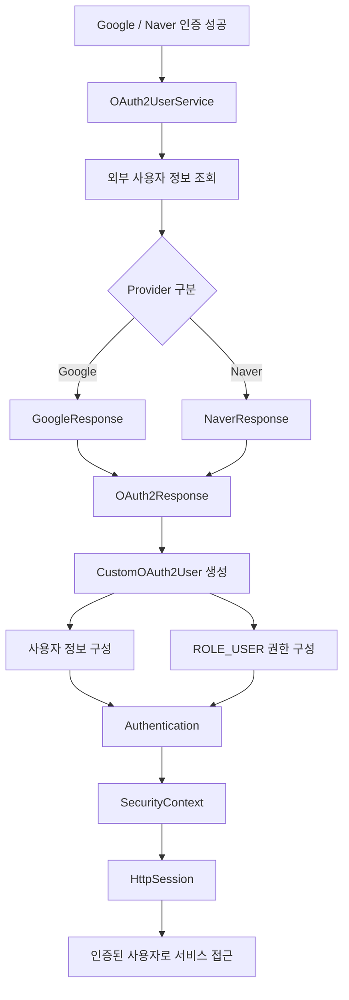
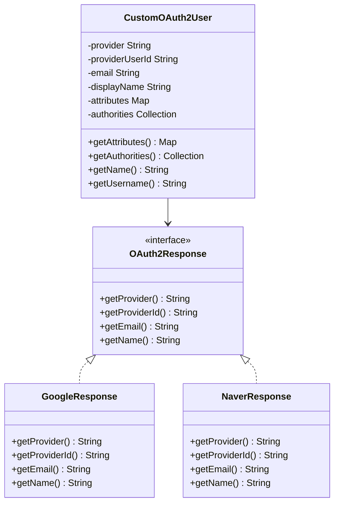
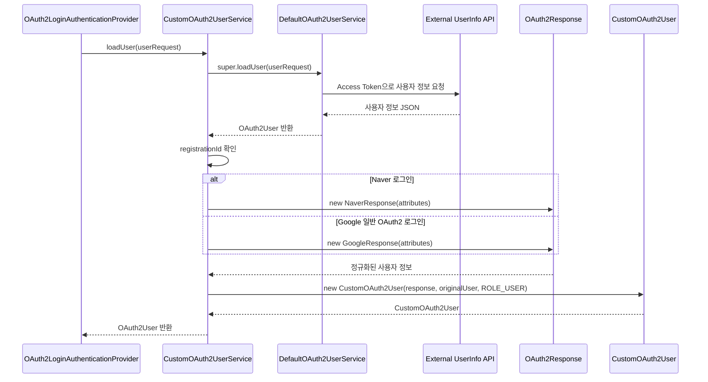
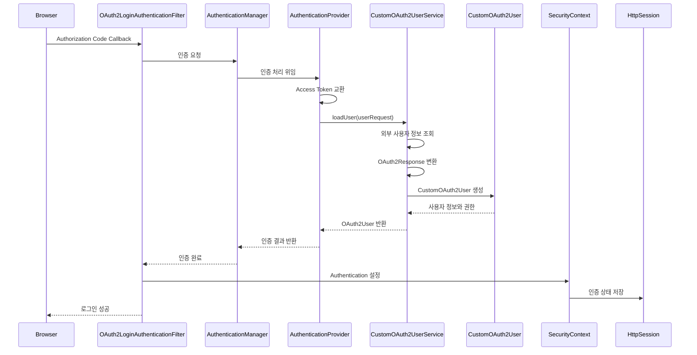
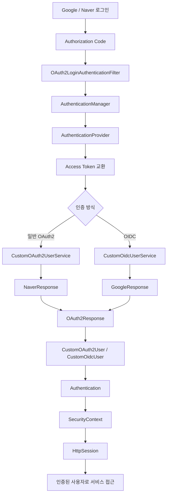

# 스프링 OAuth2 클라이언트 세션 - 9. 로그인 완료
[https://youtu.be/jT9qBPPSwFs?si=yyimr3BSX6lFV2dL](https://youtu.be/jT9qBPPSwFs?si=yyimr3BSX6lFV2dL)

# 스프링 OAuth2 클라이언트 세션 - 9. 로그인 완료
* toc
{:toc}

---

### Spring Security 6 OAuth2 소셜 로그인 완료: CustomOAuth2User 구현과 Authentication 생성

Spring Security OAuth2 Client를 이용하면 Google과 Naver 같은 외부 인증 제공자를 통해 사용자 인증을 수행할 수 있다.

앞서 `CustomOAuth2UserService`를 구현하여 외부 인증 제공자로부터 사용자 정보를 조회하고, Google과 Naver의 서로 다른 응답 구조를 공통 인터페이스로 변환했다.

현재까지 구현한 구조는 다음과 같다.

```text
Google / Naver 로그인
    ↓
외부 인증 서버
    ↓
Authorization Code 발급
    ↓
Spring Security OAuth2 Client
    ↓
Access Token 교환
    ↓
DefaultOAuth2UserService
    ↓
외부 사용자 정보 조회
    ↓
CustomOAuth2UserService
    ↓
GoogleResponse / NaverResponse
    ↓
OAuth2Response
```

하지만 여기서 한 가지 작업이 더 필요하다.

외부 사용자 정보를 조회하는 것과 Spring Security에서 사용할 인증 사용자 객체를 구성하는 것은 서로 다른 작업이다.

앞서 작성한 `OAuth2Response`는 Google과 Naver의 사용자 정보를 공통 형태로 표현하기 위한 인터페이스다.

예를 들어 다음과 같다.

```java
public interface OAuth2Response {

    String getProvider();

    String getProviderId();

    String getEmail();

    String getName();
}
```

이 인터페이스를 사용하면 외부 인증 제공자의 사용자 정보를 일관되게 처리할 수 있다.

하지만 `OAuth2Response` 자체는 Spring Security가 사용하는 인증 Principal이 아니다.

Spring Security는 인증된 사용자 정보를 `Authentication` 객체를 통해 관리한다.

그리고 OAuth2 로그인에서는 일반적으로 `OAuth2User`가 Authentication의 Principal로 사용된다.

따라서 지금까지 구현한 공통 사용자 정보를 Spring Security가 이해할 수 있도록 연결해야 한다.

이번에는 이를 위해 `CustomOAuth2User` 클래스를 구현한다.

전체적인 목표는 다음과 같다.



이번 구현에서는 다음 내용을 자세히 살펴본다.

1. OAuth2User와 CustomOAuth2User의 관계
2. CustomOAuth2UserService에서 Principal을 반환하는 이유
3. 사용자 권한을 나타내는 GrantedAuthority
4. `getAttributes()`, `getAuthorities()`, `getName()`의 역할
5. 외부 사용자 ID와 Spring Security Principal 이름의 차이
6. CustomOAuth2User 구현
7. CustomOAuth2UserService와 연결
8. Google OIDC 로그인까지 처리하는 방법
9. Authentication과 SecurityContext의 관계
10. HttpSession을 이용한 로그인 상태 유지
11. Controller에서 인증 사용자 정보 조회
12. 실제 로그인 동작 확인과 테스트

이번 단계에서는 데이터베이스에 회원을 저장하지 않는다.

먼저 외부 인증 제공자가 전달한 사용자 정보를 이용하여 **Spring Security의 인증 절차를 완료하고, 인증된 사용자로 보호된 경로에 접근하는 기능**을 구현한다.

---

### 개념

#### OAuth2User란?

`OAuth2User`는 OAuth2 인증을 통해 확인된 사용자의 정보를 표현하는 Spring Security 인터페이스다.

일반적인 아이디·비밀번호 로그인에서는 `UserDetails`를 사용한다.

반면 OAuth2 로그인에서는 `OAuth2User`를 사용할 수 있다.

두 인터페이스를 비교하면 다음과 같다.

| 구분 | UserDetails | OAuth2User |
|---|---|---|
| 주요 인증 방식 | 아이디·비밀번호 | OAuth2 소셜 로그인 |
| 사용자 정보 출처 | 내부 DB | 외부 인증 제공자 |
| 사용자 정보 조회 | UserDetailsService | OAuth2UserService |
| Principal 역할 | 지원 | 지원 |
| 권한 정보 | getAuthorities() | getAuthorities() |
| 사용자 식별 | getUsername() | getName() |
| 추가 사용자 정보 | 사용자 정의 필드 | getAttributes() |

두 인터페이스는 서로 다르지만 공통적인 역할이 있다.

바로 Spring Security가 인증된 사용자를 표현하기 위해 사용하는 객체라는 점이다.

일반적인 로그인에서는 다음과 같은 구조를 사용한다.

```text
UsernamePasswordAuthenticationFilter
    ↓
AuthenticationManager
    ↓
DaoAuthenticationProvider
    ↓
UserDetailsService
    ↓
CustomUserDetails
    ↓
Authentication
```

OAuth2 로그인에서는 다음과 같은 구조를 사용한다.

```text
OAuth2LoginAuthenticationFilter
    ↓
AuthenticationManager
    ↓
OAuth2LoginAuthenticationProvider
    ↓
OAuth2UserService
    ↓
CustomOAuth2User
    ↓
Authentication
```

Google OIDC 인증에서는 `OidcAuthorizationCodeAuthenticationProvider`와 `OidcUserService`가 사용될 수 있다.

여기서 중요한 점은 **CustomOAuth2UserService에서 반환한 OAuth2User가 이후 Authentication의 Principal을 구성하는 데 사용된다는 것**이다.

Spring Security 공식 API에서도 OAuth2User를 인증된 사용자의 Principal로 표현하며, Authentication을 통해 접근할 수 있다고 설명한다.

---

### 왜 사용하는가?

#### 1. 외부 사용자 정보를 Spring Security의 인증 정보로 연결하기 위해서

Google과 Naver에서 반환하는 사용자 정보는 외부 API 응답이다.

예를 들어 Google은 다음과 같은 데이터를 반환할 수 있다.

```json
{
  "sub": "google-user-123",
  "name": "홍길동",
  "email": "user@example.com"
}
```

Naver는 다음과 같은 구조를 사용한다.

```json
{
  "response": {
    "id": "naver-user-123",
    "name": "홍길동",
    "email": "user@example.com"
  }
}
```

이러한 데이터를 조회했다고 해서 해당 Map이 Spring Security의 인증 Principal이 되는 것은 아니다.

Spring Security가 사용할 수 있는 OAuth2User 객체를 반환해야 한다.

```text
외부 사용자 정보
    ↓
OAuth2Response
    ↓
CustomOAuth2User
    ↓
OAuth2AuthenticationToken
    ↓
SecurityContext
```

따라서 외부 사용자 정보와 인증 정보를 연결하기 위한 클래스가 필요하다.

#### 2. 서비스에서 사용하는 사용자 권한을 설정하기 위해서

OAuth2 인증 제공자는 외부 사용자의 신원을 확인한다.

하지만 해당 사용자가 우리 서비스에서 어떤 권한을 가져야 하는지는 별도의 문제다.

예를 들어 다음과 같은 역할이 필요할 수 있다.

```text
ROLE_USER

ROLE_ADMIN

ROLE_MANAGER
```

이러한 권한은 Google이나 Naver가 자동으로 결정하는 것이 아니다.

우리 서비스의 정책에 따라 설정해야 한다.

이번에는 아직 내부 회원 데이터베이스가 존재하지 않으므로 모든 정상 인증 사용자에게 임시로 다음 권한을 부여한다.

```text
ROLE_USER
```

이후 데이터베이스를 연결하면 실제 회원 정보에 저장된 권한을 이용하도록 변경할 수 있다.

#### 3. 인증된 사용자 정보를 일관된 방식으로 사용하기 위해서

외부 인증 제공자가 여러 개라면 각 제공자에서 전달하는 사용자 정보의 구조가 다르다.

하지만 서비스에서는 다음과 같은 공통 정보를 사용하고 싶을 수 있다.

```text
provider

providerUserId

email

name

role
```

CustomOAuth2User를 이용하면 이러한 정보를 하나의 Principal로 표현할 수 있다.

따라서 Controller와 Service는 외부 제공자의 응답 구조를 직접 처리하지 않아도 된다.

---

### 주요 특징

#### OAuth2User 인터페이스의 주요 메서드

`OAuth2User`는 `OAuth2AuthenticatedPrincipal`을 상속한다.

주요 메서드는 다음과 같다.

```java
public interface OAuth2User
        extends OAuth2AuthenticatedPrincipal {
}
```

상위 인터페이스를 통해 다음 기능을 사용할 수 있다.

```java
Map<String, Object> getAttributes();
```

```java
Collection<? extends GrantedAuthority> getAuthorities();
```

```java
String getName();
```

각 메서드의 역할을 살펴보자.

| 메서드 | 역할 |
|---|---|
| getAttributes() | 사용자 속성 반환 |
| getAuthorities() | 사용자에게 부여된 권한 반환 |
| getName() | Principal의 이름 반환 |

이 세 메서드를 구현하면 Spring Security에서 사용할 OAuth2User를 구성할 수 있다.

다만 단순히 메서드를 구현하는 것만으로 인증이 완료되는 것은 아니다.

해당 객체가 실제 OAuth2 인증 처리 과정에서 반환되어야 한다.

---

### getAttributes()란?

`getAttributes()`는 인증된 사용자에 관한 속성 정보를 반환한다.

예를 들어 다음과 같다.

```java
Map<String, Object> attributes =
        oauth2User.getAttributes();
```

Google 사용자 정보라면 다음과 같은 값이 존재할 수 있다.

```text
{
    sub=google-user-123,
    name=홍길동,
    email=user@example.com
}
```

Naver 사용자 정보라면 다음과 같은 중첩 구조가 존재할 수 있다.

```text
{
    resultcode=00,
    message=success,
    response={
        id=naver-user-123,
        name=홍길동,
        email=user@example.com
    }
}
```

그런데 CustomOAuth2User를 처음 구현하면서 다음과 같이 작성하는 경우가 있다.

```java
@Override
public Map<String, Object> getAttributes() {

    return null;
}
```

이렇게 작성해도 특정 인증 흐름에서는 로그인까지 진행될 수 있다.

하지만 실무에서는 권장하기 어렵다.

`getAttributes()`의 반환값을 사용하려는 Controller나 Service에서 문제가 발생할 수 있기 때문이다.

예를 들어 다음 코드가 있다고 생각해보자.

```java
Map<String, Object> attributes =
        oauth2User.getAttributes();

String email =
        (String) attributes.get("email");
```

`getAttributes()`가 `null`을 반환하면 다음 단계에서 NullPointerException이 발생할 수 있다.

따라서 CustomOAuth2User를 구현할 때는 실제 사용자 속성을 보관하고 반환하는 것이 좋다.

---

### getAuthorities()란?

`getAuthorities()`는 현재 사용자에게 부여된 권한 정보를 반환한다.

Spring Security에서는 권한을 `GrantedAuthority` 인터페이스로 표현한다.

대표적인 구현체는 다음과 같다.

```java
SimpleGrantedAuthority
```

예를 들어 일반 사용자 권한을 생성하려면 다음과 같이 작성한다.

```java
GrantedAuthority authority =
        new SimpleGrantedAuthority("ROLE_USER");
```

이 객체는 Spring Security가 사용자의 권한을 확인할 때 사용할 수 있다.

```text
CustomOAuth2User
    ↓
getAuthorities()
    ↓
ROLE_USER
    ↓
Authentication
    ↓
인가 처리
```

예를 들어 다음 보안 설정이 있다고 생각해보자.

```java
.requestMatchers("/my")
.hasRole("USER")
```

이 설정은 사용자가 `ROLE_USER` 권한을 가지고 있는지 확인한다.

여기서 `hasRole("USER")`는 기본적으로 `ROLE_` 접두사가 붙은 권한을 검사한다.

따라서 다음 두 표현은 일반적인 기본 설정에서 같은 권한을 확인한다.

```java
.hasRole("USER")
```

```java
.hasAuthority("ROLE_USER")
```

하지만 다음 두 값은 동일하지 않다.

```text
USER
```

```text
ROLE_USER
```

`hasRole("USER")`를 사용하는 경우에는 일반적으로 `ROLE_USER` 형태의 권한이 필요하다.

---

### getName()이란?

`getName()`은 인증된 Principal의 이름을 반환하는 메서드다.

여기서 중요한 점은 **Principal의 이름이 반드시 사용자의 실명이나 닉네임이어야 하는 것은 아니라는 사실**이다.

예를 들어 Google 사용자 정보가 다음과 같다고 생각해보자.

```json
{
  "sub": "google-user-123",
  "name": "홍길동"
}
```

여기서 다음 두 값은 서로 다른 목적을 가진다.

| 항목 | 값 | 목적 |
|---|---|---|
| sub | google-user-123 | 외부 사용자 식별 |
| name | 홍길동 | 사용자 표시 이름 |

사용자 식별자는 안정적으로 관리하는 것이 중요하다.

반면 표시 이름은 변경될 수 있고 중복될 수 있다.

따라서 실무에서는 `getName()`이 안정적인 식별자를 반환하도록 설계하는 것을 고려할 수 있다.

예를 들어 다음과 같다.

```text
google:google-user-123
```

Naver라면 다음과 같다.

```text
naver:naver-user-123
```

이렇게 하면 서로 다른 외부 인증 제공자의 사용자 식별자가 충돌하는 문제를 줄일 수 있다.

단, 실제 데이터베이스에서는 Provider와 Provider User ID를 별도 컬럼으로 저장하는 방식이 더 명확하다.

---

### getName()과 getUsername()의 차이

여기서 두 메서드를 구분해야 한다.

`getName()`은 OAuth2User가 상속한 Principal 계약의 일부다.

반면 `getUsername()`은 OAuth2User 인터페이스에 기본적으로 정의된 메서드가 아니다.

개발자가 CustomOAuth2User에 추가로 정의할 수 있는 메서드다.

예를 들어 다음과 같다.

```java
@Override
public String getName() {

    return username;
}
```

```java
public String getUsername() {

    return username;
}
```

이렇게 구현하면 두 메서드가 같은 값을 반환할 수 있다.

하지만 반드시 동일한 값을 반환해야 하는 것은 아니다.

예를 들어 다음과 같이 구분할 수도 있다.

```text
getName()
    ↓
Spring Security Principal 이름
```

```text
getUsername()
    ↓
서비스 내부 사용자 식별 문자열
```

```text
getDisplayName()
    ↓
화면에 표시할 사용자 이름
```

이번 구현에서는 혼동을 줄이기 위해 다음과 같이 설계한다.

| 메서드 | 반환값 |
|---|---|
| getName() | provider:providerUserId |
| getUsername() | provider:providerUserId |
| getDisplayName() | 사용자 이름 |
| getEmail() | 이메일 |

이렇게 하면 사용자 식별 정보와 화면 표시 정보를 구분할 수 있다.

---

### 예제

#### 프로젝트 구조

이번에는 앞서 작성한 프로젝트에 `CustomOAuth2User`를 추가한다.

```text
src/main/java/com/example/oauth2session
│
├── Oauth2SessionApplication.java
│
├── config
│   └── SecurityConfig.java
│
├── controller
│   ├── MainController.java
│   └── MyController.java
│
├── service
│   ├── CustomOAuth2UserService.java
│   └── CustomOidcUserService.java
│
└── dto
    └── oauth2
        ├── OAuth2Response.java
        ├── GoogleResponse.java
        ├── NaverResponse.java
        ├── CustomOAuth2User.java
        └── CustomOidcUser.java
```

앞서 구현한 `OAuth2Response`, `GoogleResponse`, `NaverResponse`는 그대로 활용한다.

이번에는 공통 OAuth2Response를 Spring Security Principal로 변환하는 부분에 집중한다.

---

### CustomOAuth2User 구현

먼저 `CustomOAuth2User` 클래스를 생성한다.

이 클래스는 `OAuth2User` 인터페이스를 구현한다.

아래 구현에서는 사용자 식별 정보, 이메일, 이름, 권한, 원본 사용자 속성을 관리한다.

```java
package com.example.oauth2session.dto.oauth2;

import java.io.Serializable;
import java.util.Collection;
import java.util.Collections;
import java.util.LinkedHashMap;
import java.util.LinkedHashSet;
import java.util.Map;
import java.util.Set;

import org.springframework.security.core.GrantedAuthority;
import org.springframework.security.core.authority.SimpleGrantedAuthority;
import org.springframework.security.oauth2.core.user.OAuth2User;

public class CustomOAuth2User
        implements OAuth2User, Serializable {

    private static final long serialVersionUID = 1L;

    private final String provider;

    private final String providerUserId;

    private final String email;

    private final String displayName;

    private final Map<String, Object> attributes;

    private final Collection<? extends GrantedAuthority> authorities;

    public CustomOAuth2User(
            OAuth2Response response,
            OAuth2User originalUser,
            String role
    ) {

        this.provider = response.getProvider();

        this.providerUserId = response.getProviderId();

        this.email = response.getEmail();

        this.displayName = response.getName();

        // 외부 인증 제공자의 원본 속성 보관
        this.attributes = Collections.unmodifiableMap(
                new LinkedHashMap<>(
                        originalUser.getAttributes()
                )
        );

        // 기존 권한과 서비스 권한을 함께 관리
        Set<GrantedAuthority> authoritySet =
                new LinkedHashSet<>(
                        originalUser.getAuthorities()
                );

        authoritySet.add(
                new SimpleGrantedAuthority(role)
        );

        this.authorities =
                Collections.unmodifiableSet(authoritySet);
    }

    @Override
    public Map<String, Object> getAttributes() {

        return attributes;
    }

    @Override
    public Collection<? extends GrantedAuthority>
    getAuthorities() {

        return authorities;
    }

    @Override
    public String getName() {

        return provider + ":" + providerUserId;
    }

    public String getUsername() {

        return getName();
    }

    public String getProvider() {

        return provider;
    }

    public String getProviderUserId() {

        return providerUserId;
    }

    public String getEmail() {

        return email;
    }

    public String getDisplayName() {

        return displayName;
    }
}
```

이제 각각의 구현 내용을 살펴보자.

---

### OAuth2Response를 생성자로 전달받는 이유

생성자는 다음과 같다.

```java
public CustomOAuth2User(
        OAuth2Response response,
        OAuth2User originalUser,
        String role
)
```

이 생성자는 세 종류의 정보를 전달받는다.

| 매개변수 | 역할 |
|---|---|
| OAuth2Response | 정규화된 외부 사용자 정보 |
| OAuth2User | Spring Security가 조회한 원본 사용자 정보 |
| role | 우리 서비스에서 사용할 권한 |

`OAuth2Response`에서는 다음 정보를 가져온다.

```java
this.provider = response.getProvider();

this.providerUserId = response.getProviderId();

this.email = response.getEmail();

this.displayName = response.getName();
```

이렇게 하면 외부 인증 제공자의 응답 구조에 직접 의존하지 않는다.

Naver를 사용하더라도 `response.id`를 직접 조회하지 않는다.

Google을 사용하더라도 `sub` 속성을 직접 조회하지 않는다.

이러한 작업은 앞서 구현한 `GoogleResponse`, `NaverResponse`에서 처리하기 때문이다.

CustomOAuth2User는 공통 인터페이스만 알고 있으면 된다.



이 구조를 통해 외부 사용자 정보와 Spring Security Principal의 책임을 분리할 수 있다.

---

### 원본 OAuth2User를 전달받는 이유

이번 생성자에는 다음 매개변수도 존재한다.

```java
OAuth2User originalUser
```

이 객체는 `DefaultOAuth2UserService`가 생성한 사용자 정보다.

여기에는 외부 사용자 속성과 Spring Security가 구성한 기본 권한 정보가 포함될 수 있다.

이번 구현에서는 다음 두 가지 정보를 보존한다.

```java
originalUser.getAttributes();
```

```java
originalUser.getAuthorities();
```

이렇게 하는 이유는 CustomOAuth2User를 생성하면서 기존 사용자 정보와 권한을 불필요하게 버리지 않기 위해서다.

특히 Google OIDC에서는 일반 OAuth2 사용자 정보 외에도 OIDC 관련 Claim과 Authority가 존재할 수 있다.

따라서 기본 사용자 정보와 권한을 보존하면서 내부 서비스 권한을 추가하는 방식이 확장에 유리하다.

---

### getAttributes() 구현

다음 코드를 살펴보자.

```java
this.attributes = Collections.unmodifiableMap(
        new LinkedHashMap<>(
                originalUser.getAttributes()
        )
);
```

이 코드는 외부 사용자 속성을 복사하여 보관한다.

`Collections.unmodifiableMap()`을 사용한 이유는 CustomOAuth2User 외부에서 사용자 속성을 임의로 수정하지 못하도록 하기 위해서다.

이후 다음 메서드에서 반환한다.

```java
@Override
public Map<String, Object> getAttributes() {

    return attributes;
}
```

이제 다음과 같이 사용자 속성에 접근할 수 있다.

```java
OAuth2User principal = ...;

Map<String, Object> attributes =
        principal.getAttributes();
```

다만 반환된 Map에는 외부 제공자의 원본 속성이 포함된다.

따라서 이름이나 이메일 같은 개인정보를 로그에 그대로 출력해서는 안 된다.

또한 이 복사는 최상위 Map에 대한 복사다.

Naver 응답처럼 중첩 Map이 포함된 경우 내부 객체까지 완전히 불변으로 만드는 깊은 복사는 아니다.

외부 속성을 완전히 불변으로 관리해야 한다면 중첩 데이터까지 복사하거나 필요한 속성만 별도 DTO로 관리하는 것이 좋다.

---

### getAuthorities() 구현

다음 코드를 살펴보자.

```java
Set<GrantedAuthority> authoritySet =
        new LinkedHashSet<>(
                originalUser.getAuthorities()
        );

authoritySet.add(
        new SimpleGrantedAuthority(role)
);
```

첫 번째 작업은 원본 OAuth2User가 가지고 있던 Authority를 복사하는 것이다.

```java
originalUser.getAuthorities();
```

OAuth2 인증에서는 다음과 같은 Authority가 존재할 수 있다.

```text
OAUTH2_USER

SCOPE_profile

SCOPE_email
```

실제 구성은 제공자와 인증 프로토콜에 따라 달라진다.

두 번째 작업은 우리 서비스의 권한을 추가하는 것이다.

```java
new SimpleGrantedAuthority(role)
```

현재는 다음 권한을 사용한다.

```text
ROLE_USER
```

따라서 최종 Authority에는 기존 권한과 내부 서비스 권한이 함께 포함될 수 있다.

```text
CustomOAuth2User
    │
    └── Authorities
          │
          ├── OAUTH2_USER
          ├── SCOPE_profile
          ├── SCOPE_email
          └── ROLE_USER
```

이후 다음 메서드에서 권한 정보를 반환한다.

```java
@Override
public Collection<? extends GrantedAuthority>
getAuthorities() {

    return authorities;
}
```

Spring Security는 이 값을 인가 처리에 사용할 수 있다.

참고로 Spring Security에서는 OAuth2 인증으로 부여된 Authority를 애플리케이션 권한으로 변환하기 위한 `GrantedAuthoritiesMapper`도 제공한다.

---

### 왜 SimpleGrantedAuthority를 사용할까?

`GrantedAuthority`는 인터페이스다.

따라서 다음과 같이 익명 클래스로 구현할 수도 있다.

```java
GrantedAuthority authority =
        new GrantedAuthority() {

            @Override
            public String getAuthority() {

                return "ROLE_USER";
            }
        };
```

하지만 Spring Security는 `SimpleGrantedAuthority`라는 기본 구현체를 제공한다.

따라서 다음과 같이 간단하게 작성할 수 있다.

```java
new SimpleGrantedAuthority("ROLE_USER");
```

두 방식 모두 권한 문자열을 제공할 수 있다.

하지만 일반적인 문자열 기반 Authority를 표현할 때는 SimpleGrantedAuthority를 사용하는 것이 간결하다.

또한 권한 정보의 비교와 직렬화 등을 고려할 때 표준 구현체를 활용하는 것이 편리하다.

---

### getName() 구현

다음 코드를 살펴보자.

```java
@Override
public String getName() {

    return provider + ":" + providerUserId;
}
```

이 메서드는 다음과 같은 값을 반환한다.

Google 사용자라면 다음과 같다.

```text
google:google-user-123
```

Naver 사용자라면 다음과 같다.

```text
naver:naver-user-123
```

이렇게 구현한 이유는 Principal의 이름을 안정적인 사용자 식별자로 사용하기 위해서다.

다만 사용자 화면에 실제 이름을 표시할 때는 다음 메서드를 사용한다.

```java
public String getDisplayName() {

    return displayName;
}
```

이를 통해 사용자 식별과 사용자 표시를 구분한다.

---

### CustomOAuth2UserService 수정

이제 앞서 작성한 `CustomOAuth2UserService`에서 CustomOAuth2User를 반환하도록 변경한다.

기존에는 다음과 같은 구조였다.

```java
OAuth2User oauth2User =
        super.loadUser(userRequest);
```

이후 사용자 정보를 GoogleResponse 또는 NaverResponse로 변환했다.

하지만 마지막에는 원본 OAuth2User를 반환했다.

```java
return oauth2User;
```

이번에는 이 부분을 변경한다.

```java
return new CustomOAuth2User(
        response,
        oauth2User,
        role
);
```

이렇게 하면 Spring Security가 기본 OAuth2User 대신 우리가 구성한 Principal을 사용할 수 있다.

---

### CustomOAuth2UserService 전체 코드

```java
package com.example.oauth2session.service;

import com.example.oauth2session.dto.oauth2.CustomOAuth2User;
import com.example.oauth2session.dto.oauth2.GoogleResponse;
import com.example.oauth2session.dto.oauth2.NaverResponse;
import com.example.oauth2session.dto.oauth2.OAuth2Response;

import org.springframework.security.oauth2.client.userinfo.DefaultOAuth2UserService;
import org.springframework.security.oauth2.client.userinfo.OAuth2UserRequest;

import org.springframework.security.oauth2.core.OAuth2AuthenticationException;
import org.springframework.security.oauth2.core.OAuth2Error;
import org.springframework.security.oauth2.core.user.OAuth2User;

import org.springframework.stereotype.Service;

@Service
public class CustomOAuth2UserService
        extends DefaultOAuth2UserService {

    @Override
    public OAuth2User loadUser(
            OAuth2UserRequest userRequest
    ) throws OAuth2AuthenticationException {

        // 외부 인증 제공자의 사용자 정보 조회
        OAuth2User oauth2User =
                super.loadUser(userRequest);

        // OAuth2 제공자 구분
        String registrationId = userRequest
                .getClientRegistration()
                .getRegistrationId();

        // 제공자별 응답을 공통 형태로 변환
        OAuth2Response response;

        if ("naver".equals(registrationId)) {

            response = new NaverResponse(
                    oauth2User.getAttributes()
            );

        } else if ("google".equals(registrationId)) {

            response = new GoogleResponse(
                    oauth2User.getAttributes()
            );

        } else {

            throw new OAuth2AuthenticationException(
                    new OAuth2Error("unsupported_provider"),
                    "지원하지 않는 OAuth2 제공자입니다."
            );
        }

        // 내부 서비스 기본 권한
        String role = "ROLE_USER";

        // 사용자 식별자가 정상적으로 존재하는지 확인
        try {

            response.getProviderId();

        } catch (IllegalArgumentException exception) {

            throw new OAuth2AuthenticationException(
                    new OAuth2Error("invalid_user_info"),
                    "OAuth2 사용자 정보가 올바르지 않습니다."
            );
        }

        // Spring Security에서 사용할 Principal 반환
        return new CustomOAuth2User(
                response,
                oauth2User,
                role
        );
    }
}
```

여기서 핵심은 마지막 부분이다.

```java
return new CustomOAuth2User(
        response,
        oauth2User,
        role
);
```

이 코드는 기존 OAuth2Response를 이용해 Spring Security 인증 Principal을 생성한다.

따라서 사용자 인증이 성공하면 Authentication의 Principal로 CustomOAuth2User를 사용할 수 있다.

---

### CustomOAuth2UserService 내부 동작

전체 처리 과정을 정리하면 다음과 같다.



이후 Spring Security는 반환된 OAuth2User를 이용해 Authentication을 구성한다.

여기서 중요한 점은 CustomOAuth2UserService가 직접 AuthenticationManager를 호출하거나 세션을 생성하지 않는다는 것이다.

CustomOAuth2UserService는 사용자 정보를 처리하고 Principal을 반환하는 역할을 담당한다.

---

### Google OIDC 로그인도 동일하게 처리할 수 있을까?

현재 프로젝트에서는 Google과 Naver를 함께 사용한다.

그런데 이전에 Google OAuth2 Client를 설정할 때 다음 Scope를 사용했다.

```yaml
scope:
  - openid
  - profile
  - email
```

여기서 `openid`가 중요하다.

Google은 OpenID Connect를 지원한다.

따라서 `openid` Scope가 포함되어 있으면 Spring Security는 OIDC 인증 경로를 사용한다.

일반 OAuth2 로그인과 OIDC 로그인은 다음과 같이 구분된다.

| 구분 | Naver 일반 OAuth2 | Google OIDC |
|---|---|---|
| 인증 Provider | OAuth2LoginAuthenticationProvider | OidcAuthorizationCodeAuthenticationProvider |
| 사용자 정보 처리 | OAuth2UserService | OidcUserService |
| Principal | OAuth2User | OidcUser |
| 주요 사용자 식별 | response.id | sub |
| 토큰 | Access Token | Access Token, ID Token |

따라서 다음 코드만 작성했다고 해서 Google OIDC 사용자 정보가 CustomOAuth2UserService를 통과하는 것은 아니다.

```java
.userService(customOAuth2UserService)
```

OIDC 인증에서는 다음 설정이 필요하다.

```java
.oidcUserService(customOidcUserService)
```

Spring Security 공식 문서에서도 일반 OAuth2 사용자 정보 처리와 OIDC 사용자 정보 처리를 구분하여 제공한다.

이 차이를 고려하지 않으면 Naver 로그인에서는 CustomOAuth2User가 생성되지만 Google 로그인에서는 생성되지 않는 상황이 발생할 수 있다.

---

### Google OIDC에서 Custom Principal 구현하기

이번에는 Google OIDC 로그인에서도 동일한 사용자 정보 구조를 활용하는 방법을 살펴보자.

OIDC 인증에서는 `OidcUser`를 사용한다.

`OidcUser`는 `OAuth2User`를 확장한 인터페이스이며 ID Token과 UserInfo 등의 정보를 제공한다.

따라서 기존 CustomOAuth2User를 그대로 반환하는 방식보다는 OIDC 전용 Principal을 구현하는 것이 적절하다.

이번에는 다음과 같은 상속 구조를 사용한다.

```text
OAuth2User
    ↑
    │
CustomOAuth2User
    ↑
    │
CustomOidcUser
    │
    └── OidcUser 구현
```

이렇게 하면 다음 두 가지 기능을 함께 유지할 수 있다.

- 공통 사용자 정보와 서비스 권한 관리
- OIDC ID Token과 Claim 접근 기능

---

### CustomOidcUser 구현

```java
package com.example.oauth2session.dto.oauth2;

import java.util.Collections;
import java.util.LinkedHashMap;
import java.util.Map;

import org.springframework.security.oauth2.core.oidc.OidcIdToken;
import org.springframework.security.oauth2.core.oidc.OidcUserInfo;
import org.springframework.security.oauth2.core.oidc.user.OidcUser;

public class CustomOidcUser
        extends CustomOAuth2User
        implements OidcUser {

    private static final long serialVersionUID = 1L;

    private final OidcIdToken idToken;

    private final OidcUserInfo userInfo;

    private final Map<String, Object> claims;

    public CustomOidcUser(
            OAuth2Response response,
            OidcUser originalUser,
            String role
    ) {

        super(
                response,
                originalUser,
                role
        );

        this.idToken = originalUser.getIdToken();

        this.userInfo = originalUser.getUserInfo();

        this.claims = Collections.unmodifiableMap(
                new LinkedHashMap<>(
                        originalUser.getClaims()
                )
        );
    }

    @Override
    public Map<String, Object> getClaims() {

        return claims;
    }

    @Override
    public OidcIdToken getIdToken() {

        return idToken;
    }

    @Override
    public OidcUserInfo getUserInfo() {

        return userInfo;
    }
}
```

이 클래스는 CustomOAuth2User의 공통 기능을 상속한다.

따라서 다음 메서드들을 그대로 사용할 수 있다.

```java
getProvider();
```

```java
getProviderUserId();
```

```java
getEmail();
```

```java
getDisplayName();
```

```java
getAuthorities();
```

```java
getName();
```

그리고 OIDC에서 필요한 정보를 추가로 제공한다.

```java
getIdToken();
```

```java
getUserInfo();
```

```java
getClaims();
```

이러한 구성을 사용하면 Google OIDC 인증에서도 기존 CustomOAuth2User와 동일한 사용자 정보 접근 방식을 유지할 수 있다.

다만 ID Token과 Claim을 세션에 유지하는 구조이므로 세션 직렬화, 개인정보 보관 범위, 토큰 수명과 관련된 정책을 함께 고려해야 한다.

---

### CustomOidcUserService 수정

이제 앞서 작성한 CustomOidcUserService에서 CustomOidcUser를 반환하도록 변경한다.

```java
package com.example.oauth2session.service;

import com.example.oauth2session.dto.oauth2.CustomOidcUser;
import com.example.oauth2session.dto.oauth2.GoogleResponse;
import com.example.oauth2session.dto.oauth2.OAuth2Response;

import org.springframework.security.oauth2.client.oidc.userinfo.OidcUserService;
import org.springframework.security.oauth2.client.oidc.userinfo.OidcUserRequest;

import org.springframework.security.oauth2.core.OAuth2AuthenticationException;
import org.springframework.security.oauth2.core.OAuth2Error;
import org.springframework.security.oauth2.core.oidc.user.OidcUser;

import org.springframework.stereotype.Service;

@Service
public class CustomOidcUserService
        extends OidcUserService {

    @Override
    public OidcUser loadUser(
            OidcUserRequest userRequest
    ) throws OAuth2AuthenticationException {

        // Google OIDC 사용자 정보 조회 및 구성
        OidcUser oidcUser =
                super.loadUser(userRequest);

        String registrationId = userRequest
                .getClientRegistration()
                .getRegistrationId();

        if (!"google".equals(registrationId)) {

            throw new OAuth2AuthenticationException(
                    new OAuth2Error("unsupported_provider"),
                    "지원하지 않는 OIDC 제공자입니다."
            );
        }

        // OIDC Claim을 공통 사용자 정보로 변환
        OAuth2Response response =
                new GoogleResponse(
                        oidcUser.getClaims()
                );

        try {

            response.getProviderId();

        } catch (IllegalArgumentException exception) {

            throw new OAuth2AuthenticationException(
                    new OAuth2Error("invalid_user_info"),
                    "OIDC 사용자 정보가 올바르지 않습니다."
            );
        }

        // 내부 서비스 기본 권한
        String role = "ROLE_USER";

        return new CustomOidcUser(
                response,
                oidcUser,
                role
        );
    }
}
```

이렇게 하면 Google OIDC 사용자 정보를 CustomOidcUser로 변환할 수 있다.

그리고 CustomOidcUser는 CustomOAuth2User를 상속하므로 Controller에서는 공통 타입으로 사용할 수 있다.

```java
@AuthenticationPrincipal
CustomOAuth2User principal
```

이 방식은 외부 인증 제공자의 인증 프로토콜이 달라도 내부 사용자 정보 구조를 일관되게 유지하고 싶을 때 유용하다.

---

### SecurityConfig에 사용자 정보 처리 서비스 등록

이제 일반 OAuth2와 OIDC 사용자 정보 처리 서비스를 SecurityConfig에 등록한다.

```java
package com.example.oauth2session.config;

import com.example.oauth2session.service.CustomOAuth2UserService;
import com.example.oauth2session.service.CustomOidcUserService;

import org.springframework.context.annotation.Bean;
import org.springframework.context.annotation.Configuration;

import org.springframework.security.config.annotation.web.builders.HttpSecurity;
import org.springframework.security.config.annotation.web.configurers.AbstractHttpConfigurer;

import org.springframework.security.web.SecurityFilterChain;

@Configuration
public class SecurityConfig {

    private final CustomOAuth2UserService customOAuth2UserService;

    private final CustomOidcUserService customOidcUserService;

    public SecurityConfig(
            CustomOAuth2UserService customOAuth2UserService,
            CustomOidcUserService customOidcUserService
    ) {

        this.customOAuth2UserService =
                customOAuth2UserService;

        this.customOidcUserService =
                customOidcUserService;
    }

    @Bean
    public SecurityFilterChain securityFilterChain(
            HttpSecurity http
    ) throws Exception {

        http
                // 일반 Form Login 비활성화
                .formLogin(AbstractHttpConfigurer::disable)

                // HTTP Basic 인증 비활성화
                .httpBasic(AbstractHttpConfigurer::disable)

                // OAuth2 및 OIDC 로그인
                .oauth2Login(oauth2 -> oauth2

                        .userInfoEndpoint(userInfo -> userInfo

                                // Naver 일반 OAuth2
                                .userService(customOAuth2UserService)

                                // Google OIDC
                                .oidcUserService(customOidcUserService)
                        )
                )

                // 경로별 인가 정책
                .authorizeHttpRequests(auth -> auth

                        .requestMatchers(
                                "/",
                                "/error",
                                "/login",
                                "/oauth2/authorization/**",
                                "/login/oauth2/code/**"
                        ).permitAll()

                        .anyRequest().authenticated()
                );

        return http.build();
    }
}
```

이 설정에서는 일반 OAuth2와 OIDC의 사용자 정보 처리 경로를 구분한다.

```text
Naver 로그인
    ↓
CustomOAuth2UserService
    ↓
NaverResponse
    ↓
CustomOAuth2User
```

```text
Google OIDC 로그인
    ↓
CustomOidcUserService
    ↓
GoogleResponse
    ↓
CustomOidcUser
```

최종적으로 두 사용자 모두 공통 CustomOAuth2User 타입으로 접근할 수 있다.

---

### 구조

#### CustomOAuth2User가 Authentication에 등록되는 과정

이제 OAuth2 로그인 인증의 전체 구조를 살펴보자.



이 구조는 일반 OAuth2 로그인 경로를 나타낸다.

Google OIDC 로그인에서는 AuthenticationProvider와 UserService 단계에서 OIDC 전용 구성요소가 사용된다.

중요한 것은 **CustomOAuth2UserService가 반환한 Principal이 Spring Security의 Authentication 구성에 사용된다는 점**이다.

---

### Authentication은 어떤 구조를 가질까?

OAuth2 로그인에 성공하면 Spring Security는 일반적으로 `OAuth2AuthenticationToken`을 구성한다.

개념적으로 다음과 같다.

```text
OAuth2AuthenticationToken
    │
    ├── Principal
    │     └── CustomOAuth2User
    │           │
    │           ├── provider
    │           ├── providerUserId
    │           ├── email
    │           ├── displayName
    │           └── attributes
    │
    ├── Authorities
    │     ├── 기존 OAuth2 Authority
    │     └── ROLE_USER
    │
    ├── Authorized Client Registration ID
    │     └── naver
    │
    └── Authenticated
          └── true
```

여기서 중요한 점은 `OAuth2AuthenticationToken`을 개발자가 직접 생성하지 않아도 된다는 것이다.

Spring Security의 기본 OAuth2 로그인 처리 과정에서 인증된 Authentication이 구성된다.

`OAuth2LoginAuthenticationFilter` 공식 API에서도 인증 성공 후 `OAuth2AuthenticationToken`이 생성되고 SecurityContextRepository에 저장되는 흐름을 설명한다.

---

### Authentication과 Principal의 차이

이 두 개념은 자주 혼동된다.

#### Authentication

Authentication은 Spring Security에서 인증된 사용자의 상태를 표현하는 객체다.

일반적으로 다음 정보를 포함할 수 있다.

```text
Principal

Authorities

Credentials

Details

Authenticated
```

#### Principal

Principal은 인증된 사용자를 표현하는 객체다.

이번 프로젝트에서는 CustomOAuth2User가 이 역할을 담당한다.

따라서 다음과 같은 관계다.

```text
Authentication
    ↓
getPrincipal()
    ↓
CustomOAuth2User
```

Java 코드로 표현하면 다음과 같다.

```java
Authentication authentication = ...;

Object principal =
        authentication.getPrincipal();
```

CustomOAuth2User를 사용하고 있다면 타입을 확인한 뒤 접근할 수 있다.

```java
if (principal instanceof CustomOAuth2User user) {

    String username =
            user.getUsername();
}
```

이렇게 하면 Spring Security의 Authentication에서 실제 사용자 정보를 조회할 수 있다.

---

### SecurityContext와 HttpSession

OAuth2 로그인에 성공하면 Spring Security는 Authentication을 SecurityContext에 등록한다.

그리고 세션 기반 인증에서는 SecurityContextRepository를 통해 인증 상태를 저장할 수 있다.

```text
Authentication
    ↓
SecurityContext
    ↓
SecurityContextRepository
    ↓
HttpSession
```

기본적인 세션 기반 구성에서는 브라우저가 세션 쿠키를 전달받는다.

대표적으로 다음과 같다.

```http
Set-Cookie: JSESSIONID=SESSION_ID
```

이후 브라우저가 우리 서비스에 요청할 때 해당 쿠키를 전달한다.

```http
GET /my HTTP/1.1
Host: localhost:8080
Cookie: JSESSIONID=SESSION_ID
```

Spring Security는 세션에 저장된 SecurityContext를 복원할 수 있다.

따라서 로그인 이후의 요청에서는 매번 Google이나 Naver에서 사용자 정보를 새로 조회할 필요가 없다.

이것이 OAuth2 소셜 로그인과 세션 기반 인증을 결합하는 핵심이다.

---

### Controller에서 CustomOAuth2User 사용하기

이제 실제로 인증된 사용자 정보를 조회해보자.

Spring Security에서는 `@AuthenticationPrincipal`을 이용해 현재 Authentication의 Principal을 주입받을 수 있다.

예를 들어 다음과 같다.

```java
@AuthenticationPrincipal
CustomOAuth2User principal
```

이제 마이 화면을 처리하는 Controller를 수정한다.

---

### MyController 구현

```java
package com.example.oauth2session.controller;

import com.example.oauth2session.dto.oauth2.CustomOAuth2User;

import org.springframework.security.core.annotation.AuthenticationPrincipal;
import org.springframework.stereotype.Controller;
import org.springframework.ui.Model;
import org.springframework.web.bind.annotation.GetMapping;

@Controller
public class MyController {

    @GetMapping("/my")
    public String my(
            @AuthenticationPrincipal CustomOAuth2User principal,
            Model model
    ) {

        model.addAttribute(
                "username",
                principal.getUsername()
        );

        model.addAttribute(
                "provider",
                principal.getProvider()
        );

        model.addAttribute(
                "displayName",
                principal.getDisplayName() != null
                        ? principal.getDisplayName()
                        : "사용자"
        );

        model.addAttribute(
                "email",
                principal.getEmail() != null
                        ? principal.getEmail()
                        : "제공되지 않음"
        );

        return "my";
    }
}
```

이 코드는 현재 인증된 CustomOAuth2User를 주입받는다.

그리고 사용자 정보를 Model에 저장한다.

각 속성의 의미는 다음과 같다.

| Model 속성 | 값 |
|---|---|
| username | provider:providerUserId |
| provider | google 또는 naver |
| displayName | 사용자 이름 |
| email | 이메일 |

이후 Mustache에서 해당 데이터를 사용할 수 있다.

---

### my.mustache 구현

파일 경로는 다음과 같다.

```text
src/main/resources/templates/my.mustache
```

전체 코드는 다음과 같다.

```html
<!DOCTYPE html>
<html lang="ko">

<head>
    <meta charset="UTF-8">

    <meta name="viewport"
          content="width=device-width, initial-scale=1.0">

    <title>OAuth2 My</title>
</head>

<body>

    <h1>마이 화면</h1>

    <hr>

    <p>
        사용자 식별자: {{username}}
    </p>

    <p>
        인증 제공자: {{provider}}
    </p>

    <p>
        사용자 이름: {{displayName}}
    </p>

    <p>
        이메일: {{email}}
    </p>

    <a href="/">
        메인 화면 이동
    </a>

</body>

</html>
```

이제 로그인에 성공한 사용자는 자신의 정보를 확인할 수 있다.

예를 들어 Google 로그인에 성공했다면 다음과 같이 표시될 수 있다.

```text
마이 화면

사용자 식별자: google:google-user-123

인증 제공자: google

사용자 이름: 홍길동

이메일: user@example.com
```

Naver 로그인이라면 다음과 같다.

```text
마이 화면

사용자 식별자: naver:naver-user-123

인증 제공자: naver

사용자 이름: 홍길동

이메일: user@example.com
```

이처럼 외부 인증 제공자가 다르더라도 동일한 Controller와 Mustache를 사용할 수 있다.

---

### 권한 기반 접근 제어

이번에는 모든 정상 로그인 사용자에게 `ROLE_USER` 권한을 부여했다.

따라서 단순히 인증 여부만 확인하는 대신 권한을 이용해 접근을 제어할 수도 있다.

예를 들어 다음과 같다.

```java
.authorizeHttpRequests(auth -> auth

        .requestMatchers(
                "/",
                "/error",
                "/login",
                "/oauth2/authorization/**",
                "/login/oauth2/code/**"
        ).permitAll()

        .requestMatchers("/my")
        .hasRole("USER")

        .anyRequest().authenticated()
)
```

이 설정에서 다음 부분이 중요하다.

```java
.requestMatchers("/my")
.hasRole("USER")
```

이제 `/my` 경로에 접근하려면 `ROLE_USER` 권한이 필요하다.

CustomOAuth2User에서 해당 권한을 반환하므로 접근할 수 있다.

```java
new SimpleGrantedAuthority("ROLE_USER");
```

하지만 관리자 전용 경로는 별도의 권한이 필요할 수 있다.

```java
.requestMatchers("/admin/**")
.hasRole("ADMIN")
```

현재는 ROLE_ADMIN을 부여하지 않았으므로 일반 사용자는 해당 경로에 접근할 수 없다.

이러한 구조를 이용하면 사용자 인증과 인가 정책을 분리할 수 있다.

---

### 실제 로그인 동작 확인

이제 전체 기능을 확인해보자.

#### 1. 애플리케이션 실행

Windows PowerShell에서 다음 명령을 실행한다.

```powershell
.\gradlew.bat bootRun
```

정상 실행 시 다음과 유사한 로그를 확인할 수 있다.

```text
Tomcat started on port 8080 (http)

Started Oauth2SessionApplication
```

단, Google과 Naver의 OAuth2 Client 정보가 정상적으로 등록되어 있어야 한다.

#### 2. 마이 화면 접근

브라우저에서 다음 경로로 접근한다.

```text
http://localhost:8080/my
```

로그인하지 않은 상태라면 Spring Security가 접근을 제한한다.

설정에 따라 OAuth2 로그인 화면으로 이동한다.

#### 3. 소셜 로그인 선택

Google 또는 Naver 로그인을 선택한다.

```text
Google 로그인

Naver 로그인
```

사용자는 외부 인증 제공자의 로그인 화면으로 이동한다.

#### 4. 외부 인증 완료

외부 인증 제공자에서 로그인과 정보 제공 동의가 완료되면 Authorization Code가 전달된다.

Spring Security는 해당 코드를 이용해 Access Token을 교환한다.

이후 사용자 정보를 조회하고 CustomOAuth2User를 생성한다.

#### 5. 마이 화면 확인

로그인이 완료되면 인증된 사용자로 `/my` 경로에 접근할 수 있다.

```text
GET /my
    ↓
SecurityFilterChain
    ↓
SecurityContext 조회
    ↓
Authentication 확인
    ↓
ROLE_USER 검증
    ↓
MyController
    ↓
my.mustache
```

이렇게 하면 외부 사용자 정보를 이용한 세션 기반 로그인이 정상적으로 구성되었는지 확인할 수 있다.

---

### 테스트

#### CustomOAuth2User 단위 테스트

실제 외부 인증 서버에 접속하지 않아도 CustomOAuth2User의 동작을 검증할 수 있다.

다음 테스트에서는 Google 사용자 정보를 이용한다.

```java
package com.example.oauth2session.dto.oauth2;

import java.util.Map;
import java.util.Set;

import org.junit.jupiter.api.Test;

import org.springframework.security.core.authority.SimpleGrantedAuthority;
import org.springframework.security.oauth2.core.user.DefaultOAuth2User;
import org.springframework.security.oauth2.core.user.OAuth2User;

import static org.junit.jupiter.api.Assertions.*;

class CustomOAuth2UserTest {

    @Test
    void 사용자_정보와_권한을_반환한다() {

        Map<String, Object> attributes = Map.of(
                "sub", "google-user-123",
                "name", "홍길동",
                "email", "user@example.com"
        );

        OAuth2User originalUser =
                new DefaultOAuth2User(
                        Set.of(
                                new SimpleGrantedAuthority(
                                        "OAUTH2_USER"
                                )
                        ),
                        attributes,
                        "sub"
                );

        OAuth2Response response =
                new GoogleResponse(attributes);

        CustomOAuth2User principal =
                new CustomOAuth2User(
                        response,
                        originalUser,
                        "ROLE_USER"
                );

        assertEquals(
                "google:google-user-123",
                principal.getName()
        );

        assertEquals(
                "google",
                principal.getProvider()
        );

        assertEquals(
                "user@example.com",
                principal.getEmail()
        );

        assertEquals(
                "홍길동",
                principal.getDisplayName()
        );

        assertTrue(
                principal.getAuthorities().contains(
                        new SimpleGrantedAuthority(
                                "ROLE_USER"
                        )
                )
        );

        assertTrue(
                principal.getAuthorities().contains(
                        new SimpleGrantedAuthority(
                                "OAUTH2_USER"
                        )
                )
        );

        assertEquals(
                "google-user-123",
                principal.getAttributes().get("sub")
        );
    }
}
```

이 테스트는 다음 내용을 검증한다.

| 검증 항목 | 기대 결과 |
|---|---|
| getName() | google:google-user-123 |
| getProvider() | google |
| getEmail() | user@example.com |
| getDisplayName() | 홍길동 |
| ROLE_USER | 존재 |
| 기존 Authority | 유지 |
| getAttributes() | 원본 속성 유지 |

#### 테스트 실행

Windows PowerShell에서 다음 명령을 실행한다.

```powershell
.\gradlew.bat test
```

정상적으로 실행되면 다음과 유사한 결과를 확인할 수 있다.

```text
BUILD SUCCESSFUL
```

이 테스트는 CustomOAuth2User의 단위 동작을 검증한다.

실제 외부 로그인과 세션 저장까지 검증하려면 별도의 통합 테스트가 필요하다.

---

### 실무에서의 활용

#### 1. Principal에는 실제로 필요한 사용자 정보를 보관한다

외부 인증 제공자는 다양한 사용자 정보를 반환할 수 있다.

하지만 내부 서비스에서 모든 정보가 필요한 것은 아니다.

예를 들어 다음과 같은 정보만으로도 기본적인 사용자 인증 기능을 구현할 수 있다.

```text
provider

providerUserId

displayName

role
```

따라서 외부 사용자 정보 전체를 Principal에 보관해야 하는지 검토할 필요가 있다.

특히 세션 기반 인증에서는 Principal이 세션 저장 대상에 포함될 수 있으므로 불필요한 개인정보를 저장하지 않는 것이 좋다.

---

#### 2. Principal 이름에는 안정적인 사용자 식별자를 사용한다

사용자 실명이나 닉네임은 변경될 수 있다.

따라서 `getName()`에서 표시 이름을 반환하면 사용자 식별이 불안정해질 수 있다.

이번 구현에서는 다음 조합을 사용했다.

```text
provider + ":" + providerUserId
```

예를 들어 다음과 같다.

```text
naver:naver-user-123
```

다만 데이터베이스 연동이 완료되면 내부 회원 ID를 Principal의 주 식별자로 사용하는 설계도 고려할 수 있다.

외부 제공자별 식별자는 소셜 계정 연결 테이블에서 별도로 관리하는 것이 좋다.

---

#### 3. 사용자 표시 이름과 인증 식별자를 구분한다

외부 사용자의 이름은 화면에 표시하기 위한 정보다.

반면 인증 식별자는 사용자를 안정적으로 구분하기 위한 정보다.

따라서 다음과 같이 분리할 수 있다.

```text
getName()
    ↓
인증 식별자
```

```text
getDisplayName()
    ↓
화면 표시 이름
```

이렇게 하면 사용자가 자신의 이름을 변경하더라도 인증 식별자가 변경되지 않는다.

---

#### 4. 외부 인증 성공과 내부 권한 부여를 구분한다

이번에는 모든 인증 사용자에게 다음 권한을 부여했다.

```text
ROLE_USER
```

하지만 실제 서비스에서는 사용자의 계정 상태와 권한을 확인해야 한다.

예를 들어 다음과 같은 계정 상태가 있을 수 있다.

```text
ACTIVE

SUSPENDED

WITHDRAWN
```

따라서 실제 운영 환경에서는 외부 인증에 성공한 사용자를 내부 회원 정보와 연결한 뒤 접근 허용 여부를 결정하는 것이 적절하다.

---

#### 5. ROLE_ADMIN을 외부 인증 정보만으로 부여하지 않는다

외부 OAuth2 인증 제공자는 사용자의 신원을 확인한다.

하지만 우리 서비스의 관리자 권한은 내부 정책에 따라 결정해야 한다.

예를 들어 다음과 같은 코드는 위험할 수 있다.

```java
String role = "ROLE_ADMIN";
```

모든 외부 로그인 사용자에게 관리자 권한을 부여하기 때문이다.

따라서 내부 회원의 권한 정보를 조회한 뒤 부여하는 구조가 필요하다.

현재는 DB 연동 이전 단계이므로 ROLE_USER만 사용한다.

---

#### 6. 기존 OAuth2 Authority를 무조건 제거하지 않는다

외부 OAuth2 로그인 과정에서는 기본 Authority나 Scope 기반 Authority가 생성될 수 있다.

예를 들어 다음과 같다.

```text
OAUTH2_USER

SCOPE_email

SCOPE_profile
```

새로운 CustomOAuth2User를 생성하면서 이러한 Authority를 모두 제거할 수도 있다.

하지만 이후 외부 API 접근 권한이나 인증 프로토콜별 정책을 확인할 때 문제가 발생할 수 있다.

따라서 기존 Authority를 유지할지, 내부 서비스 권한으로 완전히 대체할지 명확하게 결정해야 한다.

이번 구현에서는 기존 Authority를 보존하고 ROLE_USER를 추가했다.

---

#### 7. getAttributes()에서는 null을 반환하지 않는다

CustomOAuth2User를 구현하면서 다음과 같이 작성할 수 있다.

```java
@Override
public Map<String, Object> getAttributes() {

    return null;
}
```

그러나 이 방식은 사용자 정보 조회 기능을 사용하는 다른 코드에서 문제를 일으킬 수 있다.

따라서 실제 속성을 반환하도록 구현하는 것이 좋다.

```java
@Override
public Map<String, Object> getAttributes() {

    return attributes;
}
```

다만 민감한 사용자 정보가 포함될 수 있으므로 외부에 그대로 응답하거나 로그에 출력하지 않도록 주의해야 한다.

---

#### 8. OIDC 인증에서는 OidcUser 계약을 유지한다

Google에서 `openid` Scope를 사용하는 경우에는 OIDC 인증 경로가 사용된다.

이때 CustomOAuth2User만 반환하도록 무리하게 구조를 단순화하면 ID Token과 OIDC Claim을 사용하는 기능에 문제가 발생할 수 있다.

따라서 OIDC 인증에서는 OidcUser 계약을 유지하는 것이 좋다.

이번에는 CustomOidcUser를 별도로 구현하여 이 문제를 해결했다.

---

#### 9. CustomOAuth2User는 세션 저장을 고려해 설계한다

이번 프로젝트에서는 세션 기반 인증을 사용한다.

따라서 CustomOAuth2User는 세션에 저장되는 Authentication의 일부가 될 수 있다.

이때 다음 사항을 고려해야 한다.

- 직렬화 가능한 필드 구성
- 불필요한 사용자 정보 저장 방지
- 민감정보 최소화
- 세션 만료 정책
- 사용자 권한 변경 시 반영 정책

특히 Redis와 같은 외부 세션 저장소를 사용하는 경우에는 직렬화 문제를 사전에 확인해야 한다.

---

#### 10. 세션에 저장된 권한은 자동으로 DB와 동기화되지 않는다

사용자가 로그인할 때 ROLE_USER 권한을 부여했다고 생각해보자.

이후 데이터베이스에서 해당 사용자의 권한이 변경된다.

```text
ROLE_USER
    ↓
ROLE_ADMIN
```

하지만 기존 세션에 저장된 Authentication의 Authority는 즉시 변경되지 않을 수 있다.

따라서 권한 변경을 실시간으로 반영해야 하는 서비스라면 별도의 정책이 필요하다.

예를 들어 다음과 같은 방법을 고려할 수 있다.

```text
권한 변경 시 세션 무효화
```

```text
중요 요청에서 DB 권한 재확인
```

```text
권한 변경 이벤트 기반 세션 갱신
```

이러한 정책은 관리자 권한이나 민감한 기능을 제공하는 서비스에서 중요하다.

---

#### 11. 외부 사용자 식별자와 내부 회원 ID를 분리한다

이번에는 데이터베이스를 연결하지 않았으므로 외부 사용자 ID를 그대로 사용한다.

하지만 실제 서비스에서는 내부 회원 ID를 별도로 관리하는 것이 좋다.

```text
Naver User ID
    ↓
naver-user-123
```

```text
Internal User ID
    ↓
10001
```

이렇게 분리하면 외부 계정 연결을 변경하더라도 내부 사용자와 관련된 주문, 결제, 게시글 등의 데이터를 유지할 수 있다.

---

#### 12. 여러 소셜 계정으로 동일한 내부 회원에 로그인할 수 있도록 확장한다

서비스가 성장하면 한 사용자가 여러 소셜 계정을 연결하고 싶어 할 수 있다.

예를 들어 다음과 같다.

```text
Google Account
    ↓
Internal User 10001
```

```text
Naver Account
    ↓
Internal User 10001
```

이러한 구조를 지원하려면 외부 인증 계정과 내부 회원을 분리한 데이터베이스 모델이 필요하다.

따라서 CustomOAuth2User의 사용자 식별 정보도 이후 내부 회원 ID 중심으로 변경할 수 있도록 설계하는 것이 좋다.

---

#### 13. 인증 실패와 사용자 정보 변환 실패를 구분한다

OAuth2 로그인에서는 다양한 실패가 발생할 수 있다.

예를 들어 다음과 같다.

| 실패 단계 | 예시 |
|---|---|
| 외부 인증 | 사용자가 로그인 취소 |
| Authorization Code 교환 | Code 만료 |
| UserInfo 조회 | Access Token 오류 |
| 제공자 구분 | 지원하지 않는 registrationId |
| 사용자 정보 변환 | 필수 사용자 식별자 누락 |
| Principal 생성 | 잘못된 권한 또는 속성 |
| 내부 회원 처리 | DB 조회 실패 |
| 세션 저장 | 세션 저장소 장애 |

각 오류는 서로 다른 원인을 가진다.

따라서 모든 상황을 단순한 로그인 실패로만 처리하기보다 내부적으로 실패 지점을 구분하는 것이 좋다.

다만 Authorization Code와 Access Token 등 민감한 인증 정보를 로그에 그대로 남겨서는 안 된다.

---

#### 14. OAuth2UserService에서 null을 반환하지 않는다

지원하지 않는 인증 제공자가 전달되었다고 해서 다음과 같이 처리하는 것은 적절하지 않다.

```java
return null;
```

이렇게 하면 이후 인증 처리 과정에서 원인을 파악하기 어려운 예외가 발생할 수 있다.

대신 명확한 OAuth2AuthenticationException을 발생시키는 것이 좋다.

```java
throw new OAuth2AuthenticationException(
        new OAuth2Error("unsupported_provider"),
        "지원하지 않는 OAuth2 제공자입니다."
);
```

이렇게 하면 인증 실패 원인을 더 명확하게 표현할 수 있다.

---

#### 15. Controller가 외부 OAuth2 응답 구조에 직접 의존하지 않도록 한다

Controller에서 다음과 같은 코드를 반복하면 유지보수가 어려워진다.

```java
attributes.get("sub");
```

```java
attributes.get("response");
```

이러한 코드는 외부 제공자의 응답 구조에 직접 의존한다.

따라서 Controller에서는 CustomOAuth2User의 공통 메서드를 사용하는 것이 좋다.

```java
principal.getProvider();
```

```java
principal.getUsername();
```

```java
principal.getDisplayName();
```

이렇게 하면 제공자별 사용자 정보 처리 로직을 Controller에서 분리할 수 있다.

---

#### 16. 인증 객체 생성과 내부 회원 저장의 책임을 분리한다

현재는 CustomOAuth2UserService에서 외부 사용자 정보를 처리하고 CustomOAuth2User를 생성한다.

하지만 DB 연동 이후에는 회원 조회와 신규 회원 등록이 추가된다.

이때 모든 로직을 하나의 메서드에 구현하면 복잡해질 수 있다.

따라서 다음과 같은 구조로 분리할 수 있다.

```text
CustomOAuth2UserService
    ↓
OAuth2Response 변환
    ↓
SocialUserService
    ↓
UserRepository
    ↓
MySQL
    ↓
내부 회원 정보
    ↓
CustomOAuth2User
```

이렇게 하면 외부 인증 제공자 연동과 내부 회원 관리의 책임을 구분할 수 있다.

또한 나중에 새로운 OAuth2 제공자를 추가하더라도 기존 회원 서비스의 변경을 최소화할 수 있다.

---

### 정리

Spring Security OAuth2 Client에서는 외부 인증 제공자로부터 사용자 정보를 조회한 뒤 OAuth2User를 반환하여 인증 절차를 진행할 수 있다.

앞서 구현한 OAuth2Response는 Google과 Naver 사용자 정보를 공통 형태로 변환하기 위한 인터페이스다.

```java
public interface OAuth2Response {

    String getProvider();

    String getProviderId();

    String getEmail();

    String getName();
}
```

하지만 이 인터페이스 자체는 Spring Security의 Principal이 아니다.

따라서 CustomOAuth2User를 구현한다.

```java
public class CustomOAuth2User
        implements OAuth2User, Serializable {
}
```

CustomOAuth2User에서는 다음 기능을 구현한다.

```text
getAttributes()
    ↓
사용자 속성 반환
```

```text
getAuthorities()
    ↓
사용자 권한 반환
```

```text
getName()
    ↓
Principal 이름 반환
```

그리고 CustomOAuth2UserService에서 사용자 정보를 변환한 뒤 CustomOAuth2User를 반환한다.

```java
String role = "ROLE_USER";

return new CustomOAuth2User(
        response,
        oauth2User,
        role
);
```

이렇게 하면 Spring Security의 OAuth2 인증 과정에서 커스텀 Principal을 사용할 수 있다.

인증에 성공하면 Spring Security는 Authentication을 구성한다.

이후 SecurityContext에 인증 정보를 등록하고, 세션 기반 환경에서는 HttpSession에 인증 상태를 저장한다.

전체 흐름은 다음과 같다.



이번 구현에서 반드시 기억해야 할 핵심은 다음과 같다.

**첫째, OAuth2Response와 OAuth2User는 서로 다른 역할을 담당한다.**

OAuth2Response는 외부 사용자 정보의 공통 규격이며 OAuth2User는 Spring Security가 사용하는 인증 Principal이다.

**둘째, CustomOAuth2User를 이용하면 사용자 정보와 권한을 하나의 Principal로 관리할 수 있다.**

**셋째, getAttributes()는 실제 사용자 속성을 반환하도록 구현하는 것이 좋다.**

**넷째, getAuthorities()는 사용자의 접근 권한을 반환하며 SimpleGrantedAuthority를 이용할 수 있다.**

**다섯째, getName()은 사용자 실명보다 안정적인 식별자를 반환하도록 설계할 수 있다.**

**여섯째, CustomOAuth2UserService에서 반환한 OAuth2User는 이후 Authentication 구성에 사용된다.**

**일곱째, Google OIDC와 Naver 일반 OAuth2는 사용자 정보 처리 경로가 다르므로 구분해야 한다.**

**여덟째, 인증이 완료되면 Spring Security는 SecurityContext와 HttpSession을 이용해 로그인 상태를 유지할 수 있다.**

**아홉째, OAuth2 인증 성공과 내부 회원 권한 부여는 별도의 문제다.**

**열째, 데이터베이스 연동 이후에는 외부 사용자 식별자와 내부 회원 ID를 분리하는 것이 좋다.**

이번 구현을 통해 외부 인증 제공자로부터 받은 사용자 정보를 Spring Security의 인증 체계에 연결할 수 있게 되었다.

이후에는 내부 데이터베이스에 사용자 정보를 저장하고, 기존 회원과 신규 회원을 구분하여 실제 서비스의 사용자 계정과 연결하는 기능으로 확장할 수 있다.

#### 한 줄 요약

Spring Security 6에서 OAuth2 소셜 로그인을 완료하려면 외부 인증 제공자로부터 받은 사용자 정보를 `CustomOAuth2User`로 변환하여 OAuth2UserService에서 반환할 수 있다. CustomOAuth2User는 `OAuth2User` 인터페이스를 구현하여 사용자 속성, 권한, Principal 이름을 제공하며, Spring Security는 이를 이용해 Authentication을 구성한다. 세션 기반 환경에서는 인증된 Authentication이 SecurityContext와 HttpSession에 저장되어 이후 요청에서도 로그인 상태를 유지할 수 있다. Google OIDC를 사용하는 경우에는 OidcUser 계약을 유지하는 별도의 Principal 구현을 고려해야 한다.
