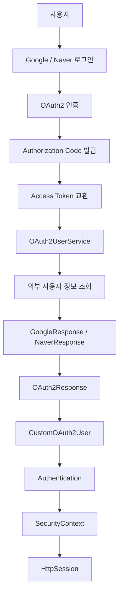
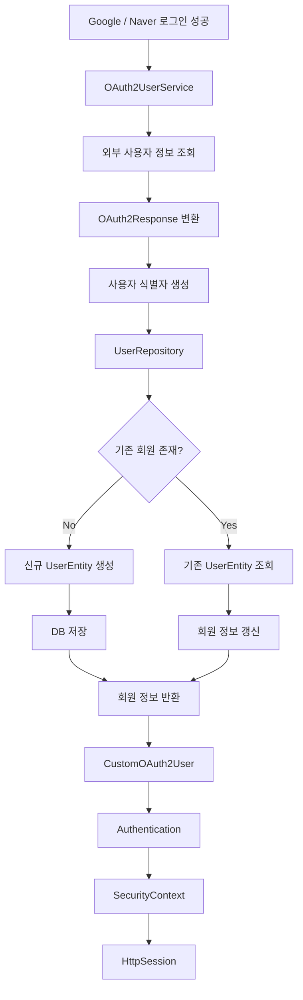
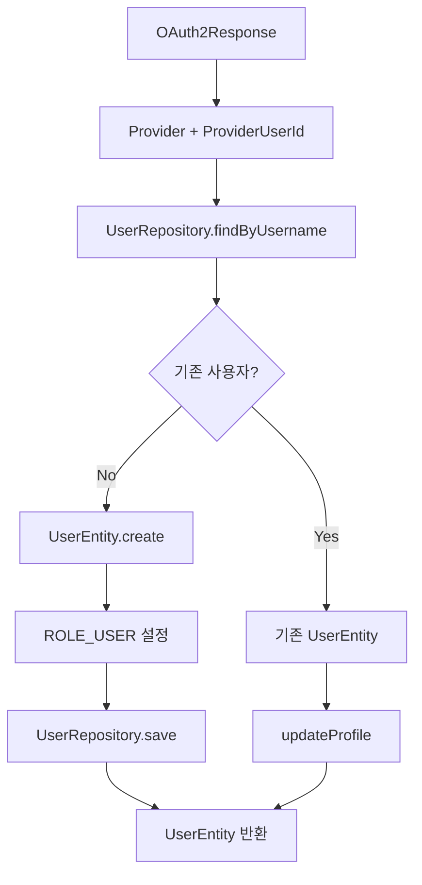
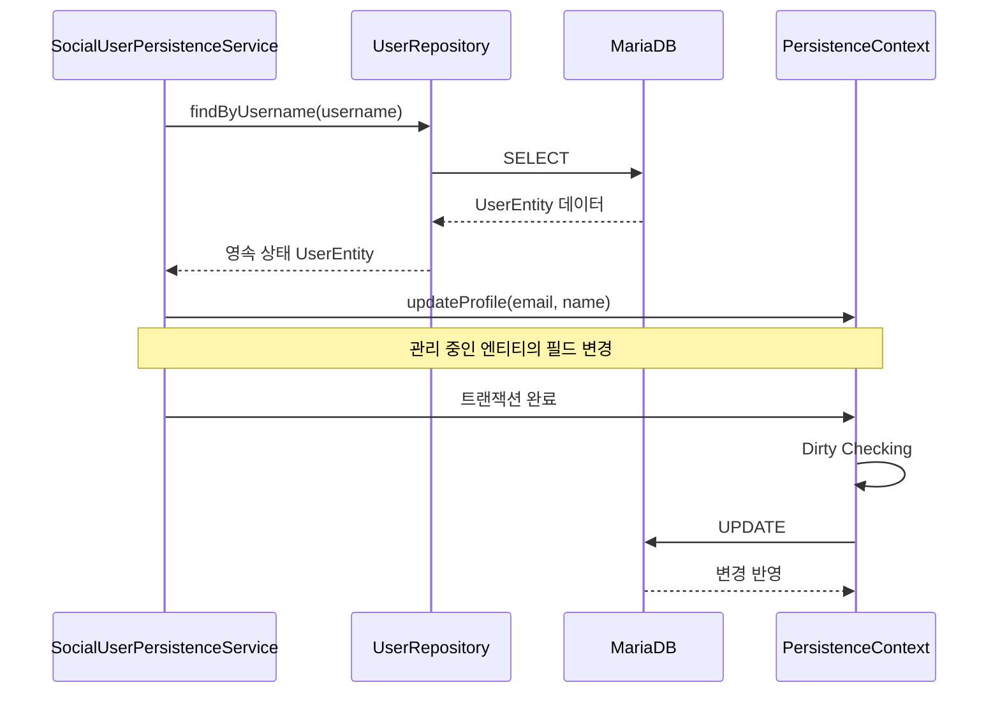
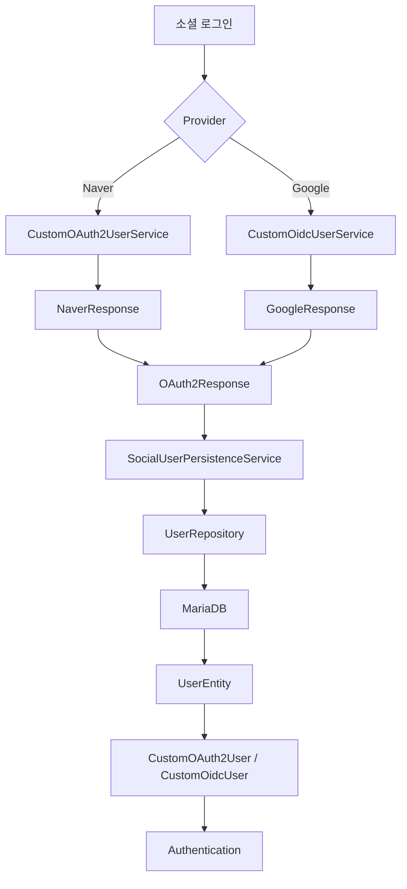
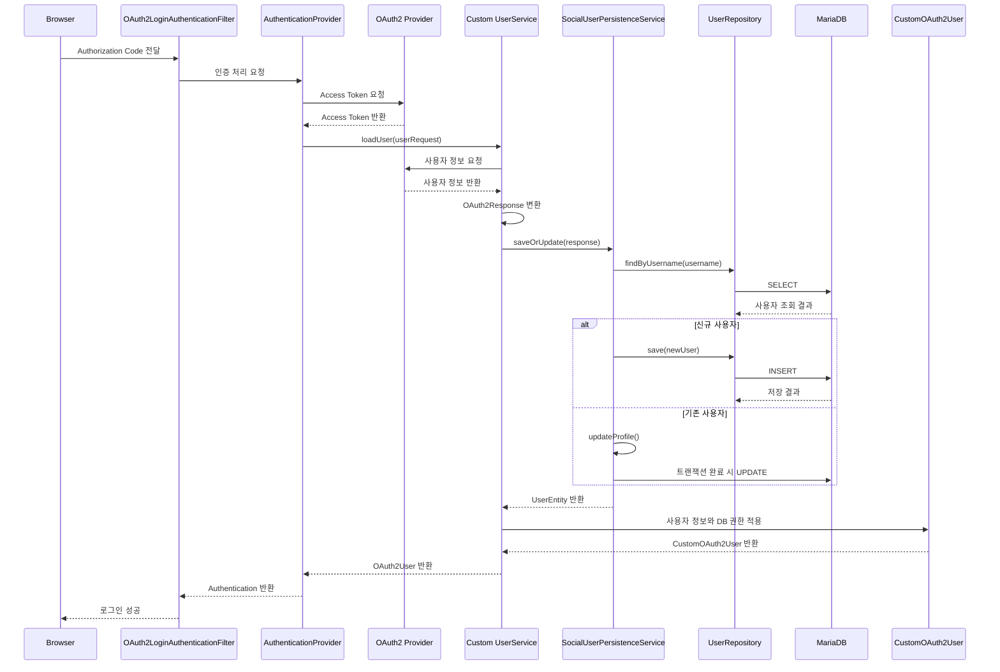
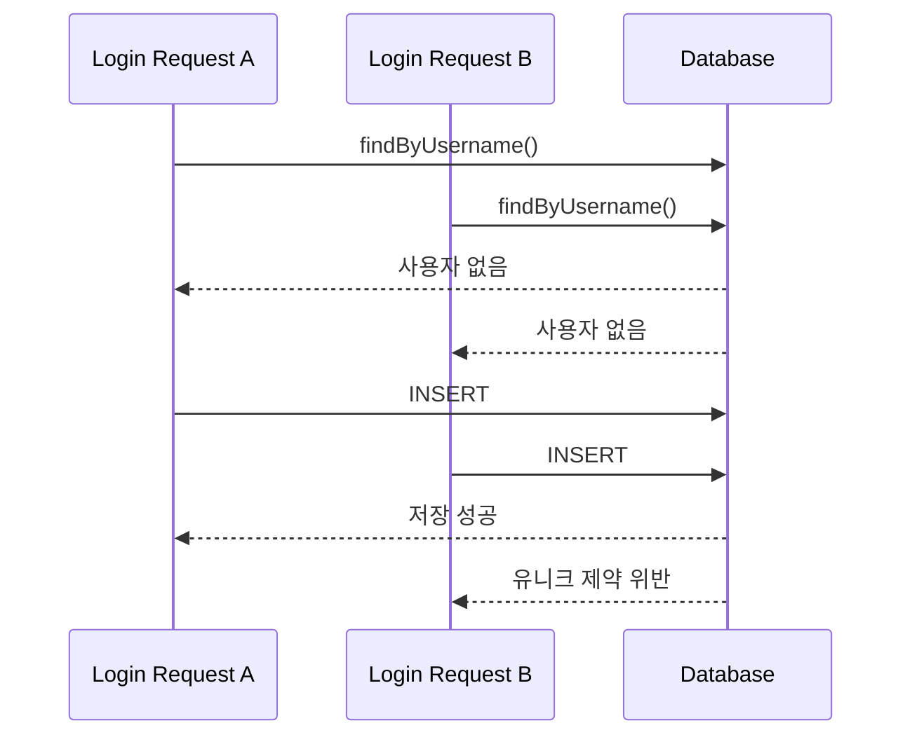
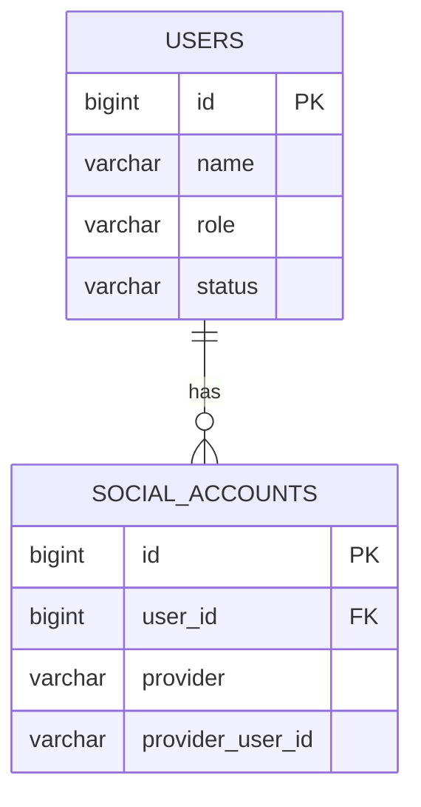
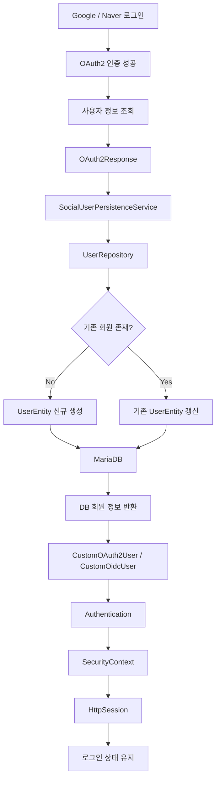

# 스프링 OAuth2 클라이언트 세션 - 10. 유저 정보 DB 저장
[https://youtu.be/CY_QrS26Euk?si=gcxdbKuw0Ay9zbZr](https://youtu.be/CY_QrS26Euk?si=gcxdbKuw0Ay9zbZr)

# 스프링 OAuth2 클라이언트 세션 - 10. 유저 정보 DB 저장
* toc
{:toc}

---

### Spring Security 6 OAuth2 소셜 로그인 사용자 정보 DB 저장: UserEntity, UserRepository, JPA와 CustomOAuth2UserService 구현

Spring Security OAuth2 Client를 이용하면 Google과 Naver 같은 외부 인증 제공자를 통해 사용자를 인증할 수 있다.

앞서 OAuth2 로그인 기능을 활성화하고, 외부 인증 제공자로부터 사용자 정보를 조회하는 `CustomOAuth2UserService`를 구현했다.

또한 Google과 Naver의 서로 다른 사용자 정보 구조를 `OAuth2Response`라는 공통 인터페이스로 변환하고, `CustomOAuth2User`를 이용해 Spring Security의 인증 Principal을 구성했다.

현재까지 구현한 구조는 다음과 같다.



이제 외부 소셜 로그인을 이용한 사용자 인증은 가능한 상태다.

하지만 아직 한 가지 중요한 문제가 남아 있다.

**사용자가 우리 서비스에 로그인했더라도, 해당 사용자의 정보가 데이터베이스에 저장되지 않았다는 점이다.**

예를 들어 사용자가 Google 계정으로 로그인했다고 생각해보자.

Google은 사용자 식별자와 이름, 이메일 등의 정보를 반환할 수 있다.

```json
{
  "sub": "google-user-123",
  "name": "홍길동",
  "email": "user@example.com"
}
```

Spring Security는 이러한 정보를 이용해 인증된 사용자를 구성한다.

하지만 우리 서비스의 데이터베이스에 해당 사용자가 존재하지 않는다면 다음과 같은 기능을 구현하기 어렵다.

- 사용자별 주문 및 결제 내역 관리
- 회원 권한 및 계정 상태 관리
- 사용자 프로필 수정
- 서비스 가입일 및 활동 이력 관리
- Google과 Naver 계정 연결
- 회원 탈퇴 및 재가입 처리
- 사용자별 구독 서비스 및 이용권 관리

따라서 실제 서비스에서는 외부 OAuth2 인증에 성공한 사용자를 내부 데이터베이스의 회원 정보와 연결해야 한다.

이번에는 이를 위해 **Spring Data JPA를 이용한 소셜 로그인 사용자 정보 저장 기능**을 구현한다.

최종 목표는 다음과 같다.



여기서 가장 중요한 부분은 **최초 로그인과 재로그인을 구분하는 것**이다.

처음 로그인한 사용자라면 데이터베이스에 회원 정보를 저장해야 한다.

반면 이미 가입된 사용자라면 새로운 회원을 생성하지 않고 기존 회원 정보를 사용해야 한다.

이러한 처리를 구현하면 외부 인증을 통해 전달받은 사용자 정보를 내부 회원 데이터와 연결할 수 있다.

---

### 개념

#### OAuth2 사용자 정보를 DB에 저장한다는 것은 무엇일까?

OAuth2 소셜 로그인에서는 외부 인증 제공자가 사용자의 신원을 확인한다.

예를 들어 Google 로그인이라면 Google이 사용자 인증을 수행한다.

Naver 로그인이라면 Naver가 사용자 인증을 수행한다.

하지만 외부 인증 제공자가 우리 서비스의 회원 데이터까지 관리해 주는 것은 아니다.

다음 두 개념을 구분해야 한다.

**외부 인증 사용자**

Google이나 Naver에서 인증된 사용자다.

```text
Google User

provider = google

providerUserId = google-user-123

email = user@example.com
```

**내부 서비스 회원**

우리 서비스의 데이터베이스에서 관리하는 사용자다.

```text
UserEntity

id = 1

username = google:google-user-123

email = user@example.com

role = ROLE_USER
```

외부 인증 사용자는 OAuth2 인증 제공자가 관리한다.

내부 서비스 회원은 우리 애플리케이션이 관리한다.

따라서 두 정보를 연결하는 과정이 필요하다.

이를 간단하게 표현하면 다음과 같다.

```text
External OAuth2 User
        ↓
Provider + ProviderUserId
        ↓
Internal UserEntity
        ↓
Service User
```

이러한 구조에서는 외부 인증 제공자가 사용자 인증을 담당하고, 우리 서비스는 회원 정보와 권한을 관리한다.

#### 왜 외부 사용자 정보를 그대로 사용하면 안 될까?

외부 OAuth2 사용자 정보는 우리 서비스의 요구사항을 모두 충족하지 못할 수 있다.

예를 들어 Google은 다음과 같은 정보를 제공할 수 있다.

```text
sub

email

name

picture
```

하지만 우리 서비스에는 다음과 같은 추가 정보가 필요할 수 있다.

```text
userId

role

membershipStatus

createdAt

updatedAt

subscriptionStatus
```

이러한 정보는 Google이 관리하는 데이터가 아니다.

우리 서비스에서 별도로 관리해야 한다.

따라서 외부 사용자 정보를 내부 회원 엔티티와 연결하는 구조가 필요하다.

---

### 왜 사용하는가?

#### 1. 소셜 로그인 사용자에게 고유한 내부 식별자를 부여하기 위해서

Google은 `sub`를 통해 사용자를 식별한다.

Naver는 `response.id`를 통해 사용자를 식별한다.

하지만 외부 사용자 식별자를 그대로 우리 서비스의 기본키로 사용하는 것은 적절하지 않을 수 있다.

예를 들어 다음과 같은 상황을 생각해보자.

```text
Google User ID = 12345
```

```text
Naver User ID = 12345
```

두 값이 동일하더라도 같은 사용자를 의미하지 않는다.

서로 다른 인증 제공자에서 발급한 식별자이기 때문이다.

따라서 외부 계정을 구분할 때는 일반적으로 다음 두 값을 함께 사용한다.

```text
provider + providerUserId
```

예를 들어 다음과 같다.

```text
google:12345
```

```text
naver:12345
```

이렇게 하면 서로 다른 인증 제공자의 사용자 식별자 충돌을 방지할 수 있다.

이후 데이터베이스에서는 별도의 내부 회원 ID를 사용할 수 있다.

```text
Internal User ID = 1
```

이 구조를 사용하면 주문, 결제, 구독 등 다양한 도메인에서 내부 회원 ID를 기준으로 데이터를 관리할 수 있다.

#### 2. 재로그인 시 중복 회원가입을 방지하기 위해서

사용자가 같은 Google 계정으로 여러 번 로그인한다고 생각해보자.

회원 정보 조회 없이 매번 새로운 UserEntity를 저장한다면 다음과 같은 문제가 발생한다.

```text
첫 번째 로그인 → User ID 1

두 번째 로그인 → User ID 2

세 번째 로그인 → User ID 3
```

실제로는 모두 같은 사용자다.

하지만 데이터베이스에는 서로 다른 회원으로 저장된다.

따라서 로그인 과정에서 기존 회원이 존재하는지 확인해야 한다.

```text
OAuth2 로그인 성공
    ↓
사용자 식별자 생성
    ↓
DB 조회
    ↓
기존 회원 확인
    ↓
존재하면 재사용
    ↓
없으면 신규 등록
```

이렇게 하면 동일한 외부 계정으로 로그인하더라도 하나의 내부 회원 정보를 사용할 수 있다.

#### 3. 내부 서비스의 권한을 관리하기 위해서

외부 인증 제공자는 사용자의 신원을 확인한다.

하지만 해당 사용자가 우리 서비스에서 관리자 권한을 가져야 하는지는 결정하지 않는다.

예를 들어 다음과 같은 권한이 있을 수 있다.

```text
ROLE_USER

ROLE_MANAGER

ROLE_ADMIN
```

이러한 권한은 내부 데이터베이스에서 관리하는 것이 적절하다.

이번에는 모든 신규 사용자에게 기본적으로 `ROLE_USER` 권한을 부여한다.

하지만 이미 가입된 사용자라면 데이터베이스에 저장된 권한을 사용한다.

이 차이는 중요하다.

**재로그인할 때마다 ROLE_USER를 다시 부여하면 기존 관리자의 권한이 의도하지 않게 변경될 수 있기 때문이다.**

따라서 최초 회원가입과 기존 회원 로그인 처리를 구분해야 한다.

---

### 주요 특징

#### OAuth2 인증과 내부 회원 저장의 관계

OAuth2 인증은 외부 인증 제공자와 Spring Security가 처리한다.

반면 내부 회원 저장은 우리 애플리케이션의 비즈니스 로직이다.

두 작업의 책임은 다음과 같이 구분된다.

| 구분 | 담당 구성요소 | 역할 |
|---|---|---|
| 사용자 인증 | Google / Naver | 사용자 신원 확인 |
| Authorization Code 처리 | Spring Security | 인증 코드 수신 및 검증 |
| Access Token 발급 | OAuth2 인증 서버 | 접근 토큰 발급 |
| 사용자 정보 조회 | OAuth2UserService | 외부 사용자 정보 획득 |
| 사용자 정보 변환 | OAuth2Response | 제공자별 응답 정규화 |
| 내부 회원 조회 | UserRepository | 기존 회원 확인 |
| 신규 회원 저장 | Spring Data JPA | UserEntity 저장 |
| 회원 정보 갱신 | JPA 영속성 컨텍스트 | 기존 엔티티 변경 반영 |
| Principal 구성 | CustomOAuth2User | 사용자 정보 및 권한 제공 |
| 로그인 상태 관리 | Spring Security | Authentication 및 Session 관리 |

여기서 사용자 정보 저장은 OAuth2 인증 절차 중 **외부 사용자 정보를 조회한 이후**에 수행할 수 있다.

이렇게 하면 외부 인증에 성공한 사용자만 내부 회원 처리 로직에 진입하도록 구성할 수 있다.

---

### 프로젝트 구조

이번에는 기존 프로젝트에 데이터베이스 관련 패키지를 추가한다.

```text
src
└── main
    ├── java
    │   └── com
    │       └── example
    │           └── oauth2session
    │               │
    │               ├── Oauth2SessionApplication.java
    │               │
    │               ├── config
    │               │   └── SecurityConfig.java
    │               │
    │               ├── controller
    │               │   ├── MainController.java
    │               │   └── MyController.java
    │               │
    │               ├── entity
    │               │   └── UserEntity.java
    │               │
    │               ├── repository
    │               │   └── UserRepository.java
    │               │
    │               ├── service
    │               │   ├── CustomOAuth2UserService.java
    │               │   ├── CustomOidcUserService.java
    │               │   └── SocialUserPersistenceService.java
    │               │
    │               └── dto
    │                   └── oauth2
    │                       ├── OAuth2Response.java
    │                       ├── GoogleResponse.java
    │                       ├── NaverResponse.java
    │                       ├── CustomOAuth2User.java
    │                       └── CustomOidcUser.java
    │
    └── resources
        └── application.yml
```

각 클래스의 역할은 다음과 같다.

| 클래스 | 역할 |
|---|---|
| UserEntity | 회원 정보 저장 |
| UserRepository | 회원 조회 및 저장 |
| SocialUserPersistenceService | 신규 회원 등록 및 기존 회원 갱신 |
| CustomOAuth2UserService | 일반 OAuth2 사용자 정보 처리 |
| CustomOidcUserService | OIDC 사용자 정보 처리 |
| OAuth2Response | 제공자별 사용자 정보 공통 규격 |
| CustomOAuth2User | Spring Security 인증 Principal |
| SecurityConfig | OAuth2 사용자 정보 처리 서비스 등록 |

이번에는 JPA의 기본적인 사용법뿐 아니라 트랜잭션을 고려하여 회원 저장 로직을 분리한다.

이러한 구조는 실제 서비스에서 사용자 정보를 관리할 때도 활용할 수 있다.

---

### 예제

#### 1. Spring Data JPA 의존성 추가

앞서 프로젝트를 생성할 때 다음 의존성을 추가했다.

```gradle
implementation 'org.springframework.boot:spring-boot-starter-data-jpa'
```

하지만 당시에는 데이터베이스 연결을 구성하지 않았으므로 JPA 관련 의존성을 임시로 비활성화했다.

이제 사용자 정보를 저장해야 하므로 다시 활성화한다.

이번 구현에서는 MariaDB를 기준으로 설명한다.

기존 프로젝트가 MySQL을 사용하고 있다면 뒤에서 설명하는 MySQL 설정을 적용할 수 있다.

#### build.gradle

Spring Boot 3.2.1, Java 17, Gradle Groovy 환경을 기준으로 작성한다.

```gradle
plugins {
    id 'java'
    id 'org.springframework.boot' version '3.2.1'
    id 'io.spring.dependency-management' version '1.1.4'
}

group = 'com.example'
version = '0.0.1-SNAPSHOT'

java {
    toolchain {
        languageVersion = JavaLanguageVersion.of(17)
    }
}

repositories {
    mavenCentral()
}

dependencies {

    // Spring MVC
    implementation 'org.springframework.boot:spring-boot-starter-web'

    // Spring Security
    implementation 'org.springframework.boot:spring-boot-starter-security'

    // OAuth2 Client
    implementation 'org.springframework.boot:spring-boot-starter-oauth2-client'

    // Mustache
    implementation 'org.springframework.boot:spring-boot-starter-mustache'

    // Spring Data JPA
    implementation 'org.springframework.boot:spring-boot-starter-data-jpa'

    // MariaDB JDBC Driver
    runtimeOnly 'org.mariadb.jdbc:mariadb-java-client'

    // Lombok
    compileOnly 'org.projectlombok:lombok'
    annotationProcessor 'org.projectlombok:lombok'

    // Test
    testImplementation 'org.springframework.boot:spring-boot-starter-test'
    testImplementation 'org.springframework.security:spring-security-test'
}

tasks.named('test') {
    useJUnitPlatform()
}
```

여기서 이번에 중요한 의존성은 다음 두 가지다.

```gradle
implementation 'org.springframework.boot:spring-boot-starter-data-jpa'
```

```gradle
runtimeOnly 'org.mariadb.jdbc:mariadb-java-client'
```

각 의존성의 역할은 다음과 같다.

| 의존성 | 역할 |
|---|---|
| spring-boot-starter-data-jpa | JPA 및 Spring Data JPA 기능 제공 |
| mariadb-java-client | Java 애플리케이션과 MariaDB 연결 |
| spring-boot-starter-oauth2-client | OAuth2 Client 기능 |
| spring-boot-starter-security | Spring Security 인증 및 인가 |

Spring Data JPA를 사용하면 Repository 인터페이스를 정의하는 것만으로 기본적인 CRUD 기능을 사용할 수 있다.

반면 JDBC Driver는 실제 데이터베이스와 통신하는 데 사용된다.

즉 JPA 의존성만 추가한다고 해서 데이터베이스 연결까지 자동으로 완료되는 것은 아니다.

---

### 2. 데이터베이스 생성

이제 회원 정보를 저장할 데이터베이스를 준비한다.

MariaDB에 접속한 뒤 다음 SQL을 실행한다.

```sql
CREATE DATABASE IF NOT EXISTS oauth2
CHARACTER SET utf8mb4
COLLATE utf8mb4_unicode_ci;
```

이 명령어는 `oauth2`라는 데이터베이스를 생성한다.

각 요소의 의미는 다음과 같다.

| SQL | 의미 |
|---|---|
| CREATE DATABASE | 데이터베이스 생성 |
| IF NOT EXISTS | 이미 존재하면 중복 생성 방지 |
| oauth2 | 데이터베이스 이름 |
| utf8mb4 | 유니코드 문자 저장 |
| utf8mb4_unicode_ci | 문자 비교에 사용할 Collation |

한글 사용자 이름과 다양한 문자를 저장할 수 있도록 `utf8mb4`를 사용한다.

#### 데이터베이스 확인

다음 SQL을 실행한다.

```sql
SHOW DATABASES;
```

정상적으로 생성되었다면 다음과 유사한 결과를 확인할 수 있다.

```text
information_schema

mysql

oauth2

performance_schema
```

여기서 `oauth2` 데이터베이스가 존재하는지 확인한다.

#### 데이터베이스 사용자 설정

로컬 개발 환경이라면 별도의 애플리케이션 계정을 생성할 수 있다.

```sql
CREATE USER IF NOT EXISTS 'oauth2_app'@'localhost'
IDENTIFIED BY 'replace-with-strong-password';
```

이후 개발용 데이터베이스에 필요한 권한을 부여한다.

```sql
GRANT ALL PRIVILEGES
ON oauth2.*
TO 'oauth2_app'@'localhost';
```

이 예제는 로컬 개발 편의를 위한 구성이다.

운영 환경에서는 애플리케이션 계정에 필요한 권한만 부여해야 한다.

특히 테이블 생성 및 변경 권한과 애플리케이션의 일반적인 데이터 조회·수정 권한을 분리하는 것이 좋다.

---

### 3. application.yml 데이터베이스 연결 설정

이제 Spring Boot에서 MariaDB에 연결할 수 있도록 설정한다.

파일 경로는 다음과 같다.

```text
src/main/resources/application.yml
```

기존 OAuth2 Client 설정은 유지하고, 데이터베이스 연결 설정을 추가한다.

```yaml
server:
  port: 8080

spring:
  application:
    name: oauth2-session

  datasource:
    driver-class-name: org.mariadb.jdbc.Driver
    url: jdbc:mariadb://localhost:3306/oauth2
    username: ${DB_USERNAME}
    password: ${DB_PASSWORD}

  jpa:
    hibernate:
      ddl-auto: update

    properties:
      hibernate:
        format_sql: true

    show-sql: true

  security:
    oauth2:
      client:
        registration:

          google:
            client-name: Google
            client-id: ${GOOGLE_CLIENT_ID}
            client-secret: ${GOOGLE_CLIENT_SECRET}
            authorization-grant-type: authorization_code
            redirect-uri: "{baseUrl}/login/oauth2/code/{registrationId}"

            scope:
              - openid
              - profile
              - email

          naver:
            client-name: Naver
            client-id: ${NAVER_CLIENT_ID}
            client-secret: ${NAVER_CLIENT_SECRET}
            client-authentication-method: client_secret_post
            authorization-grant-type: authorization_code
            redirect-uri: "{baseUrl}/login/oauth2/code/{registrationId}"

        provider:
          naver:
            authorization-uri: https://nid.naver.com/oauth2.0/authorize
            token-uri: https://nid.naver.com/oauth2.0/token
            user-info-uri: https://openapi.naver.com/v1/nid/me
            user-name-attribute: response
```

여기서 Naver의 Provider 설정은 기존에 작성한 구성을 유지했다.

Naver의 실제 토큰 교환 요청이나 사용자 정보 조회에서 제공자별 추가 처리가 필요한 경우 해당 설정을 별도로 확장해야 한다.

이번에는 데이터베이스 저장 과정에 집중한다.

---

### datasource 설정

다음 부분을 살펴보자.

```yaml
spring:
  datasource:
    driver-class-name: org.mariadb.jdbc.Driver
    url: jdbc:mariadb://localhost:3306/oauth2
    username: ${DB_USERNAME}
    password: ${DB_PASSWORD}
```

각 설정의 의미는 다음과 같다.

#### driver-class-name

```yaml
driver-class-name: org.mariadb.jdbc.Driver
```

MariaDB JDBC Driver를 지정한다.

Spring Boot는 이 Driver를 이용해 데이터베이스 연결을 구성할 수 있다.

#### url

```yaml
url: jdbc:mariadb://localhost:3306/oauth2
```

데이터베이스 접속 주소다.

구조를 나누면 다음과 같다.

```text
jdbc:mariadb://localhost:3306/oauth2
     │           │       │      │
     │           │       │      └── Database
     │           │       └───────── Port
     │           └───────────────── Host
     └───────────────────────────── JDBC Protocol
```

각 항목의 의미는 다음과 같다.

| 항목 | 값 | 의미 |
|---|---|---|
| Protocol | jdbc:mariadb | MariaDB JDBC 연결 |
| Host | localhost | DB 서버 주소 |
| Port | 3306 | DB 서버 포트 |
| Database | oauth2 | 사용할 데이터베이스 |

#### username과 password

```yaml
username: ${DB_USERNAME}
password: ${DB_PASSWORD}
```

데이터베이스 계정 정보를 환경변수로 읽어온다.

실제 비밀번호를 `application.yml`에 직접 작성하지 않도록 구성했다.

Windows PowerShell에서는 다음과 같이 설정할 수 있다.

```powershell
$env:DB_USERNAME = "oauth2_app"

$env:DB_PASSWORD = "실제_데이터베이스_비밀번호"
```

이 설정은 현재 PowerShell 세션에 환경변수를 등록한다.

해당 세션에서 Spring Boot를 실행하면 설정값을 사용할 수 있다.

IntelliJ에서 별도로 실행하는 경우에는 Run Configuration에도 환경변수를 등록해야 한다.

---

### 4. JPA 설정 이해하기

이번에는 다음 설정을 살펴보자.

```yaml
spring:
  jpa:
    hibernate:
      ddl-auto: update

    properties:
      hibernate:
        format_sql: true

    show-sql: true
```

여기서 중요한 값은 `ddl-auto`다.

#### ddl-auto란?

`ddl-auto`는 Hibernate가 엔티티와 데이터베이스 스키마를 어떻게 관리할지 결정하는 설정이다.

대표적인 값은 다음과 같다.

| 값 | 동작 |
|---|---|
| none | 스키마 생성 및 변경을 수행하지 않음 |
| validate | 엔티티와 DB 스키마의 일치 여부 검증 |
| update | 엔티티 구조를 기준으로 DB 스키마 갱신 시도 |
| create | 실행 시 기존 테이블을 제거하고 다시 생성 |
| create-drop | 시작 시 생성하고 종료 시 제거 |

이번에는 로컬 개발 환경에서 다음 값을 사용한다.

```yaml
ddl-auto: update
```

이 설정은 UserEntity에 대응하는 테이블을 생성하거나 일부 스키마 변경을 반영하는 데 사용할 수 있다.

다만 `update`는 모든 스키마 변경을 안전하게 처리하는 마이그레이션 도구가 아니다.

특히 컬럼 타입 변경, 제약조건 변경, 기존 데이터 보존 등은 별도로 검증해야 한다.

#### create와 update의 차이

예를 들어 이미 사용자 데이터가 저장되어 있다고 생각해보자.

```text
User ID = 1

Username = google:12345
```

이 상태에서 다음 설정으로 애플리케이션을 재시작하면:

```yaml
ddl-auto: create
```

기존 테이블을 제거하고 다시 생성할 수 있다.

따라서 저장된 데이터가 삭제될 위험이 있다.

반면 다음 설정은:

```yaml
ddl-auto: update
```

기존 테이블과 데이터를 유지하면서 스키마 변경을 시도한다.

하지만 운영 환경에서는 `update`도 주의해서 사용해야 한다.

일반적으로 운영 환경에서는 Flyway나 Liquibase 같은 마이그레이션 도구를 이용해 스키마 변경을 명시적으로 관리하고, Hibernate는 `validate`로 스키마를 검증하도록 구성하는 것이 적절하다.

Spring Boot 3.2.1 공식 문서에서도 `ddl-auto`의 각 동작과 스키마 초기화 시 주의사항을 설명한다.

---

### 5. UserEntity 생성

이제 소셜 로그인 사용자 정보를 저장할 엔티티를 생성한다.

파일 경로는 다음과 같다.

```text
entity/UserEntity.java
```

이번 엔티티에서는 다음 정보를 관리한다.

| 필드 | 의미 |
|---|---|
| id | 내부 회원 고유 ID |
| username | 외부 인증 제공자와 사용자 식별자를 결합한 값 |
| email | 사용자 이메일 |
| name | 사용자 이름 |
| role | 내부 서비스 권한 |

전체 코드는 다음과 같다.

```java
package com.example.oauth2session.entity;

import jakarta.persistence.Column;
import jakarta.persistence.Entity;
import jakarta.persistence.GeneratedValue;
import jakarta.persistence.GenerationType;
import jakarta.persistence.Id;
import jakarta.persistence.Table;

@Entity
@Table(name = "users")
public class UserEntity {

    @Id
    @GeneratedValue(strategy = GenerationType.IDENTITY)
    private Long id;

    @Column(
            nullable = false,
            unique = true,
            length = 190
    )
    private String username;

    @Column(length = 255)
    private String email;

    @Column(length = 100)
    private String name;

    @Column(
            nullable = false,
            length = 30
    )
    private String role;

    protected UserEntity() {
    }

    private UserEntity(
            String username,
            String email,
            String name,
            String role
    ) {

        this.username = username;
        this.email = email;
        this.name = name;
        this.role = role;
    }

    public static UserEntity create(
            String username,
            String email,
            String name
    ) {

        return new UserEntity(
                username,
                email,
                name,
                "ROLE_USER"
        );
    }

    public void updateProfile(
            String email,
            String name
    ) {

        if (email != null) {
            this.email = email;
        }

        if (name != null) {
            this.name = name;
        }
    }

    public Long getId() {
        return id;
    }

    public String getUsername() {
        return username;
    }

    public String getEmail() {
        return email;
    }

    public String getName() {
        return name;
    }

    public String getRole() {
        return role;
    }
}
```

여기서 몇 가지 중요한 부분을 살펴보자.

---

### @Entity

```java
@Entity
public class UserEntity {
}
```

`@Entity`는 해당 클래스를 JPA가 관리하는 엔티티로 선언한다.

JPA는 이 클래스를 데이터베이스 테이블과 연결하여 관리할 수 있다.

이번에는 다음 Annotation을 사용했다.

```java
@Table(name = "users")
```

따라서 UserEntity는 `users` 테이블과 매핑된다.

```text
Java

UserEntity
    ↓
JPA Mapping
    ↓
Database

users
```

#### jakarta.persistence를 사용하는 이유

Spring Boot 3.x에서는 Jakarta EE 기반 API를 사용한다.

따라서 JPA 관련 Annotation도 다음 패키지를 사용한다.

```java
import jakarta.persistence.Entity;
```

과거 Spring Boot 2.x에서 사용하던 다음 패키지와 다르다.

```java
import javax.persistence.Entity;
```

Spring Boot 3.2.1에서는 `jakarta.persistence`를 사용해야 한다.

---

### @Id와 @GeneratedValue

다음 코드를 살펴보자.

```java
@Id
@GeneratedValue(strategy = GenerationType.IDENTITY)
private Long id;
```

`@Id`는 해당 필드를 엔티티의 기본키로 지정한다.

`@GeneratedValue`는 기본키 생성 전략을 지정한다.

이번에는 다음 전략을 사용한다.

```java
GenerationType.IDENTITY
```

이는 데이터베이스의 자동 증가 컬럼과 같은 기본키 생성 기능을 활용하는 전략이다.

예를 들어 다음과 같이 저장될 수 있다.

| id | username | role |
|---:|---|---|
| 1 | google:google-user-123 | ROLE_USER |
| 2 | naver:naver-user-456 | ROLE_USER |
| 3 | google:google-user-789 | ROLE_USER |

여기서 `id`는 우리 서비스 내부에서 사용하는 회원 식별자다.

반면 `username`은 외부 OAuth2 계정을 구분하기 위한 값이다.

이 둘을 구분해야 한다.

---

### username에 unique 제약을 설정하는 이유

다음 코드를 살펴보자.

```java
@Column(
        nullable = false,
        unique = true,
        length = 190
)
private String username;
```

여기서 중요한 옵션은 다음과 같다.

```java
unique = true
```

이 설정은 `username`에 유니크 제약을 적용하도록 엔티티 매핑을 선언한다.

예를 들어 다음 값이 이미 저장되어 있다고 생각해보자.

```text
google:google-user-123
```

동일한 값을 가진 사용자가 다시 생성된다면 데이터베이스의 유니크 제약에 의해 중복 저장이 거부될 수 있다.

이는 단순히 Repository에서 기존 사용자를 조회하는 것만으로 해결되지 않는 동시성 문제를 방어하는 데 중요하다.

실제 운영에서는 데이터베이스에 유니크 인덱스가 정상적으로 생성되어 있는지 별도로 확인해야 한다.

---

### 정적 팩토리 메서드를 사용하는 이유

이번에는 다음 메서드를 작성했다.

```java
public static UserEntity create(
        String username,
        String email,
        String name
) {

    return new UserEntity(
            username,
            email,
            name,
            "ROLE_USER"
    );
}
```

이 메서드는 신규 사용자를 생성할 때 사용한다.

예를 들어 다음과 같다.

```java
UserEntity user = UserEntity.create(
        "google:google-user-123",
        "user@example.com",
        "홍길동"
);
```

이렇게 하면 신규 회원에게 기본적으로 `ROLE_USER`를 부여할 수 있다.

또한 UserEntity 생성 규칙을 클래스 내부에서 관리할 수 있다.

반면 모든 필드에 Setter를 제공하면 외부에서 회원 식별자나 권한을 임의로 변경할 가능성이 커진다.

따라서 필요한 생성 및 변경 동작을 메서드로 제한하는 방식이 유지보수에 도움이 된다.

---

### updateProfile()의 역할

다음 메서드를 살펴보자.

```java
public void updateProfile(
        String email,
        String name
) {

    if (email != null) {
        this.email = email;
    }

    if (name != null) {
        this.name = name;
    }
}
```

이 메서드는 기존 사용자가 다시 로그인했을 때 사용자 정보를 갱신하기 위해 사용한다.

예를 들어 처음 로그인했을 때 다음과 같은 정보가 저장되었다고 생각해보자.

```text
email = old@example.com

name = 홍길동
```

이후 외부 인증 제공자에서 새로운 이메일을 반환했다.

```text
email = new@example.com

name = 홍길동
```

그러면 기존 회원 정보의 이메일을 변경할 수 있다.

하지만 여기서 한 가지를 주의해야 한다.

외부 인증 제공자가 특정 속성을 반환하지 않았다고 해서 기존에 저장된 값을 무조건 `null`로 덮어쓰면 데이터가 손실될 수 있다.

따라서 이번에는 값이 존재하는 경우에만 갱신하도록 구성했다.

실제 서비스에서는 외부 사용자 정보와 내부에서 직접 수정한 프로필 정보 중 어느 값을 우선할 것인지 별도의 정책을 정의하는 것이 좋다.

---

### 6. UserRepository 생성

이제 UserEntity를 조회하고 저장할 Repository를 작성한다.

파일 경로는 다음과 같다.

```text
repository/UserRepository.java
```

전체 코드는 다음과 같다.

```java
package com.example.oauth2session.repository;

import com.example.oauth2session.entity.UserEntity;

import org.springframework.data.jpa.repository.JpaRepository;

import java.util.Optional;

public interface UserRepository
        extends JpaRepository<UserEntity, Long> {

    Optional<UserEntity> findByUsername(
            String username
    );
}
```

여기서 중요한 것은 다음 부분이다.

```java
extends JpaRepository<UserEntity, Long>
```

`JpaRepository`를 상속하면 기본적인 데이터베이스 작업을 사용할 수 있다.

대표적인 메서드는 다음과 같다.

| 메서드 | 역할 |
|---|---|
| save() | 엔티티 저장 |
| findById() | 기본키로 조회 |
| findAll() | 전체 조회 |
| deleteById() | 기본키로 삭제 |
| existsById() | 존재 여부 확인 |
| count() | 데이터 개수 조회 |

따라서 기본적인 CRUD SQL을 직접 작성할 필요가 없다.

#### findByUsername()

이번에 추가한 메서드는 다음과 같다.

```java
Optional<UserEntity> findByUsername(
        String username
);
```

Spring Data JPA는 메서드 이름을 분석하여 쿼리를 생성할 수 있다.

이 메서드는 개념적으로 다음 SQL과 유사한 조회를 수행한다.

```sql
SELECT
    id,
    username,
    email,
    name,
    role
FROM users
WHERE username = ?;
```

예를 들어 다음과 같이 사용할 수 있다.

```java
Optional<UserEntity> user =
        userRepository.findByUsername(
                "google:google-user-123"
        );
```

해당 사용자가 존재한다면 UserEntity를 반환한다.

존재하지 않는다면 비어 있는 Optional을 반환한다.

이를 통해 최초 로그인과 재로그인을 구분할 수 있다.

---

### 7. 최초 로그인과 재로그인 처리

이제 실제 회원 저장 로직을 구현해보자.

핵심 요구사항은 다음과 같다.

**최초 로그인**

```text
OAuth2 로그인 성공
    ↓
DB에서 회원 조회
    ↓
기존 회원 없음
    ↓
UserEntity 생성
    ↓
ROLE_USER 부여
    ↓
DB 저장
```

**재로그인**

```text
OAuth2 로그인 성공
    ↓
DB에서 회원 조회
    ↓
기존 회원 존재
    ↓
사용자 정보 갱신
    ↓
기존 권한 유지
    ↓
로그인 처리
```

이 흐름을 하나의 다이어그램으로 표현하면 다음과 같다.



이번에는 이 로직을 `CustomOAuth2UserService`에 모두 작성하지 않고 별도의 서비스로 분리한다.

그 이유는 **외부 사용자 정보 조회와 데이터베이스 트랜잭션 관리의 책임이 서로 다르기 때문**이다.

---

### 8. SocialUserPersistenceService 구현

파일 경로는 다음과 같다.

```text
service/SocialUserPersistenceService.java
```

전체 코드는 다음과 같다.

```java
package com.example.oauth2session.service;

import com.example.oauth2session.dto.oauth2.OAuth2Response;
import com.example.oauth2session.entity.UserEntity;
import com.example.oauth2session.repository.UserRepository;

import org.springframework.stereotype.Service;
import org.springframework.transaction.annotation.Transactional;

import java.util.Optional;

@Service
public class SocialUserPersistenceService {

    private final UserRepository userRepository;

    public SocialUserPersistenceService(
            UserRepository userRepository
    ) {

        this.userRepository = userRepository;
    }

    @Transactional
    public UserEntity saveOrUpdate(
            OAuth2Response response
    ) {

        // 외부 사용자 식별자 생성
        String username =
                response.getProvider()
                + ":"
                + response.getProviderId();

        // 기존 사용자 조회
        Optional<UserEntity> existingUser =
                userRepository.findByUsername(username);

        // 신규 사용자
        if (existingUser.isEmpty()) {

            UserEntity newUser =
                    UserEntity.create(
                            username,
                            response.getEmail(),
                            response.getName()
                    );

            return userRepository.save(newUser);
        }

        // 기존 사용자
        UserEntity user = existingUser.get();

        // 프로필 정보 갱신
        user.updateProfile(
                response.getEmail(),
                response.getName()
        );

        return user;
    }
}
```

이제 각 부분을 살펴보자.

---

### 사용자 식별자 생성

다음 코드를 살펴보자.

```java
String username =
        response.getProvider()
        + ":"
        + response.getProviderId();
```

예를 들어 Google 로그인이라면 다음 값이 생성된다.

```text
google:google-user-123
```

Naver 로그인이라면 다음과 같다.

```text
naver:naver-user-456
```

이 값은 외부 인증 제공자와 제공자 사용자 ID를 결합한 식별자다.

따라서 서로 다른 인증 제공자의 사용자 ID가 같더라도 구분할 수 있다.

다만 실제 운영 시스템에서는 Provider와 Provider User ID를 별도 컬럼으로 관리하고 복합 유니크 제약을 적용하는 방법도 고려할 수 있다.

현재는 기존 프로젝트의 구조를 유지하기 위해 하나의 username으로 결합했다.

---

### 기존 회원 조회

다음 코드를 살펴보자.

```java
Optional<UserEntity> existingUser =
        userRepository.findByUsername(username);
```

이 메서드는 생성한 username을 이용해 데이터베이스에서 기존 회원을 조회한다.

예를 들어 다음 값이 전달된다.

```text
google:google-user-123
```

데이터베이스에 해당 사용자가 존재하는지 확인한다.

```sql
SELECT *
FROM users
WHERE username = 'google:google-user-123';
```

이후 조회 결과에 따라 서로 다른 작업을 수행한다.

---

### 신규 회원 저장

다음 코드를 살펴보자.

```java
if (existingUser.isEmpty()) {

    UserEntity newUser =
            UserEntity.create(
                    username,
                    response.getEmail(),
                    response.getName()
            );

    return userRepository.save(newUser);
}
```

기존 회원이 존재하지 않으면 새로운 UserEntity를 생성한다.

이때 신규 회원의 기본 권한은 다음과 같다.

```text
ROLE_USER
```

그리고 다음 메서드로 저장한다.

```java
userRepository.save(newUser);
```

Spring Data JPA는 새로운 엔티티를 저장할 때 JPA의 `persist()` 등을 이용한다.

이번 엔티티는 기본키 생성 전략으로 `IDENTITY`를 사용하므로 데이터베이스에서 기본키를 생성한다.

개념적으로 다음 SQL과 유사한 작업이 수행된다.

```sql
INSERT INTO users (
    username,
    email,
    name,
    role
)
VALUES (
    'google:google-user-123',
    'user@example.com',
    '홍길동',
    'ROLE_USER'
);
```

정상적으로 저장되면 UserEntity는 데이터베이스에 기록된다.

---

### 기존 회원 정보 갱신

이번에는 기존 회원이 존재하는 경우다.

```java
UserEntity user = existingUser.get();

user.updateProfile(
        response.getEmail(),
        response.getName()
);

return user;
```

여기서 주목할 부분은 다음과 같다.

```java
userRepository.save(user);
```

기존 회원 갱신 분기에서는 이 메서드를 명시적으로 호출하지 않았다.

그런데도 데이터베이스에 변경 사항을 반영할 수 있다.

그 이유는 **JPA 영속성 컨텍스트와 Dirty Checking** 때문이다.

---

### 9. JPA Dirty Checking 이해하기

JPA는 영속 상태의 엔티티를 관리한다.

트랜잭션 안에서 조회한 엔티티의 필드가 변경되면 Hibernate는 변경 사항을 감지할 수 있다.

예를 들어 다음 코드가 있다고 생각해보자.

```java
UserEntity user =
        userRepository.findByUsername(username)
                .orElseThrow();

user.updateProfile(
        newEmail,
        newName
);
```

이 코드는 엔티티의 값을 변경한다.

그리고 트랜잭션이 정상적으로 완료되면 JPA는 변경 사항을 데이터베이스에 반영할 수 있다.



이러한 과정을 Dirty Checking이라고 한다.

#### Dirty Checking이 동작하기 위한 조건

중요한 조건은 다음과 같다.

- 엔티티가 JPA 영속성 컨텍스트에서 관리되는 상태여야 한다.
- 변경 사항이 트랜잭션 안에서 발생해야 한다.
- 트랜잭션이 정상적으로 완료되어 변경 사항이 반영되어야 한다.

이번 코드에서는 다음 Annotation을 사용했다.

```java
@Transactional
public UserEntity saveOrUpdate(
        OAuth2Response response
) {
}
```

따라서 회원 조회와 변경 작업이 하나의 트랜잭션으로 처리된다.

Spring Data JPA 공식 문서에서도 여러 Repository 작업을 하나의 업무 단위로 묶는 경우 서비스 계층에서 트랜잭션 경계를 정의하는 방법을 설명한다.

---

### 10. @Transactional을 왜 별도 서비스에 선언했을까?

현재 구조에서는 OAuth2 사용자 정보 조회와 데이터베이스 저장을 분리했다.

```text
CustomOAuth2UserService
    ↓
외부 사용자 정보 조회
    ↓
OAuth2Response
    ↓
SocialUserPersistenceService
    ↓
DB 조회 및 저장
```

이렇게 구성한 이유는 트랜잭션 범위를 명확하게 제한하기 위해서다.

#### 모든 작업을 하나의 트랜잭션으로 묶는 경우

다음과 같은 구조를 생각해보자.

```text
@Transactional
    ↓
Google / Naver UserInfo API 호출
    ↓
응답 대기
    ↓
사용자 정보 변환
    ↓
DB 조회
    ↓
DB 저장
```

이 경우 외부 API 호출까지 데이터베이스 트랜잭션 범위에 포함될 수 있다.

외부 API 응답이 지연되면 트랜잭션도 불필요하게 오래 유지될 수 있다.

물론 실제 DB 커넥션을 언제 확보하는지는 트랜잭션 매니저와 데이터 접근 방식에 따라 달라질 수 있다.

하지만 외부 네트워크 호출과 데이터베이스 작업의 경계를 분리하는 것이 일반적으로 더 명확하다.

#### DB 작업만 트랜잭션으로 처리하는 경우

```text
외부 사용자 정보 조회
    ↓
OAuth2Response 변환
    ↓
@Transactional 시작
    ↓
DB 조회
    ↓
INSERT 또는 UPDATE
    ↓
@Transactional 종료
    ↓
CustomOAuth2User 생성
```

이렇게 하면 데이터베이스 작업에 필요한 범위에서만 트랜잭션을 관리할 수 있다.

따라서 이번에는 `SocialUserPersistenceService`에 `@Transactional`을 선언했다.

---

### 11. CustomOAuth2UserService에 DB 저장 기능 연결

이제 기존 `CustomOAuth2UserService`를 수정한다.

앞서 구현한 기능은 다음과 같다.

```text
DefaultOAuth2UserService
    ↓
OAuth2User 획득
    ↓
registrationId 확인
    ↓
GoogleResponse / NaverResponse
    ↓
CustomOAuth2User 반환
```

이번에는 중간에 데이터베이스 저장 로직을 추가한다.

```text
DefaultOAuth2UserService
    ↓
OAuth2User 획득
    ↓
registrationId 확인
    ↓
OAuth2Response 변환
    ↓
SocialUserPersistenceService
    ↓
UserEntity 조회 또는 저장
    ↓
DB의 사용자 권한 확인
    ↓
CustomOAuth2User 반환
```

핵심은 데이터베이스에 저장된 회원 정보를 기준으로 최종 권한을 결정하는 것이다.

---

### CustomOAuth2UserService 전체 코드

```java
package com.example.oauth2session.service;

import com.example.oauth2session.dto.oauth2.CustomOAuth2User;
import com.example.oauth2session.dto.oauth2.GoogleResponse;
import com.example.oauth2session.dto.oauth2.NaverResponse;
import com.example.oauth2session.dto.oauth2.OAuth2Response;

import com.example.oauth2session.entity.UserEntity;

import org.springframework.security.oauth2.client.userinfo.DefaultOAuth2UserService;
import org.springframework.security.oauth2.client.userinfo.OAuth2UserRequest;

import org.springframework.security.oauth2.core.OAuth2AuthenticationException;
import org.springframework.security.oauth2.core.OAuth2Error;
import org.springframework.security.oauth2.core.user.OAuth2User;

import org.springframework.stereotype.Service;

@Service
public class CustomOAuth2UserService
        extends DefaultOAuth2UserService {

    private final SocialUserPersistenceService
            socialUserPersistenceService;

    public CustomOAuth2UserService(
            SocialUserPersistenceService socialUserPersistenceService
    ) {

        this.socialUserPersistenceService =
                socialUserPersistenceService;
    }

    @Override
    public OAuth2User loadUser(
            OAuth2UserRequest userRequest
    ) throws OAuth2AuthenticationException {

        // 1. 외부 사용자 정보 조회
        OAuth2User oauth2User =
                super.loadUser(userRequest);

        // 2. OAuth2 제공자 확인
        String registrationId = userRequest
                .getClientRegistration()
                .getRegistrationId();

        // 3. 제공자별 응답 변환
        OAuth2Response response;

        if ("naver".equals(registrationId)) {

            response = new NaverResponse(
                    oauth2User.getAttributes()
            );

        } else if ("google".equals(registrationId)) {

            response = new GoogleResponse(
                    oauth2User.getAttributes()
            );

        } else {

            throw new OAuth2AuthenticationException(
                    new OAuth2Error("unsupported_provider"),
                    "지원하지 않는 OAuth2 제공자입니다."
            );
        }

        // 4. 필수 사용자 식별자 확인
        try {

            response.getProviderId();

        } catch (IllegalArgumentException exception) {

            throw new OAuth2AuthenticationException(
                    new OAuth2Error("invalid_user_info"),
                    "OAuth2 사용자 정보가 올바르지 않습니다."
            );
        }

        // 5. 내부 회원 조회 및 저장
        UserEntity user = socialUserPersistenceService
                .saveOrUpdate(response);

        // 6. DB에 저장된 권한을 사용
        String role = user.getRole();

        // 7. Spring Security Principal 생성
        return new CustomOAuth2User(
                response,
                oauth2User,
                role
        );
    }
}
```

이제 중요한 변경 부분을 살펴보자.

---

### SocialUserPersistenceService 호출

다음 코드가 추가되었다.

```java
UserEntity user = socialUserPersistenceService
        .saveOrUpdate(response);
```

이 메서드는 전달받은 외부 사용자 정보를 이용해 데이터베이스를 조회한다.

기존 사용자가 없다면 신규 회원을 생성한다.

기존 사용자가 존재한다면 회원 정보를 갱신한다.

따라서 처음 로그인한 사용자와 이미 가입된 사용자를 동일한 메서드에서 처리할 수 있다.

#### 기존 회원 권한 사용

다음 부분도 중요하다.

```java
String role = user.getRole();
```

이전 단계에서는 다음과 같이 권한을 고정했다.

```java
String role = "ROLE_USER";
```

하지만 이제는 데이터베이스에 저장된 권한을 사용한다.

이렇게 해야 기존 사용자의 권한을 유지할 수 있다.

예를 들어 다음과 같은 데이터가 있다고 생각해보자.

```text
username = google:google-user-123

role = ROLE_ADMIN
```

이 사용자가 다시 로그인했을 때 무조건 ROLE_USER를 부여하면 관리자 권한이 사라질 수 있다.

반면 데이터베이스에서 권한을 조회하면 기존 ROLE_ADMIN을 사용할 수 있다.

**외부 인증 제공자는 사용자 신원을 확인하고, 우리 서비스의 사용자 권한은 내부 데이터베이스에서 결정한다.**

이 원칙을 유지하는 것이 중요하다.

---

### 12. CustomOAuth2User와 데이터베이스 정보 연결

현재 프로젝트에서는 이전에 작성한 다음 생성자를 사용한다.

```java
public CustomOAuth2User(
        OAuth2Response response,
        OAuth2User originalUser,
        String role
)
```

이 생성자는 다음 세 정보를 전달받는다.

| 매개변수 | 역할 |
|---|---|
| OAuth2Response | 외부 사용자 정보 |
| OAuth2User | 원본 OAuth2 사용자 속성 |
| role | 내부 DB에 저장된 사용자 권한 |

따라서 다음 코드로 Principal을 생성할 수 있다.

```java
return new CustomOAuth2User(
        response,
        oauth2User,
        user.getRole()
);
```

여기서 중요한 점은 **DB 저장과 Spring Security Principal 생성이 서로 다른 작업이라는 것**이다.

데이터베이스에 UserEntity를 저장했다고 해서 Spring Security가 자동으로 해당 엔티티를 Principal로 사용하는 것은 아니다.

반대로 CustomOAuth2User를 생성했다고 해서 사용자 정보가 자동으로 데이터베이스에 저장되는 것도 아니다.

두 작업을 명시적으로 연결해야 한다.

```text
UserEntity
    ↓
DB에 저장할 회원 정보
```

```text
CustomOAuth2User
    ↓
Spring Security에서 사용할 인증 사용자
```

이러한 구분은 이후 사용자 모델을 확장할 때도 중요하다.

---

### 13. UserDto를 사용하는 설계

앞의 코드는 기존 프로젝트의 CustomOAuth2User 구조를 유지한 구현이다.

다른 방법으로는 UserEntity를 별도의 DTO로 변환한 후 Principal을 구성할 수도 있다.

예를 들어 다음과 같다.

```text
UserEntity
    ↓
UserDto
    ↓
CustomOAuth2User
```

이렇게 하면 JPA 엔티티와 Spring Security Principal 사이의 결합도를 줄일 수 있다.

#### UserDto 예제

```java
package com.example.oauth2session.dto;

public record UserDto(
        Long id,
        String username,
        String email,
        String name,
        String role
) {
}
```

그리고 다음과 같은 변환 메서드를 사용할 수 있다.

```java
public static UserDto from(
        UserEntity user
) {

    return new UserDto(
            user.getId(),
            user.getUsername(),
            user.getEmail(),
            user.getName(),
            user.getRole()
    );
}
```

이러한 구조에서는 DB 저장 이후 사용자 정보를 DTO로 변환한다.

```text
OAuth2Response
    ↓
SocialUserPersistenceService
    ↓
UserEntity
    ↓
UserDto
    ↓
CustomOAuth2User
```

다만 `UserDto`를 도입하려면 CustomOAuth2User의 생성자와 필드 구조도 그에 맞게 변경해야 한다.

현재 프로젝트에서는 기존 코드를 최대한 유지하기 위해 OAuth2Response와 DB 권한을 함께 사용하는 방식을 적용했다.

실제 서비스에서는 내부 회원 ID까지 Principal에 포함할 수 있는 UserDto 기반 설계를 고려할 수 있다.

---

### 14. Google OIDC 로그인에서도 DB 저장하기

이번 프로젝트에서는 Google과 Naver를 모두 사용한다.

여기서 중요한 차이가 있다.

Google 설정에 다음 Scope가 포함되어 있다.

```yaml
scope:
  - openid
  - profile
  - email
```

`openid` Scope가 존재하면 Spring Security는 Google 로그인에 OIDC 전용 사용자 정보 처리 경로를 사용할 수 있다.

따라서 일반 OAuth2UserService만 구현하면 Google 로그인에서는 DB 저장 로직이 실행되지 않을 수 있다.

```text
Naver
    ↓
CustomOAuth2UserService
```

```text
Google OIDC
    ↓
CustomOidcUserService
```

이전 단계에서 OIDC 전용 서비스를 구현했다면 해당 서비스에서도 동일한 회원 저장 로직을 호출해야 한다.

Spring Security 공식 문서에서도 `openid` Scope를 사용하면 OIDC 전용 사용자 정보 처리 구성요소가 사용된다고 설명한다.

---

### CustomOidcUserService 전체 코드

```java
package com.example.oauth2session.service;

import com.example.oauth2session.dto.oauth2.CustomOidcUser;
import com.example.oauth2session.dto.oauth2.GoogleResponse;
import com.example.oauth2session.dto.oauth2.OAuth2Response;

import com.example.oauth2session.entity.UserEntity;

import org.springframework.security.oauth2.client.oidc.userinfo.OidcUserService;
import org.springframework.security.oauth2.client.oidc.userinfo.OidcUserRequest;

import org.springframework.security.oauth2.core.OAuth2AuthenticationException;
import org.springframework.security.oauth2.core.OAuth2Error;

import org.springframework.security.oauth2.core.oidc.user.OidcUser;

import org.springframework.stereotype.Service;

@Service
public class CustomOidcUserService
        extends OidcUserService {

    private final SocialUserPersistenceService
            socialUserPersistenceService;

    public CustomOidcUserService(
            SocialUserPersistenceService socialUserPersistenceService
    ) {

        this.socialUserPersistenceService =
                socialUserPersistenceService;
    }

    @Override
    public OidcUser loadUser(
            OidcUserRequest userRequest
    ) throws OAuth2AuthenticationException {

        // 1. OIDC 사용자 정보 조회
        OidcUser oidcUser =
                super.loadUser(userRequest);

        // 2. 등록된 제공자 확인
        String registrationId = userRequest
                .getClientRegistration()
                .getRegistrationId();

        if (!"google".equals(registrationId)) {

            throw new OAuth2AuthenticationException(
                    new OAuth2Error("unsupported_provider"),
                    "지원하지 않는 OIDC 제공자입니다."
            );
        }

        // 3. Google 사용자 정보 정규화
        OAuth2Response response =
                new GoogleResponse(
                        oidcUser.getClaims()
                );

        // 4. 사용자 식별자 확인
        try {

            response.getProviderId();

        } catch (IllegalArgumentException exception) {

            throw new OAuth2AuthenticationException(
                    new OAuth2Error("invalid_user_info"),
                    "Google 사용자 정보가 올바르지 않습니다."
            );
        }

        // 5. 내부 회원 조회 및 저장
        UserEntity user = socialUserPersistenceService
                .saveOrUpdate(response);

        // 6. DB 권한을 적용한 OIDC Principal 생성
        return new CustomOidcUser(
                response,
                oidcUser,
                user.getRole()
        );
    }
}
```

이렇게 하면 Google OIDC 로그인에서도 UserEntity를 조회하거나 저장할 수 있다.

중요한 점은 일반 OAuth2 로그인과 OIDC 로그인이 서로 다른 UserService를 사용하더라도 **내부 회원 저장 로직은 동일하게 재사용할 수 있다는 사실**이다.



이 구조는 외부 인증 프로토콜과 내부 회원 저장 로직을 분리하는 데 도움이 된다.

---

### 15. SecurityConfig 설정

이제 기존 SecurityConfig에서 두 UserService가 정상적으로 연결되어 있는지 확인한다.

```java
package com.example.oauth2session.config;

import com.example.oauth2session.service.CustomOAuth2UserService;
import com.example.oauth2session.service.CustomOidcUserService;

import org.springframework.context.annotation.Bean;
import org.springframework.context.annotation.Configuration;

import org.springframework.security.config.annotation.web.builders.HttpSecurity;
import org.springframework.security.config.annotation.web.configurers.AbstractHttpConfigurer;

import org.springframework.security.web.SecurityFilterChain;

@Configuration
public class SecurityConfig {

    private final CustomOAuth2UserService
            customOAuth2UserService;

    private final CustomOidcUserService
            customOidcUserService;

    public SecurityConfig(
            CustomOAuth2UserService customOAuth2UserService,
            CustomOidcUserService customOidcUserService
    ) {

        this.customOAuth2UserService =
                customOAuth2UserService;

        this.customOidcUserService =
                customOidcUserService;
    }

    @Bean
    public SecurityFilterChain securityFilterChain(
            HttpSecurity http
    ) throws Exception {

        http
                // Form Login 비활성화
                .formLogin(AbstractHttpConfigurer::disable)

                // HTTP Basic 비활성화
                .httpBasic(AbstractHttpConfigurer::disable)

                // OAuth2 및 OIDC 로그인
                .oauth2Login(oauth2 -> oauth2

                        .userInfoEndpoint(userInfo -> userInfo

                                // Naver 일반 OAuth2
                                .userService(customOAuth2UserService)

                                // Google OIDC
                                .oidcUserService(customOidcUserService)
                        )
                )

                // 경로별 인가
                .authorizeHttpRequests(auth -> auth

                        .requestMatchers(
                                "/",
                                "/error",
                                "/login",
                                "/oauth2/authorization/**",
                                "/login/oauth2/code/**"
                        ).permitAll()

                        .requestMatchers("/my")
                        .hasRole("USER")

                        .anyRequest().authenticated()
                );

        return http.build();
    }
}
```

이번 설정에서는 CSRF 보호를 비활성화하지 않았다.

세션 기반 인증에서는 브라우저가 쿠키를 자동으로 전송할 수 있으므로 CSRF 보호를 유지하는 것이 일반적으로 적절하다.

또한 `/my` 경로에서는 다음 권한을 요구한다.

```java
.hasRole("USER")
```

이 설정은 기본적으로 `ROLE_USER` 권한을 확인한다.

이번에 데이터베이스에 저장한 역할이 `ROLE_USER`이므로 정상적으로 인증된 일반 사용자는 해당 경로에 접근할 수 있다.

다만 DB에 `ROLE_ADMIN`만 저장된 사용자에게는 `ROLE_USER`가 자동으로 추가되지 않는다. 관리자가 일반 사용자 기능도 사용할 수 있어야 한다면 역할 계층이나 별도의 Authority 정책을 정의해야 한다.

---

### 구조

#### OAuth2 로그인과 DB 저장의 전체 동작 과정

지금까지 구현한 전체 흐름을 시퀀스 다이어그램으로 표현해보자.



위 다이어그램은 일반 OAuth2 사용자 정보 처리 흐름을 중심으로 표현했다.

Google OIDC 로그인에서는 AuthenticationProvider와 UserService가 OIDC 전용 구현체로 달라질 수 있다.

다만 내부 회원 저장 단계는 공통으로 사용할 수 있다.

---

### DB 저장과 Session 저장의 차이

이번 구현에서 반드시 이해해야 할 부분이 있다.

**UserEntity를 데이터베이스에 저장하는 것과 Authentication을 세션에 저장하는 것은 서로 다른 작업이다.**

먼저 DB 저장을 살펴보자.

```text
UserEntity
    ↓
UserRepository
    ↓
MariaDB
```

이 과정은 회원 정보를 영속적으로 저장하기 위한 작업이다.

반면 Spring Security의 세션 인증은 다음과 같다.

```text
CustomOAuth2User
    ↓
Authentication
    ↓
SecurityContext
    ↓
HttpSession
```

이 과정은 현재 로그인한 사용자의 인증 상태를 유지하기 위한 작업이다.

두 구조를 비교하면 다음과 같다.

| 구분 | DB 저장 | 세션 저장 |
|---|---|---|
| 목적 | 회원 정보 영속화 | 로그인 상태 유지 |
| 주요 데이터 | UserEntity | Authentication |
| 저장 위치 | MariaDB | 서버 세션 저장소 |
| 생명주기 | 회원 데이터 삭제 전까지 유지 | 세션 만료 또는 무효화까지 |
| 재시작 영향 | 일반적으로 유지 | 세션 저장 방식에 따라 다름 |
| 담당 기능 | Spring Data JPA | Spring Security |

예를 들어 Spring Boot 서버를 재시작하면 기본 메모리 기반 HttpSession은 사라질 수 있다.

하지만 MariaDB에 저장된 UserEntity는 유지된다.

따라서 사용자가 다시 Google이나 Naver로 로그인하면 기존 UserEntity를 조회하여 재사용할 수 있다.

---

### 실행 및 확인

#### 1. 환경변수 설정

Windows PowerShell에서 데이터베이스 연결 정보를 설정한다.

```powershell
$env:DB_USERNAME = "oauth2_app"

$env:DB_PASSWORD = "실제_데이터베이스_비밀번호"
```

Google과 Naver 설정도 함께 준비한다.

```powershell
$env:GOOGLE_CLIENT_ID = "발급받은_GOOGLE_CLIENT_ID"

$env:GOOGLE_CLIENT_SECRET = "발급받은_GOOGLE_CLIENT_SECRET"

$env:NAVER_CLIENT_ID = "발급받은_NAVER_CLIENT_ID"

$env:NAVER_CLIENT_SECRET = "발급받은_NAVER_CLIENT_SECRET"
```

실제 발급받은 값을 사용해야 한다.

#### 2. 애플리케이션 실행

다음 명령을 실행한다.

```powershell
.\gradlew.bat bootRun
```

각 명령의 의미는 다음과 같다.

| 명령 | 의미 |
|---|---|
| `.\gradlew.bat` | Windows Gradle Wrapper 실행 |
| `bootRun` | Spring Boot 애플리케이션 실행 |

정상적으로 실행되면 다음과 유사한 로그를 확인할 수 있다.

```text
Tomcat started on port 8080 (http)

Started Oauth2SessionApplication
```

#### 3. 테이블 생성 확인

DB에 접속하여 다음 SQL을 실행한다.

```sql
USE oauth2;
```

이후 테이블 목록을 확인한다.

```sql
SHOW TABLES;
```

정상적으로 엔티티가 매핑되고 Hibernate가 스키마를 생성했다면 다음과 같은 결과를 확인할 수 있다.

```text
users
```

테이블 구조는 다음 명령으로 확인한다.

```sql
DESC users;
```

예상되는 주요 컬럼은 다음과 같다.

```text
id

username

email

name

role
```

실제 컬럼 타입과 제약조건은 적용된 Hibernate DDL과 데이터베이스 설정에 따라 달라질 수 있다.

---

### 4. 최초 로그인 확인

브라우저에서 다음 경로로 접근한다.

```text
http://localhost:8080/oauth2/authorization/google
```

Google 인증을 완료한다.

정상적으로 처리되면 다음 흐름이 실행된다.

```text
Google 로그인 성공
    ↓
GoogleResponse 생성
    ↓
SocialUserPersistenceService
    ↓
UserRepository.findByUsername()
    ↓
기존 회원 없음
    ↓
UserEntity 생성
    ↓
DB 저장
```

이후 다음 SQL을 실행한다.

```sql
SELECT
    id,
    username,
    email,
    name,
    role
FROM users;
```

다음과 유사한 데이터가 조회될 수 있다.

```text
id       : 1
username : google:google-user-123
email    : user@example.com
name     : 홍길동
role     : ROLE_USER
```

실제 username은 Google이 발급한 사용자 식별자에 따라 달라진다.

---

### 5. 재로그인 확인

이번에는 로그아웃하거나 세션을 무효화한 뒤 같은 Google 계정으로 다시 로그인한다.

정상적인 경우 다음 흐름으로 처리된다.

```text
Google 로그인 성공
    ↓
GoogleResponse 생성
    ↓
기존 username 조회
    ↓
기존 UserEntity 발견
    ↓
updateProfile()
    ↓
기존 회원 정보 사용
```

이때 새로운 회원을 생성하지 않아야 한다.

다음 SQL로 확인한다.

```sql
SELECT
    COUNT(*)
FROM users
WHERE username = 'google:google-user-123';
```

정상적으로 중복 저장을 방지했다면 결과는 다음과 같다.

```text
1
```

즉 동일한 Google 계정으로 여러 번 로그인하더라도 하나의 회원 정보가 유지된다.

다만 이 확인은 순차적인 재로그인에 대한 것이다. 동시에 여러 요청이 발생하는 상황은 데이터베이스 유니크 제약과 예외 처리까지 함께 검증해야 한다.

---

### 6. Naver 로그인 확인

이번에는 Naver 로그인을 진행한다.

```text
http://localhost:8080/oauth2/authorization/naver
```

Naver 인증이 정상적으로 완료되고 사용자 정보 조회까지 성공했다면 다음과 같은 흐름으로 처리된다.

```text
Naver 로그인 성공
    ↓
NaverResponse 생성
    ↓
response.id 추출
    ↓
username 생성
    ↓
UserRepository 조회
    ↓
신규 회원 저장 또는 기존 회원 갱신
```

이후 다음 SQL을 실행한다.

```sql
SELECT
    id,
    username,
    email,
    name,
    role
FROM users
ORDER BY id;
```

다음과 유사한 데이터가 존재할 수 있다.

```text
1 | google:google-user-123 | user@example.com | 홍길동 | ROLE_USER

2 | naver:naver-user-456  | user@example.com | 홍길동 | ROLE_USER
```

여기서 주의할 점이 있다.

두 계정의 이메일과 이름이 같더라도 외부 인증 제공자와 제공자 사용자 ID가 다르면 서로 다른 소셜 계정으로 처리된다.

현재 구현에서는 Google 계정과 Naver 계정을 자동으로 하나의 내부 회원으로 합치지 않는다.

동일 사용자의 여러 소셜 계정을 연결하는 기능은 별도의 계정 연결 정책이 필요하다.

---

### MySQL을 사용하는 경우

기존 프로젝트에서 MariaDB 대신 MySQL을 사용하고 있다면 JDBC Driver와 연결 URL을 변경하면 된다.

#### build.gradle

MariaDB Driver 대신 MySQL Driver를 사용한다.

```gradle
runtimeOnly 'com.mysql:mysql-connector-j'
```

#### application.yml

다음과 같이 설정한다.

```yaml
spring:
  datasource:
    driver-class-name: com.mysql.cj.jdbc.Driver
    url: jdbc:mysql://localhost:3306/oauth2
    username: ${DB_USERNAME}
    password: ${DB_PASSWORD}

  jpa:
    hibernate:
      ddl-auto: update

    properties:
      hibernate:
        format_sql: true

    show-sql: true
```

이렇게 하면 MySQL 데이터베이스에 연결할 수 있다.

Spring Data JPA의 Repository 코드와 UserEntity는 기본적으로 동일하게 사용할 수 있다.

다만 MariaDB와 MySQL은 서로 다른 데이터베이스 제품이므로 버전과 SQL 기능, 데이터 타입 및 운영 설정에서 차이가 존재할 수 있다.

---

### 실무에서의 활용

지금까지는 OAuth2 인증 후 사용자 정보를 데이터베이스에 저장하는 기본 기능을 구현했다.

하지만 실제 서비스에서는 단순히 `findByUsername()`과 `save()`를 호출하는 것만으로 모든 문제가 해결되지는 않는다.

특히 로그인은 여러 사용자가 동시에 수행할 수 있는 기능이기 때문에 데이터 정합성과 권한 관리, 장애 대응 등을 함께 고려해야 한다.

#### 1. 중복 회원가입을 방지하기 위해 DB 유니크 제약을 적용한다

가장 먼저 고려할 문제는 중복 회원가입이다.

일반적인 구현에서는 다음과 같이 처리한다.

```text
기존 회원 조회
    ↓
없으면 저장
```

하지만 동시에 두 로그인 요청이 들어오면 문제가 발생할 수 있다.

예를 들어 다음과 같다.



두 요청 모두 조회 시점에는 사용자가 없다고 판단할 수 있다.

따라서 애플리케이션의 존재 여부 확인만으로는 중복 저장을 완전히 방지하기 어렵다.

이 때문에 다음과 같은 데이터베이스 유니크 제약이 중요하다.

```java
@Column(
        nullable = false,
        unique = true
)
private String username;
```

실무에서는 실제 DB에 유니크 제약이 생성되어 있는지 검증해야 한다.

또한 중복 생성 충돌이 발생했을 때 이를 기존 회원 조회로 전환할지, 로그인 실패로 처리할지 정책을 정해야 한다.

단, 유니크 제약 위반으로 실패한 트랜잭션 안에서 그대로 재조회하는 방식은 트랜잭션의 Rollback 상태 때문에 실패할 수 있다.

따라서 충돌을 재시도하려면 별도의 트랜잭션 경계를 사용해야 한다.

---

#### 2. 최초 로그인과 재로그인은 서로 다른 비즈니스 이벤트다

최초 로그인과 재로그인은 모두 외부 사용자 인증에 성공했다는 공통점이 있다.

하지만 내부 서비스 관점에서는 서로 다른 의미를 가진다.

**최초 로그인**

```text
새로운 회원 발생
    ↓
회원 계정 생성
    ↓
기본 권한 부여
    ↓
가입일 기록
    ↓
온보딩 필요 여부 결정
```

**재로그인**

```text
기존 회원 인증
    ↓
회원 상태 확인
    ↓
프로필 갱신
    ↓
최근 로그인 시각 변경
```

이 차이를 이용하면 가입 이벤트와 로그인 이벤트를 별도로 관리할 수 있다.

예를 들어 신규 회원에게만 환영 메시지를 발송하거나 초기 설정을 생성할 수 있다.

반면 기존 사용자에게는 이러한 작업을 반복하지 않아야 한다.

따라서 실제 서비스에서는 단순히 UserEntity만 반환하는 대신 `created` 여부를 함께 반환하는 결과 모델을 고려할 수 있다.

---

#### 3. 이메일을 회원 식별의 기본 조건으로 사용하지 않는다

소셜 로그인에서 자주 발생하는 설계 문제 중 하나는 이메일을 기준으로 사용자를 조회하는 것이다.

예를 들어 다음과 같은 코드다.

```java
userRepository.findByEmail(email);
```

하지만 이메일은 변경될 수 있다.

또한 외부 인증 제공자의 사용자 정보 제공 정책이나 사용자의 동의 여부에 따라 이메일이 없을 수도 있다.

따라서 다음 조합을 기본적인 소셜 계정 식별자로 사용하는 것이 적절하다.

```text
provider + providerUserId
```

현재 구현에서는 다음과 같은 username을 사용했다.

```text
google:google-user-123
```

```text
naver:naver-user-456
```

이렇게 하면 제공자별 사용자 식별자를 명확하게 관리할 수 있다.

다만 동일한 사람이 Google과 Naver 계정을 모두 보유한 경우 두 계정을 자동으로 동일 회원으로 판단하지는 않는다.

계정 연결은 사용자의 명시적인 인증과 동의 과정을 포함한 별도 기능으로 설계해야 한다.

---

#### 4. 재로그인 시 기존 권한을 덮어쓰지 않는다

현재 UserEntity에서는 신규 회원을 생성할 때 다음 권한을 부여한다.

```text
ROLE_USER
```

하지만 기존 회원의 권한은 다를 수 있다.

```text
ROLE_ADMIN
```

```text
ROLE_MANAGER
```

따라서 재로그인 시 다음과 같이 권한을 무조건 변경하는 것은 적절하지 않다.

```java
user.setRole("ROLE_USER");
```

이렇게 하면 기존 권한이 사라질 수 있기 때문이다.

대신 데이터베이스에 저장된 권한을 유지하고, 최종 Principal에도 해당 권한을 적용해야 한다.

```java
String role = user.getRole();
```

그리고 다음과 같이 전달한다.

```java
return new CustomOAuth2User(
        response,
        oauth2User,
        role
);
```

이렇게 하면 외부 사용자 인증과 내부 서비스 권한 관리를 분리할 수 있다.

---

#### 5. 계정 상태를 확인하지 않고 로그인시키지 않는다

실제 서비스에서는 회원 권한 외에도 계정 상태가 필요할 수 있다.

예를 들어 다음과 같다.

```text
ACTIVE

SUSPENDED

WITHDRAWN
```

사용자가 Google 인증에 성공했다고 해서 우리 서비스에서도 반드시 로그인할 수 있어야 하는 것은 아니다.

예를 들어 내부 데이터베이스에서 정지된 사용자라면 접근을 제한해야 할 수 있다.

```text
Google 인증 성공
    ↓
UserRepository 조회
    ↓
계정 상태 확인
    ↓
ACTIVE
    ├── 로그인 허용
    │
    └── SUSPENDED
          ↓
       로그인 거부
```

따라서 이후 UserEntity에 회원 상태를 추가하고 내부 인증 처리 과정에서 검증하도록 확장할 수 있다.

이러한 검증은 서비스 약관 위반 계정이나 관리자에 의해 접근이 제한된 계정을 처리할 때 중요하다.

---

#### 6. 외부 프로필 정보와 내부 사용자 프로필을 구분한다

이번 구현에서는 외부 인증 제공자가 반환한 이름과 이메일을 데이터베이스에 저장한다.

하지만 실제 서비스에서는 사용자가 우리 서비스에서 별도의 프로필 정보를 수정할 수 있다.

예를 들어 다음과 같다.

```text
Google 이름
    ↓
홍길동
```

```text
우리 서비스 닉네임
    ↓
backend_master
```

이 두 값은 서로 다른 정보다.

그런데 매번 Google 로그인 시 외부 이름으로 내부 닉네임을 덮어쓴다면 사용자가 설정한 값이 사라질 수 있다.

따라서 외부 인증 제공자의 프로필 정보와 내부 서비스에서 관리하는 프로필 정보를 구분하는 것이 좋다.

예를 들어 다음과 같은 구조를 고려할 수 있다.

```text
External Profile
    │
    ├── providerName
    ├── providerEmail
    └── providerImage
```

```text
Internal Profile
    │
    ├── nickname
    ├── profileImage
    └── preferences
```

이렇게 하면 외부 사용자 정보가 변경되더라도 내부 서비스에서 사용자가 직접 설정한 정보를 유지할 수 있다.

---

#### 7. 외부 API 호출과 DB 트랜잭션을 분리한다

OAuth2 로그인에서는 외부 인증 서버와의 네트워크 통신이 발생한다.

예를 들어 다음과 같다.

```text
Token Endpoint 호출
    ↓
UserInfo Endpoint 호출
```

이러한 작업은 네트워크 지연이 발생할 수 있다.

반면 DB 저장은 내부 데이터베이스에서 수행하는 트랜잭션 작업이다.

따라서 다음과 같이 구분할 수 있다.

```text
외부 OAuth2 통신
    ↓
사용자 정보 획득
    ↓
트랜잭션 시작
    ↓
DB 조회 및 저장
    ↓
트랜잭션 종료
```

이렇게 하면 데이터베이스 트랜잭션의 범위를 명확하게 관리할 수 있다.

특히 소셜 로그인 요청량이 증가할수록 불필요하게 긴 트랜잭션은 데이터베이스 자원 사용에 영향을 줄 수 있다.

---

#### 8. JPA Entity를 그대로 SecurityContext에 저장하지 않는다

Spring Security의 Authentication은 세션에 저장될 수 있다.

따라서 Principal에 JPA Entity를 직접 보관하는 것은 신중해야 한다.

예를 들어 다음과 같은 구조는 문제가 발생할 수 있다.

```text
Authentication
    ↓
UserEntity
    ↓
JPA 연관관계
    ↓
Lazy Loading
```

세션에 저장된 엔티티가 영속성 컨텍스트 밖에서 사용되면 LazyInitializationException과 같은 문제가 발생할 수 있다.

또한 엔티티에 연관관계가 많다면 불필요하게 큰 객체 그래프가 세션에 포함될 수 있다.

따라서 내부 회원 정보를 DTO나 Custom Principal로 변환하여 사용하는 것이 좋다.

이번 구현에서도 UserEntity를 직접 반환하지 않고 다음 객체를 생성한다.

```java
new CustomOAuth2User(
        response,
        oauth2User,
        user.getRole()
);
```

다만 현재 CustomOAuth2User는 외부 OAuth2 속성을 보관하므로, 운영 환경에서는 개인정보와 세션 크기를 고려해 필요한 정보만 저장하도록 추가 개선할 수 있다.

---

#### 9. DB 저장과 로그인 성공은 별도 단계라는 점을 이해한다

OAuth2 인증 과정에서 사용자 정보를 DB에 저장했다고 해서 반드시 최종 로그인이 완료되는 것은 아니다.

다음과 같은 상황을 생각해보자.

```text
외부 인증 성공
    ↓
DB 저장 성공
    ↓
CustomOAuth2User 생성
    ↓
이후 인증 처리 실패
```

이 경우 내부 사용자 정보는 DB에 저장되었지만 최종 로그인은 실패할 수 있다.

즉 DB 저장 트랜잭션과 Spring Security의 인증 완료는 하나의 분산 트랜잭션으로 묶여 있지 않다.

따라서 다음 두 개념을 구분해야 한다.

**회원 등록 성공**

데이터베이스에 회원 정보가 저장된 상태다.

**로그인 성공**

Spring Security가 Authentication을 구성하고 인증 상태를 정상적으로 유지할 수 있는 상태다.

이러한 차이를 이해하면 로그인 실패 이후 회원 정보가 존재하는 상황도 정확하게 분석할 수 있다.

---

#### 10. 회원가입 후 추가 정보 입력이 필요한 경우를 고려한다

외부 소셜 로그인으로 제공받은 사용자 정보만으로 내부 회원가입을 완료할 수 없는 서비스도 있다.

예를 들어 다음과 같은 추가 정보가 필요할 수 있다.

```text
닉네임

서비스 이용약관 동의

마케팅 수신 동의

거주 국가

서비스 유형 선택
```

이 경우 외부 인증에 성공한 사용자와 최종 회원가입이 완료된 사용자를 구분해야 한다.

예를 들어 다음과 같은 구조를 사용할 수 있다.

```text
OAuth2 인증 성공
    ↓
외부 사용자 정보 조회
    ↓
기존 회원 여부 확인
    ↓
신규 회원 생성
    ↓
가입 완료 여부 확인
    ↓
추가 정보 입력
    ↓
회원가입 완료
```

따라서 UserEntity에 회원가입 완료 여부를 나타내는 상태를 추가할 수 있다.

```text
SIGNUP_REQUIRED
```

```text
ACTIVE
```

이렇게 하면 OAuth2 인증과 서비스 회원가입을 별도의 단계로 관리할 수 있다.

특히 결제, 구독, 금융 서비스처럼 필수 사용자 정보나 약관 동의가 중요한 도메인에서는 이러한 구분이 필요하다.

---

#### 11. 사용자 권한 변경과 세션 권한 동기화를 고려한다

이번에는 로그인할 때 DB에서 사용자의 권한을 조회한다.

예를 들어 다음과 같다.

```text
ROLE_USER
```

그리고 해당 권한을 CustomOAuth2User에 저장한다.

```text
Authentication
    ↓
CustomOAuth2User
    ↓
ROLE_USER
```

하지만 로그인 이후 데이터베이스에서 사용자의 권한이 변경될 수 있다.

예를 들어 관리자가 사용자의 권한을 변경했다고 생각해보자.

```text
ROLE_USER
    ↓
ROLE_ADMIN
```

데이터베이스에는 새로운 권한이 저장되었다.

하지만 이미 생성된 세션의 Authentication은 이전 권한을 유지할 수 있다.

따라서 권한 변경이 즉시 반영되어야 한다면 별도의 정책이 필요하다.

예를 들어 다음과 같은 방식을 사용할 수 있다.

| 방식 | 설명 |
|---|---|
| 세션 무효화 | 권한 변경 시 기존 로그인 세션 종료 |
| 재로그인 요구 | 새로운 인증 과정에서 권한 재조회 |
| 중요 API에서 재검증 | 민감한 요청마다 DB 권한 확인 |
| 세션 버전 관리 | 권한 변경 시 세션 버전 불일치 검증 |

특히 관리자 권한이나 결제 관련 민감한 기능을 제공하는 서비스에서는 세션에 저장된 권한만으로 모든 요청을 판단해도 되는지 검토해야 한다.

---

#### 12. 소셜 계정과 내부 회원을 분리하면 확장성이 높아진다

현재 구현은 다음과 같은 구조다.

```text
UserEntity
    │
    ├── id
    ├── username
    ├── email
    ├── name
    └── role
```

이 구조는 기본적인 소셜 로그인 구현에 충분하다.

하지만 하나의 내부 회원에 여러 소셜 계정을 연결하려면 제약이 발생할 수 있다.

예를 들어 사용자가 Google과 Naver를 모두 연결하고 싶다고 생각해보자.

```text
Google Account
    ↓
Internal User 1
```

```text
Naver Account
    ↓
Internal User 1
```

현재 구조에서는 username이 외부 계정 식별자와 결합되어 있으므로 하나의 내부 회원에 여러 계정을 연결하는 모델로 확장하기 어렵다.

따라서 실제 서비스에서는 다음과 같이 분리하는 방법을 고려할 수 있다.



이 구조에서는 하나의 내부 회원이 여러 소셜 계정을 가질 수 있다.

또한 소셜 계정 연결과 내부 회원의 생명주기를 독립적으로 관리할 수 있다.

실제 운영 환경이라면 다음과 같은 유니크 제약을 적용하는 것이 좋다.

```sql
UNIQUE (provider, provider_user_id)
```

이렇게 하면 동일한 외부 소셜 계정이 여러 내부 회원에게 중복 연결되는 문제를 방지할 수 있다.

---

#### 13. OAuth2 로그인 실패 원인을 단계별로 구분한다

OAuth2 로그인과 데이터베이스 저장을 연결하면 실패 지점이 증가한다.

따라서 다음과 같은 단계별 오류 분석이 필요하다.

| 실패 단계 | 주요 원인 |
|---|---|
| OAuth2 로그인 시작 | ClientRegistration 설정 오류 |
| 외부 사용자 인증 | 사용자 로그인 취소 또는 인증 실패 |
| Authorization Code 교환 | Code 만료 또는 Client 인증 오류 |
| UserInfo 조회 | Access Token 또는 Provider API 오류 |
| 사용자 정보 변환 | 필수 사용자 ID 누락 |
| DB 연결 | 데이터베이스 접속 실패 |
| 기존 회원 조회 | SQL 또는 Repository 오류 |
| 신규 회원 저장 | 제약조건 위반 |
| 기존 회원 갱신 | 트랜잭션 또는 데이터 정합성 오류 |
| Principal 생성 | 잘못된 권한 또는 사용자 정보 |
| 세션 저장 | 세션 저장소 또는 직렬화 오류 |

예를 들어 사용자 인증까지 정상적으로 완료했는데 `DataIntegrityViolationException`이 발생했다면, 외부 OAuth2 인증보다 데이터베이스 저장 과정에 문제가 있을 가능성이 높다.

반면 `invalid_client` 오류가 발생했다면 DB 저장 로직이 실행되기 전에 외부 Client 인증에서 실패했을 가능성이 있다.

이처럼 실패 지점을 구분하면 장애 원인을 빠르게 분석할 수 있다.

---

#### 14. 로그인 과정에서 개인정보와 토큰을 로그로 출력하지 않는다

OAuth2 사용자 정보에는 이름, 이메일, 프로필 등의 개인정보가 포함될 수 있다.

또한 OAuth2 인증 과정에서는 Access Token과 Authorization Code 같은 민감한 정보가 사용된다.

따라서 다음과 같은 코드는 운영 환경에서 사용하지 않는 것이 좋다.

```java
System.out.println(
        oauth2User.getAttributes()
);
```

외부 사용자 정보 전체를 로그에 출력하면 개인정보가 불필요하게 저장될 수 있기 때문이다.

대신 다음과 같은 정보를 중심으로 기록할 수 있다.

```text
OAuth2 provider

로그인 성공 여부

신규 회원 여부

내부 회원 ID

오류 유형
```

내부 회원 ID도 운영 로그의 접근 권한과 보관 정책에 따라 관리해야 한다.

특히 Client Secret과 Access Token은 로그에 그대로 기록하지 않도록 주의해야 한다.

---

#### 15. UserEntity 저장과 OAuth2AuthorizedClient 저장은 다르다

이번에 구현한 UserEntity 저장은 우리 서비스의 회원 정보를 보관하는 작업이다.

하지만 Spring Security OAuth2 Client는 별도로 외부 Access Token 등의 인증 정보를 관리할 수 있다.

예를 들어 다음과 같다.

```text
UserEntity
    ↓
내부 회원 정보 저장
```

```text
OAuth2AuthorizedClient
    ↓
외부 OAuth2 Client 인증 정보
```

두 개념은 다르다.

UserEntity에는 다음과 같은 정보를 저장한다.

```text
id

username

email

name

role
```

반면 OAuth2AuthorizedClient에는 다음과 같은 정보가 포함될 수 있다.

```text
ClientRegistration

Principal Name

Access Token

Refresh Token
```

따라서 UserEntity를 데이터베이스에 저장했다고 해서 외부 Access Token까지 자동으로 데이터베이스에 영속화되는 것은 아니다.

외부 API를 지속적으로 호출해야 하는 서비스라면 `OAuth2AuthorizedClientService`와 `OAuth2AuthorizedClientRepository`의 저장 방식도 별도로 고려해야 한다.

이 차이를 이해하면 내부 회원 관리와 외부 OAuth2 토큰 관리를 명확하게 분리할 수 있다.

---

### 정리

Spring Security OAuth2 Client를 이용하면 외부 인증 제공자를 통해 사용자 인증을 수행할 수 있다.

하지만 외부 인증에 성공했다고 해서 사용자 정보가 우리 서비스의 데이터베이스에 자동으로 저장되는 것은 아니다.

따라서 내부 회원 정보를 관리하기 위한 데이터베이스 저장 기능이 필요하다.

이번에는 다음 기능을 구현했다.

**첫째, Spring Data JPA와 MariaDB JDBC Driver를 추가했다.**

```gradle
implementation 'org.springframework.boot:spring-boot-starter-data-jpa'

runtimeOnly 'org.mariadb.jdbc:mariadb-java-client'
```

**둘째, 데이터베이스 연결 정보를 등록했다.**

```yaml
spring:
  datasource:
    driver-class-name: org.mariadb.jdbc.Driver
    url: jdbc:mariadb://localhost:3306/oauth2
    username: ${DB_USERNAME}
    password: ${DB_PASSWORD}
```

**셋째, 회원 정보를 저장하기 위한 UserEntity를 구현했다.**

```text
UserEntity
    │
    ├── id
    ├── username
    ├── email
    ├── name
    └── role
```

**넷째, UserRepository를 구현했다.**

```java
public interface UserRepository
        extends JpaRepository<UserEntity, Long> {

    Optional<UserEntity> findByUsername(
            String username
    );
}
```

**다섯째, 최초 로그인과 재로그인을 구분했다.**

```text
신규 사용자
    ↓
UserEntity 생성
    ↓
DB 저장
```

```text
기존 사용자
    ↓
UserEntity 조회
    ↓
프로필 정보 갱신
```

**여섯째, @Transactional을 이용해 DB 작업을 하나의 트랜잭션으로 처리했다.**

**일곱째, 기존 회원의 권한을 유지하도록 구성했다.**

```java
String role = user.getRole();
```

**여덟째, Google OIDC와 Naver OAuth2가 동일한 회원 저장 로직을 사용하도록 구성했다.**

**아홉째, 사용자 정보를 DB에 저장하는 작업과 Spring Security의 세션 인증을 구분했다.**

**열째, 중복 회원가입과 계정 상태, 세션 권한 동기화 등 실제 서비스에서 필요한 확장 사항을 살펴보았다.**

전체 흐름을 정리하면 다음과 같다.



이번 구현을 통해 외부 인증 제공자에서 인증된 사용자를 내부 데이터베이스의 회원 정보와 연결할 수 있게 되었다.

이제 Google이나 Naver로 처음 로그인한 사용자는 신규 회원으로 등록할 수 있다.

기존 회원은 중복 생성하지 않고 기존 정보를 조회하여 사용할 수 있다.

또한 데이터베이스에 저장된 권한을 Spring Security Principal에 반영할 수 있다.

다만 현재 구조는 사용자와 소셜 계정을 하나의 엔티티로 관리하는 단순한 형태다.

서비스가 성장하여 다중 소셜 계정 연결, 회원 탈퇴, 권한 변경, 계정 정지 등의 기능이 필요해진다면 UserEntity와 SocialAccountEntity를 분리하는 구조로 확장할 수 있다.

#### 한 줄 요약

Spring Security 6에서 OAuth2 소셜 로그인 사용자 정보를 DB에 저장하려면 Spring Data JPA를 이용해 `UserEntity`와 `UserRepository`를 구현하고, `CustomOAuth2UserService`에서 외부 사용자 정보를 정규화한 뒤 기존 회원 여부를 확인해야 한다. 신규 사용자라면 UserEntity를 생성하여 저장하고, 기존 사용자라면 회원 정보를 갱신한다. 이후 DB에 저장된 권한을 이용해 `CustomOAuth2User`를 생성하고, Spring Security는 이를 Authentication으로 구성하여 HttpSession에 인증 상태를 유지한다. 실제 서비스에서는 유니크 제약, 트랜잭션, 계정 상태, 개인정보 관리 및 소셜 계정 연결 정책까지 함께 고려해야 한다.
