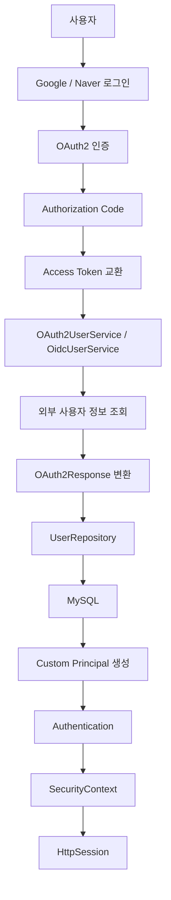
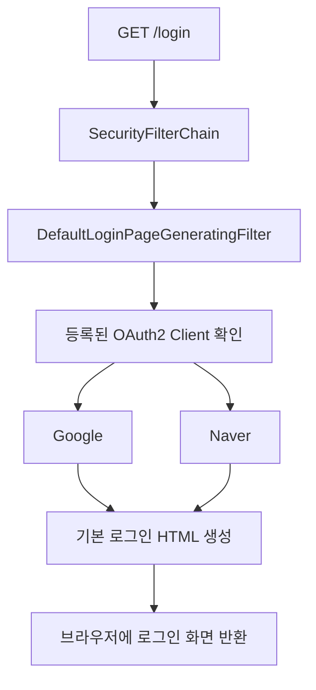
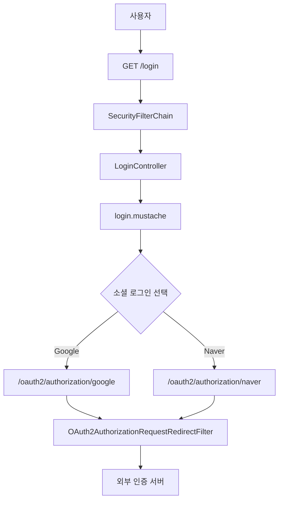
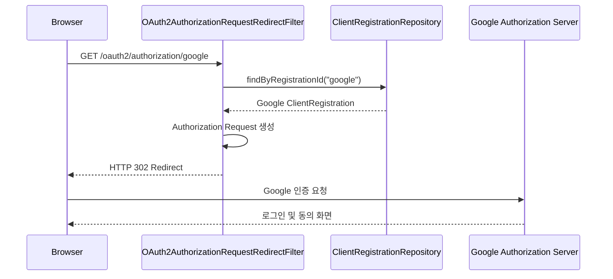
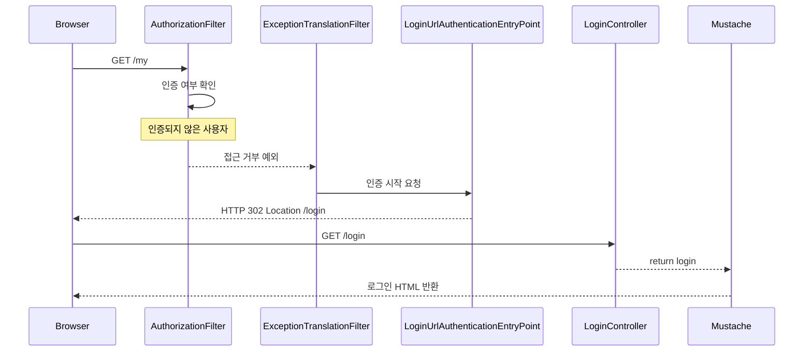
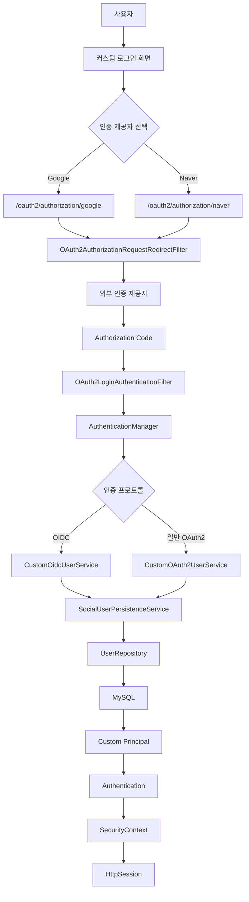
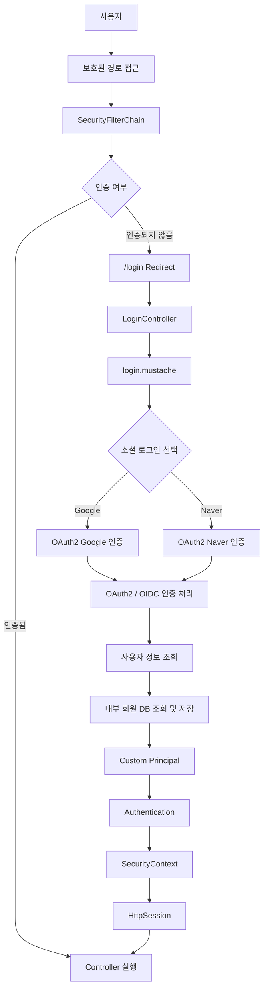

# 스프링 OAuth2 클라이언트 세션 - 11. 커스텀 로그인 페이지
[https://youtu.be/FqEdiOGZmn0?si=0iXQ5h2H1hJNMzqM](https://youtu.be/FqEdiOGZmn0?si=0iXQ5h2H1hJNMzqM)

# 스프링 OAuth2 클라이언트 세션 - 11. 커스텀 로그인 페이지
* toc
{:toc}

---

### Spring Security 6 OAuth2 커스텀 로그인 페이지 구현

Spring Security OAuth2 Client를 사용하면 Google과 Naver 같은 외부 인증 제공자를 이용해 소셜 로그인을 구현할 수 있다.

앞서 OAuth2 Client 설정을 완료하고, 외부 인증 제공자로부터 사용자 정보를 조회하는 `CustomOAuth2UserService`를 구현했다.

또한 Google과 Naver의 사용자 정보를 공통 DTO로 변환하고, `CustomOAuth2User`를 이용해 Spring Security의 Authentication을 구성했다.

이후 Spring Data JPA를 이용해 신규 사용자는 데이터베이스에 저장하고, 기존 사용자는 조회하여 재로그인을 처리하도록 구현했다.

현재까지 완성한 인증 구조는 다음과 같다.



이 구조를 통해 사용자는 Google이나 Naver로 인증하고, 우리 서비스의 회원 정보와 연결된 상태로 로그인할 수 있다.

하지만 현재 로그인 화면은 Spring Security가 기본적으로 제공하는 화면을 사용하고 있다.

Spring Security는 OAuth2 로그인을 활성화하면 등록된 인증 제공자를 이용해 기본 로그인 화면을 생성할 수 있다.

개발 과정에서는 편리하지만, 실제 서비스에서는 서비스의 디자인과 사용자 경험에 맞는 로그인 화면이 필요한 경우가 많다.

예를 들어 다음과 같은 요구사항이 있을 수 있다.

- Google과 Naver 로그인 버튼을 원하는 위치에 배치한다.
- 서비스 이름과 안내 문구를 표시한다.
- 로그인 실패 메시지를 사용자에게 보여준다.
- 회원가입 및 개인정보 처리방침과 연결한다.
- 모바일과 PC에서 동일한 로그인 경험을 제공한다.
- 로그인된 사용자는 별도의 화면으로 이동시킨다.

이러한 요구사항을 구현하려면 Spring Security의 기본 로그인 화면 대신 직접 작성한 화면을 사용할 수 있다.

이번에는 Mustache를 이용해 커스텀 로그인 화면을 구현하고, Spring Security가 해당 화면을 사용하도록 설정하는 방법을 알아본다.

---

### 개념

#### Spring Security의 기본 OAuth2 로그인 화면

Spring Security는 OAuth2 로그인 기능을 활성화하면 기본 로그인 화면을 제공할 수 있다.

예를 들어 다음과 같이 SecurityFilterChain을 설정했다고 생각해보자.

```java
.oauth2Login(Customizer.withDefaults())
```

그리고 Google과 Naver를 OAuth2 Client로 등록했다면 Spring Security는 해당 인증 제공자를 이용한 로그인 링크를 표시할 수 있다.

기본 로그인 화면의 접근 경로는 다음과 같다.

```text
GET /login
```

로그인 화면에는 등록된 OAuth2 Client에 대한 링크가 표시될 수 있다.

```text
Login with OAuth 2.0

Google

Naver
```

실제 표시되는 이름은 `ClientRegistration`에 설정한 `clientName` 등의 정보에 따라 달라진다.

여기서 중요한 점은 **개발자가 별도의 HTML 파일이나 Controller를 생성하지 않았는데도 로그인 화면이 나타날 수 있다는 것**이다.

이 기능은 Spring Security가 제공하는 기본 로그인 화면 생성 기능 때문이다.

#### DefaultLoginPageGeneratingFilter

Spring Security는 기본 로그인 화면을 생성하기 위해 다음 필터를 제공한다.

```java
DefaultLoginPageGeneratingFilter
```

이 필터는 로그인 기능이 구성되어 있고 별도의 커스텀 로그인 화면을 지정하지 않은 경우 기본 로그인 HTML을 생성할 수 있다.



이때 등록된 OAuth2 Client의 링크를 자동으로 생성하려면 `ClientRegistrationRepository`가 `Iterable<ClientRegistration>`도 구현하는 등의 조건을 충족해야 한다.

Spring Boot에서 일반적으로 구성하는 `InMemoryClientRegistrationRepository`는 이러한 조건을 충족한다.

따라서 Google과 Naver를 등록하면 기본 로그인 화면에서 해당 인증 제공자를 선택할 수 있다.

다만 모든 OAuth2 Client 등록 환경에서 반드시 동일한 로그인 화면이 자동 생성되는 것은 아니다.

커스텀 ClientRegistrationRepository를 사용하거나 로그인 화면 관련 설정을 변경했다면 동작이 달라질 수 있다.

---

### 왜 사용하는가?

#### 1. 서비스에 적합한 로그인 화면을 제공하기 위해서

Spring Security가 생성하는 기본 로그인 화면은 인증 기능을 빠르게 확인하기에 적합하다.

하지만 실제 서비스에서는 로그인 화면도 사용자 경험의 일부다.

예를 들어 다음과 같은 화면이 필요할 수 있다.

```text
----------------------------------

         Example Service

     서비스에 오신 것을 환영합니다.

       [ Google 로그인 ]

       [ Naver 로그인 ]

     로그인하면 서비스 이용약관 및
     개인정보 처리방침에 동의합니다.

----------------------------------
```

이러한 화면을 구현하려면 HTML과 CSS를 직접 작성해야 한다.

Spring Security는 인증 기능을 담당하고, 화면의 구조와 디자인은 Spring MVC와 Mustache가 담당하도록 역할을 분리할 수 있다.

#### 2. 로그인 화면과 OAuth2 인증 처리를 분리하기 위해서

커스텀 로그인 화면을 구현한다고 해서 Google이나 Naver와 통신하는 인증 로직까지 다시 작성해야 하는 것은 아니다.

로그인 화면은 사용자가 어떤 인증 제공자를 선택할지 결정하는 역할을 담당한다.

실제 OAuth2 인증 요청과 Callback 처리는 기존 Spring Security 필터가 수행한다.

```text
로그인 화면
    ↓
Google / Naver 선택
    ↓
Spring Security OAuth2 인증 시작
    ↓
외부 인증 제공자
    ↓
인증 완료
    ↓
Spring Security Callback 처리
```

즉 로그인 UI와 인증 프로토콜을 분리할 수 있다.

이렇게 하면 화면 디자인을 변경하더라도 OAuth2 인증 처리 로직을 수정할 필요가 없다.

#### 3. 인증되지 않은 사용자의 접근 흐름을 제어하기 위해서

현재 프로젝트에서는 `/my`와 같은 보호된 경로에 인증된 사용자만 접근하도록 구성했다.

```java
.anyRequest().authenticated()
```

인증되지 않은 사용자가 `/my`에 접근하면 Spring Security는 로그인이 필요하다고 판단한다.

이때 사용자를 커스텀 로그인 화면으로 이동시키도록 구성할 수 있다.

```text
GET /my
    ↓
인증 여부 확인
    ↓
인증되지 않음
    ↓
GET /login
    ↓
커스텀 로그인 화면
```

이후 사용자가 Google 또는 Naver를 선택하면 OAuth2 인증 절차가 시작된다.

---

### 주요 특징

#### 커스텀 로그인 화면을 구성하는 세 가지 요소

이번 구현에는 세 가지 구성요소가 필요하다.

| 구성요소 | 역할 |
|---|---|
| `login.mustache` | 로그인 화면을 구성하는 HTML |
| `LoginController` | `/login` 요청을 처리하고 화면 반환 |
| `SecurityConfig` | Spring Security가 커스텀 로그인 화면을 사용하도록 설정 |

전체 구조는 다음과 같다.



여기서 각 구성요소의 책임이 다르다는 점을 이해해야 한다.

`LoginController`는 인증을 직접 수행하지 않는다.

`login.mustache` 역시 OAuth2 Access Token을 발급하거나 사용자 정보를 조회하지 않는다.

실제 인증은 Spring Security가 담당한다.

---

### 예제

#### 1. 프로젝트 구조

먼저 기존 Spring Boot 프로젝트에 로그인 화면과 Controller를 추가한다.

전체적인 프로젝트 구조는 다음과 같다.

```text
src
└── main
    ├── java
    │   └── com
    │       └── example
    │           └── oauth2session
    │               │
    │               ├── Oauth2SessionApplication.java
    │               │
    │               ├── config
    │               │   └── SecurityConfig.java
    │               │
    │               ├── controller
    │               │   ├── MainController.java
    │               │   ├── LoginController.java
    │               │   └── MyController.java
    │               │
    │               ├── service
    │               │   ├── CustomOAuth2UserService.java
    │               │   ├── CustomOidcUserService.java
    │               │   └── SocialUserPersistenceService.java
    │               │
    │               ├── entity
    │               │   └── UserEntity.java
    │               │
    │               └── repository
    │                   └── UserRepository.java
    │
    └── resources
        │
        ├── application.yml
        │
        ├── static
        │   └── css
        │       └── login.css
        │
        └── templates
            ├── main.mustache
            ├── login.mustache
            └── my.mustache
```

이번에 추가하는 파일은 다음 세 가지다.

```text
LoginController.java

login.mustache

login.css
```

기존 `SecurityConfig`는 커스텀 로그인 URL을 등록하도록 수정한다.

---

### 2. login.mustache 생성

Mustache는 Spring Boot에서 사용할 수 있는 템플릿 엔진이다.

Controller가 반환한 View 이름을 이용해 HTML 화면을 렌더링할 수 있다.

기존 프로젝트에는 다음 의존성이 추가되어 있다.

```gradle
implementation 'org.springframework.boot:spring-boot-starter-mustache'
```

이제 다음 경로에 로그인 화면을 생성한다.

```text
src/main/resources/templates/login.mustache
```

먼저 가장 기본적인 로그인 화면부터 살펴보자.

```html
<!DOCTYPE html>
<html lang="ko">

<head>
    <meta charset="UTF-8">

    <meta name="viewport"
          content="width=device-width, initial-scale=1.0">

    <title>소셜 로그인</title>
</head>

<body>

    <h1>로그인</h1>

    <hr>

    <a href="/oauth2/authorization/naver">
        Naver 로그인
    </a>

    <br>

    <a href="/oauth2/authorization/google">
        Google 로그인
    </a>

</body>

</html>
```

이 코드는 Google과 Naver 로그인 링크를 표시한다.

여기서 가장 중요한 부분은 다음 두 경로다.

```html
<a href="/oauth2/authorization/naver">
    Naver 로그인
</a>
```

```html
<a href="/oauth2/authorization/google">
    Google 로그인
</a>
```

이 주소는 Spring Security에서 OAuth2 로그인 요청을 시작하는 기본 경로다.

#### 로그인 시작 경로

Spring Security OAuth2 Login에서는 일반적으로 다음 패턴을 사용한다.

```text
/oauth2/authorization/{registrationId}
```

여기서 `registrationId`는 Spring Security의 ClientRegistration을 구분하는 값이다.

Google을 등록했다면 다음과 같다.

```text
/oauth2/authorization/google
```

Naver를 등록했다면 다음과 같다.

```text
/oauth2/authorization/naver
```

사용자가 로그인 링크를 클릭하면 Spring Security가 해당 registrationId에 맞는 ClientRegistration을 조회한다.

그다음 외부 인증 제공자로 이동하기 위한 Authorization Request를 생성한다.

따라서 로그인 화면에서 Google 또는 Naver의 Authorization Endpoint를 직접 조합할 필요가 없다.

---

### 로그인 버튼을 클릭하면 어떤 일이 발생할까?

사용자가 Google 로그인 링크를 클릭했다고 생각해보자.

브라우저에서는 다음 요청이 발생한다.

```http
GET /oauth2/authorization/google HTTP/1.1
Host: localhost:8080
```

이 요청은 `OAuth2AuthorizationRequestRedirectFilter`가 처리한다.

처리 흐름은 다음과 같다.



여기서 중요한 점은 `login.mustache`가 Google 로그인 처리를 직접 수행하지 않는다는 사실이다.

로그인 화면은 단순히 Spring Security의 인증 시작 경로를 호출한다.

이후 OAuth2 프로토콜 처리는 Spring Security가 담당한다.

---

### 3. LoginController 생성

다음으로 로그인 화면 요청을 처리할 Controller를 생성한다.

파일 경로는 다음과 같다.

```text
controller/LoginController.java
```

전체 코드는 다음과 같다.

```java
package com.example.oauth2session.controller;

import org.springframework.stereotype.Controller;
import org.springframework.web.bind.annotation.GetMapping;

@Controller
public class LoginController {

    @GetMapping("/login")
    public String loginPage() {

        return "login";
    }
}
```

이 Controller는 매우 간단하다.

하지만 Spring MVC와 Spring Security의 역할을 이해하는 데 중요한 코드다.

#### @Controller

```java
@Controller
public class LoginController {
}
```

`@Controller`는 해당 클래스가 Spring MVC의 Controller임을 나타낸다.

Spring Boot의 컴포넌트 스캔 대상에 포함되면 Bean으로 등록된다.

#### @GetMapping("/login")

```java
@GetMapping("/login")
```

이 설정은 다음 HTTP 요청을 처리한다.

```http
GET /login HTTP/1.1
Host: localhost:8080
```

사용자가 브라우저에서 `/login`에 접근하면 해당 메서드가 호출된다.

#### return "login"

```java
return "login";
```

이 코드는 단순한 문자열 응답이 아니다.

`@Controller`에서 반환한 문자열은 일반적으로 View 이름으로 해석된다.

Spring Boot의 Mustache 설정에 따라 다음 템플릿을 찾는다.

```text
src/main/resources/templates/login.mustache
```

이후 Mustache가 HTML을 렌더링하여 브라우저에 반환한다.

전체 과정을 정리하면 다음과 같다.

```text
GET /login
    ↓
DispatcherServlet
    ↓
LoginController
    ↓
loginPage()
    ↓
return "login"
    ↓
Mustache View Resolver
    ↓
login.mustache
    ↓
HTML 응답
```

이렇게 하면 `/login` 요청으로 직접 작성한 로그인 화면을 제공할 수 있다.

하지만 여기까지 구현했다고 해서 Spring Security가 자동으로 해당 화면을 사용하는 것은 아니다.

Spring Security에 커스텀 로그인 URL을 등록해야 한다.

---

### 4. SecurityConfig에 커스텀 로그인 화면 등록

기존 SecurityConfig에서는 다음과 같이 OAuth2 Login을 활성화했다.

```java
.oauth2Login(Customizer.withDefaults())
```

이 설정은 OAuth2 로그인 기본 기능을 활성화한다.

하지만 직접 작성한 로그인 화면을 사용하려면 다음 설정을 추가해야 한다.

```java
.oauth2Login(oauth2 -> oauth2
        .loginPage("/login")
)
```

핵심은 다음 부분이다.

```java
.loginPage("/login")
```

이 설정은 **인증이 필요한 사용자를 어느 로그인 화면으로 이동시킬지 지정한다.**

즉 Spring Security의 기본 로그인 화면 대신 직접 구현한 `/login` 경로를 사용하도록 설정하는 것이다.

여기서 중요한 점이 있다.

`loginPage("/login")`은 HTML을 생성하는 기능이 아니다.

Spring Security에 로그인 화면의 URL을 알려주는 설정이다.

따라서 해당 경로를 실제로 처리하는 Controller나 다른 웹 리소스가 존재해야 한다.

공식 문서에서도 커스텀 로그인 URL을 등록했다면 해당 요청을 처리하는 Controller를 제공하도록 안내한다.

---

### 기존 OAuth2UserService와 함께 등록하기

현재 프로젝트에서는 외부 사용자 정보 조회 로직을 커스터마이징했다.

따라서 기존에 사용하던 `CustomOAuth2UserService`도 유지해야 한다.

다음과 같이 작성할 수 있다.

```java
.oauth2Login(oauth2 -> oauth2

        .loginPage("/login")

        .userInfoEndpoint(userInfo -> userInfo
                .userService(customOAuth2UserService)
        )
)
```

여기서 두 설정은 서로 다른 역할을 담당한다.

| 설정 | 역할 |
|---|---|
| `loginPage("/login")` | 로그인 화면 지정 |
| `userInfoEndpoint()` | OAuth2 사용자 정보 처리 설정 |
| `userService()` | 일반 OAuth2 사용자 정보 조회 서비스 등록 |

즉 다음과 같이 구분할 수 있다.

```text
loginPage()
    ↓
사용자가 볼 로그인 화면
```

```text
userService()
    ↓
인증 이후 외부 사용자 정보 처리
```

하나는 UI와 관련된 설정이다.

다른 하나는 OAuth2 인증 과정에서 사용자 정보를 처리하는 설정이다.

따라서 커스텀 로그인 화면을 추가한다고 해서 기존 OAuth2UserService를 제거할 필요가 없다.

---

### 5. Google OIDC와 Naver OAuth2를 모두 지원하는 SecurityConfig

이전 단계에서 Google은 `openid` Scope를 사용하도록 구성했다.

```yaml
scope:
  - openid
  - profile
  - email
```

이 경우 Google 로그인은 일반 OAuth2 사용자 정보 처리 대신 OIDC 전용 경로를 사용할 수 있다.

따라서 앞서 작성한 `CustomOidcUserService`도 유지해야 한다.

전체 SecurityConfig는 다음과 같이 구성할 수 있다.

```java
package com.example.oauth2session.config;

import com.example.oauth2session.service.CustomOAuth2UserService;
import com.example.oauth2session.service.CustomOidcUserService;

import org.springframework.context.annotation.Bean;
import org.springframework.context.annotation.Configuration;

import org.springframework.security.config.annotation.web.builders.HttpSecurity;
import org.springframework.security.config.annotation.web.configurers.AbstractHttpConfigurer;

import org.springframework.security.web.SecurityFilterChain;

@Configuration
public class SecurityConfig {

    private final CustomOAuth2UserService customOAuth2UserService;

    private final CustomOidcUserService customOidcUserService;

    public SecurityConfig(
            CustomOAuth2UserService customOAuth2UserService,
            CustomOidcUserService customOidcUserService
    ) {

        this.customOAuth2UserService = customOAuth2UserService;

        this.customOidcUserService = customOidcUserService;
    }

    @Bean
    public SecurityFilterChain securityFilterChain(
            HttpSecurity http
    ) throws Exception {

        http
                // 일반 Form Login 비활성화
                .formLogin(AbstractHttpConfigurer::disable)

                // HTTP Basic 비활성화
                .httpBasic(AbstractHttpConfigurer::disable)

                // OAuth2 로그인 설정
                .oauth2Login(oauth2 -> oauth2

                        // 커스텀 로그인 화면
                        .loginPage("/login")

                        // 외부 사용자 정보 처리
                        .userInfoEndpoint(userInfo -> userInfo

                                // Naver 등 일반 OAuth2
                                .userService(customOAuth2UserService)

                                // Google OIDC
                                .oidcUserService(customOidcUserService)
                        )
                )

                // 경로별 인가 설정
                .authorizeHttpRequests(auth -> auth

                        .requestMatchers(
                                "/",
                                "/login",
                                "/error",
                                "/css/**",
                                "/js/**",
                                "/images/**",
                                "/oauth2/authorization/**",
                                "/login/oauth2/code/**"
                        ).permitAll()

                        .anyRequest().authenticated()
                );

        return http.build();
    }
}
```

이 설정에서는 다음 기능을 사용한다.

| 기능 | 설정 |
|---|---|
| 일반 아이디·비밀번호 로그인 | 비활성화 |
| HTTP Basic 인증 | 비활성화 |
| OAuth2 Login | 활성화 |
| 커스텀 로그인 화면 | `/login` |
| Naver 사용자 정보 처리 | CustomOAuth2UserService |
| Google OIDC 사용자 정보 처리 | CustomOidcUserService |
| 세션 인증 | 기본 세션 기반 구성 사용 |
| CSRF 보호 | 기본값 유지 |
| 공개 경로 | `/`, `/login`, OAuth2 관련 경로 |
| 기타 경로 | 인증 필요 |

이제 Spring Security가 로그인 화면으로 이동시켜야 할 때 `/login` 경로를 사용하게 된다.

또한 Google과 Naver의 OAuth2 인증 및 사용자 정보 저장 로직은 기존 구조를 유지한다.

---

### 로그인 화면에서 반드시 permitAll()을 설정해야 하는 이유

커스텀 로그인 화면을 구현할 때 가장 중요한 설정 중 하나가 다음 코드다.

```java
.requestMatchers("/login").permitAll()
```

이 설정은 인증되지 않은 사용자도 로그인 화면에 접근할 수 있도록 한다.

생각해보면 로그인 화면은 아직 로그인하지 않은 사용자가 접근해야 하는 경로다.

그런데 다음과 같이 모든 경로에 인증을 요구하면 어떻게 될까?

```java
.authorizeHttpRequests(auth -> auth
        .anyRequest().authenticated()
)
```

로그인 화면인 `/login`에도 인증이 필요해질 수 있다.

그렇다면 다음과 같은 문제가 발생한다.

```text
GET /my
    ↓
인증 필요
    ↓
GET /login
    ↓
/login도 인증 필요
    ↓
다시 GET /login
    ↓
리다이렉트 반복
```

이러한 상황은 리다이렉트 반복 문제로 이어질 수 있다.

따라서 커스텀 로그인 화면은 인증되지 않은 사용자도 접근할 수 있도록 설정해야 한다.

```java
.requestMatchers("/login").permitAll()
```

일반적인 로그인 시작 경로 역시 공개할 수 있다.

```java
.requestMatchers(
        "/oauth2/authorization/**"
).permitAll()
```

여기서 주의해야 할 점은 `permitAll()`이 OAuth2 인증 검증을 생략한다는 의미는 아니라는 사실이다.

`permitAll()`은 HTTP 요청에 대한 접근 권한 설정이다.

실제 인증 시작 및 Callback은 Spring Security의 OAuth2 인증 필터가 처리한다.

---

### 구조

#### 인증되지 않은 사용자가 보호된 경로에 접근하는 과정

이제 커스텀 로그인 화면이 등록되었을 때 요청이 어떻게 처리되는지 살펴보자.

사용자가 로그인하지 않은 상태에서 다음 주소에 접근한다.

```http
GET /my HTTP/1.1
Host: localhost:8080
```

`/my`는 인증이 필요한 경로다.

따라서 Spring Security는 사용자가 인증되었는지 확인한다.

인증되지 않았다면 로그인 화면으로 이동하도록 처리한다.

이때 핵심 구성요소는 다음과 같다.

| 구성요소 | 역할 |
|---|---|
| AuthorizationFilter | 요청에 대한 접근 권한 확인 |
| ExceptionTranslationFilter | 인증 및 인가 예외 처리 |
| AuthenticationEntryPoint | 인증이 필요한 사용자에게 로그인 시작 위치 안내 |
| LoginUrlAuthenticationEntryPoint | 로그인 URL로 리다이렉트 |
| LoginController | `/login` 요청 처리 |
| Mustache | HTML 렌더링 |

전체 흐름은 다음과 같다.



이 과정에서 중요한 점은 Spring Security가 로그인 화면의 HTML을 직접 생성하지 않는다는 것이다.

커스텀 로그인 화면을 지정했으므로 실제 화면은 `LoginController`와 Mustache가 제공한다.

또한 인증 전 접근하려던 요청은 Spring Security의 RequestCache에 저장될 수 있다.

따라서 로그인 성공 이후 원래 요청한 경로로 이동하는 기능도 구성할 수 있다.

---

### 로그인 화면과 OAuth2 Callback 경로의 차이

다음 세 경로는 반드시 구분해야 한다.

```text
/login
```

```text
/oauth2/authorization/google
```

```text
/login/oauth2/code/google
```

이름이 비슷하지만 역할은 완전히 다르다.

| 경로 | 역할 | 주요 처리 주체 |
|---|---|---|
| `/login` | 로그인 화면 표시 | LoginController |
| `/oauth2/authorization/google` | Google 인증 시작 | OAuth2AuthorizationRequestRedirectFilter |
| `/login/oauth2/code/google` | Google 인증 결과 처리 | OAuth2LoginAuthenticationFilter |

Naver도 마찬가지다.

```text
/login
    ↓
로그인 화면
```

```text
/oauth2/authorization/naver
    ↓
Naver 인증 시작
```

```text
/login/oauth2/code/naver
    ↓
Naver 인증 완료 후 Callback
```

여기서 `loginPage("/login")`을 설정했다고 해서 OAuth2 Callback 경로가 변경되는 것은 아니다.

이 설정은 로그인 화면의 위치만 변경한다.

따라서 Google Cloud나 네이버 개발자센터에 등록한 Callback URL을 수정할 필요는 없다.

기존 Callback URL은 그대로 유지할 수 있다.

---

### 로그인 화면을 변경해도 OAuth2 인증 구조는 유지된다

이번 변경은 로그인 UI에 대한 변경이다.

따라서 실제 인증 처리 흐름은 기존과 동일하다.



이러한 구조는 UI와 인증 로직을 명확하게 분리한다.

향후 로그인 화면을 변경하더라도 OAuth2 인증 처리 로직은 그대로 재사용할 수 있다.

---

### 로그인 화면 개선하기

앞에서 구현한 로그인 화면은 기본적인 HTML이다.

실제 서비스에서는 다음 기능을 추가할 수 있다.

- 서비스 이름 및 설명 표시
- Google과 Naver 버튼 디자인 구분
- 로그인 실패 메시지 제공
- 반응형 화면 구성
- 사용자 접근성 개선
- 이용약관 및 개인정보 처리방침 연결

이번에는 Mustache와 CSS를 분리하여 조금 더 완성도 있는 로그인 화면을 구현해보자.

#### login.mustache 전체 코드

```html
<!DOCTYPE html>
<html lang="ko">

<head>
    <meta charset="UTF-8">

    <meta name="viewport"
          content="width=device-width, initial-scale=1.0">

    <title>로그인 | Example Service</title>

    <link rel="stylesheet"
          href="/css/login.css">
</head>

<body>

<main class="login-container">

    <section class="login-card">

        <h1>Example Service</h1>

        <p class="description">
            소셜 계정으로 간편하게 로그인하세요.
        </p>

        {{#loginError}}
        <div class="error-message" role="alert">
            로그인 처리 중 문제가 발생했습니다.
            다시 시도해 주세요.
        </div>
        {{/loginError}}

        <div class="social-login">

            <a class="login-button google"
               href="/oauth2/authorization/google">

                Google 계정으로 로그인

            </a>

            <a class="login-button naver"
               href="/oauth2/authorization/naver">

                Naver 계정으로 로그인

            </a>

        </div>

        <p class="login-guide">
            로그인하면 서비스 이용약관 및
            개인정보 처리방침에 동의한 것으로
            간주될 수 있습니다.
        </p>

        <a class="home-link" href="/">
            메인 화면으로 돌아가기
        </a>

    </section>

</main>

</body>

</html>
```

이 화면에서는 두 개의 소셜 로그인 버튼을 제공한다.

각 버튼은 기존 Spring Security의 인증 시작 경로를 사용한다.

```html
href="/oauth2/authorization/google"
```

```html
href="/oauth2/authorization/naver"
```

따라서 디자인이 변경되어도 OAuth2 인증 로직은 변경되지 않는다.

또한 다음 구문을 추가했다.

```mustache
{{#loginError}}
<div class="error-message" role="alert">
    로그인 처리 중 문제가 발생했습니다.
    다시 시도해 주세요.
</div>
{{/loginError}}
```

Mustache의 Section 문법을 이용해 로그인 오류 여부에 따라 메시지를 표시한다.

단, 이 메시지를 실제로 표시하려면 Controller에서 `loginError` 값을 전달해야 한다.

실제 서비스에서는 약관 동의의 법적 처리와 안내 문구를 서비스 정책에 맞게 구성해야 한다. 위 문구는 화면 구성 예시이며, 단순한 로그인만으로 모든 약관 동의가 성립한다고 가정해서는 안 된다.

---

### login.css 전체 코드

다음 경로에 CSS 파일을 생성한다.

```text
src/main/resources/static/css/login.css
```

전체 코드는 다음과 같다.

```css
* {
    box-sizing: border-box;
}

body {
    margin: 0;
    padding: 0;

    font-family: Arial, sans-serif;

    background-color: #f5f6f8;
}

.login-container {
    display: flex;

    justify-content: center;
    align-items: center;

    min-height: 100vh;

    padding: 20px;
}

.login-card {
    width: 100%;
    max-width: 420px;

    padding: 40px 30px;

    background-color: #ffffff;

    border: 1px solid #e5e7eb;
    border-radius: 12px;

    text-align: center;
}

.login-card h1 {
    margin-top: 0;
    margin-bottom: 16px;

    font-size: 26px;
}

.description {
    margin-bottom: 32px;

    color: #666666;
    font-size: 14px;
}

.social-login {
    display: flex;
    flex-direction: column;

    gap: 12px;
}

.login-button {
    display: flex;

    justify-content: center;
    align-items: center;

    width: 100%;
    min-height: 48px;

    border-radius: 8px;

    text-decoration: none;

    font-size: 15px;
    font-weight: 600;
}

.google {
    color: #333333;

    background-color: #ffffff;

    border: 1px solid #d1d5db;
}

.naver {
    color: #ffffff;

    background-color: #03c75a;

    border: 1px solid #03c75a;
}

.login-button:hover {
    opacity: 0.9;
}

.login-button:focus-visible {
    outline: 3px solid #2563eb;
    outline-offset: 3px;
}

.error-message {
    margin-bottom: 20px;

    padding: 12px;

    background-color: #fff1f2;

    border: 1px solid #fecdd3;
    border-radius: 8px;

    color: #be123c;

    font-size: 13px;
}

.login-guide {
    margin-top: 28px;

    color: #777777;

    font-size: 12px;
    line-height: 1.7;
}

.home-link {
    display: inline-block;

    margin-top: 20px;

    color: #555555;

    font-size: 13px;
    text-decoration: none;
}
```

CSS를 별도 파일로 분리하면 HTML 구조와 디자인을 독립적으로 관리할 수 있다.

또한 Spring Boot는 기본적으로 다음 경로에 존재하는 정적 리소스를 제공할 수 있다.

```text
src/main/resources/static
```

따라서 다음 파일은:

```text
src/main/resources/static/css/login.css
```

다음 URL로 접근할 수 있다.

```text
/css/login.css
```

SecurityConfig에서도 해당 경로를 공개하도록 설정했다.

```java
.requestMatchers("/css/**").permitAll()
```

이 설정이 없다면 로그인하지 않은 사용자가 CSS 파일을 가져오지 못하는 상황이 발생할 수 있다.

---

### 로그인 실패 메시지 처리

OAuth2 로그인에서는 다양한 이유로 인증에 실패할 수 있다.

예를 들어 다음과 같다.

| 오류 상황 | 설명 |
|---|---|
| 사용자 인증 취소 | Google 또는 Naver에서 로그인 취소 |
| Client ID 오류 | 등록된 클라이언트 정보 불일치 |
| Redirect URI 오류 | 등록된 Callback URL 불일치 |
| Authorization Code 오류 | 인증 코드 만료 또는 검증 실패 |
| 사용자 정보 조회 실패 | 외부 UserInfo API 오류 |
| 회원 저장 실패 | DB 연결 또는 제약조건 오류 |

이러한 오류가 발생하면 사용자가 다시 로그인을 시도할 수 있도록 안내하는 것이 좋다.

Spring Security의 OAuth2 로그인 실패 처리에서는 기본적으로 다음과 같은 URL로 이동하도록 구성될 수 있다.

```text
/login?error
```

따라서 Controller에서 `error` 파라미터를 확인하여 로그인 실패 메시지를 표시할 수 있다.

#### LoginController 수정

```java
package com.example.oauth2session.controller;

import org.springframework.stereotype.Controller;
import org.springframework.ui.Model;
import org.springframework.web.bind.annotation.GetMapping;
import org.springframework.web.bind.annotation.RequestParam;

@Controller
public class LoginController {

    @GetMapping("/login")
    public String loginPage(

            @RequestParam(
                    value = "error",
                    required = false
            )
            String error,

            Model model
    ) {

        model.addAttribute(
                "loginError",
                error != null
        );

        return "login";
    }
}
```

이제 다음 요청이 발생하면:

```text
GET /login?error
```

`loginError`에 `true`가 전달된다.

Mustache에서는 다음 영역이 렌더링된다.

```mustache
{{#loginError}}
<div class="error-message" role="alert">
    로그인 처리 중 문제가 발생했습니다.
    다시 시도해 주세요.
</div>
{{/loginError}}
```

다만 URL의 `error` 파라미터가 존재한다는 사실만으로 실제 인증 실패가 증명되는 것은 아니다.

사용자가 직접 해당 주소에 접근할 수도 있기 때문이다.

따라서 이 방식은 사용자에게 일반적인 안내 메시지를 표시하는 용도로 사용한다.

실제 인증 실패 원인을 정확하게 기록하거나 처리해야 한다면 `AuthenticationFailureHandler`를 이용하는 것이 적절하다.

---

### 커스텀 로그인 경로는 변경할 수 있을까?

현재는 다음 경로를 사용한다.

```text
/login
```

하지만 반드시 이 경로를 사용해야 하는 것은 아니다.

예를 들어 다음과 같은 경로도 사용할 수 있다.

```text
/sign-in
```

또는 다음과 같다.

```text
/auth/login
```

이 경우 SecurityConfig에서 로그인 경로를 변경해야 한다.

```java
.oauth2Login(oauth2 -> oauth2
        .loginPage("/auth/login")
)
```

그리고 Controller도 동일한 경로로 변경한다.

```java
@GetMapping("/auth/login")
public String loginPage() {

    return "login";
}
```

마지막으로 해당 경로를 공개해야 한다.

```java
.requestMatchers("/auth/login").permitAll()
```

즉 커스텀 로그인 경로를 변경할 때는 다음 세 요소를 함께 확인해야 한다.

| 구성요소 | 예시 |
|---|---|
| SecurityConfig | `loginPage("/auth/login")` |
| Controller | `@GetMapping("/auth/login")` |
| 인가 정책 | `requestMatchers("/auth/login").permitAll()` |

세 설정이 서로 일치해야 한다.

---

### 커스텀 로그인 URL과 OAuth2 Authorization URI는 별개의 설정이다

여기서 중요한 차이를 살펴보자.

현재 커스텀 로그인 URL은 다음과 같다.

```text
/login
```

OAuth2 로그인 시작 경로는 다음과 같다.

```text
/oauth2/authorization/google
```

커스텀 로그인 경로를 `/auth/login`으로 변경해도 OAuth2 로그인 시작 경로는 자동으로 변경되지 않는다.

다음과 같은 구조가 유지된다.

```text
/auth/login
    ↓
커스텀 로그인 화면
    ↓
/oauth2/authorization/google
    ↓
Google 인증 시작
```

OAuth2 Authorization Request의 시작 경로를 변경하려면 별도의 설정이 필요하다.

예를 들어 다음과 같다.

```java
.oauth2Login(oauth2 -> oauth2

        .loginPage("/auth/login")

        .authorizationEndpoint(authorization -> authorization

                .baseUri("/auth/oauth2/authorization")
        )
)
```

이 경우 Google 로그인 링크도 변경해야 한다.

```html
<a href="/auth/oauth2/authorization/google">
    Google 로그인
</a>
```

Naver도 마찬가지다.

```html
<a href="/auth/oauth2/authorization/naver">
    Naver 로그인
</a>
```

이러한 방식은 인증 관련 URL을 특정 경로 아래에 모으고 싶을 때 활용할 수 있다.

다만 이번 프로젝트에서는 Spring Security의 기본 OAuth2 인증 시작 경로를 그대로 사용한다.

불필요한 URL 커스터마이징을 줄이고 인증 흐름을 단순하게 유지하기 위해서다.

---

### 실무에서의 활용

#### 1. 로그인 화면과 인증 처리 로직을 분리한다

이번 구현에서 로그인 화면은 Mustache가 담당한다.

OAuth2 인증은 Spring Security가 담당한다.

```text
Mustache
    ↓
화면 구성
```

```text
LoginController
    ↓
로그인 화면 요청 처리
```

```text
Spring Security
    ↓
OAuth2 인증
```

이러한 구조를 사용하면 UI를 수정하더라도 인증 처리 로직에 영향을 주지 않는다.

예를 들어 HTML을 Thymeleaf로 변경하거나, 로그인 버튼 디자인을 수정하더라도 Spring Security의 OAuth2 인증 과정은 그대로 유지할 수 있다.

---

#### 2. 로그인 화면은 반드시 공개 경로로 설정한다

커스텀 로그인 화면에서 가장 중요한 조건은 인증되지 않은 사용자가 접근할 수 있어야 한다는 것이다.

따라서 다음 설정을 명시한다.

```java
.requestMatchers("/login").permitAll()
```

이 설정이 누락되면 `/login` 자체에 인증이 요구되어 반복적인 리다이렉트 문제가 발생할 수 있다.

또한 CSS와 이미지 파일도 필요한 범위에서 공개해야 한다.

```java
.requestMatchers(
        "/css/**",
        "/images/**"
).permitAll()
```

---

#### 3. 공개 경로는 필요한 범위로 제한한다

다음과 같은 설정은 넓은 범위를 허용한다.

```java
.requestMatchers("/login/**").permitAll()
```

하지만 실제 서비스에 다음과 같은 비즈니스 API가 존재할 수 있다.

```text
/login/history
```

```text
/login/devices
```

이러한 경로가 모두 공개되어야 하는 것은 아니다.

따라서 현재 프로젝트에서는 다음과 같이 정확한 로그인 경로를 허용한다.

```java
.requestMatchers("/login").permitAll()
```

OAuth2 인증 관련 경로도 별도로 구분한다.

```java
.requestMatchers(
        "/oauth2/authorization/**",
        "/login/oauth2/code/**"
).permitAll()
```

이렇게 하면 인증 관련 경로와 서비스 비즈니스 경로를 구분할 수 있다.

---

#### 4. 로그인 시작 경로와 Callback 경로를 혼동하지 않는다

OAuth2 로그인을 구성할 때 자주 발생하는 오류 중 하나는 로그인 시작 경로와 Callback 경로를 혼동하는 것이다.

다음 경로는 사용자가 로그인 버튼을 클릭할 때 접근한다.

```text
/oauth2/authorization/google
```

반면 다음 경로는 Google 인증 서버에서 인증을 완료한 뒤 돌아오는 주소다.

```text
/login/oauth2/code/google
```

따라서 Google Cloud에 등록한 Redirect URI는 두 번째 주소를 기준으로 구성한다.

커스텀 로그인 화면을 추가했다고 해서 기존 Redirect URI를 변경할 필요는 없다.

---

#### 5. 로그인된 사용자에게 로그인 화면을 다시 보여줄지 결정한다

현재 구현에서는 인증된 사용자도 `/login`에 접근할 수 있다.

보안 정책상 반드시 문제가 되는 것은 아니다.

하지만 사용자 경험 측면에서는 이미 로그인된 사용자를 메인 화면이나 마이 화면으로 이동시키는 것이 자연스러울 수 있다.

예를 들어 다음과 같은 흐름이다.

```text
GET /login
    ↓
현재 인증 여부 확인
    ↓
인증된 사용자
    ↓
/my 이동
```

다만 이 동작을 구현할 때는 익명 사용자 인증 객체와 실제 인증된 사용자를 구분해야 한다.

Spring Security는 인증되지 않은 요청에도 `AnonymousAuthenticationToken`을 제공할 수 있기 때문이다.

따라서 단순히 Authentication 객체가 존재하는지만 확인해서는 안 된다.

---

#### 6. 로그인 성공 이후 원래 요청한 경로로 이동할 수 있다

사용자가 다음 경로에 접근했다고 생각해보자.

```text
/my
```

하지만 로그인하지 않은 상태라면 로그인 화면으로 이동한다.

```text
/my
    ↓
/login
```

이후 Google 로그인을 완료하면 원래 접근하려던 `/my`로 다시 이동하도록 구성할 수 있다.

```text
/my
    ↓
/login
    ↓
Google 로그인
    ↓
/my
```

Spring Security는 이러한 동작을 위해 RequestCache와 SavedRequestAwareAuthenticationSuccessHandler 등을 제공한다.

기본 로그인 성공 처리에서는 인증 전에 저장된 요청이 있다면 해당 요청으로 이동하는 동작이 사용될 수 있다.

다만 커스텀 SuccessHandler를 등록하거나 기본 성공 URL을 강제로 지정하면 동작이 달라질 수 있다.

따라서 로그인 이후 이동 정책은 서비스 요구사항에 따라 결정해야 한다.

---

#### 7. 로그인 실패 메시지에 내부 오류 정보를 노출하지 않는다

외부 OAuth2 인증에서는 다양한 오류가 발생할 수 있다.

하지만 사용자에게 다음과 같은 내부 오류를 그대로 보여주는 것은 적절하지 않다.

```text
invalid_client

invalid_grant

DataIntegrityViolationException

OAuth2AuthenticationException
```

이러한 오류는 내부 로그와 모니터링을 통해 분석하는 것이 좋다.

사용자에게는 다음과 같은 메시지를 제공할 수 있다.

```text
로그인 처리 중 문제가 발생했습니다.

잠시 후 다시 시도해 주세요.
```

이렇게 하면 내부 구현 정보를 불필요하게 노출하지 않으면서 사용자에게 필요한 안내를 제공할 수 있다.

---

#### 8. 로그인 화면 변경과 인증 보안 설정 변경을 구분한다

커스텀 로그인 화면을 추가하는 작업은 UI 변경이다.

따라서 이를 위해 CSRF 보호를 비활성화할 필요는 없다.

이번 프로젝트는 HttpSession 기반 인증을 사용한다.

따라서 CSRF 보호는 기본값을 유지하는 것이 일반적으로 적절하다.

Google과 Naver 로그인 시작 경로는 GET 요청을 사용하므로, 단순히 로그인 버튼을 추가하기 위해 CSRF를 비활성화하지 않아도 된다.

반면 회원 정보 변경이나 로그아웃처럼 상태를 변경하는 요청에서는 CSRF 보호를 고려해야 한다.

---

#### 9. 소셜 로그인 버튼에는 직접 인증 URL을 작성하지 않는다

Google의 Authorization Endpoint를 직접 호출할 수도 있다.

하지만 그 경우 다음과 같은 요소를 직접 관리해야 할 수 있다.

```text
client_id

redirect_uri

response_type

scope

state
```

Spring Security OAuth2 Client를 사용한다면 이러한 인증 요청 생성을 프레임워크에 맡길 수 있다.

따라서 로그인 버튼에서는 다음 경로를 사용한다.

```text
/oauth2/authorization/google
```

이렇게 하면 ClientRegistration 설정과 인증 요청 생성 로직을 재사용할 수 있다.

특히 `state`와 OAuth2 인증 요청 저장소를 직접 구현할 필요가 없다는 장점이 있다.

---

#### 10. 여러 로그인 제공자를 하나의 화면에서 관리한다

현재 프로젝트에서는 Google과 Naver를 지원한다.

하지만 이후 다른 인증 제공자를 추가할 수도 있다.

예를 들어 다음과 같다.

```text
Google

Naver

Kakao

Apple
```

이 경우 커스텀 로그인 화면은 여러 인증 제공자의 진입점 역할을 할 수 있다.

다만 실제 서비스를 확장할 때는 해당 Provider의 ClientRegistration과 사용자 정보 처리 로직도 함께 준비해야 한다.

단순히 HTML에 링크를 추가했다고 해서 새로운 OAuth2 제공자가 자동으로 등록되는 것은 아니다.

---

#### 11. 인증 제공자 장애에 대비한 화면 정책을 고려한다

OAuth2 소셜 로그인은 외부 인증 제공자에 의존한다.

따라서 Google이나 Naver의 인증 서버에 장애가 발생하면 해당 로그인 방식이 정상적으로 동작하지 않을 수 있다.

실제 서비스에서는 다음과 같은 정책을 고려할 수 있다.

```text
Google 로그인 오류
    ↓
다른 로그인 방식 안내
```

```text
Naver 인증 서버 장애
    ↓
일시적인 로그인 오류 안내
```

다만 한 제공자가 장애 상태라고 해서 모든 사용자가 다른 제공자로 로그인할 수 있는 것은 아니다.

동일한 내부 회원에 다른 소셜 계정이 연결되어 있지 않다면 다른 제공자를 선택해도 별도 회원으로 처리될 수 있다.

따라서 로그인 제공자 전환은 내부 계정 연결 정책과 함께 고려해야 한다.

---

#### 12. 로그인 화면과 내부 회원가입 완료 여부를 구분한다

현재 프로젝트에서는 소셜 로그인 이후 내부 DB에 회원 정보를 저장한다.

하지만 실제 서비스에서는 추가 정보가 필요한 경우가 있다.

예를 들어 다음과 같다.

```text
이용약관 동의

닉네임 설정

휴대전화 인증

서비스 이용 국가 선택
```

따라서 외부 인증에 성공했다고 해서 항상 최종 회원가입이 완료되었다고 판단해서는 안 된다.

다음과 같은 흐름으로 확장할 수 있다.

```text
Google 로그인
    ↓
OAuth2 인증 성공
    ↓
내부 회원 조회
    ↓
신규 사용자 확인
    ↓
추가 정보 입력
    ↓
회원가입 완료
```

이러한 구조에서는 로그인 화면과 회원가입 완료 화면이 서로 다른 역할을 담당한다.

---

#### 13. 로그인 화면 경로를 변경할 때는 기존 요청 흐름을 함께 검증한다

예를 들어 로그인 경로를 다음과 같이 변경했다고 생각해보자.

```text
/login
```

에서:

```text
/auth/login
```

으로 변경했다.

이 경우 SecurityConfig와 Controller, 접근 권한 정책을 모두 변경해야 한다.

하지만 OAuth2 인증 시작 경로와 Callback 경로는 별도 설정을 변경하지 않았다면 그대로 유지된다.

따라서 로그인 화면 URL과 OAuth2 프로토콜 관련 URL을 명확하게 구분하는 것이 좋다.

이러한 구분은 인증 시스템을 유지보수할 때 실수를 줄이는 데 도움이 된다.

---

#### 14. 운영 환경에서는 Context Path와 Reverse Proxy를 고려한다

Spring Boot 애플리케이션이 항상 루트 경로에서 서비스되는 것은 아니다.

예를 들어 다음과 같이 서비스될 수 있다.

```text
https://service.example.com/app
```

이 경우 HTML에 다음 링크를 직접 작성하면:

```html
<a href="/oauth2/authorization/google">
    Google 로그인
</a>
```

브라우저는 도메인의 루트 경로를 기준으로 요청한다.

즉 `/app`이라는 Context Path가 자동으로 포함되지 않는다.

따라서 Context Path를 사용하는 서비스에서는 Mustache에 애플리케이션의 컨텍스트 경로를 전달하거나, URL 생성 방식을 별도로 구성해야 한다.

또한 Reverse Proxy 환경에서는 외부 HTTPS 주소가 Redirect URI 생성에 올바르게 반영되는지 확인해야 한다.

이러한 문제는 로컬 환경에서는 정상적으로 로그인되지만 운영 환경에서만 실패하는 원인이 될 수 있다.

---

#### 15. 인증 실패와 화면 렌더링 실패를 구분한다

커스텀 로그인 화면을 구현한 이후에는 오류가 발생하는 지점이 추가된다.

예를 들어 다음과 같다.

| 증상 | 확인할 부분 |
|---|---|
| `/login`에서 404 | LoginController 경로 |
| `/login`에서 500 | Mustache 렌더링 및 서버 오류 |
| 템플릿을 찾지 못함 | `login.mustache` 경로 |
| CSS가 적용되지 않음 | 정적 리소스 경로 및 보안 정책 |
| `/my` 접근 시 리다이렉트 반복 | 로그인 경로의 인가 설정 |
| Google 클릭 후 오류 | ClientRegistration 및 Google 설정 |
| Naver 클릭 후 오류 | Naver Provider 설정 |
| Callback 이후 실패 | OAuth2 인증 및 사용자 정보 처리 |
| 로그인 이후 재인증 요구 | HttpSession 및 SecurityContext |

이처럼 로그인 화면 문제와 OAuth2 인증 문제를 구분하면 오류 발생 지점을 빠르게 확인할 수 있다.

---

### 실행 및 확인

이제 커스텀 로그인 화면이 정상적으로 동작하는지 확인해보자.

#### 1. Spring Boot 실행

Windows PowerShell에서 다음 명령을 실행한다.

```powershell
.\gradlew.bat bootRun
```

이 명령은 Gradle Wrapper를 이용해 Spring Boot 애플리케이션을 실행한다.

기존 프로젝트에서 Google, Naver OAuth2 Client 설정과 MySQL 연결이 필요하다면 관련 환경변수도 준비되어 있어야 한다.

정상적으로 실행되면 다음과 유사한 로그가 출력된다.

```text
Tomcat started on port 8080 (http)

Started Oauth2SessionApplication
```

#### 2. 커스텀 로그인 화면 접근

브라우저에서 다음 주소에 접근한다.

```text
http://localhost:8080/login
```

정상적으로 구현되었다면 직접 작성한 로그인 화면이 표시된다.

```text
Example Service

소셜 계정으로 간편하게 로그인하세요.

[ Google 계정으로 로그인 ]

[ Naver 계정으로 로그인 ]
```

이때 Spring Security의 기본 로그인 화면이 아니라 Mustache로 작성한 HTML이 표시되어야 한다.

#### 3. 보호된 경로 접근

로그인하지 않은 상태에서 다음 주소에 접근한다.

```text
http://localhost:8080/my
```

해당 경로는 인증된 사용자만 접근할 수 있다.

따라서 다음과 같은 흐름을 확인할 수 있다.

```text
GET /my
    ↓
인증되지 않음
    ↓
302 Redirect
    ↓
GET /login
    ↓
커스텀 로그인 화면
```

#### 4. Google 로그인

로그인 화면에서 Google 로그인 버튼을 선택한다.

다음 요청이 발생한다.

```text
GET /oauth2/authorization/google
```

정상적으로 설정되어 있다면 Google 인증 서버로 이동한다.

이후 Google 인증을 완료하면 Spring Security가 Callback 요청을 처리한다.

#### 5. Naver 로그인

Naver 로그인 버튼을 선택한다.

다음 요청이 발생한다.

```text
GET /oauth2/authorization/naver
```

정상적으로 구성되어 있다면 Naver 인증 서버로 이동한다.

이후 Naver 인증을 완료하면 Spring Security가 Callback 요청을 처리한다.

#### 6. 인증된 사용자 확인

로그인에 성공하면 다음 경로로 접근한다.

```text
http://localhost:8080/my
```

세션에 Authentication이 정상적으로 저장되어 있다면 인증된 사용자로 접근할 수 있다.

앞서 구현한 MyController에서는 Custom Principal을 통해 사용자 정보를 조회할 수 있다.

예를 들어 다음과 같다.

```java
@AuthenticationPrincipal
CustomOAuth2User principal
```

이 객체를 통해 다음 정보를 확인할 수 있다.

```java
principal.getProvider();
```

```java
principal.getProviderUserId();
```

```java
principal.getDisplayName();
```

이렇게 하면 로그인 화면을 커스터마이징하더라도 기존 사용자 인증 및 세션 처리 기능이 유지되는지 검증할 수 있다.

---

### HTTP 요청으로 커스텀 로그인 동작 확인하기

브라우저뿐 아니라 HTTP 요청을 통해서도 기본 동작을 확인할 수 있다.

Windows PowerShell에서는 다음 명령을 실행한다.

```powershell
curl.exe -i http://localhost:8080/login
```

이 명령은 `/login` 경로에 GET 요청을 전송하고 응답 헤더와 본문을 출력한다.

정상적으로 화면이 렌더링되면 다음과 유사한 결과를 확인할 수 있다.

```http
HTTP/1.1 200 OK
Content-Type: text/html;charset=UTF-8
```

이후 응답 본문에 직접 작성한 HTML이 포함된다.

다음으로 보호된 경로에 접근한다.

```powershell
curl.exe -i http://localhost:8080/my
```

인증되지 않은 사용자라면 다음과 유사한 리다이렉트 응답을 받을 수 있다.

```http
HTTP/1.1 302 Found
Location: http://localhost:8080/login
```

여기서 중요한 부분은 `Location` 헤더다.

이 헤더가 커스텀 로그인 경로를 가리키는지 확인한다.

마지막으로 Google 로그인 시작 경로를 확인한다.

```powershell
curl.exe -i http://localhost:8080/oauth2/authorization/google
```

OAuth2 Client가 정상적으로 구성되어 있다면 다음과 유사한 응답을 받을 수 있다.

```http
HTTP/1.1 302 Found
Location: https://accounts.google.com/o/oauth2/v2/auth?...
```

이 응답은 Spring Security가 Google 인증 서버로 이동하기 위한 Authorization Request를 정상적으로 생성했다는 의미다.

다만 실제 로그인 완료 여부는 Callback과 토큰 교환, 사용자 정보 처리, 세션 인증까지 확인해야 한다.

---

### 정리

Spring Security OAuth2 Client에서는 기본 로그인 화면을 제공할 수 있다.

이 화면은 `DefaultLoginPageGeneratingFilter`를 통해 생성될 수 있으며, 등록된 OAuth2 Client 정보를 바탕으로 로그인 링크를 표시한다.

하지만 실제 서비스에서는 서비스의 디자인과 사용자 경험에 맞게 로그인 화면을 커스터마이징할 수 있다.

이번에는 다음 세 가지 구성요소를 구현했다.

**첫째, login.mustache를 작성했다.**

```html
<a href="/oauth2/authorization/naver">
    Naver 로그인
</a>

<a href="/oauth2/authorization/google">
    Google 로그인
</a>
```

이 코드는 Spring Security가 제공하는 OAuth2 로그인 시작 경로를 호출한다.

**둘째, LoginController를 생성했다.**

```java
@Controller
public class LoginController {

    @GetMapping("/login")
    public String loginPage() {

        return "login";
    }
}
```

이 Controller는 `/login` 요청을 처리하고 Mustache 로그인 화면을 반환한다.

**셋째, SecurityConfig에서 커스텀 로그인 화면을 등록했다.**

```java
.oauth2Login(oauth2 -> oauth2

        .loginPage("/login")

        .userInfoEndpoint(userInfo -> userInfo

                .userService(customOAuth2UserService)

                .oidcUserService(customOidcUserService)
        )
)
```

이 설정을 사용하면 Spring Security는 커스텀 로그인 화면을 이용하면서 기존 OAuth2 사용자 정보 처리 서비스를 유지할 수 있다.

또한 로그인 화면은 인증되지 않은 사용자도 접근해야 하므로 다음 설정이 필요하다.

```java
.requestMatchers("/login").permitAll()
```

전체 구조는 다음과 같다.



이번 구현에서 반드시 기억해야 할 핵심은 다음과 같다.

**첫째, 커스텀 로그인 화면을 구현하더라도 OAuth2 인증 로직을 다시 작성할 필요는 없다.**

**둘째, `loginPage("/login")`은 로그인 화면의 URL을 지정하는 기능이며 HTML을 직접 생성하는 기능이 아니다.**

**셋째, 커스텀 로그인 화면은 Controller와 Mustache 등의 View 기술을 이용해 제공해야 한다.**

**넷째, 로그인 화면은 반드시 인증되지 않은 사용자도 접근할 수 있도록 설정해야 한다.**

**다섯째, 로그인 화면 URL과 OAuth2 Authorization Request 시작 경로, Callback 경로는 서로 다른 역할을 담당한다.**

**여섯째, `CustomOAuth2UserService`와 `CustomOidcUserService`는 기존과 동일하게 유지할 수 있다.**

**일곱째, 커스텀 로그인 화면을 추가해도 기존 Google·Naver ClientRegistration과 Redirect URI는 변경할 필요가 없다.**

**여덟째, 로그인 성공 이후의 이동 경로는 RequestCache와 AuthenticationSuccessHandler를 통해 제어할 수 있다.**

**아홉째, 로그인 UI를 변경하기 위해 CSRF 보호를 비활성화할 필요는 없다.**

**열째, 로그인 화면 렌더링과 OAuth2 인증 실패는 서로 다른 문제이므로 오류 발생 지점을 구분해야 한다.**

이번 구현을 통해 Spring Security의 기본 로그인 화면을 직접 작성한 Mustache 화면으로 대체할 수 있게 되었다.

또한 화면 렌더링과 OAuth2 인증 처리의 책임을 분리하면서 기존 인증 시스템을 그대로 활용할 수 있다.

이러한 구조는 향후 로그인 성공 및 실패 처리, 회원가입 완료 여부 확인, 계정 상태 검증, 다양한 소셜 로그인 제공자 추가 등의 기능으로 확장할 때도 유용하다.

#### 한 줄 요약

Spring Security 6에서 OAuth2 커스텀 로그인 화면을 구현하려면 `login.mustache`로 HTML을 작성하고, `LoginController`에서 `/login` 요청을 처리하도록 구성한다. 이후 SecurityConfig의 `oauth2Login()`에서 `loginPage("/login")`을 설정하면 기본 로그인 화면 대신 직접 작성한 화면을 사용할 수 있다. Google과 Naver 로그인 버튼은 `/oauth2/authorization/{registrationId}` 경로를 이용하며, 실제 인증 요청과 Callback 처리는 Spring Security가 담당한다. 커스텀 로그인 경로는 `permitAll()`로 공개하고, 기존 OAuth2UserService와 HttpSession 인증 구조는 그대로 유지할 수 있다.
