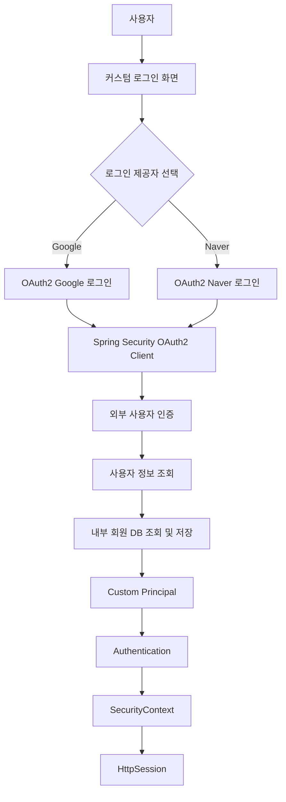
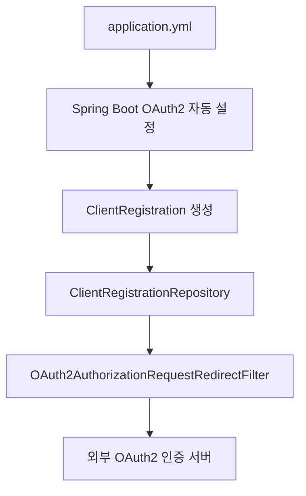
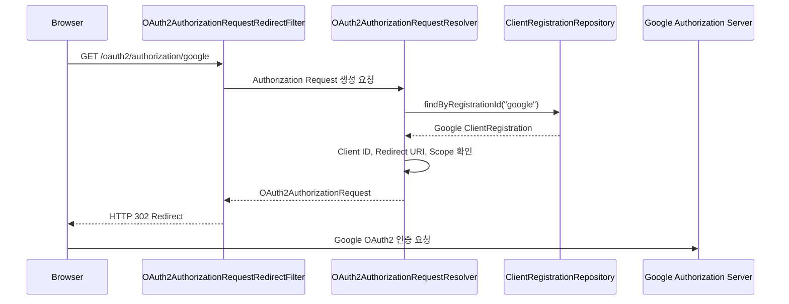
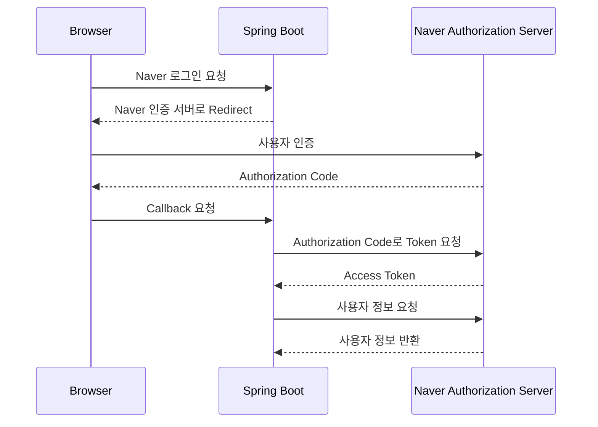
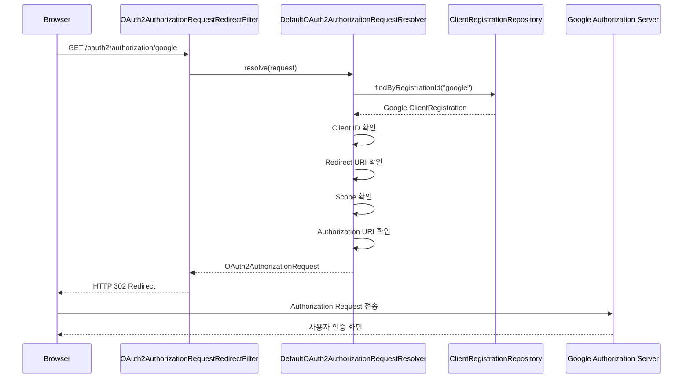
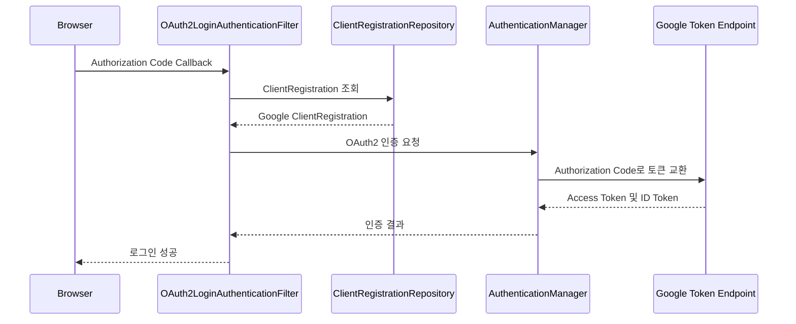
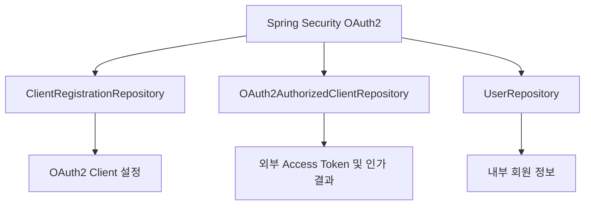
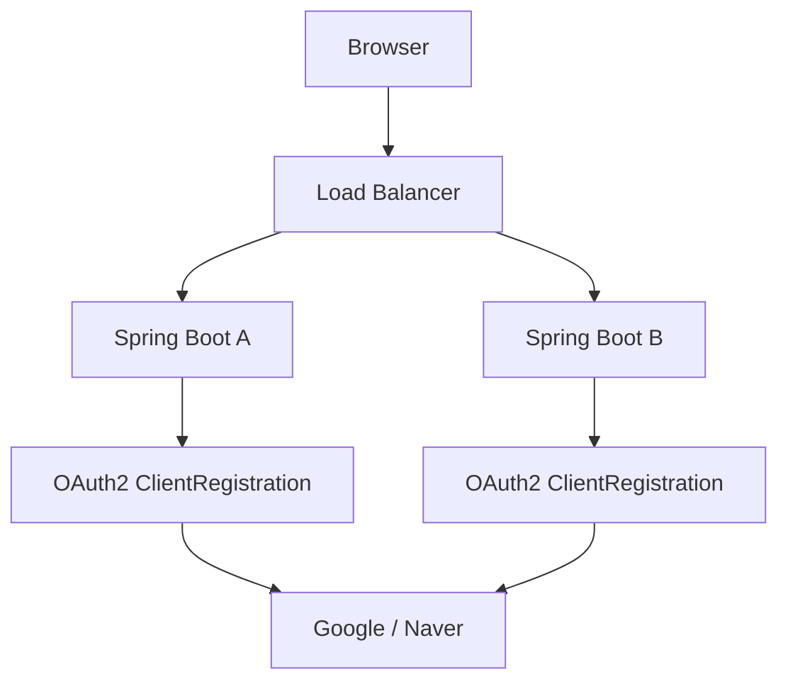
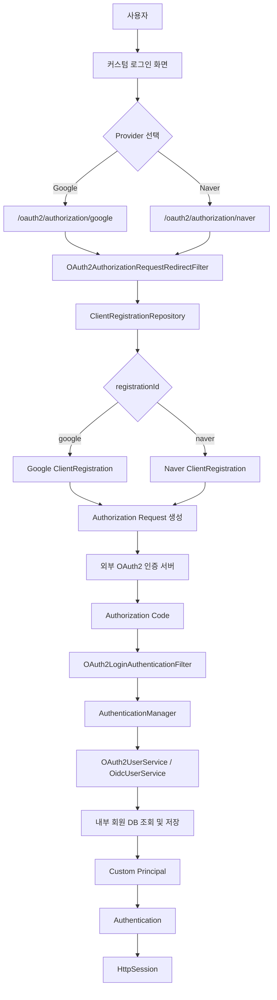

# 스프링 OAuth2 클라이언트 세션 - 12. Client Registration
[https://youtu.be/cn3a8b2Gt8k?si=G3A8Vry_f0VHj-Om](https://youtu.be/cn3a8b2Gt8k?si=G3A8Vry_f0VHj-Om)

# 스프링 OAuth2 클라이언트 세션 - 12. Client Registration
* toc
{:toc}

---

### Spring Security 6 OAuth2 ClientRegistration과 ClientRegistrationRepository 직접 구현하기

Spring Security OAuth2 Client를 이용하면 Google, Naver와 같은 외부 인증 제공자를 통해 사용자를 인증할 수 있다.

앞서 OAuth2 로그인 기능을 활성화하고, Google과 Naver의 Client ID와 Client Secret을 발급받아 Spring Boot 설정 파일에 등록했다.

또한 `CustomOAuth2UserService`, `CustomOidcUserService`를 구현하여 외부 사용자 정보를 조회하고, Spring Data JPA를 이용해 내부 회원 정보와 연결했다.

마지막으로 Mustache를 이용한 커스텀 로그인 화면을 구현하여 사용자가 원하는 소셜 로그인 제공자를 선택할 수 있도록 구성했다.

현재까지의 구조는 다음과 같다.



하지만 지금까지는 OAuth2 Client를 등록하는 과정에서 주로 설정 파일을 이용했다.

예를 들어 다음과 같다.

```yaml
spring:
  security:
    oauth2:
      client:
        registration:
          google:
            client-id: ${GOOGLE_CLIENT_ID}
            client-secret: ${GOOGLE_CLIENT_SECRET}

          naver:
            client-id: ${NAVER_CLIENT_ID}
            client-secret: ${NAVER_CLIENT_SECRET}
```

Spring Boot는 이러한 설정을 읽고 OAuth2 Client 등록 정보를 자동으로 구성한다.

하지만 Spring Security 내부에서는 단순히 설정 파일의 문자열을 읽어서 인증을 수행하는 것이 아니다.

설정 정보를 바탕으로 `ClientRegistration`이라는 객체를 생성하고, 이를 `ClientRegistrationRepository`에 등록한다.

실제 처리 구조는 다음과 같다.



그렇다면 다음과 같은 질문이 생긴다.

**설정 파일에 작성했던 OAuth2 Client 정보를 Java 코드로 직접 생성할 수는 없을까?**

가능하다.

Spring Security는 개발자가 `ClientRegistration`을 직접 생성하고, 이를 `ClientRegistrationRepository`에 등록할 수 있도록 API를 제공한다.

이 방식을 이용하면 외부 인증 제공자의 등록 정보를 프로그램 코드로 구성할 수 있다.

이번에는 다음 내용을 중심으로 살펴본다.

1. ClientRegistration의 역할과 내부 구조
2. ClientRegistrationRepository의 역할
3. 설정 파일 기반 등록과 Java 기반 등록의 차이
4. ClientRegistration.Builder 사용 방법
5. Naver ClientRegistration 직접 생성
6. Google ClientRegistration 직접 생성
7. InMemoryClientRegistrationRepository 구성
8. Spring Bean으로 등록하는 방법
9. SecurityConfig와 연결
10. OAuth2 인증 필터에서 ClientRegistration을 사용하는 과정
11. ClientRegistration과 OAuth2AuthorizedClient의 차이
12. 실무 환경에서의 보안 및 확장 설계

이번 구현은 **Spring Boot 3.2.1, Spring Security 6.2.1, Java 17**을 기준으로 한다.

---

### 개념

#### ClientRegistration이란?

`ClientRegistration`은 OAuth2 또는 OpenID Connect 인증 제공자에 등록된 클라이언트 정보를 표현하는 클래스다.

OAuth2 로그인을 구현하려면 외부 인증 제공자와 통신하기 위한 여러 정보가 필요하다.

예를 들어 다음과 같다.

```text
Client ID

Client Secret

Authorization URI

Token URI

Redirect URI

Authorization Grant Type

Scope

UserInfo URI
```

이러한 정보는 OAuth2 인증 과정에서 사용된다.

Spring Security는 이 정보를 하나의 객체로 관리한다.

그 객체가 바로 `ClientRegistration`이다.

개념적으로 표현하면 다음과 같다.

```text
ClientRegistration
    │
    ├── registrationId
    │
    ├── clientId
    │
    ├── clientSecret
    │
    ├── clientAuthenticationMethod
    │
    ├── authorizationGrantType
    │
    ├── redirectUri
    │
    ├── scopes
    │
    ├── clientName
    │
    └── providerDetails
          │
          ├── authorizationUri
          │
          ├── tokenUri
          │
          ├── jwkSetUri
          │
          ├── issuerUri
          │
          └── userInfoEndpoint
                │
                ├── uri
                ├── authenticationMethod
                └── userNameAttributeName
```

이처럼 ClientRegistration은 OAuth2 Client 자체의 정보와 외부 Provider의 정보를 함께 관리한다.

#### OAuth2 Client와 Provider의 차이

여기서 클라이언트와 인증 제공자를 구분할 필요가 있다.

**OAuth2 Client**는 외부 인증을 요청하는 애플리케이션이다.

이번 프로젝트에서는 Spring Boot 애플리케이션이 OAuth2 Client다.

반면 **Provider**는 OAuth2 인증과 관련된 기능을 제공하는 외부 시스템이다.

이번 프로젝트에서는 Google과 Naver가 해당한다.

| 구분 | OAuth2 Client | OAuth2 Provider |
|---|---|---|
| 주체 | Spring Boot 애플리케이션 | Google, Naver |
| 역할 | 사용자 인증 요청 | 사용자 인증 및 토큰 발급 |
| 주요 정보 | Client ID, Client Secret | Authorization URI, Token URI |
| 인증 요청 | 생성 | 처리 |
| Access Token | 발급받음 | 발급 |
| 사용자 정보 | 조회 | 제공 |

ClientRegistration은 이러한 두 구성요소를 연결하는 데 필요한 정보를 가지고 있다.

---

### 왜 사용하는가?

#### OAuth2 인증 과정에서 제공자별 설정을 조회하기 위해서

사용자가 커스텀 로그인 화면에서 Google 로그인 버튼을 클릭했다고 생각해보자.

```html
<a href="/oauth2/authorization/google">
    Google 로그인
</a>
```

브라우저에서는 다음 요청이 발생한다.

```http
GET /oauth2/authorization/google HTTP/1.1
Host: localhost:8080
```

Spring Security는 이 요청을 처리하기 위해 Google의 OAuth2 설정 정보가 필요하다.

대표적으로 다음 값을 확인해야 한다.

```text
Google Client ID

Google Authorization URI

Google Redirect URI

Google Scope
```

그런데 Google과 Naver는 서로 다른 Client ID와 Endpoint를 사용한다.

따라서 요청한 인증 제공자가 무엇인지 식별하고 해당 설정을 조회해야 한다.

이를 위해 `registrationId`를 사용한다.

```text
/oauth2/authorization/google
                      │
                      └── registrationId = google
```

Spring Security는 이 값을 이용해 등록 정보를 조회한다.

```java
clientRegistrationRepository.findByRegistrationId("google");
```

조회 결과는 Google의 ClientRegistration이다.

이후 Spring Security는 해당 등록 정보를 바탕으로 Authorization Request를 생성한다.

전체 흐름은 다음과 같다.



이때 ClientRegistrationRepository에 Google 등록 정보가 없다면 Spring Security는 정상적인 Google 인증 요청을 구성할 수 없다.

따라서 ClientRegistration은 OAuth2 인증을 시작하기 위한 핵심 정보다.

---

### 주요 특징

#### ClientRegistration과 ClientRegistrationRepository의 차이

두 클래스는 이름이 비슷하지만 역할이 다르다.

먼저 `ClientRegistration`은 하나의 OAuth2 클라이언트 등록 정보를 표현한다.

```text
ClientRegistration
    ↓
Google OAuth2 Client 정보
```

반면 `ClientRegistrationRepository`는 여러 ClientRegistration을 관리하고 조회하는 역할을 담당한다.

```text
ClientRegistrationRepository
    │
    ├── Google ClientRegistration
    │
    └── Naver ClientRegistration
```

차이를 정리하면 다음과 같다.

| 구분 | ClientRegistration | ClientRegistrationRepository |
|---|---|---|
| 종류 | 클래스 | 인터페이스 |
| 역할 | OAuth2 클라이언트 정보 표현 | 클라이언트 등록 정보 조회 |
| 관리 대상 | 하나의 클라이언트 | 하나 이상의 클라이언트 |
| 주요 메서드 | getClientId(), getRedirectUri() 등 | findByRegistrationId() |
| 대표 구현 | ClientRegistration 자체 | InMemoryClientRegistrationRepository |

이 두 구성요소는 서로 다른 책임을 가진다.

ClientRegistration은 데이터를 표현한다.

ClientRegistrationRepository는 해당 데이터를 조회한다.

---

### ClientRegistrationRepository 인터페이스

Spring Security는 다음 인터페이스를 제공한다.

```java
public interface ClientRegistrationRepository {

    ClientRegistration findByRegistrationId(
            String registrationId
    );
}
```

핵심 메서드는 다음과 같다.

```java
findByRegistrationId(String registrationId)
```

이 메서드는 전달받은 registrationId에 해당하는 ClientRegistration을 반환한다.

예를 들어 다음과 같이 사용할 수 있다.

```java
ClientRegistration google =
        clientRegistrationRepository
                .findByRegistrationId("google");
```

Google 등록 정보가 존재한다면 해당 객체를 반환한다.

```java
String clientId = google.getClientId();
```

```java
String redirectUri = google.getRedirectUri();
```

```java
String authorizationUri = google
        .getProviderDetails()
        .getAuthorizationUri();
```

반면 해당 registrationId에 해당하는 등록 정보가 없다면 `null`을 반환할 수 있다.

따라서 직접 Repository를 사용하는 코드에서는 등록 정보가 존재하는지 확인해야 한다.

---

### InMemoryClientRegistrationRepository란?

`ClientRegistrationRepository`는 인터페이스다.

Spring Security는 이를 구현한 다음 클래스를 제공한다.

```java
InMemoryClientRegistrationRepository
```

이 클래스는 여러 ClientRegistration 객체를 애플리케이션 메모리에 보관한다.

예를 들어 다음과 같다.

```java
ClientRegistrationRepository repository =
        new InMemoryClientRegistrationRepository(
                googleClientRegistration,
                naverClientRegistration
        );
```

이렇게 하면 두 개의 등록 정보를 관리할 수 있다.

```text
InMemoryClientRegistrationRepository
    │
    ├── google
    │     └── Google ClientRegistration
    │
    └── naver
          └── Naver ClientRegistration
```

Spring Security는 필요할 때 registrationId를 이용해 해당 정보를 조회한다.

#### InMemory 방식이 의미하는 것

여기서 주의할 점이 있다.

`InMemoryClientRegistrationRepository`는 OAuth2 사용자 정보나 로그인 세션을 저장하는 저장소가 아니다.

이름 그대로 **OAuth2 클라이언트 등록 정보**를 메모리에 보관한다.

즉 다음 정보를 관리한다.

```text
Client ID

Client Secret

Authorization URI

Token URI

Redirect URI
```

반면 로그인한 사용자의 HttpSession이나 외부 Access Token 저장은 별도의 구성요소가 담당한다.

이 차이는 뒤에서 자세히 살펴본다.

---

### 설정 파일 기반과 Java 기반 ClientRegistration 비교

지금까지는 설정 파일을 이용해 OAuth2 Client를 등록했다.

예를 들어 다음과 같다.

```yaml
spring:
  security:
    oauth2:
      client:
        registration:
          google:
            client-id: ${GOOGLE_CLIENT_ID}
            client-secret: ${GOOGLE_CLIENT_SECRET}
            scope:
              - openid
              - profile
              - email
```

Spring Boot는 이 설정을 읽어 ClientRegistration을 구성한다.

내부적으로는 다음과 같은 흐름이다.

```text
application.yml
    ↓
OAuth2ClientProperties
    ↓
Spring Boot OAuth2 자동 설정
    ↓
ClientRegistration
    ↓
ClientRegistrationRepository
```

반면 Java 코드로 직접 구현하면 다음과 같다.

```text
Java Configuration
    ↓
ClientRegistration.Builder
    ↓
ClientRegistration
    ↓
InMemoryClientRegistrationRepository
    ↓
Spring Bean 등록
```

두 방식의 차이를 비교하면 다음과 같다.

| 구분 | 설정 파일 기반 | Java 기반 |
|---|---|---|
| 설정 위치 | application.yml | Java 클래스 |
| ClientRegistration 생성 | Spring Boot 자동 구성 | 개발자가 직접 생성 |
| Repository 생성 | Spring Boot 자동 구성 | 개발자가 직접 등록 |
| 설정 복잡도 | 낮음 | 상대적으로 높음 |
| 동적 설정 생성 | 제한적 | 코드로 제어 가능 |
| Provider별 조건 분기 | 설정 구조에 의존 | 프로그래밍으로 구현 가능 |
| 유지보수 | 단순한 구성에 유리 | 복잡한 요구사항에 유리 |
| 보안 정보 관리 | 환경변수 연동 가능 | 환경변수 연동 가능 |

여기서 중요한 점은 **Java로 직접 구현하는 방식이 반드시 더 좋은 것은 아니라는 사실**이다.

Google과 Naver 정도의 소셜 로그인만 지원한다면 설정 파일 기반으로도 충분하다.

반면 인증 제공자가 많거나 환경별로 설정을 동적으로 조합해야 한다면 Java 기반 구성이 유용할 수 있다.

또한 Java 기반으로 ClientRegistration을 구성한다고 해서 모든 OAuth2 인증 로직을 직접 구현해야 하는 것은 아니다.

실제 인증 요청과 Callback 처리는 기존 Spring Security가 계속 담당한다.

---

### 예제

#### 1. 프로젝트 구조

이번에는 기존 프로젝트에 두 개의 클래스를 추가한다.

첫 번째는 제공자별 ClientRegistration을 생성하는 클래스다.

```text
SocialClientRegistration.java
```

두 번째는 생성한 ClientRegistration을 Repository에 등록하는 클래스다.

```text
CustomClientRegistrationRepo.java
```

전체 프로젝트 구조는 다음과 같다.

```text
src/main/java/com/example/oauth2session
│
├── Oauth2SessionApplication.java
│
├── config
│   ├── SecurityConfig.java
│   └── CustomClientRegistrationRepo.java
│
├── oauth2
│   └── SocialClientRegistration.java
│
├── controller
│   ├── MainController.java
│   ├── LoginController.java
│   └── MyController.java
│
├── service
│   ├── CustomOAuth2UserService.java
│   ├── CustomOidcUserService.java
│   └── SocialUserPersistenceService.java
│
├── entity
│   └── UserEntity.java
│
├── repository
│   └── UserRepository.java
│
└── dto
    └── oauth2
        ├── OAuth2Response.java
        ├── GoogleResponse.java
        ├── NaverResponse.java
        ├── CustomOAuth2User.java
        └── CustomOidcUser.java
```

기존에 구현한 사용자 정보 조회 및 데이터베이스 저장 기능은 그대로 유지한다.

이번에는 OAuth2 Client의 등록 방식을 변경하는 것이 목적이다.

---

### 2. 기존 OAuth2 Client 설정 분리

기존에는 다음과 같은 설정을 사용했다.

```yaml
spring:
  security:
    oauth2:
      client:
        registration:
          google:
            client-id: ${GOOGLE_CLIENT_ID}
            client-secret: ${GOOGLE_CLIENT_SECRET}

          naver:
            client-id: ${NAVER_CLIENT_ID}
            client-secret: ${NAVER_CLIENT_SECRET}
```

이제 ClientRegistration을 Java 코드에서 직접 생성하므로 기존 자동 등록 설정과 혼동되지 않도록 분리한다.

이번에는 인증 정보를 다음 설정으로 관리한다.

```yaml
app:
  oauth2:
    google:
      client-id: ${GOOGLE_CLIENT_ID}
      client-secret: ${GOOGLE_CLIENT_SECRET}

    naver:
      client-id: ${NAVER_CLIENT_ID}
      client-secret: ${NAVER_CLIENT_SECRET}
```

여기서 주목할 부분은 다음과 같다.

```text
spring.security.oauth2.client
```

대신:

```text
app.oauth2
```

를 사용한다.

`app.oauth2`는 이번 프로젝트에서 직접 정의한 설정 경로다.

Spring Boot가 이 설정을 자동으로 OAuth2 ClientRegistration으로 변환하는 것은 아니다.

개발자가 Java 코드에서 값을 읽고 ClientRegistration을 생성해야 한다.

이렇게 하면 OAuth2 등록 정보를 생성하는 책임을 명확하게 구분할 수 있다.

#### application.yml

이번 단계에서 필요한 설정을 정리하면 다음과 같다.

```yaml
server:
  port: 8080

spring:
  application:
    name: oauth2-session

  datasource:
    driver-class-name: com.mysql.cj.jdbc.Driver
    url: jdbc:mysql://localhost:3306/oauth2
    username: ${DB_USERNAME}
    password: ${DB_PASSWORD}

  jpa:
    hibernate:
      ddl-auto: validate

app:
  oauth2:
    google:
      client-id: ${GOOGLE_CLIENT_ID}
      client-secret: ${GOOGLE_CLIENT_SECRET}

    naver:
      client-id: ${NAVER_CLIENT_ID}
      client-secret: ${NAVER_CLIENT_SECRET}
```

여기서 데이터베이스 설정은 앞서 구현한 MySQL 기반 회원 저장 구조를 유지하기 위한 것이다.

`ddl-auto: validate`는 이미 테이블이 생성된 환경을 전제로 한다.

처음 테이블을 생성하는 개발 환경이라면 별도의 스키마 생성 작업이 필요하다.

**중요한 점은 OAuth2 Client Secret을 Java 코드나 Git 저장소에 직접 작성하지 않는 것**이다.

---

### 3. ClientRegistration.Builder 이해하기

Spring Security는 ClientRegistration을 생성하기 위해 Builder API를 제공한다.

기본적인 사용 방식은 다음과 같다.

```java
ClientRegistration registration =
        ClientRegistration.withRegistrationId("naver")
                .clientId("client-id")
                .clientSecret("client-secret")
                .authorizationGrantType(
                        AuthorizationGrantType.AUTHORIZATION_CODE
                )
                .redirectUri(
                        "{baseUrl}/login/oauth2/code/{registrationId}"
                )
                .authorizationUri(
                        "https://nid.naver.com/oauth2.0/authorize"
                )
                .tokenUri(
                        "https://nid.naver.com/oauth2.0/token"
                )
                .userInfoUri(
                        "https://openapi.naver.com/v1/nid/me"
                )
                .userNameAttributeName("response")
                .build();
```

위 코드는 Builder의 주요 메서드를 설명하기 위한 기본 예제다.

실제 Naver 연동에서는 클라이언트 인증 방식도 지정하는 것이 좋으며, Client ID와 Client Secret은 환경변수에서 읽어오도록 구성한다.

Builder 패턴은 여러 설정값을 순차적으로 지정한 뒤 최종 객체를 생성하는 방식이다.

```text
withRegistrationId()
    ↓
clientId()
    ↓
clientSecret()
    ↓
authorizationGrantType()
    ↓
redirectUri()
    ↓
authorizationUri()
    ↓
tokenUri()
    ↓
userInfoUri()
    ↓
build()
```

마지막의 `build()`가 호출되면 설정값을 이용해 ClientRegistration 객체를 생성한다.

#### Builder 패턴을 사용하는 이유

ClientRegistration은 여러 설정값을 가진 객체다.

이를 생성자 하나로 구성한다면 다음과 같이 많은 인자를 전달해야 할 수 있다.

```text
new ClientRegistration(
    registrationId,
    clientId,
    clientSecret,
    authorizationGrantType,
    redirectUri,
    authorizationUri,
    tokenUri,
    ...
)
```

이런 방식에서는 인자의 순서와 의미를 파악하기 어렵다.

반면 Builder 패턴을 사용하면 다음과 같이 각 값의 의미가 명확해진다.

```java
.clientId(clientId)
```

```java
.clientSecret(clientSecret)
```

```java
.redirectUri(redirectUri)
```

따라서 필드가 많은 설정 객체를 생성할 때 가독성과 유지보수성을 높일 수 있다.

---

### 4. SocialClientRegistration 구현

이제 Google과 Naver의 ClientRegistration을 직접 생성하는 클래스를 작성한다.

클래스 이름은 다음과 같다.

```text
SocialClientRegistration
```

이 클래스는 외부 인증 제공자별 ClientRegistration을 생성하는 책임을 담당한다.

파일 경로는 다음과 같다.

```text
oauth2/SocialClientRegistration.java
```

이번 구현에서는 다음 두 메서드를 제공한다.

```java
naverClientRegistration()
```

```java
googleClientRegistration()
```

각 메서드는 해당 인증 제공자의 ClientRegistration을 반환한다.

#### 전체 코드

```java
package com.example.oauth2session.oauth2;

import org.springframework.beans.factory.annotation.Value;
import org.springframework.security.config.oauth2.client.CommonOAuth2Provider;
import org.springframework.security.oauth2.client.registration.ClientRegistration;
import org.springframework.security.oauth2.core.AuthorizationGrantType;
import org.springframework.security.oauth2.core.ClientAuthenticationMethod;
import org.springframework.stereotype.Component;

@Component
public class SocialClientRegistration {

    private static final String REDIRECT_URI =
            "{baseUrl}/login/oauth2/code/{registrationId}";

    private final String googleClientId;
    private final String googleClientSecret;

    private final String naverClientId;
    private final String naverClientSecret;

    public SocialClientRegistration(
            @Value("${app.oauth2.google.client-id}")
            String googleClientId,

            @Value("${app.oauth2.google.client-secret}")
            String googleClientSecret,

            @Value("${app.oauth2.naver.client-id}")
            String naverClientId,

            @Value("${app.oauth2.naver.client-secret}")
            String naverClientSecret
    ) {

        this.googleClientId = googleClientId;
        this.googleClientSecret = googleClientSecret;

        this.naverClientId = naverClientId;
        this.naverClientSecret = naverClientSecret;
    }

    public ClientRegistration naverClientRegistration() {

        return ClientRegistration
                .withRegistrationId("naver")

                // Naver OAuth2 Client 정보
                .clientId(naverClientId)
                .clientSecret(naverClientSecret)

                // Naver 토큰 요청 시 Client 인증 방식
                .clientAuthenticationMethod(
                        ClientAuthenticationMethod.CLIENT_SECRET_POST
                )

                // Authorization Code 방식
                .authorizationGrantType(
                        AuthorizationGrantType.AUTHORIZATION_CODE
                )

                // OAuth2 Callback URI
                .redirectUri(REDIRECT_URI)

                // 외부 인증 제공자 이름
                .clientName("Naver")

                // Naver Authorization Endpoint
                .authorizationUri(
                        "https://nid.naver.com/oauth2.0/authorize"
                )

                // Naver Token Endpoint
                .tokenUri(
                        "https://nid.naver.com/oauth2.0/token"
                )

                // Naver UserInfo Endpoint
                .userInfoUri(
                        "https://openapi.naver.com/v1/nid/me"
                )

                // Naver 응답의 최상위 사용자 정보 속성
                .userNameAttributeName("response")

                .build();
    }

    public ClientRegistration googleClientRegistration() {

        return CommonOAuth2Provider.GOOGLE
                .getBuilder("google")

                // Google OAuth2 Client 정보
                .clientId(googleClientId)
                .clientSecret(googleClientSecret)

                // OAuth2 Callback URI
                .redirectUri(REDIRECT_URI)

                // OpenID Connect
                .scope(
                        "openid",
                        "profile",
                        "email"
                )

                .clientName("Google")

                .build();
    }
}
```

이 코드에서는 Naver와 Google의 ClientRegistration을 생성하는 방식이 다르다.

Naver는 Builder를 이용해 주요 Endpoint를 직접 작성했다.

반면 Google은 Spring Security에서 제공하는 `CommonOAuth2Provider`를 사용했다.

왜 이렇게 구성했는지 자세히 살펴보자.

---

### Naver ClientRegistration 분석

#### registrationId

먼저 다음 코드를 살펴보자.

```java
ClientRegistration.withRegistrationId("naver")
```

이 설정은 ClientRegistration을 구분하는 식별자를 지정한다.

이번 프로젝트에서는 다음 값을 사용한다.

```text
naver
```

이 값은 다음 요청 경로와 연결된다.

```text
/oauth2/authorization/naver
```

또한 인증 완료 후 Callback 경로에도 사용된다.

```text
/login/oauth2/code/naver
```

따라서 registrationId는 Spring Security의 OAuth2 인증 흐름에서 중요한 식별자다.

---

### clientId와 clientSecret

다음 설정을 살펴보자.

```java
.clientId(naverClientId)
.clientSecret(naverClientSecret)
```

이 값은 Naver 개발자센터에서 발급받은 OAuth2 Client 정보다.

기존에는 다음과 같이 설정했다.

```yaml
spring:
  security:
    oauth2:
      client:
        registration:
          naver:
            client-id: ${NAVER_CLIENT_ID}
            client-secret: ${NAVER_CLIENT_SECRET}
```

하지만 이제는 Java 코드에서 직접 설정한다.

```java
.clientId(naverClientId)
```

```java
.clientSecret(naverClientSecret)
```

두 방식의 결과는 개념적으로 동일하다.

Spring Security에서 사용할 ClientRegistration에 Client ID와 Client Secret을 제공하는 것이다.

다만 이번에는 해당 값을 외부 설정에서 주입받도록 구성했다.

---

### clientAuthenticationMethod

다음 설정을 살펴보자.

```java
.clientAuthenticationMethod(
        ClientAuthenticationMethod.CLIENT_SECRET_POST
)
```

이 설정은 OAuth2 클라이언트가 Token Endpoint에 접근할 때 어떤 방식으로 자신을 인증할지 지정한다.

대표적인 방식은 다음과 같다.

| 방식 | 설명 |
|---|---|
| CLIENT_SECRET_BASIC | HTTP Basic 인증 헤더에 Client ID와 Secret 전달 |
| CLIENT_SECRET_POST | HTTP 요청 본문에 Client ID와 Secret 전달 |
| NONE | 클라이언트 비밀정보를 사용하지 않는 방식 |

이번 Naver 구성에서는 다음 값을 사용한다.

```java
ClientAuthenticationMethod.CLIENT_SECRET_POST
```

즉 토큰 교환 요청을 처리할 때 Client ID와 Client Secret을 요청 본문에 포함하는 방식이다.

이 설정은 Authorization Code 방식 자체와는 다른 개념이다.

`authorizationGrantType`은 어떤 OAuth2 인가 방식을 사용할지 결정한다.

`clientAuthenticationMethod`는 토큰 요청 시 OAuth2 Client를 어떤 방식으로 인증할지 결정한다.

두 값을 구분해야 한다.

---

### authorizationGrantType

다음 설정을 살펴보자.

```java
.authorizationGrantType(
        AuthorizationGrantType.AUTHORIZATION_CODE
)
```

이번 프로젝트에서는 Authorization Code Grant를 사용한다.

사용자는 먼저 Naver 인증 서버에서 로그인한다.

Naver는 인증에 성공하면 Authorization Code를 발급한다.

Spring Security는 Authorization Code를 이용해 Access Token을 요청한다.



ClientRegistration에 Authorization Code 방식이 설정되어 있어야 Spring Security가 해당 인증 흐름을 구성할 수 있다.

---

### redirectUri

다음 설정을 살펴보자.

```java
.redirectUri(
        "{baseUrl}/login/oauth2/code/{registrationId}"
)
```

이 값은 외부 인증 서버에서 인증 완료 후 돌아올 주소다.

여기서 두 가지 변수를 사용한다.

```text
{baseUrl}
```

```text
{registrationId}
```

예를 들어 다음 환경이라고 생각해보자.

```text
baseUrl = http://localhost:8080
```

```text
registrationId = naver
```

그러면 최종 Redirect URI는 다음과 같다.

```text
http://localhost:8080/login/oauth2/code/naver
```

Google을 사용하는 경우에는 다음과 같다.

```text
http://localhost:8080/login/oauth2/code/google
```

이 방식의 장점은 개발 환경과 운영 환경에서 주소를 유연하게 구성할 수 있다는 것이다.

다만 실제 운영 환경에서는 Reverse Proxy 및 Forwarded Header 설정을 정확하게 관리해야 한다.

또한 외부 인증 제공자에 등록한 Callback URL과 실제 생성된 Redirect URI가 일치해야 한다.

---

### authorizationUri

다음 코드를 살펴보자.

```java
.authorizationUri(
        "https://nid.naver.com/oauth2.0/authorize"
)
```

이 설정은 사용자가 인증을 수행할 Naver Authorization Endpoint를 지정한다.

사용자가 Naver 로그인을 선택하면 Spring Security는 이 주소를 기반으로 Authorization Request를 생성한다.

요청에는 다음과 같은 정보가 포함될 수 있다.

```text
response_type

client_id

redirect_uri

state
```

Spring Security는 ClientRegistration에 저장된 정보를 사용하여 인증 요청을 구성한다.

따라서 개발자가 직접 모든 쿼리 파라미터를 조합할 필요는 없다.

---

### tokenUri

다음 설정을 살펴보자.

```java
.tokenUri(
        "https://nid.naver.com/oauth2.0/token"
)
```

이 주소는 Authorization Code를 Access Token으로 교환할 때 사용하는 Token Endpoint다.

즉 다음 과정에서 사용된다.

```text
Authorization Code
    ↓
Token Endpoint
    ↓
Access Token
```

여기서 중요한 점은 Authorization URI와 Token URI가 서로 다른 역할을 가진다는 사실이다.

| 구분 | Authorization URI | Token URI |
|---|---|---|
| 목적 | 사용자 인증 및 동의 | 토큰 발급 |
| 사용 주체 | 브라우저 중심 인증 흐름 | Spring Boot 서버 |
| 요청 결과 | Authorization Code | Access Token |
| 주요 처리 | Redirect | 서버 간 HTTP 요청 |

이 차이를 이해하면 OAuth2 로그인 문제를 분석하기가 쉬워진다.

---

### userInfoUri

다음 설정을 살펴보자.

```java
.userInfoUri(
        "https://openapi.naver.com/v1/nid/me"
)
```

이 주소는 Access Token을 이용해 사용자 정보를 조회하는 Endpoint다.

Spring Security의 `DefaultOAuth2UserService`는 이 정보를 이용해 외부 사용자 정보 API를 호출할 수 있다.

```text
Access Token
    ↓
DefaultOAuth2UserService
    ↓
Naver UserInfo Endpoint
    ↓
사용자 정보 JSON
```

예를 들어 다음과 같은 응답이 반환될 수 있다.

```json
{
  "resultcode": "00",
  "message": "success",
  "response": {
    "id": "naver-user-123",
    "name": "홍길동",
    "email": "user@example.com"
  }
}
```

이때 실제 사용자 정보는 `response` 객체 내부에 존재한다.

---

### userNameAttributeName

다음 코드를 살펴보자.

```java
.userNameAttributeName("response")
```

이 설정은 Spring Security가 UserInfo 응답에서 사용자 이름 속성으로 참조할 필드의 이름을 지정한다.

Naver의 사용자 정보 구조는 다음과 같다.

```text
Naver UserInfo Response
    │
    ├── resultcode
    │
    ├── message
    │
    └── response
          │
          ├── id
          ├── name
          └── email
```

따라서 최상위 속성인 `response`를 지정했다.

하지만 여기서 주의해야 한다.

**`userNameAttributeName("response")`는 내부의 `response.id`를 자동으로 사용자 식별자로 변환하지 않는다.**

즉 이 값은 사용자 정보의 중첩 객체를 가리킨다.

실제 사용자 식별자는 다음 위치에 있다.

```text
response.id
```

따라서 이전에 구현한 `NaverResponse`에서는 다음과 같이 처리했다.

```java
Object responseValue = attributes.get("response");

if (!(responseValue instanceof Map<?, ?> responseMap)) {
    throw new IllegalArgumentException(
            "Naver 사용자 정보 구조가 올바르지 않습니다."
    );
}

Object id = responseMap.get("id");
```

이후 내부 사용자 ID를 추출하고 `CustomOAuth2User`를 생성했다.

이번에 ClientRegistration의 등록 방식을 변경하더라도 기존 사용자 정보 변환 로직은 유지할 수 있다.

---

### 5. Google ClientRegistration 구현

이번에는 Google ClientRegistration을 살펴보자.

Naver와 달리 Google에서는 다음 클래스를 사용할 수 있다.

```java
CommonOAuth2Provider
```

Spring Security는 Google과 같은 일부 인증 제공자에 대해 기본 설정을 제공한다.

따라서 다음과 같이 구현할 수 있다.

```java
public ClientRegistration googleClientRegistration() {

    return CommonOAuth2Provider.GOOGLE
            .getBuilder("google")

            .clientId(googleClientId)

            .clientSecret(googleClientSecret)

            .redirectUri(
                    "{baseUrl}/login/oauth2/code/{registrationId}"
            )

            .scope(
                    "openid",
                    "profile",
                    "email"
            )

            .clientName("Google")

            .build();
}
```

여기서 가장 중요한 부분은 다음과 같다.

```java
CommonOAuth2Provider.GOOGLE
        .getBuilder("google")
```

이 코드는 Google에 필요한 기본 Provider 설정이 포함된 Builder를 생성한다.

따라서 주요 Endpoint를 직접 작성하지 않아도 된다.

대표적으로 다음과 같은 정보가 기본 구성에 포함된다.

```text
Authorization Endpoint

Token Endpoint

UserInfo Endpoint

JWK Set Endpoint

User Name Attribute
```

이후 Client ID와 Client Secret 등 애플리케이션마다 달라지는 정보를 추가한다.

---

### Google과 Naver의 차이

두 제공자의 등록 방식을 비교하면 다음과 같다.

| 구분 | Google | Naver |
|---|---|---|
| registrationId | google | naver |
| Client ID | Google 발급 | Naver 발급 |
| Client Secret | Google 발급 | Naver 발급 |
| Builder | CommonOAuth2Provider 활용 | ClientRegistration Builder 직접 구성 |
| Authorization URI | 기본 설정 활용 가능 | 직접 지정 |
| Token URI | 기본 설정 활용 가능 | 직접 지정 |
| UserInfo URI | 기본 설정 활용 가능 | 직접 지정 |
| 사용자 식별자 | sub | response.id |
| 인증 방식 | OIDC 구성 | 일반 OAuth2 구성 |

여기서 Google과 Naver 모두 Builder API로 직접 생성할 수 있다는 점은 동일하다.

다만 Google은 Spring Security에서 제공하는 기본 Provider 설정을 활용할 수 있으므로 코드가 간결해진다.

#### Google을 수동 Builder로 모두 작성할 수도 있다

예를 들어 다음과 같이 주요 Endpoint를 직접 지정하는 방식도 가능하다.

```java
public ClientRegistration googleClientRegistration() {

    return ClientRegistration
            .withRegistrationId("google")

            .clientId(googleClientId)

            .clientSecret(googleClientSecret)

            .clientAuthenticationMethod(
                    ClientAuthenticationMethod.CLIENT_SECRET_BASIC
            )

            .authorizationGrantType(
                    AuthorizationGrantType.AUTHORIZATION_CODE
            )

            .redirectUri(
                    "{baseUrl}/login/oauth2/code/{registrationId}"
            )

            .scope(
                    "openid",
                    "profile",
                    "email"
            )

            .clientName("Google")

            .authorizationUri(
                    "https://accounts.google.com/o/oauth2/v2/auth"
            )

            .tokenUri(
                    "https://oauth2.googleapis.com/token"
            )

            .userInfoUri(
                    "https://openidconnect.googleapis.com/v1/userinfo"
            )

            .jwkSetUri(
                    "https://www.googleapis.com/oauth2/v3/certs"
            )

            .issuerUri(
                    "https://accounts.google.com"
            )

            .userNameAttributeName("sub")

            .build();
}
```

이 방식에서는 Google의 주요 Provider Endpoint를 직접 관리한다.

하지만 Google의 Provider 정보가 변경된다면 관련 설정도 직접 관리해야 한다.

따라서 특별한 커스터마이징 요구사항이 없다면 `CommonOAuth2Provider.GOOGLE`을 활용하는 방식이 더 간결하다.

---

### 6. ClientRegistrationRepository 구현

이제 Google과 Naver의 ClientRegistration을 생성했다.

하지만 아직 Spring Security에서 해당 객체들을 조회할 수 있도록 등록하지 않았다.

다음으로 `ClientRegistrationRepository`를 구성해야 한다.

이번에는 다음 클래스를 사용한다.

```java
InMemoryClientRegistrationRepository
```

이 클래스에 앞에서 생성한 ClientRegistration 객체들을 전달한다.

```java
new InMemoryClientRegistrationRepository(
        naverClientRegistration,
        googleClientRegistration
);
```

이렇게 하면 여러 OAuth2 ClientRegistration을 하나의 저장소에서 관리할 수 있다.

---

### CustomClientRegistrationRepo 생성

파일 경로는 다음과 같다.

```text
config/CustomClientRegistrationRepo.java
```

전체 코드는 다음과 같다.

```java
package com.example.oauth2session.config;

import com.example.oauth2session.oauth2.SocialClientRegistration;

import org.springframework.context.annotation.Bean;
import org.springframework.context.annotation.Configuration;

import org.springframework.security.oauth2.client.registration.ClientRegistration;
import org.springframework.security.oauth2.client.registration.ClientRegistrationRepository;
import org.springframework.security.oauth2.client.registration.InMemoryClientRegistrationRepository;

@Configuration
public class CustomClientRegistrationRepo {

    private final SocialClientRegistration socialClientRegistration;

    public CustomClientRegistrationRepo(
            SocialClientRegistration socialClientRegistration
    ) {

        this.socialClientRegistration =
                socialClientRegistration;
    }

    @Bean
    public ClientRegistrationRepository clientRegistrationRepository() {

        ClientRegistration naver =
                socialClientRegistration.naverClientRegistration();

        ClientRegistration google =
                socialClientRegistration.googleClientRegistration();

        return new InMemoryClientRegistrationRepository(
                naver,
                google
        );
    }
}
```

이 코드에서 중요한 부분을 살펴보자.

---

### @Configuration

먼저 다음 Annotation을 사용했다.

```java
@Configuration
public class CustomClientRegistrationRepo {
}
```

`@Configuration`은 해당 클래스가 Spring Bean 정의를 포함하는 설정 클래스임을 나타낸다.

이번 클래스에서는 OAuth2 ClientRegistrationRepository를 생성한다.

---

### @Bean의 역할

다음 메서드를 살펴보자.

```java
@Bean
public ClientRegistrationRepository clientRegistrationRepository() {

    ClientRegistration naver =
            socialClientRegistration.naverClientRegistration();

    ClientRegistration google =
            socialClientRegistration.googleClientRegistration();

    return new InMemoryClientRegistrationRepository(
            naver,
            google
    );
}
```

여기서 가장 중요한 Annotation은 다음과 같다.

```java
@Bean
```

`@Bean`은 메서드가 반환하는 객체를 Spring Container에 Bean으로 등록하도록 한다.

따라서 Spring Security는 필요한 경우 해당 ClientRegistrationRepository Bean을 사용할 수 있다.

```text
CustomClientRegistrationRepo
    ↓
@Bean
    ↓
ClientRegistrationRepository
    ↓
Spring Container
    ↓
Spring Security OAuth2 Login
```

#### @Bean을 선언하지 않으면 어떻게 될까?

예를 들어 다음과 같이 작성했다고 생각해보자.

```java
public ClientRegistrationRepository clientRegistrationRepository() {

    return new InMemoryClientRegistrationRepository(
            naverClientRegistration,
            googleClientRegistration
    );
}
```

이 메서드 자체는 ClientRegistrationRepository 객체를 생성할 수 있다.

하지만 메서드에 `@Bean`이 없다면 해당 반환 객체가 Spring Container에 자동으로 Bean 등록되는 것은 아니다.

물론 개발자가 메서드를 직접 호출하고 반환 객체를 SecurityConfig에 전달하는 방식으로 사용할 수는 있다.

하지만 그 방식에서는 Repository의 생성과 공유를 직접 관리해야 한다.

이번처럼 Spring Boot와 Spring Security의 자동 구성을 활용하는 환경에서는 ClientRegistrationRepository를 Bean으로 등록하는 방식이 더 명확하다.

**따라서 ClientRegistrationRepository를 직접 구현할 때는 반환 객체가 실제로 Spring Bean으로 등록되는지 확인해야 한다.**

---

### 7. SecurityConfig에 연결하기

이제 다음 구성이 완료되었다.

```text
SocialClientRegistration
    ↓
Google / Naver ClientRegistration 생성
    ↓
CustomClientRegistrationRepo
    ↓
InMemoryClientRegistrationRepository
    ↓
Spring Bean 등록
```

이제 Spring Security의 OAuth2 Login 설정과 연결해보자.

Spring Security는 등록된 ClientRegistrationRepository Bean을 사용할 수 있다.

따라서 일반적인 구성에서는 SecurityConfig에서 Repository 생성 메서드를 직접 호출할 필요가 없다.

#### SecurityConfig 전체 코드

```java
package com.example.oauth2session.config;

import com.example.oauth2session.service.CustomOAuth2UserService;
import com.example.oauth2session.service.CustomOidcUserService;

import org.springframework.context.annotation.Bean;
import org.springframework.context.annotation.Configuration;

import org.springframework.security.config.annotation.web.builders.HttpSecurity;
import org.springframework.security.config.annotation.web.configurers.AbstractHttpConfigurer;

import org.springframework.security.web.SecurityFilterChain;

@Configuration
public class SecurityConfig {

    private final CustomOAuth2UserService customOAuth2UserService;

    private final CustomOidcUserService customOidcUserService;

    public SecurityConfig(
            CustomOAuth2UserService customOAuth2UserService,
            CustomOidcUserService customOidcUserService
    ) {

        this.customOAuth2UserService =
                customOAuth2UserService;

        this.customOidcUserService =
                customOidcUserService;
    }

    @Bean
    public SecurityFilterChain securityFilterChain(
            HttpSecurity http
    ) throws Exception {

        http
                // 일반 Form Login 비활성화
                .formLogin(AbstractHttpConfigurer::disable)

                // HTTP Basic 인증 비활성화
                .httpBasic(AbstractHttpConfigurer::disable)

                // OAuth2 로그인
                .oauth2Login(oauth2 -> oauth2

                        // 커스텀 로그인 화면
                        .loginPage("/login")

                        // 사용자 정보 처리
                        .userInfoEndpoint(userInfo -> userInfo

                                // Naver 일반 OAuth2
                                .userService(customOAuth2UserService)

                                // Google OIDC
                                .oidcUserService(customOidcUserService)
                        )
                )

                // 경로별 인가
                .authorizeHttpRequests(auth -> auth

                        .requestMatchers(
                                "/",
                                "/login",
                                "/error",
                                "/css/**",
                                "/js/**",
                                "/images/**",
                                "/oauth2/authorization/**",
                                "/login/oauth2/code/**"
                        ).permitAll()

                        .anyRequest().authenticated()
                );

        return http.build();
    }
}
```

여기서 주목할 부분은 다음과 같다.

```java
.oauth2Login(oauth2 -> oauth2
        .loginPage("/login")
)
```

이 코드에서는 ClientRegistrationRepository를 명시적으로 지정하지 않았다.

그 이유는 앞에서 다음 Bean을 등록했기 때문이다.

```java
@Bean
public ClientRegistrationRepository clientRegistrationRepository()
```

Spring Security는 해당 Bean을 이용해 OAuth2 Client 등록 정보를 조회할 수 있다.

---

### ClientRegistrationRepository를 명시적으로 지정하는 방법

필요하다면 SecurityConfig에서 Repository를 직접 주입받아 지정할 수도 있다.

예를 들어 다음과 같다.

```java
private final ClientRegistrationRepository
        clientRegistrationRepository;
```

생성자에서 주입받는다.

```java
public SecurityConfig(
        ClientRegistrationRepository clientRegistrationRepository,
        CustomOAuth2UserService customOAuth2UserService,
        CustomOidcUserService customOidcUserService
) {

    this.clientRegistrationRepository =
            clientRegistrationRepository;

    this.customOAuth2UserService =
            customOAuth2UserService;

    this.customOidcUserService =
            customOidcUserService;
}
```

그리고 다음과 같이 등록할 수 있다.

```java
.oauth2Login(oauth2 -> oauth2

        .clientRegistrationRepository(
                clientRegistrationRepository
        )

        .loginPage("/login")

        .userInfoEndpoint(userInfo -> userInfo

                .userService(customOAuth2UserService)

                .oidcUserService(customOidcUserService)
        )
)
```

이 설정은 OAuth2 로그인에서 사용할 ClientRegistrationRepository를 명시적으로 지정한다.

다만 이번처럼 하나의 ClientRegistrationRepository Bean이 등록되어 있는 환경에서는 반드시 필요한 설정은 아니다.

따라서 특별한 이유가 없다면 Bean으로 등록하고 Spring Security가 해당 Bean을 사용하도록 구성하는 방식이 간결하다.

---

### 구조

#### ClientRegistration이 인증 요청에서 사용되는 과정

이번에는 실제 OAuth2 로그인 요청에서 ClientRegistration이 어떻게 사용되는지 살펴보자.

사용자가 다음 경로에 접근한다고 생각해보자.

```text
http://localhost:8080/oauth2/authorization/google
```

Spring Security는 요청 경로에서 `google`이라는 registrationId를 확인한다.

그리고 ClientRegistrationRepository를 이용해 Google 등록 정보를 조회한다.

```java
ClientRegistration google =
        clientRegistrationRepository
                .findByRegistrationId("google");
```

이후 조회한 등록 정보를 이용해 Authorization Request를 생성한다.

전체 흐름은 다음과 같다.



여기서 `DefaultOAuth2AuthorizationRequestResolver`가 중요한 역할을 담당한다.

이 구성요소는 ClientRegistrationRepository에서 클라이언트 등록 정보를 가져와 실제 Authorization Request를 구성한다.

즉 ClientRegistration은 단순한 설정 객체이지만 OAuth2 인증 요청을 구성하는 데 직접적인 영향을 준다.

---

### OAuth2 로그인 완료 시에도 ClientRegistration이 사용될까?

ClientRegistration은 로그인 요청을 시작하는 순간에만 사용되는 것이 아니다.

Authorization Code가 반환된 이후에도 사용된다.

예를 들어 다음 Callback 요청이 발생했다고 생각해보자.

```http
GET /login/oauth2/code/google?code=AUTH_CODE&state=STATE HTTP/1.1
Host: localhost:8080
```

이 요청은 `OAuth2LoginAuthenticationFilter`가 처리한다.

이후 Spring Security는 해당 OAuth2 ClientRegistration을 이용해 토큰 교환에 필요한 정보를 확인한다.

대표적으로 다음과 같다.

```text
Client ID

Client Secret

Client Authentication Method

Token URI

Authorization Grant Type
```

이를 바탕으로 Authorization Code를 Access Token으로 교환한다.



Google OIDC에서는 이후 ID Token 검증과 OIDC 사용자 정보 처리가 수행된다.

반면 Naver의 일반 OAuth2 구성에서는 UserInfo API를 이용해 사용자 정보를 조회한다.

중요한 점은 **ClientRegistration이 Authorization Request 생성과 Token Request 처리 모두에 사용된다는 사실**이다.

---

### ClientRegistrationRepository와 OAuth2AuthorizedClientRepository의 차이

Spring Security OAuth2 Client를 이해할 때 두 저장소를 혼동하기 쉽다.

```java
ClientRegistrationRepository
```

```java
OAuth2AuthorizedClientRepository
```

두 이름 모두 Repository로 끝난다.

하지만 관리하는 데이터가 다르다.

#### ClientRegistrationRepository

이 저장소는 OAuth2 Client의 등록 정보를 관리한다.

```text
ClientRegistrationRepository
    │
    ├── registrationId
    ├── clientId
    ├── clientSecret
    ├── redirectUri
    └── providerDetails
```

예를 들어 Google과 Naver의 OAuth2 설정을 관리한다.

#### OAuth2AuthorizedClientRepository

이 저장소는 사용자의 OAuth2 인가 결과와 관련된 OAuth2AuthorizedClient를 관리한다.

대표적으로 다음과 같은 정보를 포함할 수 있다.

```text
OAuth2AuthorizedClient
    │
    ├── ClientRegistration
    ├── Principal Name
    ├── Access Token
    └── Refresh Token
```

즉 로그인 과정에서 발급받은 외부 토큰과 관련된 데이터를 관리할 수 있다.

두 저장소를 비교하면 다음과 같다.

| 구분 | ClientRegistrationRepository | OAuth2AuthorizedClientRepository |
|---|---|---|
| 관리 목적 | OAuth2 Client 설정 관리 | 사용자별 인가 결과 관리 |
| 주요 데이터 | Client ID, Secret, Endpoint | Access Token, Refresh Token |
| 데이터 성격 | 애플리케이션 설정 | 사용자 인증·인가 결과 |
| 대표 접근 기준 | registrationId | 클라이언트 및 사용자 |
| 주요 사용 시점 | 인증 요청 생성, 토큰 교환 | 인증 완료 후 토큰 관리 |

이 차이를 이해해야 한다.

**ClientRegistrationRepository를 InMemory 방식으로 구성했다고 해서 사용자별 Access Token도 같은 Repository에 저장되는 것은 아니다.**

두 저장소는 서로 다른 책임을 가진다.

---

### ClientRegistrationRepository와 UserRepository의 차이

앞서 Spring Data JPA를 이용해 다음 Repository도 구현했다.

```java
UserRepository
```

이 Repository는 내부 회원 정보를 저장한다.

예를 들어 다음과 같다.

```text
UserEntity
    │
    ├── id
    ├── username
    ├── email
    ├── name
    └── role
```

반면 ClientRegistrationRepository는 외부 인증 제공자의 설정 정보를 저장한다.

따라서 세 종류의 저장소를 다음과 같이 구분할 수 있다.



각 저장소는 서로 다른 목적을 가진다.

이 구조를 명확하게 이해하면 OAuth2 로그인 시스템의 데이터 흐름을 분석할 때 혼동을 줄일 수 있다.

---

### 설정 방식 변경 후 기존 인증 구조는 어떻게 될까?

이번에는 ClientRegistration 생성 방식만 변경했다.

따라서 기존에 구현한 사용자 정보 처리 로직은 유지할 수 있다.

예를 들어 다음과 같다.

```text
ClientRegistrationRepository
    ↓
Google / Naver 인증 설정 조회
    ↓
외부 OAuth2 인증
    ↓
OAuth2UserService / OidcUserService
    ↓
OAuth2Response
    ↓
SocialUserPersistenceService
    ↓
UserRepository
    ↓
MySQL
    ↓
Custom Principal
    ↓
Authentication
    ↓
HttpSession
```

여기서 변경된 부분은 다음과 같다.

**기존 방식**

```text
application.yml
    ↓
Spring Boot 자동 설정
    ↓
ClientRegistrationRepository
```

**변경된 방식**

```text
SocialClientRegistration
    ↓
ClientRegistration.Builder
    ↓
CustomClientRegistrationRepo
    ↓
InMemoryClientRegistrationRepository
```

이후 OAuth2 인증 과정은 동일한 Spring Security 구성요소를 이용한다.

따라서 기존의 CustomOAuth2UserService나 UserRepository를 다시 구현할 필요는 없다.

---

### 실행 및 확인

#### 1. 환경변수 설정

Windows PowerShell에서 OAuth2 Client 정보를 설정한다.

```powershell
$env:GOOGLE_CLIENT_ID = "발급받은_GOOGLE_CLIENT_ID"

$env:GOOGLE_CLIENT_SECRET = "발급받은_GOOGLE_CLIENT_SECRET"

$env:NAVER_CLIENT_ID = "발급받은_NAVER_CLIENT_ID"

$env:NAVER_CLIENT_SECRET = "발급받은_NAVER_CLIENT_SECRET"
```

데이터베이스 연결 정보도 준비한다.

```powershell
$env:DB_USERNAME = "oauth2_app"

$env:DB_PASSWORD = "데이터베이스_비밀번호"
```

이 환경변수는 현재 PowerShell 세션에서 사용할 수 있다.

IntelliJ에서 애플리케이션을 직접 실행한다면 Run Configuration에서 환경변수를 별도로 지정해야 할 수 있다.

#### 2. Spring Boot 실행

다음 명령을 실행한다.

```powershell
.\gradlew.bat bootRun
```

이 명령은 Windows용 Gradle Wrapper를 이용해 Spring Boot 애플리케이션을 실행한다.

정상적으로 실행되면 다음과 유사한 로그를 확인할 수 있다.

```text
Tomcat started on port 8080 (http)

Started Oauth2SessionApplication
```

실제 클래스 이름과 로그 형식은 프로젝트 설정에 따라 달라질 수 있다.

---

### ClientRegistrationRepository 등록 여부 확인

애플리케이션이 정상적으로 실행된 이후에는 Repository에 Google과 Naver가 등록되었는지 확인하는 것이 좋다.

예를 들어 다음과 같은 테스트를 작성할 수 있다.

```java
package com.example.oauth2session;

import org.junit.jupiter.api.Test;

import org.springframework.security.oauth2.client.registration.ClientRegistration;
import org.springframework.security.oauth2.client.registration.ClientRegistrationRepository;
import org.springframework.security.oauth2.client.registration.InMemoryClientRegistrationRepository;

import java.util.List;

import static org.junit.jupiter.api.Assertions.*;

class ClientRegistrationRepositoryTest {

    @Test
    void 구글과_네이버_등록_정보를_조회할_수_있다() {

        ClientRegistration google =
                org.springframework.security.config.oauth2.client.CommonOAuth2Provider
                        .GOOGLE
                        .getBuilder("google")
                        .clientId("test-google-client-id")
                        .clientSecret("test-google-client-secret")
                        .redirectUri(
                                "{baseUrl}/login/oauth2/code/{registrationId}"
                        )
                        .scope("openid", "profile", "email")
                        .build();

        ClientRegistration naver =
                ClientRegistration.withRegistrationId("naver")
                        .clientId("test-naver-client-id")
                        .clientSecret("test-naver-client-secret")
                        .clientAuthenticationMethod(
                                org.springframework.security.oauth2.core
                                        .ClientAuthenticationMethod.CLIENT_SECRET_POST
                        )
                        .authorizationGrantType(
                                org.springframework.security.oauth2.core
                                        .AuthorizationGrantType.AUTHORIZATION_CODE
                        )
                        .redirectUri(
                                "{baseUrl}/login/oauth2/code/{registrationId}"
                        )
                        .authorizationUri(
                                "https://nid.naver.com/oauth2.0/authorize"
                        )
                        .tokenUri(
                                "https://nid.naver.com/oauth2.0/token"
                        )
                        .userInfoUri(
                                "https://openapi.naver.com/v1/nid/me"
                        )
                        .userNameAttributeName("response")
                        .build();

        ClientRegistrationRepository repository =
                new InMemoryClientRegistrationRepository(
                        List.of(google, naver)
                );

        ClientRegistration googleResult =
                repository.findByRegistrationId("google");

        ClientRegistration naverResult =
                repository.findByRegistrationId("naver");

        assertNotNull(googleResult);

        assertNotNull(naverResult);

        assertEquals(
                "google",
                googleResult.getRegistrationId()
        );

        assertEquals(
                "naver",
                naverResult.getRegistrationId()
        );

        assertEquals(
                "test-google-client-id",
                googleResult.getClientId()
        );

        assertEquals(
                "test-naver-client-id",
                naverResult.getClientId()
        );
    }

    @Test
    void 등록되지_않은_제공자는_조회되지_않는다() {

        ClientRegistration google =
                org.springframework.security.config.oauth2.client.CommonOAuth2Provider
                        .GOOGLE
                        .getBuilder("google")
                        .clientId("test-client-id")
                        .clientSecret("test-client-secret")
                        .build();

        ClientRegistrationRepository repository =
                new InMemoryClientRegistrationRepository(
                        google
                );

        ClientRegistration result =
                repository.findByRegistrationId("unknown");

        assertNull(result);
    }
}
```

이 테스트는 실제 Google이나 Naver 서버와 통신하지 않는다.

메모리에 ClientRegistration을 생성한 뒤 등록 정보가 정상적으로 조회되는지만 검증한다.

따라서 실제 Client ID나 Client Secret을 사용할 필요가 없다.

#### 테스트 실행

Windows PowerShell에서 다음 명령을 실행한다.

```powershell
.\gradlew.bat test
```

정상적으로 완료되면 다음과 유사한 결과를 확인할 수 있다.

```text
BUILD SUCCESSFUL
```

이 테스트를 통해 다음 항목을 검증할 수 있다.

| 검증 항목 | 기대 결과 |
|---|---|
| Google 등록 정보 조회 | 성공 |
| Naver 등록 정보 조회 | 성공 |
| Google Client ID | 설정한 값 반환 |
| Naver Client ID | 설정한 값 반환 |
| 잘못된 registrationId | null 반환 |

다만 이 테스트는 ClientRegistrationRepository의 기본적인 동작을 확인하는 단위 테스트다.

실제 Spring Container에 Bean이 등록되었는지와 전체 OAuth2 로그인 과정이 정상적으로 동작하는지는 별도의 통합 검증이 필요하다.

---

### OAuth2 로그인 요청 확인

다음으로 실제 OAuth2 로그인 시작 경로를 확인한다.

#### Google

```text
http://localhost:8080/oauth2/authorization/google
```

#### Naver

```text
http://localhost:8080/oauth2/authorization/naver
```

Spring Security가 등록 정보를 정상적으로 조회했다면 외부 인증 제공자로 이동하기 위한 Redirect 응답을 생성할 수 있다.

PowerShell에서 다음 명령을 실행한다.

```powershell
curl.exe -i http://localhost:8080/oauth2/authorization/google
```

정상적인 경우 다음과 유사한 응답이 발생할 수 있다.

```http
HTTP/1.1 302 Found

Location: https://accounts.google.com/o/oauth2/v2/auth?...
```

Naver도 동일하게 확인할 수 있다.

```powershell
curl.exe -i http://localhost:8080/oauth2/authorization/naver
```

정상적인 경우 다음과 유사한 응답이 발생할 수 있다.

```http
HTTP/1.1 302 Found

Location: https://nid.naver.com/oauth2.0/authorize?...
```

여기서 중요한 부분은 `Location` 헤더다.

이 응답은 Spring Security가 해당 ClientRegistration을 이용해 Authorization Request를 생성했다는 의미다.

다만 Redirect 응답이 정상적으로 발생했다고 해서 전체 로그인이 성공한 것은 아니다.

실제 로그인 성공 여부는 Authorization Code 수신, 토큰 교환, 사용자 정보 처리 및 세션 저장까지 확인해야 한다.

---

### 실무에서의 활용

#### 1. ClientRegistration을 직접 구현해야 하는 상황과 그렇지 않은 상황을 구분한다

단순히 Google과 Naver를 등록하는 정도라면 설정 파일만으로도 충분하다.

```yaml
spring:
  security:
    oauth2:
      client:
        registration:
          google:
            client-id: ${GOOGLE_CLIENT_ID}
            client-secret: ${GOOGLE_CLIENT_SECRET}
```

Spring Boot는 이를 기반으로 ClientRegistrationRepository를 자동 구성할 수 있다.

따라서 특별한 요구사항이 없다면 설정 파일 기반 구성이 더 간단하다.

반면 다음과 같은 상황에서는 Java 기반 구성이 유리할 수 있다.

```text
여러 인증 제공자의 설정을 동적으로 생성

서비스 환경에 따라 ClientRegistration 변경

고객사별 OAuth2 Client 정보 관리

외부 설정 저장소와 연동

제공자별 커스텀 정책 적용
```

핵심은 직접 구현 자체가 목적이 아니라 서비스 요구사항에 적합한 구성을 선택하는 것이다.

---

#### 2. Client Secret은 코드에 직접 작성하지 않는다

ClientRegistration을 직접 구현하면 다음과 같이 작성하기 쉽다.

```java
.clientSecret("actual-client-secret")
```

하지만 이 방식은 위험하다.

소스 코드가 유출되거나 저장소 접근 권한이 잘못 설정되면 Client Secret이 외부에 노출될 수 있기 때문이다.

따라서 다음과 같이 환경변수를 이용한다.

```java
.clientSecret(googleClientSecret)
```

그리고 외부 설정에서 주입받는다.

```yaml
app:
  oauth2:
    google:
      client-secret: ${GOOGLE_CLIENT_SECRET}
```

운영 환경에서는 비밀정보 관리 시스템과 연동하는 방식도 고려할 수 있다.

Client Secret을 직접 구현 코드에 포함하는 것은 설정을 Java로 옮겼다는 이유만으로 정당화되지 않는다.

---

#### 3. ClientRegistrationRepository를 Spring Bean으로 관리한다

ClientRegistrationRepository는 OAuth2 인증 과정에서 여러 구성요소가 사용할 수 있다.

따라서 다음과 같이 Bean으로 등록한다.

```java
@Bean
public ClientRegistrationRepository clientRegistrationRepository() {

    return new InMemoryClientRegistrationRepository(
            googleClientRegistration,
            naverClientRegistration
    );
}
```

이렇게 하면 Spring Security가 동일한 Repository Bean을 사용할 수 있다.

반면 여러 클래스에서 다음과 같이 객체를 직접 생성하면 관리가 복잡해질 수 있다.

```java
new InMemoryClientRegistrationRepository(...);
```

특히 설정이 여러 곳에 분산되면 OAuth2 로그인 시작 단계와 Callback 처리 단계에서 서로 다른 설정을 사용하게 되는 문제를 만들 수 있다.

따라서 Repository의 생성 위치와 생명주기를 일관되게 관리하는 것이 중요하다.

---

#### 4. Spring Boot 자동 등록과 수동 등록을 혼동하지 않는다

Spring Boot는 다음 설정을 이용해 ClientRegistration을 자동 구성할 수 있다.

```text
spring.security.oauth2.client.registration
```

하지만 개발자가 직접 `ClientRegistrationRepository` Bean을 정의할 수도 있다.

이때는 자동 설정과 수동 설정의 관계를 이해해야 한다.

Spring Boot는 조건부 자동 설정을 통해 필요한 Bean을 생성한다.

일반적으로 개발자가 ClientRegistrationRepository Bean을 직접 등록하면 해당 자동 구성은 물러나도록 설계되어 있다.

따라서 수동 Repository를 사용하는 경우 기존 속성 기반 설정과 중복되지 않도록 관리하는 것이 좋다.

이번에는 다음 설정을 사용했다.

```text
app.oauth2
```

그리고 Java 코드에서 직접 ClientRegistration을 생성했다.

이렇게 하면 설정 정보를 읽는 책임과 Repository를 생성하는 책임을 명확하게 구분할 수 있다.

---

#### 5. 등록 정보에 사용한 registrationId를 일관되게 유지한다

이번 프로젝트에서는 다음 두 registrationId를 사용한다.

```text
google
```

```text
naver
```

이 값은 OAuth2 로그인 시작 경로에 사용된다.

```text
/oauth2/authorization/google
```

```text
/oauth2/authorization/naver
```

또한 사용자 정보 처리 과정에서도 사용된다.

```java
String registrationId = userRequest
        .getClientRegistration()
        .getRegistrationId();
```

따라서 registrationId를 변경한다면 다음 설정을 함께 확인해야 한다.

- ClientRegistration 생성
- 로그인 버튼 URL
- Callback URI
- 사용자 정보 처리 분기
- 테스트 코드

예를 들어 `google`을 `google-login`으로 변경했다면 로그인 시작 경로도 달라진다.

따라서 registrationId는 단순한 표시용 이름이 아니라 인증 흐름 전체를 연결하는 식별자다.

---

#### 6. Google의 기본 Provider 설정을 활용한다

Google은 Spring Security가 기본 Provider 설정을 제공한다.

따라서 특별한 요구사항이 없다면 다음 방식을 사용할 수 있다.

```java
CommonOAuth2Provider.GOOGLE.getBuilder("google")
```

이를 이용하면 주요 Endpoint를 직접 작성하지 않아도 된다.

반면 모든 Endpoint를 직접 하드코딩하면 제공자 설정을 개발자가 계속 관리해야 한다.

따라서 기본 Provider 설정을 활용할 수 있다면 이를 먼저 고려하는 것이 좋다.

다만 특수한 인증 서버나 제공자별 커스텀 Endpoint가 필요한 경우에는 직접 Builder를 사용할 수 있다.

---

#### 7. Naver의 사용자 식별자 구조를 정확하게 처리한다

Naver는 사용자 정보 응답에서 중첩 객체를 사용한다.

```json
{
  "response": {
    "id": "naver-user-123"
  }
}
```

따라서 다음 설정만으로는 최종 사용자 식별자를 정확하게 표현하기 어렵다.

```java
.userNameAttributeName("response")
```

실제 사용자 식별자는 다음 위치에 있기 때문이다.

```text
response.id
```

따라서 기존 `NaverResponse`에서 내부 `id`를 추출하는 처리를 유지해야 한다.

특히 외부 사용자 ID를 내부 회원 데이터베이스에 저장할 때는 잘못된 식별자가 사용되지 않도록 주의해야 한다.

---

#### 8. Google OIDC에서는 openid Scope를 유지한다

이번 프로젝트에서는 Google에 대해 다음 Scope를 사용한다.

```java
.scope(
        "openid",
        "profile",
        "email"
)
```

여기서 `openid`가 중요하다.

이 Scope를 사용하면 Google의 OIDC 인증 흐름을 구성할 수 있다.

이 경우 Spring Security에서는 `OidcUserService`가 사용될 수 있다.

따라서 기존에 구현한 다음 서비스를 유지한다.

```java
CustomOidcUserService
```

반면 Naver의 일반 OAuth2 연동에서는 다음 서비스를 사용한다.

```java
CustomOAuth2UserService
```

즉 ClientRegistration을 수동으로 생성하더라도 두 제공자의 사용자 정보 처리 경로 차이는 그대로 유지된다.

---

#### 9. Redirect URI는 개발 환경과 운영 환경을 고려해 구성한다

이번에는 다음 템플릿을 사용했다.

```java
.redirectUri(
        "{baseUrl}/login/oauth2/code/{registrationId}"
)
```

이 설정은 기본 주소와 registrationId를 이용해 Redirect URI를 생성한다.

예를 들어 다음과 같다.

```text
개발 환경

http://localhost:8080/login/oauth2/code/google
```

```text
운영 환경

https://service.example.com/login/oauth2/code/google
```

하지만 운영 환경에서 Reverse Proxy를 사용한다면 외부 URL 정보가 정확하게 전달되는지 확인해야 한다.

특히 HTTPS 종료 지점과 Spring Boot 서버 사이에서 프로토콜 정보가 달라지면 잘못된 Redirect URI가 생성될 수 있다.

따라서 외부에서 접근하는 URL을 기준으로 Callback URI가 일치하는지 검증해야 한다.

---

#### 10. ClientRegistrationRepository는 사용자 세션 저장소가 아니다

OAuth2 로그인 시스템에서는 여러 종류의 저장소가 사용된다.

대표적으로 다음과 같다.

```text
ClientRegistrationRepository
```

```text
OAuth2AuthorizedClientRepository
```

```text
HttpSession
```

```text
UserRepository
```

이 저장소들은 모두 서로 다른 책임을 가진다.

| 저장소 | 관리 대상 |
|---|---|
| ClientRegistrationRepository | OAuth2 클라이언트 등록 정보 |
| OAuth2AuthorizedClientRepository | 사용자별 외부 인가 결과 |
| HttpSession | 우리 서비스의 로그인 상태 |
| UserRepository | 내부 회원 데이터 |

따라서 클라이언트 등록 정보를 메모리에 저장한다고 해서 사용자 세션까지 동일한 저장소에 보관되는 것은 아니다.

이 차이를 이해해야 인증 시스템의 전체 구조를 정확하게 설계할 수 있다.

---

#### 11. 동적인 ClientRegistration이 필요한 경우를 고려한다

일반적인 서비스에서는 OAuth2 ClientRegistration이 애플리케이션 시작 시 고정된다.

하지만 여러 고객사가 서로 다른 OAuth2 인증 제공자를 사용하는 서비스라면 상황이 달라질 수 있다.

예를 들어 다음과 같다.

```text
Customer A
    ↓
Google OAuth2 Client A
```

```text
Customer B
    ↓
Google OAuth2 Client B
```

```text
Customer C
    ↓
Custom OAuth2 Provider
```

이러한 구조에서는 하나의 정적인 설정만으로 모든 요구사항을 처리하기 어려울 수 있다.

따라서 다음과 같은 구조를 고려할 수 있다.

```text
Tenant ID
    ↓
Tenant OAuth2 설정 조회
    ↓
ClientRegistration 생성
    ↓
OAuth2 인증 요청
```

다만 이번에 사용한 `InMemoryClientRegistrationRepository`는 기본적으로 등록된 객체를 메모리에서 관리하는 구현체다.

동적으로 등록 정보가 변경되는 요구사항을 지원하려면 별도의 ClientRegistrationRepository 구현과 캐시 갱신 정책을 고려해야 한다.

---

#### 12. 여러 서버에서 ClientRegistration의 일관성을 유지한다

서비스가 확장되면 여러 Spring Boot 서버를 운영할 수 있다.

예를 들어 다음과 같다.



이때 각 서버가 서로 다른 Client ID나 Secret을 사용한다면 인증 과정에서 문제가 발생할 수 있다.

예를 들어 사용자 인증 요청은 A 서버에서 시작하고 Callback은 B 서버에서 처리될 수 있다.

그런데 두 서버의 OAuth2 설정이 다르다면 인증 코드 교환에 실패할 가능성이 있다.

또한 인증 요청의 `state` 등은 세션과 연결되므로 여러 서버에서 공유 세션 또는 적절한 요청 라우팅 전략이 필요하다.

따라서 서버별 ClientRegistration 설정의 일관성과 세션 관리 정책을 함께 고려해야 한다.

---

#### 13. Client Secret 교체 정책을 마련한다

OAuth2 Client Secret은 영구적으로 변경하지 않는 값이라고 가정해서는 안 된다.

운영 과정에서 다음과 같은 이유로 교체가 필요할 수 있다.

```text
Client Secret 유출

보안 정책 변경

서비스 운영 계정 변경

정기적인 인증 정보 교체
```

현재 구성에서는 애플리케이션 시작 시 Client Secret을 주입받아 ClientRegistration을 생성한다.

따라서 환경변수의 값만 변경한다고 해서 이미 생성된 ClientRegistration이 자동으로 변경되지는 않는다.

일반적으로 새로운 설정을 적용하려면 애플리케이션을 재시작하거나 별도의 동적 갱신 구조를 구현해야 한다.

이러한 특성을 이해하고 인증 정보 교체 절차를 설계해야 한다.

---

#### 14. ClientRegistration에 민감한 정보를 포함한다는 점을 고려한다

ClientRegistration에는 다음 정보가 포함될 수 있다.

```text
Client ID

Client Secret

Provider Endpoint
```

따라서 객체 전체를 로그에 출력하는 것은 주의해야 한다.

예를 들어 다음과 같은 코드는 피하는 것이 좋다.

```java
log.info("ClientRegistration: {}", registration);
```

구현체의 문자열 표현 방식에 따라 민감한 설정 정보가 노출될 위험을 고려해야 하기 때문이다.

대신 다음과 같이 필요한 정보만 출력할 수 있다.

```java
log.info(
        "OAuth2 Client 등록 완료: registrationId={}",
        registration.getRegistrationId()
);
```

이렇게 하면 Client Secret을 노출하지 않으면서 어떤 OAuth2 Client가 등록되었는지 확인할 수 있다.

---

#### 15. 등록 정보 오류와 사용자 인증 오류를 구분한다

OAuth2 로그인에서 문제가 발생하면 모든 오류를 외부 인증 서버의 문제라고 생각하기 쉽다.

하지만 ClientRegistration이 잘못 구성된 경우에도 로그인에 실패할 수 있다.

대표적인 오류는 다음과 같다.

| 증상 | 확인할 부분 |
|---|---|
| 애플리케이션 시작 실패 | ClientRegistration 필수값 |
| 등록 정보 조회 실패 | registrationId |
| Google 로그인 시작 실패 | Google ClientRegistration |
| Naver 로그인 시작 실패 | Naver ClientRegistration |
| Redirect URI 오류 | Callback URL |
| 토큰 교환 오류 | Client ID, Client Secret |
| 사용자 정보 조회 실패 | UserInfo Endpoint |
| 사용자 식별 오류 | userNameAttributeName 및 CustomOAuth2UserService |
| OIDC 처리 실패 | openid Scope, Issuer, JWK 설정 |

이처럼 오류를 단계별로 구분하면 문제 원인을 빠르게 좁힐 수 있다.

특히 ClientRegistrationRepository를 직접 구현한 이후에는 해당 Bean이 정상적으로 생성되었는지부터 확인하는 것이 좋다.

---

### 정리

Spring Security OAuth2 Client에서는 외부 인증 제공자의 클라이언트 정보를 `ClientRegistration`으로 관리한다.

ClientRegistration에는 다음과 같은 정보가 포함된다.

```text
registrationId

clientId

clientSecret

clientAuthenticationMethod

authorizationGrantType

redirectUri

scopes

providerDetails
```

그리고 여러 ClientRegistration을 관리하기 위해 `ClientRegistrationRepository`를 사용한다.

대표적인 구현체는 다음과 같다.

```java
InMemoryClientRegistrationRepository
```

지금까지는 Spring Boot의 자동 설정을 이용해 ClientRegistrationRepository를 구성했다.

```text
application.yml
    ↓
Spring Boot OAuth2 자동 설정
    ↓
ClientRegistrationRepository
```

하지만 이번에는 Java 코드로 직접 구현했다.

```text
SocialClientRegistration
    ↓
ClientRegistration.Builder
    ↓
Google / Naver ClientRegistration
    ↓
CustomClientRegistrationRepo
    ↓
InMemoryClientRegistrationRepository
    ↓
Spring Security OAuth2 Login
```

이때 핵심 구현은 다음과 같다.

#### ClientRegistration 생성

```java
ClientRegistration registration =
        ClientRegistration.withRegistrationId("naver")
                .clientId(naverClientId)
                .clientSecret(naverClientSecret)
                .clientAuthenticationMethod(
                        ClientAuthenticationMethod.CLIENT_SECRET_POST
                )
                .authorizationGrantType(
                        AuthorizationGrantType.AUTHORIZATION_CODE
                )
                .redirectUri(
                        "{baseUrl}/login/oauth2/code/{registrationId}"
                )
                .clientName("Naver")
                .authorizationUri(
                        "https://nid.naver.com/oauth2.0/authorize"
                )
                .tokenUri(
                        "https://nid.naver.com/oauth2.0/token"
                )
                .userInfoUri(
                        "https://openapi.naver.com/v1/nid/me"
                )
                .userNameAttributeName("response")
                .build();
```

#### Repository 생성

```java
@Bean
public ClientRegistrationRepository clientRegistrationRepository() {

    return new InMemoryClientRegistrationRepository(
            socialClientRegistration.naverClientRegistration(),
            socialClientRegistration.googleClientRegistration()
    );
}
```

이렇게 Bean으로 등록하면 Spring Security가 해당 Repository를 사용할 수 있다.

이후 사용자가 다음 경로에 접근하면:

```text
/oauth2/authorization/google
```

Spring Security는 `google` ClientRegistration을 조회하여 Authorization Request를 생성한다.

Naver도 동일하다.

```text
/oauth2/authorization/naver
```

이 경우 `naver` ClientRegistration을 조회한다.

전체 구조는 다음과 같다.



이번 구현에서 반드시 기억해야 할 핵심은 다음과 같다.

**첫째, ClientRegistration은 하나의 OAuth2 클라이언트 등록 정보를 표현한다.**

**둘째, ClientRegistrationRepository는 여러 ClientRegistration을 관리하고 조회한다.**

**셋째, InMemoryClientRegistrationRepository는 OAuth2 클라이언트 설정 정보를 메모리에 보관한다.**

**넷째, Spring Boot의 설정 파일 기반 자동 구성 대신 Java 코드로 직접 ClientRegistration을 생성할 수 있다.**

**다섯째, ClientRegistration은 Builder 패턴을 이용해 생성한다.**

**여섯째, Google은 CommonOAuth2Provider를 활용하여 기본 Provider 설정을 재사용할 수 있다.**

**일곱째, Naver는 Provider Endpoint와 사용자 정보 구조를 고려하여 별도의 설정이 필요하다.**

**여덟째, 직접 구현한 ClientRegistrationRepository를 Spring Bean으로 등록하면 OAuth2 Login에서 사용할 수 있다.**

**아홉째, ClientRegistrationRepository와 OAuth2AuthorizedClientRepository는 관리하는 데이터가 서로 다르다.**

**열째, ClientRegistration에는 Client Secret과 같은 민감한 정보가 포함되므로 외부 설정과 보안 관리가 중요하다.**

이러한 구조를 이해하면 단순히 설정 파일에 OAuth2 관련 값을 작성하는 수준을 넘어, Spring Security가 외부 인증 제공자의 정보를 어떻게 관리하고 사용하는지 이해할 수 있다.

또한 향후 여러 고객사별 OAuth2 Client를 관리하거나, 인증 제공자 설정을 동적으로 생성하는 구조로 확장할 수 있다.

#### 한 줄 요약

Spring Security 6의 `ClientRegistration`은 Google과 Naver 같은 OAuth2 인증 제공자에 등록된 클라이언트 정보를 관리하는 클래스다. 여러 ClientRegistration은 `ClientRegistrationRepository`를 통해 조회할 수 있으며, 대표적인 구현체인 `InMemoryClientRegistrationRepository`는 등록 정보를 메모리에 보관한다. Spring Boot에서는 `application.yml`을 이용해 자동 구성할 수 있지만, `ClientRegistration.Builder`로 직접 객체를 생성하고 Repository를 Spring Bean으로 등록하는 방식도 가능하다. 이렇게 등록된 정보는 `OAuth2AuthorizationRequestRedirectFilter`와 `OAuth2LoginAuthenticationFilter`를 포함한 OAuth2 인증 흐름에서 사용되며, 기존의 사용자 정보 처리 및 HttpSession 기반 인증 구조와 연결된다.
