# 스프링 OAuth2 클라이언트 세션 - 13. OAuth2AuthorizationRequestRedirectFilter
[https://youtu.be/cpx0VUA8Q1c?si=F1yxi_kD-bHDWZQ7](https://youtu.be/cpx0VUA8Q1c?si=F1yxi_kD-bHDWZQ7)

# 스프링 OAuth2 클라이언트 세션 - 13. OAuth2AuthorizationRequestRedirectFilter
* toc
{:toc}

---

### Spring Security 6 OAuth2AuthorizationRequestRedirectFilter 내부 동작 원리

Spring Security OAuth2 Client를 이용하면 Google, Naver와 같은 외부 인증 제공자를 통해 소셜 로그인을 구현할 수 있다.

앞서 OAuth2 Client를 등록하기 위해 `ClientRegistration`을 생성하고, 여러 인증 제공자의 등록 정보를 `ClientRegistrationRepository`에서 관리하는 방법을 살펴보았다.

또한 커스텀 로그인 화면에 다음과 같은 링크를 추가했다.

```html
<a href="/oauth2/authorization/google">
    Google 로그인
</a>

<a href="/oauth2/authorization/naver">
    Naver 로그인
</a>
```

사용자가 Google 로그인 버튼을 클릭하면 다음 요청이 발생한다.

```http
GET /oauth2/authorization/google HTTP/1.1
Host: localhost:8080
```

그런데 여기서 한 가지 의문이 생긴다.

**왜 `/oauth2/authorization/google`에 접근하면 별도의 Controller가 없어도 Google 로그인 화면으로 이동할까?**

일반적인 Spring MVC 애플리케이션에서는 특정 URL에 대한 요청을 처리하려면 Controller를 작성한다.

예를 들어 다음과 같다.

```java
@Controller
public class LoginController {

    @GetMapping("/login")
    public String login() {
        return "login";
    }
}
```

하지만 OAuth2 로그인 시작 경로에는 별도의 Controller가 필요하지 않다.

그 이유는 Spring Security가 해당 요청을 직접 처리하는 필터를 제공하기 때문이다.

바로 다음 클래스다.

```java
OAuth2AuthorizationRequestRedirectFilter
```

이 필터는 OAuth2 Authorization Code 인증을 시작하기 위한 요청을 처리한다.

특히 `ClientRegistrationRepository`에서 외부 인증 제공자의 등록 정보를 조회하고, 인증 요청을 생성한 뒤 브라우저를 외부 인증 서버로 이동시키는 역할을 담당한다.

전체적인 흐름은 다음과 같다.

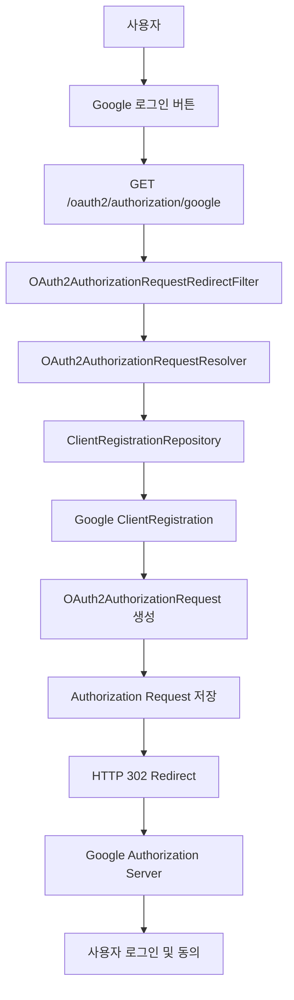

이러한 구조를 이해하면 단순히 OAuth2 로그인을 구현하는 것을 넘어 Spring Security 내부에서 어떤 작업이 수행되는지 명확하게 파악할 수 있다.

이번에는 다음 내용을 중심으로 살펴본다.

| 구분 | 주요 내용 |
|---|---|
| 개념 | OAuth2AuthorizationRequestRedirectFilter의 역할 |
| 상속 구조 | OncePerRequestFilter와의 관계 |
| 요청 처리 | doFilterInternal() |
| 요청 분석 | OAuth2AuthorizationRequestResolver |
| 등록 정보 조회 | ClientRegistrationRepository |
| 인증 요청 생성 | OAuth2AuthorizationRequest |
| 인증 상태 관리 | state와 AuthorizationRequestRepository |
| 인증 요청 저장 | HttpSessionOAuth2AuthorizationRequestRepository |
| 외부 서버 이동 | RedirectStrategy |
| 예외 처리 | ClientAuthorizationRequiredException |
| 인증 완료 연결 | OAuth2LoginAuthenticationFilter |
| 실무 활용 | 세션 문제, 동시 로그인, 프록시 및 장애 분석 |

**기준 환경은 Java 17, Spring Boot 3.2.1, Spring Security 6.2.1이다.**

---

### 개념

#### OAuth2AuthorizationRequestRedirectFilter란?

`OAuth2AuthorizationRequestRedirectFilter`는 OAuth2 Authorization Code 인증 흐름을 시작하는 Spring Security 필터다.

패키지는 다음과 같다.

```java
org.springframework.security.oauth2.client.web.OAuth2AuthorizationRequestRedirectFilter
```

이 필터의 주요 역할은 크게 네 가지다.

첫 번째는 OAuth2 로그인 시작 요청을 감지하는 것이다.

```text
/oauth2/authorization/google

/oauth2/authorization/naver
```

두 번째는 외부 인증 제공자의 ClientRegistration을 조회하는 것이다.

```text
registrationId = google
    ↓
ClientRegistrationRepository
    ↓
Google ClientRegistration
```

세 번째는 외부 인증 서버로 전달할 Authorization Request를 생성하는 것이다.

```text
client_id

response_type

redirect_uri

scope

state
```

네 번째는 생성된 인증 요청을 저장하고 외부 인증 서버로 리다이렉트하는 것이다.

```text
OAuth2AuthorizationRequest
    ↓
AuthorizationRequestRepository
    ↓
HttpSession
    ↓
HTTP 302 Redirect
    ↓
Google Authorization Server
```

즉 이 필터는 사용자를 직접 인증하는 것이 아니라 **외부 인증 서버에서 인증을 시작할 수 있도록 준비하는 역할**을 담당한다.

여기서 가장 중요한 구분은 다음과 같다.

**OAuth2AuthorizationRequestRedirectFilter는 로그인 시작을 담당한다.**

반면:

**OAuth2LoginAuthenticationFilter는 외부 인증 서버에서 돌아온 인증 결과를 처리한다.**

두 필터의 역할은 서로 다르다.

---

### OAuth2AuthorizationRequestRedirectFilter와 OAuth2LoginAuthenticationFilter 비교

OAuth2 로그인 과정에서는 두 필터가 서로 다른 시점에 동작한다.

| 구분 | OAuth2AuthorizationRequestRedirectFilter | OAuth2LoginAuthenticationFilter |
|---|---|---|
| 주요 역할 | OAuth2 인증 시작 | OAuth2 인증 결과 처리 |
| 기본 요청 경로 | `/oauth2/authorization/{registrationId}` | `/login/oauth2/code/{registrationId}` |
| 주요 입력 | registrationId | Authorization Code, state |
| ClientRegistration 조회 | 사용 | 사용 |
| Authorization Request | 생성 | 저장된 요청 조회 |
| 외부 인증 서버 이동 | 수행 | 수행하지 않음 |
| Access Token 교환 | 수행하지 않음 | AuthenticationProvider에 위임 |
| Authentication 생성 | 수행하지 않음 | 인증 결과를 Authentication으로 변환 |
| 주요 목적 | 외부 인증 시작 준비 | 외부 인증 완료 및 내부 인증 연결 |

전체 인증 흐름에서 두 필터의 위치는 다음과 같다.

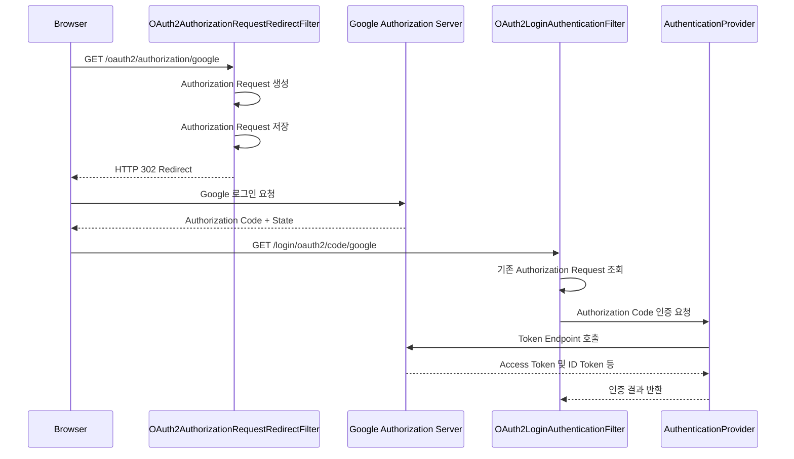

여기서 OAuth2AuthorizationRequestRedirectFilter가 실행되는 시점에는 아직 Authorization Code도 발급되지 않았다.

따라서 Access Token을 교환하거나 사용자 정보를 조회할 수도 없다.

이 필터는 외부 인증을 시작하는 데 필요한 정보를 생성하고 저장한다.

---

### 왜 사용하는가?

#### 1. 외부 인증 서버로 이동하기 위한 요청을 자동으로 생성하기 위해서

Google OAuth2 인증을 직접 구현한다면 개발자가 다음과 같은 URL을 구성해야 한다.

```text
https://accounts.google.com/o/oauth2/v2/auth
```

이 URL에는 여러 파라미터가 필요하다.

예를 들어 다음과 같다.

```text
response_type=code

client_id=GOOGLE_CLIENT_ID

redirect_uri=http://localhost:8080/login/oauth2/code/google

scope=openid profile email

state=RANDOM_STATE
```

직접 구현한다면 이러한 파라미터의 생성과 인코딩, 관리까지 고려해야 한다.

하지만 Spring Security OAuth2 Client를 사용하면 다음 경로만 호출하면 된다.

```text
/oauth2/authorization/google
```

그러면 내부적으로 OAuth2 Authorization Request를 생성한다.

이렇게 하면 개발자가 OAuth2 인증 요청을 매번 직접 조합할 필요가 없다.

#### 2. 외부 인증 제공자별 차이를 처리하기 위해서

Google과 Naver는 서로 다른 Authorization Endpoint를 사용한다.

Google은 다음 주소를 사용한다.

```text
https://accounts.google.com/o/oauth2/v2/auth
```

Naver는 다음 주소를 사용한다.

```text
https://nid.naver.com/oauth2.0/authorize
```

또한 각 제공자에서 발급받은 Client ID와 Redirect URI도 서로 다르다.

Spring Security는 이러한 정보를 `ClientRegistration`에서 조회한다.

따라서 동일한 OAuth2AuthorizationRequestRedirectFilter를 이용해 여러 인증 제공자를 지원할 수 있다.

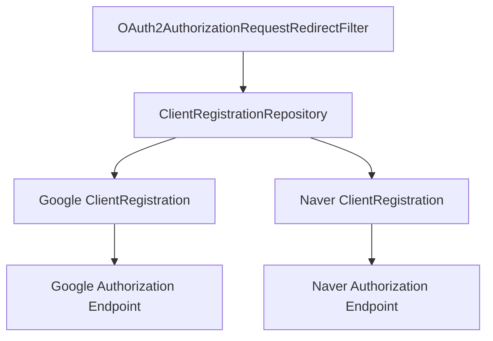

#### 3. 인증 요청과 인증 응답을 연결하기 위해서

OAuth2 인증은 하나의 HTTP 요청으로 완료되지 않는다.

사용자는 우리 서비스에서 외부 인증 서버로 이동한다.

그리고 외부 인증 서버에서 인증을 완료한 뒤 다시 우리 서비스로 돌아온다.

```text
우리 서비스
    ↓
Google
    ↓
우리 서비스
```

따라서 처음 인증을 요청했던 정보와 나중에 돌아온 응답을 연결할 수 있어야 한다.

이를 위해 `state`와 `AuthorizationRequestRepository`가 사용된다.

Spring Security는 이러한 기능을 기본적으로 제공한다.

---

### 주요 특징

#### OncePerRequestFilter 상속

OAuth2AuthorizationRequestRedirectFilter의 상속 구조를 살펴보자.

```java
public class OAuth2AuthorizationRequestRedirectFilter
        extends OncePerRequestFilter {
}
```

`OncePerRequestFilter`는 Spring Framework에서 제공하는 추상 필터 클래스다.

일반적인 요청 처리 흐름에서 필터가 중복 실행되지 않도록 지원한다.

다만 클래스 이름만 보고 하나의 HTTP 요청에 대해 모든 디스패치 상황에서 절대 한 번만 실행된다고 이해해서는 안 된다.

`OncePerRequestFilter`는 요청 속성을 이용해 필터 적용 여부를 관리하며, 비동기 및 오류 디스패치에서의 동작은 필터의 설정과 구현에 따라 달라질 수 있다.

OAuth2AuthorizationRequestRedirectFilter는 이 클래스를 상속하고 다음 메서드를 구현한다.

```java
protected void doFilterInternal(
        HttpServletRequest request,
        HttpServletResponse response,
        FilterChain filterChain
)
```

이 메서드가 OAuth2 인증 요청을 처리하는 핵심 진입점이다.

---

### OAuth2AuthorizationRequestRedirectFilter의 주요 구성요소

Spring Security 6.2.1 기준으로 필터가 사용하는 주요 구성요소를 정리하면 다음과 같다.

| 구성요소 | 기본 구현 또는 역할 |
|---|---|
| OAuth2AuthorizationRequestResolver | Authorization Request 생성 |
| AuthorizationRequestRepository | 생성된 인증 요청 저장 |
| HttpSessionOAuth2AuthorizationRequestRepository | 세션 기반 인증 요청 저장 |
| RedirectStrategy | 외부 인증 서버로 리다이렉트 |
| DefaultRedirectStrategy | 기본 리다이렉트 전략 |
| RequestCache | 필요할 때 원래 요청 저장 |
| HttpSessionRequestCache | 세션 기반 요청 캐시 |
| ThrowableAnalyzer | 예외 원인 분석 |

이 구성요소들은 하나의 필터 내부에서 서로 다른 책임을 가진다.

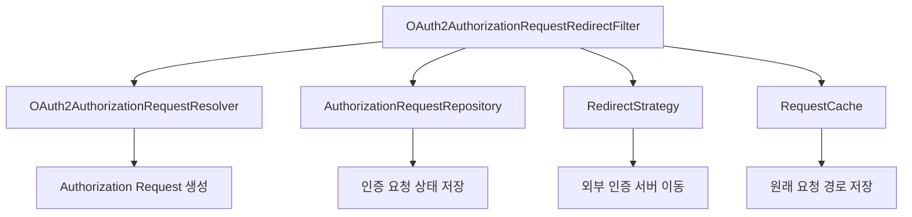

여기서 특히 다음 두 저장소를 혼동하지 않아야 한다.

```java
AuthorizationRequestRepository
```

```java
RequestCache
```

두 구성요소는 모두 HTTP 요청과 관련된 정보를 저장하지만 목적이 다르다.

AuthorizationRequestRepository는 OAuth2 인증 요청을 저장한다.

반면 RequestCache는 인증 완료 후 원래 요청으로 돌아가기 위해 HTTP 요청 정보를 저장하는 데 사용한다.

---

### OAuth2AuthorizationRequestResolver란?

OAuth2AuthorizationRequestResolver는 HTTP 요청을 분석하여 OAuth2 Authorization Request를 생성하는 인터페이스다.

대표적인 구현체는 다음과 같다.

```java
DefaultOAuth2AuthorizationRequestResolver
```

패키지는 다음과 같다.

```java
org.springframework.security.oauth2.client.web.DefaultOAuth2AuthorizationRequestResolver
```

이 클래스는 기본적으로 다음 패턴을 처리한다.

```text
/oauth2/authorization/{registrationId}
```

예를 들어 다음 요청이 발생했다고 생각해보자.

```http
GET /oauth2/authorization/google HTTP/1.1
Host: localhost:8080
```

DefaultOAuth2AuthorizationRequestResolver는 요청에서 다음 값을 추출한다.

```text
registrationId = google
```

이후 ClientRegistrationRepository에 조회를 요청한다.

```java
ClientRegistration registration =
        clientRegistrationRepository
                .findByRegistrationId("google");
```

조회한 ClientRegistration을 이용해 Authorization Request를 생성한다.

전체 흐름은 다음과 같다.

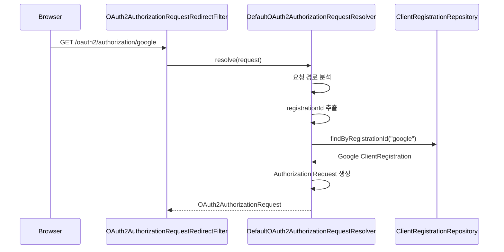

여기서 중요한 것은 OAuth2AuthorizationRequestRedirectFilter가 모든 인증 요청 파라미터를 직접 생성하는 것은 아니라는 사실이다.

실제 Authorization Request 구성은 Resolver에 위임한다.

**Filter는 인증 시작 흐름을 제어하고, Resolver는 인증 요청 객체를 구성한다.**

---

### OAuth2AuthorizationRequest란?

`OAuth2AuthorizationRequest`는 외부 인증 서버에 전달할 OAuth2 Authorization Request 정보를 표현하는 객체다.

주요 정보는 다음과 같다.

```text
OAuth2AuthorizationRequest
    │
    ├── authorizationUri
    │
    ├── authorizationGrantType
    │
    ├── responseType
    │
    ├── clientId
    │
    ├── redirectUri
    │
    ├── scopes
    │
    ├── state
    │
    ├── additionalParameters
    │
    └── attributes
```

각 항목의 의미는 다음과 같다.

| 항목 | 역할 |
|---|---|
| authorizationUri | 외부 인증 서버의 Authorization Endpoint |
| authorizationGrantType | Authorization Code 등의 인가 방식 |
| responseType | 응답 형태 |
| clientId | 외부 인증 제공자가 발급한 Client ID |
| redirectUri | 인증 완료 후 돌아올 주소 |
| scopes | 요청할 권한 범위 |
| state | 인증 요청과 응답을 연결하는 값 |
| additionalParameters | 인증 제공자별 추가 파라미터 |
| attributes | 서버 내부에서 사용할 부가 정보 |

여기서 `additionalParameters`와 `attributes`는 구분해야 한다.

`additionalParameters`에는 외부 인증 서버로 전달할 추가 파라미터가 포함될 수 있다.

반면 `attributes`에는 Spring Security가 인증 처리 과정에서 사용할 내부 정보가 포함될 수 있다.

예를 들어 `registrationId`는 인증 요청의 내부 속성으로 관리된다.

이후 OAuth2LoginAuthenticationFilter가 인증 요청을 복원할 때 이 값을 활용할 수 있다.

---

### OAuth2AuthorizationRequest 생성 과정

Google ClientRegistration이 조회되었다고 생각해보자.

다음과 같은 설정을 가지고 있다.

```text
registrationId = google

clientId = GOOGLE_CLIENT_ID

authorizationUri = https://accounts.google.com/o/oauth2/v2/auth

redirectUri = {baseUrl}/login/oauth2/code/{registrationId}

scope = openid, profile, email
```

DefaultOAuth2AuthorizationRequestResolver는 이러한 정보를 이용해 Authorization Request를 생성한다.

개념적으로 다음과 같은 구조다.

```java
OAuth2AuthorizationRequest authorizationRequest =
        OAuth2AuthorizationRequest.authorizationCode()
                .clientId(clientRegistration.getClientId())
                .authorizationUri(
                        clientRegistration.getProviderDetails()
                                .getAuthorizationUri()
                )
                .redirectUri(
                        "http://localhost:8080/login/oauth2/code/google"
                )
                .scopes(clientRegistration.getScopes())
                .state("generated-state")
                .build();
```

위 코드는 주요 필드의 관계를 설명하기 위한 재구성 예제다.

실제 Spring Security는 state를 안전한 난수 생성기로 생성하고, Redirect URI 템플릿을 현재 요청 환경에 맞춰 확장한다.

또한 인증 제공자와 클라이언트 설정에 따라 OIDC의 nonce 또는 PKCE 관련 정보가 추가될 수 있다.

생성된 Authorization Request는 최종적으로 외부 인증 서버에 전달할 URL로 변환된다.

예를 들어 다음과 같은 형태다.

```text
https://accounts.google.com/o/oauth2/v2/auth
    ?response_type=code
    &client_id=GOOGLE_CLIENT_ID
    &redirect_uri=http://localhost:8080/login/oauth2/code/google
    &scope=openid%20profile%20email
    &state=RANDOM_STATE
```

실제 요청에서는 하나의 URL로 결합되며 필요한 부분이 URL 인코딩된다.

여기서 중요한 점은 Authorization Request 생성 시 Client Secret이 브라우저의 Authorization URL에 포함되지 않는다는 것이다.

Client Secret은 이후 서버가 Token Endpoint와 통신할 때 클라이언트 인증에 사용될 수 있다.

---

### doFilterInternal() 내부 동작

이제 OAuth2AuthorizationRequestRedirectFilter의 핵심 메서드를 살펴보자.

```java
doFilterInternal()
```

Spring Security 6.2.1 구현을 기준으로 주요 흐름을 정리하면 다음과 같다.

```text
doFilterInternal(request, response, filterChain)
    │
    ├── authorizationRequestResolver.resolve(request)
    │
    ├── Authorization Request 존재?
    │       │
    │       ├── Yes
    │       │    ↓
    │       │  sendRedirectForAuthorization()
    │       │    ↓
    │       │  return
    │       │
    │       └── No
    │            ↓
    │          filterChain.doFilter()
    │
    └── 특정 예외 발생 시
            ↓
        ClientAuthorizationRequiredException 확인
            ↓
        Authorization Request 재구성
            ↓
        필요 시 RequestCache 저장
            ↓
        외부 인증 서버로 Redirect
```

여기서 두 가지 처리 경로가 존재한다는 점이 중요하다.

첫 번째는 `/oauth2/authorization/google`처럼 OAuth2 인증 시작 경로로 직접 요청한 경우다.

두 번째는 필터 체인의 후속 처리 중 OAuth2 Client 인가가 필요하다는 예외가 발생한 경우다.

두 경로를 구분해서 살펴보자.

---

### 1. OAuth2 인증 시작 요청 확인

사용자가 다음 주소에 접근한다.

```text
/oauth2/authorization/google
```

그러면 필터는 Resolver에 요청을 전달한다.

```java
authorizationRequestResolver.resolve(request);
```

Resolver는 요청 경로가 OAuth2 인증 시작 패턴에 해당하는지 확인한다.

기본 패턴은 다음과 같다.

```text
/oauth2/authorization/{registrationId}
```

요청이 해당 패턴과 일치하면 registrationId를 추출하고 ClientRegistration을 조회한다.

그리고 OAuth2AuthorizationRequest를 생성한다.

필터는 반환된 Authorization Request가 존재하면 외부 인증을 시작하기 위한 리다이렉트를 수행한다.

```text
OAuth2AuthorizationRequest 존재
    ↓
sendRedirectForAuthorization()
    ↓
HTTP 302 Redirect
```

이 경우 해당 요청에 대해 후속 필터 체인을 계속 실행하지 않고 처리를 종료한다.

즉 OAuth2 로그인 시작 요청은 일반적인 Controller까지 전달되지 않는다.

---

### 2. OAuth2 인증 시작 요청이 아닌 경우

이번에는 다음 요청이 발생했다고 생각해보자.

```http
GET /my HTTP/1.1
Host: localhost:8080
```

이 요청은 기본 OAuth2 인증 시작 패턴과 일치하지 않는다.

따라서 Resolver는 처리할 Authorization Request를 생성하지 않는다.

이 경우 필터는 다음 단계로 요청을 전달한다.

```java
filterChain.doFilter(request, response);
```

이때 중요한 점은 OAuth2AuthorizationRequestRedirectFilter가 모든 요청을 외부 인증 서버로 이동시키는 것은 아니라는 사실이다.

**OAuth2 인증을 시작해야 하는 요청에 대해서만 직접 리다이렉트를 수행한다.**

일반적인 요청은 다음 필터로 전달한다.

또한 `/my`에 접근한 미인증 사용자가 `/login`으로 이동하는 흐름은 일반적으로 `ExceptionTranslationFilter`와 `AuthenticationEntryPoint`가 담당한다.

이것을 OAuth2AuthorizationRequestRedirectFilter의 직접적인 동작과 혼동하면 안 된다.

---

### 3. ClientAuthorizationRequiredException 처리

OAuth2AuthorizationRequestRedirectFilter에는 또 다른 처리 경로가 존재한다.

바로 다음 예외를 처리하는 부분이다.

```java
ClientAuthorizationRequiredException
```

이 예외는 OAuth2 Client를 이용한 특정 작업을 수행하려고 했지만 필요한 인가가 존재하지 않는 상황에서 발생할 수 있다.

예를 들어 OAuth2AuthorizedClient를 필요로 하는 기능에서 사용자의 추가 인가가 요구되는 경우를 생각할 수 있다.

이때 인증 요청을 시작해야 한다는 사실을 예외를 통해 전달할 수 있다.

개념적인 흐름은 다음과 같다.

```text
일반 HTTP 요청
    ↓
후속 필터 또는 애플리케이션 처리
    ↓
OAuth2 Client 인가 필요
    ↓
ClientAuthorizationRequiredException
    ↓
OAuth2AuthorizationRequestRedirectFilter
    ↓
OAuth2AuthorizationRequestResolver
    ↓
Authorization Request 생성
    ↓
원래 요청 저장
    ↓
외부 인증 서버로 Redirect
```

이 경로에서는 일반적인 로그인 버튼 클릭과 달리 원래 접근하려던 요청을 저장하는 작업이 중요할 수 있다.

따라서 필터는 RequestCache를 이용할 수 있다.

```java
requestCache.saveRequest(request, response);
```

다만 이 메서드는 **모든 OAuth2 로그인 시작 요청에서 무조건 호출되는 것이 아니다.**

필터 체인 처리 중 ClientAuthorizationRequiredException이 발생하고 이를 처리하는 경우에 사용된다.

이 차이를 이해해야 한다.

---

### RequestCache란?

RequestCache는 인증이 필요한 상황에서 원래 HTTP 요청을 저장하기 위한 구성요소다.

기본적인 세션 기반 구현체는 다음과 같다.

```java
HttpSessionRequestCache
```

예를 들어 사용자가 특정 경로에 접근하려고 했다고 생각해보자.

```text
GET /orders
```

그런데 해당 작업을 수행하려면 OAuth2 Client 인가가 필요하다.

이 경우 요청을 저장한 뒤 외부 인증 서버로 이동시킬 수 있다.

```text
GET /orders
    ↓
OAuth2 Client 인가 필요
    ↓
RequestCache
    ↓
원래 요청 저장
    ↓
OAuth2 인증 시작
    ↓
인가 완료
    ↓
원래 요청으로 복귀
```

물론 인증 완료 이후 어느 경로로 돌아갈지는 SuccessHandler와 RequestCache 설정에 따라 달라질 수 있다.

여기서 중요한 것은 RequestCache가 외부 OAuth2 인증 요청을 저장하는 저장소와 다르다는 점이다.

---

### AuthorizationRequestRepository란?

AuthorizationRequestRepository는 생성된 OAuth2AuthorizationRequest를 저장하고 조회하는 인터페이스다.

인증 요청을 저장하는 목적은 나중에 외부 인증 서버에서 돌아온 응답을 원래 인증 요청과 연결하기 위해서다.

예를 들어 다음과 같은 흐름이다.

```text
우리 서비스에서 OAuth2 인증 시작
    ↓
Authorization Request 생성
    ↓
AuthorizationRequestRepository 저장
    ↓
Google 로그인
    ↓
Authorization Code + State 반환
    ↓
AuthorizationRequestRepository 조회
    ↓
이전 인증 요청 확인
```

여기서 중요한 정보는 `state`다.

Spring Security는 처음 생성한 Authorization Request를 저장하고, 이후 Callback에서 전달받은 state를 이용해 해당 요청과 연결한다.

이렇게 하면 전혀 관계없는 인증 응답을 현재 사용자의 로그인 흐름으로 처리하는 위험을 줄일 수 있다.

---

### HttpSessionOAuth2AuthorizationRequestRepository란?

Spring Security는 기본적으로 다음 구현체를 제공한다.

```java
HttpSessionOAuth2AuthorizationRequestRepository
```

이 클래스는 OAuth2AuthorizationRequest를 HttpSession에 저장한다.

패키지는 다음과 같다.

```java
org.springframework.security.oauth2.client.web.HttpSessionOAuth2AuthorizationRequestRepository
```

대표적인 메서드는 다음과 같다.

| 메서드 | 역할 |
|---|---|
| saveAuthorizationRequest() | 인증 요청 저장 |
| loadAuthorizationRequest() | 인증 요청 조회 |
| removeAuthorizationRequest() | 인증 요청 제거 |

이 클래스는 Spring Security 6.2.1에서 기본적으로 HttpSession의 속성을 이용해 OAuth2AuthorizationRequest를 관리한다.

즉 다음과 같은 구조다.

```text
HttpSession
    │
    └── OAuth2AuthorizationRequest
          │
          ├── clientId
          ├── redirectUri
          ├── scopes
          ├── state
          └── attributes
```

이 저장소는 로그인 완료 후 Authentication을 보관하는 SecurityContextRepository와는 목적이 다르다.

---

### OAuth2 인증 요청을 왜 세션에 저장할까?

OAuth2 Authorization Code 인증 과정은 여러 HTTP 요청에 걸쳐 진행된다.

처음 요청은 다음과 같다.

```text
GET /oauth2/authorization/google
```

이후 사용자는 Google로 이동한다.

그리고 인증이 완료되면 다음 요청으로 돌아온다.

```text
GET /login/oauth2/code/google?code=...&state=...
```

즉 서로 다른 HTTP 요청이다.

서버는 첫 번째 요청에서 생성한 인증 정보를 두 번째 요청에서도 확인할 수 있어야 한다.

이를 위해 HttpSession을 사용할 수 있다.

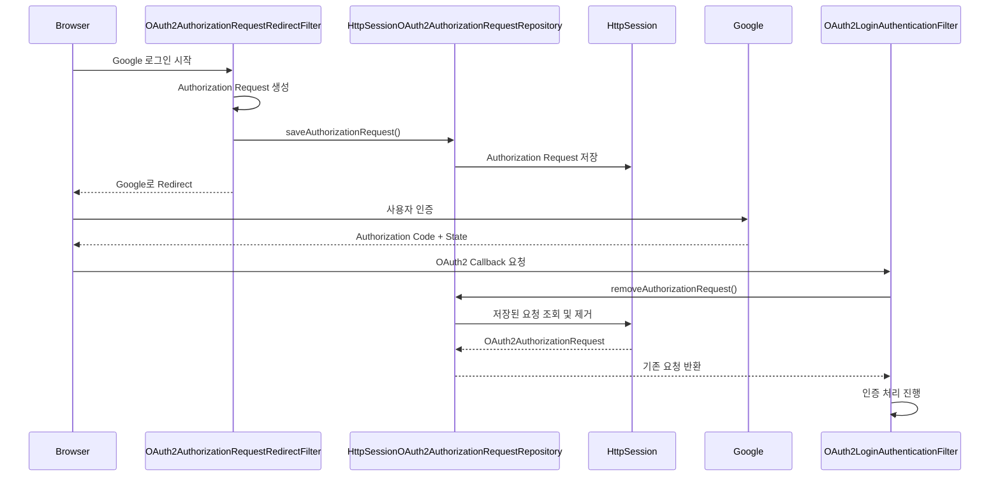

이 구조에서 브라우저는 세션 쿠키를 유지해야 한다.

외부 인증 서버에서 돌아왔을 때 동일한 세션에 접근할 수 있어야 이전에 저장한 Authorization Request를 찾을 수 있기 때문이다.

따라서 OAuth2 로그인 시작 시점의 세션과 Callback 시점의 세션이 서로 달라지면 인증에 실패할 수 있다.

---

### State란?

OAuth2의 state는 인증 요청과 응답을 연결하기 위해 사용하는 값이다.

예를 들어 다음과 같은 인증 요청이 생성되었다고 생각해보자.

```text
state = abc123
```

Spring Security는 이 값을 Authorization Request에 포함한다.

```text
OAuth2AuthorizationRequest
    ↓
state = abc123
```

그리고 외부 인증 서버로 요청할 때 state를 함께 전달한다.

```http
GET /o/oauth2/v2/auth?...&state=abc123 HTTP/1.1
Host: accounts.google.com
```

Google은 인증 완료 후 해당 값을 다시 전달한다.

```http
GET /login/oauth2/code/google?code=AUTH_CODE&state=abc123
```

Spring Security는 이전에 저장한 Authorization Request를 조회하고 state가 일치하는지 확인한다.

```text
저장된 state
    ↓
abc123
```

```text
Callback state
    ↓
abc123
```

두 값이 일치한다면 이전 인증 요청과 연결할 수 있다.

하지만 다음과 같이 값이 다르다면 문제가 발생한다.

```text
저장된 state = abc123

Callback state = xyz789
```

이 경우 정상적인 요청으로 처리할 수 없다.

#### State와 CSRF 보호

OAuth2 인증에서 state는 로그인 과정의 CSRF 및 요청 혼동 문제를 방어하는 데 중요한 역할을 한다.

공격자가 임의로 생성한 인증 결과를 다른 사용자의 로그인 과정에 연결하는 것을 막는 데 도움이 된다.

따라서 OAuth2 인증 요청을 직접 커스터마이징할 때 state를 제거하거나 고정된 값으로 변경해서는 안 된다.

또한 state를 세션에 저장하는 구조라면 Callback에서 동일한 브라우저 세션이 유지되는지도 중요하다.

---

### sendRedirectForAuthorization() 내부 동작

이제 필터의 핵심 메서드인 다음 메서드를 살펴보자.

```java
sendRedirectForAuthorization()
```

이 메서드는 생성된 OAuth2AuthorizationRequest를 이용해 실제 외부 인증 서버로 이동시키는 작업을 담당한다.

Spring Security 6.2.1 기준 핵심 처리 순서는 다음과 같다.

```text
sendRedirectForAuthorization()
    ↓
Authorization Grant Type 확인
    ↓
AUTHORIZATION_CODE 여부 확인
    ↓
AuthorizationRequestRepository 저장
    ↓
RedirectStrategy 호출
    ↓
Authorization Request URI로 이동
```

중요한 점은 **리다이렉트하기 전에 Authorization Request를 먼저 저장한다는 사실**이다.

왜 이러한 순서로 처리할까?

외부 인증 서버에서 인증을 완료한 뒤 다시 돌아왔을 때 기존 인증 요청을 확인해야 하기 때문이다.

만약 Authorization Request를 저장하지 않고 바로 리다이렉트한다면 Callback 처리 시 이전 인증 요청을 찾을 수 없을 수 있다.

따라서 다음 순서가 중요하다.

```text
Authorization Request 생성
    ↓
Authorization Request 저장
    ↓
외부 인증 서버로 이동
```

이러한 구조를 이해하면 OAuth2 로그인에서 세션이 필요한 이유도 자연스럽게 연결된다.

---

### RedirectStrategy란?

RedirectStrategy는 HTTP 리다이렉트를 수행하기 위한 Spring Security 인터페이스다.

대표적인 구현체는 다음과 같다.

```java
DefaultRedirectStrategy
```

OAuth2AuthorizationRequestRedirectFilter는 RedirectStrategy를 이용해 외부 인증 서버로 이동하도록 응답한다.

개념적인 동작은 다음과 같다.

```text
Authorization Request URI
    ↓
RedirectStrategy
    ↓
HTTP 302 Found
    ↓
Location 헤더
    ↓
브라우저 이동
```

예를 들어 다음과 같은 HTTP 응답이 발생할 수 있다.

```http
HTTP/1.1 302 Found
Location: https://accounts.google.com/o/oauth2/v2/auth?response_type=code&...
```

여기서 중요한 점이 있다.

Spring Boot 서버가 Google의 로그인 화면을 직접 반환하는 것이 아니다.

우리 서버는 브라우저에 **Google 인증 서버로 이동하라는 HTTP Redirect 응답**을 반환한다.

브라우저는 해당 응답의 Location 헤더를 확인하고 Google 인증 서버에 새로운 요청을 전송한다.

즉 다음과 같은 흐름이다.

```text
Browser
    ↓
Spring Boot
    ↓
HTTP 302
    ↓
Browser
    ↓
Google Authorization Server
```

이후 실제 사용자 인증은 Google에서 진행된다.

---

### 구조

#### OAuth2AuthorizationRequestRedirectFilter 전체 동작 흐름

지금까지 내용을 하나의 시퀀스 다이어그램으로 정리해보자.

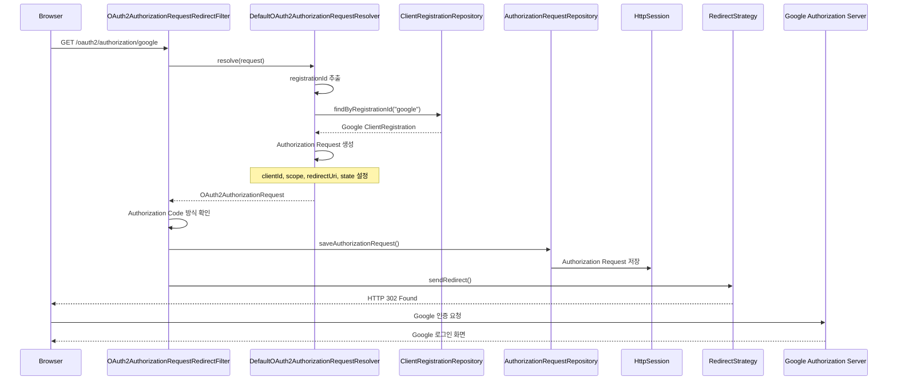

이 다이어그램에서 중요한 작업은 다음과 같다.

첫째, OAuth2AuthorizationRequestRedirectFilter가 요청을 받는다.

둘째, DefaultOAuth2AuthorizationRequestResolver가 요청 경로에서 registrationId를 추출한다.

셋째, ClientRegistrationRepository에서 Google 등록 정보를 조회한다.

넷째, 해당 정보를 이용해 OAuth2AuthorizationRequest를 생성한다.

다섯째, AuthorizationRequestRepository가 인증 요청을 저장한다.

여섯째, RedirectStrategy가 외부 인증 서버로 이동시킨다.

이렇게 하면 OAuth2 인증의 첫 단계가 완료된다.

하지만 아직 사용자가 로그인한 상태는 아니다.

실제 Authentication이 생성되는 과정은 외부 인증 서버에서 Authorization Code를 전달한 이후에 진행된다.

---

### HttpSession에 저장되는 인증 요청과 로그인 정보를 구분하자

이번 구조에서 반드시 이해해야 할 부분은 **HttpSession을 사용한다고 해서 모든 세션 데이터가 동일한 목적을 가진 것은 아니라는 점**이다.

OAuth2 인증 요청을 시작할 때는 Authorization Request를 저장한다.

```text
HttpSession
    ↓
OAuth2AuthorizationRequest
```

반면 OAuth2 로그인에 성공한 이후에는 SecurityContext를 저장할 수 있다.

```text
HttpSession
    ↓
SecurityContext
    ↓
Authentication
```

두 데이터의 차이는 다음과 같다.

| 구분 | OAuth2AuthorizationRequest | SecurityContext |
|---|---|---|
| 목적 | 외부 인증 요청과 Callback 연결 | 로그인 상태 유지 |
| 생성 시점 | OAuth2 로그인 시작 | 인증 성공 |
| 주요 정보 | state, redirectUri, clientId 등 | Authentication |
| 저장 주체 | AuthorizationRequestRepository | SecurityContextRepository |
| 사용 시점 | OAuth2 Callback 처리 | 인증된 사용자 요청 |
| 생명주기 | OAuth2 인증 처리 중 | 로그인 세션 유지 중 |

따라서 두 데이터를 혼동하면 안 된다.

OAuth2AuthorizationRequest가 HttpSession에 저장되었다고 해서 사용자가 이미 로그인에 성공한 것은 아니다.

로그인 성공 여부는 최종적으로 Spring Security Authentication이 생성되고 인증 상태가 저장되었는지 확인해야 한다.

---

### OAuth2LoginAuthenticationFilter와의 연결

OAuth2AuthorizationRequestRedirectFilter는 외부 인증 요청을 시작한다.

이후 사용자가 Google에서 로그인을 완료하면 Callback 요청이 발생한다.

예를 들어 다음과 같다.

```http
GET /login/oauth2/code/google?code=AUTH_CODE&state=RANDOM_STATE HTTP/1.1
Host: localhost:8080
```

이 요청은 OAuth2LoginAuthenticationFilter가 처리한다.

처리 과정에서 중요한 부분은 이전에 저장한 Authorization Request를 가져오는 것이다.

```text
Callback 요청 수신
    ↓
state 확인
    ↓
AuthorizationRequestRepository 조회
    ↓
저장된 OAuth2AuthorizationRequest 확인
    ↓
ClientRegistration 조회
    ↓
AuthenticationManager 인증 요청
```

Spring Security 6.2.1의 OAuth2LoginAuthenticationFilter는 AuthorizationRequestRepository에서 기존 인증 요청을 조회하고 제거하는 처리를 수행한다.

이후 해당 요청에 저장된 registrationId를 이용해 ClientRegistration을 조회한다.

그리고 Authorization Code를 이용한 인증 처리를 AuthenticationManager에 위임한다.

전체 구조는 다음과 같다.

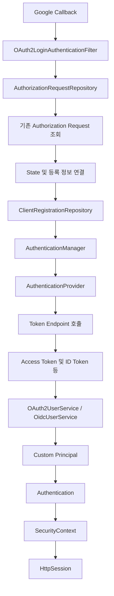

여기서 이전에 저장한 Authorization Request를 찾지 못한다면 정상적인 OAuth2 인증 처리를 계속할 수 없다.

이것이 세션 저장소와 state 관리가 중요한 이유다.

---

### 예제

#### 1. 기존 ClientRegistrationRepository 활용하기

앞서 Google과 Naver의 ClientRegistration을 직접 구성했다.

예를 들어 다음과 같다.

```java
@Bean
public ClientRegistrationRepository clientRegistrationRepository() {

    ClientRegistration google =
            socialClientRegistration.googleClientRegistration();

    ClientRegistration naver =
            socialClientRegistration.naverClientRegistration();

    return new InMemoryClientRegistrationRepository(
            google,
            naver
    );
}
```

OAuth2AuthorizationRequestRedirectFilter는 이 Repository를 이용해 등록 정보를 조회할 수 있다.

Google 로그인 요청이라면 다음 값이 사용된다.

```text
registrationId = google
```

Naver 로그인 요청이라면 다음 값이 사용된다.

```text
registrationId = naver
```

이러한 방식으로 여러 인증 제공자를 동일한 필터에서 처리한다.

---

### 2. SecurityConfig에서 Authorization Endpoint 설정하기

OAuth2AuthorizationRequestRedirectFilter를 사용하기 위해 개발자가 필터를 직접 생성할 필요는 없다.

일반적인 Spring Security OAuth2 Login 설정에서는 필요한 필터가 자동으로 구성된다.

```java
.oauth2Login(oauth2 -> oauth2
        .loginPage("/login")
)
```

다만 Authorization Request의 처리 방식을 변경하고 싶다면 `authorizationEndpoint()`를 통해 관련 설정을 지정할 수 있다.

예를 들어 다음과 같다.

```java
.oauth2Login(oauth2 -> oauth2

        .loginPage("/login")

        .authorizationEndpoint(authorization -> authorization

                .baseUri("/oauth2/authorization")
        )
)
```

여기서 다음 설정은 OAuth2 로그인 시작 경로의 기본 URI를 지정한다.

```java
.baseUri("/oauth2/authorization")
```

따라서 다음 패턴을 사용한다.

```text
/oauth2/authorization/{registrationId}
```

Google은 다음과 같다.

```text
/oauth2/authorization/google
```

Naver는 다음과 같다.

```text
/oauth2/authorization/naver
```

기본 경로를 그대로 사용한다면 해당 설정을 명시할 필요는 없다.

---

### 3. Authorization Request 저장소 명시적으로 등록하기

기본적으로 HttpSessionOAuth2AuthorizationRequestRepository를 사용할 수 있다.

필요하다면 직접 Bean을 생성하고 SecurityConfig에 등록할 수도 있다.

```java
package com.example.oauth2session.config;

import org.springframework.context.annotation.Bean;
import org.springframework.context.annotation.Configuration;

import org.springframework.security.oauth2.client.web.AuthorizationRequestRepository;
import org.springframework.security.oauth2.client.web.HttpSessionOAuth2AuthorizationRequestRepository;

import org.springframework.security.oauth2.core.endpoint.OAuth2AuthorizationRequest;

@Configuration
public class OAuth2AuthorizationRequestConfig {

    @Bean
    public AuthorizationRequestRepository<OAuth2AuthorizationRequest>
    authorizationRequestRepository() {

        return new HttpSessionOAuth2AuthorizationRequestRepository();
    }
}
```

그리고 SecurityConfig에서 주입받아 사용한다.

```java
package com.example.oauth2session.config;

import com.example.oauth2session.service.CustomOAuth2UserService;
import com.example.oauth2session.service.CustomOidcUserService;

import org.springframework.context.annotation.Bean;
import org.springframework.context.annotation.Configuration;

import org.springframework.security.config.annotation.web.builders.HttpSecurity;
import org.springframework.security.config.annotation.web.configurers.AbstractHttpConfigurer;

import org.springframework.security.oauth2.client.web.AuthorizationRequestRepository;
import org.springframework.security.oauth2.core.endpoint.OAuth2AuthorizationRequest;

import org.springframework.security.web.SecurityFilterChain;

@Configuration
public class SecurityConfig {

    private final CustomOAuth2UserService customOAuth2UserService;
    private final CustomOidcUserService customOidcUserService;

    private final AuthorizationRequestRepository<OAuth2AuthorizationRequest>
            authorizationRequestRepository;

    public SecurityConfig(
            CustomOAuth2UserService customOAuth2UserService,
            CustomOidcUserService customOidcUserService,
            AuthorizationRequestRepository<OAuth2AuthorizationRequest>
                    authorizationRequestRepository
    ) {

        this.customOAuth2UserService = customOAuth2UserService;
        this.customOidcUserService = customOidcUserService;

        this.authorizationRequestRepository =
                authorizationRequestRepository;
    }

    @Bean
    public SecurityFilterChain securityFilterChain(
            HttpSecurity http
    ) throws Exception {

        http
                .formLogin(AbstractHttpConfigurer::disable)

                .httpBasic(AbstractHttpConfigurer::disable)

                .oauth2Login(oauth2 -> oauth2

                        .loginPage("/login")

                        .authorizationEndpoint(authorization -> authorization

                                .baseUri("/oauth2/authorization")

                                .authorizationRequestRepository(
                                        authorizationRequestRepository
                                )
                        )

                        .userInfoEndpoint(userInfo -> userInfo

                                .userService(customOAuth2UserService)

                                .oidcUserService(customOidcUserService)
                        )
                )

                .authorizeHttpRequests(auth -> auth

                        .requestMatchers(
                                "/",
                                "/login",
                                "/error",
                                "/css/**",
                                "/oauth2/authorization/**",
                                "/login/oauth2/code/**"
                        ).permitAll()

                        .anyRequest().authenticated()
                );

        return http.build();
    }
}
```

이 코드에서 중요한 부분은 다음과 같다.

```java
.authorizationRequestRepository(
        authorizationRequestRepository
)
```

이 설정을 통해 OAuth2 Authorization Request를 저장하고 조회할 Repository를 지정한다.

주의할 점은 이 설정이 로그인 성공 후 SecurityContext를 저장하는 Repository를 변경하는 것은 아니라는 사실이다.

AuthorizationRequestRepository는 OAuth2 인증 요청을 관리한다.

SecurityContextRepository는 인증된 사용자의 SecurityContext를 관리한다.

따라서 두 저장소는 서로 다른 역할을 담당한다.

---

### 4. DefaultOAuth2AuthorizationRequestResolver 직접 사용하기

이번에는 Authorization Request를 생성하는 Resolver를 직접 사용해보자.

이 예제는 실제 외부 인증 서버와 통신하지 않는다.

ClientRegistration을 이용해 Authorization Request가 어떻게 생성되는지 확인하는 용도다.

먼저 Google ClientRegistration을 생성한다.

```java
ClientRegistration google =
        CommonOAuth2Provider.GOOGLE
                .getBuilder("google")
                .clientId("test-google-client-id")
                .clientSecret("test-google-client-secret")
                .redirectUri(
                        "{baseUrl}/login/oauth2/code/{registrationId}"
                )
                .scope(
                        "openid",
                        "profile",
                        "email"
                )
                .build();
```

그리고 Repository를 생성한다.

```java
ClientRegistrationRepository repository =
        new InMemoryClientRegistrationRepository(google);
```

이제 Resolver를 생성한다.

```java
DefaultOAuth2AuthorizationRequestResolver resolver =
        new DefaultOAuth2AuthorizationRequestResolver(
                repository,
                "/oauth2/authorization"
        );
```

Resolver는 요청 경로를 분석하고 등록 정보를 이용해 Authorization Request를 생성한다.

---

### 5. Authorization Request 생성 테스트

다음 테스트에서는 Google OAuth2 로그인 시작 요청에 대한 Authorization Request가 정상적으로 생성되는지 확인한다.

```java
package com.example.oauth2session;

import org.junit.jupiter.api.Test;

import org.springframework.mock.web.MockHttpServletRequest;

import org.springframework.security.config.oauth2.client.CommonOAuth2Provider;

import org.springframework.security.oauth2.client.registration.ClientRegistration;
import org.springframework.security.oauth2.client.registration.ClientRegistrationRepository;
import org.springframework.security.oauth2.client.registration.InMemoryClientRegistrationRepository;

import org.springframework.security.oauth2.client.web.DefaultOAuth2AuthorizationRequestResolver;

import org.springframework.security.oauth2.core.endpoint.OAuth2AuthorizationRequest;

import static org.junit.jupiter.api.Assertions.*;

class OAuth2AuthorizationRequestResolverTest {

    @Test
    void 구글_로그인_요청으로_AuthorizationRequest를_생성한다() {

        // Google ClientRegistration 생성
        ClientRegistration google =
                CommonOAuth2Provider.GOOGLE
                        .getBuilder("google")
                        .clientId("test-google-client-id")
                        .clientSecret("test-google-client-secret")
                        .redirectUri(
                                "{baseUrl}/login/oauth2/code/{registrationId}"
                        )
                        .scope(
                                "openid",
                                "profile",
                                "email"
                        )
                        .build();

        // ClientRegistrationRepository 생성
        ClientRegistrationRepository repository =
                new InMemoryClientRegistrationRepository(google);

        // Authorization Request Resolver 생성
        DefaultOAuth2AuthorizationRequestResolver resolver =
                new DefaultOAuth2AuthorizationRequestResolver(
                        repository,
                        "/oauth2/authorization"
                );

        // HTTP 요청 구성
        MockHttpServletRequest request =
                new MockHttpServletRequest(
                        "GET",
                        "/oauth2/authorization/google"
                );

        request.setScheme("http");
        request.setServerName("localhost");
        request.setServerPort(8080);

        request.setServletPath(
                "/oauth2/authorization/google"
        );

        // Authorization Request 생성
        OAuth2AuthorizationRequest authorizationRequest =
                resolver.resolve(request);

        // 생성 여부 검증
        assertNotNull(authorizationRequest);

        // Client ID 확인
        assertEquals(
                "test-google-client-id",
                authorizationRequest.getClientId()
        );

        // Redirect URI 확인
        assertEquals(
                "http://localhost:8080/login/oauth2/code/google",
                authorizationRequest.getRedirectUri()
        );

        // Scope 확인
        assertTrue(
                authorizationRequest.getScopes().contains("openid")
        );

        assertTrue(
                authorizationRequest.getScopes().contains("profile")
        );

        assertTrue(
                authorizationRequest.getScopes().contains("email")
        );

        // State 생성 여부 확인
        assertNotNull(
                authorizationRequest.getState()
        );

        assertFalse(
                authorizationRequest.getState().isBlank()
        );

        // Authorization Request URI 확인
        assertTrue(
                authorizationRequest
                        .getAuthorizationRequestUri()
                        .startsWith(
                                "https://accounts.google.com/o/oauth2/v2/auth"
                        )
        );
    }
}
```

이 테스트를 통해 다음 내용을 확인할 수 있다.

| 검증 항목 | 기대 결과 |
|---|---|
| Authorization Request 생성 | 성공 |
| Client ID | ClientRegistration 값 사용 |
| Redirect URI | 실제 요청 주소를 기준으로 확장 |
| Scope | 등록된 Scope 반영 |
| State | 비어 있지 않은 값 생성 |
| Authorization URI | Google Authorization Endpoint 사용 |

이 테스트는 인증 시작 요청의 생성 과정을 검증한다.

따라서 실제 Google 계정으로 로그인할 필요는 없다.

---

### 6. HttpSessionOAuth2AuthorizationRequestRepository 테스트

이번에는 Authorization Request를 세션에 저장하고 다시 조회하는 과정을 검증해보자.

핵심은 다음과 같다.

```text
Authorization Request 생성
    ↓
HttpSession 저장
    ↓
Callback 요청 구성
    ↓
state 전달
    ↓
기존 Authorization Request 조회
    ↓
인증 요청 제거
```

테스트 코드는 다음과 같다.

```java
package com.example.oauth2session;

import org.junit.jupiter.api.Test;

import org.springframework.mock.web.MockHttpServletRequest;
import org.springframework.mock.web.MockHttpServletResponse;
import org.springframework.mock.web.MockHttpSession;

import org.springframework.security.oauth2.client.web.HttpSessionOAuth2AuthorizationRequestRepository;

import org.springframework.security.oauth2.core.endpoint.OAuth2AuthorizationRequest;

import static org.junit.jupiter.api.Assertions.*;

class AuthorizationRequestRepositoryTest {

    @Test
    void AuthorizationRequest를_세션에_저장하고_조회한다() {

        HttpSessionOAuth2AuthorizationRequestRepository repository =
                new HttpSessionOAuth2AuthorizationRequestRepository();

        // Authorization Request 생성
        OAuth2AuthorizationRequest authorizationRequest =
                OAuth2AuthorizationRequest.authorizationCode()
                        .authorizationUri(
                                "https://accounts.google.com/o/oauth2/v2/auth"
                        )
                        .clientId("test-client-id")
                        .redirectUri(
                                "http://localhost:8080/login/oauth2/code/google"
                        )
                        .state("test-state")
                        .build();

        // 최초 로그인 요청
        MockHttpServletRequest loginRequest =
                new MockHttpServletRequest(
                        "GET",
                        "/oauth2/authorization/google"
                );

        MockHttpServletResponse loginResponse =
                new MockHttpServletResponse();

        // Authorization Request 세션 저장
        repository.saveAuthorizationRequest(
                authorizationRequest,
                loginRequest,
                loginResponse
        );

        // 최초 요청의 세션 획득
        MockHttpSession session =
                (MockHttpSession) loginRequest.getSession(false);

        assertNotNull(session);

        // Callback 요청
        MockHttpServletRequest callbackRequest =
                new MockHttpServletRequest(
                        "GET",
                        "/login/oauth2/code/google"
                );

        callbackRequest.setSession(session);

        callbackRequest.setParameter(
                "state",
                "test-state"
        );

        MockHttpServletResponse callbackResponse =
                new MockHttpServletResponse();

        // 저장된 인증 요청 조회
        OAuth2AuthorizationRequest loaded =
                repository.loadAuthorizationRequest(callbackRequest);

        assertNotNull(loaded);

        assertEquals(
                "test-state",
                loaded.getState()
        );

        // 인증 요청 제거
        OAuth2AuthorizationRequest removed =
                repository.removeAuthorizationRequest(
                        callbackRequest,
                        callbackResponse
                );

        assertNotNull(removed);

        // 제거 이후 다시 조회
        OAuth2AuthorizationRequest afterRemove =
                repository.loadAuthorizationRequest(callbackRequest);

        assertNull(afterRemove);
    }
}
```

이 테스트는 Spring Security의 HttpSession 기반 Authorization Request 저장 방식을 이해하는 데 도움이 된다.

특히 세션에 저장된 인증 요청을 단순히 조회하는 것과 제거하는 것이 서로 다른 작업임을 확인할 수 있다.

---

### 실행 및 확인

#### 1. 테스트 실행

Windows PowerShell에서 다음 명령을 실행한다.

```powershell
.\gradlew.bat test
```

이 명령은 Gradle Wrapper를 이용해 테스트를 실행한다.

정상적으로 완료되면 다음과 유사한 결과를 확인할 수 있다.

```text
BUILD SUCCESSFUL
```

다만 이 결과는 테스트 코드가 정상적으로 실행되었음을 의미하며, 실제 외부 인증 서버와의 통합 로그인까지 검증했다는 뜻은 아니다.

---

### 2. 실제 OAuth2 로그인 시작 요청 확인

Spring Boot 애플리케이션을 실행한다.

```powershell
.\gradlew.bat bootRun
```

이후 Google 로그인 시작 경로에 접근한다.

```powershell
curl.exe -i http://localhost:8080/oauth2/authorization/google
```

정상적으로 설정되어 있다면 다음과 유사한 응답을 확인할 수 있다.

```http
HTTP/1.1 302 Found

Location: https://accounts.google.com/o/oauth2/v2/auth?...
```

여기서 확인할 부분은 Location 헤더다.

Location에 Google Authorization Endpoint가 포함되어 있어야 한다.

또한 URL의 Query Parameter에 다음과 같은 정보가 포함되는지 확인할 수 있다.

```text
response_type

client_id

redirect_uri

scope

state
```

Google OIDC 설정이라면 nonce 관련 파라미터가 추가될 수도 있다.

이 명령에서 `-i` 옵션은 응답 헤더를 함께 출력한다.

또한 `-L` 옵션을 사용하지 않았으므로 외부 인증 서버로 이동하지 않고 최초 리다이렉트 응답을 확인할 수 있다.

인증 흐름을 분석할 때는 최종 HTML보다 **최초 302 응답의 Location 헤더**를 확인하는 것이 도움이 된다.

---

### 3. Spring Security 디버그 로그 확인

내부 필터 동작을 확인하기 위해 Spring Security의 로그 레벨을 변경할 수 있다.

`application.yml`에 다음 설정을 추가한다.

```yaml
logging:
  level:
    org.springframework.security.web.FilterChainProxy: DEBUG
    org.springframework.security.oauth2.client.web: DEBUG
```

이 설정을 사용하면 Spring Security 필터 처리와 OAuth2 Client 관련 로그를 추가로 확인할 수 있다.

다만 실제 출력되는 로그는 Spring Security 버전과 실행 환경에 따라 달라질 수 있다.

또한 Authorization Code, Access Token, Client Secret 등의 민감한 정보가 로그에 노출되지 않도록 주의해야 한다.

운영 환경에서는 상세 인증 로그를 무조건 활성화하기보다 필요한 기간과 범위로 제한하는 것이 좋다.

---

### 실무에서의 활용

#### 1. OAuth2 로그인 시작 경로와 Callback 경로를 구분한다

Spring Security OAuth2 로그인에서는 두 가지 중요한 경로를 사용한다.

```text
/oauth2/authorization/google
```

```text
/login/oauth2/code/google
```

첫 번째는 로그인 시작 경로다.

두 번째는 인증 완료 후 돌아오는 Callback 경로다.

두 경로를 처리하는 필터는 다르다.

| 경로 | 처리 필터 |
|---|---|
| `/oauth2/authorization/google` | OAuth2AuthorizationRequestRedirectFilter |
| `/login/oauth2/code/google` | OAuth2LoginAuthenticationFilter |

이 구분은 실제 장애를 분석할 때 중요하다.

로그인 시작 단계에서 실패했다면 ClientRegistration과 Resolver를 확인한다.

Callback 이후 실패했다면 AuthorizationRequestRepository와 state, 토큰 교환 과정을 확인한다.

---

#### 2. State를 고정값으로 사용하지 않는다

OAuth2 인증 요청을 직접 생성할 때 다음과 같이 고정된 state를 사용하면 문제가 발생할 수 있다.

```java
.state("fixed-state")
```

이 방식은 실제 운영용 인증 요청을 생성하는 데 적절하지 않다.

state는 요청마다 예측하기 어려운 값으로 생성되어야 한다.

Spring Security의 기본 Resolver는 이를 위한 난수 생성 방식을 제공한다.

따라서 특별한 이유가 없다면 기본 state 생성 방식을 유지하는 것이 좋다.

---

#### 3. Authorization Request와 Authentication을 혼동하지 않는다

OAuth2AuthorizationRequestRedirectFilter가 Authorization Request를 생성했다고 해서 사용자가 로그인한 것은 아니다.

이 단계에서는 아직 외부 사용자 인증이 완료되지 않았다.

```text
Authorization Request 생성
    ↓
로그인 시작
```

반면 Authentication은 외부 인증이 완료되고 Spring Security가 인증 결과를 구성한 이후에 생성된다.

```text
OAuth2 인증 성공
    ↓
Authentication
    ↓
SecurityContext
```

따라서 두 객체의 목적이 서로 다르다.

---

#### 4. HttpSession의 역할을 두 단계로 구분한다

OAuth2 로그인에서는 HttpSession이 서로 다른 시점에 사용될 수 있다.

첫 번째는 인증 시작 단계다.

```text
OAuth2AuthorizationRequest
    ↓
HttpSession
```

두 번째는 로그인 성공 이후다.

```text
SecurityContext
    ↓
HttpSession
```

첫 번째는 인증 요청과 Callback을 연결하기 위한 것이다.

두 번째는 로그인 상태를 유지하기 위한 것이다.

이러한 차이를 이해하면 세션 관련 문제를 분석하기 쉬워진다.

---

#### 5. 여러 서버를 사용하는 경우 세션 공유를 고려한다

다음과 같은 서버 구조를 생각해보자.

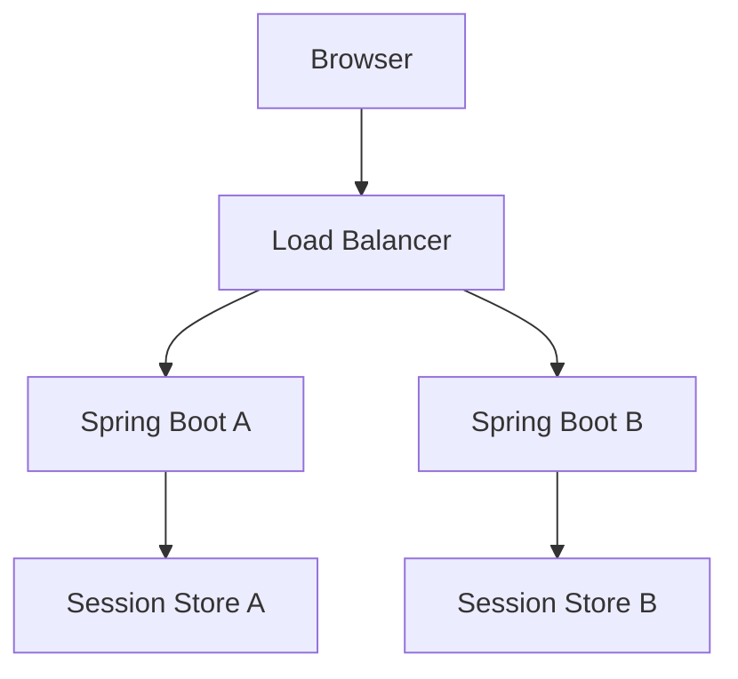

사용자가 Spring Boot A에서 OAuth2 로그인을 시작했다고 생각해보자.

Authorization Request는 A 서버의 세션에 저장될 수 있다.

그런데 Google 인증이 완료된 이후 Callback 요청이 Spring Boot B로 전달된다면 문제가 발생할 수 있다.

B 서버에서는 기존 Authorization Request를 찾지 못할 수 있기 때문이다.

따라서 여러 서버를 운영한다면 다음과 같은 구조를 고려할 수 있다.

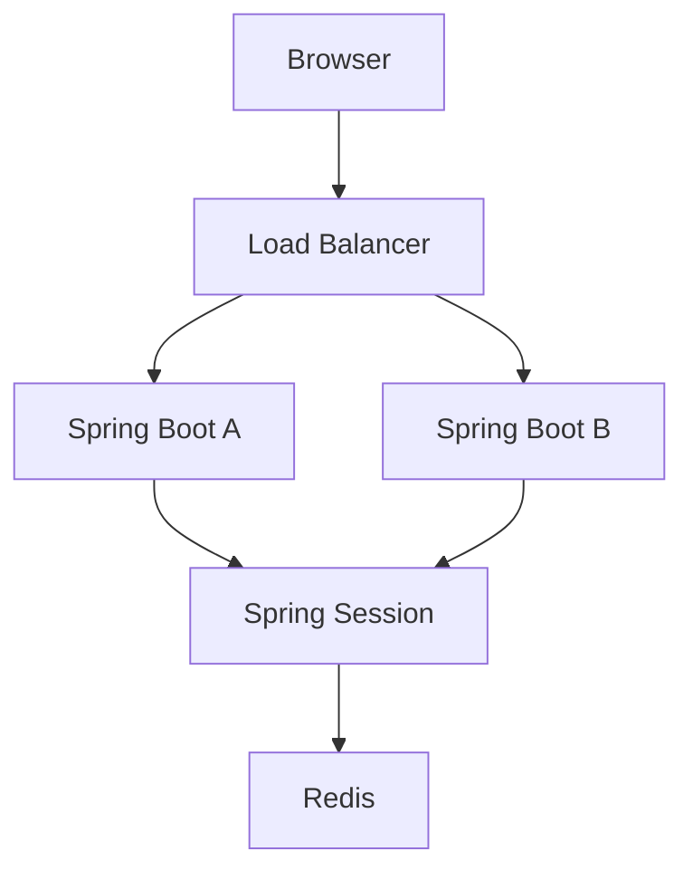

Spring Session과 Redis를 이용하면 여러 서버에서 세션 데이터를 공유할 수 있다.

다만 Redis를 도입하는 것만으로 모든 문제가 해결되는 것은 아니다.

세션 직렬화, 쿠키 설정, 세션 만료, 네트워크 장애, 동시성 등을 함께 고려해야 한다.

---

#### 6. 동일 브라우저에서 여러 OAuth2 로그인을 동시에 시작하는 경우를 고려한다

Spring Security 6.2.1의 기본 HttpSessionOAuth2AuthorizationRequestRepository는 세션 속성에 Authorization Request를 저장한다.

이 구조에서는 같은 세션에서 서로 다른 OAuth2 인증 요청을 연속적으로 시작하면 이전 요청이 새로운 요청으로 대체될 수 있다.

예를 들어 다음과 같은 상황이다.

```text
브라우저 탭 A
    ↓
Google 로그인 시작
    ↓
Authorization Request A 저장
```

```text
브라우저 탭 B
    ↓
Naver 로그인 시작
    ↓
Authorization Request B 저장
```

이후 탭 A에서 Google 인증을 완료하고 돌아오면 이전에 저장한 Authorization Request를 찾지 못하거나 state가 일치하지 않을 수 있다.

따라서 여러 인증 요청을 동시에 지원해야 하는 서비스라면 state별로 요청을 구분하여 저장하는 커스텀 AuthorizationRequestRepository를 고려할 수 있다.

이러한 구조에서는 저장 공간과 만료 정책도 함께 설계해야 한다.

---

#### 7. Reverse Proxy 환경에서 Redirect URI를 확인한다

운영 환경에서는 Spring Boot 앞에 Nginx나 Load Balancer가 존재할 수 있다.

예를 들어 다음과 같다.

```text
Browser
    ↓
HTTPS
    ↓
Nginx
    ↓
HTTP
    ↓
Spring Boot
```

외부에서는 HTTPS로 접근하지만 내부 Spring Boot에서는 HTTP 요청으로 전달될 수 있다.

이 경우 Spring Security가 실제 외부 주소를 정확히 인식하지 못하면 Redirect URI를 잘못 생성할 수 있다.

예를 들어 다음과 같은 문제가 발생할 수 있다.

```text
Google Cloud에 등록된 URI
    ↓
https://service.example.com/login/oauth2/code/google
```

```text
실제 생성된 URI
    ↓
http://service.example.com/login/oauth2/code/google
```

이렇게 되면 Redirect URI 불일치로 인증 요청이 실패할 수 있다.

따라서 Forwarded Header 처리와 신뢰할 수 있는 프록시 구성을 함께 확인해야 한다.

---

#### 8. 로그인 시작 경로를 변경할 때는 Resolver 설정도 함께 확인한다

기본 OAuth2 로그인 시작 경로는 다음과 같다.

```text
/oauth2/authorization/{registrationId}
```

하지만 서비스 요구사항에 따라 변경할 수 있다.

예를 들어 다음과 같다.

```text
/auth/oauth2/authorization/{registrationId}
```

이 경우 SecurityConfig에서 관련 설정을 변경해야 한다.

```java
.oauth2Login(oauth2 -> oauth2

        .authorizationEndpoint(authorization -> authorization

                .baseUri("/auth/oauth2/authorization")
        )
)
```

그리고 로그인 버튼 URL도 변경해야 한다.

```html
<a href="/auth/oauth2/authorization/google">
    Google 로그인
</a>
```

여기서 중요한 점은 시작 경로 변경과 Callback 경로 변경이 서로 다른 설정이라는 사실이다.

로그인 시작 경로를 변경하더라도 Callback 경로가 자동으로 변경되는 것은 아니다.

---

#### 9. AuthorizationRequestRepository를 커스터마이징할 때 보안 정보를 고려한다

기본 구현체는 HttpSession에 Authorization Request를 저장한다.

하지만 특별한 요구사항이 있다면 다른 저장 방식을 구현할 수도 있다.

예를 들어 다음과 같은 방식이다.

```text
AuthorizationRequestRepository
    ↓
Redis
```

또는 다음과 같은 구조도 고려할 수 있다.

```text
AuthorizationRequestRepository
    ↓
서버 측 임시 저장소
    ↓
State를 이용한 조회
```

이때 저장해야 할 정보의 무결성과 만료 정책이 중요하다.

특히 state와 Redirect URI 등 인증 요청을 구성하는 값이 임의로 변경되지 않도록 해야 한다.

또한 인증이 완료된 요청은 재사용되지 않도록 적절하게 제거해야 한다.

---

#### 10. RequestCache와 AuthorizationRequestRepository를 구분한다

두 구성요소는 모두 요청 관련 정보를 저장하지만 목적이 다르다.

| 구분 | RequestCache | AuthorizationRequestRepository |
|---|---|---|
| 저장 대상 | HTTP 요청 정보 | OAuth2AuthorizationRequest |
| 주요 목적 | 원래 요청으로 복귀 | OAuth2 요청과 응답 연결 |
| 대표 구현체 | HttpSessionRequestCache | HttpSessionOAuth2AuthorizationRequestRepository |
| 주요 활용 | 인증 완료 후 요청 복원 | Callback에서 state 확인 |

예를 들어 RequestCache는 다음 요청을 저장할 수 있다.

```text
GET /orders
```

반면 AuthorizationRequestRepository는 다음 정보를 저장한다.

```text
clientId

redirectUri

state

scope
```

따라서 두 저장소를 동일하게 취급하면 안 된다.

---

#### 11. OAuth2 Client 설정 오류와 사용자 인증 오류를 구분한다

OAuth2 로그인은 여러 단계로 구성된다.

따라서 문제가 발생했을 때 어느 단계에서 실패했는지 확인해야 한다.

| 증상 | 주요 확인 대상 |
|---|---|
| 로그인 버튼 클릭 후 오류 | OAuth2AuthorizationRequestRedirectFilter |
| 등록되지 않은 Provider 오류 | ClientRegistrationRepository |
| 잘못된 인증 요청 URI | OAuth2AuthorizationRequestResolver |
| Redirect URI 불일치 | ClientRegistration 및 Provider 설정 |
| Callback에서 요청을 찾지 못함 | AuthorizationRequestRepository |
| State 불일치 | HttpSession 및 state |
| Authorization Code 교환 실패 | OAuth2LoginAuthenticationFilter 및 Token Endpoint |
| 사용자 정보 조회 실패 | OAuth2UserService |
| 로그인 후 인증 상태 소실 | SecurityContextRepository 및 HttpSession |

이처럼 단계별로 문제를 구분하면 장애 원인을 빠르게 좁힐 수 있다.

---

#### 12. OIDC의 Nonce와 OAuth2 State는 다른 개념이다

Google에서 다음 Scope를 사용하면 OIDC 인증을 구성할 수 있다.

```text
openid

profile

email
```

OIDC에서는 state뿐 아니라 nonce도 중요한 역할을 한다.

두 값은 서로 다른 목적을 가진다.

| 구분 | State | Nonce |
|---|---|---|
| 주요 목적 | 인증 요청과 응답 연결 | ID Token과 인증 요청 연결 |
| 주요 보호 대상 | OAuth2 인증 흐름 | OIDC ID Token |
| 사용 위치 | Authorization Request와 Callback | Authorization Request 및 ID Token 검증 |
| 주요 역할 | 요청 혼동 및 CSRF 방어 | ID Token 재사용 공격 방어에 기여 |

Spring Security는 OIDC 인증 요청에서 nonce를 생성하는 기능을 제공한다.

따라서 Google OIDC 인증을 직접 커스터마이징할 때는 state와 nonce의 역할을 구분해야 한다.

---

#### 13. PKCE를 사용하는 경우 추가 파라미터가 필요하다

OAuth2 Authorization Code 방식에서는 PKCE를 사용할 수 있다.

PKCE는 Authorization Code를 획득한 주체가 원래 인증을 요청한 클라이언트인지 확인하는 데 도움을 준다.

대표적으로 다음 두 값이 사용된다.

```text
code_verifier
```

```text
code_challenge
```

인증 요청에는 code_challenge 등이 포함될 수 있다.

이후 Token Endpoint 요청에서는 code_verifier가 전달된다.

Spring Security 6.2.1의 DefaultOAuth2AuthorizationRequestResolver는 ClientAuthenticationMethod가 `none`인 클라이언트에 대해 PKCE 관련 처리를 자동 적용한다.

반면 Client Secret을 사용하는 모든 Confidential Client에 PKCE가 반드시 자동 적용된다고 가정해서는 안 된다.

특별한 요구사항이 있다면 Authorization Request의 커스터마이징 방식을 검토해야 한다.

---

#### 14. Authorization Request의 State와 토큰을 로그에 남기지 않는다

OAuth2 인증 흐름을 디버깅하다 보면 Authorization Request의 전체 내용을 출력하고 싶어질 수 있다.

하지만 다음 정보는 신중하게 관리해야 한다.

```text
Authorization Code

Access Token

Refresh Token

Client Secret

State

PKCE Code Verifier
```

특히 Authorization Code는 Callback URL의 Query Parameter로 전달될 수 있다.

따라서 HTTP 접근 로그나 애플리케이션 로그에 그대로 남을 가능성이 있다.

운영 환경에서는 인증 실패 원인을 파악할 수 있는 최소한의 정보만 기록하는 것이 적절하다.

예를 들어 다음과 같은 정보를 사용할 수 있다.

```text
registrationId

인증 요청 성공 여부

오류 코드

내부 Trace ID
```

이렇게 하면 민감한 인증 값을 직접 기록하지 않고도 장애를 분석할 수 있다.

---

#### 15. 인증 요청 생성은 외부 인증 서버 호출과 다르다

OAuth2AuthorizationRequestRedirectFilter의 가장 중요한 역할은 외부 인증 서버로 이동할 URL을 생성하는 것이다.

이 필터가 직접 Google의 로그인 API를 호출하여 사용자 인증을 완료하는 것은 아니다.

```text
OAuth2AuthorizationRequestRedirectFilter
    ↓
Authorization Request URI 생성
    ↓
HTTP 302
    ↓
Browser
    ↓
Google
```

실제로 Google 인증 서버에 접근하는 주체는 브라우저다.

반면 Authorization Code를 Access Token으로 교환할 때는 Spring Boot 서버가 외부 Token Endpoint와 통신한다.

따라서 다음 두 통신을 구분해야 한다.

```text
브라우저 기반 Redirect
```

```text
서버 간 Token 요청
```

이 차이를 이해하면 OAuth2 인증 과정에서 네트워크 요청이 어느 환경에서 수행되는지 명확하게 파악할 수 있다.

---

### 정리

Spring Security OAuth2 Client에서 `OAuth2AuthorizationRequestRedirectFilter`는 Authorization Code 인증 흐름을 시작하는 중요한 필터다.

사용자가 다음 경로에 접근하면:

```text
/oauth2/authorization/google
```

필터는 해당 요청을 처리한다.

먼저 `OAuth2AuthorizationRequestResolver`를 호출한다.

```java
authorizationRequestResolver.resolve(request);
```

Resolver는 요청에서 registrationId를 추출한다.

```text
registrationId = google
```

그리고 ClientRegistrationRepository에서 등록 정보를 조회한다.

```java
clientRegistrationRepository.findByRegistrationId("google");
```

이후 Client ID와 Redirect URI, Scope, State 등을 이용해 OAuth2AuthorizationRequest를 생성한다.

생성된 인증 요청은 AuthorizationRequestRepository에 저장된다.

```text
OAuth2AuthorizationRequest
    ↓
HttpSessionOAuth2AuthorizationRequestRepository
    ↓
HttpSession
```

그리고 RedirectStrategy를 이용해 외부 인증 서버로 이동시킨다.

```text
OAuth2AuthorizationRequest
    ↓
RedirectStrategy
    ↓
HTTP 302 Redirect
    ↓
Google Authorization Server
```

전체 흐름은 다음과 같다.

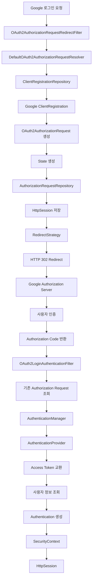

여기서 반드시 기억해야 할 핵심은 다음과 같다.

**첫째, OAuth2AuthorizationRequestRedirectFilter는 OAuth2 로그인을 시작하는 필터다.**

**둘째, DefaultOAuth2AuthorizationRequestResolver는 요청 경로에서 registrationId를 추출하고 Authorization Request를 생성한다.**

**셋째, ClientRegistrationRepository는 외부 인증 제공자의 설정 정보를 조회하는 역할을 담당한다.**

**넷째, OAuth2AuthorizationRequest에는 Client ID, Redirect URI, Scope, State 등의 정보가 포함된다.**

**다섯째, Authorization Request는 외부 인증 서버로 이동하기 전에 AuthorizationRequestRepository에 저장된다.**

**여섯째, 기본 세션 기반 구현에서는 HttpSessionOAuth2AuthorizationRequestRepository를 이용한다.**

**일곱째, State는 최초 인증 요청과 Callback 응답을 연결하는 중요한 보안 값이다.**

**여덟째, RedirectStrategy는 외부 인증 서버로 이동하기 위한 HTTP Redirect를 수행한다.**

**아홉째, RequestCache와 AuthorizationRequestRepository는 서로 다른 목적을 가진다.**

**열째, OAuth2AuthorizationRequestRedirectFilter는 Access Token을 직접 발급받거나 Authentication을 생성하지 않는다.**

**열한째, Authorization Code가 반환된 이후에는 OAuth2LoginAuthenticationFilter가 인증 처리를 이어받는다.**

**열두째, 여러 서버를 운영한다면 OAuth2 Authorization Request를 저장하는 세션의 일관성을 유지해야 한다.**

이번 구현을 통해 Spring Security OAuth2 로그인에서 사용자가 로그인 버튼을 클릭한 뒤 외부 인증 서버로 이동하기까지 어떤 과정이 수행되는지 이해할 수 있다.

특히 이전에 구현한 ClientRegistrationRepository가 단순히 설정을 보관하는 저장소가 아니라, 실제 OAuth2 인증 요청을 생성하는 데 사용된다는 점이 중요하다.

또한 인증 요청을 HttpSession에 저장하는 이유와 state 검증의 필요성도 이해할 수 있다.

이러한 내부 흐름을 이해하면 OAuth2 로그인에서 발생하는 Redirect URI 오류, state 불일치, 세션 문제, ClientRegistration 조회 실패 등을 더욱 체계적으로 분석할 수 있다.

#### 한 줄 요약

Spring Security 6의 `OAuth2AuthorizationRequestRedirectFilter`는 사용자가 `/oauth2/authorization/{registrationId}` 경로에 접근했을 때 OAuth2 인증을 시작하는 필터다. 내부적으로 `DefaultOAuth2AuthorizationRequestResolver`가 ClientRegistrationRepository에서 인증 제공자 정보를 조회하고, Client ID와 Redirect URI, Scope, State 등을 이용해 OAuth2AuthorizationRequest를 생성한다. 이후 AuthorizationRequestRepository를 통해 인증 요청을 HttpSession에 저장하고, RedirectStrategy를 이용해 외부 인증 서버로 HTTP Redirect를 수행한다. 외부 인증이 완료되면 OAuth2LoginAuthenticationFilter가 기존 Authorization Request를 조회하여 이후 인증 절차를 진행한다.
