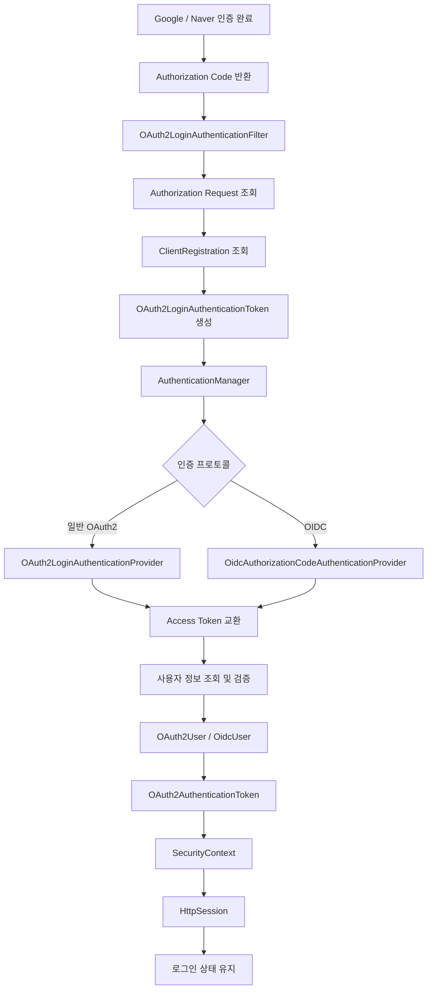
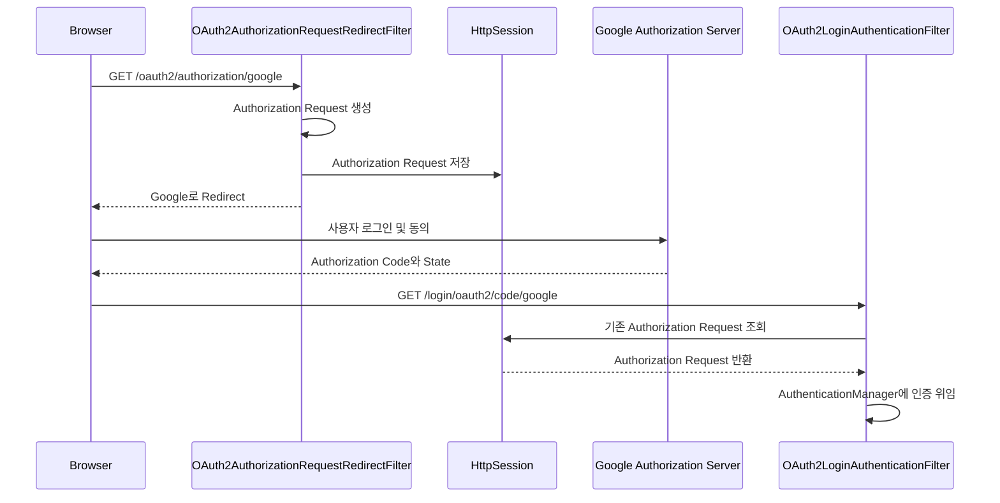
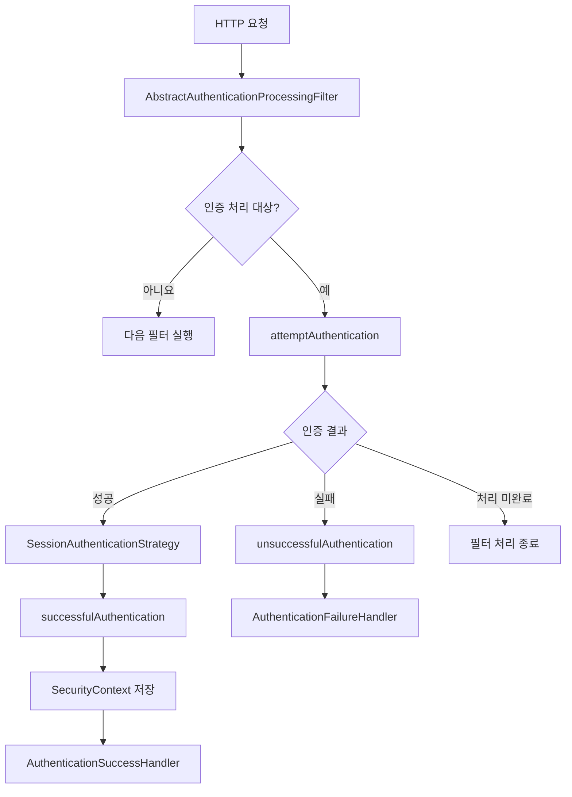
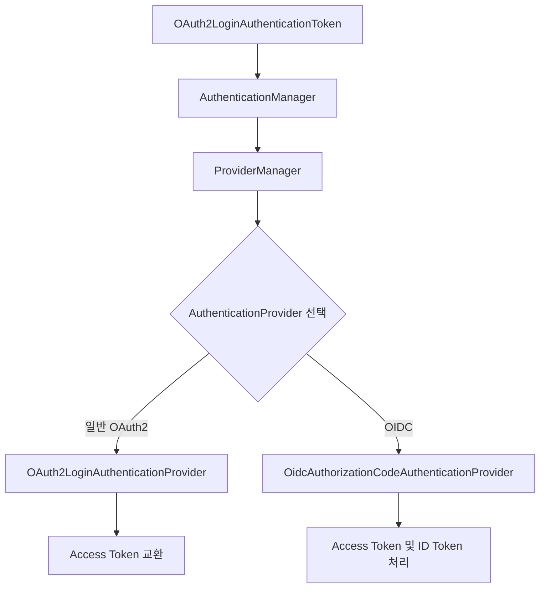
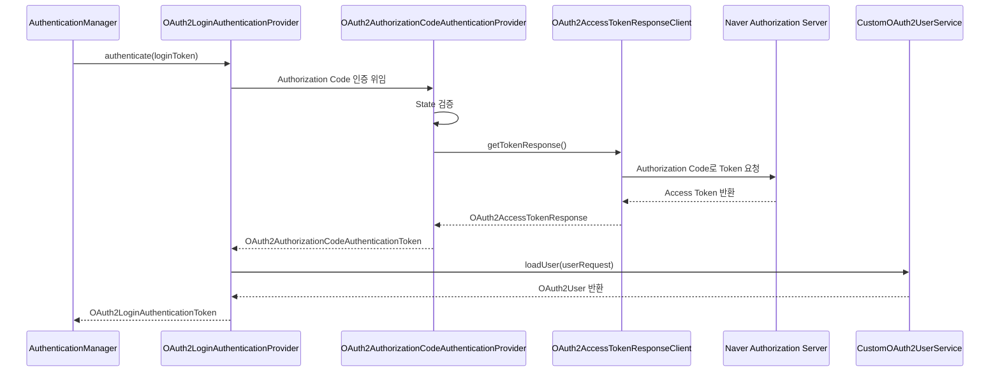
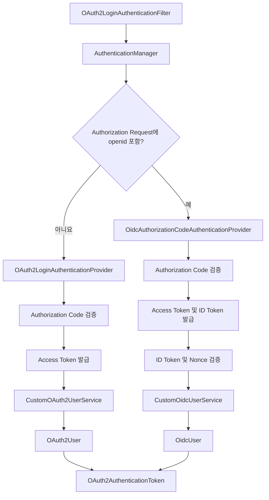
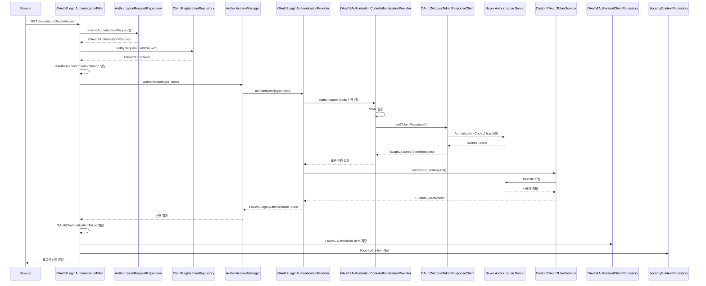
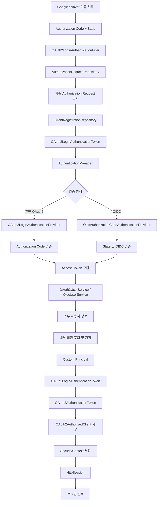

# 스프링 OAuth2 클라이언트 세션 - 14. OAuth2LoginAuthenticationFilter
[https://youtu.be/jKAaPLXNuq8?si=7Ys-7epVhM16pqk-](https://youtu.be/jKAaPLXNuq8?si=7Ys-7epVhM16pqk-)

# 스프링 OAuth2 클라이언트 세션 - 14. OAuth2LoginAuthenticationFilter
{:toc}

---

### Spring Security 6 OAuth2LoginAuthenticationFilter 내부 동작 원리

Spring Security OAuth2 Client에서는 Google과 Naver 같은 외부 인증 제공자를 이용해 사용자를 인증할 수 있다.

앞서 `ClientRegistrationRepository`를 통해 외부 인증 제공자의 설정 정보를 관리하고, `OAuth2AuthorizationRequestRedirectFilter`가 인증 요청을 생성하는 과정을 살펴보았다.

사용자가 Google 로그인 버튼을 클릭하면 다음 요청이 발생한다.

```http
GET /oauth2/authorization/google HTTP/1.1
Host: localhost:8080
```

Spring Security는 이 요청을 처리하여 Google 인증 서버로 사용자를 이동시킨다.

이때 중요한 역할을 담당하는 필터는 다음과 같다.

```java
OAuth2AuthorizationRequestRedirectFilter
```

이 필터는 다음 과정을 수행한다.

```text
OAuth2 로그인 요청
    ↓
ClientRegistration 조회
    ↓
Authorization Request 생성
    ↓
State 생성
    ↓
Authorization Request 세션 저장
    ↓
Google / Naver 인증 서버로 Redirect
```

그렇다면 외부 인증 제공자에서 사용자가 로그인을 완료한 이후에는 어떤 일이 발생할까?

Google이나 Naver는 사용자 인증을 완료하면 처음 등록한 Redirect URI로 사용자를 돌려보낸다.

이때 Authorization Code가 전달된다.

예를 들어 다음과 같다.

```http
GET /login/oauth2/code/google?code=AUTHORIZATION_CODE&state=RANDOM_STATE HTTP/1.1
Host: localhost:8080
```

여기서 중요한 점이 있다.

**Authorization Code를 전달받았다고 해서 우리 서비스의 로그인이 완료된 것은 아니다.**

Authorization Code는 Access Token을 발급받기 위해 사용하는 일회성 인증 코드다.

따라서 Spring Security는 전달받은 코드를 검증하고, 외부 인증 서버에 Access Token을 요청해야 한다.

이후 Access Token 등을 이용해 사용자 정보를 확인하고, 최종적으로 Spring Security가 사용할 Authentication 객체를 구성해야 한다.

이 과정의 시작점이 바로 다음 필터다.

```java
OAuth2LoginAuthenticationFilter
```

전체적인 동작은 다음과 같다.



이번에는 `OAuth2LoginAuthenticationFilter`와 `OAuth2LoginAuthenticationProvider`의 실제 내부 구현을 중심으로 인증이 완료되는 과정을 살펴본다.

기준 환경은 다음과 같다.

| 구분 | 버전 및 기술 |
|---|---|
| Java | 17 |
| Spring Boot | 3.2.1 |
| Spring Security | 6.2.1 |
| OAuth2 | Spring Security OAuth2 Client |
| 인증 방식 | Authorization Code |
| Google | OpenID Connect |
| Naver | OAuth2 |
| 사용자 저장 | Spring Data JPA |
| 데이터베이스 | MySQL |
| 로그인 상태 관리 | HttpSession |
| 빌드 도구 | Gradle |

---

### 개념

#### OAuth2LoginAuthenticationFilter란?

`OAuth2LoginAuthenticationFilter`는 외부 OAuth2 인증 서버에서 반환한 Authorization Response를 처리하는 필터다.

패키지는 다음과 같다.

```java
org.springframework.security.oauth2.client.web.OAuth2LoginAuthenticationFilter
```

이 필터는 OAuth2 Authorization Code 인증 과정에서 Callback 요청을 처리한다.

기본적인 처리 경로는 다음과 같다.

```text
/login/oauth2/code/*
```

예를 들어 Google을 사용하는 경우 다음 요청을 처리한다.

```text
/login/oauth2/code/google
```

Naver를 사용하는 경우에는 다음과 같다.

```text
/login/oauth2/code/naver
```

이 필터의 주요 역할은 다음과 같다.

| 역할 | 설명 |
|---|---|
| Callback 요청 감지 | OAuth2 Authorization Response 처리 |
| 요청 파라미터 확인 | code, state 또는 error 확인 |
| 기존 인증 요청 조회 | AuthorizationRequestRepository 이용 |
| ClientRegistration 조회 | 인증 요청에 연결된 제공자 정보 확인 |
| 인증 요청 객체 생성 | OAuth2LoginAuthenticationToken |
| 인증 위임 | AuthenticationManager 호출 |
| 인증 결과 변환 | OAuth2AuthenticationToken 생성 |
| 외부 인가 정보 저장 | OAuth2AuthorizedClient 저장 |
| 인증 완료 처리 연결 | SecurityContext와 세션 인증으로 연결 |

여기서 가장 중요한 점은 **OAuth2LoginAuthenticationFilter가 Access Token 발급과 사용자 정보 조회를 모두 직접 수행하는 것은 아니라는 사실**이다.

필터는 인증에 필요한 정보를 구성한 뒤 AuthenticationManager에 위임한다.

실제로 외부 Token Endpoint와 통신하고 사용자 정보를 조회하는 작업은 AuthenticationProvider와 관련 구성요소가 수행한다.

---

### OAuth2AuthorizationRequestRedirectFilter와의 차이

앞서 살펴본 필터와 이번 필터를 비교해보자.

| 구분 | OAuth2AuthorizationRequestRedirectFilter | OAuth2LoginAuthenticationFilter |
|---|---|---|
| 실행 시점 | OAuth2 로그인 시작 | 외부 인증 완료 후 |
| 기본 요청 경로 | `/oauth2/authorization/{registrationId}` | `/login/oauth2/code/{registrationId}` |
| 주요 입력 | registrationId | Authorization Code, State |
| Authorization Request | 생성 | 조회 및 제거 |
| ClientRegistration | 조회 | 조회 |
| HTTP Redirect | 외부 인증 서버로 이동 | 인증 결과에 따른 성공·실패 처리 |
| AuthenticationManager | 직접 호출하지 않음 | 호출 |
| Access Token 교환 | 수행하지 않음 | AuthenticationProvider에 위임 |
| Authentication | 생성하지 않음 | 인증 성공 결과를 생성 |
| 주요 목적 | 외부 인증 시작 | OAuth2 로그인 완료 |

두 필터는 서로 다른 역할을 담당하지만 하나의 OAuth2 인증 과정으로 연결된다.



앞의 필터에서는 외부 인증을 시작했다.

이번 필터에서는 외부 인증의 결과를 받아 우리 서비스의 인증 상태로 연결한다.

---

### 왜 사용하는가?

#### 1. Authorization Code를 안전하게 처리하기 위해서

OAuth2 Authorization Code 방식에서는 외부 인증 서버가 Access Token을 브라우저에 직접 전달하는 대신 Authorization Code를 전달한다.

예를 들어 다음과 같다.

```text
Google 로그인 성공
    ↓
Authorization Code 발급
    ↓
Spring Boot Callback
    ↓
Authorization Code로 Access Token 요청
```

Authorization Code는 일반적으로 짧은 유효기간을 가지며 일회성으로 사용된다.

Spring Security는 이를 이용해 서버 측에서 Token Endpoint에 요청을 보낼 수 있다.

이때 ClientRegistration에 설정된 Client ID, Client Secret, Token URI 등이 사용된다.

이러한 구조에서는 브라우저가 Client Secret을 전달받을 필요가 없다.

#### 2. 최초 인증 요청과 Callback 응답을 연결하기 위해서

OAuth2 로그인은 여러 HTTP 요청에 걸쳐 수행된다.

첫 번째 요청에서는 Authorization Request를 생성한다.

```text
GET /oauth2/authorization/google
```

두 번째 요청에서는 Authorization Code를 전달받는다.

```text
GET /login/oauth2/code/google
```

두 요청은 서로 다른 시점에 발생한다.

따라서 Callback이 최초 인증 요청과 연결되는지 확인할 수 있어야 한다.

이를 위해 Spring Security는 `AuthorizationRequestRepository`를 사용한다.

기본적인 세션 기반 구현체는 다음과 같다.

```java
HttpSessionOAuth2AuthorizationRequestRepository
```

이 저장소는 최초 인증 요청에서 생성한 OAuth2AuthorizationRequest를 HttpSession에 보관한다.

이후 Callback 요청이 발생하면 해당 정보를 조회한다.

#### 3. 인증 처리 책임을 여러 구성요소로 분리하기 위해서

OAuth2 인증 과정에는 여러 작업이 포함된다.

```text
Callback 요청 확인

Authorization Request 복원

ClientRegistration 조회

State 검증

Authorization Code 교환

Access Token 획득

사용자 정보 조회

내부 회원 조회 및 저장

Authentication 생성
```

이러한 작업을 하나의 필터에 모두 구현하면 구조가 복잡해진다.

Spring Security는 역할을 여러 구성요소에 분리한다.

```text
OAuth2LoginAuthenticationFilter
    ↓
AuthenticationManager
    ↓
AuthenticationProvider
    ↓
OAuth2AccessTokenResponseClient
    ↓
OAuth2UserService / OidcUserService
```

이러한 책임 분리는 Spring Security의 인증 아키텍처를 이해하는 중요한 출발점이다.

---

### 주요 특징

#### AbstractAuthenticationProcessingFilter 상속

`OAuth2LoginAuthenticationFilter`는 다음 클래스를 상속한다.

```java
public class OAuth2LoginAuthenticationFilter
        extends AbstractAuthenticationProcessingFilter {
}
```

앞서 살펴본 `OAuth2AuthorizationRequestRedirectFilter`가 `OncePerRequestFilter`를 상속했던 것과 차이가 있다.

`AbstractAuthenticationProcessingFilter`는 HTTP 요청을 기반으로 사용자를 인증하는 필터를 구현하기 위한 추상 클래스다.

대표적으로 다음과 같은 기능을 제공한다.

| 기능 | 주요 메서드 |
|---|---|
| 인증 요청 여부 판단 | requiresAuthentication() |
| 실제 인증 처리 | attemptAuthentication() |
| 인증 성공 처리 | successfulAuthentication() |
| 인증 실패 처리 | unsuccessfulAuthentication() |
| 인증 요청 위임 | AuthenticationManager |
| 세션 인증 전략 실행 | SessionAuthenticationStrategy |
| 인증 상태 저장 | SecurityContextRepository |

Spring Security의 일반적인 인증 필터도 이 추상 클래스를 활용할 수 있다.

대표적으로 다음 클래스가 있다.

```java
UsernamePasswordAuthenticationFilter
```

따라서 두 필터는 인증 방식이 다르지만 비슷한 인증 처리 구조를 가진다.

```text
UsernamePasswordAuthenticationFilter
    ↓
AbstractAuthenticationProcessingFilter
```

```text
OAuth2LoginAuthenticationFilter
    ↓
AbstractAuthenticationProcessingFilter
```

다만 두 필터가 처리하는 자격 증명은 다르다.

일반 로그인에서는 사용자 아이디와 비밀번호를 사용한다.

OAuth2 로그인에서는 Authorization Code와 최초 인증 요청의 정보를 이용한다.

---

### AbstractAuthenticationProcessingFilter의 처리 구조

이 추상 클래스는 인증 요청이 들어오면 먼저 인증이 필요한 요청인지 확인한다.

그다음 하위 클래스의 `attemptAuthentication()`을 실행한다.

개념적으로 다음과 같은 구조다.

```java
Authentication result = attemptAuthentication(
        request,
        response
);

if (result == null) {
    return;
}

sessionStrategy.onAuthentication(
        result,
        request,
        response
);

successfulAuthentication(
        request,
        response,
        filterChain,
        result
);
```

위 코드는 핵심 흐름을 설명하기 위한 간략화된 예시다.

실제 구현에서는 요청 매칭, 예외 처리, 필터 체인 진행 여부 등의 추가 조건이 존재한다.

인증에 성공하면 SessionAuthenticationStrategy가 실행되고, 이후 successfulAuthentication()을 통해 인증 상태를 저장한다.

인증 과정에서 AuthenticationException이 발생하면 unsuccessfulAuthentication()으로 이동한다.

전체 구조는 다음과 같다.



이 구조는 OAuth2 로그인뿐 아니라 Spring Security의 인증 필터 전반을 이해하는 데도 중요하다.

---

### OAuth2LoginAuthenticationFilter의 주요 구성요소

Spring Security 6.2.1 기준으로 주요 구성요소를 정리하면 다음과 같다.

| 구성요소 | 역할 |
|---|---|
| ClientRegistrationRepository | OAuth2 Client 등록 정보 조회 |
| AuthorizationRequestRepository | 최초 인증 요청 조회 및 제거 |
| OAuth2AuthorizedClientRepository | 외부 인가 결과 저장 |
| AuthenticationManager | 인증 처리 위임 |
| AuthenticationResultConverter | 인증 결과 타입 변환 |
| AuthenticationDetailsSource | HTTP 요청 관련 부가 정보 구성 |

특히 다음 세 저장소를 구분하는 것이 중요하다.

```java
ClientRegistrationRepository
```

```java
AuthorizationRequestRepository
```

```java
OAuth2AuthorizedClientRepository
```

세 저장소 모두 OAuth2 인증 과정에 사용되지만 관리하는 정보가 다르다.

| 저장소 | 관리 대상 |
|---|---|
| ClientRegistrationRepository | Client ID, Secret, Endpoint 등 |
| AuthorizationRequestRepository | 최초 Authorization Request |
| OAuth2AuthorizedClientRepository | Access Token, Refresh Token 등 인가 결과 |

OAuth2 로그인 필터는 이 저장소들을 서로 다른 단계에서 활용한다.

---

### attemptAuthentication() 내부 동작

이제 핵심 메서드를 살펴보자.

```java
attemptAuthentication()
```

이 메서드는 OAuth2 Callback 요청을 받아 인증 과정을 시작한다.

Spring Security 6.2.1의 실제 구현을 기준으로 주요 처리 단계를 정리하면 다음과 같다.

```text
attemptAuthentication()
    │
    ├── Callback 파라미터 추출
    │
    ├── Authorization Response 형식 확인
    │
    ├── 기존 Authorization Request 조회 및 제거
    │
    ├── registrationId 추출
    │
    ├── ClientRegistration 조회
    │
    ├── OAuth2AuthorizationResponse 생성
    │
    ├── OAuth2AuthorizationExchange 생성
    │
    ├── OAuth2LoginAuthenticationToken 생성
    │
    ├── AuthenticationManager.authenticate()
    │
    ├── 인증 결과 반환
    │
    ├── OAuth2AuthenticationToken 변환
    │
    ├── OAuth2AuthorizedClient 생성 및 저장
    │
    └── OAuth2AuthenticationToken 반환
```

이제 각각의 과정을 자세히 살펴보자.

---

### 1. Callback 요청 파라미터 추출

Google 인증이 완료되면 다음과 같은 요청이 발생할 수 있다.

```http
GET /login/oauth2/code/google?code=AUTH_CODE&state=RANDOM_STATE HTTP/1.1
Host: localhost:8080
Cookie: JSESSIONID=SESSION_ID
```

여기서 중요한 값은 두 가지다.

```text
code
```

```text
state
```

`code`는 Access Token을 발급받기 위한 Authorization Code다.

`state`는 최초 인증 요청과 현재 응답을 연결하는 값이다.

OAuth2LoginAuthenticationFilter는 HTTP 요청에 포함된 파라미터를 확인한다.

개념적으로 다음과 같다.

```java
String code = request.getParameter("code");

String state = request.getParameter("state");
```

다만 실제 구현은 단순히 두 값을 읽는 것에서 끝나지 않는다.

Spring Security는 요청 파라미터를 MultiValueMap으로 변환한 뒤 OAuth2 Authorization Response에 해당하는지 확인한다.

이때 정상적인 인증 응답뿐 아니라 다음과 같은 오류 응답도 고려한다.

```http
GET /login/oauth2/code/google?error=access_denied&state=RANDOM_STATE
```

사용자가 외부 인증 제공자에서 로그인을 취소하거나 동의를 거부하면 오류 응답이 반환될 수 있다.

따라서 Callback 요청은 항상 정상적인 Authorization Code를 포함한다고 가정해서는 안 된다.

---

### 2. 기존 Authorization Request 조회 및 제거

다음 단계에서는 최초 인증 요청을 조회한다.

이때 사용되는 구성요소는 다음과 같다.

```java
AuthorizationRequestRepository
```

기본 구현체는 다음과 같다.

```java
HttpSessionOAuth2AuthorizationRequestRepository
```

Spring Security는 Callback 요청에 포함된 state를 이용해 세션에 저장된 기존 인증 요청을 확인한다.

그리고 유효한 인증 요청을 찾았다면 해당 요청을 반환하면서 저장소에서 제거한다.

개념적인 흐름은 다음과 같다.

```text
Callback 요청
    ↓
state 확인
    ↓
HttpSession 조회
    ↓
저장된 OAuth2AuthorizationRequest 확인
    ↓
state 비교
    ↓
인증 요청 반환 및 제거
```

이러한 구조에는 중요한 목적이 있다.

**하나의 Authorization Request를 인증 과정에서 반복적으로 사용하지 않도록 관리하는 것**이다.

여기서 주의할 점도 있다.

기본 HttpSessionOAuth2AuthorizationRequestRepository는 state가 일치하는 요청을 찾은 경우에만 해당 요청을 제거한다.

따라서 state가 일치하지 않는 요청이라면 저장된 Authorization Request를 반환하지 않으며, 해당 상태에서 무조건 기존 세션 속성을 삭제하는 것도 아니다.

---

### Authorization Request를 찾지 못하면 어떻게 될까?

기존 Authorization Request를 찾을 수 없다면 인증 과정을 정상적으로 진행할 수 없다.

이때 다음 오류가 발생할 수 있다.

```text
authorization_request_not_found
```

대표적인 원인은 다음과 같다.

| 원인 | 설명 |
|---|---|
| 세션 만료 | 최초 인증 요청을 저장한 세션이 사라짐 |
| 세션 쿠키 누락 | Callback 요청에 기존 JSESSIONID가 전달되지 않음 |
| State 불일치 | 최초 요청과 Callback의 state가 다름 |
| 중복 Callback | 이미 처리한 인증 요청을 다시 사용 |
| 서버 간 세션 불일치 | 로그인 시작 서버와 Callback 서버의 세션이 다름 |
| 동시 로그인 요청 | 새로운 Authorization Request가 기존 요청을 대체 |

특히 여러 Spring Boot 서버에서 OAuth2 로그인을 운영한다면 세션 저장 방식이 중요하다.

Authorization Request는 Callback 시점까지 유지되어야 하기 때문이다.

---

### 3. registrationId 추출

기존 Authorization Request를 조회했다면 어떤 외부 인증 제공자를 사용했는지 확인한다.

여기서 중요한 점이 있다.

Spring Security 6.2.1의 OAuth2LoginAuthenticationFilter는 **Callback URL의 마지막 경로 문자열만으로 registrationId를 결정하는 것이 아니다.**

최초 Authorization Request에 저장된 속성에서 registrationId를 가져온다.

예를 들어 다음과 같다.

```java
String registrationId =
        authorizationRequest.getAttribute(
                OAuth2ParameterNames.REGISTRATION_ID
        );
```

Google 로그인 요청이었다면 다음 값이 저장되어 있을 수 있다.

```text
google
```

Naver 로그인 요청이었다면 다음과 같다.

```text
naver
```

이렇게 추출한 값을 이용해 ClientRegistrationRepository에서 외부 인증 제공자의 등록 정보를 조회한다.

```java
ClientRegistration clientRegistration =
        clientRegistrationRepository
                .findByRegistrationId(registrationId);
```

이 구조는 최초 인증 요청과 Callback에서 사용할 OAuth2 Client 정보를 연결하는 데 중요한 역할을 한다.

---

### 4. ClientRegistration 조회

ClientRegistrationRepository는 OAuth2 Client의 등록 정보를 관리한다.

앞서 다음과 같이 직접 구현했다.

```java
@Bean
public ClientRegistrationRepository clientRegistrationRepository() {

    ClientRegistration google =
            socialClientRegistration.googleClientRegistration();

    ClientRegistration naver =
            socialClientRegistration.naverClientRegistration();

    return new InMemoryClientRegistrationRepository(
            google,
            naver
    );
}
```

Callback이 Google 로그인에 대한 요청이라면 다음 정보가 사용된다.

```text
Google ClientRegistration
    │
    ├── registrationId
    ├── clientId
    ├── clientSecret
    ├── redirectUri
    ├── authorizationGrantType
    └── providerDetails
          │
          ├── authorizationUri
          ├── tokenUri
          └── userInfoEndpoint
```

이 정보는 이후 Token Endpoint에 Access Token을 요청하는 데 사용된다.

#### ClientRegistration이 존재하지 않는 경우

저장된 registrationId에 해당하는 ClientRegistration을 찾을 수 없다면 다음 오류가 발생할 수 있다.

```text
client_registration_not_found
```

예를 들어 인증 시작 당시에는 다음 등록 정보가 있었다고 생각해보자.

```text
registrationId = google
```

하지만 Callback을 처리하는 서버에는 해당 ClientRegistration이 없다.

이 경우 Spring Security는 적절한 인증 정보를 조회할 수 없다.

따라서 여러 서버를 운영할 때는 ClientRegistration의 일관성도 중요하다.

---

### 5. OAuth2AuthorizationResponse 생성

다음으로 Callback 요청의 정보를 이용해 OAuth2AuthorizationResponse를 구성한다.

주요 정보는 다음과 같다.

```text
OAuth2AuthorizationResponse
    │
    ├── code
    ├── state
    ├── redirectUri
    └── error
```

정상적인 인증 응답이라면 Authorization Code가 포함된다.

반면 인증에 실패했다면 error 정보가 포함될 수 있다.

여기서 Redirect URI도 중요하다.

Spring Security는 현재 Callback 요청의 URL에서 Query Parameter를 제외한 주소를 구성한다.

예를 들어 다음 요청이 들어왔다면:

```text
http://localhost:8080/login/oauth2/code/google?code=ABC&state=XYZ
```

다음 주소를 사용한다.

```text
http://localhost:8080/login/oauth2/code/google
```

이러한 정보는 Authorization Code를 토큰으로 교환할 때 사용되는 OAuth2AuthorizationExchange에 포함된다.

---

### 6. OAuth2AuthorizationExchange란?

OAuth2AuthorizationExchange는 최초 Authorization Request와 외부 인증 서버에서 전달된 Authorization Response를 함께 보관하는 객체다.

개념적으로 다음과 같다.

```text
OAuth2AuthorizationExchange
    │
    ├── OAuth2AuthorizationRequest
    │     │
    │     ├── clientId
    │     ├── redirectUri
    │     ├── scopes
    │     └── state
    │
    └── OAuth2AuthorizationResponse
          │
          ├── code
          ├── state
          └── redirectUri
```

이 객체가 필요한 이유는 인증 요청과 응답을 함께 비교해야 하기 때문이다.

예를 들어 state 검증을 생각해보자.

```text
Authorization Request State
    ↓
abc123
```

```text
Authorization Response State
    ↓
abc123
```

두 값이 일치한다면 요청과 응답이 연결된 것으로 판단할 수 있다.

하지만 다음과 같이 서로 다르다면 문제가 발생한다.

```text
Authorization Request State = abc123

Authorization Response State = xyz789
```

이 경우 정상적인 OAuth2 인증으로 처리하면 안 된다.

이러한 요청과 응답 정보를 하나로 묶는 역할이 OAuth2AuthorizationExchange다.

---

### 7. OAuth2LoginAuthenticationToken 생성

이제 OAuth2LoginAuthenticationFilter는 AuthenticationManager에 전달할 인증 요청 객체를 생성한다.

사용되는 클래스는 다음과 같다.

```java
OAuth2LoginAuthenticationToken
```

이 클래스는 OAuth2 로그인 인증 과정에서 사용되는 Authentication 구현체다.

개념적인 생성 코드는 다음과 같다.

```java
OAuth2LoginAuthenticationToken authenticationRequest =
        new OAuth2LoginAuthenticationToken(
                clientRegistration,
                authorizationExchange
        );
```

여기서 전달하는 정보는 다음과 같다.

| 매개변수 | 역할 |
|---|---|
| ClientRegistration | 외부 인증 제공자의 Client 정보 |
| OAuth2AuthorizationExchange | 최초 요청과 Callback 응답 |

이 시점의 OAuth2LoginAuthenticationToken은 아직 인증이 완료된 객체가 아니다.

Authorization Code 교환과 사용자 정보 확인이 진행되지 않았기 때문이다.

따라서 이 객체는 **인증 요청을 표현하는 토큰**으로 이해하는 것이 적절하다.

---

### 8. AuthenticationManager에 인증 위임

다음 단계에서는 AuthenticationManager에 인증을 위임한다.

개념적인 코드는 다음과 같다.

```java
Authentication authenticationResult =
        authenticationManager.authenticate(
                authenticationRequest
        );
```

여기서 중요한 질문이 생긴다.

**AuthenticationManager는 실제로 외부 인증 서버에 Access Token을 요청하는 객체일까?**

AuthenticationManager는 인증 처리를 조정하고 적절한 AuthenticationProvider에 인증을 위임하는 역할을 담당한다.

대표적인 구현체는 다음과 같다.

```java
ProviderManager
```

ProviderManager는 등록된 AuthenticationProvider를 확인하고 전달받은 Authentication 객체를 처리할 수 있는 Provider에 인증을 위임한다.



여기서 OAuth2LoginAuthenticationProvider와 OidcAuthorizationCodeAuthenticationProvider의 차이를 이해해야 한다.

이번 프로젝트에서는 Naver와 Google이 서로 다른 인증 경로를 사용할 수 있기 때문이다.

---

### OAuth2LoginAuthenticationProvider란?

`OAuth2LoginAuthenticationProvider`는 일반 OAuth2 Authorization Code 로그인을 처리하는 AuthenticationProvider다.

패키지는 다음과 같다.

```java
org.springframework.security.oauth2.client.authentication.OAuth2LoginAuthenticationProvider
```

이 클래스의 핵심 역할은 다음과 같다.

```text
OAuth2LoginAuthenticationToken 수신
    ↓
Authorization Request 확인
    ↓
Authorization Code 인증
    ↓
Access Token 교환
    ↓
OAuth2UserService 호출
    ↓
OAuth2User 획득
    ↓
Authority 구성
    ↓
OAuth2LoginAuthenticationToken 반환
```

여기서 중요한 구성요소는 다음 두 가지다.

```java
OAuth2AuthorizationCodeAuthenticationProvider
```

```java
OAuth2UserService
```

첫 번째는 Authorization Code를 이용해 Access Token을 발급받는 과정을 처리한다.

두 번째는 Access Token을 이용해 외부 사용자 정보를 조회한다.

즉 OAuth2LoginAuthenticationProvider가 이 두 과정을 연결한다.

---

### OAuth2LoginAuthenticationProvider의 내부 구조

실제 구현을 보면 다음과 같은 구성요소를 사용한다.

```java
OAuth2AuthorizationCodeAuthenticationProvider
```

```java
OAuth2UserService<OAuth2UserRequest, OAuth2User>
```

개념적인 흐름은 다음과 같다.



이 구조에서 주의해야 할 점은 `OAuth2LoginAuthenticationProvider`가 HTTP 요청을 직접 조합하는 저수준 통신까지 모두 구현하는 것은 아니라는 사실이다.

실제 Token Endpoint 통신은 OAuth2AccessTokenResponseClient에 위임한다.

---

### 9. State 검증은 어디서 수행할까?

이 부분은 정확하게 구분해야 한다.

앞서 OAuth2LoginAuthenticationFilter는 AuthorizationRequestRepository에서 기존 인증 요청을 조회했다.

기본 HttpSessionOAuth2AuthorizationRequestRepository는 Callback 요청의 state와 저장된 Authorization Request의 state가 일치하는지 확인한다.

하지만 이것이 유일한 State 검증 지점은 아니다.

일반 OAuth2 인증 과정에서는 다음 클래스에서도 State를 검증한다.

```java
OAuth2AuthorizationCodeAuthenticationProvider
```

인증 요청과 응답의 state가 일치하지 않으면 오류가 발생한다.

대표적인 오류 코드는 다음과 같다.

```text
invalid_state_parameter
```

따라서 State 검증을 단순히 OAuth2LoginAuthenticationFilter 하나가 수행한다고 이해해서는 안 된다.

실제 처리 책임은 다음과 같이 분리된다.

| 구성요소 | State 관련 역할 |
|---|---|
| AuthorizationRequestRepository | Callback의 state에 해당하는 기존 요청 조회 |
| OAuth2LoginAuthenticationFilter | 저장된 요청과 응답을 인증 처리에 연결 |
| OAuth2AuthorizationCodeAuthenticationProvider | 일반 OAuth2 요청·응답의 state 일치 여부 검증 |
| OidcAuthorizationCodeAuthenticationProvider | OIDC 요청·응답의 state 일치 여부 검증 |

이러한 구조를 이해하면 State 오류 발생 지점을 더 정확하게 분석할 수 있다.

---

### 10. Authorization Code로 Access Token 발급받기

State 검증이 완료되면 Authorization Code를 이용해 Access Token을 요청한다.

이 과정에서 중요한 인터페이스는 다음과 같다.

```java
OAuth2AccessTokenResponseClient
```

Authorization Code 방식에서는 다음 제네릭 타입을 사용한다.

```java
OAuth2AccessTokenResponseClient<
        OAuth2AuthorizationCodeGrantRequest
>
```

Spring Security 6.2.1에서 사용하는 대표적인 기본 구현체는 다음과 같다.

```java
DefaultAuthorizationCodeTokenResponseClient
```

이 클래스는 OAuth2 Token Endpoint와 통신하여 Access Token 응답을 가져온다.

기본 구현은 RestOperations를 이용하며, 일반적으로 RestTemplate 기반 HTTP 통신을 수행한다.

#### Token Endpoint 요청

개념적인 요청은 다음과 같다.

```http
POST /oauth2.0/token HTTP/1.1
Host: nid.naver.com
Content-Type: application/x-www-form-urlencoded

grant_type=authorization_code&
code=AUTHORIZATION_CODE&
redirect_uri=http%3A%2F%2Flocalhost%3A8080%2Flogin%2Foauth2%2Fcode%2Fnaver&
client_id=CLIENT_ID&
client_secret=CLIENT_SECRET
```

위 요청은 Client Secret을 HTTP 요청 본문으로 전달하는 클라이언트 인증 방식을 설명하기 위한 예시다.

실제 파라미터 구성은 인증 제공자와 ClientRegistration 설정에 따라 달라진다.

예를 들어 다음 방식에서는 Client ID와 Secret을 HTTP Basic 인증 헤더에 전달할 수 있다.

```java
ClientAuthenticationMethod.CLIENT_SECRET_BASIC
```

반면 다음 방식에서는 요청 본문을 이용한다.

```java
ClientAuthenticationMethod.CLIENT_SECRET_POST
```

따라서 Token Endpoint 요청에 항상 같은 형식으로 Client Secret이 포함된다고 가정해서는 안 된다.

---

### OAuth2AccessTokenResponse란?

Access Token 발급에 성공하면 OAuth2AccessTokenResponse 객체가 생성된다.

이 객체는 외부 인증 서버에서 반환한 토큰 발급 결과를 표현한다.

개념적인 구조는 다음과 같다.

```text
OAuth2AccessTokenResponse
    │
    ├── accessToken
    │
    ├── refreshToken
    │
    └── additionalParameters
```

일반적인 OAuth2 토큰 응답은 다음과 유사할 수 있다.

```json
{
  "access_token": "ACCESS_TOKEN_VALUE",
  "token_type": "Bearer",
  "expires_in": 3600,
  "refresh_token": "REFRESH_TOKEN_VALUE"
}
```

단, Refresh Token은 항상 발급되는 것은 아니다.

외부 인증 제공자의 정책과 Scope, 사용자의 동의 상태 등에 따라 제공 여부가 달라질 수 있다.

Google OIDC에서는 추가로 ID Token이 발급될 수 있다.

```json
{
  "access_token": "ACCESS_TOKEN_VALUE",
  "token_type": "Bearer",
  "expires_in": 3600,
  "id_token": "ID_TOKEN_VALUE"
}
```

Access Token과 ID Token은 서로 다른 목적을 가진다.

| 구분 | Access Token | ID Token |
|---|---|---|
| 목적 | 보호된 리소스 접근 | 사용자 인증 정보 전달 |
| 대표 사용처 | UserInfo API | OIDC 사용자 인증 |
| 발급 방식 | OAuth2 Token Endpoint | OIDC Token Endpoint |
| 형식 | 제공자에 따라 다름 | 일반적으로 JWT |
| 주요 정보 | 접근 권한 | 사용자 식별 및 인증 Claim |

따라서 Google OIDC 로그인에서는 Access Token뿐 아니라 ID Token의 검증도 중요하다.

---

### 11. Access Token을 이용해 사용자 정보 조회

일반 OAuth2 로그인에서는 Access Token을 획득한 이후 사용자 정보를 조회한다.

이때 사용하는 구성요소는 다음과 같다.

```java
OAuth2UserService
```

앞서 구현한 서비스는 다음과 같다.

```java
CustomOAuth2UserService
```

이 서비스에서는 기본 사용자 정보 조회 기능을 재사용했다.

```java
OAuth2User oauth2User =
        super.loadUser(userRequest);
```

`super.loadUser()`는 기본적으로 DefaultOAuth2UserService의 사용자 정보 조회 기능을 사용한다.

예를 들어 Naver의 UserInfo Endpoint는 다음과 같다.

```text
https://openapi.naver.com/v1/nid/me
```

Access Token을 이용한 사용자 정보 요청은 다음과 같은 형태다.

```http
GET /v1/nid/me HTTP/1.1
Host: openapi.naver.com
Authorization: Bearer ACCESS_TOKEN_VALUE
```

정상적으로 처리되면 다음과 유사한 사용자 정보가 반환된다.

```json
{
  "resultcode": "00",
  "message": "success",
  "response": {
    "id": "naver-user-123",
    "email": "user@example.com",
    "name": "홍길동"
  }
}
```

이후 CustomOAuth2UserService는 해당 정보를 공통 DTO로 변환한다.

```text
Naver UserInfo Response
    ↓
NaverResponse
    ↓
OAuth2Response
    ↓
SocialUserPersistenceService
    ↓
UserRepository
    ↓
CustomOAuth2User
```

이렇게 하면 외부 사용자 정보를 우리 서비스의 회원 정보와 연결할 수 있다.

---

### 12. OAuth2LoginAuthenticationToken 반환

외부 사용자 정보를 조회하고 CustomOAuth2User를 구성했다면 OAuth2LoginAuthenticationProvider는 인증 결과를 반환한다.

이때 중요한 클래스는 다음과 같다.

```java
OAuth2LoginAuthenticationToken
```

앞에서 같은 이름의 클래스를 인증 요청에도 사용했다.

하지만 인증 전과 인증 후의 상태는 다르다.

#### 인증 요청 단계

```text
OAuth2LoginAuthenticationToken
    │
    ├── ClientRegistration
    └── OAuth2AuthorizationExchange
```

이 시점에는 아직 Access Token과 사용자 Principal이 존재하지 않는다.

#### 인증 완료 단계

```text
OAuth2LoginAuthenticationToken
    │
    ├── ClientRegistration
    ├── OAuth2AuthorizationExchange
    ├── OAuth2User
    ├── Authorities
    ├── Access Token
    └── Refresh Token
```

즉 동일한 OAuth2LoginAuthenticationToken 타입이라도 인증 진행 상태에 따라 포함하는 정보가 달라진다.

이후 AuthenticationManager는 인증 성공 결과를 OAuth2LoginAuthenticationFilter에 반환한다.

---

### OAuth2LoginAuthenticationToken과 OAuth2AuthenticationToken의 차이

여기서 반드시 이해해야 할 개념이 있다.

```java
OAuth2LoginAuthenticationToken
```

```java
OAuth2AuthenticationToken
```

이름은 비슷하지만 역할이 다르다.

| 구분 | OAuth2LoginAuthenticationToken | OAuth2AuthenticationToken |
|---|---|---|
| 목적 | OAuth2 로그인 인증 처리 | 최종 인증 사용자 표현 |
| 사용 단계 | AuthenticationManager 및 Provider | 인증 완료 후 |
| ClientRegistration | 포함 | registrationId로 연결 |
| Authorization Exchange | 포함 | 직접 포함하지 않음 |
| Principal | 인증 완료 시 포함 | 포함 |
| Authorities | 인증 완료 시 포함 | 포함 |
| Access Token | 인증 완료 시 포함 | 직접 포함하지 않음 |
| 대표 사용처 | 인증 처리 내부 | SecurityContext |

OAuth2LoginAuthenticationToken은 OAuth2 로그인 절차를 수행하는 동안 사용된다.

반면 OAuth2AuthenticationToken은 최종적으로 인증된 사용자를 표현한다.

Spring Security는 OAuth2LoginAuthenticationFilter 내부에서 인증 결과를 변환한다.

개념적인 코드는 다음과 같다.

```java
OAuth2AuthenticationToken oauth2Authentication =
        new OAuth2AuthenticationToken(
                authenticationResult.getPrincipal(),
                authenticationResult.getAuthorities(),
                authenticationResult
                        .getClientRegistration()
                        .getRegistrationId()
        );
```

따라서 최종 Authentication에는 사용자 Principal과 Authority, registrationId가 포함된다.

이때 Access Token은 OAuth2AuthenticationToken 자체에 직접 저장하지 않는다.

외부 인가 결과는 OAuth2AuthorizedClient를 통해 별도로 관리할 수 있다.

---

### 13. OAuth2AuthorizedClient 생성 및 저장

OAuth2LoginAuthenticationFilter는 인증 결과를 OAuth2AuthenticationToken으로 변환한 이후 OAuth2AuthorizedClient를 생성한다.

OAuth2AuthorizedClient는 외부 OAuth2 인증 제공자의 인가 결과를 표현하는 객체다.

주요 정보는 다음과 같다.

```text
OAuth2AuthorizedClient
    │
    ├── ClientRegistration
    │
    ├── Principal Name
    │
    ├── Access Token
    │
    └── Refresh Token
```

개념적인 생성 과정은 다음과 같다.

```java
OAuth2AuthorizedClient authorizedClient =
        new OAuth2AuthorizedClient(
                clientRegistration,
                principalName,
                accessToken,
                refreshToken
        );
```

그리고 다음 저장소에 저장한다.

```java
OAuth2AuthorizedClientRepository
```

이 저장소는 외부 토큰 등을 관리하기 위한 구성요소다.

여기서 중요한 점이 있다.

**OAuth2AuthorizedClient를 저장하는 것과 SecurityContext를 저장하는 것은 서로 다른 작업이다.**

OAuth2AuthorizedClient는 외부 API 접근을 위한 인가 결과를 관리한다.

반면 SecurityContext는 우리 서비스에 로그인한 사용자의 인증 상태를 관리한다.

다음과 같이 구분할 수 있다.

```text
OAuth2AuthorizedClient
    ↓
외부 Access Token 관리
```

```text
SecurityContext
    ↓
우리 서비스 Authentication 관리
```

이 차이는 이후 외부 Access Token을 지속적으로 관리하거나 갱신하는 기능을 구현할 때 중요하다.

---

### 14. OAuth2AuthorizedClient 저장소는 어디일까?

Spring Security에서는 다음과 같은 저장 방식을 사용할 수 있다.

```java
InMemoryOAuth2AuthorizedClientService
```

```java
JdbcOAuth2AuthorizedClientService
```

또한 OAuth2AuthorizedClientRepository를 통해 HTTP 요청 및 인증 사용자와 연결하여 관리할 수 있다.

대표적인 구현체는 다음과 같다.

```java
AuthenticatedPrincipalOAuth2AuthorizedClientRepository
```

이 구현체는 인증된 Principal의 인가 결과를 OAuth2AuthorizedClientService에 위임하여 관리할 수 있다.

반면 익명 요청에서는 기본적으로 세션 기반 저장소를 사용할 수 있다.

```java
HttpSessionOAuth2AuthorizedClientRepository
```

따라서 **OAuth2AuthorizedClientRepository를 사용한다고 해서 모든 토큰이 반드시 HttpSession에 저장되는 것은 아니다.**

실제 저장 위치는 등록한 OAuth2AuthorizedClientRepository와 OAuth2AuthorizedClientService의 구성에 따라 달라진다.

또한 InMemoryOAuth2AuthorizedClientService를 사용한다면 애플리케이션 인스턴스의 메모리에 인가 결과가 저장된다.

이는 로그인 상태를 유지하는 HttpSession과 별도로 관리된다.

---

### Google OIDC와 Naver OAuth2의 차이

지금까지 살펴본 OAuth2LoginAuthenticationProvider는 일반 OAuth2 로그인을 처리한다.

하지만 현재 프로젝트에서는 Google에 다음 Scope를 사용한다.

```yaml
scope:
  - openid
  - profile
  - email
```

여기서 `openid`가 포함되어 있다는 점이 중요하다.

Spring Security는 Authorization Request에 `openid` Scope가 포함되어 있는지 확인하여 OIDC 인증 요청인지 판단한다.

OIDC 요청이라면 일반 OAuth2LoginAuthenticationProvider는 인증 처리를 수행하지 않고 다른 Provider가 처리할 수 있도록 한다.

이때 사용되는 클래스는 다음과 같다.

```java
OidcAuthorizationCodeAuthenticationProvider
```

따라서 이번 프로젝트의 인증 흐름은 다음과 같이 구분된다.



여기서 중요한 것은 **Google과 Naver 모두 OAuth2LoginAuthenticationFilter를 통해 Callback을 처리할 수 있지만, 이후 AuthenticationProvider가 달라질 수 있다는 사실**이다.

즉 Callback을 처리하는 필터가 다르기 때문에 Google과 Naver의 인증 방식이 달라지는 것은 아니다.

동일한 필터에서 AuthenticationManager에 인증을 위임한 이후 적절한 Provider가 인증을 처리한다.

---

### OidcAuthorizationCodeAuthenticationProvider의 주요 역할

OIDC 전용 Provider는 일반 OAuth2 인증 과정에 추가적인 검증을 수행한다.

대표적인 작업은 다음과 같다.

```text
OIDC 인증 요청 확인
    ↓
State 검증
    ↓
Authorization Code로 Token 요청
    ↓
Access Token 및 ID Token 확인
    ↓
ID Token 검증
    ↓
Nonce 검증
    ↓
OidcUserService 호출
    ↓
OidcUser 생성
    ↓
인증 결과 반환
```

특히 ID Token 검증이 중요하다.

Google의 ID Token은 사용자 인증에 관한 Claim을 포함한다.

대표적으로 다음과 같은 정보가 있다.

```json
{
  "iss": "https://accounts.google.com",
  "sub": "google-user-123",
  "aud": "GOOGLE_CLIENT_ID",
  "email": "user@example.com",
  "email_verified": true
}
```

위 JSON은 주요 Claim만 설명하기 위한 예시다.

실제 ID Token에는 발급 시각, 만료 시간 등의 추가 정보가 포함된다.

Spring Security는 OIDC 인증 과정에서 ID Token의 서명과 관련 Claim을 검증할 수 있다.

또한 인증 요청에 Nonce가 포함되었다면 ID Token에 포함된 Nonce와 비교하여 요청과 토큰의 연결을 확인한다.

이렇게 하면 단순히 Access Token을 발급받는 것을 넘어 사용자 인증 결과를 표준화된 방식으로 검증할 수 있다.

---

### 구조

#### OAuth2 로그인 완료까지의 전체 시퀀스

지금까지 내용을 하나의 시퀀스 다이어그램으로 정리해보자.

다음 다이어그램은 일반 OAuth2 인증을 기준으로 작성했다.



이 다이어그램에서 중요한 것은 인증 처리의 책임이 여러 계층에 분리되어 있다는 점이다.

OAuth2LoginAuthenticationFilter는 Callback을 처리한다.

AuthenticationManager는 인증을 적절한 Provider에 위임한다.

AuthenticationProvider는 Authorization Code 교환과 사용자 정보 조회를 수행한다.

OAuth2UserService는 외부 사용자 정보를 Spring Security Principal로 변환한다.

그리고 최종 인증 상태는 SecurityContextRepository를 통해 저장된다.

---

### AuthenticationProvider 내부 동작과 사용자 DB 저장

현재 프로젝트에서는 앞서 다음 서비스도 구현했다.

```java
SocialUserPersistenceService
```

이 서비스는 외부 사용자 정보를 내부 DB에 저장하거나 기존 회원을 조회한다.

따라서 OAuth2UserService 내부의 처리 과정은 다음과 같다.

```text
OAuth2LoginAuthenticationProvider
    ↓
CustomOAuth2UserService
    ↓
DefaultOAuth2UserService
    ↓
Naver UserInfo API
    ↓
NaverResponse
    ↓
OAuth2Response
    ↓
SocialUserPersistenceService
    ↓
UserRepository
    ↓
MySQL
    ↓
CustomOAuth2User
```

이 구조에서 중요한 점은 데이터베이스 저장이 OAuth2LoginAuthenticationFilter의 직접적인 책임이 아니라는 것이다.

OAuth2LoginAuthenticationFilter는 AuthenticationManager에 인증을 위임한다.

그 이후 CustomOAuth2UserService가 실행되는 과정에서 우리 서비스의 회원 저장 로직이 수행된다.

따라서 외부 인증 처리와 내부 회원 데이터 관리의 책임을 명확하게 구분할 수 있다.

---

### OAuth2 로그인 성공 시 SecurityContext 저장

OAuth2LoginAuthenticationFilter가 인증에 성공하면 OAuth2AuthenticationToken을 반환한다.

하지만 반환했다고 해서 모든 후속 작업이 완료되는 것은 아니다.

이후 `AbstractAuthenticationProcessingFilter`의 인증 성공 처리 과정이 실행된다.

Spring Security 6.2.1에서는 주요 흐름이 다음과 같다.

```text
OAuth2AuthenticationToken 반환
    ↓
SessionAuthenticationStrategy
    ↓
successfulAuthentication()
    ↓
SecurityContext 생성
    ↓
Authentication 설정
    ↓
SecurityContextHolder 설정
    ↓
SecurityContextRepository 저장
    ↓
AuthenticationSuccessHandler 실행
```

여기서 SecurityContext는 인증된 사용자의 Authentication을 보관한다.

예를 들어 다음과 같다.

```text
SecurityContext
    │
    └── OAuth2AuthenticationToken
          │
          ├── Principal
          │     └── CustomOAuth2User
          │
          ├── Authorities
          │     └── ROLE_USER
          │
          └── Authorized Client Registration ID
                └── naver
```

세션 기반 인증에서는 이 SecurityContext가 HttpSession을 통해 유지될 수 있다.

따라서 로그인 이후 사용자가 `/my`에 접근하면 외부 인증 서버에 다시 로그인하지 않고 인증된 상태로 처리할 수 있다.

---

### SessionAuthenticationStrategy의 역할

로그인 성공 과정에서는 SessionAuthenticationStrategy도 중요한 역할을 담당한다.

이 구성요소는 인증에 성공했을 때 세션과 관련된 보안 정책을 적용할 수 있다.

대표적으로 다음 기능이 있다.

```text
Session Fixation 보호

동시 세션 제어

세션 인증 전략
```

특히 Session Fixation 공격 방어가 중요하다.

공격자가 미리 알고 있는 세션 ID를 사용자가 로그인한 이후에도 계속 사용한다면 보안 문제가 발생할 수 있다.

이를 방어하기 위해 Spring Security는 인증 성공 시 세션 ID를 변경하는 전략 등을 사용할 수 있다.

따라서 OAuth2 인증에 성공했다고 해서 기존 JSESSIONID가 반드시 그대로 유지되는 것은 아니다.

설정된 SessionAuthenticationStrategy에 따라 세션 식별자가 변경될 수 있다.

이 부분은 OAuth2 로그인에서 세션 인증을 구성할 때 고려해야 할 보안 요소다.

---

### 예제

#### 1. SecurityConfig 확인하기

OAuth2LoginAuthenticationFilter를 사용하기 위해 직접 필터 인스턴스를 생성할 필요는 없다.

일반적으로 다음 설정을 활성화하면 Spring Security가 OAuth2 로그인에 필요한 필터와 인증 처리 구성요소를 설정한다.

```java
.oauth2Login(oauth2 -> oauth2
        .loginPage("/login")
)
```

현재 프로젝트에서는 Google과 Naver의 사용자 정보 처리를 커스터마이징했으므로 다음과 같이 구성한다.

```java
package com.example.oauth2session.config;

import com.example.oauth2session.service.CustomOAuth2UserService;
import com.example.oauth2session.service.CustomOidcUserService;

import org.springframework.context.annotation.Bean;
import org.springframework.context.annotation.Configuration;

import org.springframework.security.config.annotation.web.builders.HttpSecurity;
import org.springframework.security.config.annotation.web.configurers.AbstractHttpConfigurer;

import org.springframework.security.web.SecurityFilterChain;

@Configuration
public class SecurityConfig {

    private final CustomOAuth2UserService customOAuth2UserService;

    private final CustomOidcUserService customOidcUserService;

    public SecurityConfig(
            CustomOAuth2UserService customOAuth2UserService,
            CustomOidcUserService customOidcUserService
    ) {
        this.customOAuth2UserService = customOAuth2UserService;
        this.customOidcUserService = customOidcUserService;
    }

    @Bean
    public SecurityFilterChain securityFilterChain(
            HttpSecurity http
    ) throws Exception {

        http
                .formLogin(AbstractHttpConfigurer::disable)

                .httpBasic(AbstractHttpConfigurer::disable)

                .oauth2Login(oauth2 -> oauth2

                        .loginPage("/login")

                        .userInfoEndpoint(userInfo -> userInfo

                                .userService(customOAuth2UserService)

                                .oidcUserService(customOidcUserService)
                        )
                )

                .authorizeHttpRequests(auth -> auth

                        .requestMatchers(
                                "/",
                                "/login",
                                "/error",
                                "/css/**",
                                "/js/**",
                                "/oauth2/authorization/**",
                                "/login/oauth2/code/**"
                        ).permitAll()

                        .anyRequest().authenticated()
                );

        return http.build();
    }
}
```

이 설정을 사용하면 Spring Security는 다음 두 종류의 인증을 처리할 수 있다.

```text
Naver
    ↓
일반 OAuth2 인증
    ↓
CustomOAuth2UserService
```

```text
Google
    ↓
OIDC 인증
    ↓
CustomOidcUserService
```

여기서 중요한 점은 두 인증 방식 모두 OAuth2LoginAuthenticationFilter의 Callback 처리 흐름을 거친다는 사실이다.

그리고 AuthenticationManager를 통해 적절한 AuthenticationProvider가 선택된다.

---

### 2. AuthenticationManager와 AuthenticationProvider를 직접 이해하기

AuthenticationManager는 다음과 같은 인터페이스다.

```java
public interface AuthenticationManager {

    Authentication authenticate(
            Authentication authentication
    ) throws AuthenticationException;
}
```

핵심 메서드는 다음과 같다.

```java
authenticate()
```

이 메서드는 전달받은 Authentication을 검증하고 결과를 반환한다.

하지만 AuthenticationManager 인터페이스 자체가 모든 인증 검증 로직을 구현하지는 않는다.

대표적인 구현체인 ProviderManager는 등록된 AuthenticationProvider에 인증 처리를 위임한다.

AuthenticationProvider의 핵심 메서드는 다음과 같다.

```java
Authentication authenticate(
        Authentication authentication
);
```

그리고 다음 메서드를 제공한다.

```java
boolean supports(
        Class<?> authentication
);
```

`supports()`는 해당 Provider가 특정 Authentication 타입을 처리할 수 있는지 판단한다.

이렇게 하면 여러 인증 방식이 하나의 AuthenticationManager 아래에서 동작할 수 있다.

```text
ProviderManager
    │
    ├── DaoAuthenticationProvider
    │     └── 일반 로그인
    │
    ├── OAuth2LoginAuthenticationProvider
    │     └── 일반 OAuth2 로그인
    │
    └── OidcAuthorizationCodeAuthenticationProvider
          └── OIDC 로그인
```

실제 Provider 구성은 활성화된 보안 기능과 SecurityFilterChain 설정에 따라 달라진다.

중요한 것은 AuthenticationManager가 인증 처리를 조정하고 AuthenticationProvider가 실제 인증을 수행한다는 점이다.

---

### 3. OAuth2LoginAuthenticationProvider 단위 테스트

이번에는 외부 인증 서버와 실제 통신하지 않고 OAuth2LoginAuthenticationProvider의 동작을 확인해보자.

테스트에서는 Token Endpoint 호출과 사용자 정보 조회를 Mock으로 대체한다.

이를 통해 다음 흐름을 검증한다.

```text
OAuth2LoginAuthenticationToken
    ↓
OAuth2LoginAuthenticationProvider
    ↓
State 검증
    ↓
Mock Token Response
    ↓
Mock OAuth2UserService
    ↓
OAuth2LoginAuthenticationToken 반환
```

테스트를 위해 다음 의존성을 사용한다.

```gradle
testImplementation 'org.springframework.boot:spring-boot-starter-test'
```

이 Starter는 JUnit과 Mockito 등을 이용한 테스트 환경을 제공한다.

#### 전체 테스트 코드

```java
package com.example.oauth2session;

import java.util.Map;
import java.util.Set;

import org.junit.jupiter.api.BeforeEach;
import org.junit.jupiter.api.Test;

import org.springframework.security.core.authority.SimpleGrantedAuthority;

import org.springframework.security.oauth2.client.authentication.OAuth2LoginAuthenticationProvider;
import org.springframework.security.oauth2.client.authentication.OAuth2LoginAuthenticationToken;

import org.springframework.security.oauth2.client.endpoint.OAuth2AccessTokenResponseClient;
import org.springframework.security.oauth2.client.endpoint.OAuth2AuthorizationCodeGrantRequest;

import org.springframework.security.oauth2.client.registration.ClientRegistration;

import org.springframework.security.oauth2.client.userinfo.OAuth2UserRequest;
import org.springframework.security.oauth2.client.userinfo.OAuth2UserService;

import org.springframework.security.oauth2.core.AuthorizationGrantType;
import org.springframework.security.oauth2.core.ClientAuthenticationMethod;
import org.springframework.security.oauth2.core.OAuth2AccessToken;
import org.springframework.security.oauth2.core.OAuth2AuthorizationException;

import org.springframework.security.oauth2.core.endpoint.OAuth2AccessTokenResponse;
import org.springframework.security.oauth2.core.endpoint.OAuth2AuthorizationExchange;
import org.springframework.security.oauth2.core.endpoint.OAuth2AuthorizationRequest;
import org.springframework.security.oauth2.core.endpoint.OAuth2AuthorizationResponse;

import org.springframework.security.oauth2.core.user.DefaultOAuth2User;
import org.springframework.security.oauth2.core.user.OAuth2User;

import static org.junit.jupiter.api.Assertions.*;
import static org.mockito.ArgumentMatchers.any;
import static org.mockito.Mockito.*;

class OAuth2LoginAuthenticationProviderTest {

    private OAuth2AccessTokenResponseClient<
            OAuth2AuthorizationCodeGrantRequest> tokenClient;

    private OAuth2UserService<
            OAuth2UserRequest, OAuth2User> userService;

    private OAuth2LoginAuthenticationProvider provider;

    private ClientRegistration clientRegistration;

    @BeforeEach
    @SuppressWarnings("unchecked")
    void setUp() {

        tokenClient = mock(OAuth2AccessTokenResponseClient.class);

        userService = mock(OAuth2UserService.class);

        provider = new OAuth2LoginAuthenticationProvider(
                tokenClient,
                userService
        );

        clientRegistration = ClientRegistration
                .withRegistrationId("naver")
                .clientId("test-client-id")
                .clientSecret("test-client-secret")
                .clientAuthenticationMethod(
                        ClientAuthenticationMethod.CLIENT_SECRET_POST
                )
                .authorizationGrantType(
                        AuthorizationGrantType.AUTHORIZATION_CODE
                )
                .redirectUri(
                        "http://localhost:8080/login/oauth2/code/naver"
                )
                .authorizationUri(
                        "https://nid.naver.com/oauth2.0/authorize"
                )
                .tokenUri(
                        "https://nid.naver.com/oauth2.0/token"
                )
                .userInfoUri(
                        "https://openapi.naver.com/v1/nid/me"
                )
                .userNameAttributeName("response")
                .build();
    }

    @Test
    void 정상적인_인가코드로_사용자_인증에_성공한다() {

        OAuth2AuthorizationExchange exchange =
                createAuthorizationExchange(
                        "expected-state",
                        "expected-state"
                );

        OAuth2LoginAuthenticationToken request =
                new OAuth2LoginAuthenticationToken(
                        clientRegistration,
                        exchange
                );

        OAuth2AccessTokenResponse tokenResponse =
                OAuth2AccessTokenResponse
                        .withToken("mock-access-token")
                        .tokenType(
                                OAuth2AccessToken.TokenType.BEARER
                        )
                        .expiresIn(3600)
                        .build();

        when(tokenClient.getTokenResponse(
                any(OAuth2AuthorizationCodeGrantRequest.class)
        )).thenReturn(tokenResponse);

        OAuth2User oauth2User = new DefaultOAuth2User(
                Set.of(
                        new SimpleGrantedAuthority("ROLE_USER")
                ),
                Map.of(
                        "id", "naver-user-123",
                        "name", "홍길동"
                ),
                "id"
        );

        when(userService.loadUser(
                any(OAuth2UserRequest.class)
        )).thenReturn(oauth2User);

        OAuth2LoginAuthenticationToken result =
                (OAuth2LoginAuthenticationToken)
                        provider.authenticate(request);

        assertNotNull(result);

        assertTrue(result.isAuthenticated());

        assertEquals(
                "naver-user-123",
                result.getPrincipal().getName()
        );

        assertEquals(
                "mock-access-token",
                result.getAccessToken().getTokenValue()
        );

        verify(tokenClient).getTokenResponse(
                any(OAuth2AuthorizationCodeGrantRequest.class)
        );

        verify(userService).loadUser(
                any(OAuth2UserRequest.class)
        );
    }

    @Test
    void State가_다르면_토큰_교환을_수행하지_않는다() {

        OAuth2AuthorizationExchange exchange =
                createAuthorizationExchange(
                        "expected-state",
                        "wrong-state"
                );

        OAuth2LoginAuthenticationToken request =
                new OAuth2LoginAuthenticationToken(
                        clientRegistration,
                        exchange
                );

        assertThrows(
                OAuth2AuthorizationException.class,
                () -> provider.authenticate(request)
        );

        verifyNoInteractions(
                tokenClient,
                userService
        );
    }

    private OAuth2AuthorizationExchange createAuthorizationExchange(
            String requestState,
            String responseState
    ) {

        String redirectUri =
                "http://localhost:8080/login/oauth2/code/naver";

        OAuth2AuthorizationRequest authorizationRequest =
                OAuth2AuthorizationRequest
                        .authorizationCode()
                        .authorizationUri(
                                "https://nid.naver.com/oauth2.0/authorize"
                        )
                        .clientId("test-client-id")
                        .redirectUri(redirectUri)
                        .state(requestState)
                        .build();

        OAuth2AuthorizationResponse authorizationResponse =
                OAuth2AuthorizationResponse
                        .success("mock-authorization-code")
                        .redirectUri(redirectUri)
                        .state(responseState)
                        .build();

        return new OAuth2AuthorizationExchange(
                authorizationRequest,
                authorizationResponse
        );
    }
}
```

이 테스트는 다음 내용을 확인한다.

| 테스트 | 검증 내용 |
|---|---|
| 정상적인 Authorization Code | Mock Access Token으로 인증 성공 |
| 사용자 정보 조회 | OAuth2UserService 호출 |
| OAuth2User 반환 | Principal에 사용자 식별자 포함 |
| Access Token 확인 | 토큰 값 반환 |
| State 불일치 | 인증 실패 |
| State 불일치 시 Token Endpoint | 호출하지 않음 |

여기서 중요한 것은 실제 Naver 서버와 통신하지 않는다는 점이다.

OAuth2LoginAuthenticationProvider의 내부 호출 관계를 Mock으로 검증한다.

따라서 외부 OAuth2 Client ID나 Client Secret 없이도 해당 인증 처리 로직을 테스트할 수 있다.

다만 실제 Provider와의 통신, Redirect URI, 세션 저장 및 로그인 완료 여부까지 검증하려면 별도의 통합 테스트가 필요하다.

---

### 4. Callback 요청의 Authorization Request 누락 테스트

이번에는 OAuth2LoginAuthenticationFilter에서 기존 Authorization Request를 찾지 못하는 상황을 테스트해보자.

예를 들어 다음 Callback 요청이 들어왔다고 생각해보자.

```text
/login/oauth2/code/naver?code=mock-code&state=unknown-state
```

하지만 세션에는 최초 Authorization Request가 저장되어 있지 않다.

이 경우 인증을 정상적으로 진행할 수 없다.

다음과 같이 테스트할 수 있다.

```java
package com.example.oauth2session;

import org.junit.jupiter.api.Test;

import org.springframework.mock.web.MockHttpServletRequest;
import org.springframework.mock.web.MockHttpServletResponse;

import org.springframework.security.oauth2.client.registration.ClientRegistrationRepository;
import org.springframework.security.oauth2.client.web.OAuth2AuthorizedClientRepository;
import org.springframework.security.oauth2.client.web.OAuth2LoginAuthenticationFilter;

import org.springframework.security.oauth2.core.OAuth2AuthenticationException;

import static org.junit.jupiter.api.Assertions.*;
import static org.mockito.Mockito.*;

class OAuth2LoginAuthenticationFilterTest {

    @Test
    void 기존_AuthorizationRequest가_없으면_인증에_실패한다() {

        ClientRegistrationRepository clientRepository =
                mock(ClientRegistrationRepository.class);

        OAuth2AuthorizedClientRepository authorizedClientRepository =
                mock(OAuth2AuthorizedClientRepository.class);

        OAuth2LoginAuthenticationFilter filter =
                new OAuth2LoginAuthenticationFilter(
                        clientRepository,
                        authorizedClientRepository,
                        "/login/oauth2/code/*"
                );

        MockHttpServletRequest request =
                new MockHttpServletRequest(
                        "GET",
                        "/login/oauth2/code/naver"
                );

        request.setParameter(
                "code",
                "mock-code"
        );

        request.setParameter(
                "state",
                "unknown-state"
        );

        MockHttpServletResponse response =
                new MockHttpServletResponse();

        OAuth2AuthenticationException exception =
                assertThrows(
                        OAuth2AuthenticationException.class,
                        () -> filter.attemptAuthentication(
                                request,
                                response
                        )
                );

        assertEquals(
                "authorization_request_not_found",
                exception.getError().getErrorCode()
        );
    }
}
```

이 테스트는 OAuth2LoginAuthenticationFilter의 초기 검증 단계에 집중한다.

세션에 기존 Authorization Request가 존재하지 않기 때문에 AuthenticationManager까지 인증 요청이 전달되지 않는다.

따라서 실제 Access Token 교환도 발생하지 않는다.

이러한 구조를 이해하면 OAuth2 Callback 오류 중 다음 상황을 분석할 수 있다.

```text
authorization_request_not_found
```

---

### 5. 테스트 실행

Windows PowerShell에서는 다음 명령을 실행한다.

```powershell
.\gradlew.bat test
```

이 명령은 Gradle Wrapper를 통해 테스트를 실행한다.

테스트가 모두 정상적으로 완료되면 다음과 유사한 결과를 확인할 수 있다.

```text
BUILD SUCCESSFUL
```

특정 테스트 클래스만 실행하고 싶다면 다음 명령을 사용할 수 있다.

```powershell
.\gradlew.bat test --tests "*OAuth2LoginAuthenticationProviderTest"
```

이 명령은 이름이 일치하는 테스트 클래스를 실행한다.

Callback 필터 테스트만 실행하려면 다음과 같다.

```powershell
.\gradlew.bat test --tests "*OAuth2LoginAuthenticationFilterTest"
```

이렇게 하면 전체 Spring Boot 애플리케이션을 실행하지 않고도 특정 인증 처리 로직을 검증할 수 있다.

---

### 6. 실제 OAuth2 로그인 흐름 확인

이번에는 브라우저에서 실제 로그인 흐름을 확인해보자.

먼저 Spring Boot 애플리케이션을 실행한다.

```powershell
.\gradlew.bat bootRun
```

정상적으로 실행되었다면 다음 주소에 접근한다.

```text
http://localhost:8080/login
```

커스텀 로그인 화면에서 Google 또는 Naver를 선택한다.

예를 들어 Naver를 선택하면 다음 요청이 발생한다.

```text
/oauth2/authorization/naver
```

이후 Naver에서 사용자 인증을 완료한다.

정상적으로 처리되면 다음 Callback 경로로 이동한다.

```text
/login/oauth2/code/naver
```

이 요청은 OAuth2LoginAuthenticationFilter가 처리한다.

최종 인증에 성공하면 Spring Security는 Authentication을 구성하고 세션 기반 인증 상태를 유지한다.

이후 다음 경로에 접근한다.

```text
http://localhost:8080/my
```

앞서 구현한 CustomOAuth2User를 통해 사용자 정보를 확인할 수 있다.

---

### 실무에서의 활용

#### 1. Filter와 AuthenticationProvider의 책임을 구분한다

OAuth2LoginAuthenticationFilter는 Callback을 처리한다.

AuthenticationProvider는 실제 인증을 수행한다.

```text
Filter
    ↓
요청 수신 및 인증 위임
```

```text
Provider
    ↓
자격 증명 검증 및 사용자 인증
```

이 구분은 장애 분석에서 중요하다.

예를 들어 Callback 요청 자체가 올바르지 않다면 Filter에서 실패할 수 있다.

반면 Authorization Code를 Token Endpoint로 교환하는 과정에서 실패했다면 AuthenticationProvider 또는 Token Response Client 단계의 문제일 수 있다.

---

#### 2. Authorization Code와 Access Token을 구분한다

Authorization Code는 Access Token을 발급받기 위한 코드다.

반면 Access Token은 외부 리소스에 접근하기 위한 토큰이다.

```text
Authorization Code
    ↓
Token Endpoint
    ↓
Access Token
```

따라서 Authorization Code를 사용자 정보 조회 API에 직접 전달해서는 안 된다.

또한 Authorization Code를 우리 서비스의 로그인 세션 토큰으로 사용해서도 안 된다.

현재 프로젝트에서는 최종적으로 HttpSession을 이용해 로그인 상태를 유지한다.

---

#### 3. State 검증은 Token Endpoint 요청보다 먼저 완료되어야 한다

State는 최초 인증 요청과 Callback 응답을 연결하는 중요한 값이다.

따라서 State가 일치하지 않는 상황에서 Access Token 요청을 진행해서는 안 된다.

Spring Security의 OAuth2AuthorizationCodeAuthenticationProvider는 토큰을 요청하기 전에 State를 확인한다.

이러한 구조는 OAuth2 로그인 과정의 요청 혼동 및 CSRF 방어에 도움이 된다.

---

#### 4. Authorization Request가 없는 Callback을 신뢰하지 않는다

다음과 같은 요청이 들어왔다고 생각해보자.

```text
/login/oauth2/code/google?code=ABC&state=XYZ
```

이 요청에 Authorization Code가 포함되어 있다는 사실만으로 정상적인 인증 요청이라고 판단할 수 없다.

처음 인증을 시작한 기록이 존재해야 한다.

따라서 AuthorizationRequestRepository에서 기존 요청을 찾을 수 없다면 인증을 중단해야 한다.

이러한 검증은 OAuth2 로그인의 중요한 보안 요소다.

---

#### 5. OAuth2 인증 요청은 재사용되지 않도록 관리한다

기본 HttpSessionOAuth2AuthorizationRequestRepository는 정상적으로 조회된 Authorization Request를 제거할 수 있다.

따라서 이미 처리한 Callback을 반복적으로 요청하더라도 동일한 인증 요청을 다시 조회하기 어렵다.

또한 Authorization Code 자체도 일반적으로 일회성으로 사용된다.

이렇게 인증 요청과 Authorization Code의 재사용을 제한하는 구조는 인증 과정의 안전성을 높이는 데 도움이 된다.

---

#### 6. 외부 인증 제공자별 AuthenticationProvider를 구분한다

현재 프로젝트에서는 다음 인증 제공자를 사용한다.

```text
Naver
    ↓
OAuth2
```

```text
Google
    ↓
OIDC
```

두 제공자는 모두 OAuth2LoginAuthenticationFilter를 통해 Callback을 처리할 수 있다.

하지만 AuthenticationProvider에서는 서로 다른 경로를 사용할 수 있다.

```text
Naver
    ↓
OAuth2LoginAuthenticationProvider
```

```text
Google
    ↓
OidcAuthorizationCodeAuthenticationProvider
```

따라서 Google 로그인에서 CustomOAuth2UserService가 호출되지 않는다면 `openid` Scope와 OIDC 인증 경로를 확인해야 한다.

---

#### 7. Access Token과 ID Token의 검증 책임을 구분한다

일반 OAuth2에서는 Access Token을 이용해 외부 리소스에 접근한다.

OIDC에서는 추가로 ID Token을 이용해 사용자 인증 결과를 확인한다.

따라서 Google OIDC에서는 ID Token 검증이 중요하다.

반면 Naver 일반 OAuth2에서는 UserInfo API에서 반환한 사용자 정보를 이용해 Principal을 구성할 수 있다.

두 방식의 내부 검증 절차가 동일하다고 생각해서는 안 된다.

---

#### 8. OAuth2AuthorizedClient와 SecurityContext를 분리해 관리한다

OAuth2 로그인에서 외부 Access Token과 우리 서비스의 로그인 상태는 서로 다른 개념이다.

```text
OAuth2AuthorizedClient
    ↓
외부 인가 정보
```

```text
SecurityContext
    ↓
내부 인증 정보
```

따라서 OAuth2AuthorizedClient 저장소에 문제가 발생했다고 해서 반드시 HttpSession이 사라진 것은 아니다.

반대로 HttpSession이 만료되었다고 해서 외부 Token Endpoint에서 발급한 모든 토큰이 즉시 무효화되는 것도 아니다.

각 데이터의 수명과 저장 위치를 구분해야 한다.

---

#### 9. 로그인 성공 처리와 Access Token 저장의 순서를 이해한다

Spring Security 6.2.1의 OAuth2LoginAuthenticationFilter는 인증 결과를 받은 이후 OAuth2AuthorizedClient를 저장하고 OAuth2AuthenticationToken을 반환한다.

그다음 상위 필터의 인증 성공 처리 과정에서 SecurityContext가 저장된다.

따라서 두 작업은 서로 다른 시점에 발생한다.

```text
OAuth2AuthorizedClient 저장
    ↓
OAuth2AuthenticationToken 반환
    ↓
SessionAuthenticationStrategy
    ↓
SecurityContext 저장
```

이러한 구조에서는 외부 토큰 저장과 최종 로그인 성공을 완전히 동일한 작업으로 취급해서는 안 된다.

실제 서비스에서는 저장소 장애나 세션 문제에 따라 일부 단계에서 실패할 수 있기 때문이다.

---

#### 10. 내부 회원 DB 저장 실패를 별도로 처리한다

현재 프로젝트에서는 OAuth2UserService 내부에서 UserRepository를 호출한다.

따라서 외부 인증이 성공하더라도 데이터베이스 저장 과정에서 오류가 발생할 수 있다.

예를 들어 다음과 같다.

```text
Google 인증 성공
    ↓
Access Token 발급 성공
    ↓
사용자 정보 조회 성공
    ↓
UserRepository 저장 실패
    ↓
로그인 처리 실패
```

이 경우 Google 인증 서버의 문제가 아니라 내부 DB 저장 단계의 문제다.

따라서 OAuth2 인증 오류와 내부 회원 처리 오류를 구분하여 기록하는 것이 좋다.

---

#### 11. 외부 API 통신에 타임아웃을 설정한다

OAuth2 인증 과정에서는 외부 네트워크 호출이 발생한다.

대표적으로 다음과 같다.

```text
Token Endpoint
```

```text
UserInfo Endpoint
```

외부 인증 서버의 응답이 지연되면 로그인 요청도 지연될 수 있다.

따라서 운영 환경에서는 Token Response Client와 UserInfo 조회에 사용하는 HTTP 클라이언트의 연결 및 응답 타임아웃을 고려해야 한다.

특히 로그인 요청이 몰리는 상황에서 외부 API 응답 지연이 지속되면 서버의 요청 처리 자원이 영향을 받을 수 있다.

따라서 외부 인증 통신에 적절한 타임아웃과 실패 처리 정책을 적용하는 것이 좋다.

---

#### 12. Authorization Code와 Access Token을 로그에 출력하지 않는다

OAuth2 Callback을 디버깅할 때 다음 값을 로그에 출력하고 싶어질 수 있다.

```text
Authorization Code
```

```text
Access Token
```

```text
Refresh Token
```

하지만 이러한 값은 보안상 민감하다.

특히 Authorization Code는 Callback URL의 Query Parameter로 전달될 수 있으므로 접근 로그에 노출될 가능성이 있다.

따라서 운영 환경에서는 해당 값들을 그대로 기록하지 않도록 관리해야 한다.

대신 다음 정보를 중심으로 기록할 수 있다.

```text
registrationId

인증 단계

성공 여부

오류 코드

Trace ID
```

이렇게 하면 민감한 인증 정보를 노출하지 않고도 장애를 분석할 수 있다.

---

#### 13. 여러 서버에서는 Authorization Request 저장소를 공유한다

다음과 같은 환경을 생각해보자.

```text
Load Balancer
    │
    ├── Spring Boot A
    │
    └── Spring Boot B
```

사용자가 A 서버에서 OAuth2 인증을 시작했다.

Authorization Request는 A 서버의 HttpSession에 저장되었다.

그런데 Callback 요청이 B 서버로 전달되면 B 서버에서는 해당 Authorization Request를 찾지 못할 수 있다.

따라서 여러 서버를 운영한다면 다음과 같은 구성을 고려할 수 있다.

```text
Spring Boot A
    │
    └── Spring Session
             │
             └── Redis
             │
    ┌────────┘
    │
Spring Boot B
```

Spring Session과 Redis를 이용하면 여러 서버에서 세션 정보를 공유할 수 있다.

단, 모든 서버가 같은 세션 저장소와 일관된 직렬화 정책을 사용해야 한다.

---

#### 14. OAuth2 로그인 성공 후 권한을 내부 DB 기준으로 결정한다

외부 인증 제공자는 사용자를 인증한다.

하지만 우리 서비스의 관리자 권한을 결정하지는 않는다.

따라서 내부 회원 정보에 저장된 권한을 사용하는 것이 적절하다.

```text
Google / Naver 인증 성공
    ↓
OAuth2UserService
    ↓
UserRepository
    ↓
UserEntity
    ↓
ROLE_USER / ROLE_ADMIN
    ↓
CustomOAuth2User
```

이렇게 하면 외부 인증과 내부 서비스 인가를 구분할 수 있다.

다만 기존 세션에 저장된 권한이 DB 변경 사항을 즉시 반영하는 것은 아니므로 권한 변경 정책도 별도로 고려해야 한다.

---

#### 15. Callback 경로를 변경할 때는 ClientRegistration과 함께 수정한다

OAuth2LoginAuthenticationFilter의 기본 처리 경로는 다음과 같다.

```text
/login/oauth2/code/*
```

하지만 서비스 요구사항에 따라 변경할 수 있다.

예를 들어 다음과 같다.

```text
/auth/oauth2/callback/*
```

이 경우 SecurityConfig에서 Redirection Endpoint를 변경할 수 있다.

```java
.oauth2Login(oauth2 -> oauth2

        .redirectionEndpoint(redirection -> redirection

                .baseUri("/auth/oauth2/callback/*")
        )
)
```

하지만 이것만 수정하면 충분하지 않다.

ClientRegistration에 설정한 Redirect URI도 일치해야 한다.

```java
.redirectUri(
        "{baseUrl}/auth/oauth2/callback/{registrationId}"
)
```

그리고 Google Cloud나 Naver 개발자센터에 등록한 Callback URL도 변경해야 한다.

즉 다음 세 가지가 일치해야 한다.

```text
Spring Security Callback 처리 경로
    ↓
ClientRegistration Redirect URI
    ↓
외부 인증 제공자에 등록한 Redirect URI
```

이러한 설정을 일관되게 관리하지 않으면 Redirect URI 오류가 발생할 수 있다.

---

### OAuth2 로그인 오류 분석

실제 운영에서는 OAuth2 로그인 과정의 실패 지점을 구분하는 것이 중요하다.

| 오류 또는 증상 | 주요 발생 단계 | 확인할 부분 |
|---|---|---|
| `invalid_request` | Callback 요청 검증 | code, state, error 파라미터 |
| `authorization_request_not_found` | Authorization Request 조회 | HttpSession, State |
| `client_registration_not_found` | ClientRegistration 조회 | registrationId |
| `invalid_state_parameter` | AuthenticationProvider 검증 | Request State와 Response State |
| `invalid_grant` | Token Endpoint | Authorization Code 만료·재사용 등 |
| `invalid_client` | Token Endpoint | Client ID, Client Secret |
| `invalid_id_token` | OIDC 인증 | ID Token 및 검증 설정 |
| `invalid_nonce` | OIDC 인증 | Nonce 검증 |
| UserInfo 조회 실패 | OAuth2UserService | Access Token, 외부 API |
| DB 저장 실패 | SocialUserPersistenceService | DB 연결, 유니크 제약 |
| 로그인 후 인증 상태 소실 | SecurityContextRepository | HttpSession, 세션 쿠키 |

이러한 구분을 활용하면 모든 오류를 단순히 소셜 로그인 실패로 처리하지 않고 어느 단계에서 문제가 발생했는지 확인할 수 있다.

---

### 정리

Spring Security OAuth2 Client에서 `OAuth2LoginAuthenticationFilter`는 외부 인증 서버의 Callback 요청을 처리하는 핵심 필터다.

사용자가 Google이나 Naver에서 인증을 완료하면 다음과 같은 요청이 발생한다.

```text
/login/oauth2/code/{registrationId}
```

이 요청에는 Authorization Code와 State 등이 포함될 수 있다.

OAuth2LoginAuthenticationFilter는 먼저 Callback 요청의 파라미터를 확인한다.

그리고 AuthorizationRequestRepository에서 기존 Authorization Request를 조회한다.

이후 저장된 registrationId를 이용해 ClientRegistration을 찾는다.

```text
OAuth2LoginAuthenticationFilter
    ↓
AuthorizationRequestRepository
    ↓
ClientRegistrationRepository
```

다음으로 OAuth2AuthorizationExchange를 구성하고 OAuth2LoginAuthenticationToken을 생성한다.

```text
OAuth2AuthorizationRequest
    +
OAuth2AuthorizationResponse
    ↓
OAuth2AuthorizationExchange
    ↓
OAuth2LoginAuthenticationToken
```

생성된 Authentication 객체는 AuthenticationManager로 전달된다.

```text
AuthenticationManager
    ↓
ProviderManager
    ↓
AuthenticationProvider
```

일반 OAuth2 로그인에서는 OAuth2LoginAuthenticationProvider가 인증을 처리한다.

이 Provider는 OAuth2AuthorizationCodeAuthenticationProvider에 Authorization Code 검증과 Access Token 교환을 위임한다.

```text
Authorization Code
    ↓
OAuth2AuthorizationCodeAuthenticationProvider
    ↓
OAuth2AccessTokenResponseClient
    ↓
Token Endpoint
    ↓
Access Token
```

이후 OAuth2UserService를 이용해 사용자 정보를 조회한다.

```text
Access Token
    ↓
OAuth2UserService
    ↓
UserInfo Endpoint
    ↓
OAuth2User
```

현재 프로젝트에서는 외부 사용자 정보를 내부 DB의 회원 정보와 연결한다.

```text
OAuth2User
    ↓
OAuth2Response
    ↓
SocialUserPersistenceService
    ↓
UserRepository
    ↓
CustomOAuth2User
```

인증에 성공하면 OAuth2LoginAuthenticationToken이 반환된다.

이후 OAuth2LoginAuthenticationFilter는 이를 OAuth2AuthenticationToken으로 변환한다.

```text
OAuth2LoginAuthenticationToken
    ↓
OAuth2AuthenticationToken
```

그리고 OAuth2AuthorizedClient를 저장한다.

최종 인증 성공 처리에서는 SecurityContext가 생성되고, 세션 기반 환경에서는 HttpSession을 통해 로그인 상태를 유지한다.

전체 구조는 다음과 같다.



이번 내용에서 중요한 핵심을 정리하면 다음과 같다.

**첫째, OAuth2LoginAuthenticationFilter는 외부 인증 서버에서 전달한 Callback 요청을 처리한다.**

**둘째, 기본 처리 경로는 `/login/oauth2/code/*`다.**

**셋째, 최초 Authorization Request는 AuthorizationRequestRepository에서 조회한다.**

**넷째, ClientRegistration은 기존 Authorization Request에 저장된 registrationId를 기준으로 조회한다.**

**다섯째, OAuth2AuthorizationExchange는 최초 인증 요청과 Callback 응답을 함께 보관한다.**

**여섯째, OAuth2LoginAuthenticationFilter는 OAuth2LoginAuthenticationToken을 생성하고 AuthenticationManager에 인증을 위임한다.**

**일곱째, OAuth2LoginAuthenticationProvider는 Authorization Code 인증과 사용자 정보 조회를 연결한다.**

**여덟째, 실제 Access Token 교환은 OAuth2AccessTokenResponseClient에 위임된다.**

**아홉째, 일반 OAuth2와 OIDC는 인증을 처리하는 AuthenticationProvider가 달라질 수 있다.**

**열째, OAuth2LoginAuthenticationToken과 OAuth2AuthenticationToken은 서로 다른 목적을 가진다.**

**열한째, OAuth2AuthorizedClient는 외부 인가 결과를 관리하며 SecurityContext와 역할이 다르다.**

**열두째, 최종 로그인 성공 이후에는 SecurityContextRepository를 통해 인증 상태를 저장할 수 있다.**

이러한 구조를 이해하면 Spring Security가 외부 인증 서버에서 전달받은 Authorization Code를 어떤 방식으로 처리하고, 어떻게 우리 서비스의 로그인 상태로 연결하는지 파악할 수 있다.

또한 OAuth2 로그인의 인증 처리 과정에서 Filter, AuthenticationManager, AuthenticationProvider, OAuth2UserService가 각각 어떤 책임을 담당하는지 명확하게 구분할 수 있다.

#### 한 줄 요약

Spring Security 6의 `OAuth2LoginAuthenticationFilter`는 외부 OAuth2 인증 서버에서 전달한 Authorization Code와 State를 포함한 Callback 요청을 처리한다. 기존 Authorization Request와 ClientRegistration을 조회한 뒤 OAuth2LoginAuthenticationToken을 생성하여 AuthenticationManager에 전달한다. 이후 OAuth2LoginAuthenticationProvider 또는 OidcAuthorizationCodeAuthenticationProvider가 Authorization Code 검증과 Access Token 발급, 사용자 정보 조회를 수행한다. 인증에 성공하면 OAuth2AuthenticationToken이 생성되고 OAuth2AuthorizedClient가 저장된다. 최종적으로 SecurityContext와 HttpSession을 이용해 우리 서비스의 로그인 상태를 유지할 수 있다.
