# 스프링 OAuth2 클라이언트 세션 - 15. OAuth2AuthorizedClientService
[https://youtu.be/NAGoCwc6iBg?si=HcBiw9Muw_bBdrRu](https://youtu.be/NAGoCwc6iBg?si=HcBiw9Muw_bBdrRu)

# 스프링 OAuth2 클라이언트 세션 - 15. OAuth2AuthorizedClientService
{:toc}

---

### Spring Security 6 OAuth2AuthorizedClientService: JDBC 기반 Access Token과 Refresh Token 저장

Spring Security OAuth2 Client는 Google과 Naver 같은 외부 인증 제공자를 통해 소셜 로그인을 구현할 수 있도록 지원한다.

앞서 `OAuth2AuthorizationRequestRedirectFilter`와 `OAuth2LoginAuthenticationFilter`의 내부 동작 과정을 살펴보았다.

사용자가 소셜 로그인을 시작하면 Spring Security는 외부 인증 서버로 이동하기 위한 Authorization Request를 생성한다.

이후 외부 인증 서버에서 사용자 인증이 완료되면 Authorization Code가 전달된다.

Spring Security는 해당 코드를 이용해 Access Token을 발급받고, 사용자 정보를 조회하여 Authentication을 구성한다.

전체적인 인증 과정은 다음과 같다.

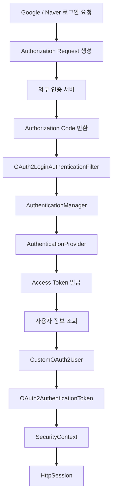

이 구조를 통해 사용자는 Google이나 Naver에서 인증한 후 우리 서비스에 로그인할 수 있다.

그런데 여기서 한 가지 의문이 생긴다.

**외부 인증 제공자가 발급한 Access Token은 어디에 저장될까?**

앞서 Spring Security의 세션 인증을 구현하면서 `SecurityContext`와 `HttpSession`을 사용했다.

하지만 `HttpSession`에 로그인 정보를 저장하는 것과 외부 인증 서버에서 발급받은 Access Token을 저장하는 것은 다른 작업이다.

예를 들어 다음 두 정보를 생각해보자.

첫 번째는 우리 서비스에서 사용하는 인증 정보다.

```text
OAuth2AuthenticationToken
    │
    ├── Principal
    │     └── CustomOAuth2User
    │
    ├── Authorities
    │     └── ROLE_USER
    │
    └── Authenticated
          └── true
```

두 번째는 Google이나 Naver에서 발급받은 외부 인증 정보다.

```text
OAuth2AuthorizedClient
    │
    ├── ClientRegistration
    ├── PrincipalName
    ├── AccessToken
    └── RefreshToken
```

두 객체는 서로 다른 역할을 담당한다.

`OAuth2AuthenticationToken`은 우리 서비스에서 사용자가 인증되었음을 표현한다.

반면 `OAuth2AuthorizedClient`는 외부 인증 제공자의 보호된 리소스에 접근할 수 있도록 발급받은 토큰 정보를 관리한다.

Spring Security는 이러한 OAuth2AuthorizedClient를 저장하고 조회하기 위한 인터페이스를 제공한다.

바로 다음 인터페이스다.

```java
OAuth2AuthorizedClientService
```

이번에는 이 인터페이스의 역할을 이해하고, `JdbcOAuth2AuthorizedClientService`를 이용해 외부 Access Token과 Refresh Token을 MySQL 또는 MariaDB에 저장하는 방법을 살펴본다.

---

### 개념

#### OAuth2AuthorizedClient란?

`OAuth2AuthorizedClient`는 외부 OAuth2 인증 제공자로부터 인가를 받은 클라이언트의 정보를 표현하는 클래스다.

패키지는 다음과 같다.

```java
org.springframework.security.oauth2.client.OAuth2AuthorizedClient
```

여기서 Authorized Client라는 개념을 먼저 이해해야 한다.

OAuth2에서 Client는 외부 인증 서버를 이용하는 애플리케이션이다.

이번 프로젝트에서는 Spring Boot 애플리케이션이 Client다.

사용자가 Google이나 Naver에서 인증을 완료하고 외부 리소스 접근에 동의하면, 우리 애플리케이션은 해당 사용자를 대신해 허용된 외부 리소스에 접근할 수 있는 토큰을 발급받는다.

이때 사용자와 클라이언트, 발급받은 토큰의 관계를 표현하는 객체가 OAuth2AuthorizedClient다.

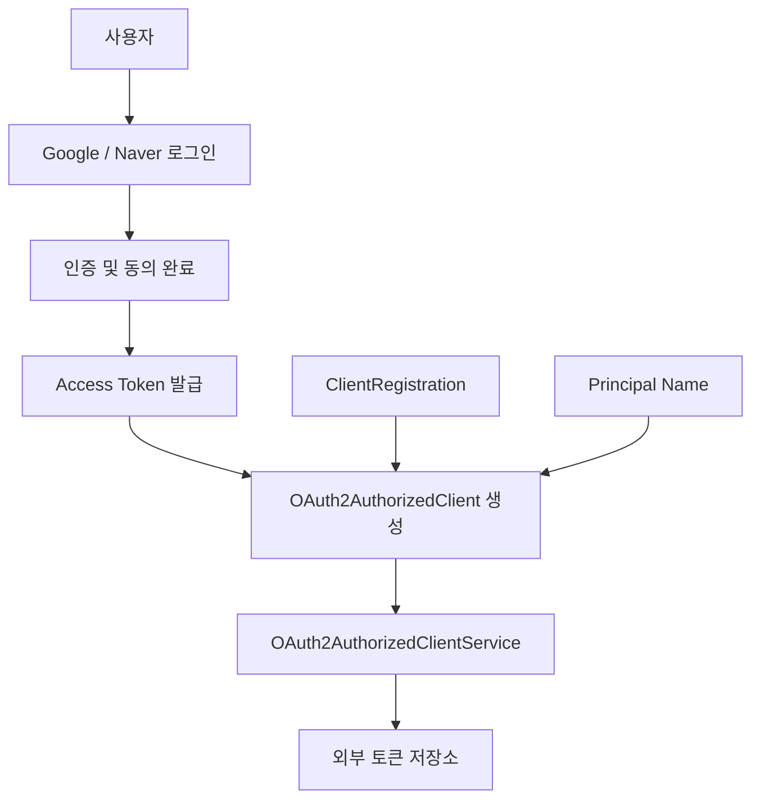

OAuth2AuthorizedClient는 다음과 같은 정보를 가진다.

| 필드 | 역할 |
|---|---|
| `clientRegistration` | 외부 인증 제공자에 등록한 클라이언트 정보 |
| `principalName` | 인가를 받은 사용자 식별자 |
| `accessToken` | 외부 보호된 리소스에 접근하기 위한 토큰 |
| `refreshToken` | Access Token 갱신에 사용할 수 있는 토큰 |

주요 메서드는 다음과 같다.

```java
getClientRegistration();
```

```java
getPrincipalName();
```

```java
getAccessToken();
```

```java
getRefreshToken();
```

여기서 Refresh Token은 항상 존재하는 것이 아니다.

외부 인증 제공자가 Refresh Token을 발급하지 않았다면 `getRefreshToken()`은 `null`을 반환할 수 있다.

#### OAuth2AuthorizedClient의 생성 과정

앞서 살펴본 `OAuth2LoginAuthenticationFilter`는 인증에 성공하면 OAuth2AuthorizedClient를 생성한다.

Spring Security 6.2.1 기준으로 다음과 같은 구조다.

```java
OAuth2AuthorizedClient authorizedClient =
        new OAuth2AuthorizedClient(
                authenticationResult.getClientRegistration(),
                oauth2Authentication.getName(),
                authenticationResult.getAccessToken(),
                authenticationResult.getRefreshToken()
        );
```

이 코드에서 중요한 것은 네 가지 정보다.

```text
ClientRegistration
    +
Principal Name
    +
Access Token
    +
Refresh Token
    ↓
OAuth2AuthorizedClient
```

이렇게 생성된 객체는 OAuth2AuthorizedClientRepository를 통해 저장된다.

이 과정에서 OAuth2AuthorizedClientService가 사용될 수 있다.

---

### OAuth2AuthorizedClientService란?

`OAuth2AuthorizedClientService`는 OAuth2AuthorizedClient의 저장, 조회, 삭제 기능을 제공하는 인터페이스다.

패키지는 다음과 같다.

```java
org.springframework.security.oauth2.client.OAuth2AuthorizedClientService
```

이 인터페이스는 OAuth2 클라이언트의 인가 정보를 관리하는 데 사용된다.

대표적인 메서드는 다음과 같다.

```java
<T extends OAuth2AuthorizedClient> T loadAuthorizedClient(
        String clientRegistrationId,
        String principalName
);
```

```java
void saveAuthorizedClient(
        OAuth2AuthorizedClient authorizedClient,
        Authentication principal
);
```

```java
void removeAuthorizedClient(
        String clientRegistrationId,
        String principalName
);
```

각 메서드의 역할을 정리하면 다음과 같다.

| 메서드 | 역할 |
|---|---|
| `loadAuthorizedClient()` | 저장된 OAuth2AuthorizedClient 조회 |
| `saveAuthorizedClient()` | OAuth2AuthorizedClient 저장 또는 갱신 |
| `removeAuthorizedClient()` | OAuth2AuthorizedClient 삭제 |

이 인터페이스의 중요한 특징은 **저장 방식이 인터페이스에 고정되어 있지 않다는 것**이다.

따라서 구현체에 따라 메모리 또는 데이터베이스를 사용할 수 있다.

---

### 주요 구현체

Spring Security는 OAuth2AuthorizedClientService에 대해 여러 구현체를 제공한다.

대표적인 구현체는 다음과 같다.

```java
InMemoryOAuth2AuthorizedClientService
```

```java
JdbcOAuth2AuthorizedClientService
```

두 구현체의 차이를 살펴보자.

| 구분 | InMemoryOAuth2AuthorizedClientService | JdbcOAuth2AuthorizedClientService |
|---|---|---|
| 저장 위치 | 애플리케이션 메모리 | 관계형 데이터베이스 |
| 데이터 영속성 | 프로세스 종료 시 소실 | DB에 유지 |
| JDBC 필요 | 불필요 | 필요 |
| 테이블 생성 | 불필요 | 필요 |
| 여러 서버 간 공유 | 인스턴스마다 별도 | 공통 DB를 사용하면 공유 가능 |
| 저장 데이터 | OAuth2AuthorizedClient | OAuth2AuthorizedClient |
| 활용 | 간단한 환경, 개발 환경 | 영속 저장이 필요한 환경 |

중요한 점은 `JdbcOAuth2AuthorizedClientService`를 사용하기 위해 개발자가 `OAuth2AuthorizedClientService` 인터페이스를 처음부터 직접 구현할 필요가 없다는 것이다.

Spring Security에서 JDBC 구현체를 이미 제공하기 때문이다.

따라서 일반적인 JDBC 저장 요구사항이라면 다음 객체를 생성하여 활용할 수 있다.

```java
new JdbcOAuth2AuthorizedClientService(
        jdbcTemplate,
        clientRegistrationRepository
);
```

---

### 왜 사용하는가?

#### 1. Access Token을 애플리케이션 메모리 밖에 저장하기 위해서

기본적인 메모리 기반 저장 방식을 생각해보자.

```text
Spring Boot Application
    │
    └── InMemoryOAuth2AuthorizedClientService
          │
          ├── User A → Google Access Token
          ├── User B → Naver Access Token
          └── User C → Google Access Token
```

이 구조에서는 토큰 정보가 애플리케이션 프로세스의 메모리에 저장된다.

따라서 애플리케이션이 재시작되면 저장된 정보가 사라질 수 있다.

```text
Spring Boot 종료
    ↓
메모리 데이터 소실
    ↓
OAuth2AuthorizedClient 정보 소실
```

이때 주의할 점이 있다.

**OAuth2AuthorizedClient 정보가 사라지는 것과 외부 Access Token 자체가 외부 인증 서버에서 무효화되는 것은 다른 문제다.**

우리 서버가 토큰을 저장하지 못한다고 해서 Google이나 Naver가 해당 토큰을 즉시 만료시키는 것은 아니다.

또한 OAuth2AuthorizedClient가 사라졌다고 해서 모든 로그인 세션이 반드시 즉시 무효화되는 것도 아니다.

두 정보는 별도로 관리되기 때문이다.

#### 2. 여러 서버에서 동일한 외부 토큰 정보를 사용하기 위해서

서비스 규모가 커지면 Spring Boot 애플리케이션을 여러 인스턴스로 운영할 수 있다.

예를 들어 다음과 같다.

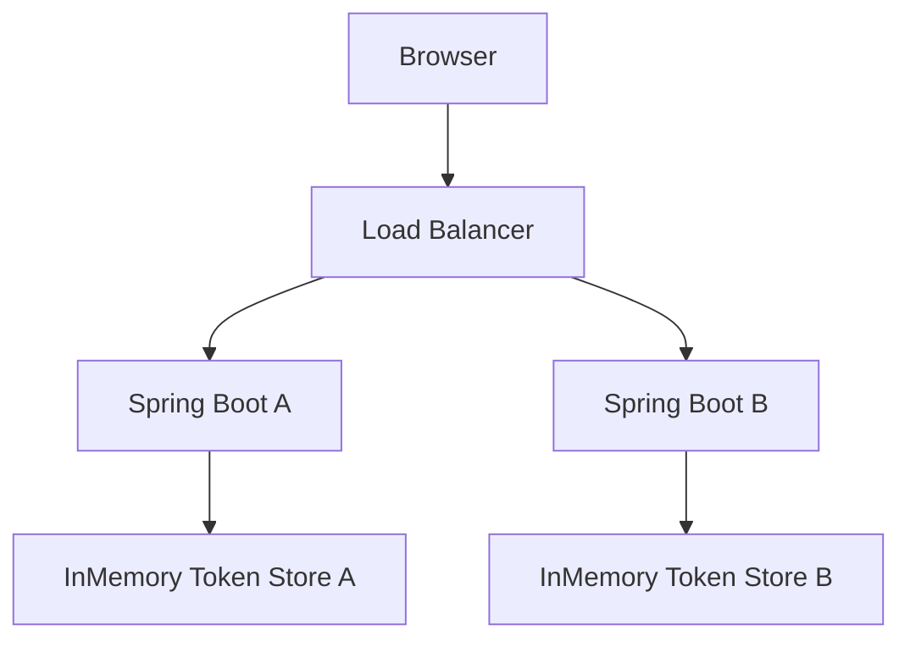

이 구조에서 두 서버는 서로 다른 메모리 저장소를 사용한다.

따라서 A 서버에서 저장한 OAuth2AuthorizedClient를 B 서버에서 조회하지 못할 수 있다.

반면 공통 데이터베이스를 사용한다면 다음과 같이 구성할 수 있다.

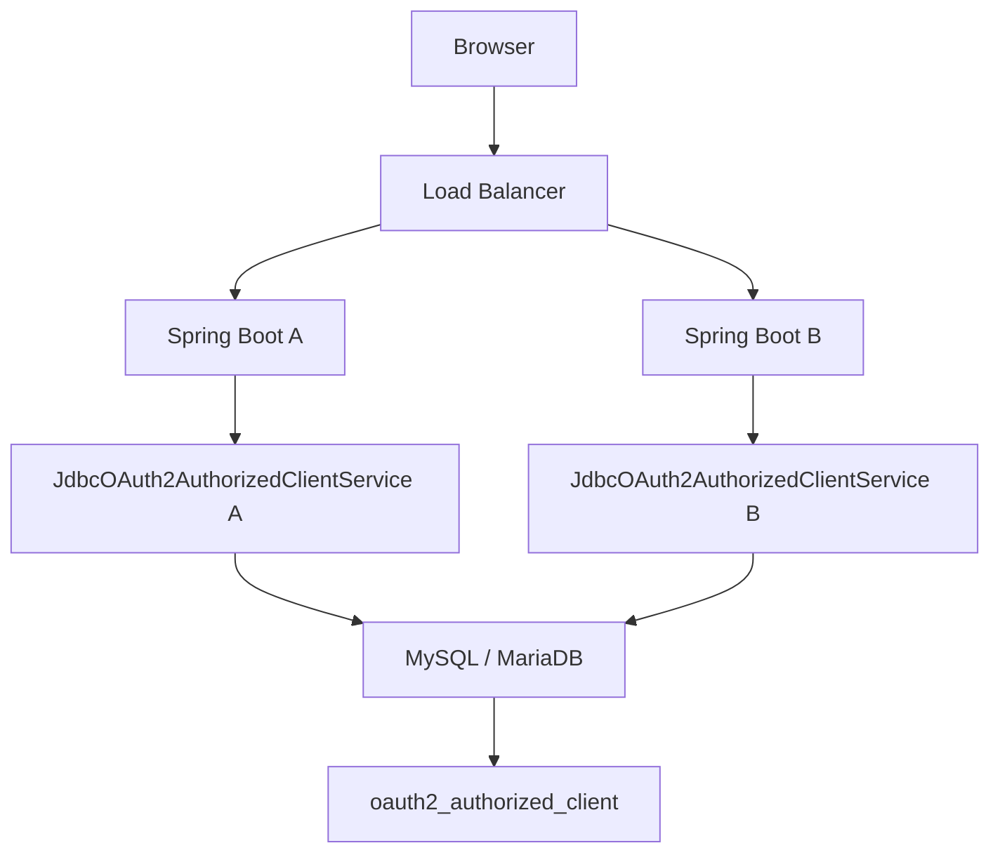

이 구조에서는 여러 서버가 동일한 데이터베이스를 사용하여 OAuth2AuthorizedClient 정보를 공유할 수 있다.

다만 JDBC 저장소를 도입한다고 해서 모든 세션 문제가 자동으로 해결되는 것은 아니다.

OAuth2 인증 요청을 저장하는 HttpSession과 로그인 상태를 저장하는 SecurityContext는 별도의 저장 정책이 필요하다.

#### 3. 로그인 이후에도 외부 API를 호출하기 위해서

사용자가 Google 로그인에 성공했다고 생각해보자.

우리 서비스에서는 인증된 사용자 정보를 얻을 수 있다.

하지만 이후 Google의 보호된 API를 호출하려면 외부 Access Token이 필요할 수 있다.

예를 들어 다음과 같은 기능을 생각할 수 있다.

```text
Google 로그인
    ↓
Access Token 발급
    ↓
Access Token 저장
    ↓
사용자가 외부 API 연동 기능 요청
    ↓
저장된 Access Token 조회
    ↓
Google API 호출
```

이때 OAuth2AuthorizedClientService를 이용해 기존 Access Token을 조회할 수 있다.

물론 해당 Access Token에 필요한 Scope가 부여되어 있어야 하며, 토큰이 만료되지 않았는지도 확인해야 한다.

---

### OAuth2AuthorizedClientRepository와의 차이

이번 주제에서 가장 중요한 개념 중 하나다.

Spring Security에는 다음 두 인터페이스가 존재한다.

```java
OAuth2AuthorizedClientRepository
```

```java
OAuth2AuthorizedClientService
```

이름이 비슷하지만 역할이 다르다.

#### OAuth2AuthorizedClientRepository

OAuth2AuthorizedClientRepository는 HTTP 요청 환경에서 OAuth2AuthorizedClient를 관리하기 위한 인터페이스다.

주요 메서드에는 `HttpServletRequest`, `HttpServletResponse`, `Authentication` 등이 전달된다.

따라서 현재 HTTP 요청과 인증 사용자를 고려한 저장 처리를 구현할 수 있다.

#### OAuth2AuthorizedClientService

OAuth2AuthorizedClientService는 HTTP 요청과 직접적인 결합 없이 OAuth2AuthorizedClient를 저장하고 조회하는 인터페이스다.

다음 두 값을 이용해 인가 정보를 조회한다.

```text
clientRegistrationId

principalName
```

즉 특정 사용자와 OAuth2 Client에 연결된 토큰을 조회할 수 있다.

두 인터페이스의 차이를 정리하면 다음과 같다.

| 구분 | OAuth2AuthorizedClientRepository | OAuth2AuthorizedClientService |
|---|---|---|
| 중심 역할 | HTTP 요청과 연결된 인가 정보 관리 | 인가 정보 저장 및 조회 |
| HTTP 요청 의존 | 있음 | 직접적인 의존 없음 |
| 사용자 식별 | Authentication 활용 | principalName 활용 |
| 대표 구현체 | AuthenticatedPrincipalOAuth2AuthorizedClientRepository | JdbcOAuth2AuthorizedClientService |
| 주요 활용 | Servlet 기반 OAuth2 인증 처리 | 저장소 및 백엔드 로직 |

이 두 인터페이스는 서로 경쟁하는 관계가 아니다.

오히려 하나의 처리 과정에서 함께 사용할 수 있다.

---

### AuthenticatedPrincipalOAuth2AuthorizedClientRepository

Spring Security는 다음 구현체를 제공한다.

```java
AuthenticatedPrincipalOAuth2AuthorizedClientRepository
```

이 클래스는 현재 Principal의 인증 상태에 따라 저장 처리를 위임한다.

핵심적인 구조는 다음과 같다.

```text
OAuth2AuthorizedClientRepository
    ↓
AuthenticatedPrincipalOAuth2AuthorizedClientRepository
    ↓
현재 Principal 인증 여부 확인
    │
    ├── 인증된 사용자
    │     ↓
    │   OAuth2AuthorizedClientService
    │
    └── 익명 사용자
          ↓
        HttpSessionOAuth2AuthorizedClientRepository
```

Spring Security 6.2.1에서는 `AuthenticatedPrincipalOAuth2AuthorizedClientRepository`가 인증된 사용자에 대해 OAuth2AuthorizedClientService를 사용하도록 구성할 수 있다.

따라서 OAuth2AuthorizedClientService를 JDBC 구현체로 변경하면 인증된 사용자의 인가 결과가 데이터베이스에 저장되도록 연결할 수 있다.

여기서 중요한 점은 다음과 같다.

**OAuth2AuthorizedClientService를 등록했다고 해서 OAuth2 인증 과정의 모든 토큰 저장이 무조건 JDBC를 거치는 것은 아니다.**

실제 저장 경로는 OAuth2AuthorizedClientRepository의 구현체와 현재 Authentication의 상태에 따라 달라진다.

---

### 예제

#### 1. 프로젝트 구조

이번에는 기존 OAuth2 프로젝트에 JDBC 기반 저장 설정을 추가한다.

앞서 구현한 사용자 정보 처리 서비스와 UserRepository는 그대로 유지한다.

전체 구조는 다음과 같다.

```text
src/main/java/com/example/oauth2session
│
├── Oauth2SessionApplication.java
│
├── config
│   ├── SecurityConfig.java
│   ├── CustomClientRegistrationRepo.java
│   └── OAuth2AuthorizedClientConfig.java
│
├── oauth2
│   └── SocialClientRegistration.java
│
├── controller
│   ├── LoginController.java
│   └── MyController.java
│
├── service
│   ├── CustomOAuth2UserService.java
│   ├── CustomOidcUserService.java
│   └── SocialUserPersistenceService.java
│
├── entity
│   └── UserEntity.java
│
├── repository
│   └── UserRepository.java
│
└── dto
    └── oauth2
        ├── OAuth2Response.java
        ├── GoogleResponse.java
        ├── NaverResponse.java
        ├── CustomOAuth2User.java
        └── CustomOidcUser.java
```

이번에 추가할 클래스는 다음과 같다.

```text
OAuth2AuthorizedClientConfig.java
```

이 클래스는 JDBC 기반 OAuth2AuthorizedClientService를 생성하고 Spring Bean으로 등록하는 역할을 담당한다.

---

### 2. JDBC 의존성 추가

Spring Security는 JDBC 기반 OAuth2AuthorizedClientService를 제공한다.

따라서 데이터베이스에 토큰 정보를 저장하려면 JDBC 관련 의존성이 필요하다.

기존 프로젝트에서는 Spring Data JPA를 사용하고 있다.

```gradle
implementation 'org.springframework.boot:spring-boot-starter-data-jpa'
```

JPA를 이용해 사용자 정보를 저장하는 것은 기존과 동일하다.

다만 이번에는 `JdbcOAuth2AuthorizedClientService`를 사용하기 위해 JDBC Starter를 명시적으로 추가한다.

#### build.gradle

```gradle
plugins {
    id 'java'
    id 'org.springframework.boot' version '3.2.1'
    id 'io.spring.dependency-management' version '1.1.4'
}

group = 'com.example'

version = '0.0.1-SNAPSHOT'

java {
    toolchain {
        languageVersion = JavaLanguageVersion.of(17)
    }
}

repositories {
    mavenCentral()
}

dependencies {

    // Spring MVC
    implementation 'org.springframework.boot:spring-boot-starter-web'

    // Spring Security
    implementation 'org.springframework.boot:spring-boot-starter-security'

    // OAuth2 Client
    implementation 'org.springframework.boot:spring-boot-starter-oauth2-client'

    // Spring Data JPA
    implementation 'org.springframework.boot:spring-boot-starter-data-jpa'

    // JDBC
    implementation 'org.springframework.boot:spring-boot-starter-jdbc'

    // MySQL
    runtimeOnly 'com.mysql:mysql-connector-j'

    // Mustache
    implementation 'org.springframework.boot:spring-boot-starter-mustache'

    // Test
    testImplementation 'org.springframework.boot:spring-boot-starter-test'

    testImplementation 'org.springframework.security:spring-security-test'

    testRuntimeOnly 'com.h2database:h2'
}

tasks.named('test') {
    useJUnitPlatform()
}
```

이번에 핵심적으로 추가한 의존성은 다음과 같다.

```gradle
implementation 'org.springframework.boot:spring-boot-starter-jdbc'
```

Spring Boot JDBC Starter는 JdbcTemplate을 포함한 JDBC 접근 기능을 제공한다.

다만 `spring-boot-starter-data-jpa`도 일반적으로 JDBC 관련 의존성을 전이적으로 포함한다.

따라서 기존 JPA Starter가 이미 충분한 JDBC 의존성을 제공하는 환경이라면 JDBC Starter를 별도로 추가하지 않아도 동작할 수 있다.

이번에는 JDBC 기반 OAuth2 저장 기능을 사용한다는 점을 명확하게 표현하기 위해 해당 의존성을 선언했다.

---

### 3. JdbcTemplate이란?

`JdbcTemplate`은 Spring Framework에서 제공하는 JDBC 접근 도구다.

패키지는 다음과 같다.

```java
org.springframework.jdbc.core.JdbcTemplate
```

JdbcTemplate을 사용하면 다음과 같은 JDBC 반복 작업을 줄일 수 있다.

```text
Connection 확보

PreparedStatement 생성

SQL 실행

ResultSet 처리

예외 변환

JDBC 리소스 정리
```

예를 들어 특정 사용자의 정보를 조회한다고 생각해보자.

```java
String sql = """
        SELECT id, username
        FROM users
        WHERE username = ?
        """;
```

JdbcTemplate을 이용하면 다음과 같이 조회할 수 있다.

```java
jdbcTemplate.query(
        sql,
        (rs, rowNum) -> rs.getString("username"),
        username
);
```

이번에는 이러한 JdbcTemplate을 직접 이용해 SQL을 작성하는 것이 목적은 아니다.

Spring Security가 제공하는 `JdbcOAuth2AuthorizedClientService`에 JdbcTemplate을 전달하여 기본 JDBC 구현을 재사용한다.

```text
JdbcOAuth2AuthorizedClientService
    ↓
JdbcTemplate
    ↓
DataSource
    ↓
MySQL / MariaDB
```

이렇게 하면 OAuth2AuthorizedClient를 저장하기 위한 SQL을 직접 작성하지 않아도 된다.

---

### 4. OAuth2AuthorizedClientService 설정 클래스 생성

이제 JDBC 기반 저장 서비스를 생성한다.

파일 경로는 다음과 같다.

```text
config/OAuth2AuthorizedClientConfig.java
```

전체 코드는 다음과 같다.

```java
package com.example.oauth2session.config;

import org.springframework.context.annotation.Bean;
import org.springframework.context.annotation.Configuration;

import org.springframework.jdbc.core.JdbcTemplate;

import org.springframework.security.oauth2.client.OAuth2AuthorizedClientService;
import org.springframework.security.oauth2.client.JdbcOAuth2AuthorizedClientService;

import org.springframework.security.oauth2.client.registration.ClientRegistrationRepository;

@Configuration
public class OAuth2AuthorizedClientConfig {

    @Bean
    public OAuth2AuthorizedClientService authorizedClientService(
            JdbcTemplate jdbcTemplate,
            ClientRegistrationRepository clientRegistrationRepository
    ) {

        return new JdbcOAuth2AuthorizedClientService(
                jdbcTemplate,
                clientRegistrationRepository
        );
    }
}
```

코드는 간단하지만 중요한 의미를 가진다.

우선 다음 메서드를 살펴보자.

```java
@Bean
public OAuth2AuthorizedClientService authorizedClientService(
        JdbcTemplate jdbcTemplate,
        ClientRegistrationRepository clientRegistrationRepository
)
```

이 메서드는 OAuth2AuthorizedClientService 구현체를 Spring Bean으로 등록한다.

그리고 다음 코드를 통해 JDBC 구현체를 생성한다.

```java
return new JdbcOAuth2AuthorizedClientService(
        jdbcTemplate,
        clientRegistrationRepository
);
```

여기서 두 가지 객체가 필요하다.

| 매개변수 | 역할 |
|---|---|
| JdbcTemplate | 데이터베이스에 OAuth2AuthorizedClient 저장 및 조회 |
| ClientRegistrationRepository | 저장된 registrationId에 해당하는 ClientRegistration 조회 |

이 둘이 필요한 이유를 살펴보자.

---

### JdbcTemplate이 필요한 이유

JdbcOAuth2AuthorizedClientService는 토큰 정보를 관계형 데이터베이스에 저장한다.

따라서 SQL을 실행하기 위한 JDBC 접근 기능이 필요하다.

예를 들어 다음과 같은 작업이 수행된다.

```sql
INSERT INTO oauth2_authorized_client (...);
```

```sql
SELECT ...
FROM oauth2_authorized_client
WHERE client_registration_id = ?
  AND principal_name = ?;
```

```sql
UPDATE oauth2_authorized_client
SET ...
WHERE client_registration_id = ?
  AND principal_name = ?;
```

```sql
DELETE FROM oauth2_authorized_client
WHERE client_registration_id = ?
  AND principal_name = ?;
```

이러한 SQL 실행을 JdbcTemplate이 담당한다.

따라서 개발자가 별도의 JPA Entity나 JpaRepository를 생성할 필요는 없다.

---

### ClientRegistrationRepository가 필요한 이유

데이터베이스에는 OAuth2AuthorizedClient의 모든 ClientRegistration 객체가 그대로 저장되는 것이 아니다.

대표적으로 다음 정보가 저장된다.

```text
client_registration_id
principal_name
access_token_value
refresh_token_value
...
```

예를 들어 다음과 같은 데이터가 있다고 생각해보자.

```text
client_registration_id = google

principal_name = google:google-user-123
```

JdbcOAuth2AuthorizedClientService가 해당 데이터를 조회했다면 `google`이라는 registrationId에 해당하는 ClientRegistration 객체가 필요하다.

따라서 다음 저장소를 이용한다.

```java
ClientRegistrationRepository
```

개념적인 흐름은 다음과 같다.

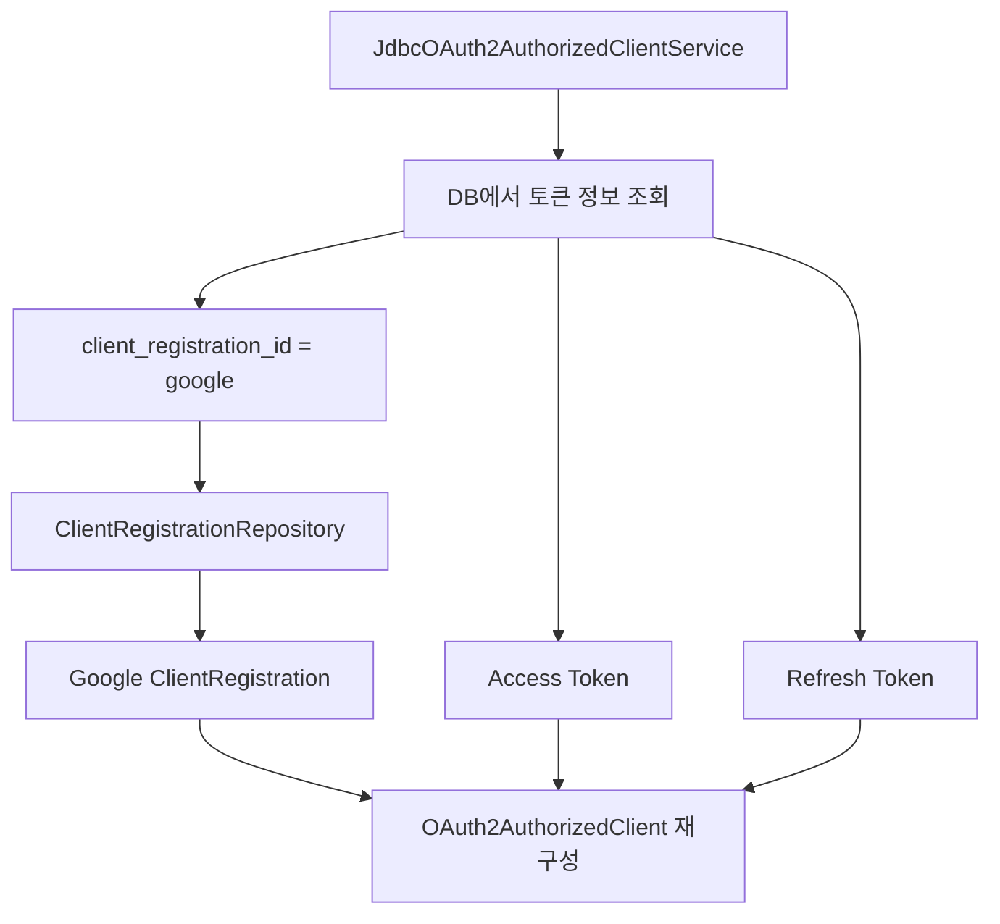

즉 데이터베이스에서 조회한 토큰 정보를 완전한 OAuth2AuthorizedClient로 복원하기 위해 ClientRegistrationRepository가 사용된다.

여기서 중요한 점이 있다.

**DB에 저장된 registrationId가 ClientRegistrationRepository에 존재하지 않으면 정상적으로 OAuth2AuthorizedClient를 복원하지 못할 수 있다.**

따라서 Google이나 Naver의 registrationId를 변경한다면 기존에 저장된 토큰 데이터와의 호환성도 고려해야 한다.

---

### 5. @Bean을 반드시 등록해야 할까?

이번 구현에서 다음 Annotation을 사용했다.

```java
@Bean
```

이 부분은 중요하다.

예를 들어 다음과 같이 메서드만 작성했다고 생각해보자.

```java
@Configuration
public class OAuth2AuthorizedClientConfig {

    public OAuth2AuthorizedClientService authorizedClientService(
            JdbcTemplate jdbcTemplate,
            ClientRegistrationRepository clientRegistrationRepository
    ) {

        return new JdbcOAuth2AuthorizedClientService(
                jdbcTemplate,
                clientRegistrationRepository
        );
    }
}
```

이 메서드는 호출하면 정상적으로 객체를 생성할 수 있다.

하지만 `@Bean`이 없다면 메서드 반환 객체가 자동으로 Spring Bean으로 등록되는 것은 아니다.

따라서 일반적인 Spring Boot 구성에서는 다음처럼 작성하는 것이 좋다.

```java
@Configuration
public class OAuth2AuthorizedClientConfig {

    @Bean
    public OAuth2AuthorizedClientService authorizedClientService(
            JdbcTemplate jdbcTemplate,
            ClientRegistrationRepository clientRegistrationRepository
    ) {

        return new JdbcOAuth2AuthorizedClientService(
                jdbcTemplate,
                clientRegistrationRepository
        );
    }
}
```

이렇게 하면 다른 구성요소에서 OAuth2AuthorizedClientService를 주입받아 사용할 수 있다.

또한 동일한 Spring Bean을 여러 구성요소에서 공유할 수 있다.

---

### 6. SecurityConfig에 JDBC 저장 서비스 등록

이제 JDBC 기반 OAuth2AuthorizedClientService를 Spring Bean으로 등록했다.

다음으로 Spring Security의 OAuth2 Login 설정에 연결해야 한다.

현재 프로젝트에서는 이미 다음 기능을 사용하고 있다.

```text
Google OIDC 로그인

Naver OAuth2 로그인

CustomOAuth2UserService

CustomOidcUserService

커스텀 로그인 화면

HttpSession 인증
```

이 구조를 유지하면서 OAuth2AuthorizedClientService만 JDBC 구현체로 변경한다.

핵심 설정은 다음과 같다.

```java
.oauth2Login(oauth2 -> oauth2

        .authorizedClientService(
                authorizedClientService
        )
)
```

여기서 중요한 부분은 다음과 같다.

```java
.authorizedClientService(authorizedClientService)
```

이 설정을 통해 OAuth2 Login에서 사용할 Authorized Client 저장 서비스를 지정한다.

---

### SecurityConfig 전체 코드

```java
package com.example.oauth2session.config;

import com.example.oauth2session.service.CustomOAuth2UserService;
import com.example.oauth2session.service.CustomOidcUserService;

import org.springframework.context.annotation.Bean;
import org.springframework.context.annotation.Configuration;

import org.springframework.security.config.annotation.web.builders.HttpSecurity;
import org.springframework.security.config.annotation.web.configurers.AbstractHttpConfigurer;

import org.springframework.security.oauth2.client.OAuth2AuthorizedClientService;

import org.springframework.security.web.SecurityFilterChain;

@Configuration
public class SecurityConfig {

    private final CustomOAuth2UserService customOAuth2UserService;

    private final CustomOidcUserService customOidcUserService;

    private final OAuth2AuthorizedClientService authorizedClientService;

    public SecurityConfig(
            CustomOAuth2UserService customOAuth2UserService,
            CustomOidcUserService customOidcUserService,
            OAuth2AuthorizedClientService authorizedClientService
    ) {

        this.customOAuth2UserService =
                customOAuth2UserService;

        this.customOidcUserService =
                customOidcUserService;

        this.authorizedClientService =
                authorizedClientService;
    }

    @Bean
    public SecurityFilterChain securityFilterChain(
            HttpSecurity http
    ) throws Exception {

        http
                // 일반 Form Login 비활성화
                .formLogin(AbstractHttpConfigurer::disable)

                // HTTP Basic 인증 비활성화
                .httpBasic(AbstractHttpConfigurer::disable)

                // OAuth2 로그인 설정
                .oauth2Login(oauth2 -> oauth2

                        // 커스텀 로그인 화면
                        .loginPage("/login")

                        // OAuth2 Authorized Client JDBC 저장
                        .authorizedClientService(
                                authorizedClientService
                        )

                        // 사용자 정보 처리
                        .userInfoEndpoint(userInfo -> userInfo

                                // Naver 일반 OAuth2
                                .userService(customOAuth2UserService)

                                // Google OIDC
                                .oidcUserService(customOidcUserService)
                        )
                )

                // 경로별 인가 설정
                .authorizeHttpRequests(auth -> auth

                        .requestMatchers(
                                "/",
                                "/login",
                                "/error",
                                "/css/**",
                                "/js/**",
                                "/images/**",
                                "/oauth2/authorization/**",
                                "/login/oauth2/code/**"
                        ).permitAll()

                        .anyRequest().authenticated()
                );

        return http.build();
    }
}
```

이번 설정에서는 ClientRegistrationRepository를 직접 지정하지 않았다.

그 이유는 앞서 다음 Bean을 등록했기 때문이다.

```java
@Bean
public ClientRegistrationRepository clientRegistrationRepository() {
    // ...
}
```

Spring Security는 등록된 ClientRegistrationRepository Bean을 사용할 수 있다.

또한 JDBC 저장 서비스도 별도 Bean으로 등록했으므로 SecurityConfig에서 생성자 주입으로 전달받을 수 있다.

#### 이 설정이 내부적으로 수행하는 작업

Spring Security 6.2.1에서는 `authorizedClientService()`가 전달받은 OAuth2AuthorizedClientService를 이용해 `AuthenticatedPrincipalOAuth2AuthorizedClientRepository`를 구성한다.

따라서 전체 관계는 다음과 같다.

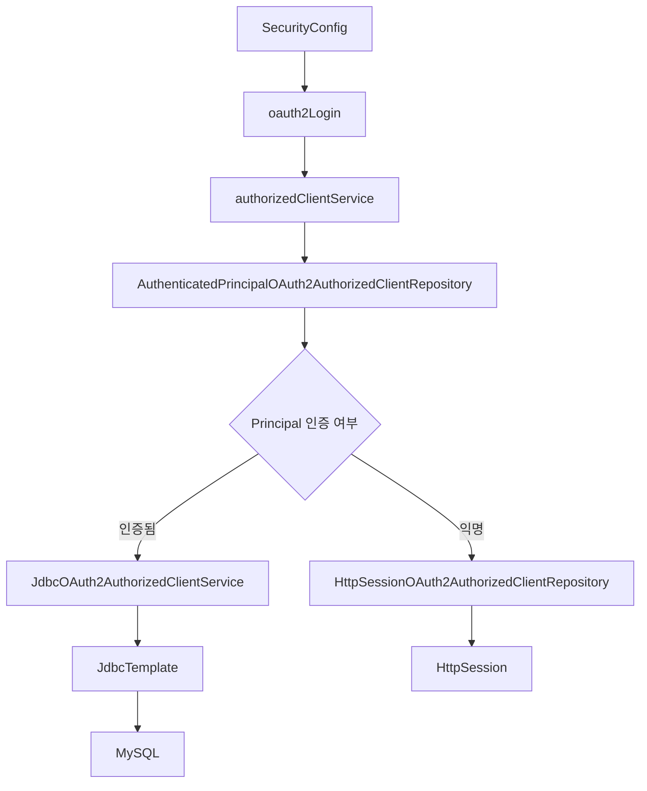

즉 다음 메서드를 호출한다고 해서 항상 DB에 토큰을 저장하는 것은 아니다.

```java
authorizedClientRepository.saveAuthorizedClient(...);
```

현재 Principal의 인증 상태에 따라 적절한 저장 방식이 선택될 수 있다.

---

### 7. 데이터베이스 테이블 생성

이제 JDBC 저장 서비스에서 사용할 테이블이 필요하다.

이번 구현에서 사용되는 테이블 이름은 다음과 같다.

```text
oauth2_authorized_client
```

여기서 중요한 점이 있다.

기존에 구현한 `UserEntity`는 내부 회원 정보를 저장한다.

하지만 `oauth2_authorized_client`는 외부 인증 제공자가 발급한 토큰 정보를 저장한다.

따라서 두 테이블은 서로 다른 목적을 가진다.

```text
users
    ↓
우리 서비스 회원 정보
```

```text
oauth2_authorized_client
    ↓
외부 OAuth2 인가 정보
```

또한 `JdbcOAuth2AuthorizedClientService`는 JPA Entity를 이용하지 않는다.

따라서 `spring.jpa.hibernate.ddl-auto` 설정만으로 OAuth2AuthorizedClient 테이블이 자동 생성되는 것은 아니다.

직접 SQL을 실행하거나 데이터베이스 마이그레이션 도구를 이용해 생성해야 한다.

#### 테이블 생성 SQL

Spring Security 6.2.1에서 제공하는 기본 스키마는 다음과 같다.

```sql
CREATE TABLE oauth2_authorized_client (
    client_registration_id varchar(100) NOT NULL,
    principal_name varchar(200) NOT NULL,
    access_token_type varchar(100) NOT NULL,
    access_token_value blob NOT NULL,
    access_token_issued_at timestamp NOT NULL,
    access_token_expires_at timestamp NOT NULL,
    access_token_scopes varchar(1000) DEFAULT NULL,
    refresh_token_value blob DEFAULT NULL,
    refresh_token_issued_at timestamp DEFAULT NULL,
    created_at timestamp DEFAULT CURRENT_TIMESTAMP NOT NULL,
    PRIMARY KEY (client_registration_id, principal_name)
);
```

이 스키마는 Spring Security 6.2.1의 JDBC 구현에서 사용하는 기본 테이블 구조다.

각 컬럼의 역할을 살펴보자.

| 컬럼 | 자료형 | 역할 |
|---|---|---|
| client_registration_id | varchar(100) | Google, Naver 등 ClientRegistration 식별자 |
| principal_name | varchar(200) | 인증된 사용자 식별자 |
| access_token_type | varchar(100) | Bearer 등 토큰 유형 |
| access_token_value | blob | Access Token 값 |
| access_token_issued_at | timestamp | Access Token 발급 시각 |
| access_token_expires_at | timestamp | Access Token 만료 시각 |
| access_token_scopes | varchar(1000) | 발급된 Access Token의 Scope |
| refresh_token_value | blob | Refresh Token 값 |
| refresh_token_issued_at | timestamp | Refresh Token 발급 시각 |
| created_at | timestamp | 레코드 최초 생성 시각 |

여기서 특히 중요한 컬럼은 다음 두 가지다.

```text
client_registration_id
```

```text
principal_name
```

이 두 컬럼이 복합 기본키로 사용된다.

---

### 복합 기본키를 사용하는 이유

다음 SQL을 살펴보자.

```sql
PRIMARY KEY (
    client_registration_id,
    principal_name
)
```

이 설정은 OAuth2 Client와 사용자 식별자의 조합을 유일하게 관리한다.

예를 들어 다음과 같은 데이터가 있을 수 있다.

| client_registration_id | principal_name |
|---|---|
| google | google:google-user-123 |
| naver | naver:naver-user-456 |
| google | google:google-user-789 |

같은 사용자가 동일한 OAuth2 Client에 대해 다시 인가를 받더라도, 동일한 복합키를 사용한다면 별도 레코드를 계속 추가하는 것이 아니라 기존 데이터를 갱신할 수 있다.

반면 서로 다른 ClientRegistration에 대해서는 별도의 인가 정보를 보관할 수 있다.

이러한 구조는 다음 관계를 표현한다.

```text
하나의 OAuth2 Client
    +
하나의 Principal
    ↓
하나의 OAuth2AuthorizedClient
```

#### 여러 소셜 계정을 연결하는 경우

추후 하나의 내부 회원에 여러 소셜 계정을 연결한다면 principalName 설계가 중요해진다.

예를 들어 내부 회원 ID를 Principal 이름으로 사용한다면 다음과 같은 데이터가 가능하다.

```text
google + user:10001
```

```text
naver + user:10001
```

하지만 현재 프로젝트에서는 외부 제공자와 Provider User ID를 결합한 값을 Principal 이름으로 사용한다.

```text
google:google-user-123
```

따라서 현재 구조에서는 각각의 소셜 계정을 별도의 Principal로 관리하는 형태다.

이 설계는 이후 계정 통합 기능을 구현할 때 함께 검토해야 한다.

---

### 8. principal_name과 CustomOAuth2User.getName()의 관계

이번 내용에서 반드시 이해해야 할 부분이다.

앞서 CustomOAuth2User를 구현하면서 다음 메서드를 작성했다.

```java
@Override
public String getName() {

    return provider + ":" + providerUserId;
}
```

예를 들어 Google 사용자라면 다음 값을 반환한다.

```text
google:google-user-123
```

Naver 사용자라면 다음과 같다.

```text
naver:naver-user-456
```

이 값은 Spring Security의 Authentication에서 Principal 이름으로 사용될 수 있다.

```java
authentication.getName();
```

OAuth2LoginAuthenticationFilter는 인증 성공 이후 이 이름을 이용해 OAuth2AuthorizedClient를 생성한다.

개념적인 구조는 다음과 같다.

```java
OAuth2AuthorizedClient authorizedClient =
        new OAuth2AuthorizedClient(
                clientRegistration,
                authentication.getName(),
                accessToken,
                refreshToken
        );
```

이후 JDBC 저장 서비스에서는 이 값이 `principal_name`에 저장된다.

```text
CustomOAuth2User.getName()
    ↓
OAuth2AuthenticationToken.getName()
    ↓
OAuth2AuthorizedClient.principalName
    ↓
oauth2_authorized_client.principal_name
```

따라서 `getName()`의 반환값은 단순히 화면에 표시할 사용자 이름이 아니다.

**OAuth2AuthorizedClient 저장과 조회에 사용되는 식별자이기도 하다.**

이 때문에 `getName()`에서 변경 가능한 닉네임이나 이메일을 사용하면 문제가 발생할 수 있다.

예를 들어 처음 로그인했을 때 다음 값이 저장되었다고 생각해보자.

```text
principal_name = old@example.com
```

이후 사용자의 이메일이 변경되었다.

```text
new@example.com
```

그런데 `getName()`이 이메일을 반환한다면 기존 저장된 OAuth2AuthorizedClient를 새로운 Principal 이름으로 조회하지 못할 수 있다.

따라서 안정적인 사용자 식별자를 사용하는 것이 좋다.

현재 구현에서는 다음 조합을 사용한다.

```text
provider + ":" + providerUserId
```

이후 내부 회원 ID가 확립되면 해당 ID를 기준으로 설계하는 방법도 고려할 수 있다.

---

### 구조

#### OAuth2AuthorizedClient 저장 전체 흐름

이제 실제 로그인 과정에서 OAuth2AuthorizedClient가 어떻게 저장되는지 살펴보자.

사용자가 Google 로그인을 완료했다고 생각해보자.

Spring Security는 Authorization Code를 이용해 Access Token을 발급받는다.

이후 사용자 정보를 조회하고 Authentication을 구성한다.

그다음 OAuth2AuthorizedClient를 생성하여 저장한다.

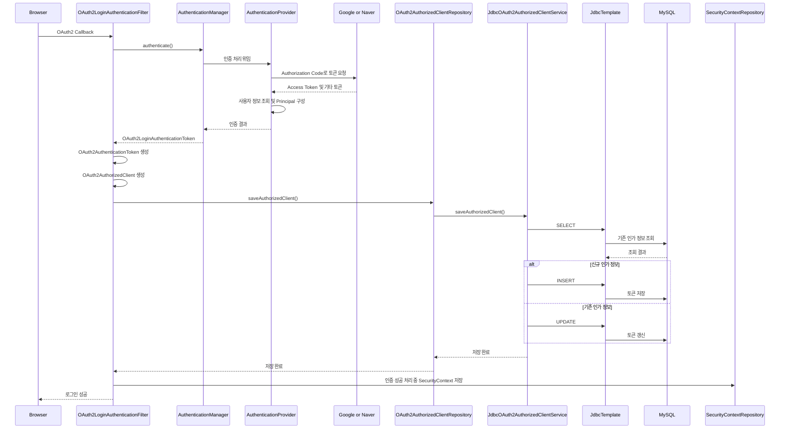

이 다이어그램에서 중요한 부분은 다음과 같다.

첫째, OAuth2LoginAuthenticationFilter가 인증 결과를 받는다.

둘째, OAuth2AuthenticationToken을 생성한다.

셋째, OAuth2AuthorizedClient를 생성한다.

넷째, OAuth2AuthorizedClientRepository에 저장을 요청한다.

다섯째, 인증된 사용자라면 JDBC 기반 OAuth2AuthorizedClientService가 사용될 수 있다.

여섯째, 기존 데이터가 존재하면 UPDATE를 수행하고, 존재하지 않으면 INSERT를 수행한다.

일곱째, 이후 인증 성공 처리 과정에서 SecurityContext가 저장된다.

즉 **외부 토큰을 DB에 저장하는 단계와 우리 서비스의 인증 상태를 세션에 저장하는 단계는 구분된다.**

---

### JdbcOAuth2AuthorizedClientService 내부 동작

이번에는 Spring Security 6.2.1의 실제 JDBC 구현을 기준으로 살펴보자.

`JdbcOAuth2AuthorizedClientService`는 다음 인터페이스를 구현한다.

```java
public class JdbcOAuth2AuthorizedClientService
        implements OAuth2AuthorizedClientService {
}
```

내부적으로 JdbcOperations를 사용한다.

```java
protected final JdbcOperations jdbcOperations;
```

여기서 JdbcTemplate은 JdbcOperations의 구현체다.

따라서 생성자에 JdbcTemplate을 전달할 수 있다.

```java
new JdbcOAuth2AuthorizedClientService(
        jdbcTemplate,
        clientRegistrationRepository
);
```

이 클래스는 OAuth2AuthorizedClient 저장과 조회를 위해 SQL을 직접 실행한다.

주요 메서드는 다음과 같다.

```text
loadAuthorizedClient()

saveAuthorizedClient()

removeAuthorizedClient()
```

각 메서드의 내부 처리 과정을 살펴보자.

---

### 1. loadAuthorizedClient()

`loadAuthorizedClient()`는 특정 OAuth2 Client와 사용자에 해당하는 인가 정보를 조회한다.

메서드의 매개변수는 다음과 같다.

```java
loadAuthorizedClient(
        String clientRegistrationId,
        String principalName
)
```

예를 들어 다음과 같이 호출할 수 있다.

```java
OAuth2AuthorizedClient authorizedClient =
        authorizedClientService.loadAuthorizedClient(
                "google",
                "google:google-user-123"
        );
```

이 메서드는 다음 조건으로 데이터베이스를 조회한다.

```sql
SELECT
    client_registration_id,
    principal_name,
    access_token_type,
    access_token_value,
    access_token_issued_at,
    access_token_expires_at,
    access_token_scopes,
    refresh_token_value,
    refresh_token_issued_at
FROM oauth2_authorized_client
WHERE client_registration_id = ?
  AND principal_name = ?;
```

여기서 중요한 부분은 WHERE 조건이다.

```sql
WHERE client_registration_id = ?
  AND principal_name = ?;
```

즉 다음 두 값이 일치해야 한다.

```text
OAuth2 Client 식별자
    +
Principal 식별자
```

조회 결과가 존재하면 해당 데이터를 OAuth2AuthorizedClient로 변환한다.

존재하지 않는다면 `null`을 반환한다.

#### 조회 결과의 객체 복원

데이터베이스에 저장된 정보는 문자열과 바이너리 데이터 등으로 구성된다.

하지만 Spring Security에서는 OAuth2AuthorizedClient 객체가 필요하다.

따라서 JDBC 구현체는 RowMapper를 이용해 데이터를 변환한다.

대표적인 클래스는 다음과 같다.

```java
OAuth2AuthorizedClientRowMapper
```

이 RowMapper는 다음 과정을 수행한다.

```text
ResultSet
    ↓
client_registration_id 조회
    ↓
ClientRegistrationRepository 조회
    ↓
Access Token 복원
    ↓
Refresh Token 복원
    ↓
OAuth2AuthorizedClient 생성
```

이 과정에서 ClientRegistrationRepository가 필요하다는 점이 중요하다.

DB에서 Access Token을 읽어왔다고 해서 곧바로 OAuth2AuthorizedClient가 완성되는 것은 아니다.

해당 토큰에 연결된 ClientRegistration도 함께 구성해야 한다.

---

### 2. saveAuthorizedClient()

`saveAuthorizedClient()`는 OAuth2AuthorizedClient를 저장한다.

메서드는 다음과 같다.

```java
void saveAuthorizedClient(
        OAuth2AuthorizedClient authorizedClient,
        Authentication principal
);
```

이때 중요한 매개변수는 두 가지다.

```text
OAuth2AuthorizedClient
    ↓
저장할 토큰 및 클라이언트 정보
```

```text
Authentication
    ↓
현재 인증 사용자 정보
```

실제 JDBC 구현에서는 먼저 기존 데이터가 존재하는지 확인한다.

```text
saveAuthorizedClient()
    ↓
loadAuthorizedClient()
    ↓
기존 데이터 존재?
    │
    ├── Yes
    │     ↓
    │   UPDATE
    │
    └── No
          ↓
        INSERT
```

여기서 단순히 무조건 INSERT를 수행하지 않는다는 점이 중요하다.

동일한 ClientRegistration과 Principal의 조합이 이미 존재한다면 해당 정보를 갱신한다.

---

### INSERT 처리

신규 OAuth2AuthorizedClient라면 INSERT가 수행된다.

다음과 같은 SQL을 사용한다.

```sql
INSERT INTO oauth2_authorized_client (
    client_registration_id,
    principal_name,
    access_token_type,
    access_token_value,
    access_token_issued_at,
    access_token_expires_at,
    access_token_scopes,
    refresh_token_value,
    refresh_token_issued_at
)
VALUES (
    ?, ?, ?, ?, ?, ?, ?, ?, ?
);
```

예를 들어 Google 로그인에 성공했다면 다음 정보가 저장될 수 있다.

```text
client_registration_id = google

principal_name = google:google-user-123

access_token_type = Bearer

access_token_value = 발급받은 Access Token

access_token_issued_at = 발급 시각

access_token_expires_at = 만료 시각
```

Refresh Token이 발급되었다면 해당 값도 저장된다.

반면 발급되지 않았다면 refresh_token_value는 NULL일 수 있다.

---

### UPDATE 처리

기존 인가 정보가 존재한다면 UPDATE가 수행된다.

```sql
UPDATE oauth2_authorized_client
SET
    access_token_type = ?,
    access_token_value = ?,
    access_token_issued_at = ?,
    access_token_expires_at = ?,
    access_token_scopes = ?,
    refresh_token_value = ?,
    refresh_token_issued_at = ?
WHERE client_registration_id = ?
  AND principal_name = ?;
```

예를 들어 사용자가 동일한 Google 계정으로 다시 로그인하여 새로운 Access Token을 발급받았다면 기존 데이터를 갱신할 수 있다.

```text
기존 Access Token
    ↓
새로운 Access Token 발급
    ↓
동일한 ClientRegistration + Principal
    ↓
기존 레코드 UPDATE
```

이렇게 하면 동일한 사용자와 OAuth2 Client 조합에 대해 불필요한 중복 레코드가 증가하는 것을 방지할 수 있다.

#### 동시에 저장 요청이 발생한다면?

Spring Security 6.2.1의 JDBC 구현은 기존 데이터가 없다고 판단한 뒤 INSERT를 수행했을 때 `DuplicateKeyException`이 발생하면 UPDATE를 시도하는 처리를 포함한다.

예를 들어 다음 상황을 생각해보자.

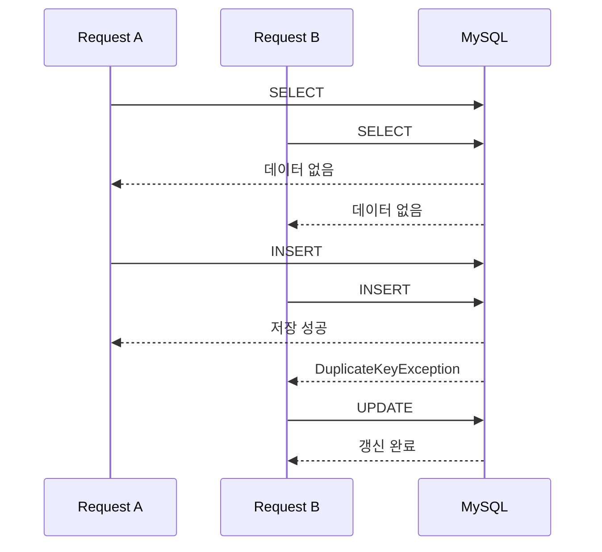

이처럼 단순한 조회 후 INSERT만 사용하는 것보다 중복 저장 상황을 처리할 수 있도록 구성되어 있다.

다만 이 동작이 모든 동시성 문제를 해결하는 것은 아니다.

예를 들어 서로 다른 토큰이 동시에 저장되었다면 마지막으로 반영된 값이 남을 수 있다.

따라서 토큰 갱신 경쟁이 중요한 서비스에서는 별도의 동시성 정책을 고려해야 한다.

---

### 3. removeAuthorizedClient()

`removeAuthorizedClient()`는 저장된 OAuth2AuthorizedClient를 삭제한다.

메서드는 다음과 같다.

```java
void removeAuthorizedClient(
        String clientRegistrationId,
        String principalName
);
```

예를 들어 다음과 같이 호출할 수 있다.

```java
authorizedClientService.removeAuthorizedClient(
        "google",
        "google:google-user-123"
);
```

내부적으로는 다음과 같은 SQL이 실행된다.

```sql
DELETE FROM oauth2_authorized_client
WHERE client_registration_id = ?
  AND principal_name = ?;
```

이 메서드는 우리 서버의 저장소에서 OAuth2AuthorizedClient 정보를 제거한다.

여기서 중요한 점이 있다.

**OAuth2AuthorizedClient를 DB에서 삭제했다고 해서 Google이나 Naver에 발급된 Access Token이 자동으로 폐기되는 것은 아니다.**

DB 삭제와 외부 토큰 폐기는 서로 다른 작업이다.

외부 인증 제공자가 토큰 폐기 API를 지원한다면 별도의 요청이 필요할 수 있다.

---

### MySQL에서 실제 저장 결과 확인하기

이제 JDBC 저장 서비스가 정상적으로 동작하는지 확인해보자.

먼저 MySQL에 접속한다.

Windows PowerShell에서 다음 명령을 사용할 수 있다.

```powershell
mysql -u oauth2_app -p
```

비밀번호 입력 후 데이터베이스를 선택한다.

```sql
USE oauth2;
```

테이블이 존재하는지 확인한다.

```sql
SHOW TABLES;
```

정상적으로 생성되었다면 다음 테이블을 확인할 수 있다.

```text
oauth2_authorized_client
```

이후 테이블 구조를 확인한다.

```sql
DESC oauth2_authorized_client;
```

이제 Spring Boot 애플리케이션을 실행한다.

```powershell
.\gradlew.bat bootRun
```

각 명령의 의미는 다음과 같다.

| 명령 | 의미 |
|---|---|
| `mysql -u oauth2_app -p` | MySQL 접속 |
| `USE oauth2` | 데이터베이스 선택 |
| `SHOW TABLES` | 테이블 목록 확인 |
| `DESC` | 테이블 컬럼 확인 |
| `.\gradlew.bat bootRun` | Spring Boot 실행 |

애플리케이션이 정상적으로 시작되면 다음과 유사한 로그를 확인할 수 있다.

```text
Tomcat started on port 8080 (http)

Started Oauth2SessionApplication
```

이제 브라우저에서 로그인 화면에 접근한다.

```text
http://localhost:8080/login
```

Google 또는 Naver 로그인을 진행한다.

정상적으로 인증이 완료되고 JDBC 저장 서비스가 연결되어 있다면 `oauth2_authorized_client` 테이블에 레코드가 생성될 수 있다.

---

### Access Token 저장 결과 확인

실제 Access Token 값은 민감한 정보다.

따라서 토큰 값 전체를 출력하는 대신 메타데이터를 조회한다.

다음 SQL을 실행한다.

```sql
SELECT
    client_registration_id,
    principal_name,
    access_token_type,
    access_token_issued_at,
    access_token_expires_at,
    access_token_scopes,
    refresh_token_value IS NOT NULL AS has_refresh_token,
    created_at
FROM oauth2_authorized_client;
```

정상적으로 저장되었다면 다음과 유사한 결과를 확인할 수 있다.

```text
client_registration_id : google

principal_name : google:google-user-123

access_token_type : Bearer

access_token_issued_at : 발급 시각

access_token_expires_at : 만료 시각

access_token_scopes : profile,email,openid

has_refresh_token : 0
```

위 결과는 예시이며 실제 Scope와 Refresh Token 발급 여부는 인증 제공자의 응답에 따라 달라진다.

이때 주의해야 한다.

다음 SQL은 운영 환경에서 사용하지 않는 것이 좋다.

```sql
SELECT *
FROM oauth2_authorized_client;
```

Access Token과 Refresh Token 원문이 조회 결과에 포함될 수 있기 때문이다.

운영 환경에서는 필요한 메타데이터만 제한적으로 확인하는 것이 적절하다.

---

### OAuth2AuthorizedClientService 직접 조회하기

이번에는 애플리케이션 코드에서 저장된 OAuth2AuthorizedClient를 조회하는 방법을 살펴보자.

Spring Security가 제공하는 인터페이스를 이용하면 된다.

```java
OAuth2AuthorizedClient authorizedClient =
        authorizedClientService.loadAuthorizedClient(
                registrationId,
                principalName
        );
```

현재 프로젝트에서는 `authentication.getName()`을 이용해 Principal 이름을 가져올 수 있다.

예를 들어 다음과 같다.

```java
String principalName =
        authentication.getName();
```

그리고 현재 사용자의 OAuth2 Client 인가 정보를 조회할 수 있다.

```java
OAuth2AuthorizedClient authorizedClient =
        authorizedClientService.loadAuthorizedClient(
                "google",
                principalName
        );
```

다만 실제 서비스에서는 사용자가 임의의 principalName을 전달해 다른 사용자의 토큰을 조회하지 못하도록 해야 한다.

따라서 HTTP 요청에서 전달받은 사용자 식별자를 그대로 신뢰하지 않고, 서버에서 확인한 Authentication을 기준으로 조회해야 한다.

---

### OAuth2 Authorized Client 상태 확인 API

이번에는 Access Token 원문을 노출하지 않고 저장 상태만 확인하는 API를 작성해보자.

파일 경로는 다음과 같다.

```text
controller/OAuth2ClientStatusController.java
```

전체 코드는 다음과 같다.

```java
package com.example.oauth2session.controller;

import java.time.Instant;

import org.springframework.http.ResponseEntity;

import org.springframework.security.core.Authentication;

import org.springframework.security.oauth2.client.OAuth2AuthorizedClient;
import org.springframework.security.oauth2.client.OAuth2AuthorizedClientService;

import org.springframework.security.oauth2.client.authentication.OAuth2AuthenticationToken;

import org.springframework.web.bind.annotation.GetMapping;
import org.springframework.web.bind.annotation.RestController;

@RestController
public class OAuth2ClientStatusController {

    private final OAuth2AuthorizedClientService authorizedClientService;

    public OAuth2ClientStatusController(
            OAuth2AuthorizedClientService authorizedClientService
    ) {

        this.authorizedClientService =
                authorizedClientService;
    }

    @GetMapping("/api/oauth2/status")
    public ResponseEntity<OAuth2ClientStatusResponse> status(
            Authentication authentication
    ) {

        if (!(authentication instanceof OAuth2AuthenticationToken oauth2Token)) {
            return ResponseEntity.status(401).build();
        }

        String registrationId =
                oauth2Token.getAuthorizedClientRegistrationId();

        String principalName =
                authentication.getName();

        OAuth2AuthorizedClient authorizedClient =
                authorizedClientService.loadAuthorizedClient(
                        registrationId,
                        principalName
                );

        if (authorizedClient == null) {
            return ResponseEntity.notFound().build();
        }

        Instant expiresAt =
                authorizedClient.getAccessToken().getExpiresAt();

        boolean expired =
                expiresAt != null
                && !expiresAt.isAfter(Instant.now());

        return ResponseEntity.ok(
                new OAuth2ClientStatusResponse(
                        registrationId,
                        expiresAt,
                        expired,
                        authorizedClient.getRefreshToken() != null
                )
        );
    }

    public record OAuth2ClientStatusResponse(
            String provider,
            Instant accessTokenExpiresAt,
            boolean accessTokenExpired,
            boolean hasRefreshToken
    ) {
    }
}
```

이 API는 현재 로그인한 사용자의 OAuth2AuthorizedClient 상태를 확인한다.

응답은 다음과 유사하다.

```json
{
  "provider": "google",
  "accessTokenExpiresAt": "2026-11-23T03:00:00Z",
  "accessTokenExpired": false,
  "hasRefreshToken": false
}
```

여기서 중요한 점은 Access Token 원문을 응답하지 않는다는 것이다.

대신 다음 정보만 제공한다.

```text
인증 제공자

Access Token 만료 시각

Access Token 만료 여부

Refresh Token 존재 여부
```

이렇게 하면 JDBC 저장 서비스가 정상적으로 연결되어 있는지 확인하면서 민감한 토큰 값의 노출을 줄일 수 있다.

또한 이 API는 인증된 사용자만 접근할 수 있도록 SecurityConfig에서 보호해야 한다.

기존 설정의 다음 부분이 적용된다.

```java
.anyRequest().authenticated()
```

---

### JdbcOAuth2AuthorizedClientService 테스트

실제 Google이나 Naver에 접속하지 않고도 JDBC 기반 저장 서비스의 동작을 검증할 수 있다.

이번에는 H2 인메모리 데이터베이스를 테스트 환경에서 사용한다.

운영 DB는 MySQL을 사용하더라도 JDBC 저장 서비스의 기본 CRUD 동작은 별도로 검증할 수 있다.

#### 테스트 의존성

```gradle
testImplementation 'org.springframework.boot:spring-boot-starter-test'

testRuntimeOnly 'com.h2database:h2'
```

#### 테스트 코드

```java
package com.example.oauth2session;

import java.time.Instant;
import java.util.Set;

import org.junit.jupiter.api.AfterEach;
import org.junit.jupiter.api.BeforeEach;
import org.junit.jupiter.api.Test;

import org.springframework.jdbc.core.JdbcTemplate;

import org.springframework.jdbc.datasource.embedded.EmbeddedDatabase;
import org.springframework.jdbc.datasource.embedded.EmbeddedDatabaseBuilder;
import org.springframework.jdbc.datasource.embedded.EmbeddedDatabaseType;

import org.springframework.security.authentication.TestingAuthenticationToken;

import org.springframework.security.oauth2.client.JdbcOAuth2AuthorizedClientService;
import org.springframework.security.oauth2.client.OAuth2AuthorizedClient;

import org.springframework.security.oauth2.client.registration.ClientRegistration;
import org.springframework.security.oauth2.client.registration.InMemoryClientRegistrationRepository;

import org.springframework.security.config.oauth2.client.CommonOAuth2Provider;

import org.springframework.security.oauth2.core.OAuth2AccessToken;
import org.springframework.security.oauth2.core.OAuth2RefreshToken;

import static org.junit.jupiter.api.Assertions.*;

class JdbcOAuth2AuthorizedClientServiceTest {

    private EmbeddedDatabase database;

    private JdbcOAuth2AuthorizedClientService service;

    private ClientRegistration google;

    private TestingAuthenticationToken authentication;

    @BeforeEach
    void setUp() {

        database = new EmbeddedDatabaseBuilder()
                .setType(EmbeddedDatabaseType.H2)
                .addScript(
                        "classpath:org/springframework/security/oauth2/client/oauth2-client-schema.sql"
                )
                .build();

        JdbcTemplate jdbcTemplate =
                new JdbcTemplate(database);

        google = CommonOAuth2Provider.GOOGLE
                .getBuilder("google")
                .clientId("test-google-client-id")
                .clientSecret("test-google-client-secret")
                .build();

        InMemoryClientRegistrationRepository registrations =
                new InMemoryClientRegistrationRepository(google);

        service = new JdbcOAuth2AuthorizedClientService(
                jdbcTemplate,
                registrations
        );

        authentication = new TestingAuthenticationToken(
                "google:google-user-123",
                "unused",
                "ROLE_USER"
        );
    }

    @AfterEach
    void tearDown() {

        database.shutdown();
    }

    @Test
    void OAuth2AuthorizedClient를_저장하고_조회한다() {

        Instant now = Instant.now();

        OAuth2AccessToken accessToken =
                new OAuth2AccessToken(
                        OAuth2AccessToken.TokenType.BEARER,
                        "test-access-token",
                        now,
                        now.plusSeconds(3600),
                        Set.of("profile", "email")
                );

        OAuth2RefreshToken refreshToken =
                new OAuth2RefreshToken(
                        "test-refresh-token",
                        now
                );

        OAuth2AuthorizedClient authorizedClient =
                new OAuth2AuthorizedClient(
                        google,
                        authentication.getName(),
                        accessToken,
                        refreshToken
                );

        service.saveAuthorizedClient(
                authorizedClient,
                authentication
        );

        OAuth2AuthorizedClient loaded =
                service.loadAuthorizedClient(
                        "google",
                        "google:google-user-123"
                );

        assertNotNull(loaded);

        assertEquals(
                "test-access-token",
                loaded.getAccessToken().getTokenValue()
        );

        assertEquals(
                "test-refresh-token",
                loaded.getRefreshToken().getTokenValue()
        );

        assertEquals(
                "google:google-user-123",
                loaded.getPrincipalName()
        );
    }

    @Test
    void 저장된_OAuth2AuthorizedClient를_삭제한다() {

        Instant now = Instant.now();

        OAuth2AccessToken accessToken =
                new OAuth2AccessToken(
                        OAuth2AccessToken.TokenType.BEARER,
                        "test-access-token",
                        now,
                        now.plusSeconds(3600)
                );

        OAuth2AuthorizedClient authorizedClient =
                new OAuth2AuthorizedClient(
                        google,
                        authentication.getName(),
                        accessToken
                );

        service.saveAuthorizedClient(
                authorizedClient,
                authentication
        );

        service.removeAuthorizedClient(
                "google",
                authentication.getName()
        );

        OAuth2AuthorizedClient loaded =
                service.loadAuthorizedClient(
                        "google",
                        authentication.getName()
                );

        assertNull(loaded);
    }
}
```

이 테스트에서는 다음 내용을 검증한다.

| 테스트 항목 | 기대 결과 |
|---|---|
| 신규 OAuth2AuthorizedClient 저장 | INSERT 성공 |
| 저장된 Access Token 조회 | 토큰 값 일치 |
| 저장된 Refresh Token 조회 | 토큰 값 일치 |
| Principal Name 조회 | 사용자 식별자 일치 |
| OAuth2AuthorizedClient 삭제 | DELETE 성공 |
| 삭제 이후 재조회 | null 반환 |

이 테스트에서는 실제 외부 OAuth2 서버와 통신하지 않는다.

따라서 Google이나 Naver의 실제 Client ID, Client Secret 없이도 JDBC 저장 서비스의 기본 동작을 확인할 수 있다.

#### 테스트 실행

Windows PowerShell에서 다음 명령을 실행한다.

```powershell
.\gradlew.bat test
```

정상적으로 실행되면 다음과 유사한 결과를 확인할 수 있다.

```text
BUILD SUCCESSFUL
```

이 테스트는 JDBC 저장 기능을 검증한다.

실제 Google과 Naver 로그인을 통해 DB에 토큰 정보가 저장되는지 확인하려면 별도의 통합 테스트가 필요하다.

---

### OAuth2AuthorizedClientService와 HttpSession의 차이

이 부분은 반드시 구분해야 한다.

현재 프로젝트에서는 두 가지 저장 구조를 사용한다.

첫 번째는 외부 OAuth2 인가 정보를 저장하는 구조다.

```text
OAuth2AuthorizedClient
    ↓
JdbcOAuth2AuthorizedClientService
    ↓
MySQL
```

두 번째는 우리 서비스의 로그인 상태를 저장하는 구조다.

```text
OAuth2AuthenticationToken
    ↓
SecurityContext
    ↓
HttpSession
```

이 둘은 목적과 생명주기가 다르다.

| 구분 | OAuth2AuthorizedClient | SecurityContext |
|---|---|---|
| 목적 | 외부 OAuth2 인가 정보 관리 | 내부 로그인 상태 관리 |
| 주요 데이터 | Access Token, Refresh Token | Authentication, Principal |
| 저장 방식 | JDBC, 메모리 등 | HttpSession 등 |
| 대표 저장소 | OAuth2AuthorizedClientService | SecurityContextRepository |
| DB 영속화 | JDBC 구현으로 가능 | 별도 세션 저장 구성 필요 |
| 만료 기준 | 외부 토큰 유효기간 | 세션 정책 |
| 삭제 | AuthorizedClientService | 세션 무효화 등 |

따라서 JDBC 저장 서비스를 도입했다고 해서 HttpSession까지 데이터베이스에 저장되는 것은 아니다.

반대로 HttpSession을 Redis에 저장한다고 해서 OAuth2AuthorizedClient도 자동으로 Redis에 저장되는 것은 아니다.

각 저장소는 별도로 구성해야 한다.

---

### Access Token 만료와 세션 만료의 차이

예를 들어 Google Access Token의 유효기간이 1시간이라고 생각해보자.

반면 우리 서비스의 HttpSession은 30분 동안 유지하도록 구성할 수 있다.

그러면 다음과 같은 상황이 발생할 수 있다.

```text
Google Access Token
    ↓
유효기간 1시간
```

```text
우리 서비스 HttpSession
    ↓
유효기간 30분
```

사용자가 30분 동안 활동하지 않아 세션이 만료되었다고 생각해보자.

이때 외부 Google Access Token은 아직 유효할 수 있다.

반대 상황도 가능하다.

우리 서비스의 세션은 유지되고 있지만 외부 Access Token이 만료될 수 있다.

```text
HttpSession
    ↓
유효
```

```text
Google Access Token
    ↓
만료
```

이 경우 사용자는 우리 서비스에 로그인된 상태일 수 있다.

하지만 만료된 Access Token으로 Google API를 호출하면 실패할 수 있다.

따라서 다음 두 문제는 구분해서 처리해야 한다.

**우리 서비스의 로그인 상태 관리**

```text
SecurityContext + HttpSession
```

**외부 API 접근 권한 관리**

```text
OAuth2AuthorizedClient + Access Token
```

이 차이를 이해하면 토큰 만료와 세션 만료 문제를 정확하게 구분할 수 있다.

---

### Refresh Token은 자동으로 갱신될까?

OAuth2AuthorizedClientService를 JDBC 기반으로 변경했다고 해서 Access Token이 자동으로 갱신되는 것은 아니다.

이 점은 매우 중요하다.

`JdbcOAuth2AuthorizedClientService`의 주요 역할은 다음과 같다.

```text
Access Token 저장

Refresh Token 저장

OAuth2AuthorizedClient 조회

OAuth2AuthorizedClient 삭제
```

즉 저장소 역할을 담당한다.

반면 Access Token을 갱신하는 기능은 별도의 OAuth2 Client 인가 관리 구성요소에서 수행한다.

대표적으로 다음 클래스들이 있다.

```java
OAuth2AuthorizedClientManager
```

```java
OAuth2AuthorizedClientProvider
```

```java
RefreshTokenOAuth2AuthorizedClientProvider
```

따라서 다음과 같은 구조로 구분할 수 있다.

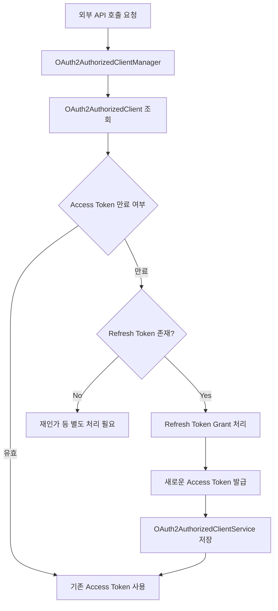

실제 갱신 동작은 OAuth2AuthorizedClientManager와 AuthorizedClientProvider의 구성에 따라 달라진다.

또한 Refresh Token이 존재한다고 해서 언제나 갱신에 성공하는 것도 아니다.

Refresh Token 자체가 만료되었거나 폐기되었을 수 있기 때문이다.

---

### OAuth2AuthorizedClientService를 직접 사용하는 경우

현재 프로젝트에서는 다음과 같이 저장된 OAuth2AuthorizedClient를 조회할 수 있다.

```java
OAuth2AuthorizedClient authorizedClient =
        authorizedClientService.loadAuthorizedClient(
                "google",
                principalName
        );
```

하지만 이 코드는 저장된 데이터를 가져오는 작업이다.

Access Token이 만료되어 있더라도 DB에 레코드가 존재한다면 해당 객체를 반환할 수 있다.

따라서 다음 코드를 이용해 만료 여부를 확인해야 한다.

```java
Instant expiresAt =
        authorizedClient.getAccessToken().getExpiresAt();

boolean expired =
        expiresAt != null
        && !expiresAt.isAfter(Instant.now());
```

이 코드 역시 만료 여부를 확인할 뿐 자동 갱신을 수행하지는 않는다.

외부 API를 호출하는 서비스에서는 만료 확인과 갱신을 포함하는 OAuth2AuthorizedClientManager를 사용하는 구조를 고려하는 것이 좋다.

---

### 실무에서의 활용

#### 1. OAuth2AuthorizedClientService는 토큰 저장소라는 책임에 집중시킨다

OAuth2AuthorizedClientService는 외부 OAuth2 인가 정보를 저장하고 조회하는 역할을 담당한다.

따라서 사용자 인증이나 회원가입, 권한 검증 등의 업무를 이 구성요소에 모두 포함시키지 않는 것이 좋다.

현재 프로젝트에서는 다음과 같이 역할을 분리했다.

```text
CustomOAuth2UserService
    ↓
외부 사용자 정보 처리
```

```text
SocialUserPersistenceService
    ↓
내부 회원 조회 및 저장
```

```text
OAuth2AuthorizedClientService
    ↓
외부 OAuth2 토큰 저장 및 조회
```

```text
SecurityContextRepository
    ↓
내부 로그인 상태 저장
```

이렇게 하면 각 저장소와 서비스의 책임이 명확해진다.

---

#### 2. DB에 저장되는 Access Token은 민감한 인증 정보다

이번 JDBC 구현에서는 Access Token이 BLOB 컬럼에 저장된다.

```sql
access_token_value blob NOT NULL
```

Refresh Token도 마찬가지다.

```sql
refresh_token_value blob DEFAULT NULL
```

여기서 BLOB은 바이너리 데이터를 저장하는 데이터 타입이다.

**BLOB으로 저장한다고 해서 토큰이 암호화되는 것은 아니다.**

Spring Security 6.2.1의 기본 JDBC 구현은 토큰 값을 바이트 배열로 변환하여 저장한다.

따라서 기본 저장 방식만으로 토큰의 암호화가 보장되는 것은 아니다.

운영 환경에서는 다음 사항을 고려해야 한다.

- 데이터베이스 접근 권한 최소화
- 저장 데이터 암호화
- DB 백업 파일 보호
- 토큰이 포함된 SQL 로그 제한
- 토큰 조회 API 접근 통제
- Refresh Token 보호

특히 Refresh Token은 Access Token을 갱신하는 데 사용될 수 있으므로 보안 수준을 높게 유지해야 한다.

---

#### 3. 사용자 로그아웃과 외부 토큰 삭제를 구분한다

사용자가 우리 서비스에서 로그아웃했다고 생각해보자.

일반적으로 Spring Security는 로그인 상태를 종료하기 위해 SecurityContext를 정리하고 세션을 무효화할 수 있다.

```text
로그아웃
    ↓
SecurityContext 정리
    ↓
HttpSession 무효화
```

하지만 이 과정에서 JDBC에 저장된 OAuth2AuthorizedClient가 항상 자동으로 삭제된다고 가정해서는 안 된다.

```text
oauth2_authorized_client
    ↓
기존 토큰 정보가 남아 있을 수 있음
```

따라서 서비스 요구사항에 따라 다음 정책을 구분해야 한다.

| 정책 | 의미 |
|---|---|
| 로그아웃 | 우리 서비스의 세션 인증 종료 |
| OAuth2AuthorizedClient 삭제 | 우리 서버가 저장한 외부 토큰 제거 |
| 외부 토큰 폐기 | Google·Naver 등 Provider에 토큰 폐기 요청 |
| 소셜 계정 연결 해제 | 내부 회원과 외부 계정 연결 관계 제거 |

이러한 작업은 서로 다른 목적을 가진다.

로그아웃 시 외부 Access Token도 삭제해야 한다면 별도의 로그아웃 처리 정책이 필요하다.

---

#### 4. 사용자 탈퇴 시 저장된 토큰 정보를 함께 정리한다

사용자가 우리 서비스에서 회원 탈퇴를 요청했다고 생각해보자.

이때 내부 UserEntity만 삭제하고 OAuth2AuthorizedClient를 유지하면 불필요한 외부 인가 정보가 남을 수 있다.

따라서 탈퇴 처리 과정에서는 해당 사용자의 OAuth2AuthorizedClient도 정리할 필요가 있다.

예를 들어 다음과 같다.

```text
회원 탈퇴 요청
    ↓
내부 회원 정보 확인
    ↓
연결된 OAuth2 Client 확인
    ↓
외부 토큰 폐기 정책 적용
    ↓
OAuth2AuthorizedClient 삭제
    ↓
내부 회원 삭제 또는 비활성화
```

여기서 중요한 것은 삭제 순서와 실패 처리 정책이다.

예를 들어 외부 토큰 폐기 API가 실패했다고 해서 내부 회원 탈퇴를 무조건 중단할지, 별도로 재시도할지는 서비스 정책에 따라 달라질 수 있다.

또한 외부 Provider의 토큰 폐기와 내부 DB 삭제는 하나의 로컬 트랜잭션으로 묶을 수 없다.

따라서 실패 시 재처리 가능한 구조를 고려해야 한다.

---

#### 5. Access Token 만료 레코드를 어떻게 관리할지 결정한다

JdbcOAuth2AuthorizedClientService는 토큰 정보를 DB에 저장한다.

하지만 Access Token이 만료되었다고 해서 해당 DB 레코드가 자동으로 삭제되는 것은 아니다.

따라서 장기간 운영하면 만료된 Access Token이 포함된 레코드가 남아 있을 수 있다.

예를 들어 다음과 같다.

```text
Access Token 만료
    ↓
DB 레코드 유지
    ↓
추가 관리 정책 필요
```

운영 환경에서는 다음과 같은 정책을 고려할 수 있다.

```text
Refresh Token 존재
    ↓
인가 갱신 가능성 검토
```

```text
Refresh Token 없음
    ↓
재인가 필요 여부 확인
```

```text
오랫동안 사용되지 않은 인가 정보
    ↓
정리 대상 검토
```

단순히 Access Token의 만료 시각만으로 모든 레코드를 삭제하면 Refresh Token을 이용해 재인가할 수 있는 정보까지 제거할 수 있다.

따라서 Access Token 만료와 OAuth2AuthorizedClient 삭제 정책은 구분해야 한다.

---

#### 6. 여러 서버가 동일한 DB를 사용하더라도 세션 저장소는 별도로 구성해야 한다

이번에 JDBC 저장소를 도입하면 여러 Spring Boot 서버가 외부 토큰 정보를 공유할 수 있다.

하지만 다음 세 가지는 별도로 관리된다.

```text
OAuth2AuthorizedClient
    ↓
MySQL
```

```text
OAuth2AuthorizationRequest
    ↓
HttpSession
```

```text
SecurityContext
    ↓
HttpSession
```

따라서 여러 서버에서 동일한 로그인 세션을 유지해야 한다면 Spring Session 등을 이용한 세션 공유 구조가 필요할 수 있다.

예를 들어 다음과 같다.

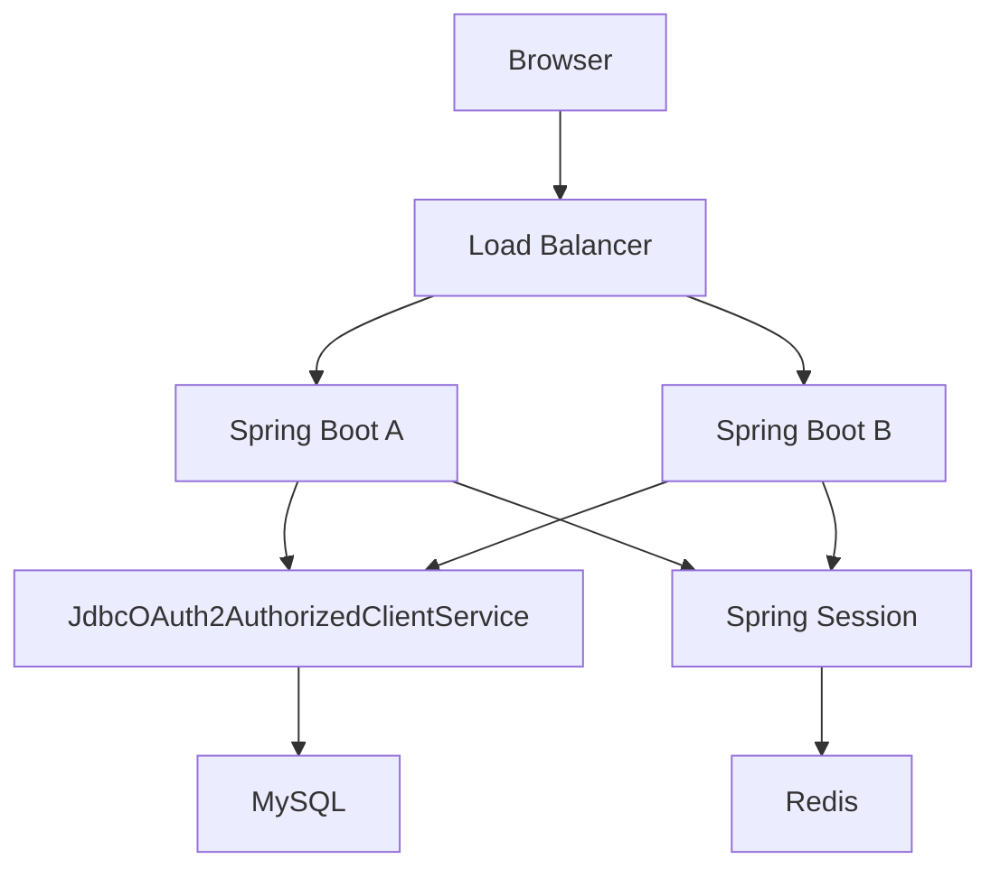

이 구조에서는 MySQL이 OAuth2AuthorizedClient를 저장한다.

Redis는 HttpSession을 공유하는 용도로 사용할 수 있다.

이처럼 저장 대상의 목적에 따라 서로 다른 저장소를 선택할 수 있다.

---

#### 7. Refresh Token 발급 여부를 Provider별로 확인한다

Google과 Naver는 모두 OAuth2 기반 인증을 제공하지만 토큰 발급 정책은 다를 수 있다.

예를 들어 Google에서 다음 Scope를 사용한다고 생각해보자.

```text
openid

profile

email
```

이 설정만으로 Refresh Token이 반드시 발급된다고 보장할 수 없다.

Refresh Token 발급에는 Provider의 정책과 추가 인증 요청 파라미터, 기존 동의 여부 등이 영향을 줄 수 있다.

따라서 다음 코드를 작성할 때는 `null` 가능성을 고려해야 한다.

```java
OAuth2RefreshToken refreshToken =
        authorizedClient.getRefreshToken();
```

Refresh Token이 존재하는지 확인한다.

```java
if (refreshToken != null) {

    // Refresh Token을 활용할 수 있는 상태
}
```

다만 Refresh Token이 존재하더라도 만료 또는 폐기 여부에 따라 실제 갱신 요청이 실패할 수 있다.

---

#### 8. Principal Name 변경은 기존 토큰 조회에 영향을 줄 수 있다

앞서 데이터베이스의 복합키를 살펴보았다.

```sql
PRIMARY KEY (
    client_registration_id,
    principal_name
)
```

따라서 principalName이 변경되면 기존 OAuth2AuthorizedClient를 조회하지 못할 수 있다.

예를 들어 기존 값이 다음과 같다고 생각해보자.

```text
google:google-user-123
```

그런데 이후 CustomOAuth2User의 `getName()` 구현을 변경했다.

```text
user:10001
```

이 경우 다음 값으로 조회하면 기존 데이터가 검색되지 않는다.

```java
authorizedClientService.loadAuthorizedClient(
        "google",
        "user:10001"
);
```

기존 DB에는 다음 값이 저장되어 있기 때문이다.

```text
google:google-user-123
```

따라서 Principal 식별자 정책을 변경할 때는 기존 OAuth2AuthorizedClient 데이터의 마이그레이션 여부도 고려해야 한다.

이 문제는 특히 외부 소셜 계정 식별자 중심의 Principal에서 내부 회원 ID 중심의 Principal로 변경할 때 중요하다.

---

#### 9. 여러 OAuth2 Client를 하나의 Principal에서 사용할 수 있다

OAuth2AuthorizedClient는 다음 두 정보를 기준으로 관리된다.

```text
clientRegistrationId

principalName
```

따라서 하나의 Principal에 대해 서로 다른 ClientRegistration의 인가 정보를 보관할 수 있다.

예를 들어 다음과 같다.

```text
google + user:10001
```

```text
naver + user:10001
```

이러한 구조는 하나의 내부 회원이 여러 외부 소셜 계정을 연결하는 서비스를 설계할 때 유용하다.

다만 동일한 Principal에 여러 OAuth2AuthorizedClient가 저장된다고 해서 외부 소셜 계정 연결에 대한 사용자 동의와 본인 확인 과정이 자동으로 해결되는 것은 아니다.

계정 연결은 별도의 인증과 비즈니스 정책을 통해 처리해야 한다.

---

#### 10. JDBC 저장소는 JPA Entity와 별개로 관리할 수 있다

현재 프로젝트에서는 Spring Data JPA를 이용해 사용자 정보를 저장한다.

```text
UserRepository
    ↓
UserEntity
    ↓
users
```

반면 OAuth2AuthorizedClient는 JDBC 기반으로 저장한다.

```text
JdbcOAuth2AuthorizedClientService
    ↓
JdbcTemplate
    ↓
oauth2_authorized_client
```

즉 하나의 Spring Boot 애플리케이션에서 JPA와 JDBC를 함께 사용할 수 있다.

모든 DB 접근을 반드시 JPA로 통일해야 하는 것은 아니다.

Spring Security가 이미 제공하는 JDBC 구현이 요구사항에 적합하다면 이를 재사용하는 것이 효율적일 수 있다.

반면 토큰 암호화, 복잡한 저장 정책, 별도의 DB 스키마 등이 필요하다면 커스텀 구현을 검토할 수 있다.

---

#### 11. ClientRegistration 변경 시 기존 DB 데이터와의 호환성을 확인한다

JdbcOAuth2AuthorizedClientService는 DB에서 조회한 registrationId를 이용해 ClientRegistrationRepository에서 등록 정보를 찾는다.

예를 들어 DB에는 다음 데이터가 존재한다.

```text
client_registration_id = google
```

그런데 애플리케이션의 ClientRegistration을 다음과 같이 변경했다.

```text
google-login
```

이 경우 기존 데이터의 `google`이라는 registrationId를 더 이상 조회하지 못할 수 있다.

따라서 ClientRegistration을 변경할 때는 다음 항목을 확인해야 한다.

```text
기존 DB의 client_registration_id

변경된 ClientRegistrationRepository

OAuth2 로그인 시작 URL

Callback 설정

기존 OAuth2AuthorizedClient 조회
```

특히 여러 서버를 순차적으로 배포하는 환경에서는 구버전과 신버전의 등록 정보가 동시에 사용될 수 있으므로 변경 호환성을 고려해야 한다.

---

#### 12. Access Token 저장과 갱신 과정의 동시성을 고려한다

여러 서버에서 동일한 사용자의 OAuth2AuthorizedClient를 사용할 수 있다.

예를 들어 다음과 같다.

```text
Spring Boot A
    ↓
Google Access Token 만료 확인
```

```text
Spring Boot B
    ↓
동일한 Google Access Token 만료 확인
```

두 서버가 동시에 Refresh Token을 이용해 새로운 Access Token을 발급받으려 할 수 있다.

이 경우 Provider의 Refresh Token 회전 정책에 따라 문제가 발생할 수 있다.

따라서 외부 토큰 자동 갱신이 빈번한 서비스에서는 다음과 같은 정책을 고려할 수 있다.

```text
동일 사용자 + ClientRegistration
    ↓
토큰 갱신 중복 여부 확인
    ↓
필요 시 분산 락 또는 단일 갱신 제어
    ↓
새로운 토큰 발급
    ↓
DB 갱신
```

다만 모든 서비스에서 분산 락이 필요한 것은 아니다.

실제 동시 갱신 발생 빈도와 Provider의 Refresh Token 정책을 확인한 뒤 결정해야 한다.

---

### 정리

Spring Security OAuth2 Client에서는 외부 인증 제공자가 발급한 Access Token과 Refresh Token을 관리하기 위해 OAuth2AuthorizedClient를 사용한다.

```text
OAuth2AuthorizedClient
    │
    ├── ClientRegistration
    ├── PrincipalName
    ├── AccessToken
    └── RefreshToken
```

이 객체를 저장하고 조회하기 위한 인터페이스는 다음과 같다.

```java
OAuth2AuthorizedClientService
```

Spring Security는 대표적으로 두 가지 구현체를 제공한다.

```text
InMemoryOAuth2AuthorizedClientService
```

```text
JdbcOAuth2AuthorizedClientService
```

메모리 방식은 간단하게 사용할 수 있지만 애플리케이션 재시작 시 저장된 정보를 잃을 수 있다.

반면 JDBC 방식은 관계형 데이터베이스를 이용해 OAuth2AuthorizedClient를 영속적으로 저장할 수 있다.

이번에는 다음과 같이 JdbcOAuth2AuthorizedClientService를 생성했다.

```java
@Bean
public OAuth2AuthorizedClientService authorizedClientService(
        JdbcTemplate jdbcTemplate,
        ClientRegistrationRepository clientRegistrationRepository
) {

    return new JdbcOAuth2AuthorizedClientService(
            jdbcTemplate,
            clientRegistrationRepository
    );
}
```

그리고 SecurityConfig에 등록했다.

```java
.oauth2Login(oauth2 -> oauth2

        .loginPage("/login")

        .authorizedClientService(
                authorizedClientService
        )

        .userInfoEndpoint(userInfo -> userInfo

                .userService(customOAuth2UserService)

                .oidcUserService(customOidcUserService)
        )
)
```

이렇게 하면 OAuth2 Login에서 JDBC 기반 저장 서비스를 사용할 수 있다.

다만 실제 저장은 OAuth2AuthorizedClientRepository와 현재 Authentication의 상태에 따라 위임된다.

JDBC 구현은 다음 테이블을 사용한다.

```text
oauth2_authorized_client
```

여기에는 다음과 같은 정보가 저장된다.

```text
client_registration_id

principal_name

access_token_value

access_token_issued_at

access_token_expires_at

refresh_token_value

refresh_token_issued_at
```

또한 두 컬럼을 복합 기본키로 사용한다.

```sql
PRIMARY KEY (
    client_registration_id,
    principal_name
)
```

따라서 특정 OAuth2 Client와 Principal의 조합에 대해 인가 정보를 관리할 수 있다.

전체 구조를 정리하면 다음과 같다.

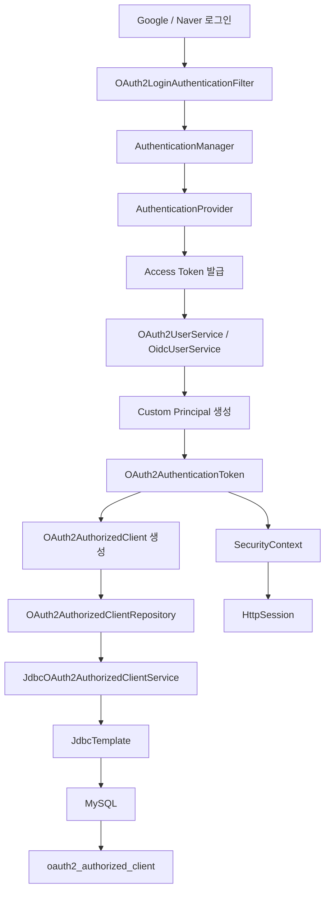

이번 내용에서 반드시 기억해야 할 핵심은 다음과 같다.

**첫째, OAuth2AuthorizedClient는 외부 OAuth2 인가 결과를 표현하는 객체다.**

**둘째, OAuth2AuthorizedClientService는 해당 객체를 저장, 조회, 삭제하는 인터페이스다.**

**셋째, JdbcOAuth2AuthorizedClientService를 이용하면 Access Token과 Refresh Token을 관계형 데이터베이스에 저장할 수 있다.**

**넷째, JDBC 구현체는 Spring Security가 기본 제공하므로 일반적인 저장 기능을 처음부터 직접 구현할 필요는 없다.**

**다섯째, JdbcOAuth2AuthorizedClientService는 JdbcTemplate과 ClientRegistrationRepository를 사용한다.**

**여섯째, 데이터베이스에는 oauth2_authorized_client 테이블이 필요하다.**

**일곱째, client_registration_id와 principal_name을 복합 기본키로 사용한다.**

**여덟째, CustomOAuth2User.getName()의 반환값은 OAuth2AuthorizedClient 조회에도 영향을 준다.**

**아홉째, OAuth2AuthorizedClient 저장과 SecurityContext 저장은 서로 다른 작업이다.**

**열째, JDBC 저장소를 도입해도 HttpSession의 공유 저장소는 별도로 구성해야 한다.**

**열한째, Refresh Token을 저장한다고 해서 Access Token이 자동으로 갱신되는 것은 아니다.**

**열두째, 외부 토큰은 민감한 인증 정보이므로 저장 시 암호화, 접근 통제, 삭제 및 만료 정책을 함께 고려해야 한다.**

이번 구현을 통해 OAuth2 소셜 로그인에서 발급받은 외부 Access Token과 Refresh Token을 애플리케이션 메모리가 아닌 데이터베이스에 저장할 수 있게 되었다.

또한 사용자 로그인 상태를 관리하는 HttpSession과 외부 토큰을 관리하는 OAuth2AuthorizedClientService의 역할을 분리하여 이해할 수 있다.

이러한 구조는 향후 외부 API 연동, Refresh Token 기반 Access Token 갱신, 다중 서버 운영, 소셜 계정 연결 기능으로 확장할 때 중요한 기반이 된다.

#### 한 줄 요약

Spring Security 6의 `OAuth2AuthorizedClientService`는 외부 인증 제공자가 발급한 Access Token과 Refresh Token 등의 인가 정보를 관리하는 인터페이스다. 기본 메모리 구현 대신 `JdbcOAuth2AuthorizedClientService`를 사용하면 OAuth2AuthorizedClient를 MySQL이나 MariaDB에 저장할 수 있다. 이를 위해 JdbcTemplate과 ClientRegistrationRepository를 전달하여 Bean을 생성하고, SecurityConfig의 `oauth2Login().authorizedClientService()`에 등록한다. 실제 저장에는 `oauth2_authorized_client` 테이블을 사용하며, ClientRegistration ID와 Principal Name의 조합으로 인가 정보를 관리한다. 단, 외부 토큰 저장과 내부 로그인 세션 관리는 별개의 기능이며, Refresh Token 갱신과 토큰 보안 정책도 별도로 설계해야 한다.
