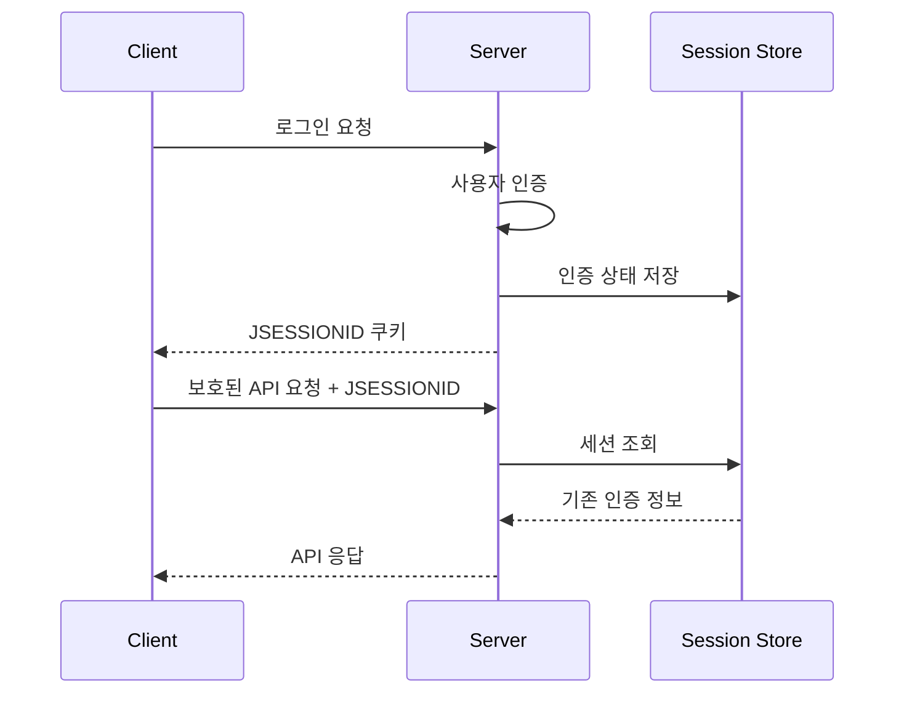
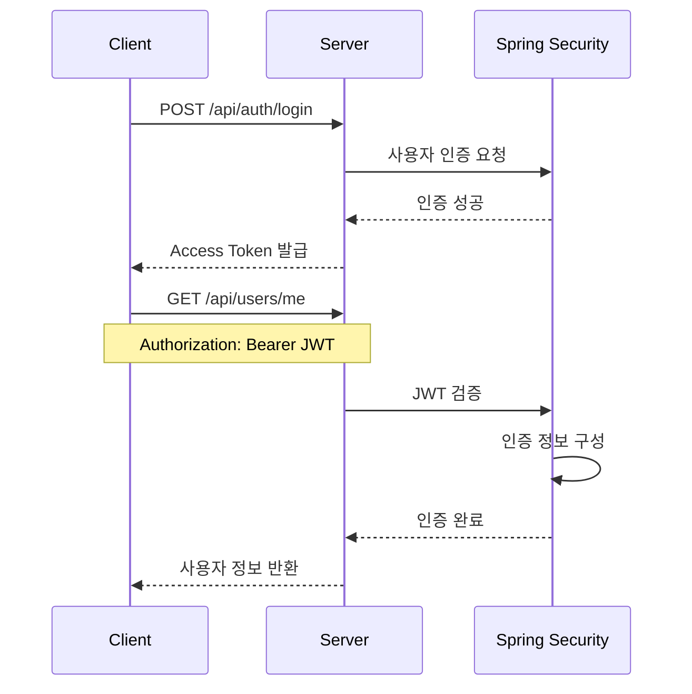
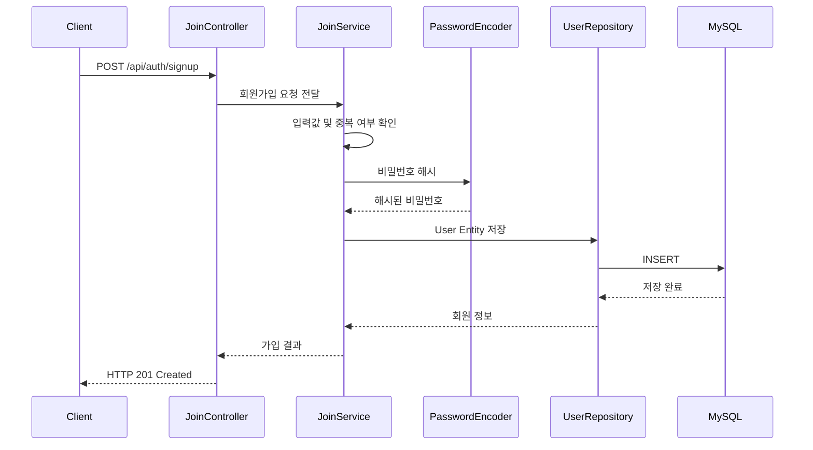
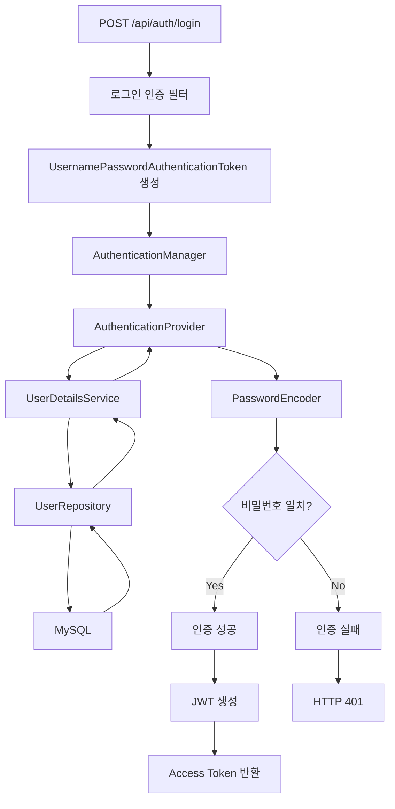
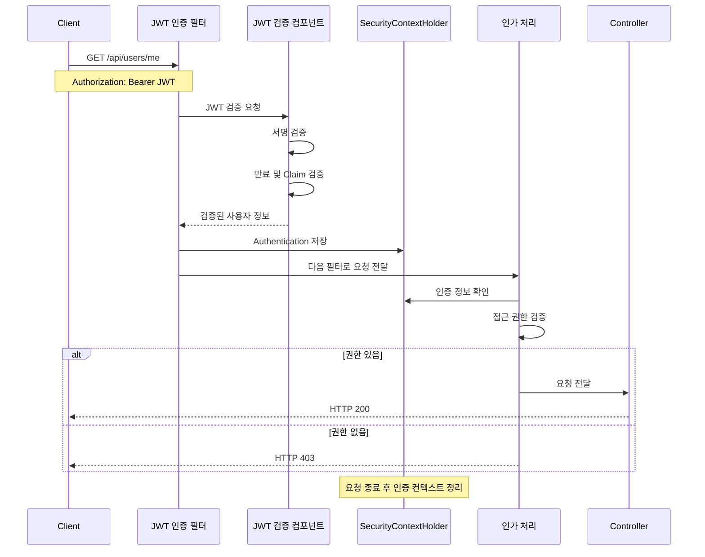
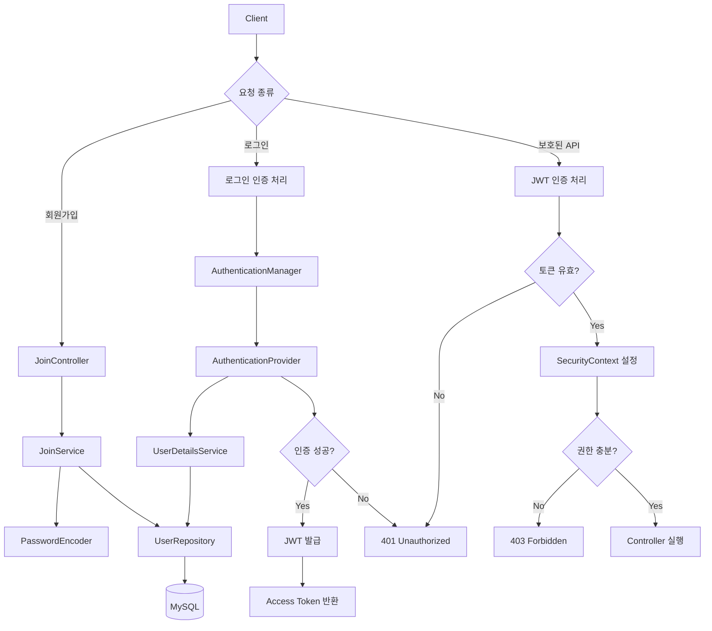

# 스프링 시큐리티 JWT - 1. 실습 목표 및 간단한 동작 원리
[https://youtu.be/NPRh2v7PTZg?si=9FIfXw6Y2e2KgE-q](https://youtu.be/NPRh2v7PTZg?si=9FIfXw6Y2e2KgE-q)

# 스프링 시큐리티 JWT - 1. 실습 목표 및 간단한 동작 원리
* toc
{:toc}

---

### Spring Security JWT 인증·인가 완벽 정리: 회원가입부터 로그인, 토큰 발급과 검증까지

Spring Security는 Java와 Spring Boot 환경에서 인증(Authentication)과 인가(Authorization)를 구현하기 위한 보안 프레임워크다.

사용자의 로그인 요청을 검증하고, 인증된 사용자가 접근할 수 있는 리소스를 제한하며, 애플리케이션의 인증 상태를 관리하는 기능을 제공한다.

Spring Security에서 사용되는 대표적인 인증 방식에는 세션 기반 인증과 토큰 기반 인증이 있다.

세션 기반 인증은 일반적으로 사용자가 로그인하면 서버에서 인증 상태를 저장하고, 이후 요청에서 세션 식별자를 이용해 사용자를 확인하는 방식이다.

반면 JWT 기반 인증은 로그인에 성공한 사용자에게 토큰을 발급하고, 클라이언트가 이후 요청마다 해당 토큰을 전달하도록 구성할 수 있다.

예를 들어 다음과 같은 시스템을 생각해보자.

```text
Client
   ↓
POST /api/auth/login
   ↓
Spring Security
   ↓
아이디 및 비밀번호 검증
   ↓
JWT 발급
   ↓
Client에 토큰 반환
```

로그인 이후에는 발급받은 JWT를 이용해 보호된 API에 접근한다.

```text
Client
   ↓
Authorization: Bearer <JWT>
   ↓
Spring Security
   ↓
JWT 검증
   ↓
인증 정보 구성
   ↓
권한 확인
   ↓
Controller 실행
```

이때 서버는 매 요청에서 전달된 JWT를 검증해 사용자를 식별할 수 있다.

따라서 서버에 사용자별 로그인 세션을 유지하지 않는 Stateless 인증 구조를 구현할 수 있다.

다만 JWT를 사용한다고 해서 자동으로 보안이 강화되거나 모든 세션 관리 문제가 사라지는 것은 아니다.

토큰의 서명 검증, 유효기간 관리, 권한 처리, 탈취 대응, 로그아웃과 토큰 폐기 등 별도로 고려해야 할 사항이 존재한다.

이번에는 Spring Boot 3.2.1과 Spring Security 6.2.1을 기준으로 JWT 인증·인가 시스템의 전체 구조를 이해하고, 각 구성요소가 어떤 역할을 담당하는지 살펴본다.

---

### 개념

#### 인증(Authentication)이란?

인증은 사용자가 누구인지 확인하는 과정이다.

예를 들어 사용자가 다음과 같은 정보를 이용해 로그인을 요청한다고 생각해보자.

```json
{
  "username": "user01",
  "password": "password123!"
}
```

서버는 전달받은 사용자 정보가 실제로 등록된 사용자의 정보와 일치하는지 검증한다.

일반적으로 다음과 같은 과정을 거친다.

```text
로그인 요청
    ↓
사용자 조회
    ↓
저장된 비밀번호 해시 확인
    ↓
입력한 비밀번호 검증
    ↓
인증 성공 또는 실패
```

인증이 성공했다는 것은 서버가 해당 요청의 사용자를 확인했다는 의미다.

하지만 인증되었다고 해서 모든 API에 접근할 수 있는 것은 아니다.

접근 가능한 리소스를 결정하는 과정은 인가에서 담당한다.

#### 인가(Authorization)란?

인가는 인증된 사용자가 특정 리소스에 접근할 권한이 있는지 확인하는 과정이다.

예를 들어 다음과 같은 API가 있다고 생각해보자.

| API                            | 필요한 권한  |
| ------------------------------ | ------- |
| `POST /api/auth/signup`        | 인증 불필요  |
| `POST /api/auth/login`         | 인증 불필요  |
| `GET /api/users/me`            | 로그인 사용자 |
| `GET /api/admin/users`         | 관리자     |
| `DELETE /api/admin/users/{id}` | 관리자     |

일반 사용자가 관리자 API에 접근하려고 한다면 인증에는 성공했더라도 권한이 부족하므로 요청이 거부되어야 한다.

```text
일반 사용자
    ↓
JWT 검증 성공
    ↓
ROLE_USER 확인
    ↓
관리자 API 접근 시도
    ↓
ROLE_ADMIN 필요
    ↓
접근 거부
```

이를 정리하면 다음과 같다.

| 구분           | Authentication   | Authorization         |
| ------------ | ---------------- | --------------------- |
| 의미           | 사용자 신원 확인        | 접근 권한 확인              |
| 핵심 질문        | 누구인가?            | 무엇을 할 수 있는가?          |
| 대표적인 정보      | 아이디, 비밀번호, JWT   | ROLE_USER, ROLE_ADMIN |
| 실패 상황        | 유효하지 않은 인증 정보    | 필요한 권한 부족             |
| 일반적인 HTTP 응답 | 401 Unauthorized | 403 Forbidden         |

인증과 인가는 서로 연결되지만 다른 목적을 가진다.

**JWT는 사용자를 인증하는 데 사용할 수 있고, 토큰에서 확인한 권한 정보는 API 인가 판단에 활용할 수 있다.**

---

### JWT란?

JWT(JSON Web Token)는 사용자 또는 시스템에 대한 정보를 JSON 형태의 Claim으로 표현하고, 이를 안전하게 전달하기 위한 토큰 형식이다.

JWT는 주로 HTTP 요청의 Authorization 헤더를 통해 전달된다.

```http
GET /api/users/me HTTP/1.1
Host: localhost:8080
Authorization: Bearer <ACCESS_TOKEN>
```

여기서 `Bearer`는 해당 토큰을 가지고 있는 클라이언트가 토큰을 제시하는 인증 방식이다.

서버는 전달받은 JWT를 검증한 후 요청을 처리할지 결정한다.

#### JWT의 기본 구조

일반적으로 서명된 JWT는 세 부분으로 구성된다.

```text
Header.Payload.Signature
```

각 부분은 마침표로 구분된다.

```text
xxxxx.yyyyy.zzzzz
```

세 부분의 역할은 다음과 같다.

| 구성요소      | 역할                                  |
| --------- | ----------------------------------- |
| Header    | 토큰 유형 및 서명 알고리즘 정보                  |
| Payload   | 사용자 식별자, 발급자, 만료 시간 등의 Claim        |
| Signature | Header와 Payload의 위변조 여부를 검증하기 위한 서명 |

예를 들어 Header는 다음과 같은 형태를 가질 수 있다.

```json
{
  "alg": "HS256",
  "typ": "JWT"
}
```

Payload에는 다음과 같은 정보를 포함할 수 있다.

```json
{
  "sub": "user-1001",
  "role": "ROLE_USER",
  "iss": "https://auth.example.com",
  "aud": "example-api",
  "iat": 1790000000,
  "exp": 1790003600
}
```

각 Claim의 의미는 다음과 같다.

| Claim  | 의미                     |
| ------ | ---------------------- |
| `sub`  | 토큰의 주체, 일반적으로 사용자 식별자  |
| `iss`  | 토큰 발급자                 |
| `aud`  | 토큰을 사용할 대상             |
| `iat`  | 토큰 발급 시간               |
| `exp`  | 토큰 만료 시간               |
| `nbf`  | 토큰 사용 가능 시작 시간         |
| `role` | 애플리케이션에서 정의한 사용자 권한 정보 |

여기서 `role`은 JWT 표준 필수 Claim이 아니라 애플리케이션이 자체적으로 정의할 수 있는 Claim이다.

반면 `sub`, `iss`, `aud`, `exp` 등은 JWT 표준에서 의미가 정의된 Claim이다.

#### JWT의 Payload는 암호화된 데이터가 아니다

JWT를 처음 사용할 때 주의해야 할 부분이 있다.

일반적인 서명 JWT의 Header와 Payload는 Base64URL로 인코딩된 데이터다.

**Base64URL 인코딩은 암호화가 아니다.**

따라서 토큰을 획득한 사람은 Payload의 내용을 확인할 수 있다.

예를 들어 다음과 같은 정보는 토큰에 저장하지 않는 것이 좋다.

```json
{
  "username": "user01",
  "password": "password123!",
  "residentRegistrationNumber": "..."
}
```

비밀번호나 민감한 개인정보를 JWT에 담는 것은 위험하다.

JWT의 서명은 데이터의 무결성과 발급 주체를 검증하기 위한 것이지 Payload의 내용을 숨기는 기능이 아니다.

민감한 정보는 서버에서 별도로 관리하고, 토큰에는 인증과 인가에 필요한 최소한의 정보만 포함하는 것이 좋다.

---

### 왜 JWT를 사용하는가?

#### 세션 기반 인증의 동작 방식

먼저 일반적인 세션 기반 인증을 살펴보자.

사용자가 로그인을 요청한다.

```http
POST /login HTTP/1.1
Content-Type: application/x-www-form-urlencoded

username=user01&password=password123!
```

Spring Security는 사용자를 인증한다.

인증에 성공하면 서버는 세션에 인증 상태를 저장하도록 구성할 수 있다.

```text
사용자 로그인
    ↓
아이디 및 비밀번호 검증
    ↓
인증 성공
    ↓
HttpSession에 인증 상태 저장
    ↓
세션 식별자 발급
```

클라이언트는 일반적으로 세션 식별자가 포함된 쿠키를 전달한다.

```http
Cookie: JSESSIONID=...
```

서버는 이 식별자를 이용해 기존 세션을 찾고 저장된 인증 상태를 확인한다.



이 구조에서는 서버가 사용자의 인증 상태를 저장하고 관리한다.

애플리케이션 인스턴스가 여러 개라면 세션을 공유하거나 라우팅을 제어하는 방식을 고려해야 할 수 있다.

예를 들어 Redis와 Spring Session을 이용해 여러 서버가 인증 세션을 공유하도록 구성할 수 있다.

#### JWT 기반 인증의 동작 방식

JWT 기반 인증에서는 일반적으로 로그인에 성공하면 서버가 JWT를 생성한다.

```text
로그인 요청
    ↓
아이디 및 비밀번호 검증
    ↓
인증 성공
    ↓
JWT 생성
    ↓
클라이언트에 반환
```

이후 클라이언트는 보호된 API를 호출할 때마다 토큰을 전달한다.

```http
Authorization: Bearer <ACCESS_TOKEN>
```

서버는 매 요청에서 토큰을 검증한다.



이 구조에서는 서버가 이전 로그인 요청의 인증 상태를 HttpSession에 저장하지 않아도 JWT를 통해 사용자를 확인할 수 있다.

따라서 여러 서버 인스턴스가 동일한 서명 검증 체계를 사용한다면 각 인스턴스에서 토큰을 독립적으로 검증할 수 있다.

다만 JWT가 무조건 세션보다 좋은 것은 아니다.

서명된 JWT는 토큰의 유효기간이 남아 있는 동안 사용될 수 있으므로, 강제 로그아웃이나 즉각적인 권한 회수에는 추가 설계가 필요하다.

---

### Session 방식과 JWT 방식 비교

| 구분          | Session 기반 인증   | JWT 기반 인증                   |
| ----------- | --------------- | --------------------------- |
| 인증 상태 관리    | 서버 세션에 저장 가능    | 토큰 자체의 Claim 활용             |
| 클라이언트 전달 정보 | 세션 식별자          | JWT                         |
| 인증 정보 복원    | 서버 측 세션 조회      | 토큰 검증 후 인증 정보 구성            |
| 서버 간 확장     | 세션 공유 또는 라우팅 고려 | 공통 검증 키·정책 필요               |
| 만료 처리       | 세션 만료           | JWT의 `exp` 검증               |
| 로그아웃        | 세션 무효화          | 토큰 폐기 전략 필요                 |
| 권한 변경 반영    | 세션 갱신 정책에 따라 다름 | 기존 토큰 Claim이 만료 전까지 남을 수 있음 |
| 주요 위험       | 세션 탈취           | 토큰 탈취                       |

여기서 중요한 점은 두 방식이 서로 완전히 독립적인 보안 체계를 사용하는 것이 아니라는 사실이다.

**Spring Security의 인증·인가 구조는 동일하게 활용하면서, 인증 상태를 유지하고 복원하는 방식이 달라지는 것이다.**

---

### 주요 특징

#### JWT 인증 시스템의 전체 구성요소

Spring Security와 JWT를 이용한 인증 시스템에는 다음 구성요소가 사용될 수 있다.

| 구성요소                                   | 역할                               |
| -------------------------------------- | -------------------------------- |
| `SecurityFilterChain`                  | 보안 필터 구성 및 인가 규칙 적용              |
| `UsernamePasswordAuthenticationFilter` | 사용자 이름과 비밀번호 기반 인증 요청 처리         |
| `AuthenticationManager`                | 인증 요청 전달 및 인증 수행 관리              |
| `AuthenticationProvider`               | 실제 인증 방식 구현                      |
| `UserDetailsService`                   | 사용자 정보 조회                        |
| `UserDetails`                          | Spring Security에서 사용할 사용자 정보     |
| `PasswordEncoder`                      | 비밀번호 해시 및 일치 여부 검증               |
| `JwtTokenService`                      | JWT 생성 및 검증을 담당하도록 설계할 수 있는 컴포넌트 |
| JWT 인증 필터                              | 요청에 포함된 JWT 검증                   |
| `SecurityContextHolder`                | 현재 요청 처리 흐름의 인증 정보 접근            |
| `AuthorizationManager`                 | 인증된 사용자의 접근 권한 판단                |

여기서 `JwtTokenService`와 JWT 인증 필터는 커스텀 구현에서 사용할 수 있는 구성요소 이름이다.

Spring Security가 반드시 해당 이름의 클래스를 제공하는 것은 아니다.

JWT 인증 기능을 구현하는 방법은 크게 다음 두 가지로 나눌 수 있다.

첫 번째는 커스텀 JWT 필터를 직접 작성하는 방식이다.

두 번째는 Spring Security가 제공하는 OAuth2 Resource Server 기능을 사용하는 방식이다.

먼저 전체 동작 구조를 이해하기 쉽도록 커스텀 JWT 필터를 사용하는 형태를 살펴보고, 이후 기본 제공 기능과의 차이도 정리한다.

---

### 회원가입 구조

회원가입은 사용자의 정보를 입력받아 데이터베이스에 저장하는 과정이다.

JWT 방식이라고 해서 회원가입 자체가 특별히 달라지는 것은 아니다.

세션 기반 인증에서도 회원 정보를 데이터베이스에 저장하고, JWT 기반 인증에서도 동일하게 저장할 수 있다.

이번에는 MySQL을 사용자 정보 저장소로 사용하고 Spring Data JPA를 통해 데이터베이스에 접근한다고 가정한다.

#### 회원가입 API

클라이언트는 다음 요청을 보낸다.

```http
POST /api/auth/signup HTTP/1.1
Content-Type: application/json
```

요청 본문은 다음과 같다.

```json
{
  "username": "user01",
  "password": "password123!"
}
```

서버에서는 다음 순서로 처리한다.

```text
회원가입 요청
    ↓
JoinController
    ↓
JoinService
    ↓
입력값 검증
    ↓
중복 사용자 확인
    ↓
비밀번호 해시 처리
    ↓
User Entity 생성
    ↓
UserRepository
    ↓
MySQL 저장
```

이를 구조로 표현하면 다음과 같다.



#### 사용자 테이블 구조

예를 들어 다음과 같은 사용자 테이블을 사용할 수 있다.

| 컬럼           | 타입 예시    | 설명      |
| ------------ | -------- | ------- |
| `id`         | BIGINT   | 사용자 PK  |
| `username`   | VARCHAR  | 로그인 아이디 |
| `password`   | VARCHAR  | 비밀번호 해시 |
| `role`       | VARCHAR  | 사용자 권한  |
| `created_at` | DATETIME | 생성 일시   |

중요한 것은 비밀번호를 원문 그대로 저장하지 않는다는 점이다.

비밀번호는 `BCryptPasswordEncoder`와 같은 PasswordEncoder를 이용해 해시한 뒤 저장해야 한다.

다음은 그 개념을 보여주는 코드다.

```java
String encodedPassword = passwordEncoder.encode(
        signupRequest.getPassword()
);
```

데이터베이스에는 다음과 같은 형태의 해시가 저장된다.

```text
$2a$10$...
```

이 값은 설명을 위한 형식 예시이며 실제 해시는 실행할 때마다 달라질 수 있다.

#### 중복 아이디 검증

회원가입에서는 동일한 아이디가 중복 저장되지 않도록 검증해야 한다.

하지만 애플리케이션에서 중복 여부를 확인하는 것만으로는 충분하지 않다.

동시에 두 개의 회원가입 요청이 발생할 수 있기 때문이다.

```text
Request A → user01 없음 확인

Request B → user01 없음 확인

Request A → INSERT

Request B → INSERT
```

따라서 `username`에는 데이터베이스의 UNIQUE 제약조건도 함께 적용해야 한다.

**회원가입의 핵심은 입력값 검증, 비밀번호 해시, 사용자 정보 저장, 중복 방지이며 이 과정은 JWT 인증 여부와 관계없이 필요하다.**

---

### 로그인 구조

로그인은 회원가입보다 더 많은 Spring Security 구성요소가 관여한다.

이번에는 사용자가 아이디와 비밀번호를 전달하고, 인증에 성공하면 JWT를 반환하는 구조다.

#### 로그인 API

클라이언트는 다음 요청을 보낸다.

```http
POST /api/auth/login HTTP/1.1
Content-Type: application/json
```

요청 본문은 다음과 같다.

```json
{
  "username": "user01",
  "password": "password123!"
}
```

서버는 사용자 정보를 검증한다.

인증에 성공하면 JWT를 생성하여 반환한다.

```json
{
  "tokenType": "Bearer",
  "accessToken": "<JWT>",
  "expiresIn": 3600
}
```

위 응답 구조는 설계 예시다.

`expiresIn`은 클라이언트가 토큰의 남은 유효기간을 이해할 수 있도록 초 단위로 제공하는 값이다.

이번 구조에서는 Access Token 하나만 발급한다고 가정한다.

Refresh Token을 이용한 재발급 기능은 포함하지 않는다.

---

### Spring Security 로그인 인증 과정

Spring Security에서 아이디와 비밀번호를 이용해 사용자를 인증하는 핵심 구조는 다음과 같다.



각 구성요소의 역할을 순서대로 살펴보자.

#### 1. UsernamePasswordAuthenticationFilter

`UsernamePasswordAuthenticationFilter`는 사용자 이름과 비밀번호를 이용한 인증 요청을 처리하는 Spring Security 필터다.

일반적인 Form Login에서는 `/login` 요청에 포함된 사용자 이름과 비밀번호를 읽어 인증을 시도한다.

하지만 기본 `UsernamePasswordAuthenticationFilter`는 JSON 요청 본문을 자동으로 역직렬화하는 필터가 아니다.

따라서 다음과 같은 JSON 요청을 처리하려면 별도의 구현이 필요할 수 있다.

```json
{
  "username": "user01",
  "password": "password123!"
}
```

대표적인 방법은 다음과 같다.

| 방식             | 설명                                                |
| -------------- | ------------------------------------------------- |
| 커스텀 로그인 필터     | 기존 인증 필터를 확장하거나 별도 필터에서 JSON 파싱                   |
| 로그인 Controller | REST Controller에서 요청을 받고 AuthenticationManager 호출 |

두 방식 모두 사용할 수 있다.

즉 **JWT 인증을 구현한다고 해서 반드시 UsernamePasswordAuthenticationFilter를 직접 상속해야 하는 것은 아니다.**

다만 Spring Security 필터 기반의 로그인 인증 구조를 이해하려면 이 구성요소의 역할을 알아두는 것이 좋다.

#### 2. AuthenticationManager

`AuthenticationManager`는 인증 요청을 처리하기 위한 Spring Security의 핵심 인터페이스다.

로그인 필터나 Controller는 사용자 이름과 비밀번호를 이용해 인증 요청 객체를 생성할 수 있다.

예를 들어 다음과 같다.

```java
Authentication authenticationRequest =
        UsernamePasswordAuthenticationToken.unauthenticated(
                username,
                password
        );
```

이 객체는 아직 인증되지 않은 상태다.

이후 `AuthenticationManager`에 전달한다.

```java
Authentication authenticationResult =
        authenticationManager.authenticate(
                authenticationRequest
        );
```

`authenticate()`는 인증 요청을 전달하고 성공한 경우 인증 결과를 반환한다.

인증에 실패하면 관련 예외가 발생한다.

여기서 중요한 점은 `AuthenticationManager`가 직접 MySQL에 SQL을 실행하는 객체가 아니라는 사실이다.

실제 인증 방식은 `AuthenticationProvider`가 담당한다.

#### 3. AuthenticationProvider

`AuthenticationProvider`는 전달받은 인증 정보를 실제로 검증하는 역할을 한다.

아이디와 비밀번호 기반 인증에서는 대표적으로 `DaoAuthenticationProvider`를 사용할 수 있다.

`DaoAuthenticationProvider`는 `UserDetailsService`를 이용해 사용자를 조회하고 `PasswordEncoder`로 비밀번호를 검증한다.

```text
AuthenticationManager
    ↓
DaoAuthenticationProvider
    ↓
UserDetailsService
    ↓
UserRepository
    ↓
MySQL
```

사용자 정보가 반환되면 다음 작업을 수행한다.

```text
입력한 비밀번호
    ↓
PasswordEncoder.matches()
    ↓
저장된 비밀번호 해시와 비교
    ↓
인증 성공 또는 실패
```

여기서 비밀번호를 비교하기 위해 저장된 해시를 복호화하는 것은 아니다.

`PasswordEncoder`는 입력한 원문 비밀번호가 저장된 해시와 일치하는지 검증한다.

#### 4. UserDetailsService

`UserDetailsService`는 사용자 정보를 조회하는 인터페이스다.

대표적인 메서드는 다음과 같다.

```java
UserDetails loadUserByUsername(String username)
        throws UsernameNotFoundException;
```

이 메서드에서는 사용자 이름을 기준으로 데이터베이스의 회원 정보를 조회할 수 있다.

```text
loadUserByUsername("user01")
    ↓
UserRepository.findByUsername("user01")
    ↓
MySQL 조회
    ↓
User Entity 반환
    ↓
UserDetails 생성
```

`UserDetails`는 Spring Security가 인증에 필요한 사용자 정보를 표현하기 위한 인터페이스다.

일반적으로 다음 정보를 제공한다.

| 정보             | 의미               |
| -------------- | ---------------- |
| Username       | 사용자 식별 정보        |
| Password       | 저장된 비밀번호 해시      |
| Authorities    | 사용자 권한           |
| Account Status | 계정 잠금 및 활성화 여부 등 |

Spring Data JPA와 UserDetailsService를 연결하면 MySQL에 저장된 사용자를 대상으로 인증할 수 있다.

#### 5. JWT 발급

사용자 인증에 성공하면 `Authentication` 객체를 이용해 JWT를 발급할 수 있다.

개념적으로는 다음과 같은 코드가 된다.

```java
Authentication authentication =
        authenticationManager.authenticate(
                UsernamePasswordAuthenticationToken.unauthenticated(
                        username,
                        password
                )
        );

// JWT 발급 서비스는 별도로 구현해야 한다.
String accessToken = jwtTokenService.createAccessToken(
        authentication
);
```

여기서 `jwtTokenService`는 JWT 생성을 담당하도록 설계한 커스텀 컴포넌트의 예시다.

Spring Security가 해당 이름과 메서드를 기본으로 제공하는 것은 아니다.

실제 구현에서는 JWT 라이브러리 또는 Spring Security의 JWT 관련 기능을 이용해 서명, 만료 시간, 사용자 식별자, 권한 등을 설정해야 한다.

로그인 과정에서 가장 중요한 점은 다음과 같다.

**아이디와 비밀번호를 검증하는 것은 Spring Security의 인증 체계이고, JWT 발급은 인증 성공 이후 클라이언트에 전달할 인증 수단을 만드는 작업이다.**

---

### JWT 인증을 이용한 API 접근 구조

로그인에 성공한 사용자는 JWT를 발급받는다.

이제 해당 토큰으로 보호된 API에 접근할 수 있다.

예를 들어 사용자 정보 조회 API를 호출한다고 생각해보자.

```http
GET /api/users/me HTTP/1.1
Host: localhost:8080
Authorization: Bearer <ACCESS_TOKEN>
```

서버는 요청에 포함된 JWT를 검증한다.

검증에 성공하면 현재 요청에서 사용할 인증 정보를 구성한다.

그리고 해당 사용자가 API에 접근할 수 있는지 확인한다.

#### 전체 인증·인가 흐름



이 과정에서 핵심은 JWT 검증 이후 `Authentication`을 현재 요청의 보안 컨텍스트에 설정한다는 것이다.

#### JWT 인증 필터의 역할

커스텀 JWT 인증 필터를 구현한다면 일반적으로 다음 역할을 담당하도록 구성할 수 있다.

| 단계 | 동작                                 |
| -- | ---------------------------------- |
| 1  | Authorization 헤더 확인                |
| 2  | Bearer 토큰 추출                       |
| 3  | JWT 서명 검증                          |
| 4  | 만료 시간 및 Claim 검증                   |
| 5  | 사용자 식별자와 권한 정보 확인                  |
| 6  | Authentication 생성                  |
| 7  | SecurityContext에 Authentication 설정 |
| 8  | 다음 필터로 요청 전달                       |

예를 들어 Authorization 헤더에 다음과 같은 값이 들어 있다.

```http
Authorization: Bearer eyJ...
```

JWT 인증 필터는 `Bearer ` 접두사를 제외한 토큰을 추출한다.

그다음 토큰의 서명이 올바른지, 토큰이 만료되지 않았는지, 이 API에서 사용할 수 있도록 발급된 토큰인지 확인한다.

검증이 끝난 후에는 해당 사용자를 나타내는 `Authentication`을 생성할 수 있다.

이 객체를 `SecurityContext`에 설정하면 이후 인가 과정에서 사용할 수 있다.

다만 **JWT를 단순히 Base64URL로 디코딩한 결과만 믿고 Authentication을 생성해서는 안 된다.**

서명과 유효기간, 발급자, 사용 대상 등을 적절하게 검증한 뒤 인증 정보를 구성해야 한다.

---

### SecurityContextHolder와 Session은 다르다

JWT 인증에서 가장 중요한 개념 중 하나다.

Spring Security에서는 현재 인증된 사용자 정보에 접근하기 위해 `SecurityContextHolder`를 사용한다.

예를 들어 다음과 같은 코드가 있다.

```java
Authentication authentication =
        SecurityContextHolder
                .getContext()
                .getAuthentication();
```

이 코드는 현재 보안 컨텍스트에 설정된 인증 정보를 가져온다.

여기서 다음과 같이 오해하기 쉽다.

> SecurityContextHolder에 인증 정보를 저장했으므로 서버 세션이 만들어진 것이다.

하지만 이 두 개념은 다르다.

`SecurityContextHolder`는 현재 실행 흐름에서 인증 정보를 접근할 수 있도록 하는 역할을 담당한다.

반면 `HttpSession`은 여러 HTTP 요청에 걸쳐 서버 측 상태를 유지하는 메커니즘이다.

둘의 차이는 다음과 같다.

| 구분               | SecurityContextHolder | HttpSession        |
| ---------------- | --------------------- | ------------------ |
| 목적               | 현재 보안 컨텍스트 관리         | 여러 요청 간 상태 유지      |
| 주요 데이터           | Authentication        | 세션 속성              |
| 기본적인 접근 방식       | ThreadLocal 기반 전략     | 세션 식별자를 통한 서버 측 조회 |
| 요청 종료 후          | 필터 체계에서 컨텍스트 정리       | 만료·무효화 전까지 유지 가능   |
| JWT Stateless 인증 | 사용 가능                 | 인증 상태 저장에 필수 아님    |

#### Stateless 인증에서는 어떻게 동작할까?

JWT 기반 Stateless 인증에서는 요청마다 토큰을 전달하고 검증할 수 있다.

```text
첫 번째 요청
    ↓
JWT 검증
    ↓
SecurityContext에 Authentication 설정
    ↓
인가 및 Controller 실행
    ↓
요청 종료
    ↓
SecurityContext 정리
```

두 번째 요청이 들어오면 다시 토큰을 검증한다.

```text
두 번째 요청
    ↓
JWT 검증
    ↓
SecurityContext에 Authentication 설정
    ↓
인가 및 Controller 실행
    ↓
요청 종료
    ↓
SecurityContext 정리
```

이 과정에서 이전 요청의 로그인 정보를 HttpSession에서 복원할 필요가 없다.

Spring Security에서는 다음 설정으로 인증 세션을 생성하지 않는 정책을 지정할 수 있다.

```java
.sessionManagement(session -> session
        .sessionCreationPolicy(SessionCreationPolicy.STATELESS)
)
```

이 설정은 Spring Security가 인증 상태를 위해 HttpSession을 생성하거나 사용하지 않도록 구성한다.

다만 애플리케이션의 다른 기능이 별도로 HttpSession을 생성할 가능성까지 모두 차단한다는 의미는 아니다.

**JWT Stateless 인증의 핵심은 요청마다 독립적으로 인증 정보를 검증하고, 이전 요청의 인증 세션에 의존하지 않는다는 것**이다.

---

### Stateless와 Stateful의 차이

Stateless와 Stateful은 서버가 이전 요청의 상태를 유지하는 방식에서 차이가 있다.

#### Stateful 인증

```text
Request 1
    ↓
로그인
    ↓
세션 저장

Request 2
    ↓
세션 조회
    ↓
인증 정보 복원

Request 3
    ↓
세션 조회
    ↓
인증 정보 복원
```

이 구조에서는 서버가 이전 요청에서 생성된 상태를 저장하고 사용한다.

#### Stateless 인증

```text
Request 1
    ↓
JWT 전달
    ↓
검증
    ↓
요청 처리

Request 2
    ↓
JWT 전달
    ↓
검증
    ↓
요청 처리

Request 3
    ↓
JWT 전달
    ↓
검증
    ↓
요청 처리
```

각 요청은 독립적으로 인증에 필요한 정보를 제공한다.

따라서 서버는 이전 요청의 인증 세션을 조회하지 않고도 사용자를 식별할 수 있다.

하지만 Stateless라는 표현을 사용할 때는 주의해야 한다.

JWT 기반 인증에서도 애플리케이션은 여전히 MySQL, Redis, 외부 API 등 다양한 상태 저장 시스템을 사용할 수 있다.

즉 Stateless 인증은 서버가 모든 상태를 저장하지 않는다는 의미가 아니다.

**인증 과정에서 클라이언트별 로그인 세션 상태에 의존하지 않는다는 의미**에 가깝다.

---

### Spring Security 6에서 JWT 인증 구성하기

이번에는 Spring Security 6에서 JWT 기반 REST API 인증 시스템을 구성할 때 어떤 설정이 필요한지 살펴보자.

아직 JWT 생성 및 검증 구현을 추가하기 전 단계이므로 전체 보안 설정의 기본 형태를 먼저 작성한다.

#### SecurityFilterChain

Spring Security 6에서는 `SecurityFilterChain`을 Bean으로 등록하여 보안 설정을 구성한다.

```java
package com.example.jwt.config;

import org.springframework.context.annotation.Bean;
import org.springframework.context.annotation.Configuration;
import org.springframework.http.HttpMethod;
import org.springframework.security.config.annotation.web.builders.HttpSecurity;
import org.springframework.security.config.annotation.web.configurers.AbstractHttpConfigurer;
import org.springframework.security.config.http.SessionCreationPolicy;
import org.springframework.security.web.SecurityFilterChain;

@Configuration
public class SecurityConfig {

    @Bean
    public SecurityFilterChain securityFilterChain(
            HttpSecurity http
    ) throws Exception {

        http
                .csrf(AbstractHttpConfigurer::disable)

                .formLogin(AbstractHttpConfigurer::disable)

                .httpBasic(AbstractHttpConfigurer::disable)

                .sessionManagement(session -> session
                        .sessionCreationPolicy(
                                SessionCreationPolicy.STATELESS
                        )
                )

                .authorizeHttpRequests(auth -> auth
                        .requestMatchers(
                                HttpMethod.POST,
                                "/api/auth/signup",
                                "/api/auth/login"
                        ).permitAll()

                        .requestMatchers(
                                "/api/admin/**"
                        ).hasRole("ADMIN")

                        .anyRequest().authenticated()
                );

        return http.build();
    }
}
```

이 설정은 JWT 인증 API에서 사용할 수 있는 기본적인 SecurityFilterChain의 형태다.

하지만 **아직 JWT 인증 필터나 Resource Server 설정을 추가하지 않았으므로 이 코드만으로 JWT 인증이 완성되는 것은 아니다.**

보호된 API에 접근하려면 이후 JWT 검증과 Authentication 구성 기능을 연결해야 한다.

각 설정의 의미를 살펴보자.

#### 1. SessionCreationPolicy.STATELESS

```java
.sessionManagement(session -> session
        .sessionCreationPolicy(
                SessionCreationPolicy.STATELESS
        )
)
```

인증 상태를 HttpSession에 저장하지 않는 Stateless 방식으로 구성한다.

JWT는 이후 각 요청에서 전달받아 검증하도록 한다.

#### 2. formLogin 비활성화

```java
.formLogin(AbstractHttpConfigurer::disable)
```

기본 Form Login 기능을 비활성화한다.

이번 시스템은 HTML 로그인 페이지를 제공하는 웹 애플리케이션이 아니라 JSON 요청을 받는 REST API 서버다.

따라서 사용자 정의 로그인 엔드포인트를 별도로 구현할 예정이다.

#### 3. httpBasic 비활성화

```java
.httpBasic(AbstractHttpConfigurer::disable)
```

HTTP Basic 인증 기능을 비활성화한다.

이번 시스템에서는 매 요청마다 아이디와 비밀번호를 전달하는 대신 JWT를 사용하기 때문이다.

#### 4. 회원가입 및 로그인 허용

```java
.requestMatchers(
        HttpMethod.POST,
        "/api/auth/signup",
        "/api/auth/login"
).permitAll()
```

회원가입과 로그인은 아직 JWT가 없는 사용자도 호출할 수 있어야 한다.

따라서 인증을 요구하지 않는 경로로 설정한다.

다만 `permitAll()`은 해당 API의 비즈니스 검증을 생략한다는 의미가 아니다.

회원가입의 중복 아이디 검증이나 로그인 시 비밀번호 검증은 여전히 필요하다.

#### 5. 관리자 API 제한

```java
.requestMatchers(
        "/api/admin/**"
).hasRole("ADMIN")
```

관리자 API는 `ROLE_ADMIN` 권한을 가진 사용자만 접근하도록 제한한다.

Spring Security의 `hasRole("ADMIN")`은 기본적으로 `ROLE_ADMIN` 권한을 확인한다.

따라서 JWT에서 권한을 읽어 Authentication을 생성할 때도 같은 형식을 유지해야 한다.

#### 6. 그 외 요청은 인증 필요

```java
.anyRequest().authenticated()
```

별도로 허용하지 않은 모든 요청에는 인증이 필요하도록 설정한다.

이렇게 하면 실수로 인증이 필요한 API를 공개하는 위험을 줄일 수 있다.

#### CSRF를 비활성화하는 이유

예제에서는 다음 설정을 사용했다.

```java
.csrf(AbstractHttpConfigurer::disable)
```

이는 토큰을 Authorization 헤더로 명시적으로 전달하고, 인증에 브라우저가 자동으로 전송하는 쿠키를 사용하지 않는 API 구조를 전제로 한다.

하지만 JWT를 쿠키에 저장하여 인증에 사용한다면 상황이 달라진다.

브라우저가 쿠키를 자동으로 전송하는 구조에서는 CSRF 위협을 다시 검토해야 한다.

따라서 **JWT를 사용한다는 이유만으로 모든 애플리케이션에서 CSRF를 무조건 비활성화하는 것은 적절하지 않다.**

---

### 권한 정보는 어떻게 처리할까?

JWT 인증에 성공했다고 해서 모든 사용자가 동일한 권한을 가져야 하는 것은 아니다.

예를 들어 일반 사용자와 관리자를 구분한다고 생각해보자.

```text
일반 사용자
→ ROLE_USER
```

```text
관리자
→ ROLE_ADMIN
```

로그인에 성공하면 JWT에 권한 정보를 포함하도록 설계할 수 있다.

예를 들어 일반 사용자의 JWT Payload는 다음과 같은 형태일 수 있다.

```json
{
  "sub": "user-1001",
  "role": "ROLE_USER",
  "exp": 1790003600
}
```

관리자 토큰은 다음과 같을 수 있다.

```json
{
  "sub": "admin-1001",
  "role": "ROLE_ADMIN",
  "exp": 1790003600
}
```

JWT 검증 이후 이 권한 정보를 `GrantedAuthority`로 변환한다.

예를 들어 다음과 같다.

```java
GrantedAuthority authority =
        new SimpleGrantedAuthority("ROLE_USER");
```

이후 Spring Security는 API 접근 권한을 확인한다.

```text
JWT 검증 성공
    ↓
ROLE_USER 추출
    ↓
GrantedAuthority 생성
    ↓
Authentication 구성
    ↓
GET /api/admin/users
    ↓
ROLE_ADMIN 필요
    ↓
403 Forbidden
```

여기서 중요한 것은 JWT Payload에 단순히 `"ROLE_ADMIN"`이라는 문자열이 존재한다고 해서 자동으로 관리자 권한이 부여되는 것은 아니라는 사실이다.

**검증된 토큰의 Claim을 Spring Security가 이해할 수 있는 Authority로 변환하는 과정이 필요하다.**

---

### 커스텀 JWT 필터와 OAuth2 Resource Server의 차이

JWT 인증 시스템을 구현할 때 반드시 알아두어야 할 선택지가 있다.

Spring Security는 JWT를 검증하기 위한 기본 기능도 제공한다.

따라서 모든 프로젝트에서 커스텀 JWT 필터를 직접 구현해야 하는 것은 아니다.

#### 커스텀 JWT 필터 방식

커스텀 JWT 필터를 사용한다면 다음 기능을 직접 설계할 수 있다.

```text
Authorization 헤더 추출
    ↓
JWT 파싱
    ↓
서명 검증
    ↓
유효기간 검증
    ↓
권한 추출
    ↓
Authentication 생성
    ↓
SecurityContext 설정
```

장점은 인증 로직을 세밀하게 제어할 수 있다는 것이다.

반면 토큰 검증 로직과 예외 처리, 필터 동작 순서를 직접 관리해야 한다.

#### OAuth2 Resource Server 방식

Spring Security는 OAuth2 Resource Server 기능을 통해 JWT 기반 Bearer Token 인증을 지원한다.

대표적으로 다음 구성요소를 제공한다.

| 구성요소                              | 역할                                        |
| --------------------------------- | ----------------------------------------- |
| `BearerTokenAuthenticationFilter` | Bearer Token 추출                           |
| `JwtAuthenticationProvider`       | JWT 인증 처리                                 |
| `JwtDecoder`                      | JWT 파싱 및 검증                               |
| `JwtAuthenticationConverter`      | JWT Claim을 Authentication 및 Authority로 변환 |

이 방식에서는 필요한 `JwtDecoder`를 구성한 뒤 Spring Security의 기본 인증 흐름을 활용할 수 있다.

예를 들어 다음과 같은 설정을 사용할 수 있다.

```java
.oauth2ResourceServer(oauth2 -> oauth2
        .jwt(Customizer.withDefaults())
)
```

단, 이 설정만 추가해서 모든 JWT가 자동으로 검증되는 것은 아니다.

토큰 발급자 또는 JWT 검증에 필요한 `JwtDecoder` 구성이 필요하다.

또한 Spring Security의 Resource Server는 JWT를 검증하는 역할을 담당하며, 사용자 이름과 비밀번호로 로그인하여 JWT를 발급하는 기능까지 자동으로 제공하는 것은 아니다.

따라서 다음과 같이 역할을 분리할 수 있다.

```text
로그인 API
    ↓
아이디 및 비밀번호 인증
    ↓
JWT 발급
```

```text
보호된 API
    ↓
Spring Security Resource Server
    ↓
JWT 검증
    ↓
인증 및 인가
```

Spring Security는 커스텀 JWT를 사용하는 경우에도 Resource Server 기능을 활용할 수 있도록 지원한다.

#### 두 방식 비교

| 항목                | 커스텀 JWT 필터        | OAuth2 Resource Server |
| ----------------- | ----------------- | ---------------------- |
| JWT 추출            | 직접 구현             | 기본 기능 제공               |
| JWT 검증            | 직접 구성             | JwtDecoder 활용          |
| Authentication 생성 | 직접 구현             | 기본 인증 체계 활용            |
| 예외 처리             | 직접 구성             | 기본 보안 처리 확장 가능         |
| 커스터마이징            | 자유도가 높음           | 제공되는 확장 지점 활용          |
| 적합한 상황            | 특수한 인증 규칙이 필요한 경우 | 표준적인 Bearer JWT 인증     |

Spring Security 내부 동작을 이해하기 위해 커스텀 필터를 구현하는 것은 의미가 있다.

하지만 실제 운영 환경에서는 이미 제공되는 검증 기능을 활용할 수 있는지도 함께 검토하는 것이 좋다.

---

### 예제

#### 프로젝트 목표

Spring Boot 기반 REST API 서버에서 다음 기능을 구현한다고 가정한다.

| 기능      | HTTP Method | API                | 설명                   |
| ------- | ----------- | ------------------ | -------------------- |
| 회원가입    | POST        | `/api/auth/signup` | 사용자 등록               |
| 로그인     | POST        | `/api/auth/login`  | 아이디·비밀번호 검증 후 JWT 발급 |
| 내 정보 조회 | GET         | `/api/users/me`    | 인증된 사용자 정보           |
| 관리자 조회  | GET         | `/api/admin/users` | 관리자 권한 필요            |

회원 정보는 MySQL에 저장한다.

데이터베이스 접근은 Spring Data JPA를 사용한다.

인증·인가는 Spring Security를 사용한다.

그리고 로그인에 성공하면 JWT Access Token 하나를 반환하는 구조다.

---

### 프로젝트 기술 환경

구성 환경은 다음과 같다.

| 항목              | 기술                      |
| --------------- | ----------------------- |
| Language        | Java 17                 |
| Spring Boot     | 3.2.1                   |
| Spring Security | 6.2.1                   |
| Build Tool      | Gradle Groovy DSL       |
| Database        | MySQL                   |
| ORM             | Spring Data JPA         |
| Utility         | Lombok                  |
| API             | Spring MVC REST API     |
| Authentication  | Username/Password + JWT |
| Authorization   | JWT 기반 권한 확인            |

Spring Boot 3.2.1의 의존성 관리에는 Spring Security 6.2.1이 포함되어 있다.

이 버전 조합은 앞에서 설명한 구조를 재현하기 위한 기준이며, 신규 운영 프로젝트에서 사용할 최신 지원 버전이라는 의미는 아니다.

---

### Gradle 의존성 구성

프로젝트의 기본 `build.gradle`은 다음과 같이 구성할 수 있다.

```gradle
plugins {
    id 'java'
    id 'org.springframework.boot' version '3.2.1'
    id 'io.spring.dependency-management' version '1.1.4'
}

group = 'com.example'
version = '0.0.1-SNAPSHOT'

java {
    toolchain {
        languageVersion = JavaLanguageVersion.of(17)
    }
}

repositories {
    mavenCentral()
}

dependencies {

    // REST API
    implementation 'org.springframework.boot:spring-boot-starter-web'

    // Spring Security
    implementation 'org.springframework.boot:spring-boot-starter-security'

    // Spring Data JPA
    implementation 'org.springframework.boot:spring-boot-starter-data-jpa'

    // Request Validation
    implementation 'org.springframework.boot:spring-boot-starter-validation'

    // MySQL
    runtimeOnly 'com.mysql:mysql-connector-j'

    // Lombok
    compileOnly 'org.projectlombok:lombok'
    annotationProcessor 'org.projectlombok:lombok'

    // Test
    testImplementation 'org.springframework.boot:spring-boot-starter-test'
    testImplementation 'org.springframework.security:spring-security-test'
}

tasks.named('test') {
    useJUnitPlatform()
}
```

위 설정은 JWT 인증 시스템의 기본 프로젝트 구성을 위한 것이다.

JWT 생성·검증 기능은 사용할 구현 방식에 따라 추가 의존성이 필요하다.

예를 들어 Spring Security Resource Server를 활용한다면 다음 Starter를 사용할 수 있다.

```gradle
implementation 'org.springframework.boot:spring-boot-starter-oauth2-resource-server'
```

반면 커스텀 JWT 필터를 구현하는 경우에는 선택한 JWT 라이브러리와 해당 버전에 맞는 의존성을 추가할 수 있다.

여기서는 JWT 라이브러리와 필터 구현을 아직 선택하지 않았으므로, 기본 프로젝트 구성과 JWT 검증 기능을 구분한다.

---

### 프로젝트 패키지 구조

회원가입과 로그인, JWT 검증, 회원 정보 관리를 분리하면 다음과 같은 구조로 구성할 수 있다.

```text
src/main/java/com/example/jwt
│
├── JwtApplication.java
│
├── config
│   └── SecurityConfig.java
│
├── controller
│   ├── JoinController.java
│   ├── AuthController.java
│   └── UserController.java
│
├── service
│   ├── JoinService.java
│   └── UserService.java
│
├── entity
│   └── UserEntity.java
│
├── repository
│   └── UserRepository.java
│
├── dto
│   ├── SignupRequest.java
│   ├── LoginRequest.java
│   └── TokenResponse.java
│
└── security
    ├── CustomUserDetails.java
    ├── CustomUserDetailsService.java
    ├── JwtTokenService.java
    └── JwtAuthenticationFilter.java
```

이 구조에서 각 패키지의 책임은 다음과 같다.

| 패키지        | 역할                  |
| ---------- | ------------------- |
| config     | Spring Security 설정  |
| controller | HTTP 요청 및 응답 처리     |
| service    | 비즈니스 로직             |
| entity     | 데이터베이스 엔티티          |
| repository | JPA 데이터 접근          |
| dto        | API 요청·응답 객체        |
| security   | 사용자 인증, JWT 발급 및 검증 |

`JwtTokenService`와 `JwtAuthenticationFilter`는 커스텀 구현을 선택하는 경우의 예시 구조다.

Resource Server 방식을 사용한다면 직접 구현해야 하는 클래스가 줄어들 수 있다.

실제 프로젝트에서는 모든 보안 로직을 하나의 Controller에 작성하기보다 각각의 책임을 분리하는 편이 유지보수에 유리하다.

---

### API 요청 및 응답 구조

#### 회원가입

요청:

```bash
curl -i -X POST \
  http://localhost:8080/api/auth/signup \
  -H "Content-Type: application/json" \
  -d '{
    "username": "user01",
    "password": "password123!"
  }'
```

의도한 응답 예시는 다음과 같다.

```http
HTTP/1.1 201 Created
Content-Type: application/json
```

```json
{
  "id": 1,
  "username": "user01",
  "role": "ROLE_USER"
}
```

회원가입 응답에는 비밀번호 해시를 포함하지 않는 것이 좋다.

#### 로그인

요청:

```bash
curl -i -X POST \
  http://localhost:8080/api/auth/login \
  -H "Content-Type: application/json" \
  -d '{
    "username": "user01",
    "password": "password123!"
  }'
```

의도한 응답은 다음과 같다.

```json
{
  "tokenType": "Bearer",
  "accessToken": "<ACCESS_TOKEN>",
  "expiresIn": 3600
}
```

이 토큰을 이용해 이후 요청에서 인증을 수행할 수 있다.

#### 인증이 필요한 API

```bash
curl -i \
  http://localhost:8080/api/users/me \
  -H "Authorization: Bearer <ACCESS_TOKEN>"
```

JWT가 유효하고 사용자가 해당 API에 접근할 수 있다면 정상 응답을 반환한다.

예를 들어 다음과 같다.

```json
{
  "id": 1,
  "username": "user01",
  "role": "ROLE_USER"
}
```

#### 관리자 API

```bash
curl -i \
  http://localhost:8080/api/admin/users \
  -H "Authorization: Bearer <ACCESS_TOKEN>"
```

일반 사용자 토큰에 `ROLE_ADMIN` 권한이 없다면 접근을 거부해야 한다.

```http
HTTP/1.1 403 Forbidden
```

위 예시는 전체 API의 계약을 설명하기 위한 것으로, 실제로 동작하려면 회원가입·로그인·JWT 검증 구현을 모두 연결해야 한다.

---

### 구조

#### 회원가입, 로그인, JWT 인가의 전체 관계

지금까지 살펴본 내용을 하나의 구조로 정리해보자.



여기서 각 단계의 핵심을 정리하면 다음과 같다.

**회원가입**

사용자의 정보를 검증하고 비밀번호를 해시한 뒤 MySQL에 저장한다.

**로그인**

아이디와 비밀번호를 검증하고 인증에 성공하면 JWT를 발급한다.

**API 인증**

클라이언트가 전달한 JWT의 유효성을 검증하고 현재 요청의 인증 정보를 구성한다.

**API 인가**

인증된 사용자의 권한을 확인하고 보호된 리소스에 대한 접근을 허용하거나 거부한다.

이 네 가지가 JWT 기반 REST API 보안 시스템의 기본 구성이다.

---

### 실무에서의 활용

JWT 인증 시스템은 구조만 구현하는 것으로 끝나지 않는다.

실제 운영 환경에서는 토큰의 수명, 사용자 정보의 변경, 권한 관리, 키 관리, 네트워크 보안 등을 함께 고려해야 한다.

#### 1. JWT를 사용한다고 서버 상태가 완전히 사라지는 것은 아니다

JWT는 요청마다 토큰을 검증할 수 있도록 하는 방식이다.

하지만 사용자 정보는 여전히 MySQL에 저장될 수 있다.

또한 토큰 강제 폐기, 중복 로그인 제어, 의심스러운 인증 차단 등을 구현하려면 Redis와 같은 저장소를 사용할 수도 있다.

따라서 JWT를 Stateless 인증이라고 부르더라도 모든 상태 저장소가 불필요해지는 것은 아니다.

#### 2. JWT의 유효기간을 적절하게 설정해야 한다

JWT는 발급 시 만료 시간을 지정할 수 있다.

예를 들어 다음과 같다.

```json
{
  "sub": "user-1001",
  "exp": 1790003600
}
```

서버는 토큰 검증 과정에서 만료 시간을 확인해야 한다.

유효기간이 지나치게 길면 토큰이 탈취되었을 때 오랜 시간 악용될 수 있다.

반대로 너무 짧으면 사용자가 자주 다시 로그인해야 할 수 있다.

따라서 서비스의 위험 수준과 사용자 경험을 고려해야 한다.

#### 3. Access Token 하나만 사용하면 재인증 문제가 발생한다

Access Token 하나만 발급하는 구조에서는 토큰이 만료되면 일반적으로 다시 로그인해야 한다.

Refresh Token을 사용하면 Access Token이 만료되었을 때 새로운 토큰을 발급하는 구조를 만들 수 있다.

하지만 Refresh Token에도 저장, 갱신, 탈취 대응, 폐기 정책이 필요하다.

따라서 단순한 인증 시스템에서는 Access Token 하나로 시작할 수 있지만, 실제 서비스에서는 토큰 재발급 전략을 별도로 검토해야 한다.

#### 4. JWT 로그아웃은 세션 로그아웃과 다르다

세션 기반 인증에서는 서버가 세션을 무효화하면 해당 세션 식별자를 이용한 인증을 차단할 수 있다.

반면 서명된 JWT는 유효기간이 남아 있다면 계속 검증에 성공할 수 있다.

예를 들어 사용자가 로그아웃했더라도 이미 발급된 토큰이 남아 있다면 다음 상황이 발생할 수 있다.

```text
로그아웃 요청
    ↓
클라이언트에서 토큰 삭제
    ↓
기존 JWT는 만료되지 않음
    ↓
탈취된 토큰으로 API 접근 가능성
```

이를 보완하기 위해 짧은 토큰 유효기간, 토큰 폐기 목록, 사용자별 토큰 버전 관리 등을 고려할 수 있다.

OWASP 역시 JWT 사용 시 강제 폐기와 재사용 방지 정책을 별도로 검토하도록 안내한다.

#### 5. 사용자의 권한이 변경되면 기존 JWT도 고려해야 한다

예를 들어 일반 사용자가 관리자 권한을 부여받았다고 생각해보자.

데이터베이스의 권한이 변경되었다.

```text
MySQL

ROLE_USER
    ↓
ROLE_ADMIN
```

하지만 기존 JWT에는 여전히 다음 정보가 들어 있을 수 있다.

```json
{
  "role": "ROLE_USER"
}
```

JWT 검증 과정에서 데이터베이스를 다시 조회하지 않는다면 기존 토큰은 여전히 이전 권한을 나타낸다.

반대 상황은 더 중요하다.

관리자 권한을 회수했는데 기존 JWT에 `ROLE_ADMIN`이 남아 있다면 만료 전까지 관리자 권한으로 접근할 수 있는 문제가 생길 수 있다.

따라서 권한 변경의 즉시 반영이 중요한 서비스에서는 JWT만 신뢰할 것인지, 중요한 요청에서 최신 권한을 추가로 확인할 것인지 정책을 결정해야 한다.

#### 6. JWT 서명 키를 소스 코드에 직접 작성하지 않는다

JWT의 보안은 서명 검증과 키 관리에 크게 의존한다.

예를 들어 HMAC 기반 JWT는 발급자와 검증자가 공유하는 비밀키를 사용한다.

이 키가 노출되면 공격자가 유효한 서명을 생성할 위험이 있다.

따라서 다음과 같은 방식은 피해야 한다.

```java
String secret = "my-secret-key";
```

실제 운영에서는 충분히 강력한 키를 사용하고 환경변수, Secret Manager, Vault 등 안전한 저장 수단을 활용해야 한다.

또한 서비스가 여러 개라면 비밀키를 모든 서비스에 배포할지, 비대칭키를 사용해 검증용 공개키만 배포할지 고려할 수 있다.

#### 7. 사용자 식별자는 변경 가능성을 고려한다

JWT의 `sub`에 사용자 이름을 저장할 수 있다.

하지만 사용자 이름이 변경될 수 있다면 문제가 발생할 수 있다.

예를 들어:

```text
기존 username
→ user01
```

```text
변경된 username
→ new-user01
```

기존 JWT에는 `user01`이 남아 있을 수 있다.

따라서 식별자가 자주 변경되는 서비스에서는 사용자 이름보다 변경되지 않는 내부 사용자 ID를 사용하는 방법을 고려할 수 있다.

#### 8. 모든 요청에서 데이터베이스를 조회할 필요는 없지만, 조회가 필요한 경우는 존재한다

JWT의 장점 중 하나는 서명과 Claim을 검증하여 데이터베이스 조회 없이 인증할 수 있다는 것이다.

하지만 모든 요청에서 데이터베이스 조회를 생략하는 것이 항상 최선은 아니다.

예를 들어 다음 상황에서는 최신 사용자 상태를 확인할 필요가 있다.

```text
사용자 계정 정지

관리자 권한 회수

회원 탈퇴

중요 거래 승인
```

따라서 일반적인 조회 API는 토큰 정보로 처리하고, 보안상 중요한 기능은 최신 사용자 상태를 추가로 확인하는 방식도 고려할 수 있다.

#### 9. JWT Payload에는 필요한 정보만 저장한다

토큰에는 사용자 식별자, 유효기간, 발급자, 권한 등 인증에 필요한 정보만 포함하는 것이 좋다.

사용자의 주소, 전화번호, 주민등록번호, 비밀번호 같은 민감한 정보를 저장해서는 안 된다.

또한 Payload가 커질수록 HTTP 요청의 Header 크기도 증가한다.

따라서 토큰을 데이터 저장소처럼 사용하는 것은 적절하지 않다.

#### 10. JWT는 반드시 HTTPS 환경에서 전달해야 한다

JWT는 Bearer Token으로 전달되는 경우가 많다.

따라서 토큰을 소유한 사람이 유효기간 동안 해당 토큰을 제시할 수 있다.

네트워크 구간에서 토큰이 노출되지 않도록 HTTPS를 사용해야 한다.

또한 로그에 Authorization 헤더 전체를 출력하지 않도록 주의해야 한다.

```text
Authorization: Bearer <ACCESS_TOKEN>
```

이 값이 로그 시스템에 저장되면 운영자나 로그 접근 권한이 있는 사람이 토큰을 확인할 수 있다.

따라서 민감한 인증 헤더는 마스킹하거나 수집 대상에서 제외하는 것이 좋다.

#### 11. 401과 403을 구분해야 한다

JWT 인증을 구현할 때 자주 발생하는 실수 중 하나는 모든 인증·인가 오류를 같은 HTTP 상태 코드로 반환하는 것이다.

하지만 인증 실패와 권한 부족은 의미가 다르다.

| 상황               | 일반적인 상태 코드 |
| ---------------- | ---------- |
| JWT 없음           | 401        |
| JWT 만료           | 401        |
| JWT 서명 검증 실패     | 401        |
| JWT 형식 오류        | 401        |
| 인증 성공, 관리자 권한 없음 | 403        |

예를 들어 인증되지 않은 사용자가 관리자 API에 접근했다면 401이 적절할 수 있다.

반면 유효한 일반 사용자 토큰으로 관리자 API에 접근했다면 403이 적절하다.

이 구분을 통해 클라이언트도 로그인 유도가 필요한지, 권한이 부족한지 판단할 수 있다.

#### 12. JWT를 사용할 때 CORS와 CSRF는 구분해야 한다

CORS는 브라우저의 교차 출처 요청에 대한 접근 정책과 관련이 있다.

CSRF는 브라우저가 자동으로 전송하는 인증 정보를 악용해 사용자가 의도하지 않은 요청을 발생시키는 공격과 관련이 있다.

따라서 JWT 기반 API라고 해서 CORS나 CSRF 문제가 모두 사라지는 것은 아니다.

특히 JWT를 쿠키에 저장한다면 브라우저의 쿠키 자동 전송 특성을 고려해야 한다.

반면 Authorization 헤더를 이용하는 구조에서도 XSS에 의한 토큰 탈취 위험은 별도로 관리해야 한다.

#### 13. JWT 인증 필터의 예외 처리 범위를 명확하게 정한다

JWT 검증에 실패한 경우 애플리케이션이 일관된 오류 응답을 반환하도록 설계해야 한다.

예를 들어 다음과 같은 상황을 구분할 수 있다.

```text
Authorization 헤더 없음
```

```text
Bearer 형식 오류
```

```text
JWT 서명 오류
```

```text
JWT 만료
```

이 오류를 모두 동일한 내부 예외 메시지로 노출할 필요는 없다.

외부 응답은 보안 정책에 맞게 통일하고, 내부 로그에서는 필요한 범위의 원인 정보를 확인할 수 있도록 구성하는 편이 좋다.

특히 서명 검증에 사용하는 비밀키나 토큰 전체를 오류 메시지에 포함해서는 안 된다.

#### 14. JWT 검증과 사용자 조회의 책임을 구분한다

JWT 인증 필터에서 모든 비즈니스 로직을 처리하는 것은 적절하지 않다.

JWT 인증 필터의 주요 책임은 토큰을 검증하고 현재 요청에 필요한 인증 정보를 구성하는 것이다.

반면 최신 사용자 정보 조회나 주문 처리 등은 각 Service 계층에서 담당하는 편이 좋다.

```text
JWT 인증 필터
    ↓
사용자 인증 확인
    ↓
Controller
    ↓
Service
    ↓
비즈니스 처리
```

이렇게 하면 인증 로직과 비즈니스 로직을 분리할 수 있다.

#### 15. 소셜 로그인과 JWT는 서로 대체되는 개념이 아니다

소셜 로그인은 일반적으로 OAuth2 또는 OpenID Connect를 이용해 외부 인증 제공자의 인증 결과를 활용하는 구조다.

반면 JWT는 인증 결과나 사용자 정보를 표현하는 토큰 형식이다.

따라서 소셜 로그인에 성공한 이후 애플리케이션에서 자체 Access Token을 발급하는 구조를 만들 수도 있다.

```text
Client
    ↓
외부 인증 제공자
    ↓
OAuth2 / OpenID Connect 인증
    ↓
애플리케이션 사용자 확인
    ↓
자체 Access Token 발급
```

즉 OAuth2와 JWT는 반드시 둘 중 하나를 선택해야 하는 관계가 아니다.

인증 흐름과 토큰 형식은 서로 다른 개념이다.

---

### 정리

Spring Security와 JWT를 이용한 REST API 인증·인가 시스템은 크게 네 가지 흐름으로 구성할 수 있다.

첫 번째는 회원가입이다.

```text
회원가입 요청
    ↓
JoinController
    ↓
JoinService
    ↓
PasswordEncoder
    ↓
UserRepository
    ↓
MySQL
```

회원가입에서는 사용자 정보를 검증하고 비밀번호를 해시한 뒤 데이터베이스에 저장한다.

두 번째는 로그인이다.

```text
로그인 요청
    ↓
UsernamePasswordAuthenticationFilter
    ↓
AuthenticationManager
    ↓
AuthenticationProvider
    ↓
UserDetailsService
    ↓
UserRepository
    ↓
MySQL
    ↓
비밀번호 검증
    ↓
JWT 발급
```

로그인에서는 아이디와 비밀번호를 확인하고 인증에 성공하면 JWT를 반환한다.

세 번째는 JWT 인증이다.

```text
API 요청
    ↓
Authorization 헤더
    ↓
JWT 추출
    ↓
서명 및 유효기간 검증
    ↓
Authentication 생성
    ↓
SecurityContext 설정
```

클라이언트는 이후 요청마다 JWT를 전달하고, 서버는 토큰을 검증해 현재 요청의 인증 정보를 구성한다.

네 번째는 인가다.

```text
SecurityContext
    ↓
Authentication 조회
    ↓
GrantedAuthority 확인
    ↓
API 접근 권한 판단
    ↓
Controller 실행 또는 접근 거부
```

Spring Security는 현재 요청의 인증 정보를 이용해 특정 API에 접근할 수 있는지 판단한다.

여기서 반드시 기억해야 할 부분은 **JWT 방식에서도 SecurityContextHolder를 사용하지만, 이것이 HttpSession을 생성한다는 의미는 아니라는 점**이다.

Stateless 인증에서는 요청마다 JWT를 검증해 인증 정보를 구성하고, 요청이 종료되면 해당 보안 컨텍스트를 정리할 수 있다.

또한 JWT는 로그인에 성공한 사용자를 식별하는 수단이지, 자체적으로 모든 보안 문제를 해결하는 기술은 아니다.

실제 운영 환경에서는 토큰 유효기간, 서명 검증, 키 관리, 로그아웃, 권한 변경, 토큰 탈취 대응 등을 함께 설계해야 한다.

마지막으로 JWT 인증을 구현할 때는 커스텀 필터 방식뿐 아니라 Spring Security의 OAuth2 Resource Server 기능도 고려할 수 있다.

커스텀 필터는 인증 과정을 직접 제어할 수 있다는 장점이 있지만, 검증 로직과 보안 예외 처리를 직접 책임져야 한다.

반면 Resource Server는 Bearer Token 추출, JWT 검증, Authentication 변환 등의 기능을 기본적으로 제공한다.

따라서 시스템 요구사항에 따라 적절한 방식을 선택하는 것이 중요하다.

#### 한 줄 요약

Spring Security JWT 인증은 로그인 시 아이디와 비밀번호를 검증해 JWT를 발급하고, 이후 요청마다 전달받은 JWT의 서명과 유효기간을 확인한 뒤 `SecurityContextHolder`에 인증 정보를 구성하여 인가를 수행하는 방식이다. 이때 인증 상태를 HttpSession에 저장하지 않는 Stateless 구조를 구현할 수 있지만, 토큰 만료·권한 변경·로그아웃·탈취 대응은 별도로 설계해야 한다.
