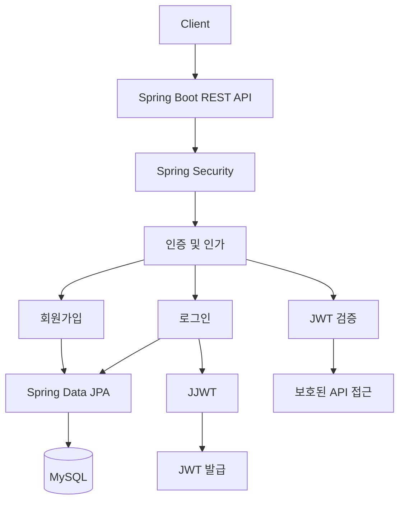
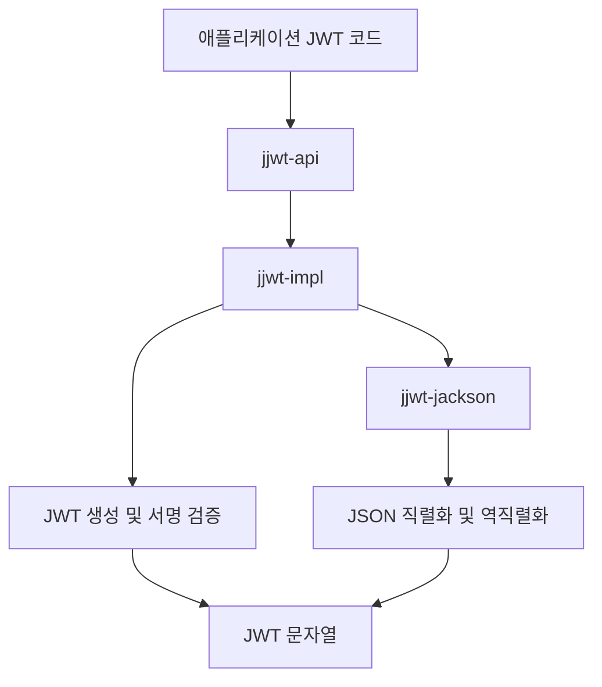
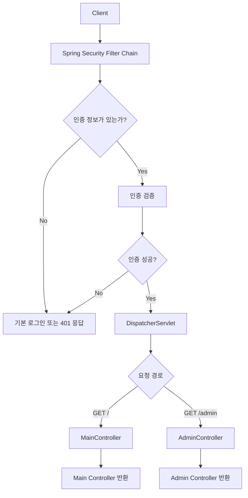
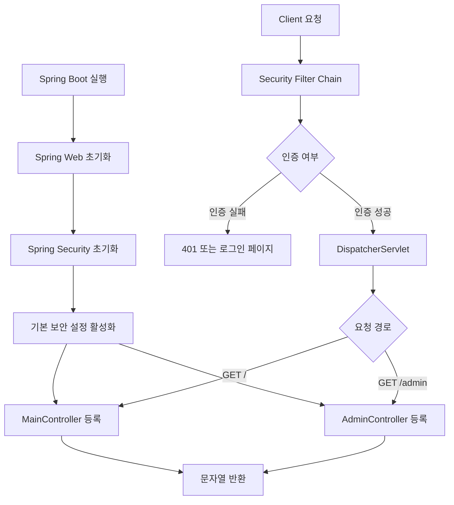

# 스프링 시큐리티 JWT - 2. 프로젝트 생성 및 JWT 의존성 추가
[https://youtu.be/ZTaZOCqTez4?si=p3T2ejV1ecv8G-v-](https://youtu.be/ZTaZOCqTez4?si=p3T2ejV1ecv8G-v-)

# 스프링 시큐리티 JWT - 2. 프로젝트 생성 및 JWT 의존성 추가
* toc
{:toc}

---

### Spring Security JWT 프로젝트 생성과 Gradle 의존성 설정: JJWT 0.12.3, Spring Boot 3.2.1

Spring Security를 이용해 JWT 기반 인증·인가 시스템을 구현하려면 먼저 프로젝트의 실행 환경과 의존성을 구성해야 한다.

일반적인 Spring Boot 프로젝트와 달리 JWT 인증 시스템에서는 사용자 인증, 데이터베이스 접근, 토큰 생성 및 검증을 담당하는 여러 라이브러리가 필요하다.

예를 들어 다음과 같은 기능을 제공하는 REST API 서버를 개발한다고 가정해보자.

| 기능      | API           | 설명                   |
| ------- | ------------- | -------------------- |
| 회원가입    | `POST /join`  | 사용자 정보 저장            |
| 로그인     | `POST /login` | 아이디·비밀번호 검증 후 JWT 발급 |
| 일반 API  | `GET /`       | 인증된 사용자 접근           |
| 관리자 API | `GET /admin`  | 관리자 권한 확인            |

회원가입 과정에서는 MySQL에 사용자 정보를 저장한다.

로그인 과정에서는 Spring Security를 통해 아이디와 비밀번호를 검증하고, 인증에 성공하면 JWT를 발급한다.

이후 클라이언트는 발급받은 JWT를 HTTP 요청 헤더에 포함하여 보호된 API에 접근한다.



이러한 시스템을 구현하기 위해서는 각 라이브러리의 역할을 명확하게 구분해야 한다.

Spring Security는 인증과 인가를 담당한다.

Spring Data JPA는 사용자 정보를 데이터베이스에 저장하고 조회하는 역할을 담당한다.

MySQL Driver는 애플리케이션이 MySQL과 통신할 수 있도록 지원한다.

그리고 JJWT는 JWT를 생성하고 검증하는 기능을 제공한다.

중요한 점은 **Spring Security와 JJWT가 동일한 역할을 수행하는 라이브러리는 아니라는 것**이다.

Spring Security가 인증·인가 체계를 제공한다면, JJWT는 그 과정에서 사용할 JWT를 생성하고 검증하는 데 활용할 수 있다.

이번에는 이러한 구성요소를 하나의 Spring Boot 프로젝트에 추가하고, 간단한 Controller를 통해 애플리케이션의 실행 상태까지 확인한다.

---

### 개념

#### Spring Security JWT 프로젝트의 기본 구성

JWT 인증을 구현하기 위한 프로젝트는 다음 기술을 기반으로 구성한다.

| 항목              | 사용 기술           | 버전             |
| --------------- | --------------- | -------------- |
| Language        | Java            | 17             |
| Spring Boot     | Spring Boot     | 3.2.1          |
| Spring Security | Spring Security | 6.2.1          |
| Build Tool      | Gradle          | Groovy DSL     |
| JWT Library     | JJWT            | 0.12.3         |
| Database        | MySQL           | 별도 구성          |
| ORM             | Spring Data JPA | Spring Boot 관리 |
| Utility         | Lombok          | Spring Boot 관리 |
| Packaging       | JAR             | -              |

Spring Boot 3.2.1은 Java 17 이상이 필요하며 Java 21까지 호환되는 버전이다. 또한 해당 버전의 의존성 관리에는 Spring Security 6.2.1이 포함되어 있다.

여기서 JDK 버전과 Java Language Level을 구분할 필요가 있다.

예를 들어 개발 환경에 JDK 18이 설치되어 있더라도 프로젝트의 Java Language Level을 17로 설정할 수 있다.

하지만 빌드 환경과 실행 환경의 차이를 줄이려면 Java 17로 통일하는 편이 단순하다.

특히 여러 개발자가 함께 작업하거나 CI/CD 환경에서 빌드하는 경우에는 JDK 버전을 명확하게 관리해야 한다.

#### Gradle을 사용하는 이유

Gradle은 Java 프로젝트의 빌드 및 의존성을 관리하는 도구다.

Spring Boot 프로젝트에서는 Gradle을 통해 다음 작업을 수행할 수 있다.

* Spring Boot 및 외부 라이브러리 의존성 다운로드
* Java 소스 코드 컴파일
* 테스트 실행
* 실행 가능한 JAR 생성
* 애플리케이션 실행
* 의존성 버전 및 충돌 관계 확인

예를 들어 다음과 같이 의존성을 선언할 수 있다.

```gradle
dependencies {
    implementation 'org.springframework.boot:spring-boot-starter-web'
    implementation 'org.springframework.boot:spring-boot-starter-security'
}
```

Gradle은 해당 라이브러리뿐 아니라 실행에 필요한 전이 의존성까지 함께 관리한다.

따라서 개발자가 Spring MVC나 Spring Security를 구성하는 모든 JAR 파일을 직접 다운로드할 필요가 없다.

---

### 왜 의존성 구성이 중요할까?

Spring Security JWT 인증을 구현할 때는 단순히 라이브러리를 추가하는 것보다 각 라이브러리의 의존 관계를 이해하는 것이 중요하다.

특히 JWT 라이브러리는 버전에 따라 메서드의 이름과 사용 방법이 달라질 수 있다.

예를 들어 JJWT `0.11.5`와 `0.12.3`은 JWT 생성 및 검증 API에서 차이가 있다.

이전 버전의 코드를 그대로 복사하면 메서드가 Deprecated 처리되어 있거나 최신 API 사용 방식과 맞지 않을 수 있다.

또한 Spring Data JPA를 추가하면 Spring Boot는 데이터베이스 연결과 관련된 자동 구성을 시도한다.

이때 데이터베이스 연결 정보가 준비되지 않았다면 애플리케이션이 정상적으로 시작되지 않을 수 있다.

따라서 프로젝트를 구성할 때는 다음 세 가지를 구분하는 것이 좋다.

**첫째, 현재 바로 사용할 라이브러리**

Spring Web, Spring Security, Lombok, JJWT 등 기본 프로젝트 구성에 필요한 의존성이다.

**둘째, 이후 기능 구현에 필요한 라이브러리**

Spring Data JPA와 MySQL Driver처럼 데이터베이스 구성이 완료된 이후 사용할 의존성이다.

**셋째, 실제 런타임에 필요한 라이브러리**

JJWT 구현체나 JSON 직렬화 모듈처럼 애플리케이션 실행 과정에서 필요한 의존성이다.

이러한 구분은 프로젝트의 실행 오류를 줄이고, 이후 인증·인가 기능을 확장할 때도 도움이 된다.

---

### 프로젝트 생성

#### Spring Initializr 사용하기

Spring Boot 프로젝트는 Spring Initializr를 통해 생성할 수 있다.

Spring Initializr는 프로젝트의 기본 구조와 Gradle 설정 파일을 자동으로 생성해주는 도구다.

프로젝트 생성 시 다음 항목을 지정한다.

| 설정          | 값               |
| ----------- | --------------- |
| Project     | Gradle - Groovy |
| Language    | Java            |
| Spring Boot | 3.2.1           |
| Group       | `com.example`   |
| Artifact    | `jwt`           |
| Name        | `jwt`           |
| Packaging   | Jar             |
| Java        | 17              |

프로젝트 이름과 패키지 이름은 필요에 따라 변경할 수 있다.

예를 들어 다음과 같이 구성할 수 있다.

```text
Group    : com.example
Artifact : jwt
Name     : jwt
Package  : com.example.jwt
```

생성되는 기본 구조는 다음과 같다.

```text
jwt
├── gradle
│   └── wrapper
│       ├── gradle-wrapper.jar
│       └── gradle-wrapper.properties
│
├── src
│   ├── main
│   │   ├── java
│   │   │   └── com
│   │   │       └── example
│   │   │           └── jwt
│   │   │               └── JwtApplication.java
│   │   │
│   │   └── resources
│   │       └── application.properties
│   │
│   └── test
│
├── build.gradle
├── settings.gradle
├── gradlew
└── gradlew.bat
```

여기서 `gradlew`는 Gradle Wrapper 실행 파일이다.

Gradle Wrapper를 사용하면 개발자가 Gradle을 직접 설치하지 않아도 프로젝트에 지정된 Gradle 버전으로 빌드할 수 있다.

#### IntelliJ IDEA에서 생성하기

IntelliJ IDEA에서도 Spring Initializr를 이용한 프로젝트 생성을 지원한다.

일반적인 생성 과정은 다음과 같다.

1. 새로운 프로젝트 생성 메뉴를 선택한다.
2. Spring Boot 프로젝트 유형을 선택한다.
3. 프로젝트 이름과 패키지 정보를 입력한다.
4. Java와 Gradle Groovy를 선택한다.
5. JDK 및 Java Language Level을 지정한다.
6. Spring Boot 3.2.1을 선택한다.
7. 필요한 의존성을 추가한다.
8. 프로젝트를 생성한다.

생성 후에는 Gradle이 필요한 의존성을 내려받고 프로젝트를 초기화한다.

IDE에서 코드를 실행하더라도 실제 프로젝트의 의존성 정보는 `build.gradle`을 기준으로 관리된다.

---

### 기본 의존성 추가

프로젝트를 생성할 때 다음 다섯 가지 의존성을 선택한다.

| 의존성             | Gradle 이름                      | 역할              |
| --------------- | ------------------------------ | --------------- |
| Lombok          | `lombok`                       | 반복적인 Java 코드 감소 |
| Spring Web      | `spring-boot-starter-web`      | REST API 개발     |
| Spring Security | `spring-boot-starter-security` | 인증 및 인가         |
| Spring Data JPA | `spring-boot-starter-data-jpa` | ORM 기반 DB 접근    |
| MySQL Driver    | `mysql-connector-j`            | MySQL 연결        |

각 의존성의 역할을 살펴보자.

#### 1. Spring Web

```gradle
implementation 'org.springframework.boot:spring-boot-starter-web'
```

Spring Web은 HTTP 요청을 처리하고 REST API를 구현하는 데 사용한다.

대표적으로 다음 Annotation을 제공한다.

```java
@Controller
```

```java
@RestController
```

```java
@GetMapping
```

```java
@PostMapping
```

JWT 인증 시스템에서는 HTML 페이지를 반환하는 방식보다 JSON 데이터를 주고받는 REST API 방식으로 구성할 수 있다.

예를 들어 로그인 API는 다음과 같은 요청을 처리할 수 있다.

```http
POST /login HTTP/1.1
Content-Type: application/json
```

```json
{
  "username": "user01",
  "password": "password123!"
}
```

이후 JWT 인증 기능이 구현되면 로그인 성공 시 토큰을 JSON으로 반환할 수 있다.

#### 2. Spring Security

```gradle
implementation 'org.springframework.boot:spring-boot-starter-security'
```

Spring Security는 인증과 인가 기능을 구현하기 위해 사용한다.

JWT 인증 시스템에서는 다음과 같은 기능을 담당한다.

| 기능                    | 설명                |
| --------------------- | ----------------- |
| 인증                    | 사용자의 아이디와 비밀번호 검증 |
| 인가                    | API 접근 권한 확인      |
| SecurityFilterChain   | HTTP 요청의 보안 필터 처리 |
| AuthenticationManager | 인증 요청 처리          |
| UserDetailsService    | 사용자 정보 조회         |
| PasswordEncoder       | 비밀번호 해시 및 검증      |
| SecurityContextHolder | 현재 요청의 인증 정보 관리   |

Spring Security를 추가하면 아직 별도의 보안 설정을 작성하지 않았더라도 기본적인 인증 기능이 활성화된다.

따라서 생성한 Controller에 접근했을 때 인증이 요구되는 것은 정상적인 동작일 수 있다.

이 부분은 애플리케이션을 실행하면서 확인한다.

#### 3. Spring Data JPA

```gradle
implementation 'org.springframework.boot:spring-boot-starter-data-jpa'
```

Spring Data JPA는 JPA를 이용해 데이터베이스의 데이터를 저장하고 조회하는 데 사용한다.

예를 들어 사용자 정보를 다음과 같은 엔티티로 표현할 수 있다.

```java
@Entity
public class UserEntity {

    @Id
    @GeneratedValue(strategy = GenerationType.IDENTITY)
    private Long id;

    private String username;

    private String password;
}
```

그리고 Repository를 이용해 사용자 정보를 조회할 수 있다.

```java
public interface UserRepository
        extends JpaRepository<UserEntity, Long> {

    Optional<UserEntity> findByUsername(String username);
}
```

이러한 구조는 회원가입과 로그인 과정에서 사용된다.

회원가입에서는 사용자 정보를 저장하고, 로그인에서는 아이디를 기준으로 사용자를 조회한다.

다만 현재는 데이터베이스 연결을 구성하지 않으므로 JPA 의존성을 잠시 비활성화한다.

#### 4. MySQL Driver

```gradle
runtimeOnly 'com.mysql:mysql-connector-j'
```

MySQL Driver는 Java 애플리케이션과 MySQL 사이의 데이터베이스 통신을 지원한다.

Spring Data JPA가 내부적으로 Hibernate 등의 ORM 구현을 사용하더라도 실제 데이터베이스와 통신하려면 JDBC Driver가 필요하다.

MySQL Driver는 애플리케이션 실행 과정에서 필요하므로 일반적으로 `runtimeOnly`로 선언할 수 있다.

#### 5. Lombok

```gradle
compileOnly 'org.projectlombok:lombok'
annotationProcessor 'org.projectlombok:lombok'
```

Lombok은 Getter, Setter, 생성자 등 반복적으로 작성하는 Java 코드를 줄이는 데 사용한다.

예를 들어 다음 Annotation을 사용할 수 있다.

```java
@Getter
```

```java
@NoArgsConstructor
```

```java
@RequiredArgsConstructor
```

다만 Lombok은 Spring Security나 JWT의 필수 구성요소는 아니다.

개발 편의성을 위해 추가하는 라이브러리다.

또한 IntelliJ IDEA에서 Lombok이 제대로 동작하지 않는다면 Annotation Processing 설정도 확인해야 한다.

---

### MySQL 연결 전 JPA 의존성을 임시로 비활성화하는 이유

Spring Boot에서는 추가한 의존성에 따라 자동 구성(Auto-configuration)이 활성화된다.

Spring Data JPA를 추가하면 Spring Boot는 JPA와 데이터베이스 연결에 필요한 Bean을 구성하려고 한다.

그런데 현재 프로젝트에는 MySQL 연결 정보가 없다.

일반적으로 다음과 같은 설정이 아직 준비되지 않은 상태다.

```yaml
spring:
  datasource:
    url: jdbc:mysql://localhost:3306/jwt_db
    username: ${DB_USERNAME}
    password: ${DB_PASSWORD}
```

이때 JPA 의존성이 활성화되어 있고 별도의 내장 데이터베이스도 없다면 애플리케이션 실행 과정에서 DataSource 자동 구성에 실패할 수 있다.

대표적인 오류 메시지는 다음과 같다.

```text
Failed to configure a DataSource:
'url' attribute is not specified
and no embedded datasource could be configured.

Reason:
Failed to determine a suitable driver class
```

이 오류는 Spring Security나 JWT 자체의 문제가 아니다.

**데이터베이스 관련 자동 구성이 활성화되었지만 필요한 연결 설정이 준비되지 않아 발생하는 오류**다.

#### 임시로 비활성화하기

현재는 Controller와 JWT 관련 의존성만 확인하면 되므로 JPA와 MySQL Driver를 주석 처리한다.

```gradle
dependencies {
    implementation 'org.springframework.boot:spring-boot-starter-web'
    implementation 'org.springframework.boot:spring-boot-starter-security'

    // 데이터베이스 연결 이후 활성화
    // implementation 'org.springframework.boot:spring-boot-starter-data-jpa'
    // runtimeOnly 'com.mysql:mysql-connector-j'
}
```

이렇게 하면 아직 MySQL 서버를 구성하지 않았더라도 Web과 Security 중심의 애플리케이션을 실행할 수 있다.

단, MySQL Driver가 있다고 해서 반드시 데이터베이스 연결을 시도하는 것은 아니다.

일반적으로 문제가 되는 것은 JDBC나 JPA 자동 구성이 활성화된 상태에서 연결에 필요한 설정이 준비되지 않은 경우다.

따라서 정확히는 **MySQL Driver 자체가 문제라기보다 DataSource 자동 구성 조건과 연결 설정을 확인해야 한다**고 이해하는 것이 좋다.

#### 나중에 다시 활성화하려면?

회원가입을 구현할 때는 주석을 제거한다.

```gradle
implementation 'org.springframework.boot:spring-boot-starter-data-jpa'
runtimeOnly 'com.mysql:mysql-connector-j'
```

그리고 MySQL 연결 정보를 작성한다.

```yaml
spring:
  datasource:
    url: jdbc:mysql://localhost:3306/jwt_db
    username: ${DB_USERNAME}
    password: ${DB_PASSWORD}

  jpa:
    hibernate:
      ddl-auto: validate
```

이 설정은 이후 데이터베이스를 연결할 때 사용할 수 있는 예시다.

`ddl-auto: validate`는 기존 데이터베이스 스키마와 엔티티의 매핑을 검사하는 설정이므로 테이블이 미리 준비되어 있어야 한다.

개발 초기에는 다른 설정을 사용할 수도 있지만, 실제 운영에서는 스키마 변경을 명시적으로 관리하는 것이 좋다.

---

### JJWT란?

JJWT는 Java에서 JSON Web Token을 생성하고 검증하는 기능을 제공하는 라이브러리다.

Spring Security는 인증과 인가를 관리하고, JJWT는 JWT의 생성과 서명 검증 등을 처리하는 데 활용할 수 있다.

예를 들어 로그인에 성공한 사용자의 정보를 이용해 JWT를 생성할 수 있다.

```text
Spring Security
    ↓
아이디와 비밀번호 검증
    ↓
Authentication 생성
    ↓
JJWT
    ↓
JWT 생성
    ↓
클라이언트 응답
```

이후 클라이언트가 JWT를 전달하면 해당 토큰의 서명과 유효기간 등을 검증할 수 있다.

```text
Authorization Header
    ↓
Bearer Token 추출
    ↓
JJWT
    ↓
JWT 검증
    ↓
사용자 정보 추출
    ↓
Spring Security Authentication 구성
```

여기서 JWT를 발급하는 로직과 Spring Security의 인증 로직은 서로 다른 책임을 가진다.

따라서 JJWT를 추가했다고 JWT 로그인이 자동으로 완성되는 것은 아니다.

JWT 발급과 검증을 처리하는 클래스, Spring Security 설정, 인증 필터 등을 별도로 구성해야 한다.

---

### JJWT 0.12.3 의존성 추가

JJWT `0.12.3`을 사용하려면 세 가지 의존성을 추가한다.

```gradle
implementation 'io.jsonwebtoken:jjwt-api:0.12.3'
runtimeOnly 'io.jsonwebtoken:jjwt-impl:0.12.3'
runtimeOnly 'io.jsonwebtoken:jjwt-jackson:0.12.3'
```

각 의존성의 역할은 다음과 같다.

| 의존성            | 역할                         | Gradle Scope   |
| -------------- | -------------------------- | -------------- |
| `jjwt-api`     | JWT 생성 및 검증을 위한 공개 API     | implementation |
| `jjwt-impl`    | JWT 기능의 실제 구현체             | runtimeOnly    |
| `jjwt-jackson` | JWT Claim의 JSON 직렬화 및 역직렬화 | runtimeOnly    |

JJWT는 공개 API와 내부 구현을 분리하는 구조를 사용한다. 특히 `jjwt-impl`은 내부 구현에 해당하므로 런타임 의존성으로 선언하는 구성이 권장된다.

#### 1. jjwt-api

```gradle
implementation 'io.jsonwebtoken:jjwt-api:0.12.3'
```

`jjwt-api`는 애플리케이션 코드에서 직접 사용하는 JJWT 공개 API를 제공한다.

대표적으로 다음 클래스들이 포함된다.

```java
Jwts
```

```java
Claims
```

```java
JwtBuilder
```

이러한 API를 이용해 JWT를 생성하거나 검증할 수 있다.

예를 들어 다음과 같은 코드를 작성할 수 있다.

```java
String token = Jwts.builder()
        .subject("user01")
        .signWith(secretKey)
        .compact();
```

여기서 `secretKey`는 적절한 알고리즘과 키 길이를 충족하는 `SecretKey`라고 가정한다.

위 코드는 JJWT `0.12.3` 계열에서 사용할 수 있는 JWT 생성 형태의 예시다.

실제 인증 시스템에서는 서명 키와 토큰 만료 시간, 사용자 식별자 등을 안전하게 관리해야 한다.

#### 2. jjwt-impl

```gradle
runtimeOnly 'io.jsonwebtoken:jjwt-impl:0.12.3'
```

`jjwt-impl`은 JJWT의 실제 구현 코드를 제공한다.

애플리케이션 코드에서는 보통 `jjwt-api`에 정의된 공개 인터페이스와 클래스를 사용한다.

하지만 JWT 생성 및 검증 기능이 실행되려면 내부 구현이 필요하다.

이를 제공하는 것이 `jjwt-impl`이다.

따라서 `jjwt-api`만 추가한 상태에서는 컴파일이 되더라도 실제 JWT 기능 실행 과정에서 필요한 구현체를 찾지 못할 수 있다.

#### 3. jjwt-jackson

```gradle
runtimeOnly 'io.jsonwebtoken:jjwt-jackson:0.12.3'
```

JWT의 Payload에는 JSON 형태의 Claim이 포함된다.

예를 들어 다음과 같다.

```json
{
  "sub": "user01",
  "role": "ROLE_USER",
  "iat": 1790000000,
  "exp": 1790003600
}
```

JJWT는 이러한 Claim을 JSON으로 직렬화하거나 JSON 데이터를 Java 객체로 역직렬화해야 한다.

`jjwt-jackson`은 이 과정에서 Jackson을 사용할 수 있도록 지원한다.

이 모듈 역시 애플리케이션에서 직접 호출하는 공개 API가 아니라 실행 과정에서 필요한 JSON 처리 구현이다.

따라서 일반적으로 `runtimeOnly`로 선언한다.

#### 세 가지 의존성이 함께 동작하는 구조



중요한 점은 세 모듈의 버전을 동일하게 맞추는 것이다.

예를 들어 다음과 같이 서로 다른 버전을 혼합하는 구성은 피해야 한다.

```gradle
implementation 'io.jsonwebtoken:jjwt-api:0.12.3'
runtimeOnly 'io.jsonwebtoken:jjwt-impl:0.11.5'
runtimeOnly 'io.jsonwebtoken:jjwt-jackson:0.12.3'
```

공개 API와 내부 구현 사이에 호환성 문제가 발생할 수 있기 때문이다.

---

### JJWT 0.11.5와 0.12.3의 차이

JJWT를 사용할 때 주의해야 할 부분 중 하나는 버전 차이다.

기존에 작성된 프로젝트에서는 `0.11.5`를 사용하는 경우가 있고, 다른 프로젝트에서는 `0.12.x` 계열을 사용할 수 있다.

두 버전은 의존성의 기본 구성이 비슷하지만 JWT를 생성하고 파싱하는 메서드에 차이가 있다.

#### JJWT 0.11.5 의존성

```gradle
implementation 'io.jsonwebtoken:jjwt-api:0.11.5'
runtimeOnly 'io.jsonwebtoken:jjwt-impl:0.11.5'
runtimeOnly 'io.jsonwebtoken:jjwt-jackson:0.11.5'
```

#### JJWT 0.12.3 의존성

```gradle
implementation 'io.jsonwebtoken:jjwt-api:0.12.3'
runtimeOnly 'io.jsonwebtoken:jjwt-impl:0.12.3'
runtimeOnly 'io.jsonwebtoken:jjwt-jackson:0.12.3'
```

각 버전에서 대표적으로 사용되는 API를 비교하면 다음과 같다.

| 기능            | JJWT 0.11.5            | JJWT 0.12.3           |
| ------------- | ---------------------- | --------------------- |
| 토큰 생성 시작      | `Jwts.builder()`       | `Jwts.builder()`      |
| Subject 설정    | `setSubject()`         | `subject()`           |
| 만료 시간 설정      | `setExpiration()`      | `expiration()`        |
| Parser 생성     | `Jwts.parserBuilder()` | `Jwts.parser()`       |
| 검증 키 설정       | `setSigningKey()`      | `verifyWith()`        |
| Parser 완성     | `build()`              | `build()`             |
| 서명된 Claims 파싱 | `parseClaimsJws()`     | `parseSignedClaims()` |
| Claims 접근     | `getBody()`            | `getPayload()`        |

일부 이전 API는 0.12.x 계열에서도 호환성을 위해 남아 있지만 Deprecated 처리되거나 새로운 방식의 사용이 권장될 수 있다.

따라서 버전만 변경하고 코드를 그대로 유지하기보다는 해당 버전의 API를 확인해야 한다.

#### 0.11.5 방식의 JWT 검증 예시

```java
Claims claims = Jwts.parserBuilder()
        .setSigningKey(secretKey)
        .build()
        .parseClaimsJws(token)
        .getBody();
```

#### 0.12.3 방식의 JWT 검증 예시

```java
Claims claims = Jwts.parser()
        .verifyWith(secretKey)
        .build()
        .parseSignedClaims(token)
        .getPayload();
```

두 예제 모두 `secretKey`는 서명 검증에 사용할 수 있는 적절한 `SecretKey`라고 가정한다.

두 코드의 목적은 같다.

JWT의 서명을 검증하고 Payload에 포함된 Claim을 읽는 것이다.

하지만 메서드의 구성 방식이 달라졌다.

이 차이는 이후 JWT 생성 및 검증 클래스를 구현할 때 중요한 영향을 준다.

**JJWT의 버전을 변경한다면 Gradle 의존성뿐 아니라 토큰 생성·검증 코드도 함께 확인해야 한다.**

---

### build.gradle 전체 구성

이제 기본 의존성과 JJWT 의존성을 합쳐보자.

현재 단계에서는 MySQL 연결을 아직 구성하지 않았으므로 JPA와 MySQL Driver는 주석 처리한다.

다음은 Spring Boot 3.2.1과 Java 17을 기준으로 사용할 수 있는 전체 `build.gradle`이다.

```gradle
plugins {
    id 'java'
    id 'org.springframework.boot' version '3.2.1'
    id 'io.spring.dependency-management' version '1.1.4'
}

group = 'com.example'
version = '0.0.1-SNAPSHOT'

java {
    toolchain {
        languageVersion = JavaLanguageVersion.of(17)
    }
}

repositories {
    mavenCentral()
}

dependencies {

    // Spring Web
    implementation 'org.springframework.boot:spring-boot-starter-web'

    // Spring Security
    implementation 'org.springframework.boot:spring-boot-starter-security'

    // Lombok
    compileOnly 'org.projectlombok:lombok'
    annotationProcessor 'org.projectlombok:lombok'

    // Spring Data JPA
    // 데이터베이스 연결 이후 활성화
    // implementation 'org.springframework.boot:spring-boot-starter-data-jpa'

    // MySQL Driver
    // 데이터베이스 연결 이후 활성화
    // runtimeOnly 'com.mysql:mysql-connector-j'

    // JJWT 0.12.3
    implementation 'io.jsonwebtoken:jjwt-api:0.12.3'
    runtimeOnly 'io.jsonwebtoken:jjwt-impl:0.12.3'
    runtimeOnly 'io.jsonwebtoken:jjwt-jackson:0.12.3'

    // Spring Boot Test
    testImplementation 'org.springframework.boot:spring-boot-starter-test'

    // Spring Security Test
    testImplementation 'org.springframework.security:spring-security-test'
}

tasks.named('test') {
    useJUnitPlatform()
}
```

현재 구성에서 각 기술의 역할은 다음과 같다.

```text
Spring Boot Application
│
├── Spring Web
│   └── REST API
│
├── Spring Security
│   ├── 인증
│   └── 인가
│
├── JJWT
│   ├── jjwt-api
│   ├── jjwt-impl
│   └── jjwt-jackson
│
├── Lombok
│   └── 반복 코드 감소
│
└── Database
    ├── Spring Data JPA
    └── MySQL Driver
        └── 현재 비활성화
```

이렇게 설정하면 데이터베이스 연결을 하지 않은 상태에서도 Spring Web과 Security, JJWT를 이용한 기본 프로젝트 구성을 확인할 수 있다.

단, JJWT 관련 의존성은 아직 실제 토큰 생성 로직에서 사용하지 않으므로 프로젝트가 실행된다는 사실만으로 JWT 생성·검증 기능이 정상 동작한다고 단정할 수는 없다.

---

### Gradle 의존성 다운로드 및 확인

의존성을 추가했다면 Gradle이 해당 라이브러리를 정상적으로 내려받았는지 확인해야 한다.

#### 1. Gradle 버전 확인

다음 명령을 실행한다.

```bash
./gradlew --version
```

이 명령은 현재 프로젝트에서 사용하는 Gradle Wrapper의 버전과 JVM 환경을 출력한다.

예상되는 출력 형태는 다음과 같다.

```text
------------------------------------------------------------
Gradle 8.x
------------------------------------------------------------

JVM: 17
OS: ...
```

실제 버전과 출력 내용은 프로젝트의 Gradle Wrapper 및 실행 환경에 따라 달라진다.

여기서 JVM이 프로젝트와 호환되는 버전인지 확인한다.

#### 2. 의존성 트리 확인

다음 명령을 실행한다.

```bash
./gradlew dependencies --configuration runtimeClasspath
```

이 명령은 애플리케이션 실행에 사용되는 의존성 관계를 출력한다.

예를 들어 다음 라이브러리가 포함되어 있는지 확인할 수 있다.

```text
spring-boot-starter-web

spring-boot-starter-security

jjwt-api

jjwt-impl

jjwt-jackson
```

`runtimeClasspath`에는 애플리케이션 실행 시 필요한 의존성이 포함된다.

따라서 `runtimeOnly`로 선언한 `jjwt-impl`과 `jjwt-jackson`도 확인할 수 있다.

#### 3. JJWT API 의존성 확인

```bash
./gradlew dependencyInsight \
  --dependency jjwt-api \
  --configuration runtimeClasspath
```

이 명령은 `jjwt-api`의 실제 선택 버전과 의존성 관계를 보여준다.

정상적으로 구성되었다면 `0.12.3` 버전이 선택되었는지 확인할 수 있다.

#### 4. JJWT 구현체 확인

```bash
./gradlew dependencyInsight \
  --dependency jjwt-impl \
  --configuration runtimeClasspath
```

`jjwt-impl`이 런타임 클래스패스에 존재하는지 확인한다.

마찬가지로 `jjwt-jackson`도 확인할 수 있다.

```bash
./gradlew dependencyInsight \
  --dependency jjwt-jackson \
  --configuration runtimeClasspath
```

이러한 명령은 나중에 JWT 생성·검증 과정에서 클래스 로딩 오류가 발생했을 때도 유용하다.

---

### 기본 Controller 생성

의존성 구성이 완료되었다면 간단한 REST API를 작성하여 프로젝트의 실행 상태를 확인해보자.

현재는 두 개의 Controller를 생성한다.

첫 번째는 일반 API를 제공하는 `MainController`다.

두 번째는 관리자 API를 제공하는 `AdminController`다.

패키지 구조는 다음과 같다.

```text
src/main/java/com/example/jwt
│
├── JwtApplication.java
│
└── controller
    ├── MainController.java
    └── AdminController.java
```

Controller 패키지는 `JwtApplication`이 위치한 기본 패키지의 하위에 생성한다.

이렇게 해야 일반적인 Spring Boot의 컴포넌트 스캔 범위에 포함된다.

---

### MainController 구현

먼저 기본 경로인 `/`에 접근하면 문자열을 반환하는 Controller를 생성한다.

```java
package com.example.jwt.controller;

import org.springframework.stereotype.Controller;
import org.springframework.web.bind.annotation.GetMapping;
import org.springframework.web.bind.annotation.ResponseBody;

@Controller
@ResponseBody
public class MainController {

    @GetMapping("/")
    public String main() {

        return "Main Controller";
    }
}
```

여기서 두 가지 Annotation을 사용했다.

```java
@Controller
```

```java
@ResponseBody
```

각각의 역할을 살펴보자.

#### @Controller

`@Controller`는 해당 클래스를 Spring MVC Controller로 등록한다.

Spring은 HTTP 요청을 처리할 Controller를 찾아 적절한 메서드를 실행한다.

예를 들어 다음 코드가 있다.

```java
@GetMapping("/")
public String main() {
    return "Main Controller";
}
```

이 메서드는 `/` 경로로 들어온 GET 요청을 처리한다.

그런데 일반적인 `@Controller`에서 문자열을 반환하면 Spring MVC는 해당 문자열을 View 이름으로 해석할 수 있다.

즉 `"Main Controller"`를 HTTP 응답 본문이 아니라 View 이름으로 처리하려고 할 수 있다.

#### @ResponseBody

`@ResponseBody`는 메서드의 반환값을 HTTP 응답 본문에 직접 작성하도록 하는 Annotation이다.

따라서 다음과 같이 동작한다.

```text
GET /
    ↓
MainController.main()
    ↓
"Main Controller"
    ↓
HTTP Response Body
```

이때 별도의 HTML 파일이나 View Template이 필요하지 않다.

현재 프로젝트는 REST API 서버로 동작하므로 이러한 방식으로 데이터를 반환한다.

---

### @RestController를 사용할 수도 있다

앞에서 작성한 코드는 다음 Annotation을 사용한다.

```java
@Controller
@ResponseBody
```

하지만 Spring MVC에서는 이 두 Annotation의 역할을 결합한 `@RestController`를 제공한다.

```java
@RestController
```

따라서 다음과 같이 작성할 수도 있다.

```java
package com.example.jwt.controller;

import org.springframework.web.bind.annotation.GetMapping;
import org.springframework.web.bind.annotation.RestController;

@RestController
public class MainController {

    @GetMapping("/")
    public String main() {

        return "Main Controller";
    }
}
```

이 코드도 동일하게 HTTP 응답 본문으로 문자열을 반환한다.

두 방식의 차이를 정리하면 다음과 같다.

| 구분            | @Controller + @ResponseBody | @RestController     |
| ------------- | --------------------------- | ------------------- |
| Controller 등록 | O                           | O                   |
| HTTP 응답 본문 반환 | O                           | O                   |
| Annotation 개수 | 2개                          | 1개                  |
| REST API 구현   | 가능                          | 가능                  |
| 일반적인 사용       | 개별 메서드 응답 제어                | REST API Controller |

REST API만 제공하는 Controller라면 `@RestController`가 간결하다.

반면 같은 Controller에서 View 반환과 HTTP 응답 본문 반환을 구분해야 한다면 `@Controller`와 메서드별 `@ResponseBody`를 사용할 수 있다.

---

### AdminController 구현

이번에는 `/admin` 경로에 접근하면 관리자 Controller임을 나타내는 문자열을 반환하도록 작성한다.

```java
package com.example.jwt.controller;

import org.springframework.stereotype.Controller;
import org.springframework.web.bind.annotation.GetMapping;
import org.springframework.web.bind.annotation.ResponseBody;

@Controller
@ResponseBody
public class AdminController {

    @GetMapping("/admin")
    public String admin() {

        return "Admin Controller";
    }
}
```

이 Controller는 다음 API를 제공한다.

```http
GET /admin
```

정상적으로 실행되면 다음 문자열을 반환한다.

```text
Admin Controller
```

여기서 중요한 점이 있다.

**AdminController라는 이름으로 클래스를 생성했다고 해서 자동으로 관리자 권한이 적용되는 것은 아니다.**

Spring Security는 클래스 이름만 보고 관리자 API 여부를 판단하지 않는다.

관리자 권한을 적용하려면 `SecurityFilterChain` 등에서 명시적인 인가 규칙을 작성해야 한다.

예를 들어 다음과 같은 설정이 필요하다.

```java
.requestMatchers("/admin/**").hasRole("ADMIN")
```

이 코드는 향후 보안 설정에 추가할 수 있는 인가 규칙의 일부다.

현재 단계에서는 아직 별도의 `SecurityFilterChain`을 작성하지 않았으므로 Spring Security의 기본 보안 정책이 적용된다.

---

### Spring Boot 실행

이제 두 개의 Controller를 생성했으므로 애플리케이션을 실행해보자.

#### 1. 메인 클래스 확인

Spring Boot 프로젝트를 생성하면 기본 애플리케이션 클래스가 만들어진다.

```java
package com.example.jwt;

import org.springframework.boot.SpringApplication;
import org.springframework.boot.autoconfigure.SpringBootApplication;

@SpringBootApplication
public class JwtApplication {

    public static void main(String[] args) {

        SpringApplication.run(
                JwtApplication.class,
                args
        );
    }
}
```

`@SpringBootApplication`은 Spring Boot의 자동 구성과 컴포넌트 스캔 등을 활성화한다.

따라서 `com.example.jwt.controller` 패키지에 있는 Controller도 Spring Bean으로 등록할 수 있다.

#### 2. application.properties 설정

현재는 데이터베이스 연결을 사용하지 않으므로 간단한 설정만 작성한다.

`src/main/resources/application.properties`

```properties
spring.application.name=jwt
server.port=8080
```

애플리케이션 이름은 `jwt`로 지정했다.

그리고 HTTP 서버는 8080 포트를 사용한다.

#### 3. 애플리케이션 실행

다음 명령을 실행한다.

```bash
./gradlew bootRun
```

이 명령은 Spring Boot 애플리케이션을 실행한다.

정상적으로 실행되었다면 다음과 유사한 로그를 확인할 수 있다.

```text
Tomcat started on port 8080 (http)

Started JwtApplication
```

실제 로그 형식과 출력 순서는 환경에 따라 달라질 수 있다.

이 로그는 Spring Boot 애플리케이션과 내장 Tomcat이 정상적으로 시작되었음을 나타낸다.

하지만 현재는 Spring Security가 활성화되어 있으므로 Controller에 바로 접근하면 예상과 다른 결과를 받을 수 있다.

---

### Spring Security를 추가하면 왜 로그인 화면이 나타날까?

Spring Boot 프로젝트에 다음 의존성이 존재한다고 생각해보자.

```gradle
implementation 'org.springframework.boot:spring-boot-starter-security'
```

그런데 별도의 Security 설정은 작성하지 않았다.

이 경우 Spring Boot는 Spring Security의 기본 보안 구성을 활성화한다.

기본 구성에서는 대부분의 애플리케이션 요청에 인증을 요구한다.

또한 기본 사용자 계정을 생성하고, 로그인에 사용할 임시 비밀번호를 애플리케이션 시작 로그에 출력한다.

Spring Security의 기본 설정은 Form Login과 HTTP Basic 인증을 제공하며, 요청 유형에 따라 로그인 페이지로 이동시키거나 HTTP 401을 반환할 수 있다.

#### 기본 사용자 계정

기본 사용자 이름은 다음과 같다.

```text
user
```

비밀번호는 애플리케이션 시작 시 임의로 생성된다.

로그에서 다음과 같은 메시지를 확인할 수 있다.

```text
Using generated security password: ...
```

이 비밀번호는 개발용 임시 비밀번호다.

따라서 운영 환경에서는 기본 사용자 계정에 의존하지 않고 자체 인증 체계를 구성해야 한다.

#### 기본 경로 접근

브라우저에서 다음 주소에 접근한다고 생각해보자.

```text
http://localhost:8080/
```

직접 `Main Controller` 문자열을 받을 것으로 예상할 수 있다.

하지만 아직 인증되지 않은 사용자이므로 기본 로그인 화면으로 이동할 수 있다.

```text
GET /
    ↓
Spring Security Filter Chain
    ↓
인증 정보 확인
    ↓
인증되지 않은 요청
    ↓
로그인 페이지로 이동
```

반면 REST API 클라이언트에서 JSON 응답을 요청하는 경우에는 다음과 같은 결과를 받을 수 있다.

```http
HTTP/1.1 401 Unauthorized
```

이처럼 동일한 API라도 요청의 특성과 Content Negotiation에 따라 인증되지 않은 요청의 처리 방식이 달라질 수 있다.

---

### curl로 API 동작 확인하기

브라우저뿐 아니라 터미널에서도 API의 응답을 확인할 수 있다.

#### 1. 인증 없이 일반 API 호출

```bash
curl -i \
  -H "Accept: application/json" \
  http://localhost:8080/
```

`-i`는 HTTP 응답 헤더까지 함께 출력하는 옵션이다.

`Accept: application/json`은 클라이언트가 JSON 형태의 응답을 기대한다는 의미다.

현재 Spring Security 기본 설정에서는 인증되지 않은 요청이므로 일반적으로 다음 상태 코드를 확인할 수 있다.

```http
HTTP/1.1 401 Unauthorized
```

이 결과는 Controller가 존재하지 않는다는 의미가 아니다.

Spring Security가 Controller 실행 전에 인증을 요구하고 있다는 의미다.

#### 2. 인증 없이 관리자 API 호출

```bash
curl -i \
  -H "Accept: application/json" \
  http://localhost:8080/admin
```

이 요청도 인증되지 않았으므로 보호 대상 API에 접근할 수 없다.

따라서 일반적으로 HTTP 401 또는 요청에 따른 로그인 리다이렉트가 발생할 수 있다.

#### 3. 기본 사용자 계정으로 접근

애플리케이션 시작 로그에서 생성된 비밀번호를 확인했다면 HTTP Basic 인증으로 접근할 수 있다.

```bash
curl -i \
  -u 'user:<GENERATED_PASSWORD>' \
  http://localhost:8080/
```

`<GENERATED_PASSWORD>` 부분은 실제 생성된 임시 비밀번호로 변경해야 한다.

인증에 성공하면 다음 응답을 받을 수 있다.

```http
HTTP/1.1 200 OK
Content-Type: text/plain;charset=UTF-8

Main Controller
```

마찬가지로 `/admin`에도 접근할 수 있다.

```bash
curl -i \
  -u 'user:<GENERATED_PASSWORD>' \
  http://localhost:8080/admin
```

현재는 관리자 권한을 별도로 설정하지 않았기 때문이다.

이 점을 구분해야 한다.

**Spring Security 기본 설정은 인증을 요구하지만, `/admin` 경로에 자동으로 관리자 권한을 적용하지는 않는다.**

즉 지금 확인한 것은 JWT 인증이나 관리자 인가가 아니라 Spring Security의 기본 인증 기능이다.

---

### 현재 요청 처리 구조

현재 프로젝트의 요청 처리 흐름은 다음과 같다.



이 구조에서는 Spring Security가 HTTP 요청을 먼저 처리한다.

그리고 인증이 완료된 요청이 Controller까지 전달된다.

현재는 Spring Security가 제공하는 기본적인 인증 방식을 사용하고 있다.

JWT 인증을 구현하려면 다음과 같은 구조로 변경해야 한다.

```text
Client
    ↓
Authorization: Bearer JWT
    ↓
Spring Security Filter Chain
    ↓
JWT 추출 및 검증
    ↓
Authentication 생성
    ↓
SecurityContext 설정
    ↓
인가 규칙 확인
    ↓
Controller 실행
```

따라서 현재 Controller가 정상적으로 등록되고 기본 인증이 동작하는 것을 확인했다면 프로젝트의 기본 구성은 완료된 것이다.

---

### 실무에서의 활용

#### 1. Spring Boot와 Spring Security 버전은 함께 관리한다

Spring Boot는 여러 Spring 라이브러리의 호환되는 버전을 관리한다.

따라서 Spring Security 버전을 별도로 지정해야 하는 특별한 이유가 없다면 Spring Boot가 관리하는 버전을 사용하는 편이 안정적이다.

예를 들어 Spring Boot 3.2.1 환경에서는 Spring Security 6.2.1 계열을 사용한다.

```gradle
implementation 'org.springframework.boot:spring-boot-starter-security'
```

이처럼 버전을 직접 작성하지 않아도 Spring Boot의 의존성 관리 설정에 따라 적절한 버전이 선택된다.

#### 2. Spring Boot 3.2.1은 현재 기준의 최신 버전이 아니다

여기서는 기존 구조와의 일관성을 위해 Spring Boot 3.2.1을 사용한다.

하지만 신규 프로젝트를 시작한다면 현재 지원되는 Spring Boot 버전과 Java 버전을 확인해야 한다.

특히 보안 프레임워크는 취약점 수정과 라이브러리 호환성이 중요하므로 오래된 버전을 운영 환경에 그대로 적용하는 것은 신중하게 검토해야 한다.

#### 3. JJWT 버전을 변경할 때는 API 차이를 확인한다

JJWT 0.11.5와 0.12.3은 JWT 생성 및 검증 방법에서 차이가 있다.

특히 다음 메서드를 확인하는 것이 좋다.

```text
parserBuilder()
parser()
setSigningKey()
verifyWith()
parseClaimsJws()
parseSignedClaims()
```

버전을 변경할 때는 이러한 API 차이를 확인하고 관련 코드를 함께 수정해야 한다.

#### 4. JJWT 내부 구현체에 직접 의존하지 않는다

`jjwt-impl`은 JWT 기능의 내부 구현체다.

애플리케이션에서 직접 사용할 API는 `jjwt-api`를 통해 접근하는 것이 좋다.

```gradle
implementation 'io.jsonwebtoken:jjwt-api:0.12.3'
runtimeOnly 'io.jsonwebtoken:jjwt-impl:0.12.3'
```

이러한 의존성 분리는 내부 구현 변경으로 인한 영향을 줄이는 데 도움이 된다.

#### 5. JWT 라이브러리를 추가했다고 인증 시스템이 완성되는 것은 아니다

JJWT는 JWT 생성 및 검증 기능을 제공한다.

하지만 사용자 인증은 Spring Security에서 담당해야 한다.

따라서 다음 작업이 별도로 필요하다.

```text
사용자 로그인
    ↓
AuthenticationManager
    ↓
사용자 검증
    ↓
JJWT로 토큰 발급
```

그리고 보호된 API에서는 JWT 검증 결과를 Spring Security 인증 정보와 연결해야 한다.

#### 6. MySQL 연결 정보는 소스 코드에 직접 작성하지 않는다

실제 데이터베이스 연결을 구성할 때는 사용자 이름과 비밀번호를 안전하게 관리해야 한다.

예를 들어 다음과 같이 환경변수를 사용할 수 있다.

```yaml
spring:
  datasource:
    url: ${DB_URL}
    username: ${DB_USERNAME}
    password: ${DB_PASSWORD}
```

이렇게 하면 개발·테스트·운영 환경마다 다른 데이터베이스 연결 정보를 사용할 수 있다.

다만 환경변수 자체의 접근 권한과 배포 환경의 비밀정보 관리도 함께 고려해야 한다.

#### 7. JPA 의존성과 데이터베이스 자동 구성의 관계를 이해한다

Spring Boot는 클래스패스에 존재하는 의존성을 기반으로 자동 구성을 수행한다.

따라서 JPA 관련 Starter를 추가하면 DataSource 및 EntityManager 구성 과정이 활성화될 수 있다.

데이터베이스가 준비되지 않은 상태에서 발생하는 오류를 Spring Security 문제로 오해하지 않도록 자동 구성 조건을 구분해야 한다.

#### 8. Controller의 위치는 Component Scan 범위를 고려한다

Spring Boot의 기본 컴포넌트 스캔은 일반적으로 `@SpringBootApplication`이 선언된 클래스의 패키지를 기준으로 수행된다.

따라서 Controller를 해당 패키지의 하위에 위치시키는 것이 좋다.

```text
com.example.jwt
    ↓
com.example.jwt.controller
```

만약 Controller가 스캔 범위를 벗어나면 Bean으로 등록되지 않아 요청 경로를 찾지 못할 수 있다.

#### 9. @RestController와 @Controller를 구분한다

REST API에서는 데이터를 HTTP 응답 본문에 직접 반환해야 하는 경우가 많다.

이때 `@RestController`를 사용하면 `@Controller`와 `@ResponseBody`를 함께 선언한 것과 같은 효과를 얻을 수 있다.

반면 서버에서 HTML View를 렌더링하는 기능이 필요하다면 `@Controller`를 사용할 수 있다.

#### 10. 기본 Security 인증과 JWT 인증을 혼동하지 않는다

Spring Security 의존성을 추가한 직후 로그인 화면이 표시되는 것은 JWT 인증이 완료되었다는 의미가 아니다.

아직은 Spring Security의 기본 Form Login 및 HTTP Basic 인증 기능이 활성화된 상태다.

JWT 기반 인증을 구현하려면 기본 보안 설정을 변경하고 JWT 검증 과정을 추가해야 한다.

#### 11. 관리자 Controller라고 자동으로 관리자 권한이 필요한 것은 아니다

다음과 같은 Controller가 존재한다고 생각해보자.

```java
@GetMapping("/admin")
public String admin() {
    return "Admin Controller";
}
```

이 API는 단순히 `/admin` 경로에 매핑된 Controller다.

관리자 권한을 요구하려면 별도의 인가 규칙을 정의해야 한다.

예를 들어 다음과 같다.

```java
.requestMatchers("/admin/**").hasRole("ADMIN")
```

이러한 설정을 하지 않으면 단순히 URL이나 클래스 이름에 `admin`이 포함되어 있다는 이유만으로 관리자 권한 검증이 수행되지 않는다.

#### 12. 의존성 Scope를 구분해서 사용한다

Gradle의 의존성 Scope는 라이브러리가 어느 단계에서 필요한지에 따라 달라진다.

| Scope                 | 역할             |
| --------------------- | -------------- |
| `implementation`      | 컴파일 및 런타임에서 사용 |
| `compileOnly`         | 컴파일 시에만 사용     |
| `runtimeOnly`         | 런타임에서만 사용      |
| `annotationProcessor` | Annotation 처리  |
| `testImplementation`  | 테스트 컴파일 및 실행   |

JJWT를 구성할 때 이러한 Scope를 구분하는 이유는 공개 API와 내부 구현의 의존 관계를 명확하게 하기 위해서다.

#### 13. Gradle Wrapper를 이용해 빌드 환경을 통일한다

개발자마다 서로 다른 Gradle 버전을 사용하면 예상하지 못한 빌드 오류가 발생할 수 있다.

따라서 프로젝트에 포함된 Gradle Wrapper를 사용하는 것이 좋다.

```bash
./gradlew build
```

이 명령은 프로젝트에 지정된 Gradle 버전을 기준으로 빌드를 수행한다.

CI/CD 환경에서도 같은 Wrapper를 사용하면 로컬과 서버의 빌드 환경 차이를 줄일 수 있다.

#### 14. 의존성 추가 이후 실제 런타임 클래스패스를 확인한다

Gradle 설정에 라이브러리를 추가했다고 해서 모든 문제가 해결되는 것은 아니다.

특히 JJWT처럼 API와 구현체를 분리한 라이브러리는 런타임 의존성이 누락되면 실제 기능 실행 과정에서 오류가 발생할 수 있다.

따라서 다음 명령으로 의존성을 점검하는 습관이 중요하다.

```bash
./gradlew dependencies --configuration runtimeClasspath
```

#### 15. 기본 로그인 비밀번호를 운영 환경에서 사용하지 않는다

Spring Security가 자동으로 생성하는 임시 비밀번호는 개발 환경에서 기본 인증 동작을 확인하기 위한 기능이다.

실제 서비스에서는 MySQL에 저장된 사용자 정보를 조회하고, `PasswordEncoder`를 이용해 비밀번호를 검증하는 인증 구조를 사용해야 한다.

JWT 인증을 구현한 뒤에는 기본 사용자 계정에 의존하지 않도록 Security 설정을 명확하게 구성해야 한다.

---

### 구조

#### 현재 프로젝트 구조

지금까지 구성한 프로젝트는 다음과 같다.

```text
jwt
│
├── src
│   ├── main
│   │   ├── java
│   │   │   └── com.example.jwt
│   │   │       │
│   │   │       ├── JwtApplication.java
│   │   │       │
│   │   │       └── controller
│   │   │           ├── MainController.java
│   │   │           └── AdminController.java
│   │   │
│   │   └── resources
│   │       └── application.properties
│   │
│   └── test
│
├── build.gradle
├── settings.gradle
└── gradlew
```

이 구조에서는 두 개의 API를 제공한다.

```text
GET /
```

```text
GET /admin
```

하지만 Spring Security의 기본 보안 설정이 활성화되어 있으므로 인증되지 않은 사용자는 두 API에 바로 접근할 수 없다.

현재 애플리케이션의 동작을 정리하면 다음과 같다.



즉 현재 단계의 목적은 JWT 인증을 완성하는 것이 아니라 **JWT 인증을 구현할 수 있는 Spring Boot 프로젝트의 기본 환경을 준비하는 것**이다.

---

### 정리

Spring Security JWT 인증 시스템을 구현하려면 먼저 필요한 의존성과 프로젝트 실행 환경을 구성해야 한다.

이번 프로젝트는 Spring Boot 3.2.1과 Java 17을 기준으로 생성한다.

기본적인 의존성은 다음과 같다.

```gradle
implementation 'org.springframework.boot:spring-boot-starter-web'
implementation 'org.springframework.boot:spring-boot-starter-security'
```

이후 회원가입과 사용자 조회 기능을 구현할 때는 Spring Data JPA와 MySQL Driver를 사용한다.

```gradle
implementation 'org.springframework.boot:spring-boot-starter-data-jpa'
runtimeOnly 'com.mysql:mysql-connector-j'
```

하지만 현재는 데이터베이스 연결이 준비되지 않았으므로 해당 의존성을 잠시 비활성화할 수 있다.

JWT 생성 및 검증을 위해서는 JJWT를 추가한다.

```gradle
implementation 'io.jsonwebtoken:jjwt-api:0.12.3'
runtimeOnly 'io.jsonwebtoken:jjwt-impl:0.12.3'
runtimeOnly 'io.jsonwebtoken:jjwt-jackson:0.12.3'
```

각 모듈의 역할을 정리하면 다음과 같다.

| 모듈           | 역할              |
| ------------ | --------------- |
| jjwt-api     | JWT 공개 API      |
| jjwt-impl    | JWT 기능 구현       |
| jjwt-jackson | JSON 직렬화 및 역직렬화 |

특히 JJWT `0.11.5`와 `0.12.3`은 JWT를 생성하고 검증하는 메서드에 차이가 있으므로 버전을 정확하게 확인해야 한다.

프로젝트가 구성되면 다음 두 개의 Controller를 생성한다.

```java
@Controller
@ResponseBody
public class MainController {

    @GetMapping("/")
    public String main() {
        return "Main Controller";
    }
}
```

```java
@Controller
@ResponseBody
public class AdminController {

    @GetMapping("/admin")
    public String admin() {
        return "Admin Controller";
    }
}
```

이후 애플리케이션을 실행한다.

```bash
./gradlew bootRun
```

Spring Security 의존성이 추가되어 있으므로 별도의 보안 설정을 작성하지 않았다면 기본적인 인증 기능이 활성화된다.

따라서 API에 접근하면 로그인 페이지로 이동하거나 HTTP 401 응답을 받을 수 있다.

이것은 애플리케이션 실행 오류가 아니라 Spring Security의 기본 보안 정책이 적용된 결과다.

현재는 다음 구성까지 완료된 상태다.

```text
Spring Boot 프로젝트 생성
        ↓
Gradle 의존성 추가
        ↓
Spring Security 적용
        ↓
JJWT 의존성 구성
        ↓
JPA 및 MySQL 연결 임시 비활성화
        ↓
MainController 생성
        ↓
AdminController 생성
        ↓
애플리케이션 실행
        ↓
기본 Security 인증 동작 확인
```

이후에는 Spring Security의 기본 보안 설정을 변경하고 JWT 기반 인증·인가 구조를 구성해야 한다.

그 과정에서 `SecurityFilterChain`, `AuthenticationManager`, JWT 인증 필터, JWT 생성 및 검증 기능 등을 연결하게 된다.

결국 JWT 인증 시스템의 기본 프로젝트 구성에서 중요한 것은 **Spring Security와 JJWT의 역할을 구분하고, 각 라이브러리의 버전과 실행 의존성을 정확하게 설정하는 것**이다.

#### 한 줄 요약

Spring Security JWT 프로젝트는 Spring Boot 3.2.1과 Java 17을 기반으로 Spring Web, Spring Security, Lombok, JJWT 0.12.3을 구성하여 시작할 수 있다. JJWT는 `jjwt-api`, `jjwt-impl`, `jjwt-jackson`으로 구성하며, MySQL 연결 전에는 JPA 의존성을 임시 비활성화해 기본 프로젝트를 실행할 수 있다. 또한 Spring Security를 추가하면 기본 인증이 자동 활성화되므로, JWT 인증을 구현하기 전에는 API 접근 시 로그인 페이지 또는 HTTP 401 응답이 나타날 수 있다.
