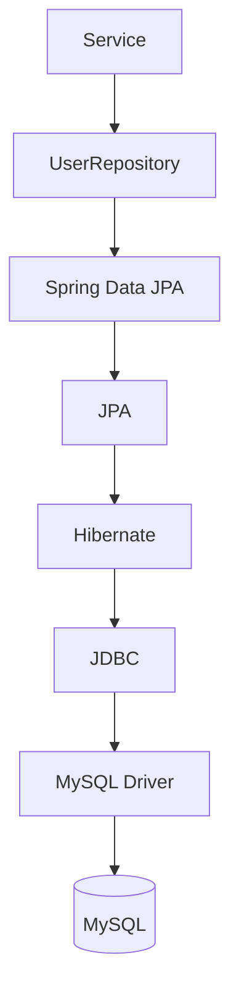
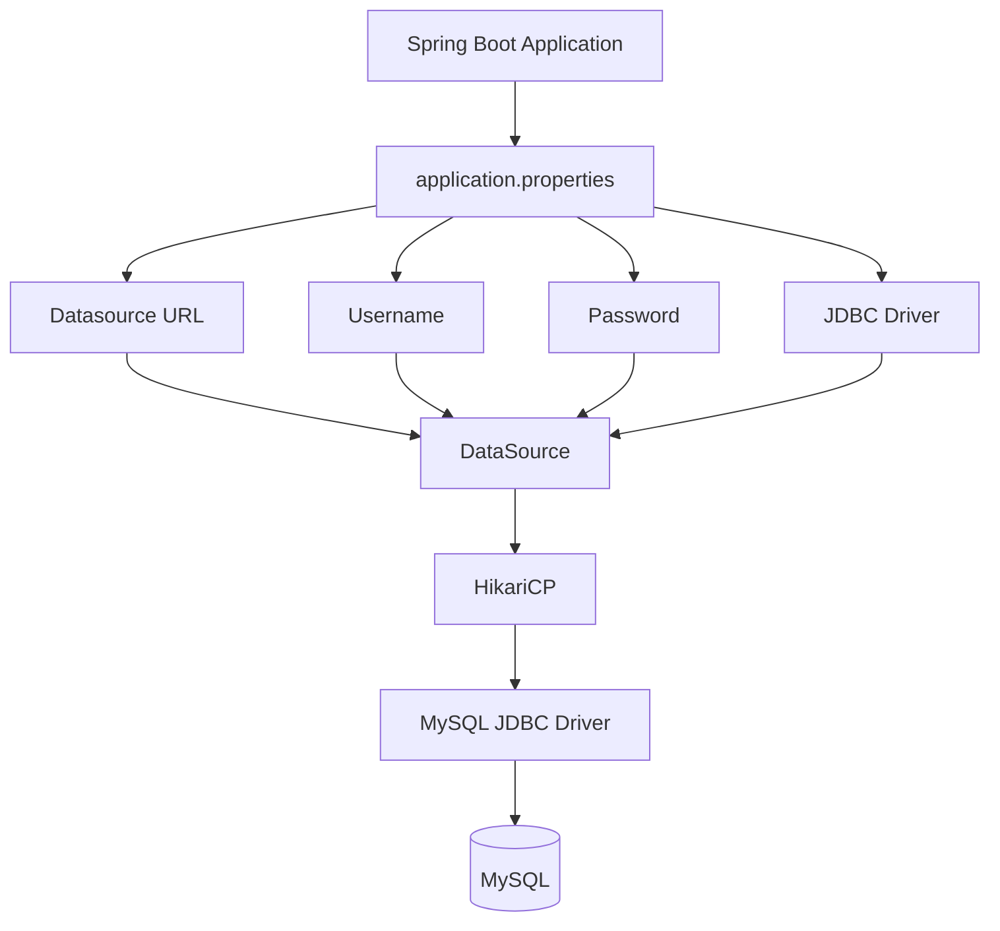
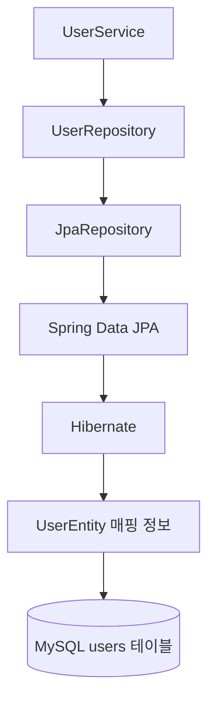
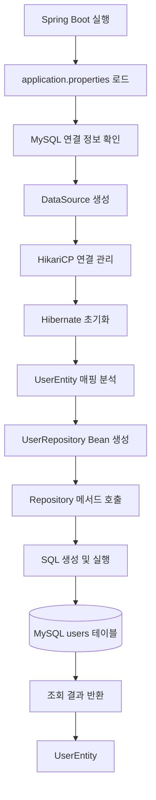

# 스프링 시큐리티 JWT - 5. DB연결 및 Entity 작성
[https://youtu.be/JFTpzy7gsg0?si=BzcaNnH2I0RHGuyn](https://youtu.be/JFTpzy7gsg0?si=BzcaNnH2I0RHGuyn)

# 스프링 시큐리티 JWT - 5. DB연결 및 Entity 작성
* toc
{:toc}

---

### Spring Security JWT MySQL 연동과 JPA Entity 구현: UserEntity, JpaRepository, ddl-auto 완벽 정리

Spring Security와 JWT를 이용해 인증 시스템을 구현하려면 사용자의 정보를 저장하고 조회할 수 있는 데이터베이스가 필요하다.

JWT는 로그인에 성공한 사용자에게 발급할 수 있는 토큰 형식이다. 그러나 JWT 자체가 사용자의 아이디와 비밀번호를 관리하거나 로그인 정보를 검증하는 역할까지 수행하는 것은 아니다.

예를 들어 사용자가 다음과 같은 정보를 이용해 로그인을 요청한다고 생각해보자.

```json
{
  "username": "user01",
  "password": "password123!"
}
```

서버는 전달받은 사용자 정보가 실제로 등록된 사용자와 일치하는지 확인해야 한다.

일반적으로 다음과 같은 과정을 거친다.

```text
로그인 요청
    ↓
아이디와 비밀번호 전달
    ↓
데이터베이스에서 사용자 조회
    ↓
저장된 비밀번호 해시 확인
    ↓
입력한 비밀번호 검증
    ↓
인증 성공
    ↓
JWT 발급
```

여기서 데이터베이스에 사용자가 존재하지 않거나 비밀번호가 일치하지 않는다면 JWT를 발급해서는 안 된다.

따라서 JWT 인증을 구현하기 전에 먼저 사용자 정보를 영속적으로 저장하고 조회할 수 있는 환경을 구성해야 한다.

이번에는 **MySQL과 Spring Data JPA를 연결하고 사용자 정보를 관리할 `UserEntity`와 `UserRepository`를 구현**한다.

전체적인 구조는 다음과 같다.

```mermaid
flowchart TD
    A["Client"] --> B["Spring Boot REST API"]

    B --> C["Spring Security"]
    C --> D["회원가입 및 로그인 처리"]

    D --> E["UserRepository"]
    E --> F["Spring Data JPA"]

    F --> G["Hibernate"]
    G --> H["JDBC Driver"]
    H --> I[("MySQL")]

    C --> J["인증 성공"]
    J --> K["JWT 발급"]
```

현재는 사용자 정보를 저장하고 조회하기 위한 데이터베이스 계층을 구축하는 것이 목적이다.

회원가입 서비스와 로그인 인증 로직은 이 구조를 기반으로 연결할 수 있다.

---

### 개념

#### JWT 인증에서 데이터베이스가 필요한 이유

JWT 기반 인증에서는 클라이언트가 매 요청마다 토큰을 전달한다.

서버는 해당 JWT의 서명과 유효기간 등을 검증하여 사용자를 인증할 수 있다.

그렇다면 JWT를 사용하는 시스템에서는 데이터베이스가 필요하지 않을까?

그렇지 않다.

JWT는 인증 정보를 전달하는 수단일 뿐, 사용자 정보를 영속적으로 관리하는 저장소는 아니다.

예를 들어 회원가입 과정에서는 다음 정보를 저장해야 한다.

| 정보       | 설명                 |
| -------- | ------------------ |
| ID       | 사용자를 고유하게 식별하는 기본키 |
| Username | 로그인에 사용할 사용자 아이디   |
| Password | 해시 처리된 비밀번호        |
| Role     | 사용자 권한             |

로그인 요청이 발생하면 이러한 정보를 이용해 인증을 진행한다.

```mermaid
sequenceDiagram
    participant Client
    participant Server as Spring Boot
    participant Security as Spring Security
    participant Repository as UserRepository
    participant DB as MySQL

    Client->>Server: 로그인 요청
    Note over Client,Server: username, password

    Server->>Security: 사용자 인증 요청

    Security->>Repository: username으로 사용자 조회
    Repository->>DB: SELECT
    DB-->>Repository: 사용자 정보
    Repository-->>Security: UserEntity 기반 사용자 정보

    Security->>Security: 비밀번호 검증

    alt 인증 성공
        Security-->>Server: 인증 결과
        Server-->>Client: JWT 발급
    else 인증 실패
        Security-->>Server: 인증 예외
        Server-->>Client: HTTP 401
    end
```

이 과정에서 MySQL은 사용자 정보를 저장한다.

Spring Data JPA는 Java 객체를 이용해 데이터베이스에 접근할 수 있도록 지원한다.

Spring Security는 조회한 사용자 정보와 입력받은 비밀번호를 검증한다.

JWT는 인증에 성공한 이후 발급한다.

각 기술의 책임을 구분하는 것이 중요하다.

---

### Spring Data JPA란?

Spring Data JPA는 JPA를 더 편리하게 사용할 수 있도록 지원하는 Spring 프로젝트다.

JPA(Java Persistence API)는 Java 객체와 관계형 데이터베이스 사이의 영속성 관리를 위한 표준이다.

Spring Boot 3.x 환경에서는 Jakarta Persistence API를 사용하며, JPA 구현체로 Hibernate가 널리 사용된다.

예를 들어 사용자 정보를 조회하기 위해 다음 SQL이 필요하다고 생각해보자.

```sql
SELECT *
FROM users
WHERE username = 'user01';
```

JDBC를 직접 사용한다면 SQL 실행, 결과 조회, 객체 변환 등의 과정을 개발자가 처리해야 한다.

반면 Spring Data JPA에서는 Repository 인터페이스를 선언하고 메서드를 정의하는 방식으로 데이터베이스에 접근할 수 있다.

```java
public interface UserRepository
        extends JpaRepository<UserEntity, Integer> {

    Optional<UserEntity> findByUsername(String username);
}
```

이후 다음과 같이 사용할 수 있다.

```java
Optional<UserEntity> user =
        userRepository.findByUsername("user01");
```

Spring Data JPA는 메서드 이름을 분석하여 적절한 조회 쿼리를 생성할 수 있다.

이를 **Query Method** 또는 **Derived Query Method**라고 한다.

Spring Data JPA를 사용한다고 SQL이 필요 없어지는 것은 아니다.

실제 데이터베이스에서는 여전히 SQL이 실행된다.

다만 기본적인 CRUD 작업에 필요한 반복 코드를 줄이고, 객체 중심으로 데이터를 관리할 수 있도록 지원한다.

#### JPA와 Hibernate, Spring Data JPA의 차이

| 구분              | 역할                               |
| --------------- | -------------------------------- |
| JPA             | Java 객체의 영속성 관리를 위한 표준           |
| Hibernate       | JPA 기능을 실제로 구현하는 ORM 프레임워크       |
| Spring Data JPA | Repository 추상화와 편리한 데이터 접근 기능 제공 |
| JDBC Driver     | Java와 데이터베이스 간 통신                |
| MySQL           | 실제 데이터를 저장하는 관계형 데이터베이스          |

이 관계를 구조로 표현하면 다음과 같다.



실제 내부 구현에는 여러 계층이 관여하지만, 개발자는 Repository를 중심으로 사용자 정보를 관리할 수 있다.

---

### 프로젝트 환경

이번에 사용할 환경은 다음과 같다.

| 항목              | 기술                |
| --------------- | ----------------- |
| Language        | Java 17           |
| Spring Boot     | 3.2.1             |
| Spring Security | 6.2.1             |
| ORM             | Spring Data JPA   |
| JPA 구현체         | Hibernate         |
| Database        | MySQL             |
| Build Tool      | Gradle Groovy DSL |
| JWT Library     | JJWT 0.12.3       |
| Utility         | Lombok            |

JWT 라이브러리와 Security 설정은 기존 프로젝트에 구성되어 있다고 가정한다.

여기서는 추가로 데이터베이스 연결과 사용자 엔티티를 구현한다.

---

### MySQL 연결을 위한 의존성 설정

먼저 Spring Data JPA와 MySQL Driver를 프로젝트에 추가해야 한다.

기존 `build.gradle`에서 다음 의존성을 비활성화한 상태라고 가정하자.

```gradle
// implementation 'org.springframework.boot:spring-boot-starter-data-jpa'
// runtimeOnly 'com.mysql:mysql-connector-j'
```

데이터베이스 연결을 진행하기 위해 주석을 제거한다.

```gradle
implementation 'org.springframework.boot:spring-boot-starter-data-jpa'
runtimeOnly 'com.mysql:mysql-connector-j'
```

각 의존성의 역할은 다음과 같다.

#### spring-boot-starter-data-jpa

```gradle
implementation 'org.springframework.boot:spring-boot-starter-data-jpa'
```

Spring Data JPA를 이용해 Repository와 Entity를 관리하기 위한 의존성이다.

Spring Boot는 이 의존성을 기반으로 JPA 관련 자동 구성을 수행할 수 있다.

대표적으로 다음 기능이 구성된다.

* EntityManagerFactory
* TransactionManager
* Hibernate
* Spring Data Repository

이를 통해 JPA 기반의 데이터 접근 기능을 사용할 수 있다.

#### mysql-connector-j

```gradle
runtimeOnly 'com.mysql:mysql-connector-j'
```

MySQL JDBC Driver를 추가하는 의존성이다.

JPA와 Hibernate가 SQL을 생성하더라도 실제 MySQL 서버와 통신하려면 JDBC Driver가 필요하다.

MySQL Driver는 애플리케이션 실행 시 사용되므로 일반적으로 `runtimeOnly`로 선언할 수 있다.

#### Gradle 의존성 다시 불러오기

의존성을 추가했다면 Gradle을 다시 동기화한다.

IntelliJ IDEA에서는 Gradle 새로고침 기능을 사용할 수 있다.

터미널에서는 다음 명령으로 의존성 구성을 확인할 수 있다.

```bash
./gradlew dependencies --configuration runtimeClasspath
```

이 명령은 애플리케이션 실행 시 사용하는 의존성 관계를 출력한다.

정상적으로 구성되었다면 다음 의존성이 포함되어 있는지 확인할 수 있다.

```text
spring-boot-starter-data-jpa

hibernate-core

mysql-connector-j
```

실제 출력에는 버전과 전이 의존성 정보도 포함된다.

---

### build.gradle 전체 구성

현재 프로젝트의 주요 의존성을 합치면 다음과 같다.

```gradle
plugins {
    id 'java'
    id 'org.springframework.boot' version '3.2.1'
    id 'io.spring.dependency-management' version '1.1.4'
}

group = 'com.example'
version = '0.0.1-SNAPSHOT'

java {
    toolchain {
        languageVersion = JavaLanguageVersion.of(17)
    }
}

repositories {
    mavenCentral()
}

dependencies {

    // Spring Web
    implementation 'org.springframework.boot:spring-boot-starter-web'

    // Spring Security
    implementation 'org.springframework.boot:spring-boot-starter-security'

    // Spring Data JPA
    implementation 'org.springframework.boot:spring-boot-starter-data-jpa'

    // MySQL JDBC Driver
    runtimeOnly 'com.mysql:mysql-connector-j'

    // Lombok
    compileOnly 'org.projectlombok:lombok'
    annotationProcessor 'org.projectlombok:lombok'

    // JJWT 0.12.3
    implementation 'io.jsonwebtoken:jjwt-api:0.12.3'
    runtimeOnly 'io.jsonwebtoken:jjwt-impl:0.12.3'
    runtimeOnly 'io.jsonwebtoken:jjwt-jackson:0.12.3'

    // Test
    testImplementation 'org.springframework.boot:spring-boot-starter-test'
    testImplementation 'org.springframework.security:spring-security-test'
}

tasks.named('test') {
    useJUnitPlatform()
}
```

Spring Boot가 관리하는 의존성은 버전을 직접 지정하지 않아도 된다.

반면 JJWT는 사용하려는 버전을 명시적으로 지정했다.

여기서 중요한 점은 **JPA와 MySQL Driver를 추가했다고 데이터베이스 연결이 자동으로 완료되는 것은 아니라는 사실**이다.

실제 데이터베이스 주소와 사용자 계정 등의 연결 정보도 필요하다.

---

### MySQL 데이터베이스 준비

Spring Boot가 MySQL에 연결하려면 먼저 MySQL 서버가 실행 중이어야 한다.

MySQL은 로컬 환경에 직접 설치하거나 별도의 데이터베이스 서버를 이용할 수 있다.

예를 들어 다음과 같은 환경이 가능하다.

| 환경           | 설명                   |
| ------------ | -------------------- |
| Local MySQL  | 개발 PC에 MySQL 설치      |
| Docker MySQL | 컨테이너로 MySQL 실행       |
| AWS RDS      | AWS에서 관리하는 MySQL 사용  |
| 별도 DB 서버     | 내부 네트워크의 MySQL 서버 사용 |

이번에는 로컬 MySQL을 기준으로 설명한다.

AWS RDS를 사용하는 경우에도 JDBC URL의 호스트 부분을 RDS 엔드포인트로 변경하면 기본적인 연결 방식은 동일하다.

다만 RDS에서는 네트워크 접근 정책과 보안 그룹, 데이터베이스 계정 권한 등을 추가로 확인해야 한다.

#### 데이터베이스 생성

MySQL에 접속한다.

```bash
mysql -u root -p
```

각 옵션의 의미는 다음과 같다.

| 옵션        | 의미           |
| --------- | ------------ |
| `-u root` | root 사용자로 접속 |
| `-p`      | 비밀번호 입력 요청   |

접속에 성공하면 데이터베이스를 생성한다.

```sql
CREATE DATABASE jwt_db
CHARACTER SET utf8mb4
COLLATE utf8mb4_unicode_ci;
```

이 SQL은 `jwt_db`라는 데이터베이스를 생성한다.

`utf8mb4`는 다양한 유니코드 문자를 저장할 수 있는 문자 집합이다.

데이터베이스가 생성되었는지 확인한다.

```sql
SHOW DATABASES;
```

정상적으로 생성되었다면 다음과 유사한 결과를 확인할 수 있다.

```text
+--------------------+
| Database           |
+--------------------+
| information_schema |
| jwt_db             |
| mysql              |
| performance_schema |
| sys                |
+--------------------+
```

실제 출력은 MySQL 서버에 존재하는 데이터베이스에 따라 달라진다.

이제 `jwt_db`를 Spring Boot와 연결하면 된다.

---

### application.properties로 MySQL 연결하기

Spring Boot에서는 `application.properties` 또는 `application.yml`을 이용해 데이터베이스 연결 정보를 설정할 수 있다.

먼저 다음 경로의 파일을 확인한다.

```text
src/main/resources/application.properties
```

데이터베이스 연결에 필요한 대표적인 설정은 다음과 같다.

```properties
spring.datasource.driver-class-name=com.mysql.cj.jdbc.Driver

spring.datasource.url=jdbc:mysql://localhost:3306/jwt_db

spring.datasource.username=${DB_USERNAME}

spring.datasource.password=${DB_PASSWORD}
```

각 설정의 의미를 살펴보자.

#### 1. driver-class-name

```properties
spring.datasource.driver-class-name=com.mysql.cj.jdbc.Driver
```

MySQL JDBC Driver 클래스를 지정한다.

Spring Boot는 일반적으로 JDBC URL을 이용해 적절한 Driver를 자동으로 판단할 수 있다.

따라서 반드시 명시해야 하는 것은 아니다.

하지만 연결 설정을 명확하게 표현하거나 Driver 관련 문제를 확인할 때 사용할 수 있다.

#### 2. datasource.url

```properties
spring.datasource.url=jdbc:mysql://localhost:3306/jwt_db
```

MySQL 서버의 접속 주소를 지정한다.

JDBC URL의 구조는 다음과 같다.

```text
jdbc:mysql://호스트:포트/데이터베이스명
```

각 부분의 의미는 다음과 같다.

| 항목        | 값         | 설명          |
| --------- | --------- | ----------- |
| jdbc      | jdbc      | JDBC 연결     |
| mysql     | mysql     | 데이터베이스 종류   |
| localhost | localhost | MySQL 서버 주소 |
| 3306      | 3306      | MySQL 포트    |
| jwt_db    | jwt_db    | 사용할 데이터베이스  |

AWS RDS를 사용하는 경우에는 `localhost` 대신 실제 RDS 엔드포인트를 지정할 수 있다.

```properties
spring.datasource.url=jdbc:mysql://your-rds-endpoint:3306/jwt_db
```

이 주소는 형식을 보여주기 위한 예시다.

RDS에서는 실제 접속 주소뿐 아니라 TLS 설정 및 네트워크 접근 정책도 확인해야 한다.

#### 3. datasource.username

```properties
spring.datasource.username=${DB_USERNAME}
```

MySQL에 접속할 사용자 이름을 지정한다.

여기서는 계정 정보를 직접 작성하지 않고 환경변수로 전달받도록 구성했다.

실행 환경에서 `DB_USERNAME`이 설정되어 있어야 한다.

#### 4. datasource.password

```properties
spring.datasource.password=${DB_PASSWORD}
```

MySQL 접속 비밀번호를 지정한다.

비밀번호는 소스 코드나 Git 저장소에 직접 저장하지 않는 것이 좋다.

특히 AWS RDS와 같은 외부 데이터베이스를 사용하는 경우에는 환경변수나 Secret Manager 등을 활용하여 안전하게 관리해야 한다.

#### 연결 구조



Spring Boot의 JDBC 환경에서는 일반적으로 HikariCP를 Connection Pool로 사용할 수 있다.

즉 Spring Data JPA의 Repository가 매번 JDBC 연결을 직접 생성하고 관리하는 것이 아니라, DataSource와 Connection Pool을 통해 데이터베이스에 접근하는 구조다.

---

### JPA 설정 추가하기

데이터베이스 연결을 완료했다면 JPA 관련 설정을 추가한다.

대표적인 설정은 다음과 같다.

```properties
spring.jpa.hibernate.ddl-auto=none

spring.jpa.hibernate.naming.physical-strategy=org.hibernate.boot.model.naming.CamelCaseToUnderscoresNamingStrategy
```

두 설정은 서로 다른 역할을 담당한다.

첫 번째는 데이터베이스 테이블을 자동으로 생성하거나 변경할 것인지 결정한다.

두 번째는 Java 객체의 이름을 실제 데이터베이스 테이블 및 컬럼 이름으로 변환할 때 사용하는 규칙을 지정한다.

각 설정을 자세히 살펴보자.

---

### ddl-auto란?

`ddl-auto`는 Hibernate가 애플리케이션 실행 과정에서 데이터베이스 스키마를 어떻게 처리할지 결정하는 설정이다.

예를 들어 다음과 같다.

```properties
spring.jpa.hibernate.ddl-auto=none
```

이 설정은 Hibernate가 엔티티를 기준으로 테이블을 자동 생성하거나 변경하지 않도록 한다.

JPA에서 엔티티를 관리한다고 해서 반드시 테이블이 자동으로 생성되는 것은 아니다.

테이블 생성 여부는 `ddl-auto` 같은 스키마 관리 설정에 영향을 받는다.

#### ddl-auto의 종류

대표적인 설정값은 다음과 같다.

| 값             | 동작                       | 주의 사항               |
| ------------- | ------------------------ | ------------------- |
| `none`        | Hibernate의 자동 DDL 실행 안 함 | 테이블이 없어도 자동 생성하지 않음 |
| `validate`    | 엔티티와 DB 스키마의 일부 정합성 검증   | 구조가 맞지 않으면 시작 실패 가능 |
| `update`      | 엔티티를 기준으로 스키마 변경 시도      | 안전한 마이그레이션 도구가 아님   |
| `create`      | 기존 스키마 객체를 다시 생성         | 기존 데이터 삭제 위험        |
| `create-drop` | 시작 시 생성하고 종료 시 삭제        | 데이터 보존에 부적합         |

Spring Boot는 내장 데이터베이스인지 여부와 스키마 관리 도구의 존재 등을 고려해 `ddl-auto`의 기본값을 선택한다.

MySQL처럼 일반적인 외부 관계형 데이터베이스를 사용하는 경우에는 별도 설정이 없다면 보통 `none`이 적용된다.

#### none

```properties
spring.jpa.hibernate.ddl-auto=none
```

Hibernate가 자동으로 DDL을 실행하지 않는다.

이미 데이터베이스 테이블이 존재하고 별도 방법으로 스키마를 관리한다면 사용할 수 있다.

여기서 주의할 점은 `none`이 엔티티와 데이터베이스 구조의 일치 여부까지 검증해 주는 것은 아니라는 것이다.

테이블이 없더라도 애플리케이션 시작 단계에서 반드시 오류가 발생하는 것은 아니다.

실제 Repository가 해당 테이블에 접근하는 시점에 오류가 발생할 수 있다.

#### validate

```properties
spring.jpa.hibernate.ddl-auto=validate
```

Hibernate가 엔티티와 데이터베이스 스키마를 검사한다.

예를 들어 `UserEntity`에는 `username` 필드가 있는데 실제 테이블에 해당 컬럼이 없다면 스키마 검증 과정에서 오류가 발생할 수 있다.

따라서 운영 환경에서는 자동 DDL 변경을 비활성화하면서 스키마 검증만 수행하도록 구성할 수 있다.

다만 `validate`가 모든 데이터베이스 제약조건과 스키마 차이를 완벽하게 검증하는 것은 아니다.

#### update

```properties
spring.jpa.hibernate.ddl-auto=update
```

엔티티 정의를 기준으로 데이터베이스 스키마를 변경하려고 시도한다.

예를 들어 새로운 컬럼이 추가되었다면 해당 컬럼을 생성할 수 있다.

하지만 `update`는 실제 운영 환경에서 발생하는 모든 스키마 변경을 안전하게 처리하는 도구는 아니다.

컬럼 이름 변경이나 데이터 타입 변경, 기존 데이터 변환 등의 작업을 정확하게 처리한다고 보장할 수 없다.

따라서 운영 환경에서 스키마 변경을 관리하는 수단으로 무조건 사용하는 것은 권장하지 않는다.

#### create

```properties
spring.jpa.hibernate.ddl-auto=create
```

엔티티 정보를 기반으로 스키마를 다시 생성한다.

예를 들어 다음 엔티티가 있다고 생각해보자.

```java
@Entity
@Table(name = "users")
public class UserEntity {

    @Id
    @GeneratedValue(strategy = GenerationType.IDENTITY)
    private Integer id;
}
```

`ddl-auto=create`로 실행하면 Hibernate는 엔티티에 대응하는 테이블을 생성할 수 있다.

하지만 이미 테이블이 존재한다면 해당 스키마 객체를 삭제하고 다시 생성할 수 있다.

이 과정에서 기존 데이터가 사라질 수 있다.

따라서 `create`는 격리된 개발용 데이터베이스에서만 신중하게 사용해야 한다.

#### create-drop

```properties
spring.jpa.hibernate.ddl-auto=create-drop
```

애플리케이션 시작 시 테이블을 생성하고 종료 시 삭제하도록 구성한다.

일시적인 데이터베이스를 사용하는 테스트 환경에서는 활용할 수 있다.

하지만 데이터를 계속 보존해야 하는 시스템에서는 적절하지 않다.

---

### Entity란?

Entity는 관계형 데이터베이스의 테이블과 매핑되는 Java 객체다.

예를 들어 MySQL에 다음과 같은 사용자 테이블이 있다고 생각해보자.

| id | username | password  | role       |
| -: | -------- | --------- | ---------- |
|  1 | user01   | BCrypt 해시 | ROLE_USER  |
|  2 | admin01  | BCrypt 해시 | ROLE_ADMIN |

JPA에서는 이러한 테이블을 Java 객체로 표현할 수 있다.

```java
public class UserEntity {

    private Integer id;

    private String username;

    private String password;

    private String role;
}
```

하지만 단순히 Java 클래스를 만들었다고 JPA가 자동으로 Entity로 인식하는 것은 아니다.

JPA 엔티티로 관리하려면 관련 Annotation을 선언해야 한다.

대표적으로 다음 Annotation을 사용한다.

| Annotation        | 역할              |
| ----------------- | --------------- |
| `@Entity`         | JPA 엔티티 선언      |
| `@Table`          | 매핑할 테이블 지정      |
| `@Id`             | 기본키 지정          |
| `@GeneratedValue` | 기본키 생성 전략 지정    |
| `@Column`         | 컬럼 매핑 및 제약조건 설정 |

이제 실제 `UserEntity`를 작성해보자.

---

### UserEntity 생성

프로젝트에 `entity` 패키지를 생성한다.

```text
src/main/java/com/example/jwt/entity
```

그다음 `UserEntity.java`를 생성한다.

전체 프로젝트 구조는 다음과 같다.

```text
src/main/java/com/example/jwt
│
├── JwtApplication.java
│
├── config
│   └── SecurityConfig.java
│
├── controller
│   ├── MainController.java
│   └── AdminController.java
│
└── entity
    └── UserEntity.java
```

#### UserEntity 전체 코드

```java
package com.example.jwt.entity;

import jakarta.persistence.Column;
import jakarta.persistence.Entity;
import jakarta.persistence.GeneratedValue;
import jakarta.persistence.GenerationType;
import jakarta.persistence.Id;
import jakarta.persistence.Table;

import lombok.AccessLevel;
import lombok.Getter;
import lombok.NoArgsConstructor;
import lombok.Setter;

@Entity
@Table(name = "users")
@Getter
@Setter
@NoArgsConstructor(access = AccessLevel.PROTECTED)
public class UserEntity {

    @Id
    @GeneratedValue(strategy = GenerationType.IDENTITY)
    private Integer id;

    @Column(nullable = false, unique = true, length = 50)
    private String username;

    @Column(nullable = false, length = 255)
    private String password;

    @Column(nullable = false, length = 30)
    private String role;
}
```

이 엔티티는 사용자 인증에 필요한 네 가지 정보를 관리한다.

| 필드       | Java 타입 | 역할        |
| -------- | ------- | --------- |
| id       | Integer | 회원 고유 식별자 |
| username | String  | 로그인 아이디   |
| password | String  | 비밀번호 해시   |
| role     | String  | 사용자 권한    |

현재는 기본적인 인증 구조를 구성하는 것이 목적이므로 최소한의 필드만 사용한다.

실제 서비스에서는 계정 활성화 여부, 생성 일시, 수정 일시, 탈퇴 상태 등의 정보가 추가될 수 있다.

---

### @Entity란?

```java
@Entity
```

`@Entity`는 해당 클래스가 JPA에서 관리하는 엔티티임을 나타낸다.

Spring Boot는 엔티티 스캔 범위에 포함된 클래스를 찾아 JPA 매핑 정보를 구성한다.

예를 들어 다음과 같이 선언한다.

```java
@Entity
public class UserEntity {

}
```

그러면 JPA는 이 클래스를 데이터베이스 테이블과 연결할 수 있는 엔티티로 인식한다.

Spring Boot 3.x에서는 다음 패키지를 사용해야 한다.

```java
import jakarta.persistence.Entity;
```

예전 Spring Boot 2.x 프로젝트에서 사용하던 다음 패키지와 구분해야 한다.

```java
import javax.persistence.Entity;
```

Spring Boot 3.x는 Jakarta EE 기반으로 전환되었기 때문에 JPA 관련 Annotation도 `jakarta.persistence` 패키지를 사용한다.

---

### @Table이란?

```java
@Table(name = "users")
```

`@Table`은 엔티티가 매핑될 데이터베이스 테이블을 지정한다.

위 코드는 `UserEntity`가 `users` 테이블에 매핑된다는 의미다.

```text
Java Class

UserEntity
    ↓
@Table(name = "users")
    ↓
MySQL Table

users
```

`@Table`을 생략하더라도 기본 명명 규칙에 따라 테이블 이름을 결정할 수 있다.

하지만 프로젝트마다 명명 규칙이 다르거나 데이터베이스 테이블 이름을 명확하게 관리해야 하는 경우에는 직접 지정하는 것이 좋다.

이번에는 사용자 테이블 이름을 `users`로 명시했다.

이렇게 하면 엔티티 클래스 이름과 데이터베이스 테이블 이름을 구분하여 관리할 수 있다.

---

### @Id란?

```java
@Id
private Integer id;
```

`@Id`는 해당 필드를 엔티티의 기본키로 지정한다.

관계형 데이터베이스에서 Primary Key는 각각의 행을 고유하게 구분하기 위해 사용한다.

예를 들어 다음과 같은 사용자 데이터가 있다고 생각해보자.

| id | username |
| -: | -------- |
|  1 | user01   |
|  2 | user02   |
|  3 | user03   |

각 사용자는 서로 다른 ID를 가진다.

기본키를 이용하면 특정 사용자를 식별할 수 있다.

```sql
SELECT *
FROM users
WHERE id = 1;
```

이 SQL은 ID가 1인 사용자를 조회한다.

JPA에서도 기본키를 이용해 사용자를 조회할 수 있다.

```java
Optional<UserEntity> user =
        userRepository.findById(1);
```

여기서 `@Id`와 `@GeneratedValue`는 역할이 다르다.

`@Id`는 기본키 필드를 지정한다.

`@GeneratedValue`는 기본키 값을 생성하는 전략을 지정한다.

---

### @GeneratedValue란?

```java
@GeneratedValue(strategy = GenerationType.IDENTITY)
```

`@GeneratedValue`는 엔티티의 기본키 값을 자동으로 생성하도록 지정한다.

JPA에서는 다양한 기본키 생성 전략을 제공한다.

대표적으로 다음과 같다.

| 전략       | 설명                  |
| -------- | ------------------- |
| AUTO     | JPA 구현체가 전략 선택      |
| IDENTITY | 데이터베이스의 ID 생성 기능 사용 |
| SEQUENCE | 데이터베이스 시퀀스 사용       |
| TABLE    | 별도 테이블을 이용해 ID 생성   |

이번에는 MySQL을 사용하므로 `GenerationType.IDENTITY`를 적용한다.

```java
@Id
@GeneratedValue(strategy = GenerationType.IDENTITY)
private Integer id;
```

MySQL에서는 일반적으로 `AUTO_INCREMENT` 기능을 이용해 기본키 값을 생성할 수 있다.

예를 들어 사용자를 저장한다고 생각해보자.

```text
첫 번째 사용자 저장
    ↓
id = 1
```

```text
두 번째 사용자 저장
    ↓
id = 2
```

```text
세 번째 사용자 저장
    ↓
id = 3
```

ID 값은 데이터베이스에서 생성된다.

다만 항상 1부터 시작하거나 연속된 숫자가 유지된다고 보장되는 것은 아니다.

트랜잭션 롤백이나 데이터 삭제 등의 상황에서 ID 사이에 빈 값이 발생할 수 있다.

따라서 자동 증가 ID는 사용자 식별을 위한 값으로 사용해야 하며, 데이터 개수나 저장 순서를 정확하게 나타내는 값으로 가정해서는 안 된다.

#### ID 타입으로 Integer를 사용하는 이유

현재는 다음과 같이 선언했다.

```java
private Integer id;
```

`Integer`는 Java의 Wrapper 타입이다.

반면 다음 코드는 기본형 타입이다.

```java
private int id;
```

JPA 엔티티에서는 기본키가 아직 할당되지 않은 상태를 표현하기 위해 Wrapper 타입을 사용하는 것이 일반적으로 적절하다.

예를 들어 새로운 엔티티를 생성하면 아직 ID가 없다.

```java
UserEntity user = new UserEntity();
```

이때 ID는 다음과 같은 상태가 될 수 있다.

```text
id = null
```

하지만 기본형 `int`는 null을 표현할 수 없다.

따라서 `Integer`를 사용하면 아직 영속화되지 않은 엔티티의 상태를 더 명확하게 표현할 수 있다.

실제 운영 환경에서는 데이터 규모에 따라 `Long`을 사용하는 경우도 많다.

중요한 것은 엔티티의 ID 타입과 Repository의 ID 타입을 일치시키는 것이다.

---

### username 필드

다음 필드를 살펴보자.

```java
@Column(nullable = false, unique = true, length = 50)
private String username;
```

`username`은 로그인에 사용할 사용자 아이디다.

각 옵션의 의미는 다음과 같다.

| 옵션               | 의미           |
| ---------------- | ------------ |
| nullable = false | NULL 허용하지 않음 |
| unique = true    | 고유 제약조건 설정   |
| length = 50      | 문자열 컬럼 길이 지정 |

예를 들어 다음과 같은 사용자 데이터가 있다고 생각해보자.

```text
username = user01
```

다른 사용자가 같은 아이디로 가입하려고 한다면 데이터베이스의 UNIQUE 제약조건에 의해 중복 저장을 방지할 수 있다.

여기서 중요한 점이 있다.

**애플리케이션에서 중복 아이디를 확인하는 것만으로는 충분하지 않다.**

동시에 회원가입 요청이 들어오면 두 요청이 모두 해당 아이디가 존재하지 않는다고 판단할 수 있기 때문이다.

```text
Request A
    ↓
user01 존재 여부 조회
    ↓
존재하지 않음
```

```text
Request B
    ↓
user01 존재 여부 조회
    ↓
존재하지 않음
```

이후 두 요청이 동시에 INSERT를 시도할 수 있다.

따라서 애플리케이션 검증과 별개로 데이터베이스 UNIQUE 제약조건을 적용해야 한다.

---

### password 필드

다음 필드를 살펴보자.

```java
@Column(nullable = false, length = 255)
private String password;
```

`password`는 사용자 비밀번호를 저장하기 위한 필드다.

하지만 비밀번호 원문을 저장해서는 안 된다.

예를 들어 다음과 같이 저장하는 것은 위험하다.

```text
username = user01

password = password123!
```

데이터베이스가 유출되면 비밀번호도 그대로 노출되기 때문이다.

따라서 Spring Security의 `PasswordEncoder`를 이용해 비밀번호를 해시한 뒤 저장해야 한다.

이전에 구성한 `SecurityConfig`에는 다음 Bean이 존재한다.

```java
@Bean
public PasswordEncoder passwordEncoder() {

    return new BCryptPasswordEncoder();
}
```

회원가입에서는 다음과 같이 비밀번호를 처리할 수 있다.

```java
String encodedPassword =
        passwordEncoder.encode(rawPassword);
```

이후 데이터베이스에는 해시된 비밀번호를 저장한다.

```text
username = user01

password = $2a$10$...
```

로그인에서는 저장된 비밀번호를 복호화하지 않는다.

다음 메서드로 입력받은 비밀번호와 저장된 해시가 일치하는지 확인한다.

```java
boolean matched = passwordEncoder.matches(
        rawPassword,
        encodedPassword
);
```

이처럼 사용자 엔티티의 `password` 필드에는 원문이 아니라 비밀번호 해시를 저장해야 한다.

---

### role 필드

다음 필드를 살펴보자.

```java
@Column(nullable = false, length = 30)
private String role;
```

`role`은 사용자 권한을 나타내는 필드다.

예를 들어 다음과 같은 값이 들어갈 수 있다.

```text
ROLE_USER
```

```text
ROLE_ADMIN
```

Spring Security에서는 다음과 같은 방식으로 URL별 접근 권한을 설정할 수 있다.

```java
.requestMatchers("/admin", "/admin/**")
.hasRole("ADMIN")
```

일반적인 Spring Security 설정에서 `hasRole("ADMIN")`은 `ROLE_ADMIN` 권한을 확인한다.

따라서 사용자 엔티티에 다음 값이 저장되어 있다고 생각해보자.

```text
username = admin01

role = ROLE_ADMIN
```

로그인 인증 및 JWT 검증 과정에서 이 역할을 `GrantedAuthority`로 변환하면 관리자 권한 확인에 사용할 수 있다.

다만 데이터베이스에 `ROLE_ADMIN` 문자열이 저장되어 있다는 사실만으로 Spring Security가 자동으로 관리자 권한을 부여하는 것은 아니다.

사용자 조회와 인증 정보 구성 과정에서 해당 값을 Authority로 변환해야 한다.

---

### Lombok으로 Getter와 Setter 생성하기

현재 엔티티에는 다음 Annotation이 선언되어 있다.

```java
@Getter
@Setter
```

Lombok은 반복적으로 작성하는 메서드를 자동 생성하도록 지원한다.

예를 들어 다음 필드가 있다고 생각해보자.

```java
private String username;
```

`@Getter`를 사용하면 다음과 같은 Getter를 직접 작성하지 않아도 된다.

```java
public String getUsername() {
    return username;
}
```

마찬가지로 `@Setter`를 사용하면 다음과 같은 Setter를 사용할 수 있다.

```java
public void setUsername(String username) {
    this.username = username;
}
```

이렇게 작성하면 엔티티의 데이터를 쉽게 조회하거나 변경할 수 있다.

다만 실제 운영 환경에서는 모든 필드에 Setter를 공개하는 것이 적절한지 검토해야 한다.

예를 들어 다음과 같은 코드가 어디서든 실행될 수 있다면 문제가 발생할 수 있다.

```java
user.setRole("ROLE_ADMIN");
```

권한 변경은 단순한 필드 수정이 아니라 중요한 비즈니스 작업일 수 있기 때문이다.

따라서 실제 서비스에서는 다음처럼 의도가 명확한 메서드를 제공하는 구조도 고려할 수 있다.

```java
public void changePassword(String encodedPassword) {

    this.password = encodedPassword;
}
```

```java
public void changeRole(String role) {

    this.role = role;
}
```

이러한 메서드 내부에 권한 변경이나 상태 검증 규칙을 추가할 수 있다.

현재는 기본적인 엔티티 구조를 이해하기 위해 Lombok의 Getter와 Setter를 사용한다.

---

### JPA Entity의 기본 생성자

현재 엔티티에는 다음 Annotation도 존재한다.

```java
@NoArgsConstructor(access = AccessLevel.PROTECTED)
```

JPA 엔티티에는 기본 생성자가 필요하다.

JPA 구현체가 엔티티 객체를 생성하는 과정에서 기본 생성자를 사용하기 때문이다.

일반적으로 `public` 또는 `protected` 기본 생성자를 제공한다.

Lombok에서는 다음과 같이 작성할 수 있다.

```java
@NoArgsConstructor(access = AccessLevel.PROTECTED)
```

이렇게 하면 JPA가 사용할 수 있는 기본 생성자를 제공하면서 외부 코드에서 의미 없이 기본 생성자를 호출하는 것을 일부 제한할 수 있다.

---

### UserRepository란?

`UserEntity`는 사용자 데이터를 Java 객체로 표현한다.

하지만 엔티티를 정의했다고 데이터베이스에 자동으로 데이터를 저장하거나 조회할 수 있는 것은 아니다.

데이터베이스 접근을 담당하는 Repository가 필요하다.

Spring Data JPA에서는 `JpaRepository` 인터페이스를 상속받아 Repository를 구현할 수 있다.

예를 들어 다음과 같다.

```java
public interface UserRepository
        extends JpaRepository<UserEntity, Integer> {

}
```

이 인터페이스를 선언하면 기본적인 CRUD 메서드를 사용할 수 있다.

대표적으로 다음과 같다.

| 메서드          | 역할           |
| ------------ | ------------ |
| save()       | 엔티티 저장       |
| findById()   | 기본키로 조회      |
| findAll()    | 전체 조회        |
| existsById() | 기본키 존재 여부 확인 |
| deleteById() | 기본키를 이용한 삭제  |
| count()      | 엔티티 개수 조회    |

실제 SQL 실행은 Spring Data JPA와 Hibernate 등의 내부 구현을 통해 처리된다.

---

### UserRepository 생성

프로젝트에 `repository` 패키지를 생성한다.

```text
src/main/java/com/example/jwt/repository
```

그리고 `UserRepository.java`를 생성한다.

Repository는 일반적인 Java 클래스가 아니라 인터페이스로 작성한다.

#### UserRepository 전체 코드

```java
package com.example.jwt.repository;

import com.example.jwt.entity.UserEntity;

import org.springframework.data.jpa.repository.JpaRepository;

import java.util.Optional;

public interface UserRepository
        extends JpaRepository<UserEntity, Integer> {

    Optional<UserEntity> findByUsername(String username);

    boolean existsByUsername(String username);
}
```

여기서 핵심은 다음 부분이다.

```java
extends JpaRepository<UserEntity, Integer>
```

`JpaRepository`는 두 개의 제네릭 타입을 받는다.

첫 번째는 관리할 엔티티 타입이다.

두 번째는 해당 엔티티의 기본키 타입이다.

```text
JpaRepository<Entity 타입, ID 타입>
```

현재 엔티티의 기본키는 다음과 같다.

```java
private Integer id;
```

따라서 Repository도 `Integer`를 사용한다.

```java
JpaRepository<UserEntity, Integer>
```

만약 엔티티의 ID 타입을 `Long`으로 변경한다면 Repository 역시 다음과 같이 변경해야 한다.

```java
JpaRepository<UserEntity, Long>
```

**Entity의 ID 타입과 Repository의 ID 타입은 일치해야 한다.**

---

### JpaRepository를 상속하면 구현 클래스가 필요 없을까?

일반적으로 Spring Data JPA의 Repository 인터페이스는 구현 클래스를 직접 작성하지 않아도 된다.

예를 들어 다음 인터페이스가 있다고 생각해보자.

```java
public interface UserRepository
        extends JpaRepository<UserEntity, Integer> {

}
```

Spring Data JPA는 Repository 인터페이스에 대한 구현 객체를 생성하여 Spring Bean으로 등록할 수 있다.

따라서 다음과 같이 주입받아 사용할 수 있다.

```java
@Service
public class UserService {

    private final UserRepository userRepository;

    public UserService(UserRepository userRepository) {
        this.userRepository = userRepository;
    }
}
```

개발자가 별도의 `UserRepositoryImpl` 클래스를 반드시 작성할 필요는 없다.

물론 복잡한 쿼리나 특수한 데이터 접근 로직이 필요한 경우에는 커스텀 Repository 구현을 추가할 수도 있다.

---

### findByUsername이란?

이번 Repository에는 다음 메서드를 추가했다.

```java
Optional<UserEntity> findByUsername(String username);
```

이 메서드는 사용자 이름을 기준으로 엔티티를 조회한다.

Spring Data JPA는 메서드 이름을 분석하여 쿼리를 생성할 수 있다.

개념적으로 다음과 같은 SQL이 실행된다.

```sql
SELECT *
FROM users
WHERE username = ?;
```

예를 들어 다음과 같이 호출한다.

```java
Optional<UserEntity> user =
        userRepository.findByUsername("user01");
```

데이터베이스에 해당 사용자가 존재하면 `UserEntity`를 반환한다.

반대로 사용자가 존재하지 않으면 `Optional.empty()`를 반환한다.

#### Optional을 사용하는 이유

사용자 조회 결과가 항상 존재하는 것은 아니다.

예를 들어 존재하지 않는 아이디를 조회할 수 있다.

```java
userRepository.findByUsername("unknownUser");
```

이 경우 단순히 null을 반환하는 것보다 `Optional`을 사용하면 결과가 없을 수 있다는 사실을 명확하게 표현할 수 있다.

예를 들어 다음과 같이 처리할 수 있다.

```java
UserEntity user = userRepository
        .findByUsername(username)
        .orElseThrow(() ->
                new IllegalArgumentException(
                        "사용자를 찾을 수 없습니다."
                )
        );
```

이 코드는 일반적인 조회 예시다.

실제 로그인 과정에서는 사용자 정보가 없을 때 Spring Security의 `UsernameNotFoundException` 등 인증 체계에 적합한 예외를 사용하도록 구성할 수 있다.

---

### existsByUsername이란?

다음 메서드도 살펴보자.

```java
boolean existsByUsername(String username);
```

이 메서드는 해당 아이디가 존재하는지 확인한다.

예를 들어 회원가입 과정에서 사용할 수 있다.

```java
boolean exists =
        userRepository.existsByUsername("user01");
```

결과는 다음 중 하나다.

```text
true  → 이미 존재하는 사용자

false → 존재하지 않는 사용자
```

이를 이용해 회원가입 시 아이디 중복 여부를 확인할 수 있다.

다만 앞에서 설명했듯이 이 검사만으로 동시 가입 요청의 중복 저장을 완전히 막을 수는 없다.

따라서 데이터베이스의 UNIQUE 제약조건도 함께 필요하다.

---

### UserEntity와 UserRepository의 관계

지금까지 작성한 두 클래스를 연결하면 다음과 같다.



`UserEntity`는 데이터 구조와 매핑 정보를 담당한다.

`UserRepository`는 해당 엔티티를 이용한 데이터 접근을 담당한다.

따라서 두 클래스는 역할이 다르다.

| 구분                  | UserEntity                   | UserRepository                 |
| ------------------- | ---------------------------- | ------------------------------ |
| 형태                  | Java Class                   | Java Interface                 |
| 역할                  | 데이터 및 테이블 매핑                 | 데이터베이스 접근                      |
| 핵심 Annotation 또는 상속 | @Entity                      | JpaRepository                  |
| 주요 정보               | id, username, password, role | save, findById, findByUsername |
| 실제 DB 접근            | 직접 수행하지 않음                   | Spring Data JPA를 통해 수행         |

이러한 책임 분리는 서비스 로직과 데이터베이스 접근 로직을 구분하는 데 도움이 된다.

---

### Hibernate를 이용해 테이블 생성하기

이제 MySQL 연결과 Entity, Repository가 준비되었다.

하지만 MySQL에 `users` 테이블이 없다면 사용자 정보를 저장할 수 없다.

개발 환경에서는 Hibernate의 DDL 자동 생성 기능을 이용해 엔티티에 대응하는 테이블을 생성할 수 있다.

현재 설정은 다음과 같다.

```properties
spring.jpa.hibernate.ddl-auto=none
```

이 값을 개발용 데이터베이스에서 일시적으로 변경한다.

```properties
spring.jpa.hibernate.ddl-auto=create
```

애플리케이션을 실행하면 Hibernate가 엔티티 매핑 정보를 기반으로 테이블 생성 SQL을 실행할 수 있다.

```text
Spring Boot 실행
    ↓
JPA Entity 검색
    ↓
UserEntity 발견
    ↓
Hibernate 매핑 정보 분석
    ↓
DDL 생성
    ↓
MySQL에 테이블 생성
```

이때 실제 생성되는 SQL은 데이터베이스 종류와 Hibernate 버전, 엔티티 설정에 따라 달라질 수 있다.

현재 엔티티를 기준으로 하면 다음과 유사한 테이블이 생성될 수 있다.

```sql
CREATE TABLE users (
    id INT NOT NULL AUTO_INCREMENT,
    username VARCHAR(50) NOT NULL,
    password VARCHAR(255) NOT NULL,
    role VARCHAR(30) NOT NULL,
    PRIMARY KEY (id),
    UNIQUE KEY uk_users_username (username)
);
```

위 SQL은 구조를 설명하기 위한 예시이며 Hibernate가 실제로 생성하는 SQL과 제약조건 이름은 다를 수 있다.

핵심은 엔티티의 필드가 데이터베이스 컬럼과 연결된다는 점이다.

| Java Entity             | MySQL          |
| ----------------------- | -------------- |
| Integer id              | INT            |
| String username         | VARCHAR(50)    |
| String password         | VARCHAR(255)   |
| String role             | VARCHAR(30)    |
| @Id                     | PRIMARY KEY    |
| GenerationType.IDENTITY | AUTO_INCREMENT |

---

### ddl-auto=create를 사용할 때 주의할 점

가장 주의해야 할 부분이다.

`ddl-auto=create`는 애플리케이션 시작 시 엔티티를 기준으로 스키마를 새롭게 구성한다.

그 과정에서 기존 테이블이 삭제될 수 있다.

예를 들어 다음과 같은 데이터가 존재한다고 생각해보자.

| id | username |
| -: | -------- |
|  1 | user01   |
|  2 | user02   |
|  3 | user03   |

그런데 `ddl-auto=create`가 활성화된 상태에서 애플리케이션을 다시 실행했다.

```text
Spring Boot 실행
    ↓
Hibernate DDL 실행
    ↓
기존 users 테이블 삭제 가능
    ↓
users 테이블 재생성
    ↓
기존 회원 데이터 손실
```

따라서 데이터가 존재하는 환경에서는 매우 위험하다.

**특히 실제 운영 데이터베이스나 공유 개발 데이터베이스에서 `create`를 사용해서는 안 된다.**

테이블 자동 생성 기능을 확인하려면 데이터가 없는 격리된 개발용 데이터베이스를 사용하는 것이 안전하다.

테이블 생성이 끝났다면 설정을 다시 변경한다.

```properties
spring.jpa.hibernate.ddl-auto=none
```

또는 이미 생성된 테이블 구조를 검사하고 싶다면 다음 설정을 사용할 수 있다.

```properties
spring.jpa.hibernate.ddl-auto=validate
```

`none`과 `validate`는 서로 다르다.

| 설정       | 자동 DDL 실행 | 스키마 검증     |
| -------- | --------- | ---------- |
| none     | 안 함       | 안 함        |
| validate | 안 함       | 수행         |
| create   | 수행        | 기존 스키마 재생성 |

실제 운영에서는 Flyway나 Liquibase와 같은 데이터베이스 마이그레이션 도구를 이용해 스키마 변경을 명시적으로 관리하는 방식을 고려할 수 있다.

Spring Boot 공식 문서에서도 데이터베이스 스키마를 생성하고 관리할 때 여러 초기화 방식을 혼용하지 않고 하나의 관리 방식을 선택하도록 안내한다.

---

### MySQL에서 테이블 생성 여부 확인하기

Hibernate가 테이블을 생성했다면 실제 MySQL에서 확인해야 한다.

먼저 데이터베이스에 접속한다.

```bash
mysql -u root -p
```

이후 사용할 데이터베이스를 선택한다.

```sql
USE jwt_db;
```

테이블 목록을 확인한다.

```sql
SHOW TABLES;
```

정상적으로 생성되었다면 다음과 같은 결과를 확인할 수 있다.

```text
+------------------+
| Tables_in_jwt_db |
+------------------+
| users            |
+------------------+
```

#### 테이블 구조 확인

다음 명령을 실행한다.

```sql
DESCRIBE users;
```

예상되는 결과는 다음과 유사하다.

```text
+----------+--------------+------+-----+---------+----------------+
| Field    | Type         | Null | Key | Default | Extra          |
+----------+--------------+------+-----+---------+----------------+
| id       | int          | NO   | PRI | NULL    | auto_increment |
| username | varchar(50)  | NO   | UNI | NULL    |                |
| password | varchar(255) | NO   |     | NULL    |                |
| role     | varchar(30)  | NO   |     | NULL    |                |
+----------+--------------+------+-----+---------+----------------+
```

실제 결과는 Hibernate의 DDL 생성 방식과 MySQL 버전에 따라 달라질 수 있다.

여기서 확인해야 할 항목은 다음과 같다.

| 항목             | 확인할 내용         |
| -------------- | -------------- |
| id             | 기본키 여부         |
| auto_increment | 자동 증가 설정 여부    |
| username       | UNIQUE 제약조건 여부 |
| password       | NULL 허용 여부     |
| role           | 권한 저장 컬럼 존재 여부 |

실제 생성된 DDL을 자세히 확인하려면 다음 명령을 사용할 수 있다.

```sql
SHOW CREATE TABLE users;
```

이 명령은 MySQL에 저장된 테이블 생성 구문을 출력한다.

따라서 JPA 엔티티에서 정의한 제약조건이 실제 데이터베이스에 반영되었는지 확인할 수 있다.

---

### JPA Naming Strategy란?

JPA에서는 Java 객체의 필드 이름과 데이터베이스 컬럼 이름이 항상 동일하지 않을 수 있다.

예를 들어 다음과 같은 Java 필드가 있다고 생각해보자.

```java
private LocalDateTime createdAt;
```

Java에서는 Camel Case를 사용하는 경우가 많다.

```text
createdAt
```

반면 데이터베이스에서는 Snake Case를 사용하는 경우가 많다.

```text
created_at
```

이러한 이름 변환 규칙을 관리하는 것이 Naming Strategy다.

Hibernate는 크게 두 가지 Naming Strategy를 제공한다.

| 구분                     | 역할                       |
| ---------------------- | ------------------------ |
| ImplicitNamingStrategy | 이름을 명시하지 않았을 때 논리적 이름 결정 |
| PhysicalNamingStrategy | 논리적 이름을 실제 DB 식별자로 변환    |

예를 들어 다음과 같은 필드가 있다고 생각해보자.

```java
private LocalDateTime createdAt;
```

Physical Naming Strategy에 따라 다음과 같이 매핑될 수 있다.

```text
Java Property
createdAt
    ↓
Physical Naming Strategy
    ↓
Database Column
created_at
```

Spring Boot 3.2 계열은 기본적으로 Hibernate의 `CamelCaseToUnderscoresNamingStrategy`를 사용해 Camel Case를 Underscore 방식으로 변환한다.

따라서 일반적인 프로젝트에서는 별도로 Naming Strategy를 선언하지 않아도 된다.

명시적으로 설정하고 싶다면 다음과 같이 작성할 수 있다.

```properties
spring.jpa.hibernate.naming.physical-strategy=org.hibernate.boot.model.naming.CamelCaseToUnderscoresNamingStrategy
```

하지만 기존 데이터베이스의 테이블 이름과 컬럼 이름이 다른 규칙을 따른다면 Naming Strategy를 변경하기보다 `@Table`이나 `@Column`으로 명시적으로 매핑하는 것도 고려할 수 있다.

---

### application.properties 전체 설정

지금까지 구성한 내용을 하나로 정리하면 다음과 같다.

```properties
# Application
spring.application.name=jwt
server.port=8080

# MySQL
spring.datasource.driver-class-name=com.mysql.cj.jdbc.Driver
spring.datasource.url=${DB_URL:jdbc:mysql://localhost:3306/jwt_db}
spring.datasource.username=${DB_USERNAME}
spring.datasource.password=${DB_PASSWORD}

# JPA
spring.jpa.hibernate.ddl-auto=none

# SQL Logging - 개발 환경에서만 필요한 경우 사용
spring.jpa.show-sql=true

# OSIV
spring.jpa.open-in-view=false

# Hibernate Naming Strategy
spring.jpa.hibernate.naming.physical-strategy=org.hibernate.boot.model.naming.CamelCaseToUnderscoresNamingStrategy
```

각 설정의 의미는 다음과 같다.

| 설정                           | 역할                           |
| ---------------------------- | ---------------------------- |
| spring.application.name      | 애플리케이션 이름                    |
| server.port                  | HTTP 서버 포트                   |
| datasource.driver-class-name | JDBC Driver                  |
| datasource.url               | MySQL 연결 주소                  |
| datasource.username          | DB 계정                        |
| datasource.password          | DB 비밀번호                      |
| ddl-auto                     | Hibernate DDL 실행 정책          |
| show-sql                     | Hibernate SQL 출력             |
| open-in-view                 | 요청 처리 중 영속성 컨텍스트 사용 범위 관련 설정 |
| physical-strategy            | DB 이름 변환 규칙                  |

여기서 `spring.jpa.show-sql=true`는 개발 과정에서 실제 SQL을 확인하기 위한 설정이다.

운영 환경에서는 로그량과 민감정보 노출 가능성을 고려해야 한다.

또한 `spring.jpa.open-in-view=false`는 영속성 컨텍스트와 HTTP 요청 처리 범위를 분리하는 데 도움이 될 수 있지만, Lazy Loading과 트랜잭션 경계를 고려한 서비스 설계가 필요하다.

이 두 설정은 데이터베이스 연결 자체를 위해 반드시 필요한 것은 아니며, 개발 및 운영 정책에 따라 선택할 수 있다.

---

### 실제 Repository 동작 확인하기

데이터베이스 연결과 테이블 생성이 완료되었다면 Repository가 정상적으로 동작하는지 확인할 수 있다.

먼저 다음과 같은 사용자 객체를 생성한다고 생각해보자.

```java
UserEntity user = new UserEntity();

user.setUsername("user01");

user.setPassword(
        passwordEncoder.encode("password123!")
);

user.setRole("ROLE_USER");
```

비밀번호는 반드시 해시한 값을 설정해야 한다.

이후 Repository를 통해 저장할 수 있다.

```java
UserEntity savedUser =
        userRepository.save(user);
```

ID 생성 전략이 `IDENTITY`이므로 데이터베이스에서 생성된 ID가 엔티티에 반영될 수 있다.

```java
Integer userId = savedUser.getId();
```

이제 사용자 이름으로 다시 조회할 수 있다.

```java
Optional<UserEntity> foundUser =
        userRepository.findByUsername("user01");
```

조회한 결과가 존재한다면 저장된 사용자 정보를 사용할 수 있다.

```java
if (foundUser.isPresent()) {

    UserEntity entity = foundUser.get();

    System.out.println(entity.getUsername());
    System.out.println(entity.getRole());
}
```

이러한 과정은 향후 회원가입과 로그인 기능을 구현하는 데 사용된다.

다만 실제 서비스에서는 Controller에서 Repository를 직접 호출하기보다 Service 계층을 통해 비즈니스 로직을 처리하는 구조가 일반적으로 적절하다.

---

### 실무에서의 활용

#### 1. 사용자 아이디에는 UNIQUE 제약조건을 적용한다

사용자 아이디는 일반적으로 중복되지 않아야 한다.

회원가입 서비스에서 중복 검사를 수행하더라도 동시 요청으로 인해 중복 저장이 발생할 수 있다.

따라서 데이터베이스 UNIQUE 제약조건을 함께 사용해야 한다.

```java
@Column(nullable = false, unique = true)
private String username;
```

또한 UNIQUE 제약조건 위반이 발생했을 때 사용자에게 적절한 중복 가입 오류를 반환하도록 처리해야 한다.

#### 2. 비밀번호 원문을 저장하지 않는다

사용자의 비밀번호는 BCrypt 등의 비밀번호 해시 알고리즘을 통해 저장해야 한다.

```java
passwordEncoder.encode(rawPassword);
```

로그인 시에는 다음 메서드를 사용한다.

```java
passwordEncoder.matches(
        rawPassword,
        encodedPassword
);
```

비밀번호를 복호화하여 비교하는 방식으로 구현해서는 안 된다.

#### 3. 사용자 ID는 변경되지 않는 식별자로 사용하는 것이 좋다

로그인 아이디인 `username`은 서비스 정책에 따라 변경할 수 있다.

하지만 기본키인 `id`는 사용자 데이터를 고유하게 식별하는 역할을 담당한다.

따라서 JWT의 Subject에 무엇을 저장할지 결정할 때도 이 차이를 고려해야 한다.

예를 들어 사용자 이름 변경을 허용한다면 변경되지 않는 내부 사용자 ID를 토큰의 식별자로 사용하는 구조를 검토할 수 있다.

#### 4. 사용자 권한 변경은 신중하게 처리한다

현재 Entity에는 다음 필드가 존재한다.

```java
private String role;
```

간단한 인증 시스템에서는 문자열로 권한을 관리할 수 있다.

하지만 실제 서비스에서는 일반 사용자가 자신의 권한을 임의로 관리자 권한으로 변경하지 못하도록 제한해야 한다.

예를 들어 회원가입 요청에 다음 값이 들어왔다고 생각해보자.

```json
{
  "username": "user01",
  "password": "password123!",
  "role": "ROLE_ADMIN"
}
```

서버가 클라이언트의 `role` 값을 그대로 신뢰해서는 안 된다.

일반 회원가입에서는 서버가 기본 권한을 직접 지정하는 것이 안전하다.

```java
user.setRole("ROLE_USER");
```

관리자 권한 부여는 별도의 권한 있는 관리 절차를 통해 처리해야 한다.

#### 5. JPA Entity를 API 응답으로 직접 반환하지 않는다

사용자 엔티티에는 다음과 같은 정보가 존재한다.

```java
private String password;
```

이 값은 원문이 아닌 해시이더라도 외부로 노출해서는 안 된다.

따라서 Controller에서 `UserEntity`를 그대로 반환하는 방식은 피하는 것이 좋다.

대신 응답에 필요한 정보만 포함하는 DTO를 사용한다.

```java
public record UserResponse(
        Integer id,
        String username,
        String role
) {
}
```

이렇게 하면 비밀번호 해시가 HTTP 응답에 포함되는 것을 방지할 수 있다.

#### 6. Entity의 모든 필드에 Setter를 공개하지 않는다

기본적인 구현에서는 Lombok의 `@Setter`를 사용할 수 있다.

하지만 운영 시스템에서는 무분별한 상태 변경을 방지하기 위해 필요한 메서드만 공개하는 편이 좋다.

특히 비밀번호와 권한은 중요한 보안 정보이므로 변경 절차를 별도로 관리해야 한다.

#### 7. ddl-auto=create를 운영 환경에 사용하지 않는다

`create`는 기존 테이블을 삭제하고 다시 생성할 수 있다.

따라서 사용자 정보가 존재하는 데이터베이스에서는 심각한 데이터 손실이 발생할 수 있다.

운영 환경에서는 보통 다음과 같은 정책을 검토한다.

```properties
spring.jpa.hibernate.ddl-auto=validate
```

또는 다음과 같이 자동 DDL을 비활성화할 수 있다.

```properties
spring.jpa.hibernate.ddl-auto=none
```

스키마 변경은 별도의 마이그레이션 절차로 관리하는 것이 좋다.

#### 8. ddl-auto=update를 운영용 마이그레이션 도구로 사용하지 않는다

`update`는 엔티티 변경사항을 기준으로 스키마 변경을 시도한다.

하지만 컬럼 이름 변경이나 데이터 타입 변경, 기존 데이터 이관 등을 완전하게 처리하는 수단은 아니다.

따라서 운영 시스템에서는 Flyway나 Liquibase를 이용해 변경 이력을 명시적으로 관리하는 방법을 고려해야 한다.

#### 9. DB 계정에는 필요한 권한만 부여한다

개발 초기에는 테이블 생성까지 수행해야 하므로 DDL 권한이 필요할 수 있다.

하지만 실제 운영 애플리케이션이 항상 테이블을 생성하거나 삭제할 권한을 가질 필요는 없다.

예를 들어 운영 애플리케이션 계정과 데이터베이스 마이그레이션 계정을 분리하는 방식도 고려할 수 있다.

이렇게 하면 잘못된 설정이나 코드로 인해 데이터베이스 스키마가 변경되는 위험을 줄일 수 있다.

#### 10. MySQL 연결 정보는 환경별로 분리한다

개발 환경과 운영 환경은 서로 다른 데이터베이스를 사용하는 것이 일반적이다.

예를 들어 다음과 같이 구분할 수 있다.

```text
Local
    ↓
localhost MySQL
```

```text
Development
    ↓
개발용 MySQL
```

```text
Production
    ↓
운영용 RDS
```

따라서 데이터베이스 주소와 계정 정보는 외부 설정으로 관리하는 것이 좋다.

특히 운영 데이터베이스의 접속 정보를 소스 코드에 직접 작성하거나 Git에 저장하지 않도록 주의해야 한다.

#### 11. AWS RDS는 네트워크 접근 정책을 함께 확인한다

AWS RDS에 연결할 때는 JDBC URL만 올바르게 설정한다고 항상 연결되는 것은 아니다.

다음과 같은 조건도 확인해야 한다.

| 항목               | 확인 사항              |
| ---------------- | ------------------ |
| RDS Endpoint     | 올바른 주소인지           |
| Port             | MySQL 포트가 일치하는지    |
| Security Group   | 애플리케이션에서 접근 가능한지   |
| VPC              | 네트워크 경로가 존재하는지     |
| Database Account | 사용자 이름과 비밀번호가 올바른지 |
| TLS              | 연결 암호화 정책을 충족하는지   |

특히 RDS가 Private Subnet에 존재한다면 로컬 PC에서 직접 접근할 수 없을 수 있다.

이 경우 네트워크 접근 구조를 별도로 구성해야 한다.

#### 12. 사용자 조회 메서드에는 적절한 인덱스가 필요하다

로그인 과정에서는 사용자 이름으로 회원을 조회하는 경우가 많다.

```java
findByUsername(String username);
```

이는 일반적으로 다음 조건의 조회를 수행한다.

```sql
WHERE username = ?
```

사용자 수가 많아지면 해당 조회의 성능이 중요해진다.

이번 엔티티에서는 `username`에 UNIQUE 제약조건을 적용했다.

MySQL에서는 UNIQUE 제약조건을 위해 고유 인덱스가 생성되므로 사용자 이름 기반 조회에도 활용할 수 있다.

다만 실제 인덱스 사용 여부는 SQL과 실행 계획을 확인해야 한다.

#### 13. 트랜잭션 경계를 명확하게 관리한다

JPA를 이용해 사용자 정보를 저장하는 작업은 트랜잭션과 밀접하게 관련된다.

예를 들어 회원가입 서비스에서 사용자 정보를 저장한 뒤 추가 작업을 수행한다고 생각해보자.

```text
회원가입
    ↓
사용자 정보 저장
    ↓
가입 이력 저장
    ↓
완료
```

이러한 작업이 하나의 비즈니스 단위라면 적절한 트랜잭션 경계를 설정해야 한다.

Spring에서는 `@Transactional`을 이용해 트랜잭션을 관리할 수 있다.

다만 사용자 저장과 외부 API 호출이 함께 존재한다면 하나의 데이터베이스 트랜잭션만으로 모든 작업의 원자성을 보장할 수 없다는 점도 고려해야 한다.

#### 14. JPA의 SQL을 확인하며 동작을 검증한다

JPA를 사용하면 Repository 메서드만 작성해도 SQL이 실행될 수 있다.

하지만 실제로 어떤 SQL이 실행되는지 확인하지 않으면 불필요한 조회나 성능 문제를 놓칠 수 있다.

개발 환경에서는 다음 설정을 활용할 수 있다.

```properties
spring.jpa.show-sql=true
```

이를 통해 Hibernate가 실행하는 SQL을 확인할 수 있다.

다만 실제 바인딩 값과 민감정보를 포함한 로그는 운영 환경에서 노출되지 않도록 관리해야 한다.

#### 15. ddl-auto=none과 validate의 차이를 이해한다

`none`은 Hibernate의 자동 DDL 작업을 비활성화한다.

반면 `validate`는 스키마를 변경하지 않으면서 매핑 구조를 검증한다.

따라서 스키마가 이미 준비된 환경에서는 `validate`를 이용해 일부 구조적 불일치를 애플리케이션 시작 단계에서 확인할 수 있다.

하지만 마이그레이션 도구를 사용한다고 해서 반드시 `validate`가 필요한 것은 아니다.

프로젝트의 배포 전략과 스키마 관리 정책에 따라 선택해야 한다.

#### 16. 데이터베이스 연결 성공과 Repository 동작 성공은 다르다

Spring Boot가 정상적으로 실행되었다고 해서 모든 Repository 쿼리가 정상적으로 동작한다고 보장할 수는 없다.

예를 들어 데이터베이스 연결은 성공했지만 `users` 테이블이 존재하지 않을 수 있다.

또는 테이블은 존재하지만 컬럼 이름이 엔티티 매핑과 다를 수 있다.

따라서 다음 과정을 구분해서 확인하는 것이 좋다.

```text
데이터베이스 접속 성공
    ↓
EntityManagerFactory 생성
    ↓
Entity 매핑 확인
    ↓
Repository Bean 생성
    ↓
실제 SELECT / INSERT 수행
    ↓
정상 동작 확인
```

이 과정을 검증해야 실제 회원가입과 로그인 구현에 필요한 데이터베이스 계층이 정상적으로 준비되었다고 판단할 수 있다.

---

### 자주 발생하는 오류

#### Failed to configure a DataSource

다음과 같은 오류가 발생할 수 있다.

```text
Failed to configure a DataSource:
'url' attribute is not specified
```

이 오류는 데이터베이스 연결 정보가 누락되었거나 DataSource를 구성할 수 없을 때 발생할 수 있다.

다음 설정을 확인한다.

```properties
spring.datasource.url=jdbc:mysql://localhost:3306/jwt_db
spring.datasource.username=${DB_USERNAME}
spring.datasource.password=${DB_PASSWORD}
```

환경변수가 실제 실행 환경에 설정되어 있는지도 확인해야 한다.

#### Access denied for user

다음과 같은 오류가 발생할 수 있다.

```text
Access denied for user
```

이 오류는 데이터베이스 계정 인증 또는 권한 문제와 관련될 수 있다.

다음 항목을 확인한다.

* 사용자 이름이 올바른지
* 비밀번호가 올바른지
* 해당 계정에 데이터베이스 접근 권한이 있는지
* 접속한 호스트에서 해당 계정의 접근이 허용되는지

#### Communications link failure

다음과 같은 오류도 발생할 수 있다.

```text
Communications link failure
```

이는 네트워크 연결 문제 또는 MySQL 서버 접근 실패와 관련될 수 있다.

예를 들어 다음과 같은 상황이다.

```text
MySQL 서버 종료

잘못된 호스트 또는 포트

방화벽 차단

RDS Security Group 설정 오류

네트워크 연결 문제
```

이 경우 단순히 계정 비밀번호를 변경하기보다 데이터베이스 서버에 네트워크로 접근할 수 있는지 먼저 확인해야 한다.

#### Table doesn't exist

다음과 같은 오류가 발생할 수 있다.

```text
Table 'jwt_db.users' doesn't exist
```

데이터베이스에는 연결되었지만 실제 테이블이 존재하지 않는 상황이다.

`ddl-auto=none`을 사용하고 있다면 Hibernate가 테이블을 자동 생성하지 않는다.

따라서 테이블을 직접 생성하거나, 격리된 개발 환경에서만 Hibernate DDL 생성 기능을 사용할 수 있다.

#### Not a managed type

다음과 같은 오류가 발생할 수 있다.

```text
Not a managed type
```

JPA가 해당 클래스를 관리되는 엔티티로 인식하지 못할 때 발생할 수 있다.

예를 들어 다음 Annotation이 누락되었을 수 있다.

```java
@Entity
```

또는 `UserEntity`가 엔티티 스캔 범위를 벗어났을 수 있다.

Spring Boot의 기본 패키지 스캔 구조와 엔티티 위치를 확인해야 한다.

---

### 전체 프로젝트 구조

지금까지 구현한 프로젝트를 정리하면 다음과 같다.

```text
src
└── main
    ├── java
    │   └── com
    │       └── example
    │           └── jwt
    │               │
    │               ├── JwtApplication.java
    │               │
    │               ├── config
    │               │   └── SecurityConfig.java
    │               │
    │               ├── controller
    │               │   ├── MainController.java
    │               │   └── AdminController.java
    │               │
    │               ├── entity
    │               │   └── UserEntity.java
    │               │
    │               └── repository
    │                   └── UserRepository.java
    │
    └── resources
        └── application.properties
```

각 구성요소의 역할은 다음과 같다.

| 구성요소                   | 역할                    |
| ---------------------- | --------------------- |
| JwtApplication         | Spring Boot 애플리케이션 실행 |
| SecurityConfig         | 인증·인가 및 보안 설정         |
| MainController         | 일반 API                |
| AdminController        | 관리자 API               |
| UserEntity             | 사용자 데이터 매핑            |
| UserRepository         | 사용자 정보 저장 및 조회        |
| application.properties | DB 및 JPA 설정           |

이번에 추가된 핵심 구성요소는 `UserEntity`와 `UserRepository`다.

이 두 구성요소를 통해 회원가입 및 로그인에 필요한 사용자 정보를 MySQL에 저장하고 조회할 수 있다.

---

### 구조

#### 데이터베이스 연결부터 사용자 조회까지

전체 동작을 정리하면 다음과 같다.



여기서 `UserEntity`는 데이터베이스 구조를 객체로 표현한다.

`UserRepository`는 해당 엔티티에 대한 데이터 접근 기능을 제공한다.

Hibernate는 엔티티 매핑 정보를 이용해 SQL을 생성하고 실행한다.

MySQL은 실제 사용자 데이터를 저장한다.

그리고 Spring Security는 이후 이 정보를 이용해 사용자 인증을 수행할 수 있다.

---

### 정리

Spring Security와 JWT를 이용한 인증 시스템에서는 JWT를 발급하기 전에 사용자의 아이디와 비밀번호를 검증해야 한다.

이를 위해 사용자 정보를 영속적으로 관리할 데이터베이스가 필요하다.

이번에는 MySQL과 Spring Data JPA를 이용해 사용자 정보를 저장하고 조회할 수 있는 환경을 구성했다.

먼저 Gradle에 다음 의존성을 추가한다.

```gradle
implementation 'org.springframework.boot:spring-boot-starter-data-jpa'
runtimeOnly 'com.mysql:mysql-connector-j'
```

이후 `application.properties`에 데이터베이스 연결 정보를 설정한다.

```properties
spring.datasource.driver-class-name=com.mysql.cj.jdbc.Driver
spring.datasource.url=jdbc:mysql://localhost:3306/jwt_db
spring.datasource.username=${DB_USERNAME}
spring.datasource.password=${DB_PASSWORD}
```

JPA의 스키마 관리 정책은 다음과 같이 구성할 수 있다.

```properties
spring.jpa.hibernate.ddl-auto=none
```

그리고 사용자 정보를 저장할 `UserEntity`를 생성한다.

```java
@Entity
@Table(name = "users")
@Getter
@Setter
@NoArgsConstructor(access = AccessLevel.PROTECTED)
public class UserEntity {

    @Id
    @GeneratedValue(strategy = GenerationType.IDENTITY)
    private Integer id;

    @Column(nullable = false, unique = true, length = 50)
    private String username;

    @Column(nullable = false, length = 255)
    private String password;

    @Column(nullable = false, length = 30)
    private String role;
}
```

다음으로 `UserRepository`를 생성한다.

```java
public interface UserRepository
        extends JpaRepository<UserEntity, Integer> {

    Optional<UserEntity> findByUsername(String username);

    boolean existsByUsername(String username);
}
```

이제 사용자 이름을 이용해 회원 정보를 조회할 수 있고, Repository를 통해 사용자 정보를 저장할 수 있다.

마지막으로 Hibernate의 `ddl-auto` 설정을 이용하면 개발 환경에서 엔티티 기반의 테이블을 생성할 수 있다.

```properties
spring.jpa.hibernate.ddl-auto=create
```

하지만 이 설정은 기존 테이블을 삭제하고 재생성할 수 있으므로 반드시 격리된 개발용 데이터베이스에서만 신중하게 사용해야 한다.

테이블 생성이 완료되었다면 다음과 같이 다시 설정한다.

```properties
spring.jpa.hibernate.ddl-auto=none
```

또는 스키마 검증이 필요한 환경에서는 `validate`를 고려할 수 있다.

이번에 구성한 전체 구조는 다음과 같다.

```text
Spring Security JWT 인증 시스템
          ↓
사용자 정보 영속성 필요
          ↓
MySQL 연결
          ↓
Spring Data JPA 설정
          ↓
UserEntity 생성
          ↓
UserRepository 생성
          ↓
users 테이블 준비
          ↓
회원가입 및 로그인 구현 기반 완성
```

여기서 가장 중요한 점은 **JWT 인증 자체와 사용자 정보 영속성 관리를 서로 다른 책임으로 구분하는 것**이다.

JWT는 인증에 성공한 사용자의 정보를 전달하는 수단이다.

반면 MySQL과 Spring Data JPA는 사용자 정보를 저장하고 조회하는 역할을 담당한다.

이러한 기반이 마련되면 이후 회원가입에서 사용자 정보를 저장하고, 로그인에서 `UserDetailsService`를 통해 사용자를 조회하여 `AuthenticationManager`로 인증한 뒤 JWT를 발급하는 구조를 구현할 수 있다.

#### 한 줄 요약

Spring Security JWT 인증 시스템에서 MySQL과 Spring Data JPA는 회원 정보의 영속성 관리를 담당한다. `UserEntity`는 사용자 정보를 데이터베이스 테이블과 매핑하고, `UserRepository`는 `JpaRepository`를 상속하여 사용자 저장·조회를 처리한다. 또한 `spring.jpa.hibernate.ddl-auto`를 이용해 테이블 생성 및 검증 정책을 설정할 수 있지만, 실제 운영 환경에서는 데이터 손실을 방지하기 위해 자동 DDL 생성과 스키마 변경을 신중하게 관리해야 한다.
