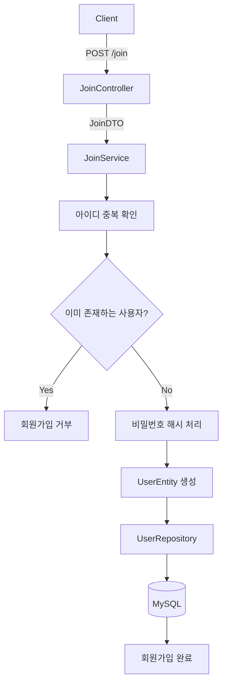
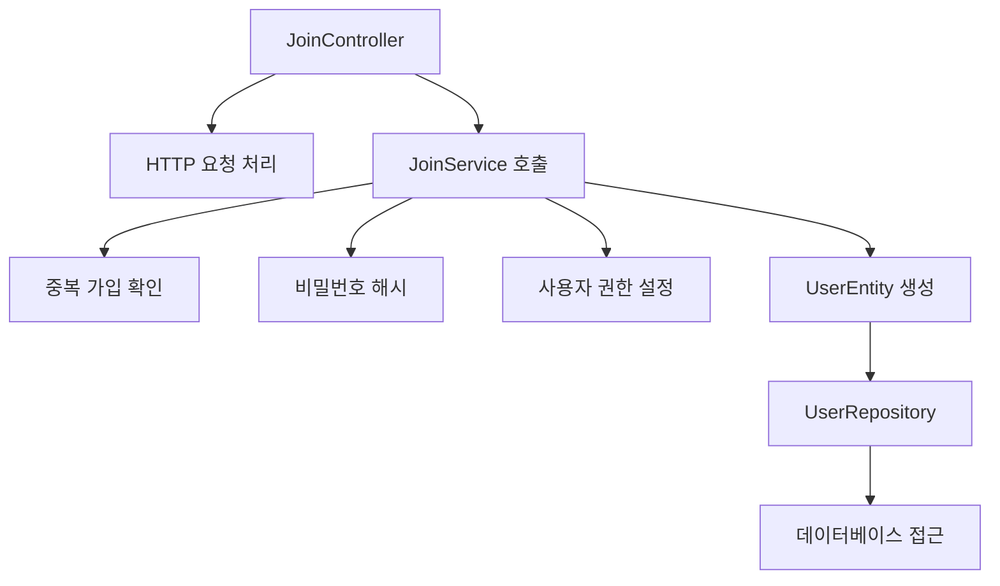
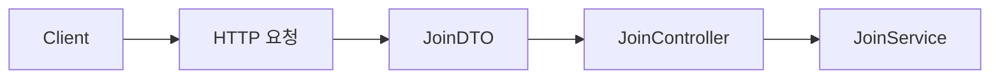
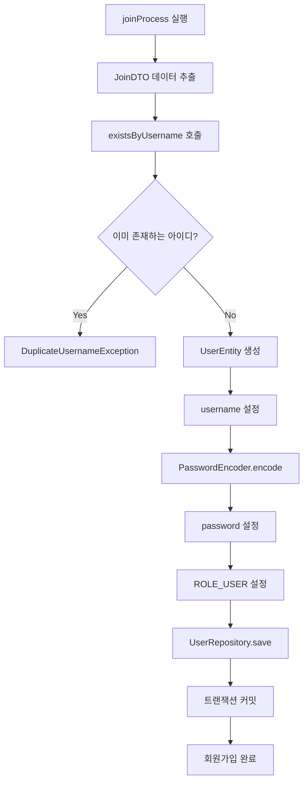
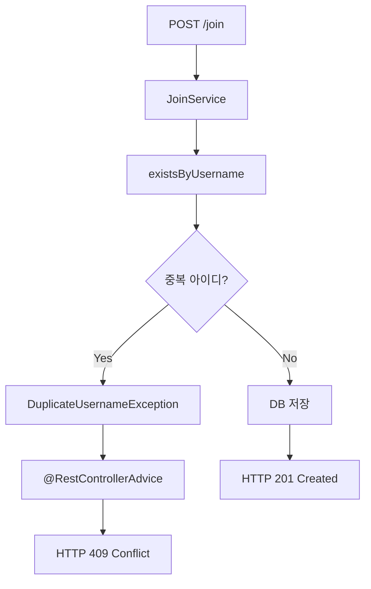
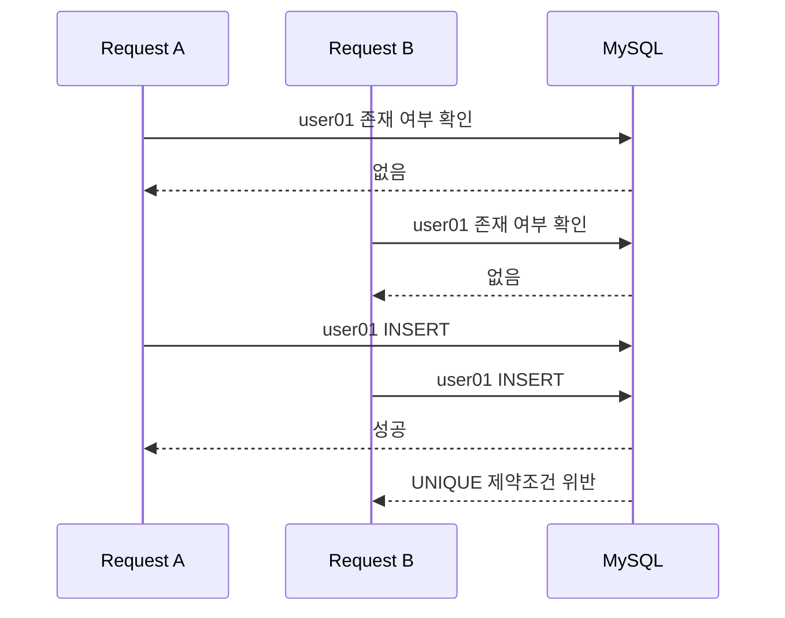
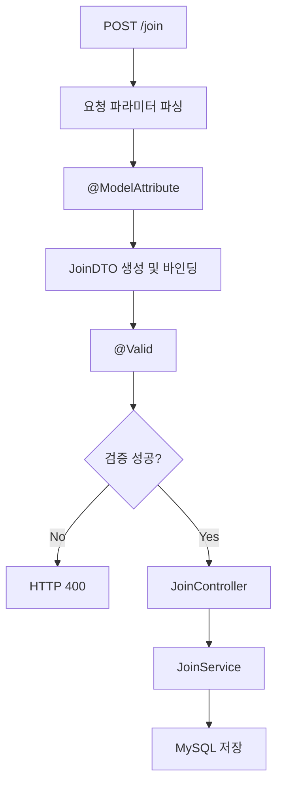
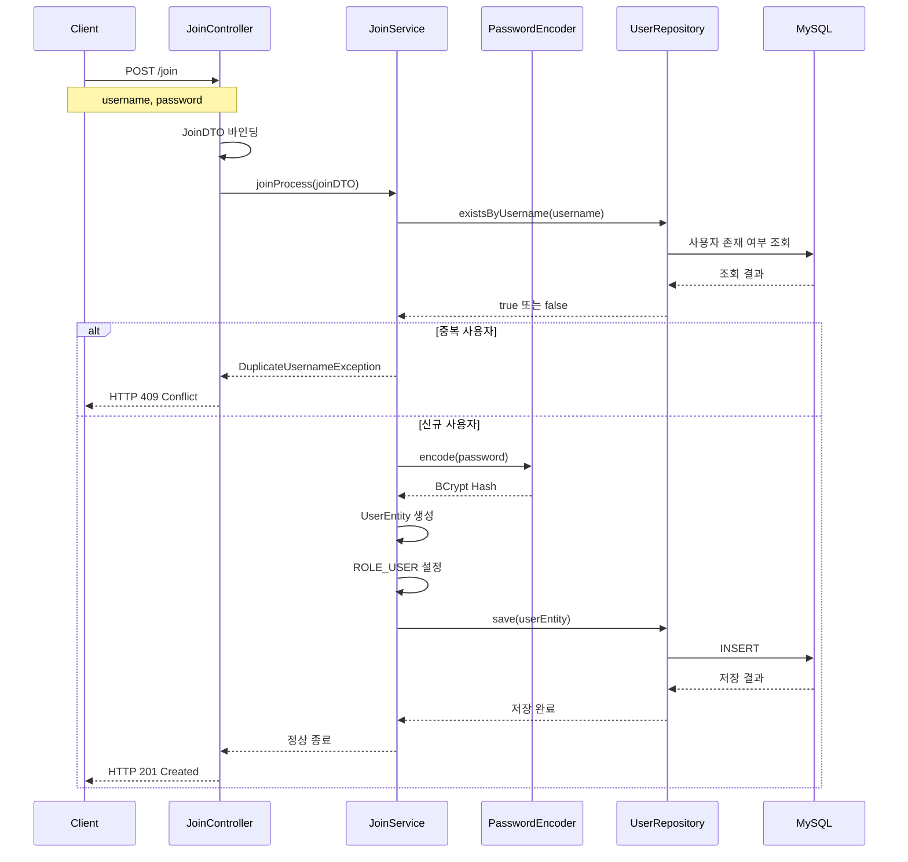
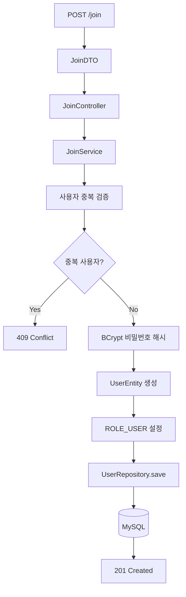

# 스프링 시큐리티 JWT - 6. 회원가입 로직 구현
[https://youtu.be/yNACbJF4uoo?si=vJYr79ejgWtnJNWf](https://youtu.be/yNACbJF4uoo?si=vJYr79ejgWtnJNWf)

# 스프링 시큐리티 JWT - 6. 회원가입 로직 구현
* toc
{:toc}

---

### Spring Security 6 JWT 회원가입 구현: JoinDTO, JoinController, JoinService, BCrypt, Spring Data JPA

Spring Security와 JWT를 이용한 인증 시스템에서는 로그인에 성공한 사용자에게 JWT를 발급하고, 이후 요청에서 해당 토큰을 검증하여 인증과 인가를 수행한다.

하지만 JWT를 발급하기 위해서는 먼저 사용자 정보를 확인할 수 있어야 한다.

예를 들어 사용자가 다음과 같은 정보로 로그인을 요청한다고 생각해보자.

```json
{
  "username": "user01",
  "password": "password123!"
}
```

서버는 전달받은 아이디가 실제로 존재하는지 확인하고, 입력된 비밀번호가 데이터베이스에 저장된 비밀번호 해시와 일치하는지 검증해야 한다.

이를 위해서는 사용자 정보가 미리 데이터베이스에 등록되어 있어야 한다.

이러한 사용자 등록 과정을 **회원가입(Sign Up)**&#xC774;라고 한다.

회원가입은 JWT를 생성하거나 검증하는 과정과는 별개다. JWT 기반 인증이든 세션 기반 인증이든 사용자 정보를 등록하고 저장하는 기본적인 구조는 크게 다르지 않다.

회원가입의 대표적인 처리 흐름은 다음과 같다.



클라이언트는 아이디와 비밀번호를 전달한다.

Controller는 요청 데이터를 DTO로 전달받는다.

Service는 중복 가입 여부를 확인하고 비밀번호를 안전하게 처리한 뒤 Entity를 생성한다.

Repository는 Entity를 데이터베이스에 저장한다.

이렇게 회원가입이 완료되면 이후 로그인 과정에서 해당 사용자 정보를 조회하여 인증할 수 있다.

이번에는 Spring Boot 3.2.1과 Spring Security 6.2.1을 기준으로 실제 회원가입 기능을 구현하고, 각 구성요소의 책임과 동작 원리를 살펴본다.

---

### 개념

#### 회원가입의 전체 구조

Spring Boot에서 회원가입 기능을 구현할 때는 일반적으로 다음 계층을 사용한다.

| 구성요소            | 역할                 |
| --------------- | ------------------ |
| JoinDTO         | 클라이언트의 회원가입 요청 데이터 |
| JoinController  | HTTP 요청 수신 및 응답    |
| JoinService     | 회원가입 비즈니스 로직       |
| PasswordEncoder | 비밀번호 해시 생성         |
| UserEntity      | 데이터베이스에 저장할 사용자 객체 |
| UserRepository  | 사용자 존재 여부 확인 및 저장  |
| MySQL           | 사용자 정보 영속성 관리      |

각 구성요소는 서로 다른 책임을 가진다.

**JoinDTO는 데이터를 전달한다.**

**JoinController는 HTTP 요청을 처리한다.**

**JoinService는 회원가입이 가능한지 판단하고 사용자 정보를 생성한다.**

**UserRepository는 데이터베이스에 접근한다.**

이러한 책임 분리는 단순히 클래스를 여러 개 만드는 것이 목적이 아니다.

HTTP 요청 처리 방식이 변경되더라도 회원가입 비즈니스 로직은 유지할 수 있고, 사용자 저장 방식이 변경되더라도 Controller에 미치는 영향을 줄일 수 있다.

#### 회원가입 요청 예시

이번에 구현할 회원가입 API는 다음과 같다.

```http
POST /join
```

요청 데이터는 두 가지다.

```text
username = user01
password = password123!
```

클라이언트는 `application/x-www-form-urlencoded` 또는 `multipart/form-data` 방식으로 값을 전송할 수 있다.

이러한 요청을 Spring MVC의 `@ModelAttribute`를 이용해 DTO에 바인딩한다.

```text
HTTP 요청
    ↓
username=user01
password=password123!
    ↓
JoinDTO
    ↓
JoinController
```

이후 Controller는 DTO를 Service로 전달하고, Service는 회원가입에 필요한 검증과 저장 작업을 수행한다.

---

### 왜 Controller, Service, Repository를 분리할까?

회원가입은 단순히 데이터베이스에 INSERT를 수행하는 작업처럼 보일 수 있다.

하지만 실제로는 여러 검증과 처리가 필요하다.

예를 들어 다음과 같은 상황을 생각해보자.

* 사용자가 아이디를 입력하지 않았다.
* 비밀번호 길이가 너무 짧다.
* 이미 동일한 아이디가 존재한다.
* 비밀번호가 해시 처리되지 않았다.
* 데이터베이스 저장 과정에서 오류가 발생했다.
* 클라이언트가 관리자 권한을 직접 지정하려고 한다.

이러한 처리를 모두 Controller에 구현할 수도 있다.

하지만 Controller가 요청 처리뿐 아니라 비밀번호 해시, 중복 검증, Entity 생성, 데이터베이스 저장까지 담당하면 코드의 책임이 지나치게 많아진다.

```text
JoinController
    ├── HTTP 요청 처리
    ├── 입력값 검증
    ├── 중복 아이디 조회
    ├── 비밀번호 해시
    ├── Entity 생성
    ├── 사용자 권한 설정
    ├── DB 저장
    └── HTTP 응답
```

이 구조는 회원가입 기능이 확장될수록 유지보수가 어려워질 수 있다.

따라서 일반적으로 다음과 같이 분리한다.



이러한 구조에서는 각 계층의 역할이 명확해진다.

| 계층         | 주요 책임              | 피해야 할 작업           |
| ---------- | ------------------ | ------------------ |
| Controller | 요청 수신, 입력값 바인딩, 응답 | 직접 SQL 실행          |
| Service    | 회원가입 정책 및 비즈니스 로직  | HTTP 요청 객체에 강하게 의존 |
| Repository | Entity 저장 및 조회     | 회원가입 정책 결정         |
| Entity     | 사용자 상태 및 매핑 정보     | HTTP 응답 처리         |

이제 실제 코드를 작성해보자.

---

### 프로젝트 구성

#### 기술 환경

이번에 사용할 환경은 다음과 같다.

| 항목              | 사용 기술             |
| --------------- | ----------------- |
| Language        | Java 17           |
| Spring Boot     | 3.2.1             |
| Spring Security | 6.2.1             |
| Build Tool      | Gradle Groovy DSL |
| ORM             | Spring Data JPA   |
| Database        | MySQL             |
| Password Hash   | BCrypt            |
| JWT Library     | JJWT 0.12.3       |
| Utility         | Lombok            |

기존 프로젝트에는 다음 구성요소가 이미 준비되어 있다고 가정한다.

* MySQL 연결
* `UserEntity`
* `UserRepository`
* `SecurityConfig`
* `PasswordEncoder` Bean

이번에 추가할 구성요소는 다음과 같다.

```text
src/main/java/com/example/jwt
│
├── JwtApplication.java
│
├── config
│   └── SecurityConfig.java
│
├── controller
│   ├── MainController.java
│   ├── AdminController.java
│   └── JoinController.java
│
├── dto
│   └── JoinDTO.java
│
├── service
│   └── JoinService.java
│
├── entity
│   └── UserEntity.java
│
└── repository
    └── UserRepository.java
```

회원가입 기능의 핵심은 `JoinDTO`, `JoinController`, `JoinService` 세 가지다.

---

### UserEntity 확인

먼저 회원 정보를 저장할 Entity부터 확인하자.

`UserEntity`는 MySQL의 사용자 테이블과 매핑되는 객체다.

```java
package com.example.jwt.entity;

import jakarta.persistence.Column;
import jakarta.persistence.Entity;
import jakarta.persistence.GeneratedValue;
import jakarta.persistence.GenerationType;
import jakarta.persistence.Id;
import jakarta.persistence.Table;

import lombok.AccessLevel;
import lombok.Getter;
import lombok.NoArgsConstructor;
import lombok.Setter;

@Entity
@Table(name = "users")
@Getter
@Setter
@NoArgsConstructor(access = AccessLevel.PROTECTED)
public class UserEntity {

    @Id
    @GeneratedValue(strategy = GenerationType.IDENTITY)
    private Integer id;

    @Column(nullable = false, unique = true, length = 50)
    private String username;

    @Column(nullable = false, length = 255)
    private String password;

    @Column(nullable = false, length = 30)
    private String role;
}
```

각 필드의 역할은 다음과 같다.

| 필드       | 역할         |
| -------- | ---------- |
| id       | 사용자 고유 식별자 |
| username | 로그인 아이디    |
| password | 비밀번호 해시    |
| role     | 사용자 권한     |

여기서 `password` 필드에는 비밀번호 원문을 저장하지 않는다.

또한 `username`에는 UNIQUE 제약조건을 적용했다.

```java
@Column(nullable = false, unique = true, length = 50)
private String username;
```

이 설정은 동일한 아이디가 데이터베이스에 중복 저장되는 것을 방지하기 위한 것이다.

다만 Entity에 `unique = true`를 선언했다고 이미 존재하는 데이터베이스 테이블에 제약조건이 자동으로 추가되는 것은 아니다.

현재 프로젝트에서 `ddl-auto=none`을 사용하고 있다면 실제 MySQL 테이블에도 UNIQUE 제약조건이 존재하는지 확인해야 한다.

---

### JoinDTO 작성

이제 클라이언트의 회원가입 요청 데이터를 전달받을 DTO를 생성한다.

#### DTO란?

DTO(Data Transfer Object)는 계층 간 데이터를 전달하기 위한 객체다.

예를 들어 사용자가 다음 데이터를 전송한다고 생각해보자.

```text
username = user01
password = password123!
```

Controller는 이 데이터를 DTO에 담아 Service에 전달할 수 있다.



DTO를 사용하면 여러 요청 값을 하나의 객체로 관리할 수 있다.

또한 Entity를 HTTP 요청과 직접 연결하지 않아도 된다.

이 부분은 보안 측면에서도 중요하다.

예를 들어 `UserEntity`를 요청 객체로 직접 사용하면 클라이언트가 `role`이나 `id` 같은 필드까지 전달할 수 있는 구조가 만들어질 수 있다.

따라서 회원가입에 필요한 필드만 포함하는 DTO를 별도로 정의하는 것이 좋다.

#### JoinDTO 전체 코드

먼저 `dto` 패키지를 생성한다.

```text
com.example.jwt.dto
```

그다음 `JoinDTO.java`를 작성한다.

```java
package com.example.jwt.dto;

import lombok.Getter;
import lombok.Setter;

@Getter
@Setter
public class JoinDTO {

    private String username;

    private String password;
}
```

현재 DTO에는 두 가지 필드만 존재한다.

```java
private String username;
```

```java
private String password;
```

`@Getter`와 `@Setter`는 Lombok을 통해 Getter와 Setter 메서드를 생성한다.

따라서 다음 메서드를 사용할 수 있다.

```java
joinDTO.getUsername();
```

```java
joinDTO.getPassword();
```

Controller에서 회원가입 요청을 받으면 Spring MVC가 요청 파라미터를 DTO 필드에 바인딩할 수 있다.

이후 Service에서는 Getter를 통해 값을 가져올 수 있다.

---

### JoinController 작성

이제 `/join` 경로로 들어오는 회원가입 요청을 처리할 Controller를 작성한다.

먼저 `controller` 패키지에 `JoinController.java`를 생성한다.

```text
com.example.jwt.controller.JoinController
```

#### 기본적인 Controller 구조

Spring MVC에서는 다음 Annotation을 이용해 Controller를 등록할 수 있다.

```java
@Controller
```

REST API로 문자열이나 객체를 직접 반환하려면 다음 Annotation을 사용할 수 있다.

```java
@ResponseBody
```

따라서 다음과 같이 작성할 수 있다.

```java
@Controller
@ResponseBody
public class JoinController {

}
```

두 Annotation을 함께 사용하는 대신 `@RestController`를 사용해도 된다.

```java
@RestController
public class JoinController {

}
```

`@RestController`는 `@Controller`와 `@ResponseBody`의 기능을 결합한 Annotation이다.

이번에는 두 Annotation을 함께 사용하여 각 역할을 명확하게 표현한다.

#### POST /join 매핑

회원가입은 새로운 사용자 정보를 저장하는 작업이므로 POST 요청을 사용한다.

```java
@PostMapping("/join")
```

이 Annotation은 다음 HTTP 요청을 처리한다.

```http
POST /join
```

기본적인 메서드는 다음과 같다.

```java
@PostMapping("/join")
public String joinProcess(JoinDTO joinDTO) {

    return "OK";
}
```

하지만 이 코드만으로는 회원가입이 수행되지 않는다.

요청 데이터를 전달받은 후 Service를 호출해야 한다.

---

### @ModelAttribute로 요청 데이터 받기

이번 회원가입 요청은 Form Data를 사용한다.

예를 들어 다음과 같다.

```http
POST /join HTTP/1.1
Content-Type: application/x-www-form-urlencoded

username=user01&password=password123%21
```

이 요청을 DTO에 바인딩하려면 `@ModelAttribute`를 사용할 수 있다.

```java
@PostMapping("/join")
public String joinProcess(
        @ModelAttribute JoinDTO joinDTO
) {

    return "OK";
}
```

Spring MVC는 요청 파라미터를 읽고, 이름이 일치하는 DTO의 속성에 값을 설정한다.

```text
HTTP 요청

username=user01
password=password123!
        ↓
@ModelAttribute
        ↓
JoinDTO
        ↓
username = "user01"
password = "password123!"
```

복잡하지 않은 객체 타입의 메서드 인자는 `@ModelAttribute`를 생략해도 암묵적으로 바인딩될 수 있다.

하지만 요청 데이터가 어떤 방식으로 전달되는지 명확하게 표현하려면 `@ModelAttribute`를 선언하는 것이 좋다.

Spring MVC의 `@ModelAttribute`는 Form Data를 포함한 요청 파라미터를 객체에 바인딩하도록 지원한다.

#### @ModelAttribute와 @RequestBody 차이

두 Annotation은 서로 다른 목적으로 사용한다.

| 구분              | @ModelAttribute                   | @RequestBody     |
| --------------- | --------------------------------- | ---------------- |
| 주요 목적           | 요청 파라미터를 객체에 바인딩                  | HTTP 요청 본문 역직렬화  |
| Form Data       | 적합                                | 일반적으로 사용하지 않음    |
| JSON            | 기본적인 JSON 본문 바인딩용이 아님             | 적합               |
| 대표 Content-Type | application/x-www-form-urlencoded | application/json |
| 사용 예시           | HTML Form, Form Data              | REST API JSON    |

예를 들어 JSON을 사용한다면 다음과 같이 작성한다.

```java
@PostMapping("/join")
public String joinProcess(
        @RequestBody JoinDTO joinDTO
) {

    return "OK";
}
```

하지만 이번 구현은 Form Data를 전달하는 방식이므로 `@ModelAttribute`를 사용한다.

여기서 중요한 점은 **JSON 요청과 Form Data 요청을 혼동하지 않는 것**이다.

Controller가 `@ModelAttribute`로 데이터를 받도록 구성되어 있다면 클라이언트 역시 이에 맞는 요청 형식을 사용해야 한다.

---

### JoinService 작성

이제 실제 회원가입 로직을 담당할 Service를 작성한다.

먼저 다음 패키지를 생성한다.

```text
com.example.jwt.service
```

그다음 `JoinService.java`를 생성한다.

Service 클래스에는 다음 Annotation을 선언한다.

```java
@Service
```

`@Service`는 해당 클래스가 비즈니스 로직을 담당하는 Spring Bean임을 나타낸다.

Spring은 이 클래스를 관리하고, 다른 Bean에서 의존성 주입을 통해 사용할 수 있도록 한다.

#### 기본적인 Service 메서드

회원가입을 처리할 메서드는 다음과 같이 정의할 수 있다.

```java
public void joinProcess(JoinDTO joinDTO) {

}
```

이번에는 반환 타입을 `void`로 구성한다.

회원가입이 정상적으로 완료되면 메서드가 종료되고, 처리할 수 없는 상황에서는 예외가 발생하도록 설계할 수 있다.

다만 `void`라는 반환 타입 자체가 성공을 보장하는 것은 아니다.

회원가입 결과를 올바르게 응답하려면 중복 가입과 저장 실패 등 예외 상황을 명확하게 처리해야 한다.

---

### UserRepository에 중복 확인 메서드 추가

회원가입에서는 같은 아이디가 이미 존재하는지 확인해야 한다.

예를 들어 현재 데이터베이스에 다음 사용자가 있다고 생각해보자.

| id | username |
| -: | -------- |
|  1 | user01   |
|  2 | user02   |

이 상태에서 `user01`로 다시 회원가입을 요청한다면 중복 가입을 방지해야 한다.

이를 위해 `UserRepository`에 사용자 존재 여부를 확인하는 메서드를 추가한다.

#### UserRepository 전체 코드

```java
package com.example.jwt.repository;

import com.example.jwt.entity.UserEntity;

import org.springframework.data.jpa.repository.JpaRepository;

import java.util.Optional;

public interface UserRepository
        extends JpaRepository<UserEntity, Integer> {

    Optional<UserEntity> findByUsername(String username);

    boolean existsByUsername(String username);
}
```

이번에 사용할 메서드는 다음과 같다.

```java
boolean existsByUsername(String username);
```

`existsByUsername()`은 전달받은 사용자 이름이 데이터베이스에 존재하는지 확인한다.

Spring Data JPA는 Repository 메서드 이름을 기반으로 조회 쿼리를 생성할 수 있다.

예를 들어 다음 코드를 실행한다.

```java
boolean exists =
        userRepository.existsByUsername("user01");
```

결과는 다음 중 하나다.

```text
true
→ 해당 사용자 존재
```

```text
false
→ 해당 사용자 없음
```

이 값을 이용해 회원가입 가능 여부를 판단할 수 있다.

#### existsByUsername의 내부 동작

개념적으로 다음과 같은 SQL 조건을 이용해 사용자 존재 여부를 확인한다.

```sql
SELECT
    1
FROM users
WHERE username = ?
LIMIT 1;
```

위 SQL은 동작을 설명하기 위한 예시이며 실제 Spring Data JPA와 Hibernate가 생성하는 SQL은 다를 수 있다.

중요한 것은 **전체 사용자 목록을 조회하는 것이 아니라 특정 아이디의 존재 여부를 확인한다는 점**이다.

---

### JoinService에 UserRepository 주입하기

이제 `JoinService`에서 `UserRepository`를 사용해야 한다.

Spring에서는 생성자 주입을 이용해 의존성을 전달받을 수 있다.

```java
@Service
public class JoinService {

    private final UserRepository userRepository;

    public JoinService(UserRepository userRepository) {

        this.userRepository = userRepository;
    }
}
```

여기서 `private final`로 선언한 필드는 생성자에서 초기화된다.

생성자 주입을 사용하면 필요한 의존성이 명확해지고, 객체가 생성된 이후 참조를 변경하지 않도록 구성할 수 있다.

또한 테스트에서 Repository를 대체하는 객체로 주입하기도 쉽다.

#### 생성자 주입과 필드 주입

Spring에서는 다음과 같은 필드 주입도 가능하다.

```java
@Autowired
private UserRepository userRepository;
```

하지만 생성자 주입은 객체 생성 시 필요한 의존성을 명시한다는 장점이 있다.

따라서 특별한 이유가 없다면 생성자 주입을 사용하는 편이 좋다.

---

### 회원가입 중복 검증 구현

이제 `JoinService`에서 실제 사용자 이름을 꺼내고 중복 여부를 확인해보자.

```java
public void joinProcess(JoinDTO joinDTO) {

    String username = joinDTO.getUsername();

    String password = joinDTO.getPassword();

    boolean exists =
            userRepository.existsByUsername(username);

    if (exists) {

        return;
    }

    // 회원가입 처리
}
```

이 코드는 중복 사용자가 존재하면 메서드를 종료한다.

하지만 여기에는 한 가지 문제가 있다.

Controller가 다음과 같이 작성되어 있다면 어떻게 될까?

```java
@PostMapping("/join")
public String joinProcess(
        @ModelAttribute JoinDTO joinDTO
) {

    joinService.joinProcess(joinDTO);

    return "OK";
}
```

Service에서 중복 사용자 때문에 단순히 `return`을 실행하더라도 Controller는 정상적으로 다음 코드를 실행한다.

```java
return "OK";
```

따라서 클라이언트는 실제 회원가입에 실패했는데도 성공한 것처럼 응답을 받을 수 있다.

```text
회원가입 요청
    ↓
이미 존재하는 사용자
    ↓
JoinService에서 return
    ↓
JoinController에서 OK 반환
    ↓
클라이언트는 성공으로 오해
```

이 문제를 방지하려면 회원가입 실패를 명시적으로 표현해야 한다.

예를 들어 다음과 같은 방법을 사용할 수 있다.

* 중복 가입 예외 발생
* 회원가입 결과 객체 반환
* 성공 여부를 나타내는 값 반환

이번에는 **중복 가입 예외를 발생시키는 방식**으로 구현한다.

---

### 중복 가입 예외 구현

먼저 다음 패키지를 생성한다.

```text
com.example.jwt.exception
```

그다음 `DuplicateUsernameException.java`를 생성한다.

```java
package com.example.jwt.exception;

public class DuplicateUsernameException
        extends RuntimeException {

    public DuplicateUsernameException() {

        super("이미 사용 중인 아이디입니다.");
    }
}
```

이 예외는 이미 사용 중인 아이디로 회원가입을 요청했을 때 발생시킨다.

이제 `JoinService`에서 다음과 같이 사용할 수 있다.

```java
if (userRepository.existsByUsername(username)) {

    throw new DuplicateUsernameException();
}
```

이렇게 하면 회원가입이 중복으로 인해 종료된 사실을 Controller 바깥까지 전달할 수 있다.

다만 중복 가입 예외를 정의했다고 해서 HTTP 응답 코드가 자동으로 409가 되는 것은 아니다.

해당 예외를 HTTP 응답으로 변환하는 과정도 필요하다.

이 부분은 뒤에서 `@RestControllerAdvice`를 이용해 구현한다.

---

### BCryptPasswordEncoder 주입하기

중복 검증을 완료했다면 비밀번호를 처리해야 한다.

사용자가 입력한 비밀번호를 그대로 데이터베이스에 저장해서는 안 된다.

예를 들어 다음 코드는 적절하지 않다.

```java
userEntity.setPassword(password);
```

비밀번호 원문이 저장되기 때문이다.

Spring Security에서는 `PasswordEncoder`를 이용해 비밀번호를 해시할 수 있다.

이전에 `SecurityConfig`에서 다음 Bean을 등록했다고 가정한다.

```java
@Bean
public PasswordEncoder passwordEncoder() {

    return new BCryptPasswordEncoder();
}
```

이제 `JoinService`에서 해당 Bean을 주입받는다.

```java
private final PasswordEncoder passwordEncoder;
```

생성자에서 초기화한다.

```java
public JoinService(
        UserRepository userRepository,
        PasswordEncoder passwordEncoder
) {

    this.userRepository = userRepository;
    this.passwordEncoder = passwordEncoder;
}
```

이렇게 하면 Service에서 비밀번호 해시 기능을 사용할 수 있다.

#### BCrypt로 비밀번호 해시하기

다음과 같이 작성한다.

```java
String encodedPassword =
        passwordEncoder.encode(password);
```

예를 들어 사용자가 다음 비밀번호를 입력했다고 생각해보자.

```text
password123!
```

`BCryptPasswordEncoder`는 해당 비밀번호를 해시한다.

생성되는 값은 다음과 같은 형태다.

```text
$2a$10$...
```

실제 해시 문자열은 매번 달라질 수 있다.

BCrypt는 Salt를 사용하기 때문이다.

Spring Security는 `PasswordEncoder`를 통해 `encode()`와 `matches()`를 제공하며, BCrypt를 적응형 단방향 비밀번호 해시 알고리즘으로 지원한다.

#### 회원가입과 로그인에서 사용하는 메서드

회원가입에서는 다음 메서드를 사용한다.

```java
passwordEncoder.encode(rawPassword);
```

로그인에서는 다음 메서드를 사용한다.

```java
passwordEncoder.matches(
        rawPassword,
        encodedPassword
);
```

두 메서드의 역할은 다르다.

| 메서드       | 사용 시점          | 역할                 |
| --------- | -------------- | ------------------ |
| encode()  | 회원가입 및 비밀번호 변경 | 비밀번호 해시 생성         |
| matches() | 로그인 및 비밀번호 확인  | 입력 비밀번호와 저장된 해시 비교 |

여기서 중요한 점은 로그인할 때 저장된 비밀번호를 복호화하는 것이 아니라는 사실이다.

입력받은 비밀번호가 저장된 해시와 일치하는지 검증한다.

---

### UserEntity 생성 및 데이터 저장

이제 사용자 정보를 데이터베이스에 저장할 차례다.

먼저 `UserEntity` 객체를 생성한다.

```java
UserEntity userEntity = new UserEntity();
```

그리고 클라이언트가 전달한 사용자 이름을 설정한다.

```java
userEntity.setUsername(username);
```

비밀번호는 해시된 값을 설정한다.

```java
userEntity.setPassword(
        passwordEncoder.encode(password)
);
```

마지막으로 사용자 권한을 설정한다.

```java
userEntity.setRole("ROLE_USER");
```

이제 Entity를 Repository에 전달한다.

```java
userRepository.save(userEntity);
```

그러면 Spring Data JPA가 Entity를 영속화하고, 트랜잭션 처리 과정에서 실제 데이터베이스에 INSERT가 수행된다.

개념적으로 다음과 같은 SQL이 실행될 수 있다.

```sql
INSERT INTO users (
    username,
    password,
    role
)
VALUES (
    ?,
    ?,
    ?
);
```

각 값에는 다음 데이터가 전달된다.

```text
username = user01

password = BCrypt 해시

role = ROLE_USER
```

이렇게 하면 사용자 정보가 MySQL에 저장된다.

---

### 신규 가입자의 권한은 어떻게 설정해야 할까?

이번 구현에서 반드시 구분해야 하는 부분이다.

Spring Security의 권한은 일반적으로 다음과 같은 문자열로 표현할 수 있다.

```text
ROLE_USER
ROLE_ADMIN
```

`ROLE_USER`는 일반 사용자 권한이다.

`ROLE_ADMIN`은 관리자 권한이다.

단순히 인증 흐름을 확인하기 위해 모든 신규 가입자에게 다음 값을 지정할 수도 있다.

```java
userEntity.setRole("ROLE_ADMIN");
```

하지만 **일반 회원가입 API에서 모든 사용자에게 관리자 권한을 부여하는 코드는 실제 서비스에 사용해서는 안 된다.**

다음과 같은 문제가 발생하기 때문이다.

```text
일반 사용자
    ↓
POST /join
    ↓
회원가입 완료
    ↓
ROLE_ADMIN 부여
    ↓
관리자 API 접근 가능
```

이는 심각한 권한 상승 문제로 이어질 수 있다.

따라서 일반 회원가입에서는 서버가 기본 권한을 직접 지정해야 한다.

```java
userEntity.setRole("ROLE_USER");
```

관리자 권한은 별도의 권한 있는 관리 절차를 통해 부여해야 한다.

또한 클라이언트가 요청한 권한 값을 그대로 저장하는 방식도 피해야 한다.

예를 들어 다음과 같은 요청을 신뢰해서는 안 된다.

```json
{
  "username": "user01",
  "password": "password123!",
  "role": "ROLE_ADMIN"
}
```

일반 회원가입 DTO에 `role`을 포함하지 않고, 서버에서 기본 권한을 결정하면 이러한 문제를 줄일 수 있다.

---

### JoinService 전체 구현

지금까지 작성한 내용을 하나의 Service로 정리해보자.

다음은 중복 가입 검증, 비밀번호 해시, 기본 권한 설정, 사용자 정보 저장을 포함한 전체 코드다.

```java
package com.example.jwt.service;

import com.example.jwt.dto.JoinDTO;
import com.example.jwt.entity.UserEntity;
import com.example.jwt.exception.DuplicateUsernameException;
import com.example.jwt.repository.UserRepository;

import org.springframework.security.crypto.password.PasswordEncoder;
import org.springframework.stereotype.Service;
import org.springframework.transaction.annotation.Transactional;

@Service
public class JoinService {

    private final UserRepository userRepository;
    private final PasswordEncoder passwordEncoder;

    public JoinService(
            UserRepository userRepository,
            PasswordEncoder passwordEncoder
    ) {

        this.userRepository = userRepository;
        this.passwordEncoder = passwordEncoder;
    }

    @Transactional
    public void joinProcess(JoinDTO joinDTO) {

        // 1. 요청 데이터 추출
        String username = joinDTO.getUsername();
        String password = joinDTO.getPassword();

        // 2. 중복 아이디 확인
        boolean exists =
                userRepository.existsByUsername(username);

        if (exists) {

            throw new DuplicateUsernameException();
        }

        // 3. UserEntity 생성
        UserEntity userEntity = new UserEntity();

        // 4. 사용자 아이디 설정
        userEntity.setUsername(username);

        // 5. 비밀번호 해시
        String encodedPassword =
                passwordEncoder.encode(password);

        userEntity.setPassword(encodedPassword);

        // 6. 기본 권한 설정
        userEntity.setRole("ROLE_USER");

        // 7. 데이터베이스 저장
        userRepository.save(userEntity);
    }
}
```

코드의 처리 순서는 다음과 같다.



여기서 `@Transactional`은 회원가입 작업을 하나의 트랜잭션으로 관리하기 위한 설정이다.

```java
@Transactional
public void joinProcess(JoinDTO joinDTO) {
    // ...
}
```

일반적으로 메서드가 정상 종료되면 트랜잭션을 커밋한다.

반대로 처리 중 RuntimeException이 발생하면 기본적인 롤백 규칙에 따라 트랜잭션을 롤백할 수 있다.

실제 INSERT 실행 시점은 ID 생성 전략과 Hibernate의 Flush 시점 등에 따라 달라질 수 있다.

중요한 것은 데이터베이스 작업의 성공 여부를 트랜잭션 경계와 함께 관리한다는 것이다.

---

### JoinController와 JoinService 연결

이제 Controller에서 Service를 호출하도록 연결한다.

생성자 주입을 이용해 `JoinService`를 전달받는다.

```java
private final JoinService joinService;

public JoinController(JoinService joinService) {

    this.joinService = joinService;
}
```

이제 회원가입 요청을 받으면 Service를 실행할 수 있다.

```java
joinService.joinProcess(joinDTO);
```

회원가입에 성공했다면 HTTP 응답을 반환한다.

회원가입은 새로운 사용자 리소스를 생성하는 작업이므로 HTTP 201 Created를 사용할 수 있다.

```java
return ResponseEntity
        .status(HttpStatus.CREATED)
        .body("OK");
```

단순히 문자열 `"OK"`를 반환하면 기본적으로 HTTP 200 OK가 반환될 수 있다.

어느 방식을 사용할지는 API 계약에 따라 결정할 수 있지만, 새 리소스가 생성되었다는 의미를 명확히 표현하려면 201이 적절하다.

#### JoinController 전체 코드

```java
package com.example.jwt.controller;

import com.example.jwt.dto.JoinDTO;
import com.example.jwt.service.JoinService;

import org.springframework.http.HttpStatus;
import org.springframework.http.ResponseEntity;

import org.springframework.stereotype.Controller;
import org.springframework.web.bind.annotation.ModelAttribute;
import org.springframework.web.bind.annotation.PostMapping;
import org.springframework.web.bind.annotation.ResponseBody;

@Controller
@ResponseBody
public class JoinController {

    private final JoinService joinService;

    public JoinController(JoinService joinService) {

        this.joinService = joinService;
    }

    @PostMapping("/join")
    public ResponseEntity<String> joinProcess(
            @ModelAttribute JoinDTO joinDTO
    ) {

        joinService.joinProcess(joinDTO);

        return ResponseEntity
                .status(HttpStatus.CREATED)
                .body("OK");
    }
}
```

이 코드는 다음과 같이 동작한다.

```text
POST /join
    ↓
JoinDTO 생성 및 요청 데이터 바인딩
    ↓
JoinController.joinProcess()
    ↓
JoinService.joinProcess()
    ↓
사용자 중복 검증
    ↓
비밀번호 해시
    ↓
MySQL 저장
    ↓
HTTP 201 Created
```

이제 회원가입 성공 시에는 정상 응답을 반환하고, 중복 아이디가 존재하면 앞에서 정의한 예외가 발생한다.

하지만 이 예외를 적절한 HTTP 응답으로 변환해야 한다.

---

### 중복 가입 시 HTTP 409 반환하기

중복 아이디는 이미 존재하는 사용자 리소스와 충돌하는 상황이다.

이러한 경우 HTTP 409 Conflict를 사용할 수 있다.

```http
HTTP/1.1 409 Conflict
```

Spring MVC에서는 `@RestControllerAdvice`를 이용해 예외를 공통으로 처리할 수 있다.

#### JoinExceptionHandler 작성

```java
package com.example.jwt.exception;

import org.springframework.http.HttpStatus;
import org.springframework.http.ResponseEntity;

import org.springframework.web.bind.annotation.ExceptionHandler;
import org.springframework.web.bind.annotation.RestControllerAdvice;

@RestControllerAdvice
public class JoinExceptionHandler {

    @ExceptionHandler(DuplicateUsernameException.class)
    public ResponseEntity<String> handleDuplicateUsername(
            DuplicateUsernameException exception
    ) {

        return ResponseEntity
                .status(HttpStatus.CONFLICT)
                .body("DUPLICATE_USERNAME");
    }
}
```

이렇게 작성하면 중복 사용자가 존재할 때 다음 흐름으로 동작한다.



이제 HTTP 응답으로 회원가입 결과를 구분할 수 있다.

| 상황          | 상태 코드             | 응답                 |
| ----------- | ----------------- | ------------------ |
| 회원가입 성공     | 201 Created       | OK                 |
| 이미 존재하는 아이디 | 409 Conflict      | DUPLICATE_USERNAME |
| 요청 형식 오류    | 400 Bad Request 등 | 오류 원인에 따른 응답       |
| 데이터베이스 장애   | 500 계열            | 서버 오류              |

다만 **사전에 중복 아이디를 확인하는 것만으로 모든 중복 가입 경쟁 상황을 해결할 수 있는 것은 아니다.**

이 부분은 실무에서 별도로 고려해야 한다.

---

### SecurityConfig에서 /join 경로 허용하기

회원가입은 인증되지 않은 사용자도 호출할 수 있어야 한다.

따라서 `SecurityConfig`에서 `/join` 경로를 공개해야 한다.

이전에 구성한 SecurityFilterChain에는 다음 설정이 존재한다.

```java
.authorizeHttpRequests(auth -> auth
        .requestMatchers("/login", "/join").permitAll()
        .requestMatchers("/admin", "/admin/**").hasRole("ADMIN")
        .anyRequest().authenticated()
)
```

여기서 핵심은 다음 코드다.

```java
.requestMatchers("/login", "/join").permitAll()
```

이 설정은 인증되지 않은 사용자도 `/join`에 접근할 수 있도록 허용한다.

하지만 `permitAll()`은 해당 경로를 자동으로 생성하는 설정이 아니다.

실제로 `/join` 요청을 처리하는 것은 `JoinController`다.

또한 URL에 접근할 수 있다는 의미일 뿐, 회원가입 시 필요한 중복 검증과 입력값 검증을 생략한다는 의미도 아니다.

#### SecurityConfig 전체 코드

현재 구조에서는 다음과 같이 작성할 수 있다.

```java
package com.example.jwt.config;

import org.springframework.context.annotation.Bean;
import org.springframework.context.annotation.Configuration;

import org.springframework.security.config.annotation.web.builders.HttpSecurity;
import org.springframework.security.config.annotation.web.configuration.EnableWebSecurity;
import org.springframework.security.config.annotation.web.configurers.AbstractHttpConfigurer;
import org.springframework.security.config.http.SessionCreationPolicy;

import org.springframework.security.crypto.bcrypt.BCryptPasswordEncoder;
import org.springframework.security.crypto.password.PasswordEncoder;

import org.springframework.security.web.SecurityFilterChain;

@Configuration
@EnableWebSecurity
public class SecurityConfig {

    @Bean
    public SecurityFilterChain filterChain(
            HttpSecurity http
    ) throws Exception {

        http
                // CSRF 비활성화
                .csrf(AbstractHttpConfigurer::disable)

                // Form Login 비활성화
                .formLogin(AbstractHttpConfigurer::disable)

                // HTTP Basic 비활성화
                .httpBasic(AbstractHttpConfigurer::disable)

                // URL별 인가 설정
                .authorizeHttpRequests(auth -> auth

                        // 로그인 및 회원가입
                        .requestMatchers(
                                "/login",
                                "/join"
                        ).permitAll()

                        // 관리자 API
                        .requestMatchers(
                                "/admin",
                                "/admin/**"
                        ).hasRole("ADMIN")

                        // 나머지 API
                        .anyRequest().authenticated()
                )

                // JWT Stateless 인증을 위한 세션 정책
                .sessionManagement(session -> session
                        .sessionCreationPolicy(
                                SessionCreationPolicy.STATELESS
                        )
                );

        return http.build();
    }

    @Bean
    public PasswordEncoder passwordEncoder() {

        return new BCryptPasswordEncoder();
    }
}
```

현재 프로젝트는 JWT를 Authorization 헤더로 전달하는 REST API 구조를 전제로 CSRF를 비활성화했다.

다만 JWT를 쿠키로 전달하고 브라우저가 해당 쿠키를 자동으로 전송하는 구조라면 CSRF 보호 정책을 다시 검토해야 한다.

---

### 전체 프로젝트 코드 구조

현재까지 작성한 파일을 정리하면 다음과 같다.

```text
src/main/java/com/example/jwt
│
├── JwtApplication.java
│
├── config
│   └── SecurityConfig.java
│
├── controller
│   ├── MainController.java
│   ├── AdminController.java
│   └── JoinController.java
│
├── dto
│   └── JoinDTO.java
│
├── service
│   └── JoinService.java
│
├── entity
│   └── UserEntity.java
│
├── repository
│   └── UserRepository.java
│
└── exception
    ├── DuplicateUsernameException.java
    └── JoinExceptionHandler.java
```

각 파일의 책임은 다음과 같다.

| 파일                         | 책임                     |
| -------------------------- | ---------------------- |
| JoinDTO                    | 회원가입 요청 데이터            |
| JoinController             | POST /join 처리          |
| JoinService                | 중복 검증, 비밀번호 해시, 사용자 저장 |
| UserEntity                 | MySQL 사용자 테이블 매핑       |
| UserRepository             | 사용자 존재 여부 확인 및 저장      |
| DuplicateUsernameException | 중복 가입 상황 표현            |
| JoinExceptionHandler       | 중복 가입 HTTP 응답          |
| SecurityConfig             | 공개 경로와 비밀번호 해시 Bean 설정 |

이렇게 구성하면 회원가입 과정의 책임을 계층별로 분리할 수 있다.

---

### 회원가입 기능 실행하기

이제 실제로 회원가입이 동작하는지 확인해보자.

#### 1. MySQL 데이터베이스 확인

먼저 MySQL에 접속한다.

```bash
mysql -u root -p
```

사용할 데이터베이스를 선택한다.

```sql
USE jwt_db;
```

사용자 테이블이 존재하는지 확인한다.

```sql
SHOW TABLES;
```

정상적으로 생성되어 있다면 다음과 같은 결과를 확인할 수 있다.

```text
+------------------+
| Tables_in_jwt_db |
+------------------+
| users            |
+------------------+
```

이제 사용자 정보가 저장되어 있는지 확인한다.

```sql
SELECT id, username, role
FROM users;
```

아직 가입한 사용자가 없다면 결과는 비어 있을 수 있다.

```text
Empty set
```

이 상태에서 회원가입 API를 호출하고 데이터가 저장되는지 확인한다.

---

### 애플리케이션 실행

Spring Boot 프로젝트에서 다음 명령을 실행한다.

```bash
./gradlew bootRun
```

이 명령은 Gradle Wrapper를 이용해 Spring Boot 애플리케이션을 실행한다.

정상적으로 실행되면 다음과 유사한 로그를 확인할 수 있다.

```text
Tomcat started on port 8080 (http)

Started JwtApplication
```

실제 로그 형식은 Spring Boot 버전과 실행 환경에 따라 달라질 수 있다.

이제 8080 포트에서 회원가입 API를 호출할 수 있다.

---

### Postman으로 회원가입 테스트하기

회원가입 API는 다음과 같다.

```http
POST http://localhost:8080/join
```

Postman에서 새로운 요청을 생성한다.

HTTP Method는 POST로 설정한다.

URL은 다음과 같이 지정한다.

```text
http://localhost:8080/join
```

그다음 Body에서 `form-data`를 선택한다.

다음 두 값을 입력한다.

| Key      | Value        |
| -------- | ------------ |
| username | user01       |
| password | password123! |

이후 요청을 전송한다.

현재 Controller에서는 `@ModelAttribute`를 사용하고 있으므로 Form Data를 `JoinDTO`에 바인딩할 수 있다.

회원가입이 정상적으로 완료되면 다음과 같은 응답을 받을 수 있다.

```http
HTTP/1.1 201 Created
Content-Type: text/plain;charset=UTF-8

OK
```

이 응답은 앞에서 작성한 개선된 Controller를 기준으로 한다.

단순히 문자열 `"OK"`만 반환하도록 작성했다면 HTTP 200 OK가 반환될 수도 있다.

중요한 것은 실제 데이터베이스에 사용자 정보가 저장되었는지 확인하는 것이다.

---

### curl로 회원가입 요청 보내기

Postman을 사용하지 않더라도 curl을 이용해 HTTP 요청을 보낼 수 있다.

#### application/x-www-form-urlencoded 방식

다음 명령을 실행한다.

```bash
curl -i -X POST \
  http://localhost:8080/join \
  --data-urlencode "username=user01" \
  --data-urlencode "password=password123!"
```

각 옵션의 의미는 다음과 같다.

| 옵션               | 역할                   |
| ---------------- | -------------------- |
| -i               | HTTP 응답 헤더 출력        |
| -X POST          | POST 요청 사용           |
| --data-urlencode | 요청 데이터를 URL 인코딩하여 전송 |

이 요청은 다음과 같은 데이터를 전송한다.

```text
username=user01
password=password123!
```

`--data-urlencode`는 공백이나 특수문자를 포함한 값을 인코딩하는 데 유용하다.

따라서 비밀번호에 특수문자가 포함되어 있어도 올바르게 전달하는 데 도움이 된다.

#### multipart/form-data 방식

Postman의 form-data와 유사한 형태로 요청을 보내려면 다음 명령을 사용할 수 있다.

```bash
curl -i -X POST \
  http://localhost:8080/join \
  -F "username=user02" \
  -F "password=password123!"
```

`-F` 옵션은 multipart/form-data 형식의 요청 필드를 생성한다.

이번 DTO는 문자열 필드 두 개로 구성되어 있으므로 파일 업로드 기능 없이도 이러한 형식을 사용할 수 있다.

두 방식은 HTTP 요청의 Content-Type이 다르지만, 현재 구현에서는 `@ModelAttribute`로 값을 바인딩할 수 있다.

---

### 데이터베이스 저장 결과 확인

회원가입 요청을 보낸 뒤 MySQL에서 사용자 정보를 조회해보자.

```sql
SELECT
    id,
    username,
    role
FROM users;
```

정상적으로 저장되었다면 다음과 같은 결과를 확인할 수 있다.

```text
+----+----------+-----------+
| id | username | role      |
+----+----------+-----------+
|  1 | user01   | ROLE_USER |
|  2 | user02   | ROLE_USER |
+----+----------+-----------+
```

위 결과는 정상적으로 가입한 경우를 가정한 예시다.

여기서 확인할 수 있는 것은 다음과 같다.

첫째, 사용자 ID가 자동으로 생성되었다.

둘째, 클라이언트가 전달한 `username`이 저장되었다.

셋째, 신규 가입자의 기본 권한이 `ROLE_USER`로 설정되었다.

넷째, 비밀번호는 별도의 해시 처리 과정을 거쳐 저장되었다.

비밀번호 해시가 저장되었는지 확인하려면 개발 환경에서 다음과 같이 일부 문자열만 조회할 수 있다.

```sql
SELECT
    username,
    LEFT(password, 7) AS password_prefix
FROM users;
```

BCryptPasswordEncoder를 사용했다면 다음과 유사한 접두사를 확인할 수 있다.

```text
+----------+-----------------+
| username | password_prefix |
+----------+-----------------+
| user01   | $2a$10$         |
| user02   | $2a$10$         |
+----------+-----------------+
```

실제 해시 접두사와 결과는 사용하는 BCrypt 설정에 따라 달라질 수 있다.

또한 **접두사만으로 비밀번호가 올바르게 저장되었다는 사실을 완전히 검증할 수는 없다.**

실제 비밀번호 검증은 `PasswordEncoder.matches()`를 이용해 확인해야 한다.

---

### 중복 회원가입 확인하기

이제 이미 존재하는 아이디로 다시 요청해보자.

```bash
curl -i -X POST \
  http://localhost:8080/join \
  --data-urlencode "username=user01" \
  --data-urlencode "password=anotherPassword123!"
```

현재 데이터베이스에는 이미 `user01`이 존재한다고 가정한다.

따라서 Service에서 다음 코드가 실행된다.

```java
boolean exists =
        userRepository.existsByUsername(username);
```

결과는 `true`다.

이후 다음 예외가 발생한다.

```java
throw new DuplicateUsernameException();
```

`JoinExceptionHandler`가 해당 예외를 처리하여 다음 응답을 반환한다.

```http
HTTP/1.1 409 Conflict
Content-Type: text/plain;charset=UTF-8

DUPLICATE_USERNAME
```

이렇게 하면 클라이언트는 회원가입이 성공하지 않았다는 사실을 명확하게 판단할 수 있다.

---

### 회원가입에서 자주 발생하는 문제

#### 중복 검사를 했는데도 같은 아이디가 저장될 수 있을까?

가능하다.

애플리케이션에서 `existsByUsername()`을 호출하더라도 두 요청이 동시에 처리되면 경쟁 상태가 발생할 수 있다.

예를 들어 다음과 같은 상황이다.



두 요청 모두 중복 검사에서는 사용자가 존재하지 않는다고 판단했다.

하지만 INSERT 시점에는 하나의 요청만 성공해야 한다.

이를 위해 데이터베이스에 UNIQUE 제약조건을 적용한다.

```java
@Column(unique = true)
private String username;
```

다만 이 Annotation만으로 이미 존재하는 스키마에 제약조건이 자동 반영되지는 않는다.

실제 데이터베이스에도 UNIQUE 인덱스가 존재해야 한다.

```sql
SHOW INDEX FROM users;
```

이 명령으로 사용자 테이블의 인덱스를 확인할 수 있다.

#### UNIQUE 제약조건 오류는 어떻게 처리할까?

동시 회원가입 중 하나의 요청이 UNIQUE 제약조건을 위반하면 Spring의 데이터 접근 계층에서 `DataIntegrityViolationException` 등이 발생할 수 있다.

이때 중요한 점은 모든 `DataIntegrityViolationException`을 중복 아이디 오류로 처리해서는 안 된다는 것이다.

다른 컬럼의 NOT NULL 제약조건이나 외래키 제약조건 때문에 발생했을 수도 있기 때문이다.

따라서 운영 환경에서는 어떤 데이터베이스 제약조건에서 오류가 발생했는지 구분하고, 실제 username 중복에 해당하는 경우에만 HTTP 409로 변환하는 것이 적절하다.

즉 회원가입의 중복 방지 전략은 다음과 같다.

```text
Service
    ↓
사전 중복 검사
    ↓
사용자에게 빠른 오류 제공
```

```text
Database
    ↓
UNIQUE 제약조건
    ↓
동시 요청에서도 중복 저장 방지
```

사전 중복 검사는 사용자 경험을 위한 기능이고, 데이터베이스 UNIQUE 제약조건은 데이터 무결성을 위한 최종 방어 수단이다.

---

### 입력값 검증 추가하기

현재 `JoinDTO`는 다음과 같이 단순한 구조다.

```java
@Getter
@Setter
public class JoinDTO {

    private String username;

    private String password;
}
```

하지만 실제 운영 환경에서는 사용자가 어떤 값을 입력하든 그대로 저장해서는 안 된다.

예를 들어 다음과 같은 요청이 들어올 수 있다.

```text
username = ""
```

```text
password = ""
```

또는 사용자 이름이 지나치게 길 수도 있다.

따라서 입력값을 검증해야 한다.

Spring Boot에서는 Bean Validation을 이용해 이를 구현할 수 있다.

#### Validation 의존성 추가

`build.gradle`에 다음 의존성을 추가한다.

```gradle
implementation 'org.springframework.boot:spring-boot-starter-validation'
```

이 의존성은 입력값 검증 기능을 추가하기 위한 것이다.

#### JoinDTO에 검증 규칙 추가

```java
package com.example.jwt.dto;

import jakarta.validation.constraints.NotBlank;
import jakarta.validation.constraints.Size;

import lombok.Getter;
import lombok.Setter;

@Getter
@Setter
public class JoinDTO {

    @NotBlank(message = "아이디는 필수입니다.")
    @Size(
            min = 3,
            max = 50,
            message = "아이디는 3~50자로 입력해야 합니다."
    )
    private String username;

    @NotBlank(message = "비밀번호는 필수입니다.")
    @Size(
            min = 8,
            message = "비밀번호는 최소 8자 이상이어야 합니다."
    )
    private String password;
}
```

각 Annotation의 의미는 다음과 같다.

| Annotation | 역할                         |
| ---------- | -------------------------- |
| @NotBlank  | null, 빈 문자열, 공백만 있는 문자열 방지 |
| @Size      | 문자열 길이 검증                  |

여기서 비밀번호는 최소 길이만 검사했다.

실제 서비스에서는 비밀번호 정책과 사용하는 해시 알고리즘의 입력 길이 제약 등을 함께 검토해야 한다.

또한 문자 개수와 UTF-8 바이트 길이는 서로 다를 수 있으므로 비밀번호 길이 정책을 설계할 때 주의해야 한다.

#### Controller에 @Valid 추가

이제 Controller 메서드에 `@Valid`를 추가한다.

```java
@PostMapping("/join")
public ResponseEntity<String> joinProcess(
        @Valid @ModelAttribute JoinDTO joinDTO
) {

    joinService.joinProcess(joinDTO);

    return ResponseEntity
            .status(HttpStatus.CREATED)
            .body("OK");
}
```

다음 import가 필요하다.

```java
import jakarta.validation.Valid;
```

이제 요청 데이터를 DTO에 바인딩한 후 검증을 수행할 수 있다.

검증에 실패하면 Controller의 비즈니스 로직이 실행되기 전에 HTTP 400 Bad Request 등의 오류 응답을 반환하도록 구성할 수 있다.

단, 오류 응답의 JSON 구조를 통일하려면 별도의 예외 처리 정책이 필요하다.

---

### @ModelAttribute와 @Valid는 어떤 순서로 동작할까?

다음 요청이 들어왔다고 생각해보자.

```http
POST /join
Content-Type: application/x-www-form-urlencoded

username=ab&password=123
```

현재 입력값은 검증 규칙을 충족하지 못한다.

아이디는 3자 미만이고 비밀번호는 8자 미만이다.

처리 과정은 다음과 같다.



이렇게 하면 잘못된 요청이 Service까지 전달되는 상황을 줄일 수 있다.

다만 DTO 검증과 비즈니스 검증은 서로 다른 목적을 가진다.

| 구분         | 검증 내용                      |
| ---------- | -------------------------- |
| DTO 검증     | 값 존재 여부, 길이, 형식            |
| Service 검증 | 중복 가입 여부, 가입 정책            |
| DB 제약조건    | UNIQUE, NOT NULL 등 데이터 무결성 |

이 세 가지는 서로 대체 관계가 아니다.

실제 서비스에서는 각 계층에서 필요한 검증을 수행해야 한다.

---

### 회원가입 기능을 테스트 코드로 검증하기

회원가입은 인증 시스템의 시작점이므로 자동화 테스트를 작성하는 것이 좋다.

특히 다음 상황을 검증해야 한다.

| 상황               | 기대 결과     |
| ---------------- | --------- |
| 신규 아이디           | 저장 성공     |
| 중복 아이디           | 가입 거부     |
| 저장되는 비밀번호        | 원문이 아닌 해시 |
| 기본 권한            | ROLE_USER |
| Repository 저장 호출 | 정상적으로 수행  |

이번에는 `JoinService`를 단위 테스트로 검증해보자.

#### JoinServiceTest

```java
package com.example.jwt.service;

import com.example.jwt.dto.JoinDTO;
import com.example.jwt.entity.UserEntity;
import com.example.jwt.exception.DuplicateUsernameException;
import com.example.jwt.repository.UserRepository;

import org.junit.jupiter.api.BeforeEach;
import org.junit.jupiter.api.Test;
import org.junit.jupiter.api.extension.ExtendWith;

import org.mockito.InjectMocks;
import org.mockito.Mock;
import org.mockito.junit.jupiter.MockitoExtension;

import org.springframework.security.crypto.password.PasswordEncoder;

import static org.junit.jupiter.api.Assertions.assertThrows;

import static org.mockito.ArgumentMatchers.any;
import static org.mockito.ArgumentMatchers.argThat;

import static org.mockito.Mockito.never;
import static org.mockito.Mockito.verify;
import static org.mockito.Mockito.when;

@ExtendWith(MockitoExtension.class)
class JoinServiceTest {

    @Mock
    private UserRepository userRepository;

    @Mock
    private PasswordEncoder passwordEncoder;

    @InjectMocks
    private JoinService joinService;

    private JoinDTO joinDTO;

    @BeforeEach
    void setUp() {

        joinDTO = new JoinDTO();

        joinDTO.setUsername("user01");
        joinDTO.setPassword("password123!");
    }

    @Test
    void 신규_사용자는_회원가입할_수_있다() {

        // given
        when(
                userRepository.existsByUsername("user01")
        ).thenReturn(false);

        when(
                passwordEncoder.encode("password123!")
        ).thenReturn("encoded-password");

        // when
        joinService.joinProcess(joinDTO);

        // then
        verify(userRepository).save(
                argThat(user ->

                        user.getUsername().equals("user01")

                        && user.getPassword()
                                .equals("encoded-password")

                        && user.getRole()
                                .equals("ROLE_USER")
                )
        );
    }

    @Test
    void 중복_사용자는_회원가입할_수_없다() {

        // given
        when(
                userRepository.existsByUsername("user01")
        ).thenReturn(true);

        // when & then
        assertThrows(
                DuplicateUsernameException.class,
                () -> joinService.joinProcess(joinDTO)
        );

        verify(
                userRepository,
                never()
        ).save(any(UserEntity.class));
    }
}
```

이 테스트는 실제 MySQL에 연결하지 않고 Mockito를 사용해 Service의 비즈니스 로직을 검증한다.

첫 번째 테스트에서는 다음을 확인한다.

* 신규 사용자라면 중복 검사를 통과한다.
* 입력한 비밀번호를 `PasswordEncoder`로 처리한다.
* 사용자에게 `ROLE_USER`를 부여한다.
* 최종적으로 `UserRepository.save()`를 호출한다.

두 번째 테스트에서는 다음을 확인한다.

* 이미 존재하는 아이디라면 예외가 발생한다.
* 중복 가입 상황에서 Repository의 `save()`가 호출되지 않는다.

#### 테스트 실행

다음 명령을 실행한다.

```bash
./gradlew test
```

이 명령은 Gradle을 통해 테스트를 실행한다.

정상적으로 통과했다면 다음과 유사한 결과를 확인할 수 있다.

```text
BUILD SUCCESSFUL
```

단, 위 테스트는 Service 단위 테스트다.

실제 MySQL의 UNIQUE 제약조건이 올바르게 적용되는지, HTTP 요청이 정상적으로 DTO에 바인딩되는지까지 검증하는 것은 아니다.

따라서 운영 수준의 검증을 위해서는 통합 테스트도 필요하다.

---

### 구조

#### 회원가입 전체 요청 흐름

지금까지 구현한 코드를 하나의 구조로 연결하면 다음과 같다.



이 구조에서 핵심은 각 계층이 맡은 역할이다.

**JoinController**

HTTP 요청을 받아 DTO로 변환하고 Service를 호출한다.

**JoinService**

사용자가 가입할 수 있는지 판단하고 Entity를 생성한다.

**PasswordEncoder**

비밀번호 원문을 안전한 해시로 변환한다.

**UserRepository**

사용자 존재 여부를 확인하고 새로운 사용자 정보를 저장한다.

**MySQL**

사용자 데이터를 영속적으로 관리한다.

---

### 실무에서의 활용

#### 1. 중복 가입 검증과 UNIQUE 제약조건을 함께 사용한다

회원가입에서는 중복 아이디 확인이 필요하다.

```java
userRepository.existsByUsername(username);
```

하지만 애플리케이션의 사전 조회만으로 동시 요청에서 발생하는 경쟁 상태를 완전히 방지할 수는 없다.

따라서 데이터베이스의 UNIQUE 제약조건을 최종적인 무결성 보호 수단으로 사용해야 한다.

#### 2. 중복 가입을 정상 응답으로 처리하지 않는다

중복 사용자가 존재하는데 Service에서 단순히 `return`만 실행하면 Controller가 성공 응답을 반환할 수 있다.

따라서 중복 가입 상황을 예외나 명확한 결과 객체로 표현해야 한다.

HTTP API에서는 409 Conflict와 같은 응답을 사용할 수 있다.

#### 3. 신규 가입자에게 관리자 권한을 부여하지 않는다

일반 회원가입에서 모든 사용자에게 `ROLE_ADMIN`을 부여하면 보안상 심각한 문제가 발생할 수 있다.

따라서 서버에서 기본 권한을 `ROLE_USER`로 지정하고, 관리자 권한은 별도의 승인 절차를 통해 부여해야 한다.

#### 4. 클라이언트가 전달한 role 값을 신뢰하지 않는다

클라이언트가 다음 값을 전달하더라도 그대로 저장해서는 안 된다.

```text
role = ROLE_ADMIN
```

회원가입에서 필요한 필드만 DTO에 포함하고, 권한은 서버의 비즈니스 정책에 따라 결정해야 한다.

#### 5. 비밀번호는 반드시 해시하여 저장한다

다음과 같이 원문 비밀번호를 저장해서는 안 된다.

```java
userEntity.setPassword(password);
```

반드시 `PasswordEncoder`를 이용한다.

```java
userEntity.setPassword(
        passwordEncoder.encode(password)
);
```

이후 로그인에서는 `matches()`로 검증해야 한다.

#### 6. 비밀번호를 로그에 출력하지 않는다

회원가입 요청을 처리할 때 다음과 같은 로그를 남기는 것은 위험하다.

```java
log.info("password={}", joinDTO.getPassword());
```

비밀번호는 원문이든 해시든 불필요하게 로그에 노출하지 않는 것이 좋다.

요청 객체 전체를 출력하는 로깅 방식도 비밀번호가 포함될 수 있으므로 주의해야 한다.

#### 7. Entity를 HTTP 요청 객체로 직접 사용하지 않는다

Entity에는 클라이언트가 수정해서는 안 되는 필드가 포함될 수 있다.

예를 들어 `id`, `password`, `role` 등이 존재한다.

따라서 회원가입 요청에는 필요한 값만 포함하는 DTO를 사용해야 한다.

#### 8. Controller와 Service의 책임을 분리한다

Controller는 요청 데이터를 받고 HTTP 응답을 반환한다.

Service는 중복 가입 검증과 비밀번호 해시, 사용자 저장을 담당한다.

이렇게 분리하면 회원가입 정책이 변경되더라도 Controller의 변경 범위를 줄일 수 있다.

#### 9. 생성자 주입을 사용한다

`JoinController`는 `JoinService`를 주입받는다.

`JoinService`는 `UserRepository`와 `PasswordEncoder`를 주입받는다.

생성자 주입을 사용하면 필요한 의존성이 명확하게 표현되고 단위 테스트도 쉬워진다.

#### 10. 회원가입 작업에 트랜잭션을 적용한다

회원가입 과정에서 여러 데이터베이스 작업을 수행할 수 있다.

예를 들어 사용자 저장과 가입 이력 저장이 함께 존재할 수 있다.

이러한 작업이 하나의 비즈니스 단위라면 `@Transactional`을 이용해 트랜잭션 경계를 설정하는 것이 좋다.

단, 외부 API 호출이나 메시지 전송까지 데이터베이스 트랜잭션만으로 원자성을 보장할 수는 없다.

#### 11. 사용자 이름의 정규화 정책을 결정한다

예를 들어 다음 값들을 같은 사용자 이름으로 취급할지 결정해야 한다.

```text
User01
user01
USER01
```

또한 다음과 같은 공백을 허용할지도 검토해야 한다.

```text
" user01 "
```

MySQL의 Collation 설정에 따라 대소문자 비교 결과가 달라질 수 있다.

따라서 회원가입과 로그인에서 동일한 사용자 이름 정규화 정책을 사용해야 한다.

중요한 것은 애플리케이션의 정규화 정책과 데이터베이스의 UNIQUE 제약조건이 서로 충돌하지 않도록 설계하는 것이다.

#### 12. 비밀번호 정책을 별도로 관리한다

단순히 비밀번호가 존재하는지만 확인하는 것은 충분하지 않을 수 있다.

서비스의 위험 수준에 따라 다음 항목을 고려할 수 있다.

* 최소 비밀번호 길이
* 비밀번호 최대 길이 및 입력 바이트 제한
* 유출된 비밀번호 사용 여부
* 사용자 아이디와 유사한 비밀번호 제한
* 비밀번호 변경 및 재설정 정책

다만 지나치게 복잡한 규칙만 추가하기보다 실제 위협과 사용자 경험을 함께 고려해야 한다.

#### 13. 중복 가입 응답이 계정 존재 여부를 노출할 수 있다

회원가입에서 `DUPLICATE_USERNAME`을 반환하면 해당 아이디가 존재한다는 사실을 알 수 있다.

이것은 일반적인 회원가입 기능에서 허용할 수도 있는 동작이다.

하지만 공격자가 대량의 아이디를 확인하는 데 악용할 가능성도 있다.

따라서 서비스의 보안 요구사항에 따라 요청 제한, 이상 징후 탐지, 계정 존재 여부 노출 정책 등을 함께 검토해야 한다.

#### 14. 회원가입 요청에는 Rate Limiting을 고려한다

회원가입 API는 인증되지 않은 사용자가 접근할 수 있다.

따라서 자동화된 계정 생성이나 대량 요청에 노출될 수 있다.

이러한 상황에서는 IP, 디바이스, 계정 생성 빈도 등의 기준으로 요청 제한 정책을 적용할 수 있다.

단순히 Spring Security에서 `permitAll()`을 설정했다고 해서 아무런 요청 제한 없이 무제한으로 허용해야 한다는 의미는 아니다.

#### 15. 회원가입과 JWT 발급은 서로 다른 기능이다

이번에 구현한 회원가입 API는 사용자 정보를 저장하는 기능이다.

JWT를 발급하는 기능은 아직 구현하지 않았다.

따라서 회원가입을 완료했다고 해서 클라이언트가 자동으로 인증 상태가 되는 것은 아니다.

```text
회원가입
    ↓
사용자 정보 저장
    ↓
회원가입 완료
```

이후 로그인 과정에서 사용자 정보를 검증하고 JWT를 발급할 수 있다.

```text
로그인
    ↓
사용자 정보 조회
    ↓
비밀번호 검증
    ↓
JWT 발급
```

회원가입 직후 자동 로그인을 지원할 수도 있지만, 그것은 별도의 인증 정책에 해당한다.

#### 16. 데이터베이스 저장 성공 여부와 응답 시점을 고려한다

JPA의 `save()` 메서드를 호출했다고 해서 모든 상황에서 즉시 SQL INSERT가 실행되거나 트랜잭션이 커밋되는 것은 아니다.

실제 SQL 실행 및 커밋 시점은 트랜잭션 경계와 ID 생성 전략, Flush 정책 등에 영향을 받는다.

따라서 저장 작업이 정상적으로 완료되기 전에 성공 응답을 확정하지 않도록 주의해야 한다.

현재 구조에서는 Service의 트랜잭션 처리가 정상적으로 끝난 뒤 Controller가 성공 응답을 반환하도록 구성했다.

#### 17. 저장한 비밀번호가 실제로 검증되는지 테스트한다

단순히 데이터베이스에 BCrypt 형태의 문자열이 존재하는지만 확인해서는 충분하지 않다.

다음과 같이 실제 비밀번호 검증을 수행해야 한다.

```java
boolean matched = passwordEncoder.matches(
        "password123!",
        savedPasswordHash
);
```

이 검증이 성공해야 이후 로그인 과정에서도 동일한 비밀번호를 사용할 수 있다.

#### 18. 실무에서는 회원가입 이벤트의 후속 처리도 고려한다

회원가입이 완료되면 다음과 같은 작업이 추가될 수 있다.

```text
회원가입 성공
    ↓
사용자 정보 저장
    ↓
환영 메시지 전송
    ↓
이메일 인증 요청
    ↓
가입 이벤트 기록
```

하지만 이메일 전송이나 외부 시스템 호출을 모두 하나의 데이터베이스 트랜잭션 안에서 처리하는 것은 신중해야 한다.

외부 API 지연으로 데이터베이스 트랜잭션이 길어질 수 있기 때문이다.

이러한 후속 작업은 이벤트 기반 구조나 비동기 처리 방식으로 분리하는 방법도 고려할 수 있다.

---

### 정리

Spring Security JWT 인증 시스템에서 회원가입은 사용자 정보를 데이터베이스에 저장하기 위한 기본 기능이다.

JWT 기반 인증이라고 해서 회원가입 자체에 특별한 JWT 처리가 필요한 것은 아니다.

사용자 정보를 저장하고, 이후 로그인 과정에서 해당 정보를 검증할 수 있도록 구성하는 것이 중요하다.

회원가입은 다음과 같은 구조로 구현할 수 있다.

```text
Client
    ↓
POST /join
    ↓
JoinDTO
    ↓
JoinController
    ↓
JoinService
    ↓
UserRepository
    ↓
MySQL
```

먼저 클라이언트에서 전달한 데이터를 `JoinDTO`로 받는다.

```java
@Getter
@Setter
public class JoinDTO {

    private String username;

    private String password;
}
```

Controller에서는 `@ModelAttribute`를 이용해 Form Data를 DTO에 바인딩한다.

```java
@PostMapping("/join")
public ResponseEntity<String> joinProcess(
        @ModelAttribute JoinDTO joinDTO
) {

    joinService.joinProcess(joinDTO);

    return ResponseEntity
            .status(HttpStatus.CREATED)
            .body("OK");
}
```

Service에서는 사용자 이름과 비밀번호를 꺼낸다.

```java
String username = joinDTO.getUsername();
String password = joinDTO.getPassword();
```

다음으로 사용자 존재 여부를 확인한다.

```java
boolean exists =
        userRepository.existsByUsername(username);
```

이미 존재하는 아이디라면 회원가입을 거부한다.

```java
if (exists) {

    throw new DuplicateUsernameException();
}
```

중복 사용자가 없다면 새로운 `UserEntity`를 생성한다.

```java
UserEntity userEntity = new UserEntity();
```

사용자 이름을 설정한다.

```java
userEntity.setUsername(username);
```

비밀번호는 반드시 해시한 뒤 설정한다.

```java
userEntity.setPassword(
        passwordEncoder.encode(password)
);
```

신규 가입자의 기본 권한은 일반 사용자로 설정한다.

```java
userEntity.setRole("ROLE_USER");
```

마지막으로 Repository를 이용해 데이터베이스에 저장한다.

```java
userRepository.save(userEntity);
```

전체 처리 흐름은 다음과 같다.



회원가입에서 가장 중요하게 기억해야 할 부분은 세 가지다.

**첫째, 동일한 사용자 이름이 중복 저장되지 않도록 검증해야 한다.**

애플리케이션에서는 `existsByUsername()`으로 중복 여부를 확인하고, 데이터베이스에서는 UNIQUE 제약조건으로 동시 요청에 대한 데이터 무결성을 보장해야 한다.

**둘째, 비밀번호는 원문으로 저장해서는 안 된다.**

Spring Security의 `PasswordEncoder`를 이용해 비밀번호를 해시한 뒤 저장하고, 이후 로그인에서는 `matches()`로 검증해야 한다.

**셋째, 사용자 권한은 클라이언트가 아니라 서버에서 결정해야 한다.**

일반 회원가입에서는 기본적으로 `ROLE_USER`를 지정하고, 관리자 권한은 별도의 관리 절차를 통해 부여해야 한다.

이러한 구조가 완성되면 이후 로그인 과정에서 `UserDetailsService`를 통해 사용자 정보를 조회하고, `AuthenticationManager`를 이용해 인증한 뒤 JWT를 발급할 수 있다.

결국 회원가입 기능은 단순한 INSERT 작업이 아니라 **사용자 정보의 유효성, 비밀번호 보안, 계정 권한, 데이터 무결성을 함께 관리하는 인증 시스템의 출발점**이다.

#### 한 줄 요약

Spring Security JWT 회원가입은 `JoinDTO`로 요청 데이터를 전달받고, `JoinController`에서 `JoinService`를 호출한 뒤, `UserRepository`를 이용해 사용자 정보를 MySQL에 저장하는 구조로 구현할 수 있다. 이때 `existsByUsername()`과 UNIQUE 제약조건으로 중복 가입을 방지하고, `BCryptPasswordEncoder`로 비밀번호를 해시하며, 신규 가입자의 기본 권한을 서버에서 안전하게 설정하는 것이 중요하다.
