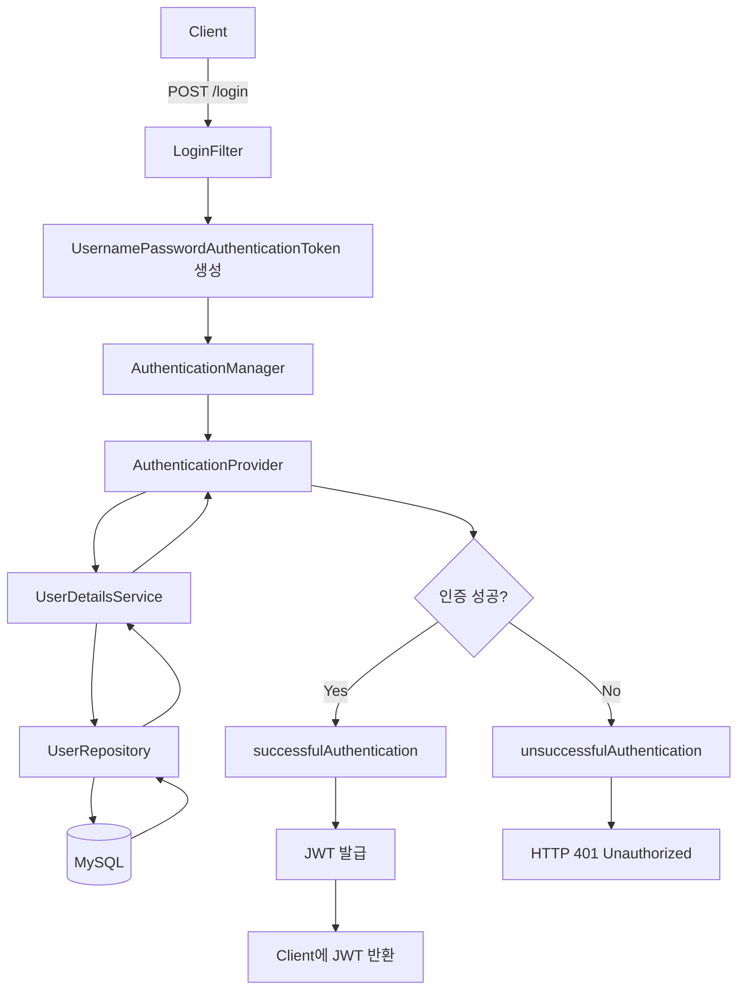
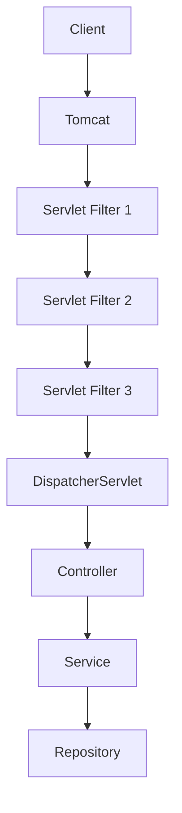
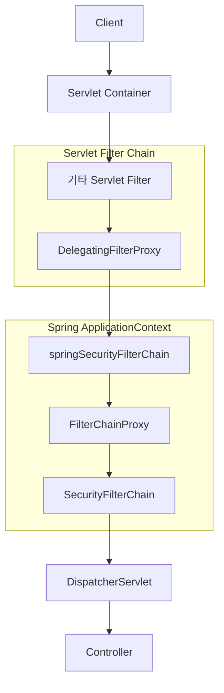
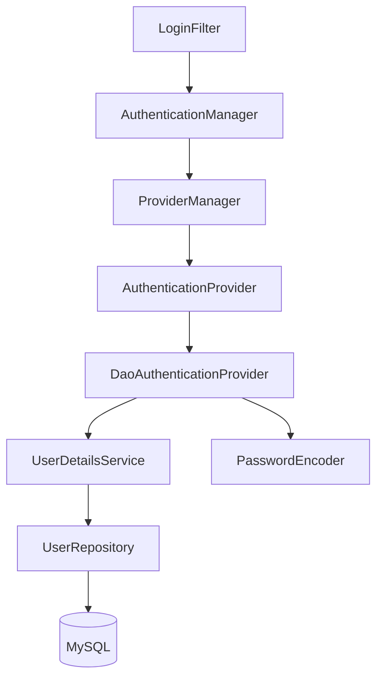
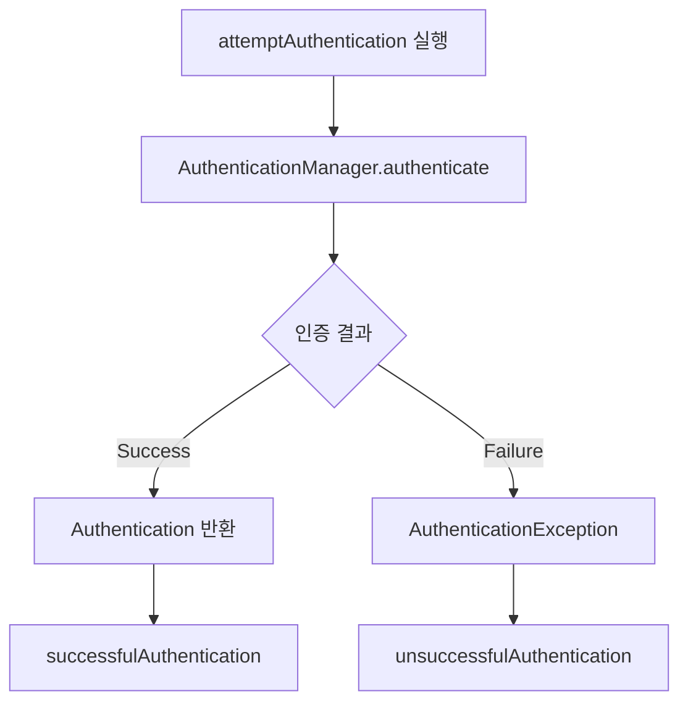
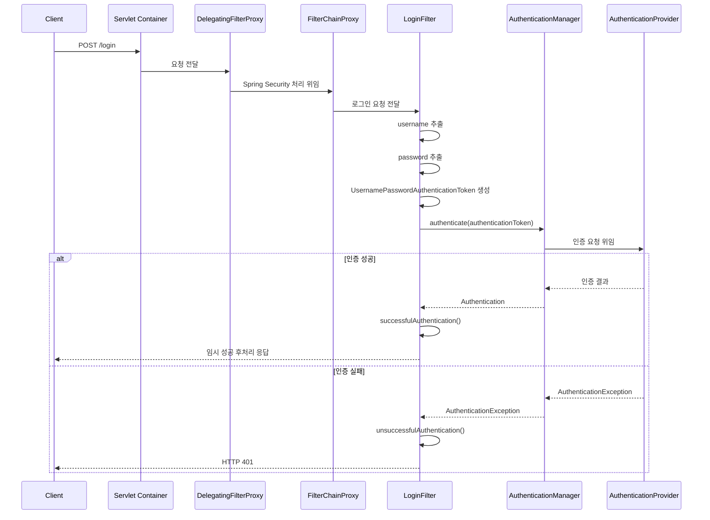

# 스프링 시큐리티 JWT - 7. 로그인 필터 구현
[https://youtu.be/3Ff7UHGG3t8?si=Gi38uWMopxPykRPm](https://youtu.be/3Ff7UHGG3t8?si=Gi38uWMopxPykRPm)

# 스프링 시큐리티 JWT - 7. 로그인 필터 구현
* toc
{:toc}

---

### Spring Security JWT 로그인 구현 1: LoginFilter, AuthenticationManager와 SecurityFilterChain 동작 원리

Spring Security를 이용한 JWT 인증 시스템에서 회원가입 기능을 구현했다면, 다음으로 필요한 것은 로그인 기능이다.

회원가입에서는 사용자의 아이디와 비밀번호를 입력받아 MySQL에 저장했다. 이때 비밀번호는 BCrypt를 이용해 해시한 뒤 저장하고, 사용자에게 기본 권한을 부여했다.

이제 사용자가 로그인을 요청하면 데이터베이스에 저장된 회원 정보와 전달받은 아이디·비밀번호를 비교해야 한다.

인증에 성공하면 JWT를 발급하고, 클라이언트는 이후 API 요청마다 해당 JWT를 전달하여 인증을 수행할 수 있다.

전체적인 흐름은 다음과 같다.



로그인 요청은 단순히 Controller가 아이디와 비밀번호를 전달받는 구조로도 구현할 수 있다.

하지만 Spring Security에서는 로그인 요청을 처리하기 위한 인증 필터와 인증 관리 체계를 제공한다.

대표적인 구성요소는 다음과 같다.

| 구성요소                                   | 역할                      |
| -------------------------------------- | ----------------------- |
| `UsernamePasswordAuthenticationFilter` | 아이디와 비밀번호를 이용한 인증 요청 처리 |
| `UsernamePasswordAuthenticationToken`  | 인증에 필요한 정보를 담는 객체       |
| `AuthenticationManager`                | 인증 요청을 처리하는 인터페이스       |
| `AuthenticationProvider`               | 실제 인증 방식 구현             |
| `UserDetailsService`                   | 사용자 정보 조회               |
| `PasswordEncoder`                      | 입력한 비밀번호와 저장된 해시 비교     |
| `successfulAuthentication()`           | 인증 성공 이후 처리             |
| `unsuccessfulAuthentication()`         | 인증 실패 이후 처리             |

이 중 이번에 집중할 부분은 **LoginFilter와 AuthenticationManager를 연결하는 과정**이다.

사용자가 전달한 아이디와 비밀번호를 Spring Security의 인증 체계로 전달하고, 인증 성공과 실패에 따라 서로 다른 처리를 수행할 수 있도록 구성한다.

---

### 개념

#### Spring Security에서 로그인은 어떻게 처리될까?

Spring Security는 Servlet Filter를 기반으로 동작한다.

사용자가 HTTP 요청을 보내면 요청은 곧바로 Spring MVC의 Controller에 전달되는 것이 아니다.

먼저 Servlet Container에 등록된 여러 Filter를 통과한다.

Spring Security는 이 과정에 보안 필터 체인을 추가하여 인증과 인가를 수행한다.

예를 들어 사용자가 다음 요청을 전송한다고 생각해보자.

```http
POST /login HTTP/1.1
Host: localhost:8080
Content-Type: application/x-www-form-urlencoded

username=user01&password=password123%21
```

Spring Security에서 로그인 필터가 해당 요청을 처리하도록 구성되어 있다면 다음 과정이 실행된다.

```text
POST /login
    ↓
Spring Security Filter Chain
    ↓
UsernamePasswordAuthenticationFilter
    ↓
username 추출
    ↓
password 추출
    ↓
UsernamePasswordAuthenticationToken 생성
    ↓
AuthenticationManager.authenticate()
    ↓
인증 성공 또는 실패
```

여기서 중요한 점은 로그인 요청을 처리하는 주체가 반드시 Controller일 필요는 없다는 사실이다.

**Spring Security의 인증 필터 자체가 특정 로그인 URL을 처리할 수 있다.**

따라서 `/login`에 대응하는 별도의 `@PostMapping` 메서드가 없어도 로그인 필터가 요청을 가로채 인증을 수행하도록 구성할 수 있다.

---

### Servlet Filter란?

Spring Security의 내부 구조를 이해하려면 먼저 Servlet Filter를 알아야 한다.

Servlet Filter는 HTTP 요청이 Servlet에 도달하기 전이나 응답이 클라이언트로 전달되기 전에 특정한 작업을 수행할 수 있는 구성요소다.

예를 들어 다음과 같은 작업에 활용할 수 있다.

* 요청 및 응답 로깅
* 인증과 인가
* 요청 헤더 검사
* 인코딩 처리
* 공통 보안 정책 적용
* 요청 데이터 검증

Spring Boot에서 Spring MVC를 사용한다면 일반적으로 내장 Tomcat과 같은 Servlet Container가 HTTP 요청을 처리한다.

요청은 여러 Servlet Filter를 통과한 뒤 `DispatcherServlet`으로 전달된다.



Filter는 요청을 다음 단계로 전달할 수도 있고, 특정 조건에서 요청 처리를 중단할 수도 있다.

예를 들어 인증되지 않은 사용자가 관리자 API에 접근하면 Filter 단계에서 접근을 거부할 수 있다.

이 경우 Controller의 메서드가 실행되지 않는다.

#### Servlet Filter와 Spring MVC Interceptor의 차이

Filter와 Interceptor는 모두 요청 처리 과정에 관여하지만 위치와 역할이 다르다.

| 구분       | Servlet Filter | Spring MVC Interceptor              |
| -------- | -------------- | ----------------------------------- |
| 동작 위치    | Servlet 앞단     | DispatcherServlet 내부의 Handler 처리 과정 |
| 기반 기술    | Servlet API    | Spring MVC                          |
| 주요 인터페이스 | `Filter`       | `HandlerInterceptor`                |
| 적용 대상    | Servlet 요청 처리  | Spring MVC Handler                  |
| 대표적인 사용  | 보안, 인코딩, 로깅    | Controller 전후 공통 처리                 |

Spring Security가 Servlet Filter 기반으로 동작하는 이유 중 하나는 Controller에 요청이 도달하기 전에 인증과 인가를 수행할 수 있기 때문이다.

---

### DelegatingFilterProxy란?

Spring Security는 Servlet Filter를 사용하지만, 인증과 인가에 필요한 구성요소는 Spring 컨테이너에서 관리한다.

여기서 두 실행 환경을 연결해야 한다.

첫 번째는 Servlet Container다.

두 번째는 Spring ApplicationContext다.

Servlet Container는 Servlet Filter의 실행을 관리한다.

반면 Spring Security의 보안 필터 체인은 Spring Bean을 통해 구성된다.

이 두 환경을 연결하기 위해 사용하는 대표적인 구성요소가 `DelegatingFilterProxy`다.



`DelegatingFilterProxy`는 Servlet Filter로 등록되어 있으면서 실제 처리를 Spring Bean에 위임하는 역할을 한다.

Spring Security에서는 일반적으로 `springSecurityFilterChain`이라는 이름의 Bean을 통해 보안 필터 체인에 접근한다.

이 Bean의 대표적인 구현체가 `FilterChainProxy`다.

이 구조는 Spring Security 공식 아키텍처에서도 설명하는 핵심 구성요소다.

#### FilterChainProxy란?

`FilterChainProxy`는 Spring Security의 여러 `SecurityFilterChain`을 관리하는 구성요소다.

예를 들어 애플리케이션에 다음과 같은 요청 경로가 있다고 생각해보자.

```text
/api/**
/admin/**
/login
```

서비스 요구사항에 따라 서로 다른 `SecurityFilterChain`을 구성할 수 있다.

```text
FilterChainProxy
    ├── SecurityFilterChain A
    ├── SecurityFilterChain B
    └── SecurityFilterChain C
```

일반적인 단일 보안 설정에서는 하나의 `SecurityFilterChain`만 사용하기도 한다.

반면 관리 API와 일반 API의 인증 방식이 다르다면 여러 필터 체인을 사용하는 구조도 가능하다.

중요한 것은 **Servlet Filter Chain과 Spring Security의 SecurityFilterChain이 서로 다른 계층에 존재한다는 사실**이다.

Servlet Filter Chain은 Servlet Container가 관리한다.

SecurityFilterChain은 Spring Security가 관리하는 보안 필터의 집합이다.

---

### SecurityFilterChain이란?

`SecurityFilterChain`은 인증, 인가, 보안 정책 등을 처리하기 위한 Spring Security Filter의 집합이다.

Spring Security에는 다양한 보안 필터가 존재한다.

대표적으로 다음과 같은 필터가 있다.

| Filter                                 | 역할                 |
| -------------------------------------- | ------------------ |
| `SecurityContextHolderFilter`          | 현재 요청의 보안 컨텍스트 관리  |
| `CsrfFilter`                           | CSRF 보호            |
| `LogoutFilter`                         | 로그아웃 처리            |
| `UsernamePasswordAuthenticationFilter` | 사용자 이름·비밀번호 기반 로그인 |
| `BasicAuthenticationFilter`            | HTTP Basic 인증      |
| `AnonymousAuthenticationFilter`        | 익명 인증 객체 제공        |
| `ExceptionTranslationFilter`           | 인증·인가 예외 처리 연결     |
| `AuthorizationFilter`                  | 요청에 대한 접근 권한 판단    |

실제 활성화되는 필터의 종류와 순서는 보안 설정에 따라 달라진다.

예를 들어 CSRF를 비활성화하면 관련 필터가 제거될 수 있다.

Form Login을 비활성화하면 기본 Form Login에 필요한 인증 필터가 등록되지 않는다.

따라서 모든 Spring Security 애플리케이션이 동일한 필터 목록을 가진다고 가정해서는 안 된다.

#### Filter 순서가 중요한 이유

보안 필터는 순서에 따라 동작한다.

예를 들어 다음 상황을 생각해보자.

```text
인가 검사
    ↓
JWT 인증
```

이 순서는 일반적인 JWT 인증 시스템에 적절하지 않다.

사용자를 인증하기 전에 접근 권한부터 검사하기 때문이다.

일반적으로는 다음 흐름이 필요하다.

```text
JWT 인증
    ↓
Authentication 구성
    ↓
SecurityContext 설정
    ↓
인가 검사
```

즉 인증 정보를 구성하는 필터가 인가 판단보다 먼저 실행되어야 한다.

Spring Security는 이러한 순서 관계를 고려해 보안 필터를 배치한다.

공식 문서에서도 인증 필터와 인가 필터의 실행 순서가 보안 처리에서 중요하다고 설명한다.

---

### 왜 커스텀 LoginFilter가 필요할까?

기존 프로젝트에서는 다음 설정을 적용했다.

```java
.formLogin(AbstractHttpConfigurer::disable)
```

이 설정은 Spring Security가 제공하는 기본 Form Login 기능을 비활성화한다.

일반적인 Form Login에서는 `UsernamePasswordAuthenticationFilter`가 로그인 요청을 처리한다.

하지만 기본 Form Login을 비활성화했기 때문에 해당 필터를 통한 기본 로그인 기능도 사용하지 않는다.

이번 프로젝트에서는 로그인 성공 시 JWT를 발급하는 인증 흐름을 직접 구성하려고 한다.

따라서 로그인 요청을 처리할 필터를 별도로 등록한다.

```text
기본 Form Login
    ↓
비활성화
    ↓
기본 로그인 필터 사용 안 함
    ↓
커스텀 LoginFilter 생성
    ↓
SecurityFilterChain에 등록
```

다만 **JWT 로그인을 구현할 때 반드시 `UsernamePasswordAuthenticationFilter`를 상속해야 하는 것은 아니다.**

로그인 Controller에서 `AuthenticationManager`를 직접 호출하는 방식도 가능하다.

또한 별도의 `AuthenticationFilter`와 `AuthenticationConverter`를 이용하는 구성도 가능하다.

이번에는 Spring Security의 기존 아이디·비밀번호 인증 구조를 활용하기 위해 `UsernamePasswordAuthenticationFilter`를 상속하는 방식을 사용한다.

---

### 주요 특징

#### UsernamePasswordAuthenticationFilter란?

`UsernamePasswordAuthenticationFilter`는 사용자 이름과 비밀번호를 이용한 인증 요청을 처리하는 필터다.

Spring Security에서 Form Login을 사용할 때 대표적으로 활용되는 클래스다.

기본적으로 다음 요청을 처리하도록 구성되어 있다.

```http
POST /login
```

그리고 다음 이름의 요청 파라미터를 사용한다.

```text
username
password
```

이 필터는 요청에서 두 값을 추출하여 인증 요청 객체를 생성하고 `AuthenticationManager`에 전달한다.

대표적인 메서드는 다음과 같다.

| 메서드                            | 역할                           |
| ------------------------------ | ---------------------------- |
| `attemptAuthentication()`      | 인증 시도                        |
| `obtainUsername()`             | username 추출                  |
| `obtainPassword()`             | password 추출                  |
| `getAuthenticationManager()`   | 연결된 AuthenticationManager 조회 |
| `successfulAuthentication()`   | 인증 성공 이후 처리                  |
| `unsuccessfulAuthentication()` | 인증 실패 이후 처리                  |
| `setFilterProcessesUrl()`      | 로그인 요청 경로 지정                 |

이번 구현에서는 해당 필터를 상속하여 로그인 요청을 직접 처리한다.

---

### attemptAuthentication()이란?

`attemptAuthentication()`은 인증을 시도할 때 실행되는 메서드다.

메서드의 기본 형태는 다음과 같다.

```java
@Override
public Authentication attemptAuthentication(
        HttpServletRequest request,
        HttpServletResponse response
) throws AuthenticationException {

    // 인증 요청 처리
}
```

각 구성요소의 의미를 살펴보자.

| 구성요소                    | 역할                         |
| ----------------------- | -------------------------- |
| HttpServletRequest      | 클라이언트가 전달한 HTTP 요청         |
| HttpServletResponse     | HTTP 응답 객체                 |
| Authentication          | 인증 요청 또는 인증 결과를 표현하는 인터페이스 |
| AuthenticationException | Spring Security의 인증 관련 예외  |

이 메서드에서는 일반적으로 다음 작업을 수행한다.

```text
HTTP 요청
    ↓
username 추출
    ↓
password 추출
    ↓
Authentication 객체 생성
    ↓
AuthenticationManager.authenticate()
    ↓
인증 결과 반환
```

여기서 중요한 점은 `attemptAuthentication()` 자체가 MySQL에 직접 접근할 필요는 없다는 사실이다.

실제 사용자 조회와 비밀번호 검증은 `AuthenticationManager`가 위임하는 인증 구성요소에서 수행할 수 있다.

---

### UsernamePasswordAuthenticationToken이란?

`UsernamePasswordAuthenticationToken`은 사용자 이름과 비밀번호 기반의 인증 요청 및 인증 결과를 표현할 수 있는 객체다.

이름에 `Token`이 포함되어 있지만 JWT와는 다른 개념이다.

두 가지를 구분해야 한다.

| 구분    | UsernamePasswordAuthenticationToken   | JWT                        |
| ----- | ------------------------------------- | -------------------------- |
| 소속    | Spring Security                       | JSON Web Token 표준          |
| 주된 역할 | 인증 요청 및 인증 결과 표현                      | 인증 정보 등을 전달하는 토큰 형식        |
| 포함 정보 | Principal, Credentials, Authorities 등 | Header, Payload, Signature |
| 사용 위치 | Spring Security 내부 인증 처리              | 클라이언트와 서버 사이의 토큰 전달        |

예를 들어 다음과 같은 로그인 요청이 들어왔다고 생각해보자.

```text
username = user01
password = password123!
```

이 데이터를 `UsernamePasswordAuthenticationToken`에 담을 수 있다.

```java
UsernamePasswordAuthenticationToken authenticationToken =
        UsernamePasswordAuthenticationToken.unauthenticated(
                username,
                password
        );
```

이 객체는 아직 인증되지 않은 상태다.

따라서 다음 값이 `false`다.

```java
authenticationToken.isAuthenticated();
```

이는 정상적인 동작이다.

사용자가 직접 전달한 아이디와 비밀번호만으로 인증에 성공했다고 판단해서는 안 되기 때문이다.

#### 인증 전후의 Authentication 차이

| 구분              | 인증 전              | 인증 후                  |
| --------------- | ----------------- | --------------------- |
| Principal       | 일반적으로 username    | UserDetails 등 인증된 사용자 |
| Credentials     | 입력한 비밀번호          | 보안 정책에 따라 제거 가능       |
| Authorities     | 아직 신뢰할 수 있는 권한 없음 | 검증된 사용자 권한            |
| isAuthenticated | false             | true                  |

인증 요청 객체를 생성할 때는 일반적으로 `unauthenticated()`를 사용한다.

```java
UsernamePasswordAuthenticationToken.unauthenticated(
        username,
        password
);
```

반대로 인증이 완료되지 않았는데 임의로 `ROLE_ADMIN` 권한을 넣고 인증된 객체로 만들어서는 안 된다.

Spring Security 6.2.1에서도 인증되지 않은 요청과 인증된 결과를 구분하기 위한 생성 방식이 제공된다.

---

### AuthenticationManager란?

`AuthenticationManager`는 Spring Security에서 인증 처리를 위한 핵심 인터페이스다.

대표적인 메서드는 다음과 같다.

```java
Authentication authenticate(
        Authentication authentication
) throws AuthenticationException;
```

이 메서드는 인증 요청 객체를 전달받는다.

인증에 성공하면 인증 결과를 반환한다.

인증에 실패하면 `AuthenticationException` 계열 예외가 발생한다.

하지만 `AuthenticationManager` 자체가 항상 직접 데이터베이스를 조회하는 것은 아니다.

일반적으로 구현체인 `ProviderManager`가 실제 인증 처리를 담당하는 `AuthenticationProvider`에 요청을 위임한다.



대표적인 인증 처리 흐름은 다음과 같다.

```text
LoginFilter
    ↓
AuthenticationManager.authenticate()
    ↓
ProviderManager
    ↓
DaoAuthenticationProvider
    ↓
UserDetailsService
    ↓
UserRepository
    ↓
MySQL
    ↓
PasswordEncoder 검증
    ↓
인증 결과 반환
```

`ProviderManager`는 여러 `AuthenticationProvider`를 관리할 수 있다.

따라서 시스템에 따라 사용자 이름·비밀번호 인증, LDAP 인증, 기타 인증 방식 등을 조합할 수 있다.

이러한 역할 분리는 Spring Security 인증 아키텍처의 중요한 특징이다.

---

### AuthenticationProvider란?

`AuthenticationProvider`는 실제 인증 방식을 구현하는 인터페이스다.

예를 들어 아이디와 비밀번호 기반 인증에서는 `DaoAuthenticationProvider`를 사용할 수 있다.

`DaoAuthenticationProvider`는 다음 구성요소를 이용한다.

```text
UserDetailsService
    ↓
사용자 정보 조회
```

```text
PasswordEncoder
    ↓
비밀번호 검증
```

사용자가 입력한 비밀번호가 저장된 해시와 일치하고 계정 상태가 인증을 허용한다면 인증 성공 결과를 반환할 수 있다.

반대로 사용자 정보가 없거나 비밀번호가 일치하지 않으면 인증에 실패한다.

**AuthenticationManager는 인증 요청을 전달하고 관리하며, AuthenticationProvider가 해당 인증 방식에 맞는 실제 검증을 수행한다.**

이번 구현에서는 LoginFilter에서 AuthenticationManager를 호출하는 부분까지 구성한다.

사용자 데이터베이스 조회를 담당할 `UserDetailsService`와 실제 비밀번호 검증 연결은 이후 단계에서 추가한다.

---

### 예제

#### 1. 프로젝트 구조

기존에 구현한 회원가입 프로젝트를 확장한다.

현재 프로젝트에는 다음 구성요소가 존재한다.

```text
src/main/java/com/example/jwt
│
├── JwtApplication.java
│
├── config
│   └── SecurityConfig.java
│
├── controller
│   ├── MainController.java
│   ├── AdminController.java
│   └── JoinController.java
│
├── dto
│   └── JoinDTO.java
│
├── service
│   └── JoinService.java
│
├── entity
│   └── UserEntity.java
│
└── repository
    └── UserRepository.java
```

이번에는 JWT 관련 인증 처리 클래스를 모아둘 패키지를 추가한다.

```text
com.example.jwt.jwt
```

그리고 해당 패키지 안에 `LoginFilter`를 생성한다.

```text
src/main/java/com/example/jwt/jwt/LoginFilter.java
```

변경된 구조는 다음과 같다.

```text
src/main/java/com/example/jwt
│
├── JwtApplication.java
│
├── config
│   └── SecurityConfig.java
│
├── controller
│   ├── MainController.java
│   ├── AdminController.java
│   └── JoinController.java
│
├── dto
│   └── JoinDTO.java
│
├── service
│   └── JoinService.java
│
├── entity
│   └── UserEntity.java
│
├── repository
│   └── UserRepository.java
│
└── jwt
    └── LoginFilter.java
```

이제 LoginFilter를 작성한다.

---

### LoginFilter 생성

#### UsernamePasswordAuthenticationFilter 상속

먼저 다음과 같이 클래스를 작성한다.

```java
package com.example.jwt.jwt;

import org.springframework.security.web.authentication.UsernamePasswordAuthenticationFilter;

public class LoginFilter
        extends UsernamePasswordAuthenticationFilter {

}
```

`UsernamePasswordAuthenticationFilter`를 상속하면 기존 Spring Security의 로그인 처리 기능을 활용할 수 있다.

대표적으로 다음 기능을 사용할 수 있다.

* 로그인 URL에 해당하는 요청 판별
* 사용자 이름과 비밀번호 파라미터 추출
* AuthenticationManager 연결
* 인증 성공·실패 처리
* 인증 요청 객체 생성에 필요한 공통 기능

이제 실제 인증 시도를 담당하는 메서드를 재정의한다.

---

### attemptAuthentication() 구현

다음 코드를 작성한다.

```java
@Override
public Authentication attemptAuthentication(
        HttpServletRequest request,
        HttpServletResponse response
) throws AuthenticationException {

    String username = obtainUsername(request);
    String password = obtainPassword(request);

    UsernamePasswordAuthenticationToken authenticationToken =
            UsernamePasswordAuthenticationToken.unauthenticated(
                    username,
                    password
            );

    return getAuthenticationManager().authenticate(
            authenticationToken
    );
}
```

이 코드를 실행하면 다음 과정이 수행된다.

```text
POST /login
    ↓
obtainUsername(request)
    ↓
username 획득
    ↓
obtainPassword(request)
    ↓
password 획득
    ↓
UsernamePasswordAuthenticationToken 생성
    ↓
AuthenticationManager.authenticate()
```

각 메서드를 자세히 살펴보자.

#### obtainUsername()

```java
String username = obtainUsername(request);
```

`obtainUsername()`은 요청에서 사용자 이름을 추출한다.

기본적으로 다음 파라미터를 사용한다.

```text
username
```

이는 다음 코드와 비슷한 역할을 한다.

```java
String username = request.getParameter("username");
```

다만 `UsernamePasswordAuthenticationFilter`가 제공하는 메서드를 사용하면 파라미터 이름을 변경하는 설정도 활용할 수 있다.

#### obtainPassword()

```java
String password = obtainPassword(request);
```

`obtainPassword()`는 요청에서 비밀번호를 추출한다.

기본 파라미터 이름은 다음과 같다.

```text
password
```

개념적으로 다음 코드와 유사하다.

```java
String password = request.getParameter("password");
```

여기서 주의해야 할 점은 이 메서드가 일반적인 JSON 요청 본문을 자동으로 파싱하는 것은 아니라는 사실이다.

이번 구성은 `application/x-www-form-urlencoded` 기반의 로그인 요청을 전제로 한다.

JSON 로그인을 구현하려면 별도의 요청 본문 파싱 로직이나 AuthenticationConverter 등이 필요할 수 있다.

---

### 인증 요청 객체 생성

사용자 이름과 비밀번호를 추출했다면 인증 요청 객체를 생성한다.

```java
UsernamePasswordAuthenticationToken authenticationToken =
        UsernamePasswordAuthenticationToken.unauthenticated(
                username,
                password
        );
```

이때 객체에 들어가는 정보는 다음과 같다.

```text
Principal
    ↓
username
```

```text
Credentials
    ↓
password
```

```text
Authorities
    ↓
아직 검증된 권한 없음
```

여기서 Authorities가 비어 있다는 사실을 잘 이해해야 한다.

로그인 요청을 처리하는 단계에서는 사용자가 일반 사용자인지 관리자인지 아직 검증하지 않았다.

따라서 신뢰할 수 있는 권한을 직접 설정해서는 안 된다.

권한 정보는 사용자 인증에 성공한 이후 신뢰할 수 있는 사용자 저장소 등을 통해 확인해야 한다.

---

### AuthenticationManager에 인증 요청 전달

이제 생성한 객체를 `AuthenticationManager`에 전달한다.

```java
return getAuthenticationManager().authenticate(
        authenticationToken
);
```

여기서 `getAuthenticationManager()`는 로그인 필터에 설정된 AuthenticationManager를 반환한다.

이후 `authenticate()`가 실제 인증 처리를 시작한다.

인증에 성공하면 `Authentication` 객체가 반환된다.

인증에 실패하면 `AuthenticationException` 계열 예외가 발생한다.

이때 `attemptAuthentication()`에서 예외를 모두 직접 처리해야 하는 것은 아니다.

`UsernamePasswordAuthenticationFilter`의 상위 클래스인 `AbstractAuthenticationProcessingFilter`가 인증 결과에 따라 성공 및 실패 처리 흐름을 실행한다.



따라서 인증 시도와 인증 결과 처리는 서로 다른 단계로 구분할 수 있다.

---

### AuthenticationManager 주입하기

LoginFilter가 AuthenticationManager를 사용하려면 먼저 해당 객체를 전달받아야 한다.

Spring Security 6.2.1에서는 다음과 같이 생성자에서 AuthenticationManager를 설정할 수 있다.

```java
public LoginFilter(
        AuthenticationManager authenticationManager
) {

    super();

    setAuthenticationManager(authenticationManager);
}
```

상속받은 필터에 AuthenticationManager를 설정하는 것이다.

이렇게 하면 이후 다음 코드에서 해당 객체를 사용할 수 있다.

```java
getAuthenticationManager().authenticate(authenticationToken);
```

여기서 다음 구분이 중요하다.

`AuthenticationManager`는 인증을 처리하기 위한 인터페이스다.

`AuthenticationConfiguration`은 Spring Security의 인증 구성을 관리하는 설정 객체다.

둘은 동일한 클래스가 아니다.

---

### successfulAuthentication()이란?

`successfulAuthentication()`은 인증에 성공했을 때 호출되는 메서드다.

메서드의 형태는 다음과 같다.

```java
@Override
protected void successfulAuthentication(
        HttpServletRequest request,
        HttpServletResponse response,
        FilterChain chain,
        Authentication authentication
) throws IOException, ServletException {

    super.successfulAuthentication(
            request,
            response,
            chain,
            authentication
    );
}
```

이 메서드는 인증이 완료된 사용자 정보를 전달받는다.

대표적으로 다음 데이터를 확인할 수 있다.

```java
authentication.getName();
```

```java
authentication.getAuthorities();
```

```java
authentication.isAuthenticated();
```

JWT 기반 로그인에서는 인증에 성공한 사용자의 정보를 이용해 JWT를 발급할 수 있다.

```text
Authentication 성공
    ↓
successfulAuthentication()
    ↓
사용자 식별자 확인
    ↓
사용자 권한 확인
    ↓
JWT 생성
    ↓
클라이언트 응답
```

다만 **현재는 JWT 생성 기능을 아직 구현하지 않은 상태**다.

따라서 임시 성공 처리를 통해 인증 성공과 JWT 발급 완료를 혼동하지 않도록 구성한다.

---

### unsuccessfulAuthentication()이란?

`unsuccessfulAuthentication()`은 인증에 실패했을 때 호출되는 메서드다.

메서드의 형태는 다음과 같다.

```java
@Override
protected void unsuccessfulAuthentication(
        HttpServletRequest request,
        HttpServletResponse response,
        AuthenticationException failed
) throws IOException, ServletException {

    super.unsuccessfulAuthentication(
            request,
            response,
            failed
    );
}
```

인증에 실패하는 상황은 다양하다.

예를 들어 다음과 같다.

| 상황          | 설명                            |
| ----------- | ----------------------------- |
| 존재하지 않는 사용자 | 사용자 조회 실패                     |
| 비밀번호 불일치    | PasswordEncoder 검증 실패         |
| 비활성화된 계정    | 계정 상태 검증 실패                   |
| 잠긴 계정       | 계정 잠금 정책 적용                   |
| 인증 처리 구성 오류 | 적절한 AuthenticationProvider 없음 |

REST API에서는 일반적으로 사용자 이름이나 비밀번호가 올바르지 않은 경우 HTTP 401 Unauthorized를 반환한다.

```http
HTTP/1.1 401 Unauthorized
```

여기서 중요한 점은 인증 실패 원인을 그대로 클라이언트에게 상세하게 노출하지 않는 것이다.

예를 들어 다음과 같이 구체적으로 구분해 반환하면 계정 존재 여부가 드러날 수 있다.

```text
사용자가 존재하지 않습니다.
```

```text
비밀번호가 잘못되었습니다.
```

서비스 정책에 따라 외부 응답은 공통 메시지로 처리하고, 내부에서는 필요한 수준의 장애 정보를 관리할 수 있다.

---

### LoginFilter 전체 코드

지금까지 작성한 내용을 하나의 클래스로 정리해보자.

이번 단계에서는 다음 기능을 구현한다.

1. POST `/login` 요청 처리
2. 사용자 이름과 비밀번호 추출
3. 인증되지 않은 Authentication 객체 생성
4. AuthenticationManager 호출
5. 인증 성공과 실패 처리
6. JWT 발급 기능이 아직 구현되지 않았음을 명시적으로 표현

다음은 `LoginFilter.java` 전체 코드다.

```java
package com.example.jwt.jwt;

import jakarta.servlet.FilterChain;
import jakarta.servlet.ServletException;
import jakarta.servlet.http.HttpServletRequest;
import jakarta.servlet.http.HttpServletResponse;

import org.springframework.security.authentication.AuthenticationManager;
import org.springframework.security.authentication.AuthenticationServiceException;
import org.springframework.security.authentication.UsernamePasswordAuthenticationToken;

import org.springframework.security.core.Authentication;
import org.springframework.security.core.AuthenticationException;

import org.springframework.security.web.authentication.UsernamePasswordAuthenticationFilter;

import java.io.IOException;

public class LoginFilter
        extends UsernamePasswordAuthenticationFilter {

    public LoginFilter(
            AuthenticationManager authenticationManager
    ) {

        super();

        // 인증을 수행할 AuthenticationManager 설정
        setAuthenticationManager(authenticationManager);

        // 로그인 요청 경로 지정
        setFilterProcessesUrl("/login");

        // 로그인 성공 시 임시 처리
        setAuthenticationSuccessHandler(
                (request, response, authentication) -> {

                    // 아직 JWT 발급 기능이 구현되지 않았음을 알림
                    response.sendError(
                            HttpServletResponse.SC_NOT_IMPLEMENTED,
                            "JWT_ISSUANCE_NOT_IMPLEMENTED"
                    );
                }
        );

        // 로그인 실패 시 HTTP 401 반환
        setAuthenticationFailureHandler(
                (request, response, exception) -> {

                    response.sendError(
                            HttpServletResponse.SC_UNAUTHORIZED,
                            "LOGIN_FAILED"
                    );
                }
        );
    }

    @Override
    public Authentication attemptAuthentication(
            HttpServletRequest request,
            HttpServletResponse response
    ) throws AuthenticationException {

        // POST 요청만 처리
        if (!"POST".equals(request.getMethod())) {

            throw new AuthenticationServiceException(
                    "Unsupported authentication method"
            );
        }

        // 1. username 추출
        String username = obtainUsername(request);

        // 2. password 추출
        String password = obtainPassword(request);

        // 3. null 값 처리
        username = username == null ? "" : username.trim();
        password = password == null ? "" : password;

        // 4. 인증되지 않은 요청 객체 생성
        UsernamePasswordAuthenticationToken authenticationToken =
                UsernamePasswordAuthenticationToken.unauthenticated(
                        username,
                        password
                );

        // 5. HTTP 요청 관련 부가 정보 설정
        setDetails(request, authenticationToken);

        // 6. AuthenticationManager로 인증 요청 전달
        return getAuthenticationManager().authenticate(
                authenticationToken
        );
    }

    @Override
    protected void successfulAuthentication(
            HttpServletRequest request,
            HttpServletResponse response,
            FilterChain chain,
            Authentication authentication
    ) throws IOException, ServletException {

        super.successfulAuthentication(
                request,
                response,
                chain,
                authentication
        );
    }

    @Override
    protected void unsuccessfulAuthentication(
            HttpServletRequest request,
            HttpServletResponse response,
            AuthenticationException failed
    ) throws IOException, ServletException {

        super.unsuccessfulAuthentication(
                request,
                response,
                failed
        );
    }
}
```

현재 코드에서는 인증 성공 시 HTTP 501을 반환하도록 설정했다.

```text
JWT_ISSUANCE_NOT_IMPLEMENTED
```

이는 인증 성공과 JWT 발급 완료를 혼동하지 않기 위한 임시 응답이다.

실제 JWT 발급 기능을 추가하면 성공 처리 부분에서 토큰을 생성하고 반환하도록 변경해야 한다.

반면 인증 실패 시에는 HTTP 401을 반환한다.

```text
LOGIN_FAILED
```

여기서 `super.successfulAuthentication()`과 `super.unsuccessfulAuthentication()`을 호출하는 이유는 Spring Security의 기본적인 인증 성공·실패 처리 흐름을 유지하면서 등록된 Handler를 사용하기 위해서다.

실제 JWT 발급 기능을 구현할 때는 이러한 Handler 또는 메서드 재정의를 통해 필요한 처리를 연결할 수 있다.

---

### SecurityConfig에 LoginFilter 등록하기

LoginFilter 클래스를 만들었다고 자동으로 모든 HTTP 요청에 적용되는 것은 아니다.

Spring Security의 `SecurityFilterChain`에 해당 필터를 등록해야 한다.

Spring Security에서는 다음 메서드를 제공한다.

```java
addFilterBefore()
```

```java
addFilterAfter()
```

```java
addFilterAt()
```

각 메서드의 역할은 다음과 같다.

| 메서드                 | 역할                |
| ------------------- | ----------------- |
| `addFilterBefore()` | 지정한 필터보다 앞에 추가    |
| `addFilterAfter()`  | 지정한 필터보다 뒤에 추가    |
| `addFilterAt()`     | 지정한 필터의 순서 위치에 추가 |

이번에는 기존 `UsernamePasswordAuthenticationFilter`가 사용하던 위치에 LoginFilter를 배치한다.

```java
http.addFilterAt(
        loginFilter,
        UsernamePasswordAuthenticationFilter.class
);
```

이렇게 하면 LoginFilter가 사용자 이름·비밀번호 인증 필터에 해당하는 순서에서 실행되도록 구성할 수 있다.

다만 `addFilterAt()`을 기존 필터 객체를 반드시 찾아 삭제하는 메서드로 이해해서는 안 된다.

지정한 필터의 순서 위치에 새로운 필터를 추가하는 방식이므로 같은 위치에 중복 필터가 등록되지 않도록 주의해야 한다.

현재는 기본 Form Login을 비활성화했으므로 기본 로그인 필터와 충돌하지 않도록 구성할 수 있다.

---

### AuthenticationManager Bean 등록하기

LoginFilter 생성자에서는 `AuthenticationManager`를 전달받는다.

```java
public LoginFilter(
        AuthenticationManager authenticationManager
)
```

따라서 Spring Security 설정에서 AuthenticationManager를 사용할 수 있도록 구성해야 한다.

Spring Security 6에서는 `AuthenticationConfiguration`을 통해 AuthenticationManager를 가져오는 방식을 사용할 수 있다.

```java
@Bean
public AuthenticationManager authenticationManager(
        AuthenticationConfiguration authenticationConfiguration
) throws Exception {

    return authenticationConfiguration.getAuthenticationManager();
}
```

코드를 살펴보자.

#### AuthenticationConfiguration

```java
AuthenticationConfiguration authenticationConfiguration
```

Spring Security의 인증 관련 구성을 관리하는 객체다.

다음 메서드를 제공한다.

```java
authenticationConfiguration.getAuthenticationManager();
```

이를 통해 구성된 AuthenticationManager를 가져올 수 있다.

이후 LoginFilter에 전달한다.

```java
LoginFilter loginFilter =
        new LoginFilter(authenticationManager);
```

이렇게 하면 LoginFilter가 AuthenticationManager를 이용해 인증을 시도할 수 있다.

단, 매우 중요한 사항이 있다.

**AuthenticationManager Bean을 등록했다고 해서 MySQL 기반 사용자 인증이 자동으로 완성되는 것은 아니다.**

실제 아이디와 비밀번호를 검증하려면 적절한 AuthenticationProvider와 UserDetailsService 등의 구성이 필요하다.

이 구성요소가 없다면 인증이 실패하거나, 인증 설정 상태에 따라 애플리케이션 초기화 과정에서 문제가 발생할 수 있다.

따라서 현재 단계에서는 AuthenticationManager를 연결하는 구조를 이해하는 것이 목적이다.

---

### SecurityConfig 전체 코드

이제 기존 `SecurityConfig`에 LoginFilter와 AuthenticationManager를 추가한다.

다음은 Spring Security 6.2.1 기준의 전체 코드다.

```java
package com.example.jwt.config;

import com.example.jwt.jwt.LoginFilter;

import org.springframework.context.annotation.Bean;
import org.springframework.context.annotation.Configuration;

import org.springframework.security.authentication.AuthenticationManager;

import org.springframework.security.config.annotation.authentication.configuration.AuthenticationConfiguration;

import org.springframework.security.config.annotation.web.builders.HttpSecurity;
import org.springframework.security.config.annotation.web.configuration.EnableWebSecurity;

import org.springframework.security.config.annotation.web.configurers.AbstractHttpConfigurer;
import org.springframework.security.config.http.SessionCreationPolicy;

import org.springframework.security.crypto.bcrypt.BCryptPasswordEncoder;
import org.springframework.security.crypto.password.PasswordEncoder;

import org.springframework.security.web.SecurityFilterChain;

import org.springframework.security.web.authentication.UsernamePasswordAuthenticationFilter;

@Configuration
@EnableWebSecurity
public class SecurityConfig {

    @Bean
    public AuthenticationManager authenticationManager(
            AuthenticationConfiguration authenticationConfiguration
    ) throws Exception {

        return authenticationConfiguration.getAuthenticationManager();
    }

    @Bean
    public SecurityFilterChain filterChain(
            HttpSecurity http,
            AuthenticationManager authenticationManager
    ) throws Exception {

        // 커스텀 로그인 필터 생성
        LoginFilter loginFilter =
                new LoginFilter(authenticationManager);

        http
                // CSRF 비활성화
                .csrf(AbstractHttpConfigurer::disable)

                // 기본 Form Login 비활성화
                .formLogin(AbstractHttpConfigurer::disable)

                // HTTP Basic 비활성화
                .httpBasic(AbstractHttpConfigurer::disable)

                // Stateless 인증 정책
                .sessionManagement(session -> session
                        .sessionCreationPolicy(
                                SessionCreationPolicy.STATELESS
                        )
                )

                // URL별 접근 권한
                .authorizeHttpRequests(auth -> auth

                        // 로그인 및 회원가입 허용
                        .requestMatchers(
                                "/login",
                                "/join"
                        ).permitAll()

                        // 관리자 API
                        .requestMatchers(
                                "/admin",
                                "/admin/**"
                        ).hasRole("ADMIN")

                        // 나머지 API는 인증 필요
                        .anyRequest().authenticated()
                )

                // 커스텀 로그인 필터 등록
                .addFilterAt(
                        loginFilter,
                        UsernamePasswordAuthenticationFilter.class
                );

        return http.build();
    }

    @Bean
    public PasswordEncoder passwordEncoder() {

        return new BCryptPasswordEncoder();
    }
}
```

이 코드에서 새롭게 추가한 부분은 크게 두 가지다.

첫 번째는 AuthenticationManager Bean이다.

```java
@Bean
public AuthenticationManager authenticationManager(
        AuthenticationConfiguration authenticationConfiguration
) throws Exception {

    return authenticationConfiguration.getAuthenticationManager();
}
```

두 번째는 LoginFilter 등록이다.

```java
.addFilterAt(
        loginFilter,
        UsernamePasswordAuthenticationFilter.class
)
```

이제 Spring Security는 `/login` 요청이 들어왔을 때 LoginFilter를 통해 인증을 시도할 수 있다.

다만 실제 데이터베이스 인증을 완료하려면 아직 구현해야 할 부분이 남아 있다.

---

### 현재까지 구현한 기능

여기서 현재 구현한 기능과 아직 구현하지 않은 기능을 명확하게 구분해야 한다.

| 기능                                     | 현재 상태 |
| -------------------------------------- | ----- |
| 회원가입                                   | 구현    |
| 사용자 정보 MySQL 저장                        | 구현    |
| 비밀번호 BCrypt 해시                         | 구현    |
| SecurityFilterChain                    | 구현    |
| LoginFilter 생성                         | 구현    |
| POST /login 요청 처리                      | 구현    |
| username 추출                            | 구현    |
| password 추출                            | 구현    |
| UsernamePasswordAuthenticationToken 생성 | 구현    |
| AuthenticationManager 연결               | 구성    |
| UserDetailsService                     | 미구현   |
| MySQL 사용자 조회를 통한 로그인 인증                | 미구현   |
| 로그인 성공 시 JWT 발급                        | 미구현   |
| 요청별 JWT 검증                             | 미구현   |

즉 현재 단계의 핵심은 다음과 같다.

```text
POST /login
    ↓
LoginFilter
    ↓
username / password 추출
    ↓
UsernamePasswordAuthenticationToken
    ↓
AuthenticationManager
```

이후에는 다음 구조가 연결되어야 한다.

```text
AuthenticationManager
    ↓
AuthenticationProvider
    ↓
UserDetailsService
    ↓
UserRepository
    ↓
MySQL
    ↓
비밀번호 검증
```

그리고 인증에 성공하면 JWT를 발급하는 기능을 구현해야 한다.

---

### 로그인 요청 테스트하기

현재는 데이터베이스 인증 구현이 완성되지 않았으므로 로그인 성공까지 확인하는 단계는 아니다.

먼저 로그인 요청이 LoginFilter에 정상적으로 전달되는지 확인해보자.

#### 1. 애플리케이션 실행

다음 명령을 실행한다.

```bash
./gradlew bootRun
```

이 명령은 Spring Boot 애플리케이션을 실행한다.

정상적으로 실행되었다면 다음과 유사한 로그를 확인할 수 있다.

```text
Tomcat started on port 8080 (http)

Started JwtApplication
```

다만 아직 AuthenticationProvider나 UserDetailsService가 구성되지 않았다면 인증 구성 상태에 따라 초기화 단계에서 문제가 발생할 수 있다.

이 경우 단순히 LoginFilter가 잘못되었다고 판단하기보다 AuthenticationManager에 실제 인증 처리 구성이 존재하는지 확인해야 한다.

#### 2. Postman 요청 구성

Postman에서 다음 요청을 생성한다.

```http
POST http://localhost:8080/login
```

Body는 `x-www-form-urlencoded`로 설정한다.

다음 데이터를 입력한다.

| Key      | Value        |
| -------- | ------------ |
| username | user01       |
| password | password123! |

요청을 전송하면 LoginFilter에서 다음 코드가 실행되어야 한다.

```java
String username = obtainUsername(request);
String password = obtainPassword(request);
```

이후 인증 요청 객체가 생성된다.

```java
UsernamePasswordAuthenticationToken authenticationToken =
        UsernamePasswordAuthenticationToken.unauthenticated(
                username,
                password
        );
```

그리고 AuthenticationManager에 전달된다.

```java
return getAuthenticationManager().authenticate(
        authenticationToken
);
```

현재는 실제 회원 정보를 조회하고 검증하는 구성요소가 완성되지 않았으므로 인증이 실패할 수 있다.

하지만 중요한 것은 로그인 요청이 LoginFilter까지 도달하고, 인증 요청 객체가 생성되어 AuthenticationManager로 전달되는지 확인하는 것이다.

---

### curl로 로그인 요청 보내기

Postman을 사용하지 않더라도 curl을 이용해 확인할 수 있다.

다음 명령을 실행한다.

```bash
curl -i -X POST \
  http://localhost:8080/login \
  --data-urlencode "username=user01" \
  --data-urlencode "password=password123!"
```

각 옵션의 의미는 다음과 같다.

| 옵션                 | 역할              |
| ------------------ | --------------- |
| `-i`               | 응답 헤더 출력        |
| `-X POST`          | POST 방식 요청      |
| `--data-urlencode` | 요청 파라미터 URL 인코딩 |

`--data-urlencode`를 사용하면 특수문자가 포함된 비밀번호도 안전하게 요청 형식에 맞춰 전달할 수 있다.

단, 이 방법이 비밀번호를 암호화하는 것은 아니다.

HTTP 요청 구간에서 비밀번호를 안전하게 보호하려면 HTTPS가 필요하다.

#### 예상되는 인증 실패 응답

AuthenticationManager가 인증 실패를 `AuthenticationException`으로 전달한다면 현재 설정한 Failure Handler가 실행된다.

이때 다음과 같은 응답을 확인할 수 있다.

```http
HTTP/1.1 401 Unauthorized
```

```text
LOGIN_FAILED
```

다만 실제 응답 본문의 표현 방식은 Servlet Container와 오류 처리 설정에 따라 달라질 수 있다.

또한 인증 구성 자체가 올바르지 않아 초기화에 실패했다면 HTTP 요청을 처리하기 전에 애플리케이션이 종료될 수 있다.

따라서 현재 단계에서는 HTTP 상태 코드만으로 구현 성공 여부를 판단해서는 안 된다.

---

### LoginFilter가 실제로 실행되는지 확인하기

가장 간단한 방법은 디버거를 이용하는 것이다.

다음 메서드에 Breakpoint를 설정한다.

```java
@Override
public Authentication attemptAuthentication(
        HttpServletRequest request,
        HttpServletResponse response
) throws AuthenticationException {
```

그다음 POST `/login` 요청을 전송한다.

Breakpoint에서 다음 값을 확인한다.

```java
request.getMethod();
```

예상 결과:

```text
POST
```

다음 값을 확인한다.

```java
obtainUsername(request);
```

예상 결과:

```text
user01
```

다음 값을 확인한다.

```java
obtainPassword(request);
```

예상 결과:

```text
password123!
```

마지막으로 Authentication 객체의 상태를 확인한다.

```java
authenticationToken.isAuthenticated();
```

예상 결과:

```text
false
```

이 값이 `false`인 이유는 아직 사용자 인증이 완료되지 않았기 때문이다.

여기서 `AuthenticationManager.authenticate()` 호출까지 도달했다면 로그인 요청을 인증 관리 체계로 전달하는 구조가 동작하고 있음을 확인할 수 있다.

비밀번호는 디버깅 과정에서도 불필요하게 출력하거나 공유하지 않는 것이 좋다.

---

### 테스트 코드로 LoginFilter 검증하기

실제 데이터베이스 인증 로직을 구현하기 전에도 LoginFilter의 핵심 동작을 검증할 수 있다.

이번에는 Mockito를 이용해 AuthenticationManager를 대체한다.

검증할 내용은 다음과 같다.

1. LoginFilter가 username을 추출하는가?
2. LoginFilter가 password를 추출하는가?
3. Authentication 객체가 인증되지 않은 상태로 생성되는가?
4. AuthenticationManager의 `authenticate()`가 호출되는가?

#### LoginFilterTest 전체 코드

```java
package com.example.jwt.jwt;

import jakarta.servlet.http.HttpServletRequest;

import org.junit.jupiter.api.Test;
import org.junit.jupiter.api.extension.ExtendWith;

import org.mockito.ArgumentCaptor;
import org.mockito.Mock;
import org.mockito.junit.jupiter.MockitoExtension;

import org.springframework.mock.web.MockHttpServletRequest;
import org.springframework.mock.web.MockHttpServletResponse;

import org.springframework.security.authentication.AuthenticationManager;
import org.springframework.security.authentication.BadCredentialsException;

import org.springframework.security.core.Authentication;

import static org.junit.jupiter.api.Assertions.assertEquals;
import static org.junit.jupiter.api.Assertions.assertFalse;
import static org.junit.jupiter.api.Assertions.assertThrows;

import static org.mockito.ArgumentMatchers.any;
import static org.mockito.Mockito.verify;
import static org.mockito.Mockito.when;

@ExtendWith(MockitoExtension.class)
class LoginFilterTest {

    @Mock
    private AuthenticationManager authenticationManager;

    @Test
    void 로그인_요청의_아이디와_비밀번호를_인증매니저에_전달한다() {

        // given
        LoginFilter loginFilter =
                new LoginFilter(authenticationManager);

        MockHttpServletRequest request =
                new MockHttpServletRequest(
                        "POST",
                        "/login"
                );

        request.addParameter(
                "username",
                "user01"
        );

        request.addParameter(
                "password",
                "password123!"
        );

        MockHttpServletResponse response =
                new MockHttpServletResponse();

        when(
                authenticationManager.authenticate(
                        any(Authentication.class)
                )
        ).thenThrow(
                new BadCredentialsException(
                        "Invalid credentials"
                )
        );

        // when
        assertThrows(
                BadCredentialsException.class,
                () -> loginFilter.attemptAuthentication(
                        request,
                        response
                )
        );

        // then
        ArgumentCaptor<Authentication> captor =
                ArgumentCaptor.forClass(
                        Authentication.class
                );

        verify(authenticationManager).authenticate(
                captor.capture()
        );

        Authentication authentication =
                captor.getValue();

        assertEquals(
                "user01",
                authentication.getPrincipal()
        );

        assertEquals(
                "password123!",
                authentication.getCredentials()
        );

        assertFalse(
                authentication.isAuthenticated()
        );
    }
}
```

이 테스트는 실제 MySQL을 사용하지 않는다.

또한 JWT를 생성하지 않는다.

LoginFilter가 요청 데이터를 올바르게 추출하고 AuthenticationManager에 전달하는지만 확인한다.

#### 테스트 실행

다음 명령을 실행한다.

```bash
./gradlew test
```

테스트가 통과하면 다음과 유사한 결과를 확인할 수 있다.

```text
BUILD SUCCESSFUL
```

이 결과가 의미하는 것은 다음과 같다.

```text
Mock HTTP Request
    ↓
LoginFilter.attemptAuthentication()
    ↓
UsernamePasswordAuthenticationToken 생성
    ↓
AuthenticationManager.authenticate() 호출
    ↓
Mockito 검증 성공
```

즉 **아직 데이터베이스 인증이 구현되지 않았더라도 로그인 필터의 입력 처리와 인증 요청 전달 기능은 독립적으로 검증할 수 있다.**

---

### 구조

#### 로그인 요청이 처리되는 전체 흐름

지금까지 구현한 내용을 하나의 구조로 정리해보자.



이번 단계에서는 필터와 AuthenticationManager를 연결한다.

이후 데이터베이스 인증을 구성하면 다음 부분이 연결된다.

```text
AuthenticationProvider
    ↓
UserDetailsService
    ↓
UserRepository
    ↓
MySQL
```

그리고 JWT 생성 기능을 구현하면 인증 성공 후 다음 흐름까지 완성할 수 있다.

```text
successfulAuthentication()
    ↓
인증된 사용자 정보 확인
    ↓
JWT 생성
    ↓
HTTP 응답에 JWT 포함
```

---

### Stateless 환경에서는 로그인 성공 후 어떻게 될까?

기존 프로젝트의 `SecurityConfig`에는 다음 설정이 존재한다.

```java
.sessionManagement(session -> session
        .sessionCreationPolicy(
                SessionCreationPolicy.STATELESS
        )
)
```

이 설정은 Spring Security가 인증 상태를 유지하기 위해 HttpSession을 생성하거나 사용하지 않도록 구성한다.

여기서 중요한 점은 LoginFilter를 통해 인증이 성공하더라도 서버가 해당 사용자의 로그인 상태를 이후 요청까지 자동으로 보존하지 않는다는 것이다.

예를 들어 다음과 같은 구조다.

```text
POST /login
    ↓
아이디와 비밀번호 검증
    ↓
Authentication 성공
    ↓
JWT 발급
    ↓
응답 종료
```

이후 클라이언트가 다른 API를 호출한다.

```http
GET /admin
Authorization: Bearer <JWT>
```

이 요청을 처리하려면 JWT를 검증하는 별도의 인증 구성이 필요하다.

```text
GET /admin
    ↓
JWT 추출
    ↓
JWT 검증
    ↓
Authentication 구성
    ↓
SecurityContext 설정
    ↓
ROLE_ADMIN 확인
    ↓
AdminController
```

즉 다음 두 필터는 서로 다른 역할을 수행할 수 있다.

| 구성요소        | 역할                     |
| ----------- | ---------------------- |
| LoginFilter | 아이디와 비밀번호를 검증하여 로그인 처리 |
| JWT 인증 필터   | 이미 발급된 JWT를 검증하여 요청 인증 |

LoginFilter는 로그인 API를 처리한다.

JWT 인증 필터는 로그인 이후 보호된 API에 접근할 때 인증 정보를 구성한다.

**로그인 필터에서 Authentication이 생성되었다고 해서 다른 HTTP 요청에서도 자동으로 인증된 상태가 유지되는 것은 아니다.**

Stateless 환경에서는 이러한 차이를 반드시 이해해야 한다.

---

### 실무에서의 활용

#### 1. LoginFilter가 모든 요청을 인증하는 것은 아니다

LoginFilter가 SecurityFilterChain에 등록되어 있더라도 모든 API 요청에서 사용자 이름과 비밀번호를 추출하는 것은 아니다.

현재 LoginFilter는 다음 URL을 처리하도록 구성했다.

```java
setFilterProcessesUrl("/login");
```

따라서 일반적으로 다음 요청이 인증 처리 대상이다.

```http
POST /login
```

반면 다음 요청은 LoginFilter의 로그인 인증 처리 대상이 아니다.

```http
GET /admin
```

```http
GET /
```

이러한 요청은 별도의 인증 방식과 인가 정책에 따라 처리되어야 한다.

#### 2. 로그인 필터와 JWT 검증 필터를 구분한다

로그인 필터는 사용자 이름과 비밀번호를 처리한다.

JWT 검증 필터는 클라이언트가 전달한 JWT를 처리한다.

두 기능을 하나의 필터에 모두 구현할 수도 있지만 책임이 복잡해질 수 있다.

따라서 다음처럼 구분하는 구조를 고려할 수 있다.

```text
LoginFilter
    ↓
로그인 요청
    ↓
아이디·비밀번호 인증
    ↓
JWT 발급
```

```text
JwtAuthenticationFilter
    ↓
일반 API 요청
    ↓
JWT 검증
    ↓
SecurityContext 구성
```

이렇게 분리하면 로그인 인증 방식과 토큰 검증 정책을 독립적으로 관리하기 쉽다.

#### 3. AuthenticationManager는 비밀번호 검증 로직 그 자체가 아니다

AuthenticationManager는 인증 요청을 처리하는 인터페이스다.

일반적으로 ProviderManager가 AuthenticationProvider에 검증을 위임한다.

따라서 AuthenticationManager를 주입받았다는 사실만으로 데이터베이스 인증이 완성되었다고 판단하면 안 된다.

실제 사용자 조회와 PasswordEncoder 설정이 올바르게 연결되어야 한다.

#### 4. 인증 전 Authentication에 권한을 임의로 부여하지 않는다

다음과 같은 값은 사용자가 입력한 데이터다.

```text
username
password
```

이 정보만으로 사용자가 관리자인지 판단할 수 없다.

따라서 인증 요청 단계에서는 다음과 같이 인증되지 않은 Token을 생성해야 한다.

```java
UsernamePasswordAuthenticationToken.unauthenticated(
        username,
        password
);
```

실제 권한은 인증 성공 이후 신뢰할 수 있는 사용자 정보에서 가져와야 한다.

#### 5. 로그인 요청 데이터를 로그에 남길 때 주의한다

로그인 구현 중에는 다음과 같이 비밀번호를 출력하고 싶을 수 있다.

```java
System.out.println(password);
```

하지만 실제 서비스에서는 피해야 한다.

비밀번호가 애플리케이션 로그나 로그 수집 시스템에 저장될 수 있기 때문이다.

필터가 정상적으로 실행되는지 확인하려면 사용자 이름 자체를 출력하기보다 요청 처리 여부를 기록하는 방법을 사용할 수 있다.

```java
log.debug("Login authentication attempted");
```

사용자 식별 정보가 필요한 경우에도 최소한의 정보만 기록하고 보안 정책을 따라야 한다.

#### 6. 로그인 API에는 Rate Limiting을 고려한다

로그인 API는 인증되지 않은 사용자가 접근할 수 있다.

따라서 공격자가 반복적으로 아이디와 비밀번호를 대입할 수 있다.

```text
POST /login
    ↓
반복적인 비밀번호 추측
    ↓
AuthenticationManager
    ↓
인증 실패 반복
```

이를 방지하기 위해 다음 정책을 고려할 수 있다.

* IP별 요청 빈도 제한
* 계정별 로그인 실패 횟수 관리
* 비정상 로그인 탐지
* 반복 공격에 대한 지연 또는 차단
* 계정 잠금 정책

다만 과도한 계정 잠금 정책은 공격자가 정상 사용자의 계정을 의도적으로 잠그는 데 악용할 수도 있으므로 신중하게 설계해야 한다.

#### 7. 인증 실패 메시지는 일관되게 관리한다

사용자가 존재하지 않는 경우와 비밀번호가 잘못된 경우를 서로 다른 메시지로 반환하면 계정 존재 여부가 노출될 수 있다.

따라서 일반적인 로그인 실패에서는 동일한 응답을 사용하는 방식을 고려할 수 있다.

```http
HTTP/1.1 401 Unauthorized
```

```text
LOGIN_FAILED
```

서버 내부에서는 보안상 필요한 수준의 원인을 구분하되, 클라이언트에 불필요한 내부 정보를 노출하지 않아야 한다.

#### 8. 로그인 성공과 JWT 발급 성공을 구분한다

아이디와 비밀번호 검증에 성공했다고 해서 JWT 발급까지 완료된 것은 아니다.

예를 들어 다음과 같은 상황이 발생할 수 있다.

```text
사용자 인증 성공
    ↓
JWT 생성 시도
    ↓
서명 키 설정 오류
    ↓
JWT 발급 실패
```

따라서 로그인 API의 최종 성공 응답은 인증 검증뿐 아니라 JWT 발급까지 정상적으로 끝난 이후 반환해야 한다.

현재 구현에서 성공 후처리를 임시 응답으로 구성한 이유도 이 차이를 명확하게 표현하기 위해서다.

#### 9. JWT 생성에는 검증된 Authentication을 사용한다

JWT에 사용자 권한을 포함하려면 해당 정보가 신뢰할 수 있는 출처에서 검증되어야 한다.

예를 들어 다음과 같은 요청을 받았다고 생각해보자.

```text
username = user01
password = password123!
role = ROLE_ADMIN
```

클라이언트가 전달한 `role` 값을 그대로 JWT에 포함하면 안 된다.

사용자 인증에 성공한 이후 서버가 확인한 권한을 이용해야 한다.

```text
AuthenticationManager
    ↓
인증 성공
    ↓
검증된 Authentication
    ↓
Authorities 확인
    ↓
JWT Claim 생성
```

이것은 사용자 권한 상승을 방지하기 위한 중요한 설계 원칙이다.

#### 10. 로그인 요청에는 HTTPS를 사용한다

아이디와 비밀번호는 민감한 인증 정보다.

따라서 반드시 HTTPS를 통해 전달해야 한다.

Form Data 방식이라고 해서 비밀번호가 자동으로 암호화되는 것은 아니다.

또한 Base64나 URL 인코딩 역시 암호화가 아니다.

실제 서비스에서는 네트워크 구간의 기밀성을 위해 HTTPS를 사용해야 한다.

#### 11. 커스텀 필터의 등록 위치를 검증한다

Spring Security는 필터 순서에 따라 인증과 인가를 처리한다.

따라서 커스텀 필터를 추가했다면 실제로 어떤 위치에 등록되었는지 확인하는 것이 좋다.

예를 들어 다음 설정을 사용할 수 있다.

```properties
logging.level.org.springframework.security.web.DefaultSecurityFilterChain=DEBUG
```

이후 애플리케이션을 실행하면 활성화된 SecurityFilterChain의 구성 정보를 확인할 수 있다.

출력 내용에는 다음과 같은 필터가 포함될 수 있다.

```text
LoginFilter
```

이는 커스텀 필터가 보안 필터 체인에 등록되었는지 확인하는 데 도움이 된다.

실제 출력되는 필터 목록은 Spring Security 버전과 보안 설정에 따라 달라진다.

#### 12. Spring Boot Filter Bean의 중복 등록을 주의한다

Servlet Filter를 Spring Bean으로 등록하면 Spring Boot가 Servlet Container에 자동 등록할 수 있다.

그런데 동일한 Filter를 `SecurityFilterChain`에도 등록하면 예상하지 못한 중복 실행이 발생할 수 있다.

따라서 이번처럼 `SecurityFilterChain` 내부에서 직접 LoginFilter를 생성하는 방식에서는 별도로 `@Component`를 선언하지 않는다.

```java
LoginFilter loginFilter =
        new LoginFilter(authenticationManager);
```

필터를 Spring Bean으로 관리해야 한다면 Servlet Filter 자동 등록 여부까지 확인해야 한다.

#### 13. AuthenticationManager가 하나만 존재한다고 가정하지 않는다

단순한 애플리케이션에서는 하나의 AuthenticationManager를 사용하는 경우가 많다.

하지만 복잡한 서비스에서는 여러 인증 방식이나 여러 SecurityFilterChain을 구성할 수 있다.

예를 들어 다음과 같은 상황이다.

```text
일반 사용자 로그인
    ↓
UsernamePasswordAuthenticationProvider
```

```text
관리자 로그인
    ↓
추가 인증 정책
```

```text
외부 시스템 인증
    ↓
별도 AuthenticationProvider
```

이러한 환경에서는 AuthenticationManager와 AuthenticationProvider의 관계를 명확하게 관리해야 한다.

#### 14. JWT를 사용한다고 모든 요청에서 사용자 정보를 조회해야 하는 것은 아니다

로그인 요청에서는 일반적으로 데이터베이스의 사용자 정보를 조회하고 비밀번호를 검증한다.

하지만 이후 JWT 기반 인증에서는 토큰을 검증하는 방식에 따라 데이터베이스 조회 없이 사용자 식별과 권한 판단을 수행할 수 있다.

다만 계정 정지나 관리자 권한 회수 등 최신 상태가 중요한 요청에서는 별도 조회 정책이 필요할 수 있다.

따라서 로그인 인증과 JWT 인증의 데이터베이스 접근 전략을 동일하게 가정할 필요는 없다.

#### 15. 로그인 실패와 서버 내부 오류를 구분한다

사용자가 비밀번호를 잘못 입력한 상황과 데이터베이스 연결이 실패한 상황은 다르다.

```text
비밀번호 불일치
    ↓
정상적인 인증 실패
```

```text
MySQL 연결 장애
    ↓
인증 시스템 내부 오류
```

두 상황을 모두 동일한 원인으로 기록하면 장애 분석이 어려워진다.

클라이언트에 노출하는 메시지는 보안상 제한할 수 있지만, 서버 내부에서는 인증 실패와 인프라 장애를 구분해 모니터링하는 것이 좋다.

#### 16. 인증 필터 테스트와 실제 로그인 통합 테스트를 구분한다

LoginFilter의 단위 테스트가 통과했다고 해서 전체 로그인이 정상적으로 구현되었다는 의미는 아니다.

단위 테스트에서는 AuthenticationManager를 Mock으로 대체할 수 있다.

하지만 실제 로그인에서는 다음 구성요소가 모두 연결되어야 한다.

```text
LoginFilter
    ↓
AuthenticationManager
    ↓
AuthenticationProvider
    ↓
UserDetailsService
    ↓
UserRepository
    ↓
MySQL
```

이후 JWT 발급까지 구현했다면 실제 요청을 이용한 통합 테스트로 다음 항목을 검증해야 한다.

| 테스트 상황             | 기대 결과         |
| ------------------ | ------------- |
| 정상 아이디·비밀번호        | JWT 발급        |
| 존재하지 않는 사용자        | 인증 실패         |
| 잘못된 비밀번호           | 인증 실패         |
| 계정 비활성화            | 정책에 따른 인증 거부  |
| 로그인 성공 후 보호 API 호출 | JWT 기반 인증     |
| 일반 사용자로 관리자 API 호출 | 403 Forbidden |

이처럼 계층별 테스트와 전체 인증 흐름 테스트를 함께 수행하는 것이 중요하다.

---

### 정리

Spring Security에서 JWT 기반 로그인 시스템을 구현하려면 사용자 이름과 비밀번호를 이용한 인증 흐름을 이해해야 한다.

이번에 구현한 핵심 구성요소는 `LoginFilter`와 `AuthenticationManager`다.

먼저 `UsernamePasswordAuthenticationFilter`를 상속하여 커스텀 로그인 필터를 생성한다.

```java
public class LoginFilter
        extends UsernamePasswordAuthenticationFilter {

}
```

그다음 `attemptAuthentication()`을 재정의한다.

```java
@Override
public Authentication attemptAuthentication(
        HttpServletRequest request,
        HttpServletResponse response
) throws AuthenticationException {

    String username = obtainUsername(request);
    String password = obtainPassword(request);

    username = username == null ? "" : username.trim();
    password = password == null ? "" : password;

    UsernamePasswordAuthenticationToken authenticationToken =
            UsernamePasswordAuthenticationToken.unauthenticated(
                    username,
                    password
            );

    setDetails(request, authenticationToken);

    return getAuthenticationManager().authenticate(
            authenticationToken
    );
}
```

이 메서드는 로그인 요청에서 사용자 이름과 비밀번호를 추출하고 AuthenticationManager에 인증을 요청한다.

다음으로 SecurityConfig에서 AuthenticationManager를 구성한다.

```java
@Bean
public AuthenticationManager authenticationManager(
        AuthenticationConfiguration authenticationConfiguration
) throws Exception {

    return authenticationConfiguration.getAuthenticationManager();
}
```

그리고 LoginFilter를 SecurityFilterChain에 등록한다.

```java
.addFilterAt(
        loginFilter,
        UsernamePasswordAuthenticationFilter.class
)
```

이를 통해 로그인 요청은 다음과 같은 흐름으로 처리될 수 있다.

```text
Client
    ↓
POST /login
    ↓
Servlet Container
    ↓
DelegatingFilterProxy
    ↓
FilterChainProxy
    ↓
SecurityFilterChain
    ↓
LoginFilter
    ↓
UsernamePasswordAuthenticationToken
    ↓
AuthenticationManager
```

인증이 성공하거나 실패하면 각각의 후처리 메서드가 실행된다.

```text
Authentication 성공
    ↓
successfulAuthentication()
    ↓
JWT 발급 및 응답
```

```text
Authentication 실패
    ↓
unsuccessfulAuthentication()
    ↓
HTTP 401
```

현재 단계에서는 인증 요청을 전달하는 구조를 구성했으며, 실제 사용자 조회와 비밀번호 검증 및 JWT 발급은 아직 연결되지 않았다.

다음으로 필요한 기능은 MySQL에 저장된 사용자 정보를 Spring Security의 `UserDetails`로 변환하고, 이를 `UserDetailsService`와 `AuthenticationProvider`에 연결하는 것이다.

이후 인증에 성공한 사용자의 정보로 JWT를 발급하면 실제 로그인 기능을 완성할 수 있다.

가장 중요한 점은 **LoginFilter가 비밀번호를 직접 검증하는 것이 아니라, AuthenticationManager에 인증을 요청한다는 사실**이다.

또한 `UsernamePasswordAuthenticationToken`은 Spring Security 내부에서 사용하는 인증 객체이며, 로그인 성공 후 발급하는 JWT와는 전혀 다른 역할을 가진다.

이 두 개념을 구분하면 Spring Security의 인증 구조를 훨씬 명확하게 이해할 수 있다.

#### 한 줄 요약

Spring Security JWT 로그인은 `UsernamePasswordAuthenticationFilter`를 상속한 `LoginFilter`에서 아이디와 비밀번호를 추출하고, `UsernamePasswordAuthenticationToken`을 생성하여 `AuthenticationManager`에 전달하는 구조로 구현할 수 있다. 인증 성공과 실패는 각각 `successfulAuthentication()`과 `unsuccessfulAuthentication()`에서 처리하며, 실제 MySQL 사용자 검증과 JWT 발급은 별도의 인증 구성요소를 연결해야 완성된다.
