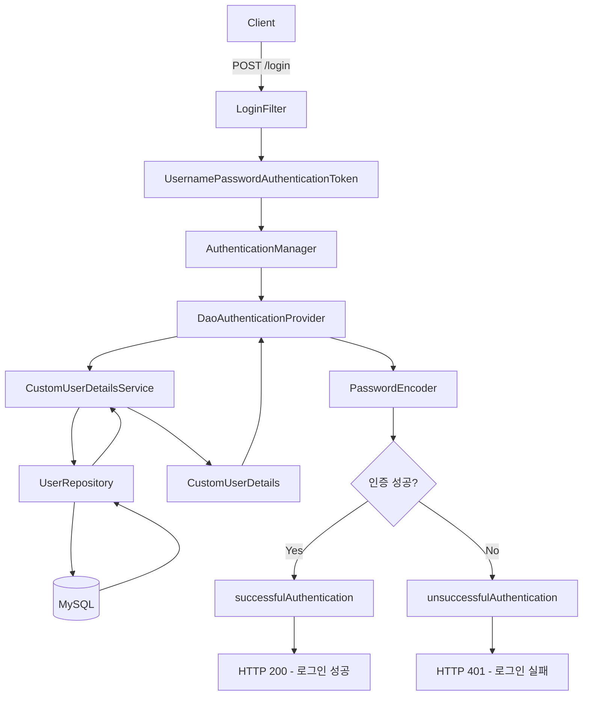
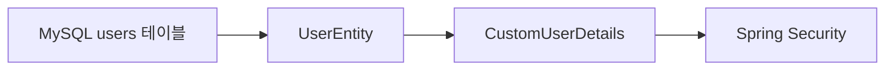
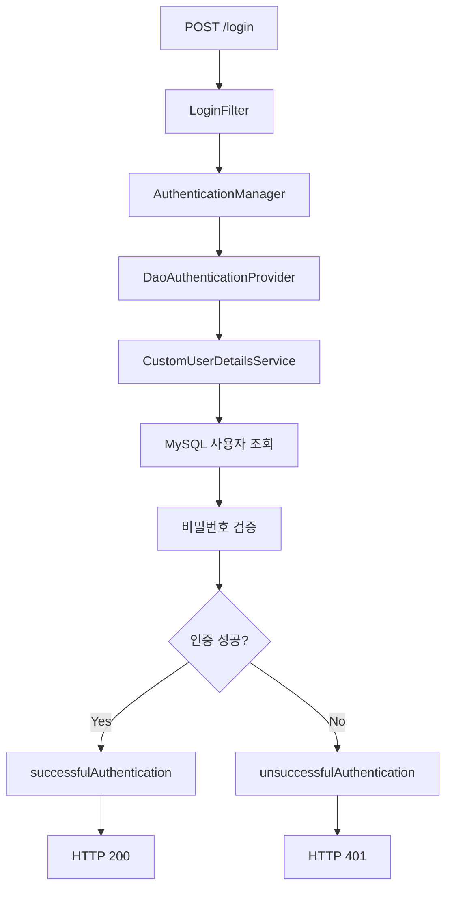
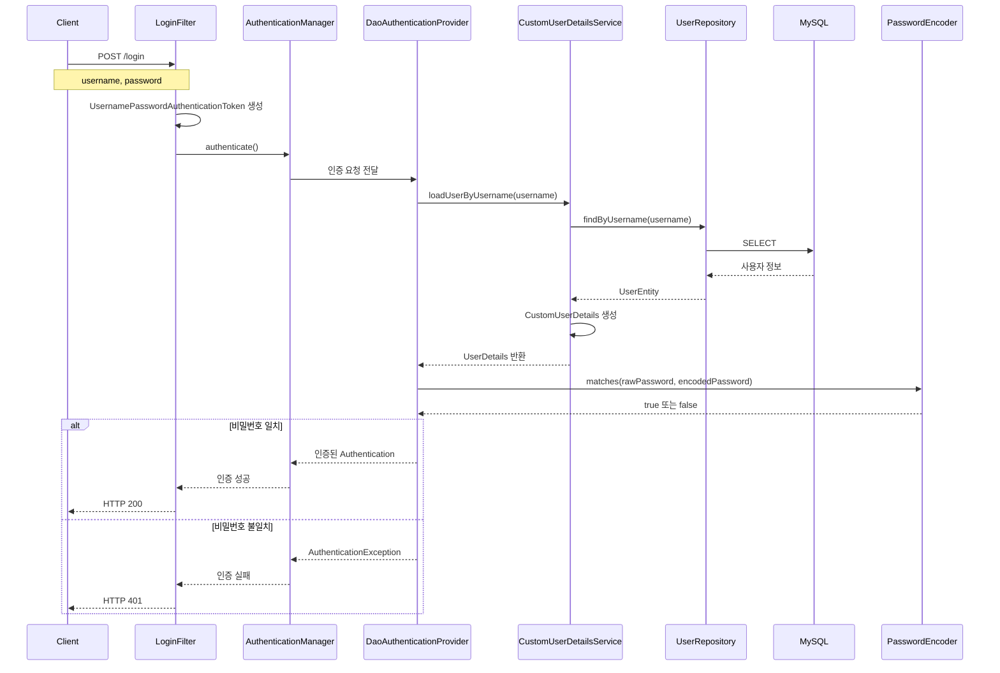
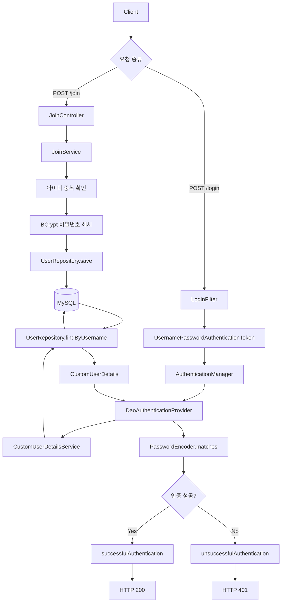

# 스프링 시큐리티 JWT - 8. DB기반 로그인 검증 로직
[https://youtu.be/q4eTHvQAvRo?si=zIENHjH9SyB8GXql](https://youtu.be/q4eTHvQAvRo?si=zIENHjH9SyB8GXql)

# 스프링 시큐리티 JWT - 8. DB기반 로그인 검증 로직
* toc
{:toc}

---

### Spring Security 6 JWT 로그인 검증 구현: UserDetailsService, UserDetails, AuthenticationManager와 MySQL 연동

Spring Security에서 JWT 기반 로그인 시스템을 구현하려면 사용자로부터 전달받은 아이디와 비밀번호를 실제 데이터베이스에 저장된 정보와 비교해야 한다.

앞서 회원가입 기능을 구현하면서 사용자의 아이디와 비밀번호를 MySQL에 저장하는 구조를 구성했다.

또한 `UsernamePasswordAuthenticationFilter`를 상속한 `LoginFilter`를 생성하여 로그인 요청에서 사용자 정보를 추출하고 `AuthenticationManager`에 인증을 요청하도록 구현했다.

현재까지의 로그인 처리 흐름은 다음과 같다.

```text
POST /login
    ↓
LoginFilter
    ↓
username / password 추출
    ↓
UsernamePasswordAuthenticationToken 생성
    ↓
AuthenticationManager.authenticate()
```

하지만 여기까지 구현했다고 실제 로그인이 완료되는 것은 아니다.

`AuthenticationManager`에 인증 요청을 전달했더라도 데이터베이스에 저장된 사용자 정보를 조회하고, 비밀번호를 검증하는 구성요소가 필요하기 때문이다.

이번에는 이 부분을 구현한다.

핵심 구성요소는 다음과 같다.

* `UserRepository`: MySQL에서 사용자 조회
* `UserDetailsService`: Spring Security에 사용자 정보 제공
* `UserDetails`: 조회한 사용자 정보를 Spring Security의 인증 객체 형태로 표현
* `DaoAuthenticationProvider`: 사용자 조회 및 비밀번호 검증 수행
* `PasswordEncoder`: 입력한 비밀번호와 저장된 BCrypt 해시 비교

전체적인 동작 구조는 다음과 같다.



이러한 구조에서 중요한 점은 **사용자 조회와 비밀번호 검증이 서로 다른 책임으로 분리되어 있다는 사실**이다.

`UserDetailsService`는 사용자 정보를 조회한다.

`UserDetails`는 조회한 사용자 정보를 Spring Security가 이해할 수 있는 형태로 제공한다.

그리고 `DaoAuthenticationProvider`는 해당 정보를 이용해 실제 인증을 수행한다.

이번에는 Spring Boot 3.2.1과 Spring Security 6.2.1을 기준으로 이러한 구조를 직접 구현하고 동작 원리를 살펴본다.

---

### 개념

#### Spring Security에서 로그인 인증은 어떻게 이루어질까?

로그인은 단순히 사용자 이름과 비밀번호를 조회하는 작업이 아니다.

서버가 전달받은 인증 정보가 실제 사용자의 정보와 일치하는지 검증하는 과정이다.

예를 들어 클라이언트가 다음 요청을 보냈다고 생각해보자.

```http
POST /login HTTP/1.1
Host: localhost:8080
Content-Type: application/x-www-form-urlencoded

username=user01&password=password123%21
```

서버는 다음 작업을 수행해야 한다.

1. 클라이언트가 전달한 사용자 이름을 확인한다.
2. 데이터베이스에서 해당 사용자를 조회한다.
3. 조회한 사용자의 비밀번호 해시를 가져온다.
4. 입력받은 비밀번호와 저장된 해시를 비교한다.
5. 사용자 계정이 유효한 상태인지 확인한다.
6. 인증에 성공하면 사용자의 권한을 포함한 인증 결과를 생성한다.

이 과정을 Spring Security에서는 여러 구성요소가 나누어 처리한다.

| 구성요소                                  | 책임           |
| ------------------------------------- | ------------ |
| `LoginFilter`                         | 로그인 요청 처리    |
| `UsernamePasswordAuthenticationToken` | 인증 요청 정보 전달  |
| `AuthenticationManager`               | 인증 처리 요청     |
| `AuthenticationProvider`              | 실제 인증 처리     |
| `UserDetailsService`                  | 사용자 정보 조회    |
| `UserDetails`                         | 사용자 인증 정보 제공 |
| `PasswordEncoder`                     | 비밀번호 검증      |

여기서 각 구성요소가 어떤 책임을 수행하는지 구분하는 것이 중요하다.

특히 다음 두 가지는 서로 다르다.

**사용자 정보 조회**

```text
username = user01
    ↓
MySQL 조회
    ↓
UserEntity 반환
```

**사용자 인증**

```text
입력한 비밀번호
    ↓
저장된 비밀번호 해시
    ↓
PasswordEncoder.matches()
    ↓
인증 성공 또는 실패
```

사용자를 조회하는 것만으로 인증이 완료되는 것은 아니다.

조회한 사용자 정보를 이용해 비밀번호와 계정 상태를 검증해야 한다.

---

### UserDetailsService란?

`UserDetailsService`는 Spring Security에서 사용자 정보를 조회하기 위한 인터페이스다.

대표적인 메서드는 다음과 같다.

```java
UserDetails loadUserByUsername(String username)
        throws UsernameNotFoundException;
```

이 메서드는 사용자 이름을 전달받아 해당 사용자의 인증 정보를 반환한다.

예를 들어 다음과 같이 호출할 수 있다.

```java
userDetailsService.loadUserByUsername("user01");
```

이 메서드의 역할은 데이터베이스에서 사용자를 조회하고 `UserDetails`를 반환하는 것이다.

```text
loadUserByUsername("user01")
    ↓
UserRepository.findByUsername("user01")
    ↓
MySQL
    ↓
UserEntity
    ↓
CustomUserDetails
```

여기서 가장 중요한 사실은 **`UserDetailsService`가 비밀번호를 직접 비교하는 인터페이스는 아니라는 점**이다.

Spring Security의 일반적인 아이디·비밀번호 인증에서는 `DaoAuthenticationProvider`가 `UserDetailsService`를 호출하여 사용자 정보를 가져오고, `PasswordEncoder`로 비밀번호를 검증한다.

따라서 다음과 같은 역할을 구분할 수 있다.

| 구성요소                      | 주요 메서드                 | 역할             |
| ------------------------- | ---------------------- | -------------- |
| UserDetailsService        | `loadUserByUsername()` | 사용자 정보 조회      |
| UserDetails               | `getPassword()`        | 저장된 비밀번호 해시 제공 |
| PasswordEncoder           | `matches()`            | 비밀번호 일치 여부 검증  |
| DaoAuthenticationProvider | `authenticate()`       | 전체 인증 수행       |

이러한 구조를 이해하면 사용자 조회 로직과 인증 로직을 불필요하게 중복 작성하지 않을 수 있다.

---

### UserDetails란?

`UserDetails`는 Spring Security가 인증 과정에서 사용하는 사용자 정보 인터페이스다.

일반적인 JPA Entity는 애플리케이션의 데이터베이스 구조를 표현한다.

반면 `UserDetails`는 Spring Security가 사용자 인증에 필요한 정보를 확인할 수 있도록 정의된 인터페이스다.

예를 들어 MySQL에 다음과 같은 사용자 정보가 저장되어 있다고 생각해보자.

| id | username | password  | role       |
| -: | -------- | --------- | ---------- |
|  1 | user01   | BCrypt 해시 | ROLE_USER  |
|  2 | admin01  | BCrypt 해시 | ROLE_ADMIN |

이 데이터는 JPA에서 `UserEntity`로 표현할 수 있다.

하지만 Spring Security가 일반적인 `UserEntity`의 필드 구조를 자동으로 이해하는 것은 아니다.

Spring Security는 사용자 이름, 비밀번호, 권한, 계정 상태 등을 일정한 인터페이스를 통해 확인한다.

이 역할을 담당하는 것이 `UserDetails`다.



`UserDetails`에서는 대표적으로 다음 정보를 제공한다.

| 메서드                         | 역할          |
| --------------------------- | ----------- |
| `getUsername()`             | 사용자 이름 반환   |
| `getPassword()`             | 비밀번호 해시 반환  |
| `getAuthorities()`          | 사용자 권한 반환   |
| `isAccountNonExpired()`     | 계정 만료 여부    |
| `isAccountNonLocked()`      | 계정 잠금 여부    |
| `isCredentialsNonExpired()` | 인증 정보 만료 여부 |
| `isEnabled()`               | 계정 활성화 여부   |

이러한 정보를 Spring Security에 제공하면 인증 과정에서 사용할 수 있다.

---

### 왜 UserEntity를 그대로 반환하지 않을까?

현재 프로젝트에서는 `UserEntity`를 사용하고 있다.

```java
@Entity
@Table(name = "users")
public class UserEntity {

    @Id
    @GeneratedValue(strategy = GenerationType.IDENTITY)
    private Integer id;

    private String username;

    private String password;

    private String role;
}
```

이 클래스는 데이터베이스의 사용자 테이블과 매핑된다.

반면 Spring Security의 인증 시스템은 다음과 같은 인터페이스를 이용한다.

```java
public interface UserDetails extends Serializable {
    // 사용자 인증 정보 제공 메서드
}
```

따라서 데이터베이스에서 조회한 `UserEntity`를 Spring Security가 사용할 수 있도록 변환해야 한다.

대표적인 방법은 두 가지다.

**첫 번째 방법은 UserEntity가 UserDetails를 직접 구현하는 것이다.**

```text
UserEntity
    ↓
implements UserDetails
```

이 방법은 구조가 단순하다는 장점이 있다.

하지만 데이터베이스 엔티티가 Spring Security 인터페이스에 직접 의존하게 된다.

**두 번째 방법은 별도의 CustomUserDetails 클래스를 만드는 것이다.**

```text
UserEntity
    ↓
CustomUserDetails
    ↓
UserDetails
```

이 방법은 데이터베이스 엔티티와 Spring Security 인증 객체를 분리할 수 있다는 장점이 있다.

이번에는 두 번째 방법을 사용한다.

---

### 프로젝트 구조

기존에 구성한 Spring Boot 프로젝트는 다음과 같다.

```text
src/main/java/com/example/jwt
│
├── JwtApplication.java
│
├── config
│   └── SecurityConfig.java
│
├── controller
│   ├── MainController.java
│   ├── AdminController.java
│   └── JoinController.java
│
├── dto
│   └── JoinDTO.java
│
├── entity
│   └── UserEntity.java
│
├── repository
│   └── UserRepository.java
│
├── service
│   └── JoinService.java
│
└── jwt
    └── LoginFilter.java
```

이번에 추가할 클래스는 두 가지다.

```text
CustomUserDetailsService.java

CustomUserDetails.java
```

각 클래스의 책임은 다음과 같다.

| 클래스                      | 역할                                 |
| ------------------------ | ---------------------------------- |
| CustomUserDetailsService | DB에서 사용자 조회                        |
| CustomUserDetails        | 사용자 정보를 Spring Security 인증 형식으로 제공 |

구현 후에는 다음과 같은 구조가 된다.

```text
src/main/java/com/example/jwt
│
├── JwtApplication.java
│
├── config
│   └── SecurityConfig.java
│
├── controller
│   ├── MainController.java
│   ├── AdminController.java
│   └── JoinController.java
│
├── dto
│   ├── JoinDTO.java
│   └── CustomUserDetails.java
│
├── entity
│   └── UserEntity.java
│
├── repository
│   └── UserRepository.java
│
├── service
│   ├── JoinService.java
│   └── CustomUserDetailsService.java
│
└── jwt
    └── LoginFilter.java
```

이제 실제 코드를 작성해보자.

---

### UserRepository에 회원 조회 메서드 추가하기

가장 먼저 데이터베이스에서 사용자 정보를 조회할 메서드가 필요하다.

기존에 작성한 `UserRepository`는 다음과 같다.

```java
package com.example.jwt.repository;

import com.example.jwt.entity.UserEntity;

import org.springframework.data.jpa.repository.JpaRepository;

import java.util.Optional;

public interface UserRepository
        extends JpaRepository<UserEntity, Integer> {

    Optional<UserEntity> findByUsername(String username);

    boolean existsByUsername(String username);
}
```

이번에 사용할 메서드는 다음과 같다.

```java
Optional<UserEntity> findByUsername(String username);
```

이 메서드는 사용자 이름을 기준으로 회원 정보를 조회한다.

Spring Data JPA에서는 메서드 이름을 분석하여 쿼리를 생성하는 기능을 제공한다.

예를 들어 다음 메서드를 호출한다.

```java
userRepository.findByUsername("user01");
```

그러면 개념적으로 다음과 같은 SQL이 실행된다.

```sql
SELECT
    id,
    username,
    password,
    role
FROM users
WHERE username = ?;
```

실제 Hibernate가 생성하는 SQL은 엔티티 매핑과 버전에 따라 달라질 수 있다.

이 메서드의 반환값은 다음과 같다.

| 상황     | 결과                        |
| ------ | ------------------------- |
| 사용자 존재 | `Optional.of(UserEntity)` |
| 사용자 없음 | `Optional.empty()`        |

`findByUsername()`을 `UserEntity` 타입으로 직접 반환하는 구현도 가능하다.

하지만 기존 프로젝트에서는 `Optional<UserEntity>`를 사용했으므로 동일한 형태를 유지한다.

사용자가 존재하지 않는 상황을 명시적으로 처리할 수 있다는 장점도 있다.

#### existsByUsername과 findByUsername의 차이

회원가입에서는 다음 메서드를 사용했다.

```java
boolean existsByUsername(String username);
```

이 메서드는 사용자의 존재 여부만 확인한다.

반면 로그인에서는 다음 메서드를 사용한다.

```java
Optional<UserEntity> findByUsername(String username);
```

로그인 과정에서는 비밀번호 해시와 사용자 권한 등 실제 사용자 정보가 필요하기 때문이다.

| 메서드                  | 목적           |
| -------------------- | ------------ |
| `existsByUsername()` | 사용자 존재 여부 확인 |
| `findByUsername()`   | 사용자 정보 조회    |

이제 Repository를 이용해 사용자 정보를 조회할 Service를 작성한다.

---

### CustomUserDetailsService 구현

`CustomUserDetailsService`는 Spring Security의 `UserDetailsService` 인터페이스를 구현하는 클래스다.

먼저 `service` 패키지에 다음 클래스를 생성한다.

```text
com.example.jwt.service.CustomUserDetailsService
```

기본 구조는 다음과 같다.

```java
@Service
public class CustomUserDetailsService
        implements UserDetailsService {

}
```

이 상태에서는 `UserDetailsService`의 메서드를 구현해야 한다.

해당 메서드는 다음과 같다.

```java
@Override
public UserDetails loadUserByUsername(String username)
        throws UsernameNotFoundException {

    // 사용자 조회
}
```

이 메서드를 구현하면 Spring Security는 사용자 이름을 이용해 회원 정보를 조회할 수 있다.

#### @Service

```java
@Service
```

해당 클래스를 Spring의 Service Bean으로 등록한다.

Spring Security에서 `UserDetailsService`를 사용하려면 구현 객체가 인증 구성에 연결되어야 한다.

이번에는 `@Service`를 이용해 Spring 컨테이너에서 관리하도록 한다.

#### implements UserDetailsService

```java
implements UserDetailsService
```

Spring Security가 정의한 사용자 조회 인터페이스를 구현한다.

이렇게 하면 해당 클래스가 사용자 인증 정보를 제공하는 역할을 담당한다는 사실을 명확하게 표현할 수 있다.

---

### UserRepository 주입하기

사용자를 조회하려면 `UserRepository`가 필요하다.

따라서 생성자 주입으로 Repository를 전달받는다.

```java
private final UserRepository userRepository;

public CustomUserDetailsService(
        UserRepository userRepository
) {

    this.userRepository = userRepository;
}
```

생성자 주입을 사용하면 필요한 의존성이 명확해진다.

또한 테스트에서 Repository를 Mock 객체로 대체할 수 있어 단위 테스트를 작성하기 쉽다.

이제 다음 메서드를 이용해 사용자를 조회할 수 있다.

```java
userRepository.findByUsername(username);
```

---

### loadUserByUsername 구현하기

이제 실제 사용자 조회 로직을 작성한다.

```java
@Override
public UserDetails loadUserByUsername(String username)
        throws UsernameNotFoundException {

    UserEntity userEntity = userRepository
            .findByUsername(username)
            .orElseThrow(() ->
                    new UsernameNotFoundException(
                            "사용자를 찾을 수 없습니다."
                    )
            );

    return new CustomUserDetails(userEntity);
}
```

코드의 처리 순서는 다음과 같다.

```text
loadUserByUsername(username)
    ↓
UserRepository.findByUsername(username)
    ↓
MySQL 조회
    ↓
사용자 존재 여부 확인
    ↓
CustomUserDetails 생성
    ↓
UserDetails 반환
```

여기서 중요한 부분은 다음 코드다.

```java
.orElseThrow(() ->
        new UsernameNotFoundException(
                "사용자를 찾을 수 없습니다."
        )
);
```

데이터베이스에 해당 사용자가 존재하지 않으면 `UsernameNotFoundException`을 발생시킨다.

이 예외는 Spring Security에서 사용자를 찾지 못했을 때 사용하는 인증 관련 예외다.

#### 사용자 정보가 없으면 null을 반환해도 될까?

`UserDetailsService`의 계약상 `loadUserByUsername()`은 사용자 정보가 없을 때 `null`을 반환해서는 안 된다.

사용자가 존재하지 않으면 `UsernameNotFoundException`을 발생시켜야 한다.

```java
// 권장하지 않는 구현
@Override
public UserDetails loadUserByUsername(String username) {

    return null;
}
```

이러한 코드는 인증 처리 과정에서 예상하지 못한 오류를 발생시킬 수 있다.

따라서 다음과 같이 구현하는 것이 적절하다.

```java
@Override
public UserDetails loadUserByUsername(String username)
        throws UsernameNotFoundException {

    return userRepository
            .findByUsername(username)
            .map(CustomUserDetails::new)
            .orElseThrow(() ->
                    new UsernameNotFoundException(
                            "사용자를 찾을 수 없습니다."
                    )
            );
}
```

이 코드 역시 동일하게 동작한다.

---

### CustomUserDetailsService 전체 코드

이제 지금까지의 내용을 하나의 클래스로 정리해보자.

```java
package com.example.jwt.service;

import com.example.jwt.dto.CustomUserDetails;
import com.example.jwt.entity.UserEntity;
import com.example.jwt.repository.UserRepository;

import org.springframework.security.core.userdetails.UserDetails;
import org.springframework.security.core.userdetails.UserDetailsService;
import org.springframework.security.core.userdetails.UsernameNotFoundException;

import org.springframework.stereotype.Service;
import org.springframework.transaction.annotation.Transactional;

@Service
public class CustomUserDetailsService
        implements UserDetailsService {

    private final UserRepository userRepository;

    public CustomUserDetailsService(
            UserRepository userRepository
    ) {

        this.userRepository = userRepository;
    }

    @Override
    @Transactional(readOnly = true)
    public UserDetails loadUserByUsername(String username)
            throws UsernameNotFoundException {

        // 1. 사용자 이름으로 회원 조회
        UserEntity userEntity = userRepository
                .findByUsername(username)
                .orElseThrow(() ->
                        new UsernameNotFoundException(
                                "사용자를 찾을 수 없습니다."
                        )
                );

        // 2. UserEntity를 UserDetails로 변환
        return new CustomUserDetails(userEntity);
    }
}
```

이 코드에서 `@Transactional(readOnly = true)`는 조회 전용 트랜잭션을 명시하기 위해 추가했다.

```java
@Transactional(readOnly = true)
```

조회 전용 트랜잭션은 데이터 접근 의도를 표현하고, JPA 구현체에 따라 불필요한 변경 감지나 Flush 작업을 줄이는 데 도움이 될 수 있다.

다만 이 설정이 모든 데이터베이스 쓰기 작업을 물리적으로 차단한다고 보장하는 것은 아니다.

또한 단순한 사용자 조회 메서드에 반드시 선언해야 하는 것은 아니다.

이제 `CustomUserDetailsService`가 반환할 `CustomUserDetails` 클래스를 구현해보자.

---

### CustomUserDetails 구현

`CustomUserDetails`는 `UserDetails` 인터페이스를 구현하는 클래스다.

먼저 `dto` 패키지에 다음 클래스를 생성한다.

```text
com.example.jwt.dto.CustomUserDetails
```

기본 구조는 다음과 같다.

```java
public class CustomUserDetails
        implements UserDetails {

}
```

이 인터페이스를 구현하면 사용자 이름, 비밀번호, 권한, 계정 상태 등을 제공해야 한다.

#### UserEntity를 전달받는 생성자

`CustomUserDetails`는 데이터베이스에서 조회한 `UserEntity`를 전달받는다.

```java
private final UserEntity userEntity;

public CustomUserDetails(UserEntity userEntity) {

    this.userEntity = userEntity;
}
```

이제 `userEntity`를 이용해 필요한 인증 정보를 반환할 수 있다.

```text
UserEntity
    ├── id
    ├── username
    ├── password
    └── role
        ↓
CustomUserDetails
```

각 메서드를 순서대로 구현해보자.

---

### getAuthorities() 구현

`getAuthorities()`는 사용자에게 부여된 권한을 반환하는 메서드다.

Spring Security는 사용자의 권한을 `GrantedAuthority` 인터페이스로 표현한다.

예를 들어 데이터베이스에 다음 값이 저장되어 있다고 생각해보자.

```text
role = ROLE_USER
```

이 값을 Spring Security가 사용할 수 있는 권한 객체로 변환해야 한다.

대표적으로 `SimpleGrantedAuthority`를 사용할 수 있다.

```java
new SimpleGrantedAuthority("ROLE_USER");
```

`SimpleGrantedAuthority`는 문자열 기반 권한 정보를 표현하는 구현체다.

이제 `getAuthorities()`를 작성해보자.

```java
@Override
public Collection<? extends GrantedAuthority> getAuthorities() {

    return List.of(
            new SimpleGrantedAuthority(
                    userEntity.getRole()
            )
    );
}
```

여기서 `List.of()`는 Java 9부터 제공되는 불변 리스트 생성 메서드다.

이번 프로젝트는 Java 17을 사용하므로 사용할 수 있다.

#### 내부 동작

예를 들어 사용자의 권한이 다음과 같다고 생각해보자.

```text
ROLE_ADMIN
```

그러면 다음 코드가 실행된다.

```java
new SimpleGrantedAuthority(
        userEntity.getRole()
);
```

결과적으로 `ROLE_ADMIN`이라는 권한 정보를 가진 객체가 생성된다.

```text
UserEntity.role
    ↓
ROLE_ADMIN
    ↓
SimpleGrantedAuthority
    ↓
Collection<GrantedAuthority>
    ↓
Spring Security
```

이후 Spring Security는 이 권한을 이용해 URL별 접근 권한을 판단할 수 있다.

예를 들어 `SecurityConfig`에 다음 설정이 존재한다고 생각해보자.

```java
.requestMatchers("/admin", "/admin/**")
.hasRole("ADMIN")
```

기본 설정에서 `hasRole("ADMIN")`은 `ROLE_ADMIN` 권한을 확인한다.

따라서 `getAuthorities()`에서 반환한 권한 정보가 올바르게 구성되어 있어야 한다.

#### getAuthorities()가 null을 반환하면 안 되는 이유

권한이 없는 사용자라고 해서 `null`을 반환하는 것은 적절하지 않다.

권한이 없다면 빈 컬렉션을 반환해야 한다.

```java
return List.of();
```

`UserDetails`의 `getAuthorities()`는 `null`이 아닌 권한 컬렉션을 반환해야 한다는 계약을 가진다.

현재 프로젝트는 사용자마다 하나의 역할을 저장하므로 해당 역할을 리스트에 담아 반환한다.

실제 서비스에서 하나의 사용자가 여러 권한을 가질 수 있다면 별도의 권한 테이블이나 다중 권한 구조를 고려할 수 있다.

---

### getPassword() 구현

다음으로 `getPassword()`를 구현한다.

```java
@Override
public String getPassword() {

    return userEntity.getPassword();
}
```

이 메서드는 데이터베이스에 저장된 비밀번호 해시를 반환한다.

예를 들어 다음과 같은 값이다.

```text
$2a$10$...
```

여기서 중요한 점이 있다.

**`getPassword()`가 반환하는 값은 비밀번호 원문이 아니라 BCrypt로 해시된 비밀번호여야 한다.**

회원가입에서는 다음과 같이 저장했다.

```java
userEntity.setPassword(
        passwordEncoder.encode(password)
);
```

따라서 데이터베이스에는 해시된 비밀번호가 존재한다.

로그인 과정에서는 사용자가 입력한 비밀번호와 이 해시를 비교한다.

```text
사용자가 입력한 비밀번호
    ↓
password123!
```

```text
DB에 저장된 비밀번호
    ↓
BCrypt Hash
```

비교는 일반적으로 `DaoAuthenticationProvider`가 사용하는 `PasswordEncoder`를 통해 수행된다.

```java
passwordEncoder.matches(
        rawPassword,
        encodedPassword
);
```

즉 `CustomUserDetails`에서 직접 비밀번호를 비교할 필요는 없다.

해시된 비밀번호를 올바르게 반환하면 된다.

---

### getUsername() 구현

다음으로 사용자 이름을 반환하는 메서드를 구현한다.

```java
@Override
public String getUsername() {

    return userEntity.getUsername();
}
```

이 메서드는 로그인에 사용하는 사용자 이름을 반환한다.

예를 들어 다음과 같다.

```text
user01
```

이 값은 Spring Security가 현재 사용자를 식별하는 데 사용될 수 있다.

일반적인 인증 성공 후에는 다음 코드로 사용자 이름을 확인할 수 있다.

```java
authentication.getName();
```

또는 Principal이 `CustomUserDetails`인 경우 다음과 같이 조회할 수 있다.

```java
CustomUserDetails userDetails =
        (CustomUserDetails) authentication.getPrincipal();

String username = userDetails.getUsername();
```

다만 실제 `Authentication`의 Principal 타입은 인증 방식과 AuthenticationProvider 설정에 따라 달라질 수 있으므로 무조건 `CustomUserDetails`라고 가정해서는 안 된다.

이번에는 우리가 구현한 사용자 이름·비밀번호 인증 구조에서 사용되는 형태를 기준으로 설명한다.

---

### isAccountNonExpired() 구현

다음 메서드를 살펴보자.

```java
@Override
public boolean isAccountNonExpired() {

    return true;
}
```

이 메서드는 사용자 계정이 만료되지 않았는지 확인하는 데 사용된다.

메서드 이름을 주의해서 살펴봐야 한다.

```text
isAccountNonExpired
```

`NonExpired`는 만료되지 않았다는 의미다.

따라서 다음과 같이 해석해야 한다.

| 반환값   | 의미          |
| ----- | ----------- |
| true  | 계정이 만료되지 않음 |
| false | 계정이 만료됨     |

현재 프로젝트에서는 계정 만료 기능을 구현하지 않는다.

따라서 `true`를 반환한다.

하지만 실제 서비스에서는 계정 만료일이 존재할 수 있다.

예를 들어 임시 계정이나 특정 기간만 사용할 수 있는 계정이다.

이런 경우 계정 만료 상태를 데이터베이스에서 관리하도록 확장할 수 있다.

---

### isAccountNonLocked() 구현

다음 메서드는 계정 잠금 상태를 나타낸다.

```java
@Override
public boolean isAccountNonLocked() {

    return true;
}
```

이 메서드는 사용자 계정이 잠기지 않았는지 확인한다.

| 반환값   | 의미        |
| ----- | --------- |
| true  | 잠기지 않은 계정 |
| false | 잠긴 계정     |

예를 들어 사용자가 비밀번호를 여러 번 잘못 입력하는 상황을 생각해보자.

서비스 정책에 따라 일정 횟수 이상 로그인에 실패하면 계정을 일시적으로 잠글 수 있다.

```text
로그인 실패
    ↓
실패 횟수 증가
    ↓
잠금 기준 도달
    ↓
계정 잠금
```

이때 다음 메서드가 `false`를 반환하도록 구성할 수 있다.

```java
@Override
public boolean isAccountNonLocked() {

    return false;
}
```

Spring Security의 인증 과정에서는 잠긴 계정에 대해 인증을 거부할 수 있다.

현재 프로젝트에는 계정 잠금 기능이 없으므로 `true`를 반환한다.

---

### isCredentialsNonExpired() 구현

다음 메서드는 인증 정보의 만료 여부를 나타낸다.

```java
@Override
public boolean isCredentialsNonExpired() {

    return true;
}
```

여기서 Credentials는 일반적으로 비밀번호와 같은 인증 정보를 의미한다.

따라서 이 메서드는 비밀번호 등의 인증 정보가 만료되지 않았는지 확인한다.

| 반환값   | 의미         |
| ----- | ---------- |
| true  | 인증 정보가 유효함 |
| false | 인증 정보가 만료됨 |

예를 들어 보안 정책에 따라 특정 기간이 지나면 비밀번호 변경을 요구하는 시스템을 생각해볼 수 있다.

비밀번호 변경이 필요한 상태라면 해당 값을 이용해 인증을 제한하도록 구성할 수 있다.

다만 현재 프로젝트는 비밀번호 만료 정책을 구현하지 않는다.

따라서 `true`를 반환한다.

---

### isEnabled() 구현

마지막으로 계정 활성화 여부를 반환하는 메서드다.

```java
@Override
public boolean isEnabled() {

    return true;
}
```

이 메서드는 사용자 계정이 활성화된 상태인지 확인한다.

| 반환값   | 의미       |
| ----- | -------- |
| true  | 활성화된 계정  |
| false | 비활성화된 계정 |

예를 들어 다음과 같은 상황에서 사용할 수 있다.

* 사용자가 회원가입했지만 이메일 인증을 완료하지 않은 경우
* 관리자가 계정을 비활성화한 경우
* 서비스 정책에 따라 계정이 정지된 경우
* 사용자가 회원 탈퇴를 신청한 경우

이러한 기능을 구현하려면 사용자 엔티티에 계정 상태 정보를 추가할 수 있다.

```java
private boolean enabled;
```

이후 다음처럼 반환하도록 구성할 수 있다.

```java
@Override
public boolean isEnabled() {

    return userEntity.isEnabled();
}
```

하지만 현재 프로젝트에는 이러한 필드가 없다.

따라서 기본적인 로그인 인증 구현을 위해 `true`를 반환한다.

#### 네 가지 상태 메서드 정리

| 메서드                       | true     | false    |
| ------------------------- | -------- | -------- |
| isAccountNonExpired()     | 계정 유효    | 계정 만료    |
| isAccountNonLocked()      | 잠금 해제    | 계정 잠금    |
| isCredentialsNonExpired() | 인증 정보 유효 | 인증 정보 만료 |
| isEnabled()               | 계정 활성화   | 계정 비활성화  |

현재 프로젝트에서는 네 메서드 모두 `true`를 반환한다.

하지만 이는 모든 사용자 계정이 항상 유효하다는 정책을 적용한 것과 같다.

따라서 실제 서비스에 적용하려면 계정 상태를 관리할 데이터와 정책을 별도로 구현해야 한다.

Spring Security 6.2.1의 `UserDetails`에서도 이러한 계정 상태 정보를 인증에 활용할 수 있도록 인터페이스가 정의되어 있다.

---

### CustomUserDetails 전체 코드

이제 각 메서드를 하나의 클래스로 정리해보자.

```java
package com.example.jwt.dto;

import com.example.jwt.entity.UserEntity;

import org.springframework.security.core.GrantedAuthority;
import org.springframework.security.core.authority.SimpleGrantedAuthority;
import org.springframework.security.core.userdetails.UserDetails;

import java.util.Collection;
import java.util.List;

public class CustomUserDetails implements UserDetails {

    private static final long serialVersionUID = 1L;

    private final UserEntity userEntity;

    public CustomUserDetails(UserEntity userEntity) {

        this.userEntity = userEntity;
    }

    // 사용자 권한 반환
    @Override
    public Collection<? extends GrantedAuthority> getAuthorities() {

        return List.of(
                new SimpleGrantedAuthority(
                        userEntity.getRole()
                )
        );
    }

    // 저장된 비밀번호 해시 반환
    @Override
    public String getPassword() {

        return userEntity.getPassword();
    }

    // 사용자 이름 반환
    @Override
    public String getUsername() {

        return userEntity.getUsername();
    }

    // 계정 만료 여부
    @Override
    public boolean isAccountNonExpired() {

        return true;
    }

    // 계정 잠금 여부
    @Override
    public boolean isAccountNonLocked() {

        return true;
    }

    // 비밀번호 등 인증 정보 만료 여부
    @Override
    public boolean isCredentialsNonExpired() {

        return true;
    }

    // 계정 활성화 여부
    @Override
    public boolean isEnabled() {

        return true;
    }
}
```

이 코드의 핵심은 `UserEntity`가 가진 데이터를 Spring Security가 요구하는 메서드로 제공한다는 것이다.

```text
UserEntity
    │
    ├── username
    │     ↓
    │   getUsername()
    │
    ├── password
    │     ↓
    │   getPassword()
    │
    └── role
          ↓
        getAuthorities()
```

이렇게 하면 Spring Security는 데이터베이스에서 조회한 사용자 정보를 이용해 인증과 인가를 수행할 수 있다.

---

### UserDetailsService와 UserDetails의 관계

두 인터페이스의 이름이 비슷해 혼동하기 쉽지만, 역할은 명확하게 다르다.

#### UserDetailsService

사용자 정보를 조회하는 역할을 담당한다.

```java
loadUserByUsername(String username)
```

#### UserDetails

조회한 사용자의 인증 정보를 제공한다.

```java
getUsername()
getPassword()
getAuthorities()
```

두 구성요소의 관계는 다음과 같다.

```mermaid
sequenceDiagram
    participant Provider as DaoAuthenticationProvider
    participant Service as CustomUserDetailsService
    participant Repository as UserRepository
    participant DB as MySQL
    participant Details as CustomUserDetails

    Provider->>Service: loadUserByUsername(username)

    Service->>Repository: findByUsername(username)

    Repository->>DB: SELECT

    DB-->>Repository: 사용자 정보
    Repository-->>Service: UserEntity

    Service->>Details: new CustomUserDetails(userEntity)

    Details-->>Service: UserDetails

    Service-->>Provider: UserDetails 반환

    Provider->>Details: getPassword()
    Details-->>Provider: BCrypt Hash

    Provider->>Details: getAuthorities()
    Details-->>Provider: ROLE_USER
```

여기서 `UserDetailsService`는 사용자 정보를 반환한다.

`UserDetails`는 사용자 인증에 필요한 데이터를 제공한다.

그리고 `DaoAuthenticationProvider`는 이 정보를 이용해 실제 인증을 수행한다.

---

### 실제 비밀번호 검증은 어디에서 이루어질까?

이번 구현에서 가장 중요한 부분이다.

앞에서 작성한 `CustomUserDetailsService`를 보면 다음과 같다.

```java
@Override
public UserDetails loadUserByUsername(String username)
        throws UsernameNotFoundException {

    UserEntity userEntity = userRepository
            .findByUsername(username)
            .orElseThrow(() ->
                    new UsernameNotFoundException(
                            "사용자를 찾을 수 없습니다."
                    )
            );

    return new CustomUserDetails(userEntity);
}
```

이 코드에는 비밀번호를 비교하는 로직이 없다.

그런데 실제 로그인에서는 비밀번호 검증이 수행된다.

어떻게 가능한 것일까?

Spring Security의 `DaoAuthenticationProvider`가 이 작업을 담당하기 때문이다.

일반적인 인증 흐름은 다음과 같다.

```text
LoginFilter
    ↓
AuthenticationManager
    ↓
DaoAuthenticationProvider
    ↓
CustomUserDetailsService
    ↓
UserRepository
    ↓
MySQL
    ↓
CustomUserDetails
    ↓
DaoAuthenticationProvider
    ↓
PasswordEncoder.matches()
```

예를 들어 사용자가 다음 정보를 전달했다고 생각해보자.

```text
username = user01

password = password123!
```

MySQL에는 다음과 같은 값이 저장되어 있다.

```text
username = user01

password = $2a$10$...
```

`DaoAuthenticationProvider`는 사용자가 입력한 비밀번호와 저장된 해시를 비교한다.

개념적으로 다음과 같은 작업이 수행된다.

```java
boolean matched = passwordEncoder.matches(
        rawPassword,
        encodedPassword
);
```

이때 `rawPassword`는 사용자가 로그인 요청에서 전달한 비밀번호다.

`encodedPassword`는 `CustomUserDetails.getPassword()`가 반환한 해시다.

비밀번호가 일치하면 인증 과정이 계속 진행된다.

반대로 일치하지 않으면 인증에 실패한다.

#### 회원가입과 로그인에서 BCrypt를 사용하는 방식

회원가입에서는 다음 메서드를 사용한다.

```java
passwordEncoder.encode(rawPassword);
```

이 메서드는 원문 비밀번호를 해시한다.

반면 로그인에서는 다음 메서드를 사용한다.

```java
passwordEncoder.matches(
        rawPassword,
        encodedPassword
);
```

이 메서드는 입력한 비밀번호와 저장된 해시가 일치하는지 확인한다.

따라서 로그인 과정에서 다음처럼 구현해서는 안 된다.

```java
String encodedInput =
        passwordEncoder.encode(rawPassword);

boolean matched =
        encodedInput.equals(savedPassword);
```

BCrypt는 Salt를 사용하므로 동일한 비밀번호를 다시 해시하더라도 다른 결과가 생성될 수 있기 때문이다.

**비밀번호 저장에는 `encode()`, 비밀번호 검증에는 `matches()`를 사용해야 한다.**

---

### DaoAuthenticationProvider의 내부 동작

이제 Spring Security가 실제로 어떤 순서로 인증하는지 조금 더 자세히 살펴보자.

#### 1. LoginFilter에서 인증 요청

```java
UsernamePasswordAuthenticationToken authenticationToken =
        UsernamePasswordAuthenticationToken.unauthenticated(
                username,
                password
        );
```

아직 인증되지 않은 객체를 생성한다.

#### 2. AuthenticationManager 호출

```java
return getAuthenticationManager().authenticate(
        authenticationToken
);
```

인증 요청 객체를 AuthenticationManager에 전달한다.

#### 3. AuthenticationProvider에 인증 위임

일반적인 구성에서는 `ProviderManager`가 적절한 `AuthenticationProvider`를 선택한다.

아이디와 비밀번호 인증에서는 `DaoAuthenticationProvider`를 사용할 수 있다.

#### 4. UserDetailsService 호출

```java
loadUserByUsername(username)
```

사용자 이름을 기준으로 회원 정보를 조회한다.

#### 5. UserDetails에서 인증 정보 확인

```java
userDetails.getPassword();
```

```java
userDetails.getAuthorities();
```

```java
userDetails.isEnabled();
```

사용자의 비밀번호 해시, 권한, 계정 상태를 확인한다.

#### 6. PasswordEncoder로 비밀번호 검증

```java
passwordEncoder.matches(
        rawPassword,
        encodedPassword
);
```

비밀번호가 일치하는지 확인한다.

#### 7. Authentication 결과 생성

인증에 성공하면 인증된 사용자 정보를 포함한 `Authentication` 객체가 반환된다.

```text
Authentication
    ├── Principal
    │     └── CustomUserDetails
    │
    ├── Credentials
    │     └── 인증 이후 제거될 수 있음
    │
    ├── Authorities
    │     └── ROLE_USER
    │
    └── Authenticated
          └── true
```

이러한 처리 구조를 이용하면 개발자가 Controller나 Service에서 비밀번호 검증 로직을 반복해서 구현할 필요가 없다.

---

### AuthenticationManager와 UserDetailsService 연결하기

앞서 `SecurityConfig`에서는 다음과 같이 AuthenticationManager를 Bean으로 등록했다.

```java
@Bean
public AuthenticationManager authenticationManager(
        AuthenticationConfiguration authenticationConfiguration
) throws Exception {

    return authenticationConfiguration.getAuthenticationManager();
}
```

`AuthenticationConfiguration`은 Spring Security의 인증 구성을 관리한다.

여기에 `UserDetailsService`와 `PasswordEncoder`가 적절하게 연결되어 있다면, Spring Security는 해당 구성요소를 이용해 아이디·비밀번호 인증을 수행할 수 있다.

현재 프로젝트에는 다음 Bean이 존재한다.

**CustomUserDetailsService**

```java
@Service
public class CustomUserDetailsService
        implements UserDetailsService {
    // ...
}
```

**PasswordEncoder**

```java
@Bean
public PasswordEncoder passwordEncoder() {

    return new BCryptPasswordEncoder();
}
```

Spring Security는 구성 조건이 충족되면 이러한 Bean을 이용해 `DaoAuthenticationProvider`를 구성할 수 있다.

다만 기존 프로젝트에 별도의 `AuthenticationProvider`나 인증 관련 설정이 존재한다면 자동 구성이 달라질 수 있다.

따라서 실제 운영 프로젝트에서는 인증 처리 구성이 의도대로 연결되었는지 확인하는 것이 중요하다.

---

### DaoAuthenticationProvider를 명시적으로 구성하는 방법

인증 처리 구조를 더 명확하게 제어하고 싶다면 `DaoAuthenticationProvider`를 직접 생성할 수도 있다.

이 방법은 추가적인 구현 선택지다.

기존 `AuthenticationConfiguration` 기반 설정이 정상적으로 동작한다면 반드시 변경해야 하는 것은 아니다.

Spring Security 6.2.1에서는 다음과 같이 구성할 수 있다.

```java
@Bean
public AuthenticationManager authenticationManager(
        CustomUserDetailsService customUserDetailsService,
        PasswordEncoder passwordEncoder
) {

    DaoAuthenticationProvider authenticationProvider =
            new DaoAuthenticationProvider();

    authenticationProvider.setUserDetailsService(
            customUserDetailsService
    );

    authenticationProvider.setPasswordEncoder(
            passwordEncoder
    );

    return new ProviderManager(authenticationProvider);
}
```

필요한 import는 다음과 같다.

```java
import com.example.jwt.service.CustomUserDetailsService;

import org.springframework.security.authentication.AuthenticationManager;
import org.springframework.security.authentication.ProviderManager;
import org.springframework.security.authentication.dao.DaoAuthenticationProvider;
import org.springframework.security.crypto.password.PasswordEncoder;
```

이 구성에서는 인증 처리에 사용할 객체를 명시적으로 지정한다.

```text
AuthenticationManager
    ↓
ProviderManager
    ↓
DaoAuthenticationProvider
    ├── CustomUserDetailsService
    └── PasswordEncoder
```

이렇게 하면 어떤 `UserDetailsService`와 어떤 `PasswordEncoder`를 사용하는지 명확하게 확인할 수 있다.

단, **기존 AuthenticationManager Bean과 이 코드를 동시에 등록해서는 안 된다.**

두 방식 중 하나를 선택해야 한다.

현재 프로젝트에서는 기존 `AuthenticationConfiguration` 기반 구성을 유지하고, 인증 설정이 의도대로 연결되지 않을 때 명시적인 Provider 구성을 검토할 수 있다.

---

### 로그인 성공과 실패 처리하기

이제 사용자 조회와 비밀번호 검증을 위한 구성요소가 준비되었다.

로그인 요청이 들어오면 AuthenticationManager는 검증을 수행한다.

검증 결과에 따라 LoginFilter의 성공 또는 실패 처리 흐름이 실행된다.



여기서 알아야 할 메서드는 두 가지다.

```java
successfulAuthentication()
```

```java
unsuccessfulAuthentication()
```

이 메서드들은 `UsernamePasswordAuthenticationFilter`의 상위 클래스인 `AbstractAuthenticationProcessingFilter`에서 제공하는 인증 결과 처리 흐름과 연결된다.

---

### successfulAuthentication() 구현

로그인에 성공하면 다음 메서드가 실행된다.

```java
@Override
protected void successfulAuthentication(
        HttpServletRequest request,
        HttpServletResponse response,
        FilterChain chain,
        Authentication authentication
) throws IOException, ServletException {

    // 로그인 성공 처리
}
```

여기서 전달받는 `Authentication`은 검증된 사용자 정보를 포함한다.

예를 들어 다음과 같이 사용자 이름을 조회할 수 있다.

```java
authentication.getName();
```

또한 권한 정보를 확인할 수 있다.

```java
authentication.getAuthorities();
```

인증에 성공했는지 확인할 수도 있다.

```java
authentication.isAuthenticated();
```

현재 단계에서는 JWT를 아직 발급하지 않으므로 로그인 인증이 성공했다는 사실만 확인한다.

로그인 성공 시에는 다음과 같은 응답을 반환할 수 있다.

```http
HTTP/1.1 200 OK
Content-Type: application/json

{
  "message": "LOGIN_SUCCESS"
}
```

다만 이 응답은 아이디·비밀번호 인증 성공만 의미한다.

**아직 JWT를 발급하지 않았으므로 이후 보호된 API에 접근할 수 있는 토큰이 제공된 것은 아니다.**

---

### unsuccessfulAuthentication() 구현

로그인에 실패하면 다음 메서드가 실행된다.

```java
@Override
protected void unsuccessfulAuthentication(
        HttpServletRequest request,
        HttpServletResponse response,
        AuthenticationException failed
) throws IOException, ServletException {

    // 로그인 실패 처리
}
```

대표적인 로그인 실패 상황은 다음과 같다.

| 상황       | 설명                               |
| -------- | -------------------------------- |
| 사용자 없음   | DB에 해당 username 없음               |
| 비밀번호 불일치 | BCrypt 검증 실패                     |
| 계정 만료    | isAccountNonExpired()가 false     |
| 계정 잠금    | isAccountNonLocked()가 false      |
| 인증 정보 만료 | isCredentialsNonExpired()가 false |
| 계정 비활성화  | isEnabled()가 false               |

일반적인 사용자 인증 실패에서는 HTTP 401 Unauthorized를 사용할 수 있다.

```http
HTTP/1.1 401 Unauthorized
Content-Type: application/json

{
  "message": "LOGIN_FAILED"
}
```

여기서 중요한 점은 인증 실패 원인을 사용자에게 지나치게 상세하게 노출하지 않는 것이다.

예를 들어 다음과 같은 메시지를 구분하여 반환하면 계정 존재 여부가 노출될 수 있다.

```text
존재하지 않는 사용자입니다.
```

```text
비밀번호가 틀렸습니다.
```

따라서 클라이언트에는 일반적인 인증 실패 메시지를 반환하고, 서버 내부에서는 필요한 수준의 원인을 구분하는 것이 좋다.

---

### LoginFilter 전체 코드

이제 로그인 검증 기능과 연결된 LoginFilter를 정리해보자.

앞에서는 JWT 발급 기능이 구현되지 않았음을 나타내기 위해 임시 응답을 사용했다.

이번에는 사용자 인증 자체가 완료되었는지 확인할 수 있도록 성공 응답을 HTTP 200으로 변경한다.

JWT 발급 로직은 아직 추가하지 않는다.

다음 코드는 Spring Security 6.2.1에서 사용할 수 있는 로그인 필터의 예시다.

```java
package com.example.jwt.jwt;

import jakarta.servlet.FilterChain;
import jakarta.servlet.ServletException;

import jakarta.servlet.http.HttpServletRequest;
import jakarta.servlet.http.HttpServletResponse;

import lombok.extern.slf4j.Slf4j;

import org.springframework.security.authentication.AuthenticationManager;
import org.springframework.security.authentication.AuthenticationServiceException;
import org.springframework.security.authentication.UsernamePasswordAuthenticationToken;

import org.springframework.security.core.Authentication;
import org.springframework.security.core.AuthenticationException;

import org.springframework.security.web.authentication.UsernamePasswordAuthenticationFilter;

import java.io.IOException;

@Slf4j
public class LoginFilter
        extends UsernamePasswordAuthenticationFilter {

    public LoginFilter(
            AuthenticationManager authenticationManager
    ) {

        super();

        // AuthenticationManager 연결
        setAuthenticationManager(authenticationManager);

        // 로그인 URL 설정
        setFilterProcessesUrl("/login");

        // 인증 성공 시 반환할 응답
        setAuthenticationSuccessHandler(
                (request, response, authentication) -> {

                    response.setStatus(
                            HttpServletResponse.SC_OK
                    );

                    response.setContentType(
                            "application/json;charset=UTF-8"
                    );

                    response.getWriter().write(
                            "{\"message\":\"LOGIN_SUCCESS\"}"
                    );
                }
        );

        // 인증 실패 시 반환할 응답
        setAuthenticationFailureHandler(
                (request, response, exception) -> {

                    response.setStatus(
                            HttpServletResponse.SC_UNAUTHORIZED
                    );

                    response.setContentType(
                            "application/json;charset=UTF-8"
                    );

                    response.getWriter().write(
                            "{\"message\":\"LOGIN_FAILED\"}"
                    );
                }
        );
    }

    @Override
    public Authentication attemptAuthentication(
            HttpServletRequest request,
            HttpServletResponse response
    ) throws AuthenticationException {

        // POST 요청 확인
        if (!"POST".equals(request.getMethod())) {

            throw new AuthenticationServiceException(
                    "Unsupported authentication method"
            );
        }

        // 1. username 추출
        String username = obtainUsername(request);

        // 2. password 추출
        String password = obtainPassword(request);

        // 3. null 처리
        username = username == null ? "" : username.trim();
        password = password == null ? "" : password;

        // 4. 인증되지 않은 Token 생성
        UsernamePasswordAuthenticationToken authenticationToken =
                UsernamePasswordAuthenticationToken.unauthenticated(
                        username,
                        password
                );

        // 5. 요청 상세 정보 설정
        setDetails(request, authenticationToken);

        // 6. AuthenticationManager에 인증 요청
        return getAuthenticationManager().authenticate(
                authenticationToken
        );
    }

    @Override
    protected void successfulAuthentication(
            HttpServletRequest request,
            HttpServletResponse response,
            FilterChain chain,
            Authentication authentication
    ) throws IOException, ServletException {

        log.info("Login authentication succeeded");

        super.successfulAuthentication(
                request,
                response,
                chain,
                authentication
        );
    }

    @Override
    protected void unsuccessfulAuthentication(
            HttpServletRequest request,
            HttpServletResponse response,
            AuthenticationException failed
    ) throws IOException, ServletException {

        log.warn("Login authentication failed");

        super.unsuccessfulAuthentication(
                request,
                response,
                failed
        );
    }
}
```

이 코드에서는 `successfulAuthentication()`과 `unsuccessfulAuthentication()`을 재정의하여 로그인 성공과 실패를 기록한다.

그리고 상위 클래스의 메서드를 호출해 등록된 인증 성공·실패 Handler가 실행되도록 한다.

#### 로그인 성공

```text
LoginFilter
    ↓
AuthenticationManager.authenticate()
    ↓
인증 성공
    ↓
successfulAuthentication()
    ↓
AuthenticationSuccessHandler
    ↓
HTTP 200
```

#### 로그인 실패

```text
LoginFilter
    ↓
AuthenticationManager.authenticate()
    ↓
인증 실패
    ↓
unsuccessfulAuthentication()
    ↓
AuthenticationFailureHandler
    ↓
HTTP 401
```

실제 JWT 발급 기능을 구현하면 로그인 성공 처리에서 JWT를 생성하고 응답하도록 변경할 수 있다.

현재는 로그인 인증 과정의 성공 여부만 확인한다.

---

### SecurityConfig 확인

LoginFilter를 실행하려면 `SecurityFilterChain`에 등록되어 있어야 한다.

기존 프로젝트에서는 다음과 같은 설정을 사용했다.

```java
.addFilterAt(
        loginFilter,
        UsernamePasswordAuthenticationFilter.class
)
```

이 설정은 LoginFilter를 Spring Security의 아이디·비밀번호 인증 필터에 해당하는 순서에 배치한다.

이제 `CustomUserDetailsService`가 추가되었으므로 데이터베이스 기반 인증을 수행할 수 있는 구성이 마련되었다.

전체 `SecurityConfig`는 다음과 같이 작성할 수 있다.

```java
package com.example.jwt.config;

import com.example.jwt.jwt.LoginFilter;

import org.springframework.context.annotation.Bean;
import org.springframework.context.annotation.Configuration;

import org.springframework.security.authentication.AuthenticationManager;

import org.springframework.security.config.annotation.authentication.configuration.AuthenticationConfiguration;

import org.springframework.security.config.annotation.web.builders.HttpSecurity;
import org.springframework.security.config.annotation.web.configuration.EnableWebSecurity;

import org.springframework.security.config.annotation.web.configurers.AbstractHttpConfigurer;
import org.springframework.security.config.http.SessionCreationPolicy;

import org.springframework.security.crypto.bcrypt.BCryptPasswordEncoder;
import org.springframework.security.crypto.password.PasswordEncoder;

import org.springframework.security.web.SecurityFilterChain;

import org.springframework.security.web.authentication.UsernamePasswordAuthenticationFilter;

@Configuration
@EnableWebSecurity
public class SecurityConfig {

    @Bean
    public AuthenticationManager authenticationManager(
            AuthenticationConfiguration authenticationConfiguration
    ) throws Exception {

        return authenticationConfiguration.getAuthenticationManager();
    }

    @Bean
    public SecurityFilterChain filterChain(
            HttpSecurity http,
            AuthenticationManager authenticationManager
    ) throws Exception {

        // 로그인 필터 생성
        LoginFilter loginFilter =
                new LoginFilter(authenticationManager);

        http
                // CSRF 비활성화
                .csrf(AbstractHttpConfigurer::disable)

                // 기본 Form Login 비활성화
                .formLogin(AbstractHttpConfigurer::disable)

                // HTTP Basic 비활성화
                .httpBasic(AbstractHttpConfigurer::disable)

                // URL별 접근 권한
                .authorizeHttpRequests(auth -> auth

                        .requestMatchers(
                                "/login",
                                "/join"
                        ).permitAll()

                        .requestMatchers(
                                "/admin",
                                "/admin/**"
                        ).hasRole("ADMIN")

                        .anyRequest().authenticated()
                )

                // Stateless 세션 정책
                .sessionManagement(session -> session
                        .sessionCreationPolicy(
                                SessionCreationPolicy.STATELESS
                        )
                )

                // 로그인 필터 등록
                .addFilterAt(
                        loginFilter,
                        UsernamePasswordAuthenticationFilter.class
                );

        return http.build();
    }

    @Bean
    public PasswordEncoder passwordEncoder() {

        return new BCryptPasswordEncoder();
    }
}
```

여기서 새롭게 구현한 `CustomUserDetailsService`는 `@Service`를 통해 Spring Bean으로 등록된다.

Spring Security의 인증 구성이 해당 Bean을 사용하도록 연결되어 있다면 로그인 과정에서 MySQL에 저장된 사용자 정보를 조회할 수 있다.

다만 별도의 AuthenticationProvider나 여러 AuthenticationManager를 구성한 프로젝트에서는 명시적인 연결이 필요할 수 있으므로 실제 등록된 인증 구성을 확인해야 한다.

---

### 전체 로그인 검증 구조

지금까지의 구현을 하나로 연결해보자.



전체 흐름에서 가장 중요한 부분은 다음과 같다.

**LoginFilter**

아이디와 비밀번호를 추출한다.

**AuthenticationManager**

인증을 요청한다.

**DaoAuthenticationProvider**

인증 과정을 수행한다.

**CustomUserDetailsService**

데이터베이스에서 사용자 정보를 조회한다.

**CustomUserDetails**

사용자 이름, 비밀번호 해시, 권한, 계정 상태를 제공한다.

**PasswordEncoder**

비밀번호 일치 여부를 검증한다.

각 구성요소가 이처럼 서로 다른 책임을 담당하기 때문에 인증 시스템을 확장하거나 변경할 때 영향을 줄일 수 있다.

---

### 로그인 검증 테스트

이제 애플리케이션을 실행하고 실제 로그인 요청을 보내보자.

#### 1. MySQL 사용자 확인

먼저 MySQL에서 사용자 정보가 존재하는지 확인한다.

```sql
SELECT
    id,
    username,
    role
FROM users;
```

예상 결과는 다음과 같다.

```text
+----+----------+-----------+
| id | username | role      |
+----+----------+-----------+
|  1 | user01   | ROLE_USER |
+----+----------+-----------+
```

이 결과는 앞서 `user01`을 회원가입한 경우를 가정한 예시다.

실제 데이터베이스에 저장된 사용자 이름을 기준으로 로그인 요청을 보내야 한다.

비밀번호는 회원가입 과정에서 BCrypt로 해시되어 저장되어 있어야 한다.

#### 2. Spring Boot 실행

다음 명령으로 애플리케이션을 실행한다.

```bash
./gradlew bootRun
```

정상적으로 실행되면 다음과 유사한 로그를 확인할 수 있다.

```text
Tomcat started on port 8080 (http)

Started JwtApplication
```

실제 로그 형식은 환경에 따라 달라질 수 있다.

#### 3. 로그인 요청

다음 API로 로그인 요청을 보낸다.

```http
POST http://localhost:8080/login
```

요청 본문은 `application/x-www-form-urlencoded` 형식으로 전송한다.

| Key      | Value        |
| -------- | ------------ |
| username | user01       |
| password | password123! |

로그인 인증에 성공하면 다음과 같은 응답을 받을 수 있다.

```http
HTTP/1.1 200 OK
Content-Type: application/json;charset=UTF-8

{
  "message": "LOGIN_SUCCESS"
}
```

서버 로그에서도 다음 메시지를 확인할 수 있다.

```text
Login authentication succeeded
```

이 응답은 아이디와 비밀번호 검증에 성공했다는 의미다.

아직 JWT를 발급하는 단계는 아니다.

---

### curl로 로그인 확인하기

Postman을 사용하지 않더라도 curl로 로그인 요청을 보낼 수 있다.

```bash
curl -i -X POST \
  http://localhost:8080/login \
  --data-urlencode "username=user01" \
  --data-urlencode "password=password123!"
```

옵션의 의미는 다음과 같다.

| 옵션                 | 역할                   |
| ------------------ | -------------------- |
| `-i`               | HTTP 응답 헤더 출력        |
| `-X POST`          | POST 방식 요청           |
| `--data-urlencode` | 요청 데이터를 URL 인코딩하여 전송 |

`--data-urlencode`는 특수문자가 포함된 값을 요청 형식에 맞게 인코딩한다.

다만 URL 인코딩은 암호화가 아니므로 실제 서비스에서는 반드시 HTTPS를 사용해야 한다.

#### 로그인 성공 결과

```http
HTTP/1.1 200 OK

{
  "message": "LOGIN_SUCCESS"
}
```

이후 서버 내부에서는 다음 흐름이 정상적으로 수행되었음을 확인할 수 있다.

```text
POST /login
    ↓
LoginFilter
    ↓
AuthenticationManager
    ↓
CustomUserDetailsService
    ↓
MySQL
    ↓
PasswordEncoder
    ↓
인증 성공
```

---

### 로그인 실패 테스트

이번에는 잘못된 비밀번호로 로그인해보자.

```bash
curl -i -X POST \
  http://localhost:8080/login \
  --data-urlencode "username=user01" \
  --data-urlencode "password=wrong-password"
```

데이터베이스에는 사용자가 존재하지만 비밀번호가 일치하지 않는 상황이다.

이 경우 `PasswordEncoder.matches()`의 검증 결과가 실패한다.

```text
username = user01
    ↓
사용자 조회 성공
    ↓
password = wrong-password
    ↓
비밀번호 검증 실패
    ↓
AuthenticationException
```

응답은 다음과 같다.

```http
HTTP/1.1 401 Unauthorized
Content-Type: application/json;charset=UTF-8

{
  "message": "LOGIN_FAILED"
}
```

서버 로그에서도 다음 메시지를 확인할 수 있다.

```text
Login authentication failed
```

이렇게 하면 정상 로그인과 실패한 로그인을 구분할 수 있다.

---

### 존재하지 않는 사용자 로그인

이번에는 데이터베이스에 존재하지 않는 아이디를 전달해보자.

```bash
curl -i -X POST \
  http://localhost:8080/login \
  --data-urlencode "username=unknown-user" \
  --data-urlencode "password=password123!"
```

`CustomUserDetailsService`는 사용자 이름을 기준으로 조회한다.

```java
userRepository.findByUsername(username);
```

하지만 데이터베이스에 사용자가 존재하지 않는다.

따라서 다음 예외가 발생한다.

```java
throw new UsernameNotFoundException(
        "사용자를 찾을 수 없습니다."
);
```

이 예외는 Spring Security의 인증 처리 과정에서 인증 실패로 처리될 수 있다.

기본적인 `DaoAuthenticationProvider` 설정에서는 사용자 없음과 비밀번호 불일치가 외부적으로 동일한 `BadCredentialsException` 형태로 처리될 수 있다.

이러한 정책은 공격자가 사용자 계정의 존재 여부를 추측하기 어렵게 만드는 데 도움이 된다.

클라이언트에는 일반적으로 동일한 로그인 실패 응답을 반환하도록 구성하는 것이 좋다.

```http
HTTP/1.1 401 Unauthorized

{
  "message": "LOGIN_FAILED"
}
```

---

### 테스트 코드 작성

로그인 검증은 인증 시스템의 핵심 기능이므로 자동화 테스트를 작성하는 것이 좋다.

이번에는 다음 항목을 검증한다.

| 테스트       | 검증 내용                     |
| --------- | ------------------------- |
| 사용자 조회 성공 | CustomUserDetails 반환      |
| 사용자 조회 실패 | UsernameNotFoundException |
| 올바른 비밀번호  | Authentication 성공         |
| 잘못된 비밀번호  | 인증 실패                     |
| 사용자 권한    | ROLE_USER 반환              |

먼저 `CustomUserDetailsService`의 동작을 테스트한다.

---

### CustomUserDetailsService 단위 테스트

다음은 Mockito를 이용해 Repository를 대체하는 테스트다.

```java
package com.example.jwt.service;

import com.example.jwt.dto.CustomUserDetails;
import com.example.jwt.entity.UserEntity;
import com.example.jwt.repository.UserRepository;

import org.junit.jupiter.api.Test;
import org.junit.jupiter.api.extension.ExtendWith;

import org.mockito.InjectMocks;
import org.mockito.Mock;
import org.mockito.junit.jupiter.MockitoExtension;

import org.springframework.security.core.userdetails.UserDetails;
import org.springframework.security.core.userdetails.UsernameNotFoundException;

import java.util.Optional;

import static org.junit.jupiter.api.Assertions.assertEquals;
import static org.junit.jupiter.api.Assertions.assertThrows;

import static org.mockito.Mockito.mock;
import static org.mockito.Mockito.when;

@ExtendWith(MockitoExtension.class)
class CustomUserDetailsServiceTest {

    @Mock
    private UserRepository userRepository;

    @InjectMocks
    private CustomUserDetailsService customUserDetailsService;

    @Test
    void 사용자_조회에_성공하면_UserDetails를_반환한다() {

        // given
        UserEntity userEntity = mock(UserEntity.class);

        when(userEntity.getUsername())
                .thenReturn("user01");

        when(userEntity.getPassword())
                .thenReturn("encoded-password");

        when(userEntity.getRole())
                .thenReturn("ROLE_USER");

        when(userRepository.findByUsername("user01"))
                .thenReturn(Optional.of(userEntity));

        // when
        UserDetails userDetails =
                customUserDetailsService.loadUserByUsername(
                        "user01"
                );

        // then
        assertEquals(
                "user01",
                userDetails.getUsername()
        );

        assertEquals(
                "encoded-password",
                userDetails.getPassword()
        );

        assertEquals(
                "ROLE_USER",
                userDetails.getAuthorities()
                        .iterator()
                        .next()
                        .getAuthority()
        );
    }

    @Test
    void 사용자가_존재하지_않으면_예외가_발생한다() {

        // given
        when(userRepository.findByUsername("unknown"))
                .thenReturn(Optional.empty());

        // when & then
        assertThrows(
                UsernameNotFoundException.class,
                () -> customUserDetailsService
                        .loadUserByUsername("unknown")
        );
    }
}
```

첫 번째 테스트는 사용자가 존재할 때 `CustomUserDetails`가 올바른 사용자 정보를 제공하는지 확인한다.

두 번째 테스트는 사용자가 존재하지 않을 때 적절한 예외가 발생하는지 확인한다.

여기서는 실제 MySQL에 연결하지 않는다.

Repository를 Mock으로 대체했기 때문이다.

---

### DaoAuthenticationProvider 인증 테스트

이번에는 실제 비밀번호 검증까지 테스트해보자.

테스트에서는 `DaoAuthenticationProvider`와 `BCryptPasswordEncoder`를 직접 연결한다.

```java
package com.example.jwt.service;

import com.example.jwt.entity.UserEntity;
import com.example.jwt.repository.UserRepository;

import org.junit.jupiter.api.BeforeEach;
import org.junit.jupiter.api.Test;

import org.springframework.security.authentication.AuthenticationManager;
import org.springframework.security.authentication.BadCredentialsException;
import org.springframework.security.authentication.ProviderManager;
import org.springframework.security.authentication.UsernamePasswordAuthenticationToken;
import org.springframework.security.authentication.dao.DaoAuthenticationProvider;

import org.springframework.security.core.Authentication;

import org.springframework.security.crypto.bcrypt.BCryptPasswordEncoder;
import org.springframework.security.crypto.password.PasswordEncoder;

import java.util.Optional;

import static org.junit.jupiter.api.Assertions.assertEquals;
import static org.junit.jupiter.api.Assertions.assertThrows;
import static org.junit.jupiter.api.Assertions.assertTrue;

import static org.mockito.Mockito.mock;
import static org.mockito.Mockito.when;

class DatabaseAuthenticationTest {

    private UserRepository userRepository;

    private PasswordEncoder passwordEncoder;

    private AuthenticationManager authenticationManager;

    @BeforeEach
    void setUp() {

        userRepository = mock(UserRepository.class);

        passwordEncoder = new BCryptPasswordEncoder();

        CustomUserDetailsService userDetailsService =
                new CustomUserDetailsService(userRepository);

        DaoAuthenticationProvider provider =
                new DaoAuthenticationProvider();

        provider.setUserDetailsService(userDetailsService);
        provider.setPasswordEncoder(passwordEncoder);

        authenticationManager = new ProviderManager(provider);

        UserEntity userEntity = mock(UserEntity.class);

        when(userEntity.getUsername())
                .thenReturn("user01");

        when(userEntity.getPassword())
                .thenReturn(
                        passwordEncoder.encode("password123!")
                );

        when(userEntity.getRole())
                .thenReturn("ROLE_USER");

        when(userRepository.findByUsername("user01"))
                .thenReturn(Optional.of(userEntity));
    }

    @Test
    void 올바른_비밀번호로_로그인하면_인증에_성공한다() {

        // given
        UsernamePasswordAuthenticationToken request =
                UsernamePasswordAuthenticationToken.unauthenticated(
                        "user01",
                        "password123!"
                );

        // when
        Authentication authentication =
                authenticationManager.authenticate(request);

        // then
        assertTrue(authentication.isAuthenticated());

        assertEquals(
                "user01",
                authentication.getName()
        );

        assertTrue(
                authentication.getAuthorities()
                        .stream()
                        .anyMatch(authority ->
                                authority.getAuthority()
                                        .equals("ROLE_USER")
                        )
        );
    }

    @Test
    void 비밀번호가_틀리면_인증에_실패한다() {

        // given
        UsernamePasswordAuthenticationToken request =
                UsernamePasswordAuthenticationToken.unauthenticated(
                        "user01",
                        "wrong-password"
                );

        // when & then
        assertThrows(
                BadCredentialsException.class,
                () -> authenticationManager.authenticate(request)
        );
    }
}
```

이 테스트에서는 실제 MySQL을 사용하지 않는다.

하지만 Spring Security의 `DaoAuthenticationProvider`와 실제 `BCryptPasswordEncoder`를 사용한다.

따라서 단순히 Repository 메서드를 호출하는 수준을 넘어 아이디·비밀번호 인증이 어떻게 수행되는지 검증할 수 있다.

다음 명령으로 테스트를 실행한다.

```bash
./gradlew test
```

정상적으로 완료되면 다음과 유사한 결과를 확인할 수 있다.

```text
BUILD SUCCESSFUL
```

이 결과는 테스트에서 구성한 AuthenticationManager와 Provider가 올바르게 동작했음을 의미한다.

다만 실제 Spring Boot 애플리케이션의 SecurityFilterChain에 동일한 인증 구성이 연결되어 있는지까지 검증하는 것은 아니다.

따라서 실제 로그인 API를 호출하는 통합 테스트도 별도로 수행하는 것이 좋다.

---

### 실무에서의 활용

#### 1. UserDetailsService에서 비밀번호를 직접 검증하지 않는다

`UserDetailsService`는 사용자 정보를 조회하기 위한 인터페이스다.

따라서 다음과 같은 역할에 집중하는 것이 좋다.

```java
loadUserByUsername(username);
```

비밀번호 검증은 `DaoAuthenticationProvider`와 `PasswordEncoder`에 맡긴다.

이렇게 하면 Spring Security가 제공하는 인증 처리 구조를 재사용할 수 있다.

#### 2. UserDetails는 데이터베이스 Entity와 구분한다

`UserEntity`는 데이터베이스에 저장할 사용자 정보를 표현한다.

반면 `UserDetails`는 인증에 필요한 사용자 정보를 제공한다.

두 개념을 분리하면 보안 프레임워크에 대한 Entity의 의존성을 줄일 수 있다.

#### 3. 계정 상태 메서드는 실제 비즈니스 정책과 연결해야 한다

현재 구현에서는 다음 메서드가 모두 `true`를 반환한다.

```java
isAccountNonExpired()
isAccountNonLocked()
isCredentialsNonExpired()
isEnabled()
```

이는 기본적인 로그인 검증을 구현하기 위한 단순한 설정이다.

실제 서비스에서 계정 정지, 탈퇴, 비활성화 상태를 관리한다면 해당 데이터와 연결해야 한다.

#### 4. 권한은 클라이언트가 전달한 값을 신뢰하지 않는다

사용자 권한은 데이터베이스 등 신뢰할 수 있는 저장소에서 조회해야 한다.

예를 들어 다음과 같은 값을 클라이언트가 전달했다고 생각해보자.

```text
role = ROLE_ADMIN
```

이 값을 그대로 인증 결과에 반영해서는 안 된다.

권한은 인증 과정에서 신뢰할 수 있는 사용자 정보로부터 가져와야 한다.

#### 5. 비밀번호 해시를 클라이언트에 반환하지 않는다

`CustomUserDetails.getPassword()`는 Spring Security 내부 인증 과정에서 사용하기 위한 메서드다.

이 값이 존재한다고 해서 HTTP 응답에 포함해야 하는 것은 아니다.

예를 들어 다음과 같은 응답을 반환해서는 안 된다.

```json
{
  "username": "user01",
  "password": "$2a$10$..."
}
```

비밀번호 해시 역시 외부로 노출하지 않는 것이 좋다.

#### 6. 로그인 성공 시 Authentication을 활용한다

인증에 성공하면 `Authentication` 객체에서 사용자 이름과 권한 등을 확인할 수 있다.

```java
authentication.getName();
```

```java
authentication.getAuthorities();
```

이 정보는 이후 JWT를 발급할 때 사용할 수 있다.

다만 JWT에 포함할 사용자 식별자와 권한 정보는 서비스 정책에 따라 명확하게 정의해야 한다.

#### 7. 사용자 이름으로 조회하는 쿼리의 성능을 고려한다

로그인 요청은 사용자 이름으로 회원을 조회하는 경우가 많다.

```java
findByUsername(username);
```

따라서 사용자 수가 많아지면 조회 성능이 중요해진다.

`username`에 UNIQUE 제약조건을 적용했다면 MySQL에서는 일반적으로 고유 인덱스가 생성된다.

이 인덱스는 사용자 이름 기반의 조회에 활용될 수 있다.

다만 실제 SQL 실행 계획을 통해 조회 성능을 확인하는 것이 좋다.

#### 8. 사용자 없음과 비밀번호 오류를 외부에 구분해서 노출하지 않는다

사용자 존재 여부를 지나치게 상세하게 알려주면 공격자가 계정 목록을 추측할 수 있다.

따라서 일반적인 로그인 실패에는 동일한 응답을 사용하는 것이 좋다.

```http
HTTP/1.1 401 Unauthorized
```

서버 내부에서는 인증 실패와 시스템 장애를 구분하여 기록할 수 있다.

#### 9. 로그인 성공 후 비밀번호를 계속 보관하지 않는다

Spring Security의 `ProviderManager`는 인증 완료 후 불필요한 자격 증명 정보를 제거하는 기능을 제공한다.

이는 원문 비밀번호와 같은 민감한 데이터가 필요 이상으로 메모리에 남아 있지 않도록 하기 위한 것이다.

실제 `UserDetails`를 캐싱하거나 별도로 보관한다면 민감한 자격 증명이 캐시에 남거나, 반대로 인증 과정에서 비밀번호가 제거된 객체를 재사용하는 문제가 발생하지 않도록 설계해야 한다.

#### 10. UserDetails에 Entity를 직접 보관하는 구조도 검토해야 한다

현재 `CustomUserDetails`는 다음과 같이 `UserEntity`를 보관한다.

```java
private final UserEntity userEntity;
```

기본 구현에서는 간단하고 이해하기 쉽다.

하지만 실제 서비스에서는 인증 객체가 JPA Entity를 직접 참조해야 하는지 검토하는 것이 좋다.

예를 들어 인증에 필요한 값만 복사해 보관할 수 있다.

```java
private final String username;
private final String password;
private final String role;
```

이렇게 하면 인증 객체와 영속성 컨텍스트의 결합을 줄일 수 있다.

다만 어떤 방식이 적절한지는 사용자 정보의 구조와 보안 요구사항에 따라 달라진다.

#### 11. 로그인 요청과 JWT 검증 요청을 구분한다

현재 구현한 로그인에서는 MySQL을 조회한다.

```text
POST /login
    ↓
UserDetailsService
    ↓
MySQL
    ↓
비밀번호 검증
```

반면 JWT를 발급한 이후 일반 API 요청에서는 토큰 검증만으로 사용자를 인증하도록 구성할 수도 있다.

```text
GET /api/users/me
    ↓
JWT 검증
    ↓
Authentication 구성
    ↓
인가 처리
```

따라서 JWT 기반 인증 시스템에서 모든 요청마다 반드시 `UserDetailsService`를 호출해야 하는 것은 아니다.

다만 계정 정지나 권한 회수 등을 즉시 반영해야 하는 경우에는 최신 사용자 정보를 추가로 조회하는 정책이 필요할 수 있다.

#### 12. AuthenticationManager에 적절한 Provider가 연결되었는지 확인한다

`AuthenticationManager`를 Bean으로 등록했다고 해서 모든 인증 요청이 자동으로 성공하는 것은 아니다.

실제 사용자 이름·비밀번호 인증을 수행할 Provider가 필요하다.

따라서 인증에 실패하거나 적절한 Provider를 찾지 못하는 문제가 발생한다면 다음 구성을 확인해야 한다.

```text
AuthenticationManager
    ↓
DaoAuthenticationProvider
    ├── UserDetailsService
    └── PasswordEncoder
```

각 구성요소가 의도대로 연결되어 있는지 확인하는 것이 중요하다.

#### 13. BCrypt 설정은 회원가입과 로그인이 일치해야 한다

회원가입과 로그인에서 서로 다른 비밀번호 저장 정책을 사용하면 인증이 실패할 수 있다.

현재 프로젝트에서는 다음 Bean을 사용한다.

```java
@Bean
public PasswordEncoder passwordEncoder() {

    return new BCryptPasswordEncoder();
}
```

회원가입과 로그인에서 동일한 비밀번호 해시 체계를 사용해야 한다.

비밀번호 해시 알고리즘을 변경하는 경우에는 기존 저장 데이터와의 호환성도 고려해야 한다.

#### 14. 인증 실패와 데이터베이스 장애는 구분해야 한다

사용자가 비밀번호를 잘못 입력한 상황과 MySQL 연결이 실패한 상황은 서로 다르다.

```text
비밀번호 불일치
    ↓
정상적인 인증 실패
```

```text
MySQL 연결 실패
    ↓
인증 시스템의 인프라 장애
```

모든 오류를 동일한 원인으로 기록하면 장애 분석이 어려워진다.

외부 응답에서는 불필요한 내부 정보를 숨기더라도 서버 내부에서는 인증 오류와 시스템 장애를 구분할 수 있어야 한다.

#### 15. 인증 성공만으로 JWT 기반 인가가 완성되지는 않는다

현재 구현에서는 사용자 이름과 비밀번호가 일치하면 로그인 인증이 성공한다.

하지만 JWT를 발급하는 기능은 아직 연결되지 않았다.

```text
로그인 요청
    ↓
사용자 인증 성공
    ↓
HTTP 200
```

이 상태에서는 다른 API에 접근할 때 사용할 JWT가 없다.

JWT 기반 Stateless 인증을 완성하려면 인증 성공 이후 JWT를 발급하고, 이후 요청에서 JWT를 검증하는 과정이 추가되어야 한다.

#### 16. UserDetailsService 테스트와 로그인 통합 테스트를 함께 수행한다

`CustomUserDetailsService`의 단위 테스트는 사용자 조회 로직을 검증한다.

`DaoAuthenticationProvider`의 테스트는 비밀번호 검증을 확인한다.

하지만 실제 로그인 API에서는 SecurityFilterChain, LoginFilter, AuthenticationManager, Repository, MySQL 등이 함께 동작한다.

따라서 실제 환경과 유사한 통합 테스트도 수행해야 한다.

예를 들어 다음 상황을 검증할 수 있다.

| 상황            | 기대 결과         |
| ------------- | ------------- |
| 올바른 아이디와 비밀번호 | 인증 성공         |
| 존재하지 않는 아이디   | 401           |
| 잘못된 비밀번호      | 401           |
| 비활성화된 계정      | 인증 거부         |
| 잠긴 계정         | 인증 거부         |
| 관리자 권한 사용자    | ROLE_ADMIN 확인 |
| 일반 사용자        | ROLE_USER 확인  |

이러한 검증을 통해 각 구성요소가 올바르게 연결되었는지 확인할 수 있다.

---

### 구조

#### 회원가입부터 로그인까지의 전체 관계

지금까지 구현한 회원가입과 로그인 기능을 하나로 정리해보자.



여기서 회원가입과 로그인의 공통점은 MySQL에 저장된 사용자 정보를 사용한다는 것이다.

하지만 비밀번호를 처리하는 방식은 다르다.

**회원가입**

```java
passwordEncoder.encode(rawPassword);
```

비밀번호를 해시하여 저장한다.

**로그인**

```java
passwordEncoder.matches(
        rawPassword,
        encodedPassword
);
```

입력받은 비밀번호와 저장된 해시를 비교한다.

이렇게 회원가입과 로그인에서 동일한 비밀번호 해시 체계를 사용해야 정상적인 인증이 가능하다.

---

### 정리

Spring Security에서 MySQL 기반 로그인 검증을 구현하려면 `UserDetailsService`와 `UserDetails`를 이해해야 한다.

앞서 LoginFilter와 AuthenticationManager를 연결했지만, 실제 회원 정보를 조회하는 로직이 없으면 사용자 인증을 완료할 수 없다.

이번에는 다음 구성요소를 추가했다.

```text
CustomUserDetailsService
CustomUserDetails
```

먼저 `UserRepository`에서 사용자 조회 메서드를 정의한다.

```java
Optional<UserEntity> findByUsername(String username);
```

다음으로 `CustomUserDetailsService`에서 사용자 정보를 조회한다.

```java
@Override
public UserDetails loadUserByUsername(String username)
        throws UsernameNotFoundException {

    UserEntity userEntity = userRepository
            .findByUsername(username)
            .orElseThrow(() ->
                    new UsernameNotFoundException(
                            "사용자를 찾을 수 없습니다."
                    )
            );

    return new CustomUserDetails(userEntity);
}
```

이 메서드는 사용자 이름을 기준으로 MySQL에서 정보를 조회하고 `UserDetails`를 반환한다.

이후 `CustomUserDetails`에서 사용자 정보를 제공한다.

```java
@Override
public String getUsername() {

    return userEntity.getUsername();
}
```

```java
@Override
public String getPassword() {

    return userEntity.getPassword();
}
```

```java
@Override
public Collection<? extends GrantedAuthority> getAuthorities() {

    return List.of(
            new SimpleGrantedAuthority(
                    userEntity.getRole()
            )
    );
}
```

이렇게 반환한 사용자 정보는 Spring Security의 인증 과정에서 사용된다.

실제 비밀번호 검증은 일반적으로 `DaoAuthenticationProvider`가 담당한다.

```text
AuthenticationManager
    ↓
DaoAuthenticationProvider
    ↓
CustomUserDetailsService
    ↓
MySQL
    ↓
CustomUserDetails
    ↓
PasswordEncoder.matches()
```

인증에 성공하면 LoginFilter의 성공 처리 흐름이 실행된다.

```text
successfulAuthentication()
    ↓
HTTP 200
```

인증에 실패하면 실패 처리 흐름이 실행된다.

```text
unsuccessfulAuthentication()
    ↓
HTTP 401
```

여기서 가장 중요한 점은 **`UserDetailsService`는 사용자 조회를 담당하고, `UserDetails`는 사용자 인증 정보를 제공하며, `DaoAuthenticationProvider`가 실제 비밀번호를 검증한다는 사실**이다.

이러한 책임 분리를 이해하면 Spring Security의 인증 흐름을 훨씬 명확하게 파악할 수 있다.

현재 단계에서는 MySQL 기반 사용자 로그인 검증까지 구현했다.

이제 남은 작업은 인증에 성공한 사용자의 정보를 이용해 JWT를 생성하고, 이후 HTTP 요청에서 해당 JWT를 검증하도록 구성하는 것이다.

이를 통해 서버 세션에 로그인 상태를 유지하지 않는 JWT 기반 Stateless 인증 시스템을 완성할 수 있다.

#### 한 줄 요약

Spring Security의 데이터베이스 기반 로그인 인증은 `CustomUserDetailsService`가 `UserRepository`를 통해 MySQL에서 사용자를 조회하고, `CustomUserDetails`가 사용자 이름·비밀번호 해시·권한·계정 상태를 제공하는 구조로 구현할 수 있다. 실제 비밀번호 검증은 `DaoAuthenticationProvider`와 `PasswordEncoder`가 수행하며, 인증 결과에 따라 `successfulAuthentication()` 또는 `unsuccessfulAuthentication()`이 실행된다.
