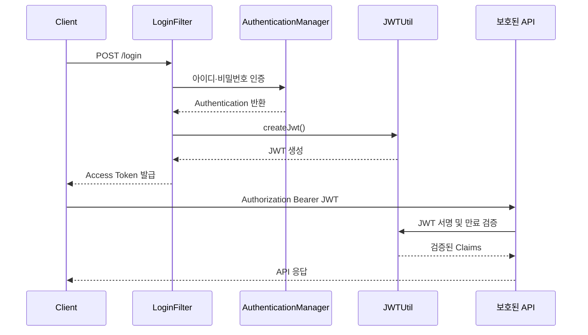
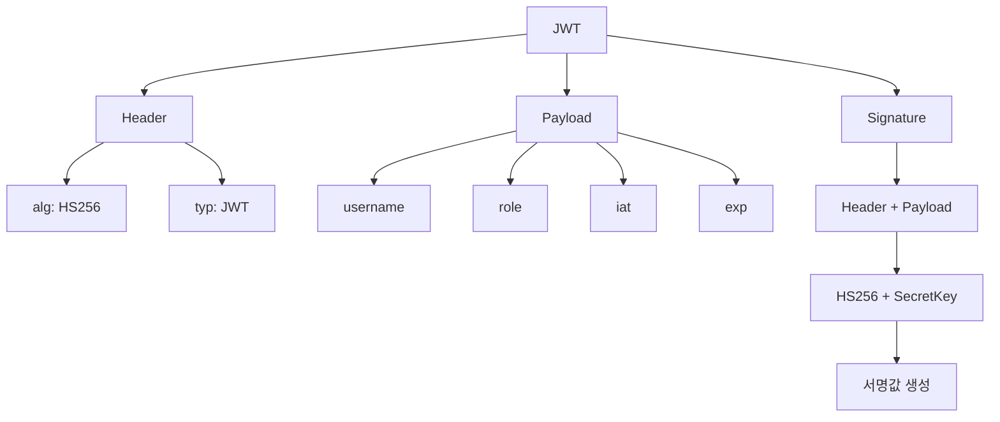
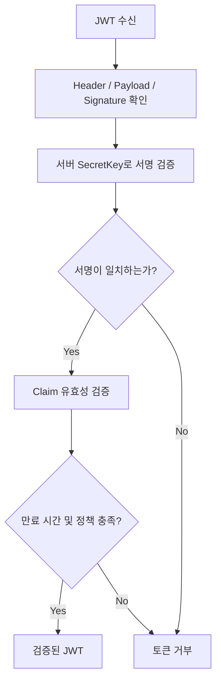
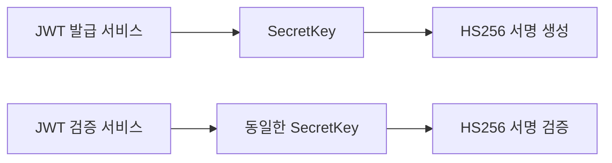
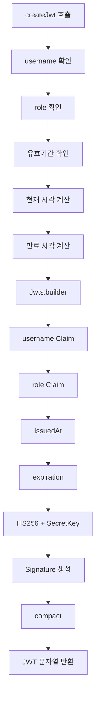
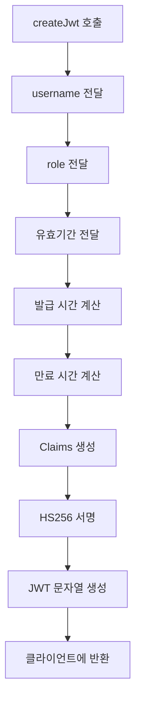
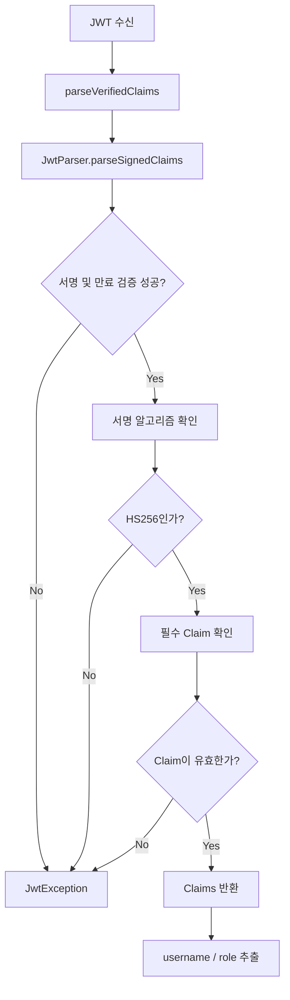
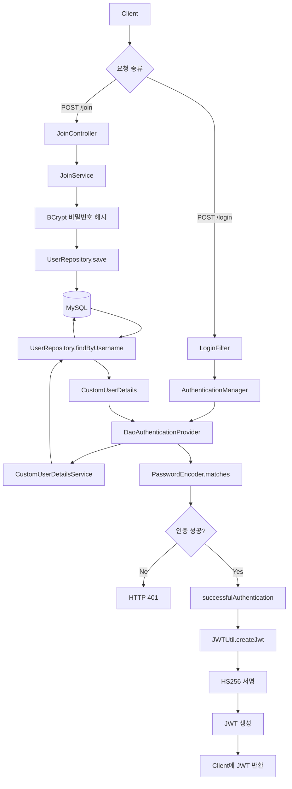

# 스프링 시큐리티 JWT - 9. JWT 발급 및 검증 클래스
[https://youtu.be/obNHwsl0fXM?si=2wQ-9GDAORKJ0ekI](https://youtu.be/obNHwsl0fXM?si=2wQ-9GDAORKJ0ekI)

# 스프링 시큐리티 JWT - 9. JWT 발급 및 검증 클래스
* toc
{:toc}

---

### Spring Security JWT 발급 및 검증 구현: JJWT 0.12.3, HS256, SecretKey와 JWTUtil 완벽 정리

Spring Security에서 JWT 기반 인증 시스템을 구현하려면 사용자 로그인에 성공했을 때 JWT를 발급하고, 이후 클라이언트가 전달한 JWT가 유효한지 검증해야 한다.

앞서 구현한 로그인 인증 구조는 다음과 같다.

```text
POST /login
    ↓
LoginFilter
    ↓
UsernamePasswordAuthenticationToken
    ↓
AuthenticationManager
    ↓
DaoAuthenticationProvider
    ↓
CustomUserDetailsService
    ↓
UserRepository
    ↓
MySQL
    ↓
PasswordEncoder.matches()
    ↓
인증 성공
```

여기까지 구현하면 아이디와 비밀번호를 이용한 로그인 인증을 수행할 수 있다.

하지만 현재 프로젝트는 `SessionCreationPolicy.STATELESS`를 적용한 상태다.

따라서 로그인에 성공했다고 해서 서버가 해당 사용자의 인증 상태를 다음 HTTP 요청까지 자동으로 유지하지 않는다.

예를 들어 사용자가 로그인에 성공한 다음 관리자 API에 접근한다고 생각해보자.

```http
GET /admin HTTP/1.1
Host: localhost:8080
```

서버가 이전 로그인 상태를 세션에 보관하지 않는다면, 이 요청이 누구에게서 발생했는지 확인할 방법이 필요하다.

이를 해결하는 방법 중 하나가 JWT(JSON Web Token)다.

로그인에 성공하면 서버가 JWT를 발급한다.

클라이언트는 발급받은 JWT를 보관하고, 이후 보호된 API를 호출할 때 HTTP Authorization 헤더에 포함하여 전달한다.

```http
GET /admin HTTP/1.1
Host: localhost:8080
Authorization: Bearer <ACCESS_TOKEN>
```

서버는 전달받은 JWT의 서명과 만료 시간 등을 검증한다.

검증에 성공하면 JWT에 포함된 사용자 정보를 이용해 현재 요청의 인증 정보를 구성할 수 있다.

전체 흐름은 다음과 같다.



이번에는 이 구조에서 **JWT 발급과 검증을 담당하는 `JWTUtil` 클래스**를 구현한다.

이 클래스에는 다음 기능을 작성한다.

| 메서드             | 역할               |
| --------------- | ---------------- |
| `createJwt()`   | JWT 생성           |
| `getUsername()` | JWT에서 사용자 이름 추출  |
| `getRole()`     | JWT에서 사용자 권한 추출  |
| `isExpired()`   | JWT 만료 여부 확인     |
| `isValid()`     | JWT의 전반적인 유효성 검사 |

`getUsername()`, `getRole()`, `isExpired()`, `createJwt()`가 기본적인 구현 기능이며, 실제 사용 시 유효하지 않은 토큰을 통합적으로 판단할 수 있도록 `isValid()`도 추가한다.

---

### JWT란?

JWT는 JSON Web Token의 약자로, JSON 형식의 Claim을 안전하게 전달할 수 있도록 정의된 토큰 형식이다.

JWT는 인증 시스템뿐 아니라 시스템 간 정보 전달에도 사용할 수 있다.

일반적인 인증 시스템에서는 다음과 같은 정보를 포함할 수 있다.

```json
{
  "username": "user01",
  "role": "ROLE_USER",
  "iat": 1790000000,
  "exp": 1790003600
}
```

각 값의 의미는 다음과 같다.

| Claim    | 의미        |
| -------- | --------- |
| username | 사용자 이름    |
| role     | 사용자 권한    |
| iat      | JWT 발급 시간 |
| exp      | JWT 만료 시간 |

`username`과 `role`은 애플리케이션이 정의한 사용자 정보다.

반면 `iat`와 `exp`는 JWT 표준에 정의된 등록 Claim이다.

JWT 표준에서는 이러한 Claim을 이용해 토큰의 발급 시간과 만료 시간을 표현할 수 있다.

#### JWT의 가장 중요한 특징

JWT를 이해할 때 가장 먼저 구분해야 할 사실이 있다.

**JWT는 반드시 암호화된 토큰을 의미하지 않는다.**

JWT에는 서명된 JWT와 암호화된 JWT 등 서로 다른 형태가 존재한다.

이번에 구현하는 JWT는 HS256 알고리즘으로 서명된 JWT다.

정확히는 **JWS(JSON Web Signature) 형식의 JWT**다.

JWS는 데이터의 기밀성을 보장하는 암호화 방식이 아니라, 데이터의 무결성과 서명 검증에 사용하는 구조다.

따라서 이번에 생성할 JWT는 외부에서 Payload를 디코딩하여 확인할 수 있다.

이 차이를 이해해야 JWT를 안전하게 사용할 수 있다.

---

### JWT의 구조

#### Header, Payload, Signature

일반적인 서명형 JWT는 세 부분으로 구성된다.

```text
Header.Payload.Signature
```

각 부분은 마침표(`.`)로 구분된다.

실제 JWT는 다음과 같은 형태다.

```text
eyJhbGciOiJIUzI1NiJ9.eyJ1c2VybmFtZSI6InVzZXIwMSJ9.<SIGNATURE>
```

위 문자열은 구조를 설명하기 위한 예시이며 마지막 부분은 실제 서명값이 아닌 자리 표시자다.

각 영역의 역할은 다음과 같다.

| 영역        | 역할          | 주요 정보                |
| --------- | ----------- | -------------------- |
| Header    | 토큰 처리 정보    | 서명 알고리즘, 토큰 유형       |
| Payload   | 전달할 Claim   | 사용자 이름, 권한, 발급·만료 시간 |
| Signature | 무결성 및 서명 검증 | 비밀키를 이용한 MAC 또는 서명값  |

이를 구조로 표현하면 다음과 같다.



이제 각 부분을 자세히 살펴보자.

---

### Header란?

Header에는 JWT를 처리하기 위한 정보가 들어간다.

대표적으로 다음과 같다.

```json
{
  "alg": "HS256",
  "typ": "JWT"
}
```

#### alg

`alg`는 JWT에 사용된 서명 또는 암호화 관련 알고리즘을 나타낸다.

이번 프로젝트에서는 다음 값을 사용한다.

```text
HS256
```

HS256은 HMAC-SHA-256 알고리즘을 의미한다.

이를 이용해 Header와 Payload에 대한 메시지 인증 코드를 생성한다.

#### typ

`typ`는 토큰의 유형을 나타낼 때 사용할 수 있다.

```text
JWT
```

다만 `typ`는 모든 JWT에 반드시 존재해야 하는 값은 아니다.

실제 JWT 처리에서는 Header에 포함된 정보뿐 아니라 애플리케이션이 허용하는 알고리즘과 검증 정책도 중요하다.

특히 **클라이언트가 전달한 Header를 신뢰하여 서버의 검증 정책을 임의로 변경해서는 안 된다.**

---

### Payload란?

Payload는 JWT에 포함할 실제 정보를 저장하는 영역이다.

이러한 정보를 Claim이라고 한다.

예를 들어 다음과 같다.

```json
{
  "username": "user01",
  "role": "ROLE_USER",
  "iat": 1790000000,
  "exp": 1790003600
}
```

#### username

사용자를 구분하기 위한 정보다.

```json
{
  "username": "user01"
}
```

현재 프로젝트에서는 로그인 시 사용자 이름을 사용하므로 해당 값을 JWT에 포함한다.

다만 실제 서비스에서 로그인 아이디 변경을 허용한다면 변경되지 않는 내부 사용자 ID를 사용하는 구조도 고려할 수 있다.

#### role

사용자의 권한이다.

```json
{
  "role": "ROLE_USER"
}
```

현재 프로젝트에서는 다음 두 가지 권한을 사용한다.

```text
ROLE_USER

ROLE_ADMIN
```

JWT에 권한 정보를 포함하면 이후 인증 과정에서 해당 값을 이용해 Spring Security의 `GrantedAuthority`를 구성할 수 있다.

단, 토큰에 들어 있는 권한을 사용하기 전에 반드시 서명과 유효성을 검증해야 한다.

#### iat

`iat`는 Issued At의 약자로 JWT가 발급된 시각을 의미한다.

```json
{
  "iat": 1790000000
}
```

JWT 표준에서 `iat`와 `exp` 등의 시간 관련 값은 NumericDate 형식으로 표현한다.

일반적으로 Unix Epoch를 기준으로 한 초 단위 숫자다.

#### exp

`exp`는 Expiration Time의 약자다.

JWT의 만료 시각을 나타낸다.

```json
{
  "exp": 1790003600
}
```

토큰의 만료 시각이 지나면 해당 JWT를 인증에 사용해서는 안 된다.

여기서 중요한 점은 `exp`가 유효기간 자체가 아니라 **만료되는 절대 시각**을 나타낸다는 것이다.

예를 들어 다음과 같이 설정할 수 있다.

```text
발급 시각: 12:00:00

유효기간: 1시간

만료 시각: 13:00:00
```

JWT 생성 과정에서는 발급 시각에 유효기간을 더해 만료 시각을 계산한다.

---

### JWT Payload는 암호화될까?

이번에 사용하는 JWS 형식의 JWT에서는 Header와 Payload가 일반적으로 Base64URL 방식으로 인코딩된다.

여기서 Base64URL은 암호화 알고리즘이 아니다.

바이너리 데이터를 URL에서 사용하기 적합한 문자 형태로 표현하는 인코딩 방식이다.

따라서 JWT의 Header와 Payload는 비밀키 없이도 디코딩할 수 있다.

예를 들어 다음 Payload가 있다고 생각해보자.

```json
{
  "username": "user01",
  "role": "ROLE_ADMIN"
}
```

이 정보는 JWT 문자열로 인코딩되더라도 외부에서 읽을 수 있다.

따라서 JWT의 Payload에는 비밀번호나 민감한 개인정보를 넣어서는 안 된다.

다음과 같은 정보는 포함하지 않는 것이 좋다.

```json
{
  "username": "user01",
  "password": "password123!",
  "residentNumber": "..."
}
```

또한 비밀번호가 BCrypt로 해시되어 있더라도 해당 해시를 JWT에 넣을 필요가 없다.

JWT Payload에는 인증과 인가에 필요한 최소한의 정보만 포함해야 한다.

**JWT의 서명은 데이터를 숨기는 것이 아니라, 데이터가 임의로 변경되지 않았는지 확인하기 위한 장치**다.

---

### Signature란?

Signature는 JWT의 Header와 Payload를 이용해 생성한 서명값이다.

이번 프로젝트에서는 HS256을 사용한다.

HS256은 HMAC-SHA-256을 의미하며, 비밀키를 이용해 메시지 인증 코드(MAC)를 생성하는 알고리즘이다.

개념적인 생성 과정은 다음과 같다.

```text
Base64UrlEncode(Header)
            +
            "."
            +
Base64UrlEncode(Payload)
            ↓
        HMAC-SHA256
            +
         SecretKey
            ↓
         Signature
```

이를 간단하게 표현하면 다음과 같다.

```text
Signature =
    HMAC-SHA256(
        SecretKey,
        encodedHeader + "." + encodedPayload
    )
```

실제 JWT는 다음과 같이 구성된다.

```text
encodedHeader.encodedPayload.encodedSignature
```

#### Signature는 어떤 역할을 할까?

예를 들어 서버가 다음 권한을 가진 사용자에게 JWT를 발급했다고 생각해보자.

```json
{
  "username": "user01",
  "role": "ROLE_USER"
}
```

공격자는 JWT의 Payload를 디코딩할 수 있다.

그리고 다음과 같이 내용을 변경할 수도 있다.

```json
{
  "username": "user01",
  "role": "ROLE_ADMIN"
}
```

하지만 Payload가 변경되면 기존 Signature와 일치하지 않게 된다.

공격자가 올바른 Signature를 다시 생성하려면 서명에 사용하는 SecretKey가 필요하다.

SecretKey를 모른다면 변경된 Payload에 대해 유효한 HMAC 값을 생성하기 어렵다.

따라서 서버는 서명 검증을 통해 변조된 토큰을 거부할 수 있다.



여기서 정확하게 구분해야 할 점이 있다.

HS256 검증에 성공했다는 것은 **해당 SecretKey를 가진 주체가 생성한 서명과 일치한다는 의미**다.

여러 서비스가 동일한 SecretKey를 공유한다면 어느 서비스가 실제로 발급했는지 서명만으로 구분할 수는 없다.

발급 주체를 명확하게 구분해야 한다면 Issuer와 Audience 같은 Claim 검증을 추가해야 한다.

또한 SecretKey가 유출되면 공격자가 유효한 서명을 생성할 수 있으므로 키 관리가 매우 중요하다.

---

### JWT 서명 알고리즘의 종류

JWT에는 여러 서명 알고리즘을 사용할 수 있다.

대표적으로 다음과 같다.

| 알고리즘  | 방식             | 특징               |
| ----- | -------------- | ---------------- |
| HS256 | HMAC-SHA-256   | 공유 비밀키 사용        |
| HS384 | HMAC-SHA-384   | 공유 비밀키 사용        |
| HS512 | HMAC-SHA-512   | 공유 비밀키 사용        |
| RS256 | RSA SHA-256 서명 | 개인키로 서명, 공개키로 검증 |
| ES256 | ECDSA P-256 서명 | 개인키로 서명, 공개키로 검증 |

이번에는 HS256을 사용한다.

#### 대칭키 기반 HMAC

HS256은 하나의 SecretKey를 공유하는 방식이다.

토큰을 발급하는 쪽과 검증하는 쪽이 동일한 비밀키를 사용한다.



구현이 비교적 단순하다는 장점이 있다.

하지만 여러 서비스가 같은 SecretKey를 공유한다면 키가 노출될 수 있는 범위도 넓어진다.

또한 검증만 수행해야 하는 서비스라도 SecretKey를 알고 있다면 이론적으로 새로운 유효 토큰을 생성할 수 있다.

#### 비대칭키 기반 서명

RS256과 같은 알고리즘은 개인키와 공개키를 구분하여 사용한다.

```text
발급 서버
    ↓
Private Key로 JWT 서명
    ↓
JWT 전달
    ↓
검증 서버
    ↓
Public Key로 서명 검증
```

이 구조에서는 검증 서버에 개인키를 전달할 필요가 없다.

따라서 여러 서비스가 JWT를 검증해야 하는 환경에서는 비대칭키 기반 서명이 유리할 수 있다.

다만 HS256과 RS256 모두 기본적으로 **서명 알고리즘**이다.

데이터를 숨기는 암호화 알고리즘으로 이해해서는 안 된다.

---

### HS256 SecretKey의 길이

HS256을 사용하려면 충분히 강력한 비밀키가 필요하다.

JWT의 HMAC 서명 알고리즘에는 최소 키 길이 요구사항이 있다.

| 알고리즘  |       최소 키 길이 |
| ----- | ------------: |
| HS256 | 256비트 / 32바이트 |
| HS384 | 384비트 / 48바이트 |
| HS512 | 512비트 / 64바이트 |

JJWT는 이러한 요구사항에 맞지 않는 약한 키를 거부할 수 있다.

여기서 자주 발생하는 오해가 있다.

**문자열 길이가 32자라고 해서 반드시 안전한 256비트 비밀키인 것은 아니다.**

예를 들어 다음 문자열을 생각해보자.

```text
aaaaaaaaaaaaaaaaaaaaaaaaaaaaaaaa
```

이 문자열은 ASCII 기준 32바이트다.

하지만 무작위성이 매우 낮아 안전한 비밀키라고 볼 수 없다.

따라서 사람이 임의로 만든 문자열을 사용하는 것보다 암호학적으로 안전한 난수 생성기를 이용해 비밀키를 생성해야 한다.

---

### Gradle 의존성 확인

이번 프로젝트에서는 JJWT 0.12.3을 사용한다.

다음 세 가지 의존성이 필요하다.

```gradle
dependencies {

    implementation 'io.jsonwebtoken:jjwt-api:0.12.3'

    runtimeOnly 'io.jsonwebtoken:jjwt-impl:0.12.3'

    runtimeOnly 'io.jsonwebtoken:jjwt-jackson:0.12.3'
}
```

각 모듈의 역할은 다음과 같다.

| 모듈           | 역할              |
| ------------ | --------------- |
| jjwt-api     | JWT 생성 및 검증 API |
| jjwt-impl    | JWT 내부 구현       |
| jjwt-jackson | JSON 직렬화 및 역직렬화 |

현재 프로젝트에서는 다음 라이브러리를 이용해 JWT를 생성하고 검증한다.

```java
import io.jsonwebtoken.Jwts;
```

JJWT는 버전에 따라 메서드 이름과 사용 방법이 달라진다.

따라서 **0.11.5와 0.12.3의 코드를 혼합해서 사용하지 않도록 주의해야 한다.**

---

### SecretKey 생성하기

JWT를 생성하려면 먼저 서명에 사용할 SecretKey를 준비해야 한다.

이번 구현에서는 HS256을 사용하므로 최소 32바이트의 무작위 비밀키가 필요하다.

#### OpenSSL로 비밀키 생성

다음 명령을 실행한다.

```bash
openssl rand -base64 32
```

이 명령은 암호학적으로 안전한 난수 32바이트를 생성하고, 이를 Base64 문자열로 인코딩하여 출력한다.

각 부분의 의미는 다음과 같다.

| 명령      | 의미            |
| ------- | ------------- |
| openssl | OpenSSL 명령 실행 |
| rand    | 난수 생성         |
| -base64 | Base64 인코딩    |
| 32      | 생성할 난수의 바이트 수 |

생성된 결과는 다음과 비슷한 형태다.

```text
<BASE64_ENCODED_SECRET_KEY>
```

실제 실행 시에는 무작위로 생성된 Base64 문자열이 출력된다.

여기서 중요한 것은 출력된 문자열의 길이가 아니라, **Base64로 디코딩한 원래 키가 32바이트의 무작위 데이터라는 점**이다.

또한 비밀키는 한 번 생성한 뒤 안전하게 보관해야 한다.

애플리케이션을 실행할 때마다 새로운 SecretKey를 생성하면 이전에 발급한 JWT를 더 이상 검증할 수 없게 된다.

---

### application.properties에 비밀키 설정하기

Spring Boot에서는 `application.properties`를 이용해 애플리케이션 설정을 관리할 수 있다.

먼저 다음 파일을 확인한다.

```text
src/main/resources/application.properties
```

다음 설정을 추가한다.

```properties
# JWT SecretKey
jwt.secret=${JWT_SECRET_BASE64}

# Access Token 유효기간: 1시간
jwt.access-token-expiration-ms=3600000
```

여기서 `jwt.secret`은 애플리케이션에서 직접 정의한 설정 이름이다.

Spring Security가 기본적으로 제공하는 필수 속성은 아니다.

따라서 프로젝트의 명명 규칙에 맞게 변경할 수 있다.

#### 환경변수 사용

현재는 실제 SecretKey를 설정 파일에 직접 작성하지 않고 환경변수에서 가져오도록 구성했다.

```properties
jwt.secret=${JWT_SECRET_BASE64}
```

로컬 개발 환경에서는 다음과 같이 환경변수를 설정할 수 있다.

```bash
export JWT_SECRET_BASE64="$(openssl rand -base64 32)"
```

이 명령은 32바이트의 무작위 키를 생성한 뒤 Base64 문자열로 환경변수에 저장한다.

그다음 Spring Boot를 실행한다.

```bash
./gradlew bootRun
```

같은 셸에서 실행했다면 Spring Boot가 `JWT_SECRET_BASE64` 환경변수를 읽을 수 있다.

실제 운영 환경에서는 키를 매번 생성하지 않고 Secret Manager 등의 안전한 저장소에서 전달받도록 구성해야 한다.

또한 환경변수에 비밀키를 저장하는 방식도 운영 환경의 접근 권한과 프로세스 보안 정책을 함께 고려해야 한다.

#### 왜 Java 코드에 직접 작성하지 않을까?

다음과 같은 방식은 피하는 것이 좋다.

```java
private static final String SECRET =
        "my-jwt-secret-key";
```

비밀키가 소스 코드에 포함되면 Git 저장소나 빌드 결과물 등을 통해 유출될 위험이 있다.

또한 여러 서버에서 같은 설정을 사용하거나 키를 변경해야 할 때 코드 수정과 배포가 필요해질 수 있다.

따라서 비밀키는 애플리케이션 코드와 분리하여 관리하는 것이 좋다.

---

### JWTUtil 클래스 생성하기

이제 실제 JWT 생성과 검증을 담당할 클래스를 구현한다.

현재 프로젝트에는 JWT 관련 클래스를 관리하는 `jwt` 패키지가 존재한다.

```text
com.example.jwt.jwt
```

이 패키지에 다음 클래스를 생성한다.

```text
JWTUtil.java
```

전체 프로젝트 구조는 다음과 같다.

```text
src/main/java/com/example/jwt
│
├── JwtApplication.java
│
├── config
│   └── SecurityConfig.java
│
├── controller
│   ├── MainController.java
│   ├── AdminController.java
│   └── JoinController.java
│
├── dto
│   ├── JoinDTO.java
│   └── CustomUserDetails.java
│
├── entity
│   └── UserEntity.java
│
├── repository
│   └── UserRepository.java
│
├── service
│   ├── JoinService.java
│   └── CustomUserDetailsService.java
│
└── jwt
    ├── LoginFilter.java
    └── JWTUtil.java
```

#### @Component 등록

JWTUtil은 로그인 성공 처리와 JWT 인증 처리 등 여러 곳에서 사용할 수 있다.

따라서 Spring Bean으로 등록한다.

```java
@Component
public class JWTUtil {

}
```

`@Component`를 사용하면 Spring이 해당 클래스를 Bean으로 관리할 수 있다.

이후 다른 Bean에서는 생성자 주입을 통해 JWTUtil을 사용할 수 있다.

```java
private final JWTUtil jwtUtil;

public SomeService(JWTUtil jwtUtil) {

    this.jwtUtil = jwtUtil;
}
```

이렇게 하면 JWT 발급과 검증 로직을 한곳에서 관리할 수 있다.

---

### @Value로 SecretKey 가져오기

먼저 `application.properties`에 설정한 비밀키를 Java 코드에서 가져와야 한다.

Spring에서는 `@Value`를 이용해 설정값을 주입할 수 있다.

```java
@Value("${jwt.secret}")
```

이번에는 생성자 주입 방식을 사용한다.

```java
@Component
public class JWTUtil {

    private final SecretKey secretKey;

    public JWTUtil(
            @Value("${jwt.secret}") String secret
    ) {

        byte[] keyBytes =
                Decoders.BASE64.decode(secret);

        this.secretKey =
                Keys.hmacShaKeyFor(keyBytes);
    }
}
```

필요한 import는 다음과 같다.

```java
import io.jsonwebtoken.io.Decoders;
import io.jsonwebtoken.security.Keys;

import org.springframework.beans.factory.annotation.Value;
import org.springframework.stereotype.Component;

import javax.crypto.SecretKey;
```

이 코드는 다음 순서로 동작한다.

```text
application.properties
    ↓
jwt.secret
    ↓
@Value
    ↓
Base64 문자열
    ↓
Decoders.BASE64.decode()
    ↓
byte[]
    ↓
Keys.hmacShaKeyFor()
    ↓
SecretKey
```

#### Decoders.BASE64.decode()

```java
byte[] keyBytes =
        Decoders.BASE64.decode(secret);
```

설정 파일에서 전달받은 Base64 문자열을 실제 키 바이트로 변환한다.

여기서 Base64 디코딩은 암호화된 비밀키를 복호화하는 작업이 아니다.

인코딩된 키 데이터를 원래 바이트 형태로 복원하는 작업이다.

#### Keys.hmacShaKeyFor()

```java
this.secretKey =
        Keys.hmacShaKeyFor(keyBytes);
```

키 바이트를 HMAC 서명에 사용할 수 있는 `SecretKey` 객체로 생성한다.

JJWT 공식 문서에서도 Base64로 인코딩된 HMAC 비밀키를 사용할 때 이러한 방식을 제공한다.

이렇게 생성한 SecretKey는 JWT를 발급하고 검증하는 데 사용한다.

---

### SecretKey를 문자열로 직접 변환하면 안 될까?

다음과 같은 코드도 발견할 수 있다.

```java
String secret = "very-long-secret-key";

byte[] keyBytes =
        secret.getBytes(StandardCharsets.UTF_8);
```

하지만 이 방식은 사람이 작성한 문자열을 그대로 암호학적 키 데이터로 사용하는 구조다.

단순히 문자열이 길다는 이유만으로 충분한 무작위성을 가진 안전한 키라고 판단할 수 없다.

따라서 이번에는 무작위로 생성된 키를 Base64로 인코딩하여 보관하고, 애플리케이션에서 디코딩하여 사용하는 방식을 적용한다.

```java
Keys.hmacShaKeyFor(
        Decoders.BASE64.decode(secret)
);
```

이렇게 하면 키 생성과 키 표현 방식을 명확하게 구분할 수 있다.

---

### JWT 생성 메서드 구현

이제 실제 JWT를 생성하는 메서드를 작성한다.

메서드의 이름은 `createJwt()`로 지정한다.

다음 세 가지 인자를 전달받는다.

```java
public String createJwt(
        String username,
        String role,
        long expiredMs
)
```

각 인자의 의미는 다음과 같다.

| 인자        | 타입     | 설명            |
| --------- | ------ | ------------- |
| username  | String | 사용자 이름        |
| role      | String | 사용자 권한        |
| expiredMs | long   | JWT 유효기간, 밀리초 |

예를 들어 다음과 같이 호출할 수 있다.

```java
String token = jwtUtil.createJwt(
        "user01",
        "ROLE_USER",
        3600000L
);
```

여기서 `3600000L`은 1시간을 밀리초로 표현한 값이다.

#### Jwts.builder()

JWT 생성에는 다음 메서드를 사용한다.

```java
Jwts.builder()
```

이 메서드는 JWT를 생성하기 위한 Builder를 반환한다.

이후 Claim과 발급 시간, 만료 시간, 서명 알고리즘 등을 설정할 수 있다.

#### claim()

JWT의 Payload에 사용자 정보를 추가한다.

```java
.claim("username", username)
.claim("role", role)
```

예를 들어 다음과 같은 데이터가 들어간다.

```json
{
  "username": "user01",
  "role": "ROLE_USER"
}
```

`claim()`은 애플리케이션이 정의한 Claim을 추가할 때 사용할 수 있다.

#### issuedAt()

JWT 발급 시간을 설정한다.

```java
.issuedAt(new Date())
```

이번에는 발급 시간과 만료 시간을 같은 기준 시각으로 계산하기 위해 `Instant`를 사용한다.

```java
Instant now = Instant.now();
```

그리고 다음과 같이 지정한다.

```java
.issuedAt(Date.from(now))
```

#### expiration()

JWT 만료 시간을 설정한다.

```java
.expiration(
        Date.from(now.plusMillis(expiredMs))
)
```

현재 시각에 유효기간을 더한 시각을 만료 시간으로 설정한다.

예를 들어 유효기간이 1시간이라면 다음과 같다.

```text
현재 시각
    ↓
12:00
    +
1시간
    ↓
만료 시각
    ↓
13:00
```

여기서 주의할 점은 Java 코드에서 전달받는 `expiredMs`는 밀리초 단위이지만, JWT Payload의 `exp`는 NumericDate 형식으로 표현된다는 것이다.

JJWT가 `Date`를 JWT의 표준 시간 형식으로 변환한다.

#### signWith()

이제 JWT에 서명을 추가한다.

```java
.signWith(secretKey, Jwts.SIG.HS256)
```

첫 번째 인자는 서명에 사용할 SecretKey다.

두 번째 인자는 서명 알고리즘이다.

이번에는 HS256을 명시적으로 지정한다.

JJWT 0.12.x에서는 `Jwts.SIG.HS256`을 이용해 HS256 알고리즘을 지정할 수 있다.

#### compact()

마지막으로 다음 메서드를 호출한다.

```java
.compact()
```

이 메서드는 JWT를 최종적인 문자열 형태로 생성한다.

결과는 다음 구조를 가진다.

```text
Header.Payload.Signature
```

이 문자열을 클라이언트에 전달할 수 있다.

---

### createJwt() 전체 구현

지금까지의 내용을 합치면 다음과 같다.

```java
public String createJwt(
        String username,
        String role,
        long expiredMs
) {

    if (username == null || username.isBlank()) {
        throw new IllegalArgumentException(
                "username은 필수입니다."
        );
    }

    if (role == null || role.isBlank()) {
        throw new IllegalArgumentException(
                "role은 필수입니다."
        );
    }

    if (expiredMs <= 0) {
        throw new IllegalArgumentException(
                "JWT 유효기간은 0보다 커야 합니다."
        );
    }

    Instant now = Instant.now();

    Instant expiredAt =
            now.plusMillis(expiredMs);

    return Jwts.builder()
            .claim("username", username)
            .claim("role", role)
            .issuedAt(Date.from(now))
            .expiration(Date.from(expiredAt))
            .signWith(secretKey, Jwts.SIG.HS256)
            .compact();
}
```

이 메서드는 다음 과정을 수행한다.



이렇게 하면 JWT를 생성하는 기능이 완성된다.

하지만 JWT를 발급하는 것만으로 인증 시스템이 완성되는 것은 아니다.

이후 서버가 전달받은 JWT의 서명과 만료 시간 등을 검증하는 기능이 필요하다.

---

### JWT 검증 메서드 구현

JWT를 검증하려면 다음과 같은 과정이 필요하다.

```text
JWT 수신
    ↓
토큰 형식 확인
    ↓
서명 검증
    ↓
만료 시간 확인
    ↓
Payload 확인
    ↓
검증된 Claim 반환
```

이번 프로젝트에서는 JJWT의 `JwtParser`를 사용한다.

JJWT 0.12.3에서는 다음과 같은 형태로 서명된 JWT를 파싱할 수 있다.

```java
Jwts.parser()
        .verifyWith(secretKey)
        .build()
        .parseSignedClaims(token)
        .getPayload();
```

각 메서드의 역할은 다음과 같다.

| 메서드                   | 역할                     |
| --------------------- | ---------------------- |
| `Jwts.parser()`       | JWT Parser Builder 생성  |
| `verifyWith()`        | 서명 검증에 사용할 키 지정        |
| `build()`             | JwtParser 생성           |
| `parseSignedClaims()` | 서명된 Claims JWT 파싱 및 검증 |
| `getPayload()`        | 검증된 JWT의 Claims 반환     |

JJWT 공식 문서에서는 서명된 JWT를 읽을 때 `verifyWith()`와 `parseSignedClaims()`를 이용하는 방식을 제공한다.

여기서 중요한 점은 **Payload를 읽기 전에 JJWT가 서명과 등록 Claim의 유효성을 검증한다는 사실**이다.

단순히 JWT 문자열을 Base64URL로 디코딩하는 것과는 다르다.

---

### JWT 서명 검증하기

먼저 다음 메서드를 살펴보자.

```java
.verifyWith(secretKey)
```

이 메서드는 JWT의 서명을 검증할 때 사용할 SecretKey를 지정한다.

클라이언트가 전달한 토큰의 Signature가 서버의 SecretKey로 검증되지 않으면 예외가 발생한다.

예를 들어 다음 상황을 생각해보자.

```text
서버가 발급한 JWT
    ↓
ROLE_USER
    ↓
공격자가 Payload 변경
    ↓
ROLE_ADMIN
    ↓
Signature 불일치
    ↓
검증 실패
```

서명 검증에 실패한 JWT의 Claim은 신뢰해서는 안 된다.

따라서 다음처럼 단순히 Payload만 디코딩하여 사용자 권한을 읽는 방식으로 인증을 구현해서는 안 된다.

```java
String[] parts = token.split("\\.");

String payload = new String(
        Base64.getUrlDecoder().decode(parts[1]),
        StandardCharsets.UTF_8
);
```

이 코드는 JWT의 Payload를 읽을 수 있지만 서명 검증을 수행하지 않는다.

따라서 인증이나 인가에 사용하기에는 부적절하다.

사용자 정보는 반드시 검증된 JWT에서 추출해야 한다.

---

### getUsername() 구현

이제 JWT에서 사용자 이름을 추출하는 메서드를 작성한다.

```java
public String getUsername(String token) {

    return Jwts.parser()
            .verifyWith(secretKey)
            .build()
            .parseSignedClaims(token)
            .getPayload()
            .get("username", String.class);
}
```

코드를 순서대로 살펴보자.

첫 번째로 JWT Parser를 생성한다.

```java
Jwts.parser()
```

두 번째로 검증에 사용할 SecretKey를 지정한다.

```java
.verifyWith(secretKey)
```

세 번째로 Parser를 생성한다.

```java
.build()
```

네 번째로 서명된 JWT를 검증하고 파싱한다.

```java
.parseSignedClaims(token)
```

다섯 번째로 Payload의 Claim을 가져온다.

```java
.getPayload()
```

마지막으로 `username`을 String 타입으로 반환한다.

```java
.get("username", String.class)
```

예를 들어 JWT Payload가 다음과 같다면:

```json
{
  "username": "user01",
  "role": "ROLE_USER"
}
```

다음 메서드의 반환값은 `user01`이다.

```java
String username =
        jwtUtil.getUsername(token);
```

여기서 중요한 점은 `username`을 가져오는 과정에서도 서명과 만료 시간 검증이 수행된다는 것이다.

따라서 유효하지 않은 JWT에서 사용자 이름을 안전하게 추출할 수 있다고 가정해서는 안 된다.

---

### getRole() 구현

사용자 권한을 추출하는 방법도 거의 동일하다.

```java
public String getRole(String token) {

    return Jwts.parser()
            .verifyWith(secretKey)
            .build()
            .parseSignedClaims(token)
            .getPayload()
            .get("role", String.class);
}
```

`getUsername()`과 다른 부분은 Claim 이름이다.

```java
.get("role", String.class)
```

예를 들어 다음과 같은 JWT가 있다고 생각해보자.

```json
{
  "username": "admin01",
  "role": "ROLE_ADMIN"
}
```

다음 메서드를 호출하면:

```java
String role =
        jwtUtil.getRole(token);
```

다음 값을 반환한다.

```text
ROLE_ADMIN
```

이 권한은 이후 Spring Security의 `GrantedAuthority`를 생성하는 데 사용할 수 있다.

예를 들어 다음과 같다.

```java
new SimpleGrantedAuthority(role);
```

하지만 JWT에서 `ROLE_ADMIN`이라는 문자열을 추출했다고 해서 모든 인가 검증이 끝난 것은 아니다.

해당 값은 검증된 JWT에서 추출해야 하며, 이후 Spring Security의 인증 정보에 적절하게 반영해야 한다.

또한 사용자의 권한이 변경되었을 때 기존 JWT에 포함된 권한을 어떻게 처리할지도 정책적으로 결정해야 한다.

---

### JWT 만료 여부 검증

JWT에는 만료 시간을 나타내는 `exp` Claim이 있다.

예를 들어 다음과 같다.

```json
{
  "iat": 1790000000,
  "exp": 1790003600
}
```

JWT가 발급된 이후 만료 시각에 도달하면 더 이상 인증에 사용해서는 안 된다.

단순히 만료 시간을 직접 비교한다면 다음과 같은 코드가 떠오를 수 있다.

```java
boolean expired =
        expiration.before(new Date());
```

하지만 JJWT 0.12.3에서는 중요한 동작을 이해해야 한다.

**JJWT는 `parseSignedClaims()`를 호출할 때 이미 JWT의 만료 시간을 검증한다.**

따라서 만료된 JWT라면 정상적인 Claims를 반환하지 않고 `ExpiredJwtException`을 발생시킬 수 있다.

예를 들어 다음 코드가 있다고 생각해보자.

```java
Claims claims = Jwts.parser()
        .verifyWith(secretKey)
        .build()
        .parseSignedClaims(token)
        .getPayload();
```

이때 토큰이 만료되었다면 `getPayload()`까지 정상적으로 진행되지 않을 수 있다.

따라서 만료 여부를 확인하기 위해 반드시 `getExpiration()`을 가져와 직접 비교해야 하는 것은 아니다.

JJWT의 Parser는 만료된 Claims JWT에 대해 `ExpiredJwtException`을 발생시키도록 정의되어 있다.

---

### isExpired() 구현

만료 여부를 Boolean 형태로 반환하는 메서드를 만들 수 있다.

```java
public boolean isExpired(String token) {

    try {

        Jwts.parser()
                .verifyWith(secretKey)
                .build()
                .parseSignedClaims(token);

        return false;

    } catch (ExpiredJwtException exception) {

        return true;
    }
}
```

이 코드는 다음과 같이 동작한다.

```text
JWT 파싱
    ↓
서명 및 만료 검증
    ↓
만료되지 않음
    ↓
false
```

반대로 만료된 JWT라면 다음과 같다.

```text
JWT 파싱
    ↓
ExpiredJwtException
    ↓
true
```

여기서 반드시 기억해야 할 부분이 있다.

**`isExpired()`가 false를 반환한다는 사실만으로 JWT의 모든 유효성이 검증되었다고 판단해서는 안 된다.**

위 코드는 만료 여부를 확인하기 위한 메서드다.

서명 오류나 잘못된 토큰 형식 등 다른 문제는 별도의 예외로 전달될 수 있다.

따라서 실제 인증 필터에서는 만료 여부만 확인하는 것보다 JWT의 전체 유효성을 검증하는 메서드를 사용하는 편이 명확하다.

이후 전체 구현에서는 공통 파싱 메서드를 이용해 이를 정리한다.

---

### JWT 유효성 검증 시 발생하는 예외

JWT는 여러 이유로 검증에 실패할 수 있다.

| 예외 또는 상황                   | 원인                        |
| -------------------------- | ------------------------- |
| `ExpiredJwtException`      | 토큰 만료                     |
| `SignatureException`       | 서명 검증 실패                  |
| `MalformedJwtException`    | 잘못된 JWT 형식                |
| `UnsupportedJwtException`  | 지원하지 않는 JWT 형식            |
| `IllegalArgumentException` | null 또는 비어 있는 토큰 등 잘못된 입력 |
| 필수 Claim 누락                | 애플리케이션이 요구하는 사용자 정보 없음    |

예를 들어 JWT의 Signature가 변경되었다면 검증에 실패해야 한다.

```text
원본 JWT
    ↓
Signature 변경
    ↓
verifyWith(secretKey)
    ↓
서명 검증 실패
```

또한 만료 시간이 지난 JWT는 다음과 같이 처리해야 한다.

```text
JWT 수신
    ↓
만료 시간 확인
    ↓
ExpiredJwtException
    ↓
인증 거부
```

실제 인증 시스템에서는 이러한 예외를 통합하여 처리할 수 있다.

예를 들어 다음과 같이 작성할 수 있다.

```java
public boolean isValid(String token) {

    try {

        Jwts.parser()
                .verifyWith(secretKey)
                .build()
                .parseSignedClaims(token);

        return true;

    } catch (JwtException | IllegalArgumentException exception) {

        return false;
    }
}
```

다만 이 메서드는 JJWT가 수행하는 기본적인 파싱·검증 결과만 확인한다.

실제 인증 시스템에서는 애플리케이션이 요구하는 Claim의 존재 여부와 알고리즘 정책 등도 함께 검사하는 것이 좋다.

이제 이러한 내용을 반영하여 전체 클래스를 작성해보자.

---

### JWTUtil 전체 코드

지금까지의 구현을 하나의 클래스로 정리한다.

이번 구현에서는 다음 기능을 제공한다.

| 메서드                     | 역할                 |
| ----------------------- | ------------------ |
| `createJwt()`           | JWT 발급             |
| `getUsername()`         | 검증된 JWT의 사용자 이름 추출 |
| `getRole()`             | 검증된 JWT의 권한 추출     |
| `isExpired()`           | JWT 만료 여부 확인       |
| `isValid()`             | JWT 전체 유효성 확인      |
| `parseVerifiedClaims()` | 공통 JWT 파싱 및 검증     |

`parseVerifiedClaims()`는 중복된 파싱 코드를 줄이기 위한 내부 메서드다.

또한 HS256 알고리즘과 필수 Claim을 확인하도록 구성했다.

```java
package com.example.jwt.jwt;

import io.jsonwebtoken.Claims;
import io.jsonwebtoken.ExpiredJwtException;
import io.jsonwebtoken.JwtException;
import io.jsonwebtoken.JwtParser;
import io.jsonwebtoken.Jwts;
import io.jsonwebtoken.Jws;

import io.jsonwebtoken.io.Decoders;
import io.jsonwebtoken.security.Keys;

import org.springframework.beans.factory.annotation.Value;
import org.springframework.stereotype.Component;

import javax.crypto.SecretKey;

import java.time.Instant;
import java.util.Date;

@Component
public class JWTUtil {

    private final SecretKey secretKey;
    private final JwtParser jwtParser;

    public JWTUtil(
            @Value("${jwt.secret}") String secret
    ) {

        // 1. Base64 문자열을 실제 키 바이트로 변환
        byte[] keyBytes =
                Decoders.BASE64.decode(secret);

        // 2. HMAC 서명에 사용할 SecretKey 생성
        this.secretKey =
                Keys.hmacShaKeyFor(keyBytes);

        // 3. JWT Parser 생성
        this.jwtParser = Jwts.parser()
                .verifyWith(secretKey)
                .build();
    }

    /**
     * JWT 생성
     *
     * @param username 사용자 이름
     * @param role 사용자 권한
     * @param expiredMs JWT 유효기간 (밀리초)
     */
    public String createJwt(
            String username,
            String role,
            long expiredMs
    ) {

        if (username == null || username.isBlank()) {
            throw new IllegalArgumentException(
                    "username은 필수입니다."
            );
        }

        if (role == null || role.isBlank()) {
            throw new IllegalArgumentException(
                    "role은 필수입니다."
            );
        }

        if (expiredMs <= 0) {
            throw new IllegalArgumentException(
                    "JWT 유효기간은 0보다 커야 합니다."
            );
        }

        Instant now = Instant.now();

        Instant expiredAt =
                now.plusMillis(expiredMs);

        return Jwts.builder()
                .claim("username", username)
                .claim("role", role)
                .issuedAt(Date.from(now))
                .expiration(Date.from(expiredAt))
                .signWith(secretKey, Jwts.SIG.HS256)
                .compact();
    }

    /**
     * JWT에서 사용자 이름 추출
     */
    public String getUsername(String token) {

        Claims claims = parseVerifiedClaims(token);

        return claims.get("username", String.class);
    }

    /**
     * JWT에서 사용자 권한 추출
     */
    public String getRole(String token) {

        Claims claims = parseVerifiedClaims(token);

        return claims.get("role", String.class);
    }

    /**
     * JWT 만료 여부 확인
     *
     * 만료된 경우 true
     * 만료되지 않은 경우 false
     *
     * 다른 검증 오류는 예외로 전달한다.
     */
    public boolean isExpired(String token) {

        try {

            parseVerifiedClaims(token);

            return false;

        } catch (ExpiredJwtException exception) {

            return true;
        }
    }

    /**
     * JWT 전체 유효성 확인
     */
    public boolean isValid(String token) {

        try {

            parseVerifiedClaims(token);

            return true;

        } catch (JwtException | IllegalArgumentException exception) {

            return false;
        }
    }

    /**
     * JWT 서명, 만료 시간, 알고리즘 및
     * 필수 Claim 검증
     */
    private Claims parseVerifiedClaims(String token) {

        // 1. JWT 파싱 및 서명·만료 검증
        Jws<Claims> parsedJwt =
                jwtParser.parseSignedClaims(token);

        // 2. 허용한 서명 알고리즘인지 확인
        String algorithm =
                parsedJwt.getHeader().getAlgorithm();

        if (!"HS256".equals(algorithm)) {
            throw new JwtException(
                    "지원하지 않는 JWT 서명 알고리즘입니다."
            );
        }

        // 3. 검증된 Payload 가져오기
        Claims claims = parsedJwt.getPayload();

        String username =
                claims.get("username", String.class);

        String role =
                claims.get("role", String.class);

        // 4. 필수 Claim 검증
        if (username == null || username.isBlank()) {
            throw new JwtException(
                    "JWT username Claim이 없습니다."
            );
        }

        if (role == null || role.isBlank()) {
            throw new JwtException(
                    "JWT role Claim이 없습니다."
            );
        }

        if (claims.getIssuedAt() == null) {
            throw new JwtException(
                    "JWT 발급 시간이 없습니다."
            );
        }

        if (claims.getExpiration() == null) {
            throw new JwtException(
                    "JWT 만료 시간이 없습니다."
            );
        }

        return claims;
    }
}
```

이 클래스는 JWT 발급과 검증에 필요한 핵심 기능을 하나로 구성한 예시다.

#### 생성자

```java
public JWTUtil(
        @Value("${jwt.secret}") String secret
)
```

애플리케이션 설정에서 비밀키를 가져온다.

#### SecretKey 생성

```java
this.secretKey =
        Keys.hmacShaKeyFor(keyBytes);
```

Base64 디코딩한 키 바이트를 HMAC용 SecretKey로 변환한다.

#### Parser 초기화

```java
this.jwtParser = Jwts.parser()
        .verifyWith(secretKey)
        .build();
```

서명 검증에 사용할 Parser를 생성한다.

JJWT의 `JwtParser`는 빌드된 후 여러 요청에서 재사용할 수 있도록 설계되어 있으므로 매번 새 Parser를 생성할 필요가 없다.

#### JWT 생성

```java
public String createJwt(
        String username,
        String role,
        long expiredMs
)
```

사용자 정보와 만료 시간을 이용해 JWT를 생성한다.

#### 사용자 정보 추출

```java
public String getUsername(String token)
```

```java
public String getRole(String token)
```

검증된 JWT에서 Claim을 추출한다.

#### 만료 여부 확인

```java
public boolean isExpired(String token)
```

JWT가 만료되었는지 확인한다.

#### 전체 유효성 검증

```java
public boolean isValid(String token)
```

잘못된 형식, 서명 오류, 만료 및 필수 Claim 누락 등의 상황을 검증한다.

---

### JWTUtil의 전체 동작 구조

JWT 발급과 검증을 나누어 살펴보자.

#### JWT 발급



#### JWT 검증



이 구조에서 중요한 점은 **JWT의 Payload를 읽는 행위와 JWT를 신뢰할 수 있는지 검증하는 행위를 구분하는 것**이다.

Payload를 읽을 수 있다는 이유만으로 해당 정보가 신뢰할 수 있는 것은 아니다.

반드시 서명과 유효성을 확인해야 한다.

---

### JJWT 0.11.5와 0.12.3의 차이

JJWT는 버전에 따라 JWT 생성 및 검증 API가 달라진다.

특히 0.11.5와 0.12.3은 메서드 사용 방식에 차이가 있다.

| 기능          | JJWT 0.11.5                               | JJWT 0.12.3                     |
| ----------- | ----------------------------------------- | ------------------------------- |
| JWT Builder | `Jwts.builder()`                          | `Jwts.builder()`                |
| 발급 시간       | `setIssuedAt()`                           | `issuedAt()`                    |
| 만료 시간       | `setExpiration()`                         | `expiration()`                  |
| JWT 서명      | `signWith(key, SignatureAlgorithm.HS256)` | `signWith(key, Jwts.SIG.HS256)` |
| Parser 생성   | `Jwts.parserBuilder()`                    | `Jwts.parser()`                 |
| 검증 키 설정     | `setSigningKey()`                         | `verifyWith()`                  |
| 서명된 JWT 파싱  | `parseClaimsJws()`                        | `parseSignedClaims()`           |
| Payload 조회  | `getBody()`                               | `getPayload()`                  |

#### JJWT 0.11.5 방식

다음은 이전 버전의 대표적인 JWT 검증 코드다.

```java
Claims claims = Jwts.parserBuilder()
        .setSigningKey(secretKey)
        .build()
        .parseClaimsJws(token)
        .getBody();
```

JWT 생성은 다음과 같은 방식으로 작성할 수 있다.

```java
String token = Jwts.builder()
        .claim("username", username)
        .claim("role", role)
        .setIssuedAt(new Date())
        .setExpiration(expiration)
        .signWith(secretKey, SignatureAlgorithm.HS256)
        .compact();
```

여기서 `expiration`은 미리 계산한 `Date` 객체라고 가정한다.

#### JJWT 0.12.3 방식

이번 프로젝트에서는 다음 코드를 사용한다.

```java
Claims claims = Jwts.parser()
        .verifyWith(secretKey)
        .build()
        .parseSignedClaims(token)
        .getPayload();
```

JWT 생성은 다음과 같다.

```java
String token = Jwts.builder()
        .claim("username", username)
        .claim("role", role)
        .issuedAt(new Date())
        .expiration(expiration)
        .signWith(secretKey, Jwts.SIG.HS256)
        .compact();
```

두 방식의 목적은 동일하다.

하지만 메서드 이름과 호출 방식이 변경되었다.

따라서 사용 중인 JJWT 버전에 맞는 코드를 작성해야 한다.

또한 JJWT 0.12.3은 이 프로젝트의 기준 버전이지 현재 시점의 최신 버전을 의미하지는 않는다.

기존 프로젝트와의 호환성을 유지하기 위해 동일한 버전을 사용한다.

---

### JWT 발급 테스트

이제 실제 JWT가 정상적으로 생성되는지 확인해보자.

JWTUtil은 외부 API나 데이터베이스를 직접 사용하지 않는다.

따라서 Spring Boot 전체 애플리케이션을 실행하지 않고도 단위 테스트로 검증할 수 있다.

#### 테스트 클래스 생성

다음 경로에 테스트 클래스를 작성한다.

```text
src/test/java/com/example/jwt/jwt/JWTUtilTest.java
```

테스트에서는 다음 기능을 확인한다.

| 테스트          | 기대 결과            |
| ------------ | ---------------- |
| JWT 생성       | 문자열 반환           |
| 사용자 이름 추출    | 입력한 username과 일치 |
| 권한 추출        | 입력한 role과 일치     |
| 정상 토큰 검증     | true             |
| 만료된 토큰       | 검증 실패            |
| 다른 키로 서명된 토큰 | 검증 실패            |
| 잘못된 유효기간     | 예외 발생            |

#### JWTUtilTest 전체 코드

```java
package com.example.jwt.jwt;

import io.jsonwebtoken.ExpiredJwtException;
import io.jsonwebtoken.Jwts;

import io.jsonwebtoken.io.Encoders;

import org.junit.jupiter.api.BeforeEach;
import org.junit.jupiter.api.Test;

import javax.crypto.SecretKey;

import java.time.Instant;
import java.util.Date;

import static org.junit.jupiter.api.Assertions.assertEquals;
import static org.junit.jupiter.api.Assertions.assertFalse;
import static org.junit.jupiter.api.Assertions.assertNotNull;
import static org.junit.jupiter.api.Assertions.assertThrows;
import static org.junit.jupiter.api.Assertions.assertTrue;

class JWTUtilTest {

    private SecretKey secretKey;

    private JWTUtil jwtUtil;

    @BeforeEach
    void setUp() {

        // 테스트 전용 SecretKey 생성
        secretKey = Jwts.SIG.HS256
                .key()
                .build();

        String encodedSecret =
                Encoders.BASE64.encode(
                        secretKey.getEncoded()
                );

        jwtUtil = new JWTUtil(encodedSecret);
    }

    @Test
    void JWT를_생성할_수_있다() {

        // when
        String token = jwtUtil.createJwt(
                "user01",
                "ROLE_USER",
                3600000L
        );

        // then
        assertNotNull(token);

        assertEquals(
                3,
                token.split("\\.").length
        );
    }

    @Test
    void JWT에서_사용자_이름을_추출할_수_있다() {

        // given
        String token = jwtUtil.createJwt(
                "user01",
                "ROLE_USER",
                3600000L
        );

        // when
        String username =
                jwtUtil.getUsername(token);

        // then
        assertEquals(
                "user01",
                username
        );
    }

    @Test
    void JWT에서_권한을_추출할_수_있다() {

        // given
        String token = jwtUtil.createJwt(
                "admin01",
                "ROLE_ADMIN",
                3600000L
        );

        // when
        String role =
                jwtUtil.getRole(token);

        // then
        assertEquals(
                "ROLE_ADMIN",
                role
        );
    }

    @Test
    void 정상_JWT는_유효성_검증에_성공한다() {

        // given
        String token = jwtUtil.createJwt(
                "user01",
                "ROLE_USER",
                3600000L
        );

        // when & then
        assertTrue(jwtUtil.isValid(token));

        assertFalse(jwtUtil.isExpired(token));
    }

    @Test
    void 만료된_JWT는_검증에_실패한다() {

        // given
        Instant now = Instant.now();

        String expiredToken = Jwts.builder()
                .claim("username", "user01")
                .claim("role", "ROLE_USER")
                .issuedAt(
                        Date.from(now.minusSeconds(3600))
                )
                .expiration(
                        Date.from(now.minusSeconds(60))
                )
                .signWith(secretKey, Jwts.SIG.HS256)
                .compact();

        // when & then
        assertFalse(
                jwtUtil.isValid(expiredToken)
        );

        assertTrue(
                jwtUtil.isExpired(expiredToken)
        );

        assertThrows(
                ExpiredJwtException.class,
                () -> jwtUtil.getUsername(expiredToken)
        );
    }

    @Test
    void 다른_키로_서명된_JWT는_검증에_실패한다() {

        // given
        String token = jwtUtil.createJwt(
                "user01",
                "ROLE_USER",
                3600000L
        );

        SecretKey otherKey = Jwts.SIG.HS256
                .key()
                .build();

        String otherSecret =
                Encoders.BASE64.encode(
                        otherKey.getEncoded()
                );

        JWTUtil otherJwtUtil =
                new JWTUtil(otherSecret);

        // when & then
        assertFalse(
                otherJwtUtil.isValid(token)
        );
    }

    @Test
    void 유효기간이_0이하면_JWT를_발급하지_않는다() {

        assertThrows(
                IllegalArgumentException.class,
                () -> jwtUtil.createJwt(
                        "user01",
                        "ROLE_USER",
                        0L
                )
        );
    }
}
```

이 테스트에서는 실제 운영용 SecretKey를 사용하지 않는다.

테스트마다 별도의 무작위 SecretKey를 생성한다.

따라서 테스트 실행을 위해 운영 환경의 비밀키를 노출할 필요가 없다.

#### 테스트 실행

다음 명령을 실행한다.

```bash
./gradlew test --tests "com.example.jwt.jwt.JWTUtilTest"
```

각 옵션의 의미는 다음과 같다.

| 명령          | 의미                |
| ----------- | ----------------- |
| `./gradlew` | Gradle Wrapper 실행 |
| `test`      | 테스트 실행            |
| `--tests`   | 실행할 테스트 클래스 지정    |

정상적으로 완료되면 다음과 유사한 결과를 확인할 수 있다.

```text
BUILD SUCCESSFUL
```

이 테스트를 통해 JWT 생성과 사용자 정보 추출, 만료 및 서명 검증 로직을 확인할 수 있다.

---

### 만료된 JWT는 왜 직접 시간을 비교하지 않을까?

JWT 만료 시간을 검증하는 코드를 작성할 때 다음과 같이 구현하고 싶을 수 있다.

```java
public boolean isExpired(String token) {

    Claims claims = Jwts.parser()
            .verifyWith(secretKey)
            .build()
            .parseSignedClaims(token)
            .getPayload();

    return claims.getExpiration()
            .before(new Date());
}
```

하지만 이 코드는 예상한 방식으로 동작하지 않을 수 있다.

JWT가 만료되었다면 `parseSignedClaims()` 단계에서 이미 `ExpiredJwtException`이 발생하기 때문이다.

즉 다음 부분까지 실행되지 않을 수 있다.

```java
return claims.getExpiration()
        .before(new Date());
```

따라서 만료 여부를 Boolean으로 표현하려면 `ExpiredJwtException`을 처리하는 방식이 적절하다.

```java
public boolean isExpired(String token) {

    try {

        parseVerifiedClaims(token);

        return false;

    } catch (ExpiredJwtException exception) {

        return true;
    }
}
```

다만 실제 인증에서는 단순히 만료 여부만 검사하기보다 `isValid()`처럼 전반적인 유효성을 검증하는 메서드를 사용하는 것이 안전하다.

---

### JWTUtil과 LoginFilter 연결하기

앞서 구현한 LoginFilter는 사용자 이름과 비밀번호를 검증한다.

인증에 성공하면 `successfulAuthentication()`이 실행된다.

```java
@Override
protected void successfulAuthentication(
        HttpServletRequest request,
        HttpServletResponse response,
        FilterChain chain,
        Authentication authentication
) throws IOException, ServletException {

    // 로그인 성공 처리
}
```

이후 JWTUtil을 연결하면 다음과 같은 작업을 수행할 수 있다.

```text
로그인 성공
    ↓
Authentication 반환
    ↓
사용자 이름 확인
    ↓
사용자 권한 확인
    ↓
JWTUtil.createJwt()
    ↓
JWT 발급
```

예를 들어 다음과 같은 호출을 수행할 수 있다.

```java
String jwt = jwtUtil.createJwt(
        authentication.getName(),
        "ROLE_USER",
        3600000L
);
```

다만 위 코드는 호출 형태를 보여주기 위한 단순한 예시다.

실제 서비스에서는 사용자 권한을 `ROLE_USER`로 고정해서는 안 된다.

인증에 성공한 `Authentication`의 권한 정보를 사용해야 한다.

예를 들어 다음과 같이 가져올 수 있다.

```java
String role = authentication
        .getAuthorities()
        .stream()
        .findFirst()
        .orElseThrow()
        .getAuthority();
```

현재 프로젝트처럼 사용자가 하나의 역할만 가지는 구조에서는 이 방법을 사용할 수 있다.

하지만 여러 권한을 가진 사용자라면 첫 번째 권한만 JWT에 저장하는 방식이 적절하지 않을 수 있다.

또한 실제 로그인 성공 처리에서는 JWTUtil을 생성자 주입으로 전달받고, 토큰을 HTTP 응답 헤더나 본문에 포함하도록 구성해야 한다.

이러한 과정까지 연결하면 로그인에 성공한 사용자에게 JWT를 발급할 수 있다.

---

### JWT를 HTTP 응답으로 전달하는 방법

JWT를 발급한 후 클라이언트에 전달하는 방식은 여러 가지가 있다.

대표적으로 HTTP 응답 헤더 또는 JSON 응답 본문을 사용할 수 있다.

#### Authorization 헤더

다음과 같은 응답을 구성할 수 있다.

```http
HTTP/1.1 200 OK
Authorization: Bearer <ACCESS_TOKEN>
```

Spring에서는 다음과 같이 응답 헤더를 설정할 수 있다.

```java
response.setHeader(
        "Authorization",
        "Bearer " + jwt
);
```

이렇게 하면 클라이언트는 Authorization 헤더에서 토큰을 가져올 수 있다.

#### JSON 응답 본문

다음과 같은 방식도 가능하다.

```json
{
  "accessToken": "<ACCESS_TOKEN>",
  "tokenType": "Bearer",
  "expiresIn": 3600
}
```

이 방식에서는 클라이언트가 JSON 응답을 파싱하여 토큰을 저장한다.

토큰 저장 방식은 클라이언트 종류와 보안 요구사항에 따라 달라질 수 있다.

브라우저에서 토큰을 저장한다면 XSS와 CSRF 위협 등을 고려해야 하므로 단순히 한 가지 저장 방법이 항상 안전하다고 단정할 수는 없다.

---

### 실무에서의 활용

#### 1. JWT에 비밀번호를 저장하지 않는다

JWT Payload는 일반적으로 디코딩할 수 있다.

따라서 다음과 같은 정보를 포함해서는 안 된다.

```json
{
  "username": "user01",
  "password": "password123!"
}
```

JWT에는 인증과 인가에 필요한 최소한의 정보만 저장해야 한다.

#### 2. JWT는 서명과 암호화를 구분해야 한다

HS256은 HMAC-SHA-256 기반의 메시지 인증 알고리즘이다.

이를 통해 JWT의 무결성을 검증할 수 있지만 Payload를 암호화하지는 않는다.

민감한 데이터를 안전하게 전달해야 한다면 별도의 암호화 구조와 데이터 보호 정책이 필요하다.

#### 3. SecretKey를 소스 코드에 하드코딩하지 않는다

비밀키를 Java 클래스에 직접 작성하는 방식은 키 유출 위험을 높인다.

따라서 외부 설정과 Secret Manager 등을 이용해 안전하게 관리해야 한다.

#### 4. SecretKey는 충분히 강력해야 한다

HS256에서는 최소 256비트의 키가 필요하다.

하지만 단순히 32자리 문자열을 작성하는 것만으로 안전한 키가 되는 것은 아니다.

암호학적으로 안전한 난수 생성기를 이용해 생성해야 한다.

#### 5. 여러 서버에서 동일한 JWT를 검증하려면 키 관리가 중요하다

여러 애플리케이션 인스턴스가 같은 JWT를 검증해야 한다면 서로 호환되는 검증 키를 사용해야 한다.

예를 들어 다음과 같은 구조다.

```text
Application A
    ↓
JWT 발급
    ↓
Client
    ↓
Application B
    ↓
JWT 검증
```

HS256에서는 발급과 검증에 동일한 SecretKey를 사용한다.

따라서 각 서버가 서로 다른 키를 사용하면 정상적으로 발급된 JWT도 검증에 실패한다.

#### 6. 서버를 재시작할 때마다 비밀키를 변경하지 않는다

애플리케이션이 시작할 때마다 새로운 SecretKey를 생성하면 기존 JWT를 검증할 수 없게 된다.

```text
JWT 발급
    ↓
SecretKey A
    ↓
서버 재시작
    ↓
SecretKey B
    ↓
기존 JWT 검증 실패
```

따라서 운영 환경에서는 안정적으로 관리되는 비밀키를 사용해야 한다.

#### 7. SecretKey 교체 정책을 설계한다

장기간 하나의 비밀키만 사용하면 키 유출 시 영향을 받는 범위가 커질 수 있다.

따라서 운영 환경에서는 키 교체 정책을 고려해야 한다.

예를 들어 새로운 키로 토큰을 발급하면서 일정 기간 기존 키로 서명된 토큰도 검증하는 방식이 가능하다.

이러한 구조에서는 `kid`와 키 식별 및 선택 전략 등을 사용할 수 있다.

단, 검증 키를 클라이언트가 지정한 값만 믿고 임의로 선택해서는 안 된다.

#### 8. JWT 만료 시간은 서비스 위험 수준에 맞게 설정한다

토큰 유효기간이 지나치게 길면 토큰이 유출되었을 때 악용될 수 있는 시간이 길어진다.

반대로 유효기간이 너무 짧으면 클라이언트가 자주 재인증해야 한다.

따라서 서비스 특성에 맞는 만료 정책이 필요하다.

현재 프로젝트에서는 단순한 구현을 위해 1시간을 사용한다.

```properties
jwt.access-token-expiration-ms=3600000
```

이는 예시 값이며 모든 서비스에 적합한 고정된 기준은 아니다.

#### 9. JWT가 유효하다고 사용자가 현재 활성 상태인 것은 아니다

JWT의 서명과 만료 시간이 정상적이라고 생각해보자.

하지만 해당 사용자가 이미 탈퇴하거나 계정이 정지되었을 수도 있다.

```text
JWT 검증 성공
    ↓
서명 정상
    ↓
만료되지 않음
    ↓
하지만 사용자 계정 정지
```

JWT의 암호학적 검증만으로 데이터베이스의 최신 계정 상태까지 확인되는 것은 아니다.

따라서 최신 사용자 상태가 중요한 요청에서는 추가적인 조회 또는 토큰 무효화 정책이 필요할 수 있다.

#### 10. JWT에 포함된 권한이 최신 상태인지 고려한다

JWT 발급 당시 사용자가 관리자 권한을 가지고 있었다고 생각해보자.

```json
{
  "username": "admin01",
  "role": "ROLE_ADMIN"
}
```

이후 관리자가 해당 사용자의 관리자 권한을 회수했다.

하지만 기존 JWT에는 여전히 `ROLE_ADMIN`이 포함되어 있을 수 있다.

따라서 권한 변경을 즉시 반영해야 하는 서비스에서는 짧은 토큰 만료 시간이나 최신 권한 확인 전략을 함께 고려해야 한다.

#### 11. JWT 검증을 여러 번 수행하지 않도록 구조를 설계한다

현재 JWTUtil에서는 다음 메서드가 각각 JWT를 파싱한다.

```java
getUsername(token);
```

```java
getRole(token);
```

따라서 하나의 요청에서 두 메서드를 호출하면 JWT 파싱과 검증이 반복될 수 있다.

기능상 문제는 없지만 실제 인증 필터에서는 JWT를 한 번 검증한 뒤 필요한 Claim을 함께 추출하는 구조가 효율적일 수 있다.

예를 들어 다음과 같은 흐름이다.

```text
JWT 수신
    ↓
서명 및 만료 검증
    ↓
Claims 획득
    ↓
username 추출
    ↓
role 추출
    ↓
Authentication 생성
```

현재 클래스는 각 메서드의 역할을 이해하기 쉽도록 분리한 구조다.

#### 12. 토큰 검증 예외는 인증 실패 응답으로 변환해야 한다

JWT 검증에 실패하면 `JwtException` 계열 예외가 발생할 수 있다.

하지만 이 예외를 그대로 클라이언트에 노출해서는 안 된다.

실제 API에서는 인증 실패 상황을 HTTP 401 Unauthorized로 변환하는 방식 등을 사용할 수 있다.

다만 JWT 인증 필터의 위치와 예외 처리 방식에 따라 Spring Security의 `AuthenticationEntryPoint`에 연결하는 추가 구성이 필요할 수 있다.

#### 13. JWT 검증은 사용자 인증과 동일한 개념이 아니다

JWTUtil은 JWT의 서명과 Claim 등을 확인한다.

하지만 HTTP 요청을 Spring Security에서 인증된 요청으로 처리하려면 검증 결과를 이용해 `Authentication`을 구성해야 한다.

```text
JWTUtil
    ↓
JWT 검증
    ↓
username / role
    ↓
Authentication 생성
    ↓
SecurityContextHolder
```

따라서 JWTUtil 구현만으로 모든 보호 API에 접근할 수 있는 것은 아니다.

JWT 검증 필터와 SecurityContext 설정이 추가로 필요하다.

#### 14. 로그에 JWT 원문을 기록하지 않는다

JWT는 Bearer Token으로 사용할 수 있다.

Bearer Token은 토큰을 보유한 주체가 사용할 수 있는 인증 수단이다.

따라서 JWT 원문이 로그에 저장되면 해당 토큰이 유출될 수 있다.

다음과 같은 로깅은 피해야 한다.

```java
log.info("JWT: {}", token);
```

로그에는 필요한 수준의 요청 식별 정보나 오류 유형만 기록하는 것이 좋다.

#### 15. 토큰 검증에는 서명 알고리즘 정책이 필요하다

JWT Header에는 `alg`가 존재한다.

하지만 클라이언트가 제공한 알고리즘을 서버가 무조건 신뢰해서는 안 된다.

이번 프로젝트에서는 HS256을 사용하므로 검증 단계에서도 HS256만 허용하도록 구성했다.

```java
if (!"HS256".equals(algorithm)) {
    throw new JwtException(
            "지원하지 않는 JWT 서명 알고리즘입니다."
    );
}
```

또한 서명되지 않은 토큰이 정상적인 인증 토큰으로 처리되지 않도록 해야 한다.

#### 16. Issuer와 Audience 검증을 고려한다

현재 JWT에는 사용자 이름과 권한, 발급 시간, 만료 시간이 포함된다.

하지만 실제 운영 환경에서는 JWT를 어느 서버가 발급했고 어떤 서비스에서 사용해야 하는지 구분할 필요가 있다.

이를 위해 `iss`와 `aud` 같은 표준 Claim을 사용할 수 있다.

| Claim | 의미                |
| ----- | ----------------- |
| iss   | Issuer, 발급자       |
| aud   | Audience, 대상 서비스  |
| sub   | Subject, 토큰의 대상   |
| jti   | JWT ID, 토큰 고유 식별자 |

예를 들어 인증 서버에서 발급한 JWT가 특정 API 서버에서만 사용되도록 제한할 수 있다.

다만 이러한 Claim을 추가하는 것만으로 보안이 강화되는 것은 아니다.

**토큰을 검증하는 서버에서도 해당 Claim의 예상값을 확인해야 한다.**

#### 17. 시간 오차를 고려한다

여러 서버가 서로 다른 시스템 시간을 사용하면 JWT 만료 검증에서 문제가 발생할 수 있다.

예를 들어 발급 서버의 시간이 검증 서버보다 빠르거나 느린 경우다.

```text
발급 서버 시간
    ↓
12:00:00
```

```text
검증 서버 시간
    ↓
11:59:55
```

이런 환경에서는 시간 동기화가 중요하다.

필요하다면 JWT Parser의 Clock Skew 설정을 이용해 제한적인 시간 오차를 허용할 수 있다.

하지만 허용 시간을 지나치게 크게 설정하면 의도한 토큰 만료 정책이 약해질 수 있으므로 주의해야 한다.

---

### 전체 구조

지금까지 구현한 회원가입, 로그인 검증, JWT 발급 구조를 하나로 연결해보자.



이제 로그인에 성공하면 JWT를 생성할 수 있는 기반이 마련되었다.

다만 현재까지 구현한 JWTUtil은 실제 로그인 성공 처리에 완전히 연결된 상태는 아니다.

로그인 성공 시 JWT를 발급하려면 `LoginFilter`의 성공 처리에 JWTUtil을 주입하고 토큰을 생성하는 코드가 추가되어야 한다.

또한 이후 요청에서 JWT를 검증하려면 별도의 JWT 인증 필터가 필요하다.

---

### 정리

Spring Security 기반 JWT 인증 시스템에서는 로그인에 성공한 사용자에게 JWT를 발급하고, 이후 요청에서 전달된 JWT를 검증해야 한다.

이를 위해 JWT 생성과 검증을 담당하는 `JWTUtil` 클래스를 구현할 수 있다.

JWT는 일반적인 서명형 구조에서 다음 세 부분으로 구성된다.

```text
Header.Payload.Signature
```

각 부분의 역할은 다음과 같다.

| 구성요소      | 역할              |
| --------- | --------------- |
| Header    | 알고리즘 등 토큰 처리 정보 |
| Payload   | 사용자 정보와 Claim   |
| Signature | 서명 및 무결성 검증     |

이번 프로젝트에서는 HS256 알고리즘을 사용한다.

HS256은 HMAC-SHA-256 기반의 메시지 인증 알고리즘이며, JWT의 Payload를 암호화하지 않는다.

따라서 JWT에는 외부에서 확인해도 되는 최소한의 정보만 저장해야 한다.

JWT 생성에는 JJWT 0.12.3의 Builder를 사용한다.

```java
String token = Jwts.builder()
        .claim("username", username)
        .claim("role", role)
        .issuedAt(new Date())
        .expiration(expiration)
        .signWith(secretKey, Jwts.SIG.HS256)
        .compact();
```

여기서 `expiration`은 미리 계산한 만료 시각의 `Date` 객체다.

JWT 검증에는 다음 코드를 사용할 수 있다.

```java
Claims claims = Jwts.parser()
        .verifyWith(secretKey)
        .build()
        .parseSignedClaims(token)
        .getPayload();
```

이 과정에서 서명과 만료 시간을 검증한다.

검증에 성공한 JWT에서는 다음과 같이 사용자 정보를 추출할 수 있다.

```java
String username =
        claims.get("username", String.class);
```

```java
String role =
        claims.get("role", String.class);
```

또한 토큰이 만료되었다면 `ExpiredJwtException`이 발생할 수 있다.

따라서 실제 인증 과정에서는 `JwtException` 계열 예외를 적절하게 처리하고, 검증에 실패한 JWT를 신뢰하지 않아야 한다.

전체 흐름은 다음과 같다.

```text
로그인 성공
    ↓
Authentication 확인
    ↓
username / role 추출
    ↓
JWTUtil.createJwt()
    ↓
HS256 서명
    ↓
JWT 발급
    ↓
클라이언트에 전달
    ↓
이후 HTTP 요청
    ↓
JWT 검증
    ↓
사용자 인증 정보 구성
```

여기서 반드시 기억해야 할 점은 세 가지다.

**첫째, JWT의 서명과 암호화는 서로 다르다.**

이번에 사용하는 HS256은 데이터의 무결성을 검증하기 위한 알고리즘이다. Payload를 암호화하지 않으므로 비밀번호와 같은 민감한 정보는 포함해서는 안 된다.

**둘째, SecretKey는 안전하게 생성하고 관리해야 한다.**

HS256에는 최소 256비트의 키가 필요하며, 단순히 긴 문자열을 작성하는 것보다 암호학적으로 안전한 난수를 생성하여 사용하는 것이 적절하다.

**셋째, JWT의 Payload를 읽기 전에 반드시 서명과 유효성을 검증해야 한다.**

Base64URL 디코딩만으로는 JWT의 무결성을 확인할 수 없다. JJWT의 `verifyWith()`와 `parseSignedClaims()`를 이용하여 서명과 만료 시간을 검증해야 한다.

이번에 구현한 JWTUtil은 JWT 생성과 검증을 위한 기반 구성요소다.

이후 로그인 성공 처리에서 `createJwt()`를 호출하여 JWT를 발급하고, JWT 인증 필터에서 토큰을 검증하여 `Authentication`을 구성하면 Stateless 기반 인증·인가 시스템을 완성할 수 있다.

#### 한 줄 요약

Spring Security JWT 인증 시스템에서는 JJWT 0.12.3의 `Jwts.builder()`를 이용해 사용자 정보와 만료 시간을 포함한 JWT를 생성하고, HS256 알고리즘과 SecretKey로 서명한다. 이후 `Jwts.parser().verifyWith().parseSignedClaims()`를 이용해 서명과 만료 시간을 검증한 뒤 사용자 이름과 권한을 추출할 수 있다. 이때 JWT 서명은 암호화가 아니므로 Payload에 민감한 정보를 저장하지 않아야 하며, SecretKey는 안전하게 생성하고 관리해야 한다.
