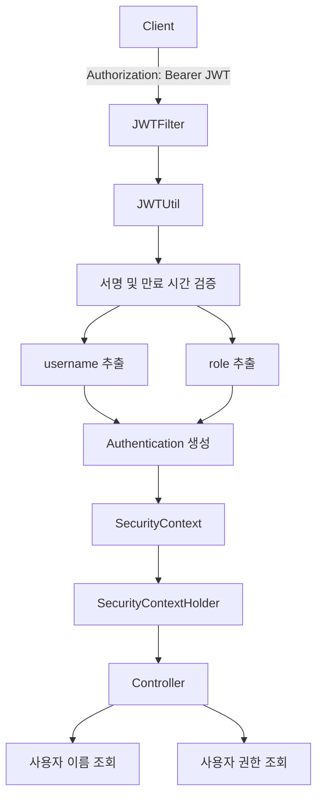
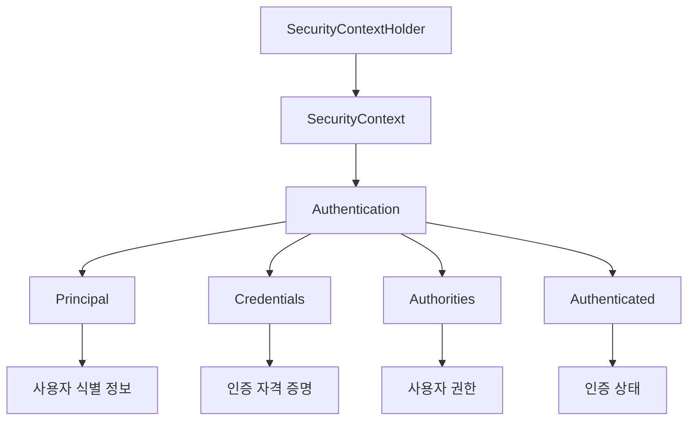
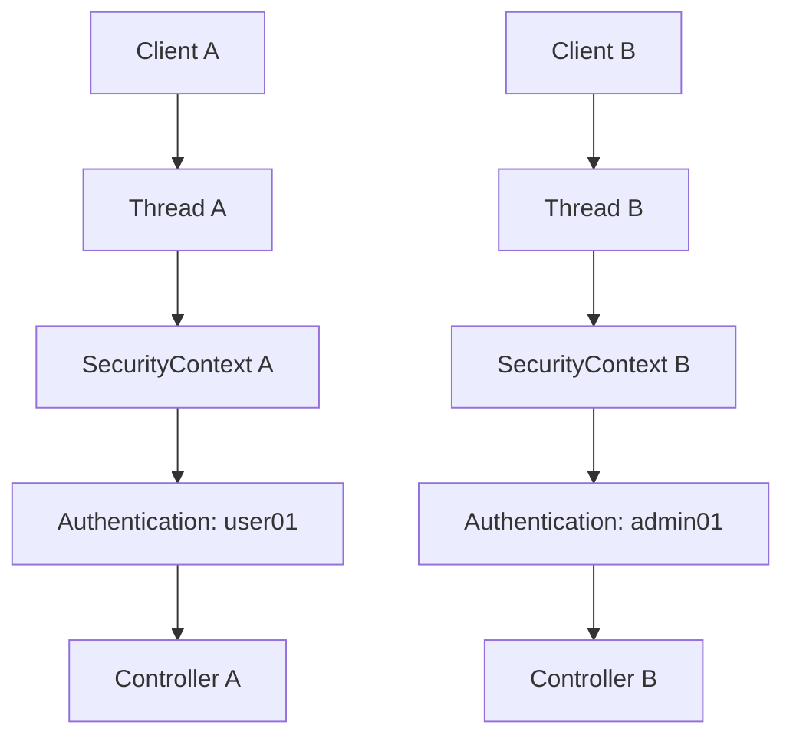
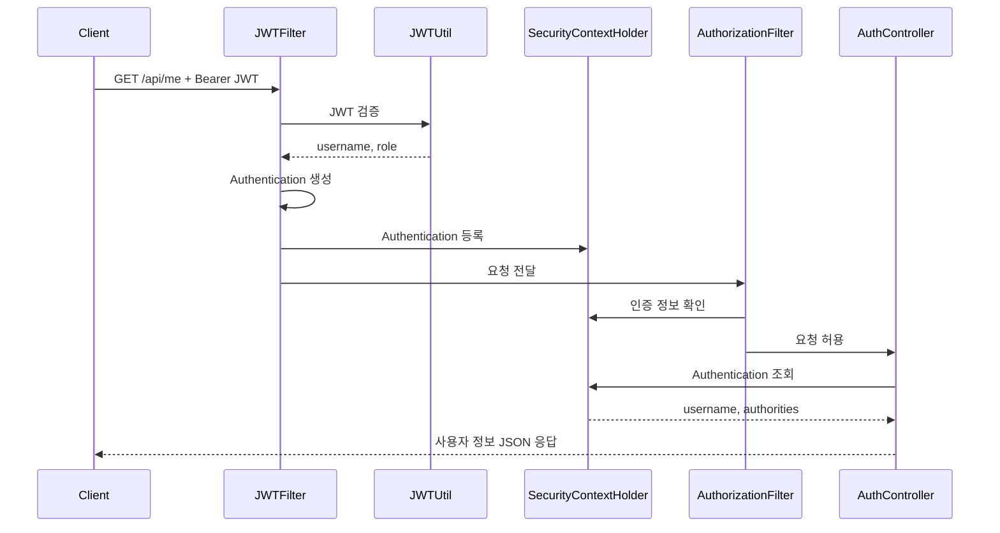
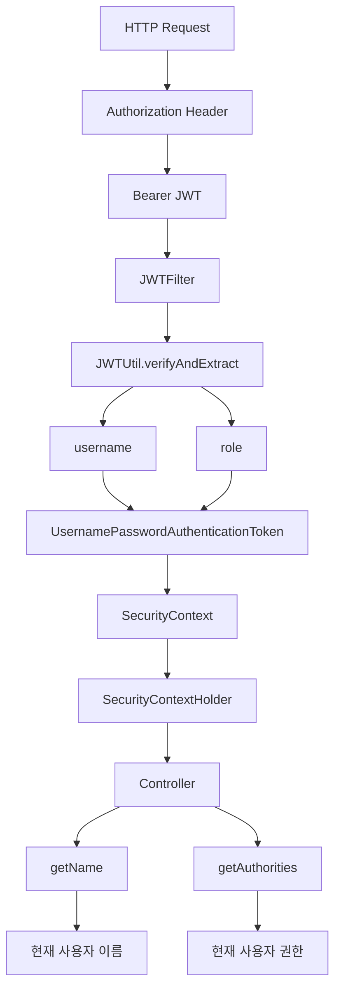
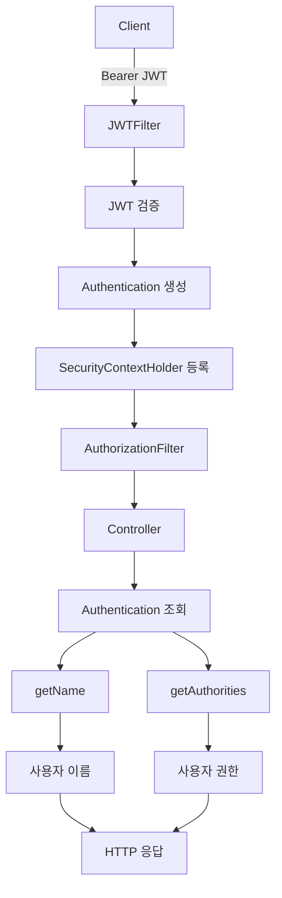

# 스프링 시큐리티 JWT - 12. 세션 정보
[https://youtu.be/Y1p6bVrRExs?si=afFf2E-PUp7VV7yt](https://youtu.be/Y1p6bVrRExs?si=afFf2E-PUp7VV7yt)

# 스프링 시큐리티 JWT - 12. 세션 정보
* toc
{:toc}

---

### Spring Security 6 JWT 인증 사용자 정보 조회: SecurityContextHolder, Authentication과 사용자 권한 확인

Spring Security와 JWT를 이용해 인증 시스템을 구현했다면, 다음으로 필요한 기능은 현재 로그인한 사용자의 정보를 조회하는 것이다.

일반적인 웹 서비스에서는 사용자 인증에 성공한 이후 다양한 기능에서 현재 사용자 정보를 사용한다.

예를 들어 다음과 같은 상황이다.

- 마이페이지에서 사용자 이름 표시
- 게시글 작성 시 작성자 식별
- 주문 내역 조회 시 현재 사용자 확인
- 관리자 페이지에서 사용자 권한 검사
- 프론트엔드에서 로그인 상태 확인
- 사용자 권한에 따른 화면 구성

이러한 기능을 구현하려면 Controller나 Service에서 현재 인증된 사용자 정보를 조회할 수 있어야 한다.

기존에 구현한 JWT 인증 시스템은 다음과 같은 구조로 동작한다.

```text
Client
    ↓
Authorization: Bearer JWT
    ↓
JWTFilter
    ↓
JWT 서명 및 만료 시간 검증
    ↓
사용자 이름과 권한 추출
    ↓
Authentication 생성
    ↓
SecurityContextHolder 등록
    ↓
AuthorizationFilter
    ↓
Controller
```

여기서 중요한 점은 JWT 검증 필터가 단순히 토큰의 유효성만 확인하는 것이 아니라는 사실이다.

JWT 검증에 성공하면 다음과 같은 인증 객체를 생성한다.

```java
UsernamePasswordAuthenticationToken authentication =
        UsernamePasswordAuthenticationToken.authenticated(
                username,
                null,
                authorities
        );
```

그리고 해당 객체를 `SecurityContextHolder`에 등록한다.

```java
SecurityContext context =
        SecurityContextHolder.createEmptyContext();

context.setAuthentication(authentication);

SecurityContextHolder.setContext(context);
```

이렇게 등록한 인증 정보는 이후 Controller에서도 확인할 수 있다.

예를 들어 다음과 같은 코드다.

```java
Authentication authentication =
        SecurityContextHolder.getContext()
                .getAuthentication();

String username = authentication.getName();
```

이 코드만으로 현재 인증된 사용자 이름을 확인할 수 있다.

사용자 권한 역시 `Authentication` 객체에서 가져올 수 있다.

```java
Collection<? extends GrantedAuthority> authorities =
        authentication.getAuthorities();
```

이번에는 이러한 구조가 어떻게 동작하는지 이해하고, 실제 Controller에서 사용자 이름과 권한을 반환하는 기능을 구현한다.

---

### 개념

#### JWT 인증 이후 사용자 정보는 어디에 저장될까?

JWT 기반 인증에서 가장 먼저 이해해야 할 것은 사용자 인증 정보가 저장되는 위치다.

로그인에 성공한 클라이언트는 JWT를 발급받는다.

이후 API 요청을 전송할 때 다음과 같이 JWT를 포함한다.

```http
GET /api/me HTTP/1.1
Host: localhost:8080
Authorization: Bearer <ACCESS_TOKEN>
```

서버는 요청에 포함된 JWT를 검증한다.

그리고 검증에 성공한 사용자 정보를 Spring Security의 `Authentication` 객체로 변환한다.



이때 사용자 정보는 다음 객체들을 통해 관리된다.

| 구성요소 | 역할 |
|---|---|
| `JWTFilter` | JWT를 검증하고 인증 객체 생성 |
| `Authentication` | 현재 사용자의 인증 정보 표현 |
| `SecurityContext` | Authentication을 보관 |
| `SecurityContextHolder` | 현재 실행 흐름의 SecurityContext 관리 |
| `GrantedAuthority` | 사용자 권한 표현 |

이러한 구조가 있기 때문에 Controller에서 JWT를 다시 파싱할 필요가 없다.

JWT 인증 필터에서 검증한 결과를 Spring Security가 관리하는 인증 객체를 통해 가져오면 된다.

---

### SecurityContextHolder란?

`SecurityContextHolder`는 Spring Security에서 현재 사용자의 보안 컨텍스트에 접근하기 위한 클래스다.

일반적으로 다음과 같은 방식으로 사용한다.

```java
SecurityContext context =
        SecurityContextHolder.getContext();
```

이렇게 가져온 `SecurityContext`에는 현재 인증 정보가 들어 있을 수 있다.

```java
Authentication authentication =
        context.getAuthentication();
```

따라서 다음 코드를 통해 사용자 이름과 권한을 확인할 수 있다.

```java
String username = authentication.getName();

Collection<? extends GrantedAuthority> authorities =
        authentication.getAuthorities();
```

전체적인 객체 관계는 다음과 같다.



각 구성요소의 의미를 구분하면 다음과 같다.

| 구성요소 | 설명 |
|---|---|
| Principal | 인증된 사용자 식별 정보 |
| Credentials | 비밀번호 등 인증 자격 증명 |
| Authorities | 사용자에게 부여된 권한 |
| Authenticated | Authentication 객체의 인증 상태 |

여기서 `SecurityContextHolder`가 JWT 문자열 자체를 저장하는 것은 아니다.

JWTFilter가 JWT를 검증한 이후 생성한 `Authentication` 객체를 관리한다.

이것이 중요한 차이다.

---

### Stateless 환경에서도 사용자 정보를 조회할 수 있는 이유

JWT 기반 인증에서는 일반적으로 Stateless 방식을 사용한다.

기존 SecurityConfig에서도 다음 설정을 적용했다.

```java
.sessionManagement(session -> session
        .sessionCreationPolicy(
                SessionCreationPolicy.STATELESS
        )
)
```

이 설정은 Spring Security가 로그인 상태를 유지하기 위해 HttpSession을 생성하거나 사용하지 않도록 구성한다.

그런데 Controller에서는 `SecurityContextHolder`를 통해 사용자 정보를 조회할 수 있다.

어떻게 가능한 것일까?

그 이유는 **HttpSession과 SecurityContext가 서로 다른 개념이기 때문**이다.

#### HttpSession

HttpSession은 서버에서 여러 HTTP 요청에 걸쳐 상태를 유지하는 데 사용할 수 있는 객체다.

세션 기반 인증에서는 다음과 같은 구조가 가능하다.

```text
로그인 성공
    ↓
서버에 인증 상태 저장
    ↓
세션 ID 발급
    ↓
다음 요청
    ↓
세션 ID로 기존 인증 상태 조회
```

서버가 사용자의 로그인 상태를 여러 요청에 걸쳐 관리할 수 있다.

#### SecurityContext

반면 SecurityContext는 Spring Security에서 현재 인증 정보를 표현하는 객체다.

JWT 기반 Stateless 인증에서는 다음과 같은 흐름으로 동작한다.

```text
HTTP 요청 A
    ↓
JWTFilter
    ↓
JWT 검증
    ↓
Authentication 생성
    ↓
SecurityContextHolder 등록
    ↓
Controller 실행
    ↓
요청 처리 종료
```

그다음 새로운 요청이 들어오면 JWT를 다시 검증한다.

```text
HTTP 요청 B
    ↓
JWTFilter
    ↓
JWT 검증
    ↓
Authentication 생성
    ↓
SecurityContextHolder 등록
    ↓
Controller 실행
    ↓
요청 처리 종료
```

즉 서버가 이전 요청의 로그인 상태를 HttpSession에 저장하지 않아도 현재 요청에서는 인증 정보를 사용할 수 있다.

**Stateless 인증은 SecurityContext를 사용하지 않는 방식이 아니라, 서버 세션에 로그인 상태를 유지하지 않는 방식이다.**

이것이 JWT 기반 인증 시스템을 이해하는 핵심이다.

---

### SecurityContextHolder는 어떻게 요청별 인증 정보를 관리할까?

Spring Security의 `SecurityContextHolder`는 기본적으로 `ThreadLocal`을 이용해 인증 정보를 관리한다.

`ThreadLocal`은 스레드별로 독립적인 값을 저장할 수 있는 Java 기능이다.

예를 들어 두 사용자가 동시에 API를 호출한다고 생각해보자.

```text
사용자 A
    ↓
JWT A
    ↓
HTTP 요청 A
    ↓
Thread A
```

```text
사용자 B
    ↓
JWT B
    ↓
HTTP 요청 B
    ↓
Thread B
```

각 요청에서 JWT 검증이 완료되면 해당 실행 스레드의 SecurityContext에 사용자 인증 정보가 설정된다.



따라서 서로 다른 스레드에서 처리되는 요청은 기본적으로 독립적인 SecurityContext를 사용한다.

하지만 여기서 중요한 주의사항이 있다.

Spring Boot의 Servlet Container는 일반적으로 스레드 풀을 사용한다.

따라서 요청 처리가 끝난 스레드가 다른 요청에 재사용될 수 있다.

이 과정에서 SecurityContext가 적절히 정리되지 않는다면 다른 요청에 이전 사용자의 인증 정보가 영향을 줄 위험이 있다.

Spring Security의 보안 필터 체인은 요청 처리 후 SecurityContext를 정리하도록 구성되어 있다.

직접 만든 별도의 스레드나 비동기 실행에서는 이러한 생명주기를 추가로 고려해야 한다.

또한 `ThreadLocal` 기반이라는 설명은 일반적인 동기식 Servlet 요청을 기준으로 한다. 비동기 처리에서는 컨텍스트 전파 방식이 달라질 수 있다.

---

### Authentication이란?

`Authentication`은 현재 사용자의 인증 상태와 권한 정보를 표현하는 인터페이스다.

대표적인 메서드는 다음과 같다.

| 메서드 | 역할 |
|---|---|
| `getName()` | 사용자 이름 조회 |
| `getPrincipal()` | 사용자 식별 객체 조회 |
| `getCredentials()` | 인증 자격 증명 조회 |
| `getAuthorities()` | 사용자 권한 조회 |
| `isAuthenticated()` | 인증 상태 확인 |

예를 들어 JWT에 다음 정보가 포함되어 있다고 생각해보자.

```json
{
  "username": "admin01",
  "role": "ROLE_ADMIN"
}
```

JWTFilter는 검증된 값을 이용해 다음과 같은 객체를 생성한다.

```java
UsernamePasswordAuthenticationToken authentication =
        UsernamePasswordAuthenticationToken.authenticated(
                "admin01",
                null,
                List.of(
                        new SimpleGrantedAuthority("ROLE_ADMIN")
                )
        );
```

이 객체는 개념적으로 다음 정보를 가진다.

```text
Authentication
    │
    ├── Principal
    │     └── admin01
    │
    ├── Credentials
    │     └── null
    │
    ├── Authorities
    │     └── ROLE_ADMIN
    │
    └── Authenticated
          └── true
```

이후 Controller에서는 다음과 같이 조회할 수 있다.

```java
String username = authentication.getName();
```

결과는 다음과 같다.

```text
admin01
```

권한도 확인할 수 있다.

```java
Collection<? extends GrantedAuthority> authorities =
        authentication.getAuthorities();
```

이때 권한 컬렉션에는 `ROLE_ADMIN`을 표현하는 `GrantedAuthority` 객체가 들어 있다.

---

### getName()과 getPrincipal()의 차이

현재 사용자 이름을 조회할 때 다음 두 메서드를 사용할 수 있다.

```java
authentication.getName();
```

```java
authentication.getPrincipal();
```

하지만 두 메서드는 동일하지 않다.

#### getName()

`getName()`은 현재 Authentication의 사용자 이름을 문자열로 반환한다.

```java
String username = authentication.getName();
```

일반적으로 사용자 이름만 필요한 상황에서 사용하기 편리하다.

#### getPrincipal()

`getPrincipal()`은 인증된 사용자 정보를 나타내는 객체를 반환한다.

```java
Object principal = authentication.getPrincipal();
```

반환되는 객체의 타입은 인증 방식에 따라 달라질 수 있다.

예를 들어 아이디·비밀번호 로그인에서는 다음과 같은 객체를 사용할 수 있다.

```text
CustomUserDetails
```

반면 앞서 구현한 JWTFilter에서는 다음과 같이 사용자 이름을 직접 Principal에 저장했다.

```java
UsernamePasswordAuthenticationToken.authenticated(
        username,
        null,
        authorities
);
```

따라서 이 구성에서는 Principal이 `String`이다.

두 방식을 비교하면 다음과 같다.

| 구분 | getName() | getPrincipal() |
|---|---|---|
| 반환 타입 | String | Object |
| 주요 목적 | 사용자 이름 조회 | 사용자 식별 객체 접근 |
| 인증 방식 의존성 | 상대적으로 낮음 | Principal 타입에 의존 |
| 예시 | `"admin01"` | `"admin01"` 또는 `CustomUserDetails` |

현재 프로젝트에서는 사용자 이름을 조회할 때 `getName()`을 사용하는 것이 간단하다.

---

### 주요 특징

#### 사용자 이름 조회하기

Controller에서 사용자 이름을 가져오는 가장 기본적인 방법은 다음과 같다.

```java
Authentication authentication =
        SecurityContextHolder.getContext()
                .getAuthentication();

String username = authentication.getName();
```

코드의 처리 순서는 다음과 같다.

```text
SecurityContextHolder
    ↓
getContext()
    ↓
SecurityContext
    ↓
getAuthentication()
    ↓
Authentication
    ↓
getName()
    ↓
username
```

하지만 이 코드는 중요한 전제조건이 있다.

**현재 요청에 사용할 수 있는 Authentication이 존재해야 한다.**

예를 들어 인증이 필요한 API라면 Spring Security가 인증되지 않은 요청을 Controller에 도달하기 전에 거부하도록 구성할 수 있다.

반면 공개 API에서는 익명 사용자가 요청할 수 있으므로 Authentication의 존재 여부와 상태를 확인해야 한다.

---

### 사용자 권한 조회하기

Spring Security에서 사용자 권한은 `GrantedAuthority` 인터페이스로 표현된다.

현재 사용자의 권한을 조회하려면 다음 메서드를 사용한다.

```java
authentication.getAuthorities();
```

반환 타입은 다음과 같다.

```java
Collection<? extends GrantedAuthority>
```

즉 권한은 단일 문자열이 아니라 컬렉션 형태로 제공된다.

예를 들어 다음과 같은 권한이 존재할 수 있다.

```text
ROLE_USER
```

```text
ROLE_ADMIN
```

또는 여러 개의 권한을 가질 수도 있다.

```text
ROLE_USER
ORDER_READ
ORDER_WRITE
```

이러한 구조 때문에 사용자 권한을 조회할 때 컬렉션을 처리해야 한다.

---

### Iterator로 권한 추출하기

가장 기본적인 방법은 Iterator를 사용하는 것이다.

```java
Collection<? extends GrantedAuthority> authorities =
        authentication.getAuthorities();

Iterator<? extends GrantedAuthority> iterator =
        authorities.iterator();

GrantedAuthority authority =
        iterator.next();

String role = authority.getAuthority();
```

각 코드를 살펴보자.

#### getAuthorities()

```java
authentication.getAuthorities();
```

현재 사용자의 권한 컬렉션을 가져온다.

#### iterator()

```java
authorities.iterator();
```

컬렉션의 요소를 순회할 수 있는 Iterator를 생성한다.

#### next()

```java
iterator.next();
```

다음 권한 객체를 가져온다.

#### getAuthority()

```java
authority.getAuthority();
```

권한 객체에서 문자열 값을 추출한다.

예를 들어 다음 값을 얻을 수 있다.

```text
ROLE_ADMIN
```

다만 `next()`를 호출하기 전에 권한이 존재하는지 확인해야 한다.

권한 컬렉션이 비어 있다면 `NoSuchElementException`이 발생할 수 있기 때문이다.

안전하게 작성하면 다음과 같다.

```java
Iterator<? extends GrantedAuthority> iterator =
        authentication.getAuthorities().iterator();

String role = iterator.hasNext()
        ? iterator.next().getAuthority()
        : "NO_ROLE";
```

현재 프로젝트에서는 사용자마다 하나의 역할을 가지므로 첫 번째 권한을 조회하는 방식으로 충분하다.

하지만 다중 권한 구조에서는 첫 번째 권한만 조회하는 방식이 적절하지 않을 수 있다.

---

### Stream으로 권한 조회하기

Java 17에서는 Stream을 이용해 더 간결하게 작성할 수 있다.

```java
String role = authentication
        .getAuthorities()
        .stream()
        .map(GrantedAuthority::getAuthority)
        .findFirst()
        .orElse("NO_ROLE");
```

각 메서드의 역할은 다음과 같다.

| 메서드 | 역할 |
|---|---|
| `getAuthorities()` | 권한 컬렉션 반환 |
| `stream()` | Stream 생성 |
| `map()` | GrantedAuthority를 String으로 변환 |
| `findFirst()` | 첫 번째 권한 조회 |
| `orElse()` | 권한이 없을 때 기본값 반환 |

여러 권한을 모두 가져오려면 다음처럼 작성할 수 있다.

```java
List<String> roles = authentication
        .getAuthorities()
        .stream()
        .map(GrantedAuthority::getAuthority)
        .toList();
```

예를 들어 결과는 다음과 같다.

```json
[
  "ROLE_USER",
  "ORDER_READ",
  "ORDER_WRITE"
]
```

실무에서는 사용자 권한이 여러 개일 수 있으므로 단일 role보다 권한 목록을 반환하는 구조가 확장에 유리하다.

---

### 예제

#### 프로젝트 구조

기존 프로젝트에서는 JWT 기반 인증 기능을 구성했다.

```text
src/main/java/com/example/jwt
│
├── config
│   └── SecurityConfig.java
│
├── controller
│   ├── MainController.java
│   └── AdminController.java
│
├── dto
│   └── CustomUserDetails.java
│
├── service
│   └── CustomUserDetailsService.java
│
├── repository
│   └── UserRepository.java
│
└── jwt
    ├── LoginFilter.java
    ├── JWTFilter.java
    └── JWTUtil.java
```

이번에는 Controller에서 현재 사용자 정보를 조회하는 기능을 추가한다.

먼저 기존 MainController를 수정한다.

이후 별도의 `/api/me` API를 구성하여 인증된 사용자 정보를 JSON으로 반환하는 구조도 살펴본다.

---

### MainController에서 사용자 정보 조회하기

현재 MainController는 다음과 같이 구성되어 있다고 가정한다.

```java
package com.example.jwt.controller;

import org.springframework.web.bind.annotation.GetMapping;
import org.springframework.web.bind.annotation.RestController;

@RestController
public class MainController {

    @GetMapping("/")
    public String main() {

        return "Main Controller";
    }
}
```

이 코드는 루트 경로에 요청이 들어오면 문자열을 반환한다.

```http
GET /
```

응답은 다음과 같다.

```text
Main Controller
```

이제 현재 사용자의 이름과 권한을 반환하도록 변경해보자.

#### 1. Authentication 조회

다음 코드를 작성한다.

```java
Authentication authentication =
        SecurityContextHolder.getContext()
                .getAuthentication();
```

이렇게 하면 현재 SecurityContext에서 Authentication을 가져올 수 있다.

#### 2. 사용자 이름 조회

```java
String username =
        authentication.getName();
```

#### 3. 사용자 권한 조회

```java
String role = authentication
        .getAuthorities()
        .stream()
        .map(GrantedAuthority::getAuthority)
        .findFirst()
        .orElse("NO_ROLE");
```

#### 4. 응답 반환

```java
return "username: " + username + ", role: " + role;
```

이렇게 하면 인증된 사용자의 정보가 문자열 형태로 반환된다.

---

### MainController 전체 코드

여기서 한 가지 상황을 추가로 고려해야 한다.

현재 루트 경로는 인증 없이 접근할 수 있도록 설정되어 있다.

```java
.requestMatchers("/")
.permitAll()
```

따라서 JWT가 없는 요청도 들어올 수 있다.

이런 경우 Authentication 객체가 존재하지 않거나 익명 사용자 인증 객체가 설정될 수 있다.

이를 고려한 전체 코드는 다음과 같다.

```java
package com.example.jwt.controller;

import org.springframework.security.authentication.AnonymousAuthenticationToken;

import org.springframework.security.core.Authentication;
import org.springframework.security.core.GrantedAuthority;

import org.springframework.security.core.context.SecurityContextHolder;

import org.springframework.web.bind.annotation.GetMapping;
import org.springframework.web.bind.annotation.RestController;

@RestController
public class MainController {

    @GetMapping("/")
    public String main() {

        // 1. 현재 인증 정보 조회
        Authentication authentication =
                SecurityContextHolder.getContext()
                        .getAuthentication();

        // 2. 인증되지 않은 사용자 처리
        if (authentication == null
                || authentication instanceof AnonymousAuthenticationToken) {

            return "Guest";
        }

        // 3. 사용자 이름 조회
        String username =
                authentication.getName();

        // 4. 사용자 권한 조회
        String role = authentication
                .getAuthorities()
                .stream()
                .map(GrantedAuthority::getAuthority)
                .findFirst()
                .orElse("NO_ROLE");

        // 5. 응답 반환
        return "username: " + username + ", role: " + role;
    }
}
```

이 코드는 다음 상황을 처리한다.

| 요청 상태 | 예상 응답 |
|---|---|
| JWT 없음 | Guest |
| 유효한 ROLE_USER JWT | username, ROLE_USER |
| 유효한 ROLE_ADMIN JWT | username, ROLE_ADMIN |
| 만료된 JWT | JWTFilter의 인증 실패 처리 |

현재 JWTFilter는 유효하지 않은 JWT가 전달되면 HTTP 401을 반환하도록 구성했다.

따라서 만료되거나 변조된 JWT가 전달된 경우 Controller까지 요청이 도달하지 않을 수 있다.

반면 Authorization 헤더가 없는 공개 요청은 Controller에서 Guest로 처리한다.

---

### 익명 사용자와 인증된 사용자의 차이

앞의 코드에서 다음 조건을 사용했다.

```java
authentication instanceof AnonymousAuthenticationToken
```

이 조건이 필요한 이유를 알아보자.

Spring Security에서는 인증되지 않은 요청에도 `AnonymousAuthenticationToken`을 설정할 수 있다.

일반적인 설정에서는 `AnonymousAuthenticationFilter`가 이 역할을 담당한다.

예를 들어 JWT가 없는 공개 요청에서는 다음과 같은 인증 객체가 존재할 수 있다.

```text
Authentication
    │
    ├── Principal
    │     └── anonymousUser
    │
    ├── Authorities
    │     └── ROLE_ANONYMOUS
    │
    └── Type
          └── AnonymousAuthenticationToken
```

이때 다음 코드를 실행하면 익명 사용자 이름이 반환될 수 있다.

```java
authentication.getName();
```

결과는 다음과 같다.

```text
anonymousUser
```

이것이 실제 로그인에 성공한 사용자를 의미하는 것은 아니다.

따라서 공개 API에서 현재 사용자 정보를 반환하려면 익명 사용자 여부를 고려해야 한다.

또한 다음 코드만으로 실제 로그인 여부를 판단하는 것도 주의해야 한다.

```java
authentication.isAuthenticated();
```

`AnonymousAuthenticationToken`도 자체적인 인증 상태가 `true`일 수 있기 때문이다.

Spring Security는 익명 인증과 실제 사용자 인증을 구분하기 위한 기능을 제공한다.

현재 코드에서는 `AnonymousAuthenticationToken`을 직접 확인했다.

더 다양한 인증 방식을 지원하는 환경에서는 `AuthenticationTrustResolver`를 이용해 익명 인증을 구분할 수도 있다.

---

### /api/me API 구현하기

현재 사용자의 정보를 반환하는 기능을 루트 경로에 구현할 수도 있지만, 실제 REST API에서는 별도의 사용자 정보 조회 API를 구성하는 경우가 많다.

예를 들어 다음과 같다.

```http
GET /api/me
Authorization: Bearer <ACCESS_TOKEN>
```

이 API는 현재 인증된 사용자의 정보를 반환한다.

응답은 다음과 같이 구성할 수 있다.

```json
{
  "username": "admin01",
  "roles": [
    "ROLE_ADMIN"
  ]
}
```

현재는 사용자 이름과 권한만 반환한다.

이후 서비스 요구사항에 따라 사용자 ID나 프로필 정보를 추가할 수 있다.

#### AuthController 생성

다음 클래스를 생성한다.

```text
com.example.jwt.controller.AuthController
```

전체 코드는 다음과 같다.

```java
package com.example.jwt.controller;

import org.springframework.security.core.Authentication;
import org.springframework.security.core.GrantedAuthority;

import org.springframework.security.core.annotation.CurrentSecurityContext;

import org.springframework.web.bind.annotation.GetMapping;
import org.springframework.web.bind.annotation.RestController;

import java.util.List;

@RestController
public class AuthController {

    @GetMapping("/api/me")
    public CurrentUserResponse me(
            @CurrentSecurityContext(expression = "authentication")
            Authentication authentication
    ) {

        // 1. 사용자 이름 조회
        String username =
                authentication.getName();

        // 2. 사용자 권한 목록 조회
        List<String> roles = authentication
                .getAuthorities()
                .stream()
                .map(GrantedAuthority::getAuthority)
                .toList();

        // 3. 응답 DTO 생성
        return new CurrentUserResponse(
                username,
                roles
        );
    }

    public record CurrentUserResponse(
            String username,
            List<String> roles
    ) {
    }
}
```

이 Controller에서는 `SecurityContextHolder`를 직접 호출하지 않았다.

대신 Spring Security가 제공하는 `@CurrentSecurityContext`를 사용했다.

```java
@CurrentSecurityContext(expression = "authentication")
Authentication authentication
```

이렇게 하면 현재 SecurityContext에 저장된 Authentication을 Controller 매개변수로 전달받을 수 있다.

단, `/api/me`는 인증이 필요한 경로로 구성해야 한다.

현재 프로젝트의 SecurityConfig에서는 다음 설정을 사용하고 있다.

```java
.anyRequest().authenticated()
```

따라서 `/api/me`는 JWT로 인증된 사용자만 접근할 수 있다.

---

### @CurrentSecurityContext란?

`@CurrentSecurityContext`는 Spring Security가 제공하는 Annotation이다.

현재 SecurityContext에 접근하기 위해 사용할 수 있다.

예를 들어 다음과 같다.

```java
@GetMapping("/api/me")
public String me(
        @CurrentSecurityContext SecurityContext context
) {

    Authentication authentication =
            context.getAuthentication();

    return authentication.getName();
}
```

SecurityContext 전체를 전달받는 방식이다.

반면 다음과 같이 Authentication만 가져올 수도 있다.

```java
@GetMapping("/api/me")
public String me(
        @CurrentSecurityContext(expression = "authentication")
        Authentication authentication
) {

    return authentication.getName();
}
```

이 방식은 Controller에서 직접 `SecurityContextHolder`를 호출하지 않아도 된다는 장점이 있다.

다음 두 방식은 현재 사용자 이름을 조회한다는 점에서 비슷하다.

**직접 조회**

```java
Authentication authentication =
        SecurityContextHolder.getContext()
                .getAuthentication();
```

**Annotation 이용**

```java
@CurrentSecurityContext(expression = "authentication")
Authentication authentication
```

Controller에서는 Annotation을 활용하는 방식이 의존성을 더 명확하게 표현할 수 있다.

반면 Spring MVC와 직접 연결되지 않은 Service나 별도의 구성요소에서는 SecurityContextHolder를 직접 사용할 수도 있다.

---

### @AuthenticationPrincipal이란?

Spring Security는 현재 인증된 Principal을 Controller에서 직접 받을 수 있도록 `@AuthenticationPrincipal`도 제공한다.

예를 들어 다음과 같다.

```java
@GetMapping("/api/username")
public String username(
        @AuthenticationPrincipal String username
) {

    return username;
}
```

다만 이 코드는 현재 프로젝트처럼 Principal에 `String`을 저장한 JWT 인증 구조를 전제로 한다.

앞서 구현한 JWTFilter에서는 다음과 같이 인증 객체를 생성했다.

```java
UsernamePasswordAuthenticationToken.authenticated(
        username,
        null,
        authorities
);
```

따라서 Principal은 사용자 이름 문자열이다.

하지만 로그인 인증 과정에서는 Principal이 `CustomUserDetails`일 수 있다.

```text
LoginFilter 인증 결과
    ↓
Principal = CustomUserDetails
```

반면 JWT 인증 필터에서는 다음과 같다.

```text
JWTFilter 인증 결과
    ↓
Principal = String
```

따라서 다음 코드를 모든 인증 방식에서 사용할 수 있다고 가정해서는 안 된다.

```java
@AuthenticationPrincipal CustomUserDetails userDetails
```

현재 JWTFilter가 Principal에 String을 저장한다면 이 방식으로 `CustomUserDetails`를 가져올 수 없다.

두 Annotation의 차이는 다음과 같다.

| 구분 | @AuthenticationPrincipal | @CurrentSecurityContext |
|---|---|---|
| 주된 목적 | Principal 조회 | SecurityContext 조회 |
| 반환 대상 | Authentication의 Principal | SecurityContext 또는 표현식 결과 |
| 사용자 이름 조회 | Principal 타입에 따라 가능 | Authentication.getName() 사용 |
| 권한 조회 | Principal 구조에 따라 다름 | Authentication.getAuthorities() 사용 |
| 주요 사용 상황 | 현재 사용자 객체 접근 | 인증 상태 및 권한 조회 |

현재처럼 사용자 이름과 권한을 함께 반환하려면 `@CurrentSecurityContext`가 편리하다.

---

### Controller에서 Authentication을 직접 받는 방법

Spring MVC에서는 다음과 같이 `Authentication`을 Controller 매개변수로 선언하는 방식도 사용할 수 있다.

```java
@GetMapping("/api/me")
public String me(Authentication authentication) {

    return authentication.getName();
}
```

이 방식은 간단하지만 익명 요청 처리에서는 차이가 존재할 수 있다.

Spring MVC의 기본 Principal 인자 처리는 Servlet 요청의 Principal에 기반한다.

따라서 SecurityContext에 `AnonymousAuthenticationToken`이 존재하더라도 익명 요청에서 Controller 매개변수로 전달되는 Authentication은 null일 수 있다.

반면 `@CurrentSecurityContext`는 SecurityContext 자체에서 인증 정보를 가져온다.

따라서 **익명 사용자의 SecurityContext까지 직접 확인해야 한다면 `@CurrentSecurityContext`를 사용하는 방식이 더 명확하다.**

---

### SecurityConfig 확인하기

현재 프로젝트에서는 다음과 같은 접근 권한 정책을 사용한다.

```java
.authorizeHttpRequests(auth -> auth

        // 메인 페이지 공개
        .requestMatchers(
                HttpMethod.GET,
                "/"
        ).permitAll()

        // 로그인 및 회원가입 공개
        .requestMatchers(
                HttpMethod.POST,
                "/login",
                "/join"
        ).permitAll()

        // 관리자 API
        .requestMatchers(
                "/admin",
                "/admin/**"
        ).hasRole("ADMIN")

        // 나머지 API 인증 필요
        .anyRequest().authenticated()
)
```

따라서 각 경로에 대한 동작은 다음과 같다.

| 요청 경로 | 인증 필요 | 필요한 권한 |
|---|---|---|
| GET `/` | 아니요 | 없음 |
| POST `/login` | 아니요 | 없음 |
| POST `/join` | 아니요 | 없음 |
| GET `/api/me` | 예 | 인증된 사용자 |
| GET `/admin` | 예 | ROLE_ADMIN |

여기서 `/api/me`는 별도의 권한을 요구하지 않는다.

하지만 인증된 사용자만 접근할 수 있다.

반면 `/admin`은 인증뿐 아니라 관리자 권한도 필요하다.

이러한 차이를 구분해야 한다.

---

### 실제 요청 흐름

JWT로 인증된 사용자가 `/api/me`에 접근하는 상황을 살펴보자.



이 구조에서 중요한 사실은 Controller가 JWTUtil을 직접 호출하지 않는다는 점이다.

JWTFilter에서 이미 토큰을 검증했기 때문이다.

따라서 Controller에서는 인증된 Authentication을 이용하면 된다.

이러한 책임 분리는 다음과 같이 정리할 수 있다.

| 계층 | 책임 |
|---|---|
| JWTFilter | JWT 검증 및 Authentication 생성 |
| SecurityContextHolder | 현재 인증 정보 관리 |
| AuthorizationFilter | 접근 권한 검증 |
| Controller | 현재 인증 정보를 이용한 요청 처리 |
| Service | 사용자 정보를 이용한 비즈니스 로직 수행 |

---

### 실행 및 확인

#### Spring Boot 실행

기존 프로젝트를 실행한다.

```bash
./gradlew bootRun
```

명령어의 의미는 다음과 같다.

| 명령 | 의미 |
|---|---|
| `./gradlew` | Gradle Wrapper 실행 |
| `bootRun` | Spring Boot 애플리케이션 실행 |

정상적으로 실행되면 다음과 유사한 로그를 확인할 수 있다.

```text
Tomcat started on port 8080 (http)

Started JwtApplication
```

이제 로그인 요청을 통해 JWT를 발급받는다.

---

### JWT 발급받기

먼저 로그인 API를 호출한다.

```http
POST http://localhost:8080/login
```

Body는 `x-www-form-urlencoded`를 사용한다.

다음 데이터를 전달한다.

| Key | Value |
|---|---|
| username | admin01 |
| password | password123! |

여기서 `admin01`은 데이터베이스에 등록되어 있고 관리자 권한을 가진 사용자라고 가정한다.

로그인에 성공하면 다음과 같은 응답을 받을 수 있다.

```http
HTTP/1.1 200 OK
Authorization: Bearer <ACCESS_TOKEN>
```

이제 해당 JWT를 이용해 사용자 정보를 조회한다.

---

### curl로 로그인하기

다음 명령을 실행한다.

```bash
curl -i -X POST \
  http://localhost:8080/login \
  --data-urlencode "username=admin01" \
  --data-urlencode "password=password123!"
```

각 옵션의 의미는 다음과 같다.

| 옵션 | 의미 |
|---|---|
| `-i` | 응답 헤더 출력 |
| `-X POST` | POST 요청 |
| `--data-urlencode` | 요청 데이터 URL 인코딩 |

정상적으로 로그인에 성공했다면 응답 헤더에서 JWT를 확인할 수 있다.

```http
Authorization: Bearer <ACCESS_TOKEN>
```

이제 실제 JWT 문자열을 다음 요청에 사용한다.

---

### 메인 Controller에서 사용자 정보 확인하기

JWT를 발급받았다면 다음 요청을 전송한다.

```bash
curl -i \
  http://localhost:8080/ \
  -H "Authorization: Bearer <ACCESS_TOKEN>"
```

여기서 `<ACCESS_TOKEN>`은 실제 발급받은 JWT로 변경해야 한다.

정상적으로 JWT가 검증되면 다음 흐름이 실행된다.

```text
GET /
    ↓
JWTFilter
    ↓
JWT 검증
    ↓
Authentication 생성
    ↓
SecurityContextHolder 등록
    ↓
MainController
    ↓
authentication.getName()
    ↓
authentication.getAuthorities()
```

응답은 다음과 같다.

```http
HTTP/1.1 200 OK

username: admin01, role: ROLE_ADMIN
```

이렇게 하면 Controller에서 현재 사용자의 이름과 권한을 확인할 수 있다.

---

### JWT 없이 메인 Controller에 접근하기

이번에는 JWT를 전달하지 않고 요청한다.

```bash
curl -i http://localhost:8080/
```

현재 메인 경로는 다음과 같이 설정되어 있다.

```java
.requestMatchers(
        HttpMethod.GET,
        "/"
).permitAll()
```

따라서 인증 없이 접근할 수 있다.

하지만 JWT가 없으므로 로그인한 사용자 정보를 제공하지 않는다.

앞서 구현한 MainController에서는 익명 사용자를 다음과 같이 처리한다.

```java
if (authentication == null
        || authentication instanceof AnonymousAuthenticationToken) {

    return "Guest";
}
```

따라서 예상 응답은 다음과 같다.

```http
HTTP/1.1 200 OK

Guest
```

이 테스트를 통해 공개 API에서 인증 여부에 따라 다른 응답을 반환할 수 있다는 사실을 확인할 수 있다.

---

### /api/me API 호출하기

이번에는 인증된 사용자의 정보를 JSON으로 반환하는 API를 호출한다.

```bash
curl -i \
  http://localhost:8080/api/me \
  -H "Authorization: Bearer <ACCESS_TOKEN>"
```

정상적으로 JWT가 검증되면 다음과 같은 응답을 받을 수 있다.

```json
{
  "username": "admin01",
  "roles": [
    "ROLE_ADMIN"
  ]
}
```

이 응답은 현재 요청에서 Spring Security가 인증한 사용자 정보를 기반으로 생성된다.

Controller는 JWT의 원본 문자열을 직접 처리하지 않는다.

이미 검증된 Authentication 객체를 통해 사용자 정보를 조회한다.

---

### JWT 없이 /api/me에 접근하기

이번에는 JWT를 제거하고 요청한다.

```bash
curl -i http://localhost:8080/api/me
```

현재 `/api/me`는 다음 정책에 따라 인증이 필요하다.

```java
.anyRequest().authenticated()
```

따라서 인증되지 않은 요청은 Controller에 도달하지 못한다.

현재 프로젝트에서 인증 실패 응답을 HTTP 401로 설정했다면 다음과 같은 결과를 확인할 수 있다.

```http
HTTP/1.1 401 Unauthorized
```

여기서 중요한 점이 있다.

Controller에서 직접 사용자의 로그인 상태를 검사하지 않아도 Spring Security가 먼저 접근을 제한한다.

따라서 인증이 반드시 필요한 API라면 Controller에서 모든 요청마다 JWT 존재 여부를 검사할 필요가 없다.

---

### 관리자 권한 확인하기

앞서 구현한 `/admin` 경로는 다음 권한을 요구한다.

```java
.requestMatchers(
        "/admin",
        "/admin/**"
).hasRole("ADMIN")
```

이 설정에서 `hasRole("ADMIN")`은 기본적으로 `ROLE_ADMIN` 권한을 확인한다.

관리자 JWT를 사용해 요청하면 다음 흐름이 실행된다.

```text
JWT 검증 성공
    ↓
Authentication 생성
    ↓
ROLE_ADMIN
    ↓
AuthorizationFilter
    ↓
hasRole("ADMIN")
    ↓
접근 허용
```

반면 일반 사용자 JWT를 이용한다면 다음과 같다.

```text
JWT 검증 성공
    ↓
Authentication 생성
    ↓
ROLE_USER
    ↓
AuthorizationFilter
    ↓
hasRole("ADMIN")
    ↓
접근 거부
```

이 경우 일반적으로 HTTP 403 Forbidden을 반환한다.

| 상황 | 결과 |
|---|---|
| 관리자 JWT로 `/admin` 접근 | 200 |
| 일반 사용자 JWT로 `/admin` 접근 | 403 |
| JWT 없이 `/admin` 접근 | 401 |
| 만료된 JWT로 접근 | 401 |

이처럼 인증과 인가는 서로 다른 단계에서 수행된다.

JWTFilter는 사용자 인증 정보를 구성한다.

AuthorizationFilter는 해당 사용자가 요청한 API에 접근할 수 있는지 판단한다.

---

### 구조

#### JWTFilter와 Controller 사이의 데이터 전달 구조

JWT 기반 인증에서는 HTTP 요청에 포함된 JWT가 최종적으로 Authentication 객체로 변환된다.

그 과정을 다시 정리해보자.



여기서 Controller가 사용하는 값은 JWT 문자열 그 자체가 아니다.

JWT를 검증한 이후 생성된 Authentication이다.

따라서 다음과 같은 구조를 사용하면 된다.

```java
Authentication authentication =
        SecurityContextHolder.getContext()
                .getAuthentication();
```

이후 사용자 이름은 다음과 같이 가져온다.

```java
String username =
        authentication.getName();
```

권한 목록은 다음과 같이 가져온다.

```java
List<String> roles = authentication
        .getAuthorities()
        .stream()
        .map(GrantedAuthority::getAuthority)
        .toList();
```

현재 사용자 정보를 조회하는 기본적인 구현은 이것으로 충분하다.

---

### 실무에서의 활용

#### 1. Controller에서 JWT를 다시 검증하지 않는다

JWTFilter에서 이미 JWT를 검증했다면 Controller에서 JWTUtil을 다시 호출할 필요가 없다.

예를 들어 다음과 같은 코드는 인증 책임이 중복되는 구조가 될 수 있다.

```java
@GetMapping("/api/me")
public String me(
        @RequestHeader("Authorization") String authorization
) {

    String token = authorization.substring(7);

    return jwtUtil.getUsername(token);
}
```

Controller에서 다시 JWT를 파싱하고 검증하고 있기 때문이다.

대신 다음과 같이 구현할 수 있다.

```java
@GetMapping("/api/me")
public String me(
        @CurrentSecurityContext(expression = "authentication")
        Authentication authentication
) {

    return authentication.getName();
}
```

이렇게 하면 JWT 검증 책임은 JWTFilter에 두고 Controller는 인증 결과만 사용한다.

#### 2. SecurityContextHolder를 무조건 모든 계층에서 호출하지 않는다

Controller에서 사용자 정보를 조회하는 방법은 여러 가지다.

하지만 Service까지 `SecurityContextHolder`에 강하게 의존하도록 구성하면 테스트와 재사용이 어려워질 수 있다.

예를 들어 다음과 같은 구조를 생각해보자.

```text
Controller
    ↓
SecurityContextHolder
    ↓
username
    ↓
Service
```

Service에서 다시 SecurityContextHolder를 호출하는 대신 Controller가 필요한 사용자 식별자를 전달할 수 있다.

```java
@GetMapping("/api/orders")
public List<OrderResponse> orders(
        @CurrentSecurityContext(expression = "authentication")
        Authentication authentication
) {

    return orderService.findMyOrders(
            authentication.getName()
    );
}
```

이 방식에서는 Service가 인증 프레임워크의 세부 구현에 직접 의존하지 않는다.

다만 여러 Service에서 현재 사용자의 식별자가 반복적으로 필요하다면 별도의 CurrentUser 추상화를 구성하는 방법도 고려할 수 있다.

#### 3. 사용자 이름보다 변경되지 않는 사용자 ID가 적절할 수 있다

현재 JWT에는 username을 저장한다.

```json
{
  "username": "user01"
}
```

하지만 실제 서비스에서 사용자가 로그인 아이디를 변경할 수 있다면 문제가 발생할 수 있다.

예를 들어 다음과 같은 상황이다.

```text
기존 username
    ↓
user01
    ↓
JWT 발급
    ↓
로그인 아이디 변경
    ↓
newUser01
```

기존 JWT에는 여전히 `user01`이 들어 있다.

따라서 안정적인 사용자 식별이 필요한 서비스에서는 데이터베이스의 내부 사용자 ID를 사용하는 구조를 고려할 수 있다.

예를 들어 JWT의 `sub` Claim에 불변 사용자 ID를 포함하는 방식이다.

#### 4. 사용자 ID와 권한은 다른 개념이다

현재 사용자의 식별자와 권한은 서로 다른 목적을 가진다.

사용자 ID는 어떤 사용자인지 구분한다.

권한은 해당 사용자가 어떤 작업을 수행할 수 있는지 판단한다.

예를 들어 다음과 같다.

```text
userId = 1001

role = ROLE_USER
```

여기서 사용자 ID는 주문 조회나 프로필 조회에 활용할 수 있다.

반면 ROLE_USER는 특정 API 접근 여부를 판단할 때 사용한다.

따라서 두 정보를 동일한 값으로 취급해서는 안 된다.

#### 5. 현재 사용자 정보 조회와 DB 조회는 구분해야 한다

SecurityContextHolder에서 가져오는 정보는 인증 과정에서 구성된 데이터다.

예를 들어 다음과 같다.

```text
username
role
```

하지만 사용자의 이메일이나 전화번호, 프로필 이미지와 같은 정보가 필요한 경우에는 별도의 데이터베이스 조회가 필요할 수 있다.

```text
Authentication
    ↓
userId
    ↓
UserService
    ↓
UserRepository
    ↓
MySQL
    ↓
사용자 프로필 조회
```

따라서 `/api/me`가 단순히 인증 정보를 반환하는 API인지, 실제 사용자 프로필을 조회하는 API인지 목적을 구분하는 것이 좋다.

#### 6. 권한은 단일 문자열보다 컬렉션으로 관리하는 것이 확장에 유리하다

현재 프로젝트에서는 한 사용자가 하나의 역할을 가진다.

```text
ROLE_USER
```

하지만 서비스가 확장되면 다음과 같은 권한이 필요할 수 있다.

```text
ROLE_USER
ROLE_ADMIN
ORDER_READ
ORDER_WRITE
```

이때 Iterator로 첫 번째 권한만 추출하는 구조는 한계가 있다.

따라서 다중 권한이 필요한 서비스에서는 다음과 같이 전체 권한을 반환하는 편이 적절하다.

```java
List<String> roles = authentication
        .getAuthorities()
        .stream()
        .map(GrantedAuthority::getAuthority)
        .toList();
```

#### 7. 프론트엔드의 화면 제어와 서버 권한 검증을 구분한다

프론트엔드에서는 사용자의 권한에 따라 특정 버튼을 숨길 수 있다.

예를 들어 관리자 권한이 없는 사용자에게 관리자 버튼을 표시하지 않는 것이다.

하지만 이러한 화면 제어가 실제 보안 정책을 대신할 수는 없다.

사용자는 브라우저에서 직접 HTTP 요청을 전송할 수 있기 때문이다.

따라서 관리자 API는 반드시 서버에서도 권한을 검증해야 한다.

```java
.requestMatchers("/admin/**")
.hasRole("ADMIN")
```

프론트엔드의 역할은 사용자 경험 개선이다.

서버의 역할은 실제 접근 권한을 강제하는 것이다.

#### 8. 익명 사용자와 인증된 사용자를 정확히 구분한다

공개 API에서는 JWT 없이도 요청이 들어올 수 있다.

이때 Spring Security가 AnonymousAuthenticationToken을 구성할 수 있다.

따라서 `Authentication`이 null이 아니라는 사실만으로 로그인했다고 판단해서는 안 된다.

또한 `isAuthenticated()`의 결과만 확인하는 방식도 익명 인증 때문에 주의가 필요하다.

인증이 필수적인 API에서는 가능하면 SecurityConfig에서 접근을 제한하는 것이 좋다.

#### 9. 인증 정보에 포함된 권한이 최신 상태라고 가정하지 않는다

JWT는 발급 당시의 사용자 정보를 포함할 수 있다.

예를 들어 JWT 발급 당시 사용자가 관리자였다고 생각해보자.

```json
{
  "username": "admin01",
  "role": "ROLE_ADMIN"
}
```

이후 관리자 권한이 회수되더라도 기존 JWT에는 ROLE_ADMIN이 남아 있을 수 있다.

따라서 권한 변경을 즉시 반영해야 하는 시스템에서는 최신 권한 조회나 토큰 무효화 전략을 추가해야 한다.

#### 10. 계정 탈퇴와 정지 상태를 고려한다

JWT 서명과 만료 시간이 정상적이라고 해서 사용자가 현재도 정상적으로 서비스를 이용할 수 있는 상태라는 의미는 아니다.

예를 들어 사용자가 회원 탈퇴를 완료했지만 기존 JWT가 아직 만료되지 않았을 수 있다.

이 경우 JWT 검증만으로 사용자를 허용하면 서비스 정책과 충돌할 수 있다.

따라서 계정 정지와 탈퇴를 즉시 반영해야 하는 서비스에서는 사용자 상태를 추가로 확인하는 정책이 필요하다.

#### 11. ThreadLocal을 비동기 환경에서 그대로 사용할 수 있다고 가정하지 않는다

SecurityContextHolder는 기본적으로 ThreadLocal 기반이다.

따라서 다음과 같은 구조에서는 주의해야 한다.

```text
HTTP 요청 스레드
    ↓
SecurityContextHolder
    ↓
Authentication
    ↓
@Async
    ↓
새로운 스레드
```

새로운 스레드에서는 기존 SecurityContext가 자동으로 전달되지 않을 수 있다.

Spring Security는 비동기 실행에서 SecurityContext를 전달하기 위한 여러 기능을 제공한다.

따라서 별도의 스레드 풀이나 비동기 작업을 사용하는 경우에는 컨텍스트 전파 정책을 명확하게 설계해야 한다.

#### 12. 사용자 정보를 로그에 남길 때 주의한다

현재 사용자의 이름을 조회할 수 있다고 해서 모든 요청에서 사용자 정보를 상세하게 기록해야 하는 것은 아니다.

특히 JWT 원문이나 비밀번호, 개인정보를 로그에 남겨서는 안 된다.

로그가 필요한 경우에는 서비스 정책에 따라 최소한의 사용자 식별자와 요청 ID 등을 기록하는 것이 좋다.

예를 들어 다음과 같이 요청 추적 ID를 활용할 수 있다.

```text
requestId = ...
userId = ...
```

이렇게 하면 민감한 인증 정보를 노출하지 않고도 요청을 추적하는 데 도움이 된다.

#### 13. 사용자 인증 정보를 신뢰할 수 있는 위치에서 생성해야 한다

현재 인증 정보는 JWTFilter에서 생성한다.

이때 JWT의 서명과 만료 시간을 검증한 이후 username과 role을 추출한다.

따라서 Controller에서는 SecurityContext에 등록된 Authentication을 사용한다.

반대로 클라이언트가 임의로 전달한 헤더의 사용자 이름을 그대로 신뢰해서는 안 된다.

예를 들어 다음 헤더를 생각해보자.

```http
X-User-Role: ROLE_ADMIN
```

이 값은 클라이언트가 임의로 변경할 수 있다.

따라서 이러한 값으로 관리자 권한을 부여해서는 안 된다.

사용자의 권한은 검증된 인증 정보 또는 신뢰할 수 있는 서버 측 저장소에서 가져와야 한다.

#### 14. SecurityContext를 직접 수정하는 로직은 최소화한다

JWTFilter에서는 검증된 사용자 정보로 Authentication을 생성하고 SecurityContext에 등록한다.

하지만 일반적인 Controller나 Service에서는 SecurityContext를 직접 변경하지 않는 것이 좋다.

예를 들어 다음과 같은 코드를 비즈니스 로직에서 실행하면 위험할 수 있다.

```java
SecurityContextHolder.getContext()
        .setAuthentication(authentication);
```

잘못된 인증 객체를 등록하면 권한 상승이나 사용자 식별 오류가 발생할 수 있기 때문이다.

인증 정보 생성과 변경은 인증을 담당하는 구성요소에서 통제하는 것이 바람직하다.

#### 15. 사용자 정보 조회 API는 필요한 데이터만 반환한다

현재 `/api/me`에서는 다음 정보를 반환한다.

```json
{
  "username": "admin01",
  "roles": [
    "ROLE_ADMIN"
  ]
}
```

실제 서비스에서는 이메일이나 닉네임, 프로필 이미지 등을 추가할 수 있다.

하지만 인증 객체에 포함된 모든 값을 그대로 반환해서는 안 된다.

특히 Credentials나 비밀번호 해시, 내부 인증 객체 전체를 응답으로 반환하지 않도록 주의해야 한다.

사용자 정보 조회 API에서는 응답 DTO를 정의하고 필요한 데이터만 반환하는 것이 적절하다.

#### 16. 인증된 사용자 정보가 존재하는지 테스트해야 한다

JWT 인증 필터의 동작을 검증하는 것과 Controller에서 사용자 정보를 정상적으로 조회하는 것은 서로 다른 문제다.

JWTFilter 단위 테스트에서는 다음 내용을 확인할 수 있다.

```text
JWT 검증
    ↓
Authentication 생성
    ↓
SecurityContext 등록
```

Controller 테스트에서는 다음 내용을 확인해야 한다.

```text
Authentication 조회
    ↓
username 추출
    ↓
authorities 추출
    ↓
응답 생성
```

따라서 인증 필터 테스트와 Controller 테스트를 함께 작성하는 것이 좋다.

#### 17. 인증 상태를 모든 요청에서 무조건 데이터베이스로 조회할 필요는 없다

JWT 기반 인증에서는 JWT를 검증하여 필요한 사용자 정보를 얻을 수 있다.

따라서 현재 사용자 이름과 권한만 필요한 API에서는 매번 MySQL을 조회하지 않고 Authentication을 사용할 수 있다.

이는 데이터베이스 조회를 줄이는 데 도움이 될 수 있다.

다만 최신 사용자 상태나 권한이 필요한 API에서는 추가 조회가 필요할 수 있다.

중요한 것은 **DB 조회를 무조건 제거하는 것이 아니라, 어떤 정보에 최신성이 필요한지 구분하는 것**이다.

---

### 테스트 코드 작성

이제 Controller에서 SecurityContext의 사용자 정보를 정상적으로 가져오는지 확인해보자.

이번에는 MainController를 단위 테스트한다.

테스트에서는 JWTFilter를 실행하지 않는다.

대신 SecurityContextHolder에 테스트용 Authentication을 직접 등록한다.

이렇게 하면 Controller의 사용자 정보 추출 로직만 독립적으로 검증할 수 있다.

#### MainControllerTest

```java
package com.example.jwt.controller;

import org.junit.jupiter.api.AfterEach;
import org.junit.jupiter.api.BeforeEach;
import org.junit.jupiter.api.Test;

import org.springframework.security.authentication.UsernamePasswordAuthenticationToken;

import org.springframework.security.core.Authentication;

import org.springframework.security.core.authority.SimpleGrantedAuthority;

import org.springframework.security.core.context.SecurityContext;
import org.springframework.security.core.context.SecurityContextHolder;

import org.springframework.test.web.servlet.MockMvc;

import org.springframework.test.web.servlet.setup.MockMvcBuilders;

import java.util.List;

import static org.springframework.test.web.servlet.request.MockMvcRequestBuilders.get;

import static org.springframework.test.web.servlet.result.MockMvcResultMatchers.content;
import static org.springframework.test.web.servlet.result.MockMvcResultMatchers.status;

class MainControllerTest {

    private MockMvc mockMvc;

    @BeforeEach
    void setUp() {

        mockMvc = MockMvcBuilders
                .standaloneSetup(new MainController())
                .build();
    }

    @AfterEach
    void tearDown() {

        SecurityContextHolder.clearContext();
    }

    @Test
    void 인증된_사용자의_이름과_권한을_반환한다()
            throws Exception {

        // given
        Authentication authentication =
                UsernamePasswordAuthenticationToken.authenticated(
                        "admin01",
                        null,
                        List.of(
                                new SimpleGrantedAuthority(
                                        "ROLE_ADMIN"
                                )
                        )
                );

        SecurityContext context =
                SecurityContextHolder.createEmptyContext();

        context.setAuthentication(authentication);

        SecurityContextHolder.setContext(context);

        // when & then
        mockMvc.perform(get("/"))
                .andExpect(status().isOk())
                .andExpect(
                        content().string(
                                "username: admin01, role: ROLE_ADMIN"
                        )
                );
    }

    @Test
    void 인증정보가_없으면_Guest를_반환한다()
            throws Exception {

        // given
        SecurityContextHolder.clearContext();

        // when & then
        mockMvc.perform(get("/"))
                .andExpect(status().isOk())
                .andExpect(
                        content().string("Guest")
                );
    }
}
```

첫 번째 테스트는 인증된 사용자의 이름과 권한을 정상적으로 반환하는지 확인한다.

두 번째 테스트는 인증 정보가 없는 경우 Guest를 반환하는지 확인한다.

여기서 중요한 점은 테스트 종료 후 다음 메서드를 호출한다는 것이다.

```java
SecurityContextHolder.clearContext();
```

테스트에서 SecurityContextHolder에 직접 값을 설정했기 때문에 다음 테스트에 영향을 주지 않도록 정리하는 것이다.

실제 Spring Security 필터 체인을 포함한 통합 테스트에서는 보안 필터가 컨텍스트 생명주기를 관리한다.

#### 테스트 실행

다음 명령을 실행한다.

```bash
./gradlew test --tests "com.example.jwt.controller.MainControllerTest"
```

각 옵션의 의미는 다음과 같다.

| 명령 | 설명 |
|---|---|
| `./gradlew` | Gradle Wrapper 실행 |
| `test` | 테스트 실행 |
| `--tests` | 실행할 테스트 클래스 지정 |

정상적으로 완료되면 다음과 유사한 결과를 확인할 수 있다.

```text
BUILD SUCCESSFUL
```

이 테스트는 Controller의 사용자 정보 조회 기능만 검증한다.

JWT 검증과 SecurityFilterChain 전체 동작을 확인하려면 실제 보안 필터가 포함된 통합 테스트를 별도로 수행해야 한다.

---

### 정리

Spring Security에서 JWT 기반 인증을 구현했다면 Controller에서도 현재 인증된 사용자 정보를 확인할 수 있다.

JWTFilter는 클라이언트가 전달한 JWT를 검증한 이후 Authentication 객체를 생성한다.

```java
UsernamePasswordAuthenticationToken authentication =
        UsernamePasswordAuthenticationToken.authenticated(
                username,
                null,
                authorities
        );
```

이후 SecurityContext에 Authentication을 등록한다.

```java
SecurityContext context =
        SecurityContextHolder.createEmptyContext();

context.setAuthentication(authentication);

SecurityContextHolder.setContext(context);
```

이렇게 하면 현재 요청을 처리하는 Controller에서도 인증 정보를 조회할 수 있다.

가장 기본적인 조회 코드는 다음과 같다.

```java
Authentication authentication =
        SecurityContextHolder.getContext()
                .getAuthentication();
```

사용자 이름은 다음과 같이 가져온다.

```java
String username =
        authentication.getName();
```

권한은 다음과 같이 가져올 수 있다.

```java
List<String> roles = authentication
        .getAuthorities()
        .stream()
        .map(GrantedAuthority::getAuthority)
        .toList();
```

Spring MVC에서는 다음과 같은 방식도 사용할 수 있다.

```java
@GetMapping("/api/me")
public String me(
        @CurrentSecurityContext(expression = "authentication")
        Authentication authentication
) {

    return authentication.getName();
}
```

이 방식은 Controller에서 SecurityContextHolder를 직접 호출하지 않아도 된다는 장점이 있다.

전체 흐름을 정리하면 다음과 같다.



이번 구현에서 반드시 기억해야 할 점은 다음과 같다.

**첫째, JWT 기반 Stateless 인증에서도 SecurityContextHolder를 사용할 수 있다.**

SecurityContext는 HttpSession과 다르다. 현재 요청에서 인증된 사용자 정보를 관리하는 데 사용할 수 있다.

**둘째, Controller에서 JWT를 다시 검증할 필요는 없다.**

JWTFilter가 이미 검증한 정보를 Authentication으로 구성했기 때문에 해당 객체를 사용하면 된다.

**셋째, 사용자 이름은 `getName()`, 권한은 `getAuthorities()`로 조회할 수 있다.**

다만 권한은 컬렉션 형태로 반환되므로 단일 권한과 다중 권한을 구분하여 처리해야 한다.

**넷째, 공개 API에서는 익명 사용자 처리가 필요하다.**

Authentication 객체가 존재한다는 사실만으로 실제 로그인한 사용자라고 판단해서는 안 된다.

**다섯째, Controller에서 확인한 권한을 프론트엔드에 전달하더라도 실제 인가 검사는 반드시 서버에서 수행해야 한다.**

프론트엔드의 화면 제어는 사용자 경험을 위한 기능이며, 서버 보안 정책을 대신할 수 없다.

이러한 구조를 이해하면 JWT 기반 인증 시스템에서 사용자 이름과 권한을 조회하고, 해당 정보를 다양한 비즈니스 기능에 활용할 수 있다.

#### 한 줄 요약

Spring Security JWT 인증에서는 `JWTFilter`가 검증된 사용자 정보를 `Authentication` 객체로 생성하여 `SecurityContextHolder`에 등록한다. 이후 Controller에서는 `SecurityContextHolder.getContext().getAuthentication()` 또는 `@CurrentSecurityContext`를 이용해 현재 사용자의 인증 정보를 가져올 수 있으며, `getName()`으로 사용자 이름을 조회하고 `getAuthorities()`로 권한을 확인할 수 있다. Stateless 인증에서도 현재 요청의 SecurityContext를 사용하는 것은 가능하며, 서버 HttpSession에 로그인 상태를 유지하는 것과는 구분해야 한다.
