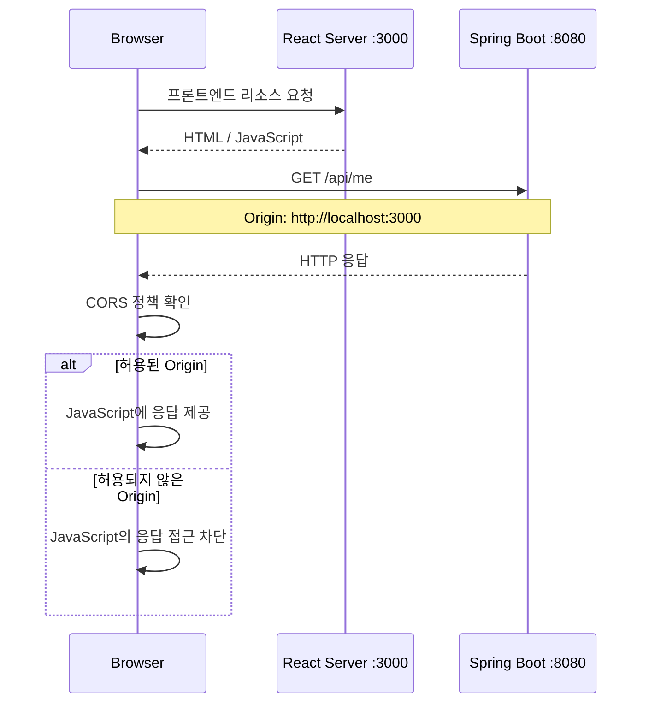
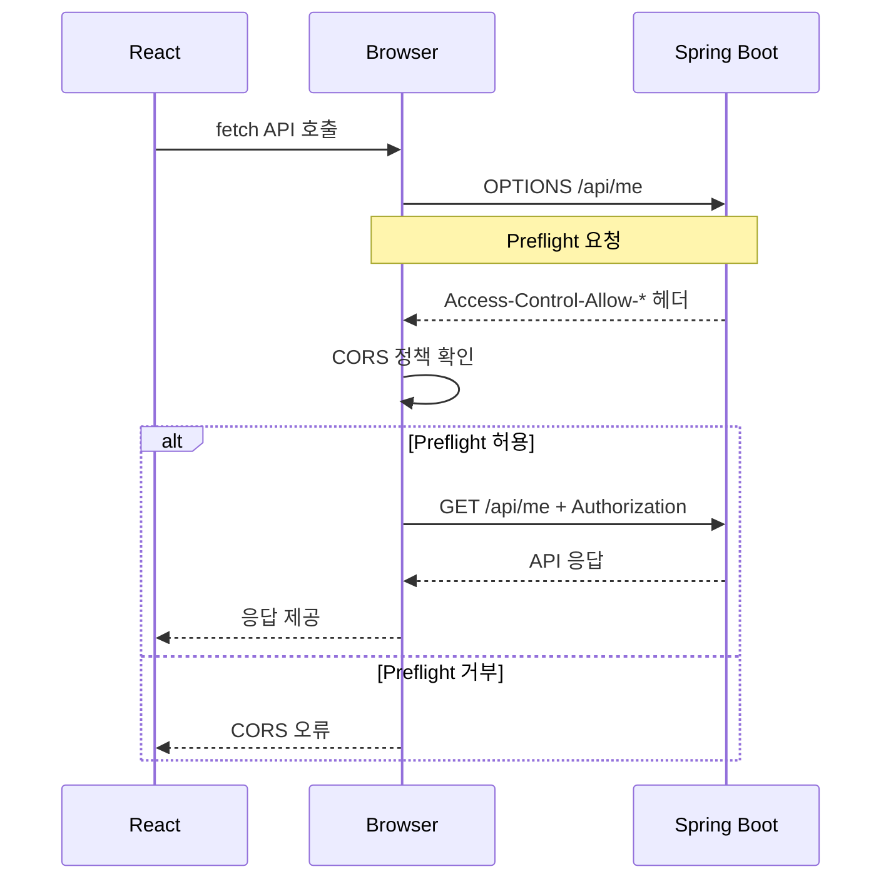
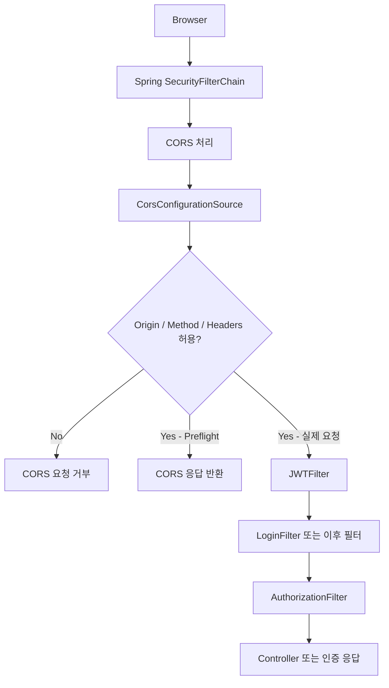
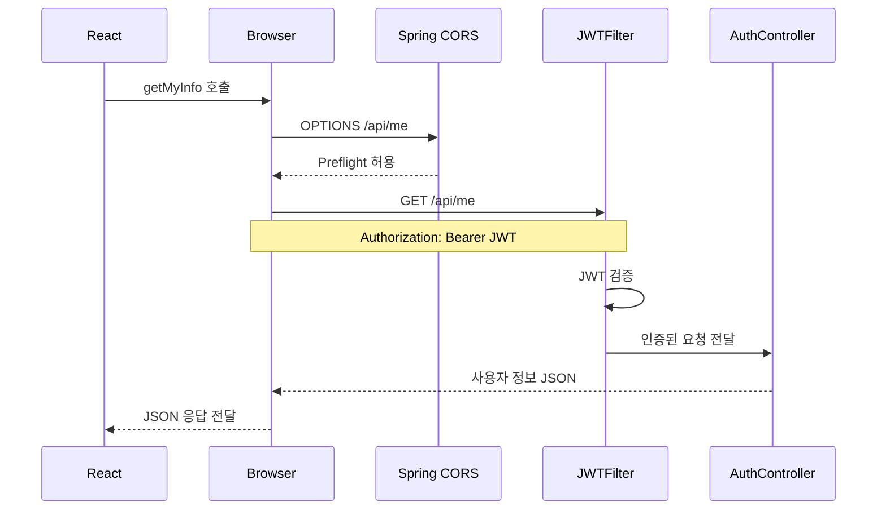
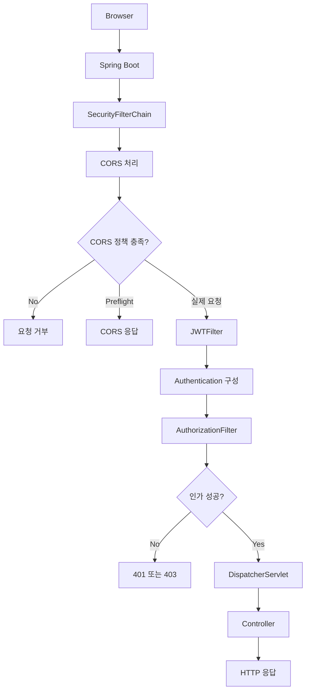
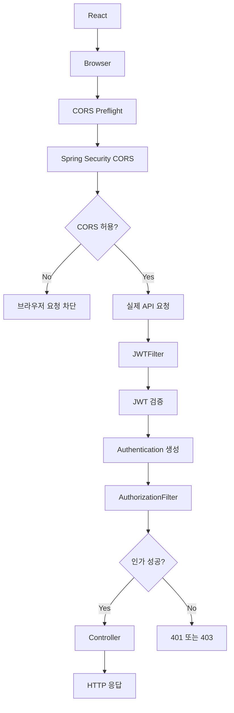

# 스프링 시큐리티 JWT - 13. CORS 설정
[https://youtu.be/MGkYFwdabeM?si=q0c5SUA1_Da2o-YL](https://youtu.be/MGkYFwdabeM?si=q0c5SUA1_Da2o-YL)

# 스프링 시큐리티 JWT - 13. CORS 설정
* toc
{:toc}

---

### Spring Security 6 JWT CORS 설정 완벽 정리: React와 Spring Boot 연동, Preflight, Authorization 헤더와 Credentials

Spring Boot와 Spring Security를 이용해 JWT 기반 인증 시스템을 구현했다면, 프론트엔드 애플리케이션과 연동하는 과정에서 CORS 문제를 경험할 수 있다.

예를 들어 React와 Spring Boot를 다음과 같이 실행한다고 생각해보자.

| 구성요소 | 주소 | 역할 |
|---|---|---|
| React | `http://localhost:3000` | 프론트엔드 |
| Spring Boot | `http://localhost:8080` | REST API 서버 |
| MySQL | `localhost:3306` | 사용자 정보 저장 |

React 애플리케이션에서 다음과 같이 API를 호출한다.

```javascript
fetch("http://localhost:8080/api/me", {
    method: "GET",
    headers: {
        "Authorization": "Bearer " + accessToken
    }
});
```

Spring Boot에는 `/api/me` API가 정상적으로 구현되어 있다.

Postman에서도 정상적으로 응답한다.

그런데 브라우저에서 요청하면 다음과 비슷한 오류가 발생할 수 있다.

```text
Access to fetch at 'http://localhost:8080/api/me'
from origin 'http://localhost:3000'
has been blocked by CORS policy.
```

이 오류는 반드시 Spring Boot의 API 처리 로직이 잘못되었다는 의미는 아니다.

브라우저가 서로 다른 출처 사이의 응답을 JavaScript에 제공해도 되는지 확인하는 과정에서 요청이 차단되었을 수 있다.

이러한 문제를 해결하려면 **CORS(Cross-Origin Resource Sharing)** 의 동작 원리를 이해하고, API 서버가 허용할 출처와 HTTP 메서드, 요청 헤더 및 응답 헤더를 명확하게 설정해야 한다.

특히 JWT 기반 인증에서는 다음 두 가지 상황을 함께 고려해야 한다.

첫 번째는 로그인 요청이다.

```text
React
    ↓
POST /login
    ↓
Spring Security LoginFilter
    ↓
JWT 발급
    ↓
Authorization 응답 헤더
```

두 번째는 JWT를 이용한 API 요청이다.

```text
React
    ↓
GET /api/me
    ↓
Authorization: Bearer JWT
    ↓
Spring Security JWTFilter
    ↓
JWT 검증
    ↓
Controller
```

두 요청 모두 브라우저에서 발생하므로 CORS 정책의 영향을 받을 수 있다.

이번에는 Spring Boot 3.2.1, Spring Security 6.2.1을 기준으로 CORS의 동작 원리와 설정 방법을 살펴본다.

---

### 개념

#### CORS란?

CORS는 Cross-Origin Resource Sharing의 약자다.

서로 다른 출처 사이에서 리소스를 공유할 수 있도록 허용하는 HTTP 기반 메커니즘이다.

브라우저는 기본적으로 동일 출처 정책(Same-Origin Policy)을 적용한다.

동일 출처 정책은 특정 출처에서 실행되는 JavaScript가 다른 출처의 리소스에 임의로 접근하는 것을 제한하는 보안 정책이다.

하지만 현대 웹 애플리케이션에서는 프론트엔드와 백엔드가 서로 다른 서버에서 실행되는 경우가 많다.

예를 들어 다음과 같은 구조다.

```text
Frontend
http://localhost:3000

Backend
http://localhost:8080
```

프론트엔드는 React, Vue 등의 기술을 사용한다.

백엔드는 Spring Boot를 이용해 REST API를 제공한다.

브라우저에서 프론트엔드 애플리케이션을 실행한 후 API 서버에 요청을 보내면 서로 다른 출처 사이의 통신이 발생한다.

이때 브라우저는 API 서버가 해당 출처의 접근을 허용하는지 확인한다.

이를 가능하게 하는 것이 CORS다.

**CORS는 모든 교차 출처 요청을 무조건 허용하는 기능이 아니라, 서버가 허용한 출처에서 응답에 접근할 수 있도록 하는 정책이다.**

---

### Origin이란?

CORS를 이해하려면 먼저 Origin의 의미를 알아야 한다.

Origin은 다음 세 가지 요소로 구성된다.

```text
Scheme + Host + Port
```

예를 들어 다음 URL을 살펴보자.

```text
http://localhost:3000
```

각 요소는 다음과 같다.

| 요소 | 값 | 설명 |
|---|---|---|
| Scheme | `http` | 통신 프로토콜 |
| Host | `localhost` | 호스트 |
| Port | `3000` | 포트 번호 |

다음 두 주소를 비교해보자.

```text
http://localhost:3000
```

```text
http://localhost:8080
```

두 주소는 프로토콜과 호스트가 동일하다.

하지만 포트 번호가 다르다.

따라서 **서로 다른 Origin**이다.

다음 예시도 살펴보자.

| 첫 번째 주소 | 두 번째 주소 | 동일 Origin |
|---|---|---|
| `http://localhost:3000` | `http://localhost:3000` | O |
| `http://localhost:3000` | `http://localhost:8080` | X |
| `http://localhost:3000` | `https://localhost:3000` | X |
| `http://localhost:3000` | `http://127.0.0.1:3000` | X |
| `https://example.com` | `https://example.com/api` | O |
| `https://example.com` | `https://api.example.com` | X |

여기서 마지막 두 예시를 주의해서 살펴보자.

URL의 경로가 다르더라도 Scheme, Host, Port가 동일하면 같은 Origin이다.

반면 서브도메인이 다르면 서로 다른 Origin이다.

따라서 CORS 문제를 해결할 때는 서버 주소뿐 아니라 브라우저가 실제로 사용하는 Origin을 확인해야 한다.

---

### CORS 문제가 발생하는 원리

React와 Spring Boot가 분리된 환경을 생각해보자.



처리 과정을 순서대로 살펴보자.

#### 1. React 애플리케이션 실행

사용자가 브라우저에서 다음 주소에 접속한다.

```text
http://localhost:3000
```

React 애플리케이션이 실행된다.

#### 2. API 서버 호출

React에서 다음 API를 호출한다.

```javascript
fetch("http://localhost:8080/api/me");
```

요청 대상은 Spring Boot 서버다.

#### 3. 브라우저가 Origin을 확인

브라우저는 요청을 보낸 출처를 확인한다.

```http
Origin: http://localhost:3000
```

이 정보는 일반적으로 브라우저가 HTTP 요청에 포함한다.

#### 4. 서버가 CORS 응답 헤더 반환

Spring Boot가 해당 Origin을 허용하도록 설정되어 있다면 다음과 같은 응답 헤더를 반환할 수 있다.

```http
Access-Control-Allow-Origin: http://localhost:3000
```

#### 5. 브라우저가 응답 접근 허용 여부 판단

브라우저는 서버가 반환한 CORS 헤더를 확인한다.

허용된 출처라면 JavaScript가 응답에 접근할 수 있다.

반대로 허용되지 않은 출처라면 JavaScript에서 응답을 읽지 못하도록 제한한다.

여기서 중요한 사실이 있다.

**CORS 오류가 발생했다고 해서 HTTP 요청이 항상 서버에 도달하지 않은 것은 아니다.**

요청 종류에 따라 서버가 실제 요청을 처리한 뒤에도 브라우저가 응답 접근을 차단할 수 있다.

반면 Preflight 검증에 실패하면 실제 요청 자체가 전송되지 않을 수 있다.

이 차이를 이해해야 CORS 문제를 정확하게 분석할 수 있다.

---

### 왜 사용하는가?

#### 프론트엔드와 백엔드가 분리된 환경

최근 웹 서비스에서는 프론트엔드와 백엔드를 서로 다른 환경에서 실행하는 경우가 많다.

예를 들어 다음과 같다.

```text
Frontend
    ↓
React
    ↓
http://localhost:3000
```

```text
Backend
    ↓
Spring Boot
    ↓
http://localhost:8080
```

브라우저는 React 애플리케이션에서 Spring Boot API를 호출한다.

이때 출처가 다르므로 CORS 정책이 적용된다.

개발 환경에서는 포트가 다른 경우가 많고, 운영 환경에서는 도메인이나 서브도메인이 다른 경우가 많다.

```text
https://www.example.com
```

```text
https://api.example.com
```

두 주소 역시 서로 다른 Origin이다.

따라서 API 서버는 허용할 프론트엔드 출처를 명확하게 정의해야 한다.

---

### JWT 기반 인증에서 CORS가 중요한 이유

JWT 기반 인증에서는 로그인과 일반 API 호출 모두 HTTP 헤더를 사용한다.

#### 로그인 요청

클라이언트가 로그인한다.

```http
POST /login HTTP/1.1
Host: localhost:8080
Origin: http://localhost:3000
Content-Type: application/x-www-form-urlencoded

username=admin01&password=password123
```

Spring Security의 `LoginFilter`가 사용자 인증을 수행한다.

인증에 성공하면 JWT를 발급한다.

```http
HTTP/1.1 200 OK
Authorization: Bearer <ACCESS_TOKEN>
```

하지만 브라우저에서는 CORS 설정에 따라 해당 응답을 JavaScript에서 읽지 못할 수 있다.

또한 Authorization은 기본적으로 JavaScript에 노출되는 CORS 응답 헤더 목록에 포함되지 않는다.

따라서 응답의 Authorization 헤더를 읽으려면 별도의 설정이 필요하다.

#### JWT 인증 요청

로그인에 성공한 이후에는 다음 요청을 보낸다.

```http
GET /api/me HTTP/1.1
Host: localhost:8080
Origin: http://localhost:3000
Authorization: Bearer <ACCESS_TOKEN>
```

이번에는 클라이언트가 요청의 Authorization 헤더에 JWT를 포함한다.

이 요청 역시 CORS 정책의 영향을 받는다.

특히 Authorization 요청 헤더는 CORS Preflight 요청을 발생시키는 대표적인 요소다.

따라서 JWT 기반 인증에서는 **요청의 Authorization 헤더 허용과 응답의 Authorization 헤더 노출을 구분해야 한다.**

---

### 주요 특징

#### Preflight 요청이란?

CORS에서 중요한 개념 중 하나가 Preflight 요청이다.

Preflight는 브라우저가 실제 요청을 보내기 전에 서버에 해당 교차 출처 요청이 허용되는지 확인하는 과정이다.

일반적으로 `OPTIONS` HTTP 메서드를 사용한다.

예를 들어 React에서 다음 요청을 보낸다고 생각해보자.

```javascript
fetch("http://localhost:8080/api/me", {
    method: "GET",
    headers: {
        "Authorization": "Bearer " + accessToken
    }
});
```

브라우저는 실제 GET 요청 전에 다음과 같은 Preflight 요청을 보낼 수 있다.

```http
OPTIONS /api/me HTTP/1.1
Host: localhost:8080
Origin: http://localhost:3000
Access-Control-Request-Method: GET
Access-Control-Request-Headers: authorization
```

여기서 각 헤더의 의미는 다음과 같다.

| 헤더 | 의미 |
|---|---|
| Origin | 요청을 시작한 출처 |
| Access-Control-Request-Method | 실제 요청에서 사용할 HTTP 메서드 |
| Access-Control-Request-Headers | 실제 요청에서 사용할 추가 헤더 |

서버는 이 요청에 대해 CORS 정책을 확인한다.

허용된 요청이라면 다음과 유사한 응답을 반환한다.

```http
HTTP/1.1 200 OK
Access-Control-Allow-Origin: http://localhost:3000
Access-Control-Allow-Methods: GET,POST,PUT,PATCH,DELETE,OPTIONS
Access-Control-Allow-Headers: authorization
Access-Control-Max-Age: 3600
```

브라우저는 이 응답을 확인한 뒤 실제 요청을 전송할 수 있다.

```http
GET /api/me HTTP/1.1
Host: localhost:8080
Origin: http://localhost:3000
Authorization: Bearer <ACCESS_TOKEN>
```

전체 흐름은 다음과 같다.



여기서 중요한 점은 모든 교차 출처 요청에 Preflight가 발생하는 것은 아니라는 사실이다.

요청 메서드와 헤더, Content-Type 등의 조건에 따라 Preflight가 생략될 수 있다.

예를 들어 일부 단순 GET 요청은 Preflight 없이 실제 요청을 보낼 수 있다.

반면 Authorization 헤더가 포함된 교차 출처 요청이나 `application/json`으로 전송하는 POST 요청은 일반적으로 Preflight가 발생한다.

---

### Spring Security에서 Preflight가 문제가 되는 이유

현재 JWT 인증 시스템은 다음과 같은 구조를 사용한다.

```text
HTTP 요청
    ↓
SecurityFilterChain
    ↓
JWTFilter
    ↓
AuthorizationFilter
    ↓
Controller
```

JWTFilter는 Authorization 헤더에 포함된 JWT를 검증한다.

그런데 Preflight 요청에는 실제 API 요청에서 사용할 JWT가 일반적으로 포함되지 않는다.

예를 들어 다음과 같다.

```http
OPTIONS /api/me HTTP/1.1
Origin: http://localhost:3000
Access-Control-Request-Method: GET
Access-Control-Request-Headers: authorization
```

이 요청에는 다음 헤더가 없다.

```http
Authorization: Bearer <ACCESS_TOKEN>
```

만약 Spring Security가 Preflight를 일반적인 인증 요청과 동일하게 처리하면 문제가 발생할 수 있다.

```text
OPTIONS 요청
    ↓
JWT 없음
    ↓
인증되지 않은 사용자
    ↓
인증 요구
    ↓
HTTP 401
```

Preflight 단계에서 요청이 거부되면 브라우저는 실제 API 요청을 전송하지 못할 수 있다.

따라서 CORS 처리는 Spring Security의 인증·인가 처리보다 먼저 이루어질 수 있도록 구성해야 한다.

Spring Security는 이러한 문제를 해결하기 위해 CORS 통합 기능을 제공한다.

---

### CORS 설정에 사용하는 주요 옵션

Spring Framework에서는 `CorsConfiguration`을 통해 CORS 정책을 설정할 수 있다.

대표적인 옵션은 다음과 같다.

| 설정 | 역할 |
|---|---|
| `setAllowedOrigins()` | 허용할 Origin 지정 |
| `setAllowedMethods()` | 허용할 HTTP 메서드 지정 |
| `setAllowedHeaders()` | 허용할 요청 헤더 지정 |
| `setExposedHeaders()` | JavaScript에서 읽을 수 있는 응답 헤더 지정 |
| `setAllowCredentials()` | 교차 출처 Credential 요청 허용 여부 |
| `setMaxAge()` | Preflight 결과 캐시 시간 설정 |

각 옵션이 어떤 역할을 하는지 이해해야 JWT 기반 API의 CORS 설정을 정확하게 구성할 수 있다.

---

#### setAllowedOrigins()

```java
configuration.setAllowedOrigins(
        List.of("http://localhost:3000")
);
```

허용할 Origin을 지정한다.

현재 프로젝트에서는 React가 다음 주소에서 실행된다고 가정한다.

```text
http://localhost:3000
```

따라서 이 출처를 허용한다.

주의할 점은 Origin에 경로를 포함하지 않는다는 것이다.

다음과 같은 설정은 의도한 Origin과 다를 수 있다.

```text
http://localhost:3000/login
```

Origin은 Scheme, Host, Port로 구성된다.

따라서 다음과 같이 지정한다.

```text
http://localhost:3000
```

운영 환경에서는 실제 프론트엔드 도메인으로 변경해야 한다.

---

#### setAllowedMethods()

```java
configuration.setAllowedMethods(
        List.of(
                "GET",
                "POST",
                "PUT",
                "PATCH",
                "DELETE",
                "OPTIONS"
        )
);
```

교차 출처 요청에서 허용할 HTTP 메서드를 설정한다.

각 메서드는 일반적으로 다음 목적에 사용된다.

| 메서드 | 대표적인 용도 |
|---|---|
| GET | 데이터 조회 |
| POST | 데이터 생성, 로그인 |
| PUT | 데이터 전체 수정 |
| PATCH | 데이터 일부 수정 |
| DELETE | 데이터 삭제 |
| OPTIONS | CORS Preflight |

여기서 모든 HTTP 메서드를 무조건 허용해야 하는 것은 아니다.

서비스에서 실제 사용하는 메서드만 허용하는 편이 정책을 명확하게 관리하는 데 도움이 된다.

---

#### setAllowedHeaders()

```java
configuration.setAllowedHeaders(
        List.of(
                "Authorization",
                "Content-Type",
                "Accept"
        )
);
```

클라이언트가 교차 출처 요청에 포함할 수 있는 요청 헤더를 설정한다.

JWT 기반 API에서는 다음 헤더가 중요하다.

```http
Authorization: Bearer <ACCESS_TOKEN>
```

따라서 Authorization을 허용해야 한다.

JSON 요청을 사용한다면 다음 헤더도 고려해야 한다.

```http
Content-Type: application/json
```

이 설정이 잘못되면 브라우저의 Preflight 요청에서 허용되지 않은 헤더로 판단되어 실제 API 요청이 차단될 수 있다.

---

#### setExposedHeaders()

```java
configuration.setExposedHeaders(
        List.of("Authorization")
);
```

이 설정은 서버가 반환한 응답 헤더 중 JavaScript에서 접근할 수 있도록 노출할 헤더를 지정한다.

JWT 로그인 시스템에서는 특히 중요하다.

앞서 구현한 LoginFilter는 로그인에 성공하면 다음과 같이 JWT를 반환한다.

```java
response.setHeader(
        HttpHeaders.AUTHORIZATION,
        "Bearer " + token
);
```

즉 HTTP 응답에 Authorization 헤더가 포함된다.

하지만 브라우저에서 다음 코드를 실행한다고 생각해보자.

```javascript
const authorization =
    response.headers.get("Authorization");
```

서버가 실제로 Authorization 응답 헤더를 반환했더라도 CORS 정책에 따라 JavaScript가 해당 헤더를 읽지 못할 수 있다.

이 문제를 해결하기 위해 다음 설정을 추가한다.

```java
configuration.setExposedHeaders(
        List.of("Authorization")
);
```

그러면 허용된 교차 출처 응답에 다음과 같은 헤더가 포함될 수 있다.

```http
Access-Control-Expose-Headers: Authorization
```

브라우저는 이 설정을 확인하고 JavaScript가 Authorization 응답 헤더를 읽을 수 있도록 한다.

**`allowedHeaders`와 `exposedHeaders`는 서로 다른 설정이다.**

| 구분 | 역할 |
|---|---|
| allowedHeaders | 클라이언트가 서버로 전송할 요청 헤더 허용 |
| exposedHeaders | 서버가 반환한 응답 헤더를 JavaScript에서 읽도록 허용 |

JWT 기반 인증에서는 두 설정을 구분해야 한다.

---

#### setAllowCredentials()

```java
configuration.setAllowCredentials(true);
```

교차 출처 요청에서 Credentials를 허용할지 설정한다.

대표적으로 쿠키를 사용하는 인증에서 중요하다.

예를 들어 브라우저에서 다음과 같이 요청할 수 있다.

```javascript
fetch("http://localhost:8080/api/me", {
    method: "GET",
    credentials: "include"
});
```

이 경우 서버에서도 Credential 요청을 허용하도록 구성해야 한다.

```java
configuration.setAllowCredentials(true);
```

그러면 응답에 다음 헤더가 포함될 수 있다.

```http
Access-Control-Allow-Credentials: true
```

하지만 중요한 주의사항이 있다.

**JWT를 Authorization 헤더로 직접 전달한다고 해서 항상 `allowCredentials(true)`를 설정해야 하는 것은 아니다.**

브라우저가 쿠키 등을 자동으로 포함하는 요청을 사용하지 않는다면 이 설정이 불필요할 수 있다.

현재 프로젝트는 JWT를 Authorization 헤더로 전달하는 구조다.

따라서 기본 예제에서는 Credentials를 허용하지 않는 방식으로 구성한다.

쿠키 기반 인증을 추가한다면 해당 설정을 별도로 검토한다.

또한 Credentials를 허용하면서 `allowedOrigins("*")`를 사용해서는 안 된다.

Spring Framework에서도 Credentials가 활성화된 경우에는 구체적인 허용 Origin을 지정하도록 제한한다.

---

#### setMaxAge()

```java
configuration.setMaxAge(3600L);
```

Preflight 요청의 결과를 브라우저가 캐시할 수 있는 시간을 설정한다.

단위는 초다.

```text
3600초 = 1시간
```

예를 들어 브라우저가 다음 Preflight를 실행했다고 생각해보자.

```http
OPTIONS /api/me
```

서버가 해당 요청을 허용하고 다음 응답을 반환한다.

```http
Access-Control-Max-Age: 3600
```

브라우저는 지원하는 범위에서 이 결과를 캐시하여 동일 조건의 Preflight 요청을 줄일 수 있다.

다만 실제 캐시 시간에는 브라우저별 제한이 적용될 수 있다.

---

### 예제

#### 프로젝트 환경

현재 프로젝트에서는 다음 기술을 사용한다.

| 항목 | 기술 |
|---|---|
| Java | 17 |
| Spring Boot | 3.2.1 |
| Spring Security | 6.2.1 |
| JWT | JJWT 0.12.3 |
| Database | MySQL |
| ORM | Spring Data JPA |
| Frontend | React |
| Frontend Port | 3000 |
| Backend Port | 8080 |

앞서 구현한 프로젝트 구조는 다음과 같다.

```text
src/main/java/com/example/jwt
│
├── config
│   └── SecurityConfig.java
│
├── controller
│   ├── MainController.java
│   ├── AdminController.java
│   ├── AuthController.java
│   └── JoinController.java
│
├── dto
│   ├── CustomUserDetails.java
│   └── JoinDTO.java
│
├── entity
│   └── UserEntity.java
│
├── repository
│   └── UserRepository.java
│
├── service
│   ├── JoinService.java
│   └── CustomUserDetailsService.java
│
└── jwt
    ├── LoginFilter.java
    ├── JWTFilter.java
    └── JWTUtil.java
```

여기에 CORS 설정을 추가한다.

CORS 설정을 구성하는 대표적인 방법은 두 가지다.

**첫 번째는 Spring Security에서 `CorsConfigurationSource`를 사용하는 방법이다.**

**두 번째는 Spring MVC에서 `WebMvcConfigurer`를 사용하는 방법이다.**

두 방식의 차이를 살펴보자.

---

### Spring Security에서 CORS 설정하기

먼저 Spring Security에서 CORS 설정을 구성한다.

핵심은 `HttpSecurity`의 `cors()` 메서드다.

```java
http.cors(Customizer.withDefaults());
```

이 설정은 Spring Security의 CORS 통합 기능을 활성화한다.

다만 `cors()`를 활성화하는 것만으로 어떤 Origin을 허용할지 결정되는 것은 아니다.

실제 허용 정책은 `CorsConfigurationSource` 또는 Spring MVC의 CORS 설정 등을 통해 제공해야 한다.

이번에는 `CorsConfigurationSource`를 Bean으로 등록하는 방식을 사용한다.

---

### CorsConfigurationSource 구현

`config` 패키지에 다음 클래스를 생성한다.

```text
com.example.jwt.config.CorsConfig
```

그리고 다음과 같이 작성한다.

```java
package com.example.jwt.config;

import org.springframework.context.annotation.Bean;
import org.springframework.context.annotation.Configuration;

import org.springframework.web.cors.CorsConfiguration;
import org.springframework.web.cors.UrlBasedCorsConfigurationSource;

import java.util.List;

@Configuration
public class CorsConfig {

    @Bean
    public UrlBasedCorsConfigurationSource corsConfigurationSource() {

        // 1. CORS 정책 생성
        CorsConfiguration configuration =
                new CorsConfiguration();

        // 2. 허용할 Origin
        configuration.setAllowedOrigins(
                List.of("http://localhost:3000")
        );

        // 3. 허용할 HTTP 메서드
        configuration.setAllowedMethods(
                List.of(
                        "GET",
                        "POST",
                        "PUT",
                        "PATCH",
                        "DELETE",
                        "OPTIONS"
                )
        );

        // 4. 허용할 요청 헤더
        configuration.setAllowedHeaders(
                List.of(
                        "Authorization",
                        "Content-Type",
                        "Accept"
                )
        );

        // 5. JavaScript에 노출할 응답 헤더
        configuration.setExposedHeaders(
                List.of("Authorization")
        );

        // 6. 쿠키 기반 교차 출처 인증을 사용하지 않음
        configuration.setAllowCredentials(false);

        // 7. Preflight 캐시 시간: 1시간
        configuration.setMaxAge(3600L);

        // 8. URL별 CORS 정책 등록
        UrlBasedCorsConfigurationSource source =
                new UrlBasedCorsConfigurationSource();

        source.registerCorsConfiguration(
                "/**",
                configuration
        );

        return source;
    }
}
```

이 코드는 현재 JWT 인증 시스템의 요구사항을 기반으로 CORS 정책을 구성한 예시다.

전체 동작은 다음과 같다.

```text
CorsConfig
    ↓
CorsConfiguration
    ↓
AllowedOrigins
    ↓
AllowedMethods
    ↓
AllowedHeaders
    ↓
ExposedHeaders
    ↓
AllowCredentials
    ↓
MaxAge
    ↓
UrlBasedCorsConfigurationSource
    ↓
Spring Security
```

각 설정이 어떤 의미를 가지는지 다시 확인해보자.

| 설정 | 현재 값 | 목적 |
|---|---|---|
| AllowedOrigins | `http://localhost:3000` | React 출처 허용 |
| AllowedMethods | GET, POST, PUT, PATCH, DELETE, OPTIONS | API 메서드 허용 |
| AllowedHeaders | Authorization, Content-Type, Accept | JWT 및 요청 데이터 헤더 허용 |
| ExposedHeaders | Authorization | 로그인 응답의 JWT 헤더 노출 |
| AllowCredentials | false | 교차 출처 쿠키 인증을 사용하지 않음 |
| MaxAge | 3600 | Preflight 결과 캐시 시간 |

이제 Spring Security에서 해당 설정을 활용하도록 구성해야 한다.

---

### SecurityConfig에 CORS 설정 추가하기

기존 `SecurityConfig`에는 `SecurityFilterChain`을 생성하는 Bean이 있다.

여기에 CORS 설정을 추가한다.

```java
.cors(Customizer.withDefaults())
```

예를 들어 다음과 같다.

```java
@Bean
public SecurityFilterChain filterChain(
        HttpSecurity http,
        AuthenticationManager authenticationManager,
        JWTUtil jwtUtil,
        @Value("${jwt.access-token-expiration-ms}")
        long accessTokenExpirationMs
) throws Exception {

    LoginFilter loginFilter =
            new LoginFilter(
                    authenticationManager,
                    jwtUtil,
                    accessTokenExpirationMs
            );

    http
            // CORS 활성화
            .cors(Customizer.withDefaults())

            // CSRF 비활성화
            .csrf(AbstractHttpConfigurer::disable)

            // 기본 로그인 방식 비활성화
            .formLogin(AbstractHttpConfigurer::disable)

            .httpBasic(AbstractHttpConfigurer::disable)

            // Stateless 인증
            .sessionManagement(session -> session
                    .sessionCreationPolicy(
                            SessionCreationPolicy.STATELESS
                    )
            )

            // 요청 경로별 접근 권한
            .authorizeHttpRequests(auth -> auth

                    .requestMatchers(
                            HttpMethod.GET,
                            "/"
                    ).permitAll()

                    .requestMatchers(
                            HttpMethod.POST,
                            "/login",
                            "/join"
                    ).permitAll()

                    .requestMatchers(
                            "/admin",
                            "/admin/**"
                    ).hasRole("ADMIN")

                    .anyRequest().authenticated()
            )

            // JWT 검증 필터
            .addFilterBefore(
                    new JWTFilter(jwtUtil),
                    UsernamePasswordAuthenticationFilter.class
            )

            // 로그인 필터
            .addFilterAt(
                    loginFilter,
                    UsernamePasswordAuthenticationFilter.class
            );

    return http.build();
}
```

필요한 import는 다음과 같다.

```java
import org.springframework.security.config.Customizer;
```

위 코드는 기존 SecurityConfig의 인증 관련 Bean과 예외 처리 설정을 유지한 상태에서 CORS를 추가하는 핵심 부분이다.

여기서 주목해야 할 코드는 다음과 같다.

```java
.cors(Customizer.withDefaults())
```

앞서 등록한 `UrlBasedCorsConfigurationSource` Bean을 Spring Security의 CORS 처리에 활용할 수 있도록 한다.

Spring Security의 CORS 통합 기능을 이용하면 CORS 요청을 보안 필터 체인에서 적절한 순서로 처리할 수 있다.

---

### Spring Security의 CORS 처리 구조

현재까지 작성한 설정을 구조로 표현하면 다음과 같다.



여기서 주의할 점은 LoginFilter가 모든 요청을 처리하는 것은 아니라는 사실이다.

LoginFilter는 설정된 로그인 경로에 해당하는 요청을 인증한다.

JWTFilter 역시 Authorization 헤더의 JWT를 검증하는 역할을 담당한다.

따라서 CORS 설정은 특정 Controller만을 위한 것이 아니라 **로그인과 JWT 인증을 포함한 HTTP 요청 전체 흐름에서 고려해야 하는 정책**이다.

---

### Spring MVC에서 CORS 설정하기

이번에는 Spring MVC에서 CORS 설정을 구성하는 방법을 살펴보자.

Spring MVC에서는 `WebMvcConfigurer`를 이용할 수 있다.

먼저 `config` 패키지에 다음 클래스를 생성한다.

```text
com.example.jwt.config.CorsMvcConfig
```

다음과 같이 작성한다.

```java
package com.example.jwt.config;

import org.springframework.context.annotation.Configuration;

import org.springframework.web.servlet.config.annotation.CorsRegistry;
import org.springframework.web.servlet.config.annotation.WebMvcConfigurer;

@Configuration
public class CorsMvcConfig implements WebMvcConfigurer {

    @Override
    public void addCorsMappings(CorsRegistry registry) {

        registry.addMapping("/**")

                .allowedOrigins(
                        "http://localhost:3000"
                )

                .allowedMethods(
                        "GET",
                        "POST",
                        "PUT",
                        "PATCH",
                        "DELETE",
                        "OPTIONS"
                )

                .allowedHeaders(
                        "Authorization",
                        "Content-Type",
                        "Accept"
                )

                .exposedHeaders(
                        "Authorization"
                )

                .allowCredentials(false)

                .maxAge(3600);
    }
}
```

이 코드에서 핵심은 다음 메서드다.

```java
@Override
public void addCorsMappings(CorsRegistry registry) {

}
```

Spring MVC의 CORS 정책을 등록하는 메서드다.

다음 코드로 적용할 경로를 지정한다.

```java
registry.addMapping("/**")
```

현재는 모든 경로에 적용한다.

필요하다면 다음과 같이 특정 경로에만 적용할 수도 있다.

```java
registry.addMapping("/api/**")
```

하지만 현재 프로젝트에는 `/api/**` 외에도 `/login`, `/join` 경로가 존재한다.

따라서 경로를 제한할 때는 로그인 요청과 회원가입 요청이 누락되지 않도록 주의해야 한다.

Spring MVC는 `WebMvcConfigurer`를 통한 전역 CORS 설정을 제공한다.

---

### Spring Security와 Spring MVC 설정을 모두 작성해야 할까?

여기서 중요한 부분을 정리해야 한다.

CORS 설정을 구성하는 방법으로 다음 두 가지를 살펴봤다.

첫 번째 방법은 Spring Security에서 `CorsConfigurationSource`를 사용하는 것이다.

```text
CorsConfigurationSource
    ↓
Spring Security
    ↓
CORS 처리
```

두 번째 방법은 Spring MVC에서 `WebMvcConfigurer`를 사용하는 것이다.

```text
WebMvcConfigurer
    ↓
Spring MVC CORS 설정
```

두 설정을 동시에 작성하는 방법도 있지만, **반드시 두 설정을 모두 작성해야 하는 것은 아니다.**

Spring Security는 Spring MVC의 CORS 설정과 통합할 수 있다.

따라서 Spring MVC의 CORS 설정을 사용하면서 다음 코드를 선언하면 Spring Security가 MVC의 CORS 구성을 활용할 수 있다.

```java
http.cors(Customizer.withDefaults());
```

단, 별도의 `CorsConfigurationSource` Bean이 존재하는지와 실제 SecurityFilterChain 구성에 따라 선택되는 설정이 달라질 수 있다.

Spring Security 공식 문서에서도 Spring MVC의 CORS 설정을 활용하는 방법과 `CorsConfigurationSource`를 직접 제공하는 방법을 구분하여 설명한다.

#### 두 가지 구성 방식 비교

| 구분 | CorsConfigurationSource | WebMvcConfigurer |
|---|---|---|
| 설정 위치 | Spring Security 연동 | Spring MVC |
| 주요 객체 | CorsConfiguration | CorsRegistry |
| 보안 필터와 통합 | 가능 | Spring Security의 CORS 통합 이용 |
| 로그인 필터 요청 처리 | 통합 설정 시 가능 | Security CORS 통합이 필요 |
| 전역 경로 설정 | 가능 | 가능 |
| 권장 상황 | SecurityFilterChain 중심 API | MVC 중심 API |

#### 방법 A: Spring Security 중심

다음 구성을 사용한다.

```text
CorsConfig
    ↓
CorsConfigurationSource Bean
    ↓
SecurityConfig
    ↓
http.cors(Customizer.withDefaults())
```

이 경우 별도의 `CorsMvcConfig`를 반드시 작성할 필요는 없다.

#### 방법 B: Spring MVC 설정 활용

다음 구성을 사용한다.

```text
CorsMvcConfig
    ↓
WebMvcConfigurer
    ↓
Spring MVC CORS 설정
    ↓
SecurityConfig
    ↓
http.cors(Customizer.withDefaults())
```

이 경우에도 별도의 CorsConfigurationSource를 중복 등록할 필요는 없다.

**현재 JWT 기반 REST API에서는 방법 A를 기본 구성으로 사용하는 것이 명확하다.**

CORS 정책을 한곳에서 관리하고 Spring Security와 직접 통합할 수 있기 때문이다.

반면 MVC의 CORS 설정을 이미 사용하고 있다면 방법 B를 활용할 수 있다.

두 설정을 동시에 사용한다면 서로 다른 Origin이나 헤더 정책이 적용되지 않도록 관리해야 한다.

---

### CORS 설정과 JWT 인증 필터의 관계

JWT 인증 시스템에서는 다음 두 가지 요청을 처리한다.

#### 로그인 요청

```text
POST /login
    ↓
CORS 처리
    ↓
LoginFilter
    ↓
AuthenticationManager
    ↓
JWT 발급
    ↓
Authorization 응답 헤더
```

이때 중요한 것은 두 가지다.

첫 번째는 React에서 발생한 요청의 Origin을 허용하는 것이다.

두 번째는 로그인 응답의 Authorization 헤더를 JavaScript에서 읽을 수 있도록 노출하는 것이다.

```java
configuration.setExposedHeaders(
        List.of("Authorization")
);
```

#### JWT 인증 요청

```text
GET /api/me
    ↓
Preflight 요청
    ↓
CORS 검증
    ↓
실제 GET 요청
    ↓
JWTFilter
    ↓
JWT 검증
    ↓
Authentication 생성
    ↓
Controller
```

이때는 클라이언트가 Authorization 요청 헤더를 사용하므로 해당 헤더를 허용해야 한다.

```java
configuration.setAllowedHeaders(
        List.of(
                "Authorization",
                "Content-Type",
                "Accept"
        )
);
```

즉 로그인과 JWT 인증 요청은 서로 다른 CORS 설정을 필요로 할 수 있다.

| 요청 | 중요한 CORS 설정 |
|---|---|
| POST `/login` | AllowedOrigins |
| 로그인 응답에서 JWT 읽기 | ExposedHeaders |
| Authorization 헤더로 API 호출 | AllowedHeaders |
| OPTIONS Preflight | AllowedMethods, AllowedHeaders |
| 쿠키 포함 요청 | AllowCredentials |

이러한 차이를 이해하면 CORS 오류의 원인을 훨씬 쉽게 파악할 수 있다.

---

### React에서 로그인 요청 보내기

이제 React에서 실제 로그인 요청을 보내보자.

현재 LoginFilter는 다음 경로를 처리한다.

```http
POST /login
```

로그인 요청 본문은 `application/x-www-form-urlencoded` 형식을 사용한다고 가정한다.

JavaScript에서는 다음과 같이 작성할 수 있다.

```javascript
async function login(username, password) {

    const response = await fetch(
        "http://localhost:8080/login",
        {
            method: "POST",

            headers: {
                "Content-Type":
                    "application/x-www-form-urlencoded"
            },

            body: new URLSearchParams({
                username,
                password
            })
        }
    );

    if (!response.ok) {
        throw new Error("로그인에 실패했습니다.");
    }

    const authorization =
        response.headers.get("Authorization");

    if (!authorization) {
        throw new Error("JWT가 반환되지 않았습니다.");
    }

    if (!authorization.startsWith("Bearer ")) {
        throw new Error("올바르지 않은 인증 응답입니다.");
    }

    return authorization;
}
```

이 코드는 다음 순서로 동작한다.

```text
React
    ↓
POST /login
    ↓
Spring Security LoginFilter
    ↓
사용자 인증
    ↓
JWT 생성
    ↓
Authorization 응답 헤더
    ↓
React에서 Authorization 조회
```

이때 서버에는 다음 설정이 필요하다.

```java
configuration.setAllowedOrigins(
        List.of("http://localhost:3000")
);
```

그리고 Authorization 응답 헤더를 읽으려면 다음 설정이 필요하다.

```java
configuration.setExposedHeaders(
        List.of("Authorization")
);
```

이렇게 하면 브라우저 JavaScript에서 JWT를 가져올 수 있다.

---

### 발급받은 JWT로 API 호출하기

로그인에 성공했다면 Authorization 값을 이용해 보호된 API를 호출할 수 있다.

```javascript
async function getMyInfo(authorization) {

    const response = await fetch(
        "http://localhost:8080/api/me",
        {
            method: "GET",

            headers: {
                "Authorization": authorization
            }
        }
    );

    if (!response.ok) {
        throw new Error("사용자 정보 조회에 실패했습니다.");
    }

    return await response.json();
}
```

이때 `authorization`에는 다음과 같은 값이 전달된다고 가정한다.

```text
Bearer <ACCESS_TOKEN>
```

전체 요청 흐름은 다음과 같다.



정상적으로 인증되었다면 다음과 같은 응답을 받을 수 있다.

```json
{
  "username": "admin01",
  "roles": [
    "ROLE_ADMIN"
  ]
}
```

이렇게 하면 React와 Spring Boot 사이에서 JWT 기반 인증 요청을 처리할 수 있다.

---

### 실행 및 확인

#### Spring Boot 실행

먼저 Spring Boot를 실행한다.

```bash
./gradlew bootRun
```

명령어의 의미는 다음과 같다.

| 명령 | 설명 |
|---|---|
| `./gradlew` | Gradle Wrapper 실행 |
| `bootRun` | Spring Boot 애플리케이션 실행 |

정상 실행 시 다음과 유사한 로그를 확인할 수 있다.

```text
Tomcat started on port 8080 (http)

Started JwtApplication
```

이제 CORS 요청을 직접 확인해보자.

---

### curl로 Preflight 요청 확인하기

브라우저가 전송하는 Preflight 요청을 curl로 재현할 수 있다.

다음 명령을 실행한다.

```bash
curl -i -X OPTIONS \
  http://localhost:8080/api/me \
  -H "Origin: http://localhost:3000" \
  -H "Access-Control-Request-Method: GET" \
  -H "Access-Control-Request-Headers: authorization"
```

각 옵션의 의미는 다음과 같다.

| 옵션 | 설명 |
|---|---|
| `-i` | 응답 헤더 출력 |
| `-X OPTIONS` | OPTIONS 요청 전송 |
| Origin | 요청을 시작한 출처 |
| Access-Control-Request-Method | 실제 요청 메서드 |
| Access-Control-Request-Headers | 실제 요청 헤더 |

정상적으로 CORS 설정이 적용되었다면 다음과 유사한 응답을 확인할 수 있다.

```http
HTTP/1.1 200 OK
Access-Control-Allow-Origin: http://localhost:3000
Access-Control-Allow-Methods: GET,POST,PUT,PATCH,DELETE,OPTIONS
Access-Control-Allow-Headers: authorization
Access-Control-Max-Age: 3600
```

실제 응답 헤더의 값과 순서는 Spring Framework 및 서버 설정에 따라 달라질 수 있다.

여기서 중요한 부분은 다음 헤더다.

```http
Access-Control-Allow-Origin: http://localhost:3000
```

API 서버가 해당 출처를 허용한다는 의미다.

또한 다음 헤더도 확인해야 한다.

```http
Access-Control-Allow-Headers: authorization
```

실제 요청에서 Authorization 헤더를 사용할 수 있다는 의미다.

단, **curl은 브라우저처럼 CORS 정책을 강제하지 않는다.**

따라서 curl로 응답 헤더를 확인한 이후 브라우저에서도 실제 동작을 검증해야 한다.

---

### 로그인 응답에서 Authorization 노출 확인하기

이번에는 로그인 요청에 Origin 헤더를 추가해보자.

```bash
curl -i -X POST \
  http://localhost:8080/login \
  -H "Origin: http://localhost:3000" \
  --data-urlencode "username=admin01" \
  --data-urlencode "password=password123"
```

로그인에 성공하면 다음과 유사한 응답을 확인할 수 있다.

```http
HTTP/1.1 200 OK
Access-Control-Allow-Origin: http://localhost:3000
Access-Control-Expose-Headers: Authorization
Authorization: Bearer <ACCESS_TOKEN>
```

여기서 확인해야 할 헤더는 두 가지다.

```http
Access-Control-Allow-Origin: http://localhost:3000
```

```http
Access-Control-Expose-Headers: Authorization
```

첫 번째는 React Origin의 접근을 허용한다는 의미다.

두 번째는 브라우저 JavaScript에서 Authorization 응답 헤더를 읽을 수 있도록 한다는 의미다.

따라서 React에서 다음 코드를 사용할 수 있다.

```javascript
const authorization =
    response.headers.get("Authorization");
```

---

### 브라우저 개발자 도구에서 확인하기

브라우저에서는 개발자 도구의 Network 탭을 이용해 CORS 요청을 확인할 수 있다.

JWT 기반 API 요청에서는 다음 항목을 확인하는 것이 좋다.

| 확인 항목 | 확인할 내용 |
|---|---|
| Request URL | 실제 요청 주소 |
| Request Method | GET, POST, OPTIONS 등 |
| Origin | 요청을 시작한 출처 |
| Access-Control-Request-Method | Preflight의 실제 요청 메서드 |
| Access-Control-Request-Headers | Preflight에서 요청한 헤더 |
| Access-Control-Allow-Origin | 서버가 허용한 출처 |
| Access-Control-Allow-Headers | 허용된 요청 헤더 |
| Access-Control-Expose-Headers | JavaScript에 노출된 응답 헤더 |
| Authorization | JWT 전달 여부 |

특히 요청이 실패했다면 **OPTIONS 요청에서 실패했는지, 실제 GET 또는 POST 요청에서 실패했는지** 먼저 확인해야 한다.

이 차이에 따라 원인이 크게 달라진다.

---

### 구조

#### Spring Security와 MVC의 CORS 처리 관계

현재 프로젝트는 JWT 기반 REST API를 제공한다.

따라서 HTTP 요청은 Spring Security와 Spring MVC를 거쳐 처리된다.



여기서 역할을 구분해야 한다.

**CORS 처리**

브라우저의 교차 출처 요청을 허용할지 판단한다.

**JWTFilter**

JWT를 검증하고 사용자 인증 정보를 구성한다.

**AuthorizationFilter**

인증된 사용자에게 해당 API 접근 권한이 있는지 판단한다.

**Controller**

정상적으로 전달된 요청의 비즈니스 로직을 수행한다.

이렇게 각 구성요소의 역할을 분리하여 이해하면 오류 원인을 분석하기 쉽다.

---

### 실무에서의 활용

#### 1. Spring Security와 MVC에 CORS를 무조건 중복 설정하지 않는다

Spring Security와 Spring MVC는 모두 CORS 설정 기능을 제공한다.

하지만 두 곳에 동일한 설정을 반드시 중복 작성할 필요는 없다.

Spring Security의 CORS 통합 기능을 이용하면 MVC의 설정을 활용할 수 있다.

따라서 가능하면 하나의 정책을 중심으로 구성하는 것이 좋다.

현재 JWT 기반 REST API에서는 `CorsConfigurationSource` Bean과 `http.cors()`를 이용한 구성을 기본 선택지로 사용할 수 있다.

#### 2. CORS 오류와 인증 오류를 구분한다

브라우저에서 API 요청에 실패했다고 해서 항상 CORS 문제는 아니다.

예를 들어 다음 상황을 비교해보자.

```text
CORS 검증 실패
    ↓
브라우저에서 응답 접근 차단
```

```text
JWT 만료
    ↓
JWTFilter
    ↓
HTTP 401
```

```text
JWT 정상
    ↓
권한 부족
    ↓
HTTP 403
```

세 상황은 서로 다르다.

또한 서버가 401 또는 403을 반환하더라도 CORS 응답 헤더가 누락되면 브라우저에서는 CORS 오류로 보일 수 있다.

따라서 실제 HTTP 상태 코드와 CORS 응답 헤더를 함께 확인해야 한다.

#### 3. Preflight 요청은 실제 인증 요청과 구분한다

Preflight는 브라우저가 교차 출처 요청 가능 여부를 확인하기 위한 요청이다.

일반적으로 JWT를 포함하지 않는다.

따라서 Preflight 요청을 일반적인 JWT 인증 요청처럼 처리하여 거부하지 않도록 구성해야 한다.

Spring Security의 CORS 통합 기능을 활성화하면 이러한 흐름을 적절하게 처리할 수 있다.

#### 4. OPTIONS를 무조건 permitAll로 설정해야 하는 것은 아니다

다음과 같은 설정을 사용하는 경우가 있다.

```java
.requestMatchers(
        HttpMethod.OPTIONS,
        "/**"
).permitAll()
```

이 방식은 특정 상황에서 OPTIONS 요청의 인증 요구를 완화할 수 있다.

하지만 올바른 CORS 응답 헤더를 생성하는 기능을 대신하지는 않는다.

CORS 자체를 처리하는 설정이 없다면 OPTIONS를 허용하더라도 브라우저에서 요청이 실패할 수 있다.

따라서 CORS 정책과 인증·인가 정책을 구분해야 한다.

#### 5. Authorization 요청 헤더와 응답 헤더를 구분한다

JWT 기반 인증에서는 Authorization 헤더를 양방향에서 사용할 수 있다.

로그인 성공 시에는 다음과 같다.

```http
Authorization: Bearer <ACCESS_TOKEN>
```

서버가 응답 헤더에 JWT를 넣는다.

반면 이후 API 요청에서도 다음과 같이 사용한다.

```http
Authorization: Bearer <ACCESS_TOKEN>
```

이번에는 클라이언트가 요청 헤더에 JWT를 넣는다.

이때 CORS 설정은 다음과 같이 구분된다.

```java
configuration.setAllowedHeaders(
        List.of("Authorization")
);
```

```java
configuration.setExposedHeaders(
        List.of("Authorization")
);
```

요청 헤더를 허용하는 것과 응답 헤더를 노출하는 것은 서로 다른 정책이다.

#### 6. Credentials를 무조건 true로 설정하지 않는다

JWT를 Authorization 헤더로 직접 전달하는 구조와 쿠키 기반 인증 구조는 다르다.

쿠키를 자동으로 포함하는 교차 출처 요청을 사용한다면 Credentials 설정이 필요할 수 있다.

하지만 JWT를 Authorization 헤더로 명시적으로 전달하는 구조에서는 반드시 필요하지 않을 수 있다.

따라서 인증 방식에 따라 설정을 결정해야 한다.

#### 7. Credentials를 사용하면 Origin을 구체적으로 제한한다

다음과 같은 설정을 생각해보자.

```java
configuration.setAllowedOrigins(
        List.of("*")
);
```

```java
configuration.setAllowCredentials(true);
```

이 조합은 올바른 Credentials CORS 구성으로 사용할 수 없다.

Credentials를 허용한다면 명확한 Origin을 지정해야 한다.

예를 들어 다음과 같다.

```java
configuration.setAllowedOrigins(
        List.of("https://www.example.com")
);
```

운영 환경에서는 신뢰할 수 있는 출처만 허용하는 것이 중요하다.

#### 8. 개발 환경과 운영 환경의 Origin을 구분한다

로컬에서는 다음 출처를 사용할 수 있다.

```text
http://localhost:3000
```

하지만 운영 환경에서는 다른 주소를 사용할 것이다.

```text
https://www.example.com
```

따라서 환경별로 허용할 Origin을 분리하는 것이 좋다.

예를 들어 다음과 같은 설정을 사용할 수 있다.

```properties
app.cors.allowed-origin=${CORS_ALLOWED_ORIGIN:http://localhost:3000}
```

이후 설정값을 주입받는다.

```java
@Value("${app.cors.allowed-origin}")
String allowedOrigin
```

그리고 다음과 같이 적용한다.

```java
configuration.setAllowedOrigins(
        List.of(allowedOrigin)
);
```

이렇게 하면 코드 수정 없이 환경별 허용 출처를 변경할 수 있다.

#### 9. CORS는 서버 API의 접근 제어를 대체하지 않는다

CORS는 브라우저가 교차 출처 응답을 JavaScript에 노출할 수 있는지 판단하는 정책이다.

하지만 모든 HTTP 클라이언트가 CORS를 강제하는 것은 아니다.

예를 들어 curl이나 서버 간 HTTP 통신에서는 브라우저와 같은 CORS 제한이 적용되지 않는다.

따라서 다음과 같은 생각은 잘못된 접근이다.

```text
CORS에서 허용하지 않은 Origin
    ↓
API를 절대 호출할 수 없음
```

서버의 실제 접근 제어는 Spring Security의 인증과 인가로 구현해야 한다.

#### 10. CORS와 CSRF를 구분한다

CORS와 CSRF는 이름이 비슷하지만 목적이 다르다.

| 구분 | CORS | CSRF |
|---|---|---|
| 목적 | 교차 출처 응답 접근 제어 | 사용자의 인증 상태를 악용한 요청 방어 |
| 핵심 대상 | 브라우저의 교차 출처 응답 처리 | 인증 정보가 자동 전송되는 요청 |
| 주요 설정 | AllowedOrigins 등 | CSRF Token 등 |
| Spring Security | `cors()` | `csrf()` |

JWT를 Authorization 헤더에 명시적으로 포함하는 구조에서는 CSRF 위험 모델이 쿠키 기반 인증과 다를 수 있다.

하지만 JWT를 쿠키에 저장하고 브라우저가 자동으로 전송한다면 CSRF 보호가 필요할 수 있다.

따라서 JWT를 사용한다는 이유만으로 모든 상황에서 CSRF를 비활성화해도 된다고 판단해서는 안 된다.

#### 11. 로그인 응답의 Authorization 헤더 노출을 확인한다

로그인에 성공해도 프론트엔드에서 JWT를 읽지 못하는 문제가 발생할 수 있다.

이때 다음 설정을 확인해야 한다.

```java
configuration.setExposedHeaders(
        List.of("Authorization")
);
```

이 설정이 없다면 브라우저가 응답의 Authorization 헤더를 JavaScript에 노출하지 않을 수 있다.

특히 Postman에서는 JWT가 정상적으로 확인되지만 React에서는 `null`이 반환되는 상황을 분석할 때 중요하다.

#### 12. JWTFilter에서 OPTIONS 요청을 잘못 처리하지 않는다

JWTFilter는 일반적으로 Authorization 헤더에서 JWT를 추출한다.

하지만 Preflight 요청에는 JWT가 포함되지 않는 경우가 많다.

따라서 모든 요청에 대해 JWT가 반드시 존재해야 한다고 처리하면 Preflight가 차단될 수 있다.

현재 프로젝트에서는 JWTFilter가 Authorization 헤더가 없는 경우 다음 필터로 요청을 전달하도록 구현했다.

```java
if (authorization == null) {

    filterChain.doFilter(request, response);

    return;
}
```

이러한 구조는 공개 요청이나 인증 정보가 없는 요청을 이후 단계에서 처리하도록 할 수 있다.

다만 CORS 처리 자체는 Spring Security의 CORS 통합 기능을 통해 인증·인가보다 앞에서 이루어지도록 구성하는 것이 중요하다.

#### 13. 여러 SecurityFilterChain을 사용하는 경우 설정을 확인한다

실무에서는 API마다 서로 다른 SecurityFilterChain을 구성할 수 있다.

예를 들어 다음과 같다.

```text
/api/**
    ↓
API SecurityFilterChain
```

```text
/admin/**
    ↓
Admin SecurityFilterChain
```

이 경우 특정 SecurityFilterChain에는 CORS 설정이 적용되고 다른 체인에는 적용되지 않는 상황이 발생할 수 있다.

또한 여러 CorsConfigurationSource가 존재한다면 Spring Security가 어떤 설정을 사용할지 명확하게 지정해야 할 수 있다.

따라서 다중 SecurityFilterChain 환경에서는 CORS 정책을 체인별로 검토해야 한다.

#### 14. 허용할 HTTP 메서드와 헤더를 제한한다

개발 편의를 위해 다음과 같이 모든 값을 허용하는 설정을 사용할 수도 있다.

```java
configuration.setAllowedMethods(
        List.of("*")
);
```

하지만 운영 환경에서는 실제 필요한 메서드만 허용하는 것이 정책을 명확하게 관리하는 데 도움이 된다.

요청 헤더 역시 필요한 값으로 제한할 수 있다.

다만 허용 범위를 지나치게 좁게 설정하면 정상적인 API 요청이 차단될 수 있으므로 실제 프론트엔드 요청을 기준으로 설정해야 한다.

#### 15. 프록시나 API Gateway 환경도 고려한다

운영 환경에서는 다음과 같은 구조를 사용할 수 있다.

```text
Browser
    ↓
CDN
    ↓
Reverse Proxy
    ↓
Spring Boot
```

이때 프록시나 API Gateway가 CORS 응답 헤더를 추가하거나 변경할 수 있다.

Spring Boot에서 정상적으로 설정했더라도 중간 계층에서 헤더가 제거되거나 중복될 수 있다.

따라서 CORS 오류가 발생하면 Spring Boot뿐 아니라 실제 외부 응답까지 확인해야 한다.

#### 16. Preflight 캐시 시간을 적절하게 설정한다

Preflight 요청이 많아지면 추가적인 네트워크 왕복이 발생할 수 있다.

따라서 다음 설정을 사용할 수 있다.

```java
configuration.setMaxAge(3600L);
```

하지만 CORS 정책이 자주 변경되는 환경에서 캐시 시간을 지나치게 길게 설정하면 정책 변경이 브라우저에 즉시 반영되지 않을 수 있다.

따라서 성능과 정책 변경 주기를 함께 고려해야 한다.

#### 17. CORS 오류를 서버 장애와 구분한다

React에서 API 요청에 실패했을 때 가능한 원인은 다양하다.

```text
API 서버 미실행
```

```text
네트워크 연결 실패
```

```text
CORS 정책 거부
```

```text
JWT 인증 실패
```

```text
API 내부 오류
```

각 상황의 해결 방법은 다르다.

따라서 단순히 CORS 설정을 변경하기보다 요청이 어느 단계에서 실패했는지 확인해야 한다.

#### 18. 프론트엔드 개발 서버의 프록시 기능도 고려할 수 있다

개발 환경에서는 프론트엔드 개발 서버의 프록시 기능을 이용할 수도 있다.

예를 들어 브라우저가 다음 주소로 요청한다고 생각해보자.

```text
http://localhost:3000/api/me
```

개발 서버가 이 요청을 Spring Boot로 전달한다.

```text
http://localhost:8080/api/me
```

브라우저 관점에서는 동일 Origin으로 요청을 보낼 수 있으므로 교차 출처 문제를 줄일 수 있다.

하지만 실제 운영 환경에서는 프록시 구조와 서버 CORS 정책이 별도로 달라질 수 있다.

따라서 개발 환경에서 프록시를 사용하더라도 운영 환경의 요청 경로를 함께 고려해야 한다.

#### 19. CORS 설정을 테스트 코드로 검증한다

CORS는 단순한 설정처럼 보이지만 로그인과 인증 요청의 정상 동작에 영향을 준다.

따라서 다음 상황을 테스트하는 것이 좋다.

| 테스트 | 기대 결과 |
|---|---|
| 허용된 Origin | CORS 허용 |
| 허용되지 않은 Origin | CORS 거부 |
| Authorization Preflight | 정상 처리 |
| 로그인 응답 | Authorization 헤더 노출 |
| 쿠키 없는 JWT 요청 | 정상 처리 |
| 지원하지 않는 요청 헤더 | 정책에 따른 거부 |
| 관리자 API 요청 | JWT 인증 및 권한 검증 |

특히 CORS 테스트는 JWT 인증 테스트와 별도로 작성할 수 있다.

---

### CORS 통합 테스트 작성하기

Spring Boot에서는 MockMvc를 이용해 CORS 요청을 검증할 수 있다.

이번에는 Preflight 요청을 테스트한다.

다음과 같은 테스트 클래스를 작성한다.

```java
package com.example.jwt.config;

import org.junit.jupiter.api.Test;

import org.springframework.beans.factory.annotation.Autowired;

import org.springframework.boot.test.autoconfigure.web.servlet.AutoConfigureMockMvc;
import org.springframework.boot.test.context.SpringBootTest;

import org.springframework.http.HttpHeaders;

import org.springframework.test.web.servlet.MockMvc;

import static org.springframework.test.web.servlet.request.MockMvcRequestBuilders.options;

import static org.springframework.test.web.servlet.result.MockMvcResultMatchers.header;
import static org.springframework.test.web.servlet.result.MockMvcResultMatchers.status;

@SpringBootTest
@AutoConfigureMockMvc
class CorsIntegrationTest {

    @Autowired
    private MockMvc mockMvc;

    @Test
    void 허용된_Origin의_Preflight_요청은_성공한다()
            throws Exception {

        mockMvc.perform(
                    options("/api/me")

                            .header(
                                    HttpHeaders.ORIGIN,
                                    "http://localhost:3000"
                            )

                            .header(
                                    HttpHeaders.ACCESS_CONTROL_REQUEST_METHOD,
                                    "GET"
                            )

                            .header(
                                    HttpHeaders.ACCESS_CONTROL_REQUEST_HEADERS,
                                    "authorization"
                            )
                )

                .andExpect(status().isOk())

                .andExpect(
                        header().string(
                                HttpHeaders.ACCESS_CONTROL_ALLOW_ORIGIN,
                                "http://localhost:3000"
                        )
                )

                .andExpect(
                        header().exists(
                                HttpHeaders.ACCESS_CONTROL_ALLOW_HEADERS
                        )
                );
    }

    @Test
    void 허용되지_않은_Origin은_거부된다()
            throws Exception {

        mockMvc.perform(
                    options("/api/me")

                            .header(
                                    HttpHeaders.ORIGIN,
                                    "http://untrusted.example"
                            )

                            .header(
                                    HttpHeaders.ACCESS_CONTROL_REQUEST_METHOD,
                                    "GET"
                            )
                )

                .andExpect(status().isForbidden());
    }
}
```

이 테스트는 Spring Security를 포함한 애플리케이션의 CORS 구성이 정상적으로 적용되는지 확인한다.

첫 번째 테스트에서는 허용된 Origin의 Preflight 요청을 검증한다.

두 번째 테스트에서는 허용되지 않은 Origin이 거부되는지 확인한다.

다만 `@SpringBootTest`는 전체 애플리케이션 컨텍스트를 실행하므로 현재 프로젝트의 MySQL 및 JWT 설정 등이 정상적으로 준비되어 있어야 한다.

테스트에서는 운영용 비밀키 대신 별도의 테스트용 설정을 사용하는 것이 좋다.

#### 테스트 실행

다음 명령을 실행한다.

```bash
./gradlew test --tests "com.example.jwt.config.CorsIntegrationTest"
```

각 부분의 의미는 다음과 같다.

| 명령 | 의미 |
|---|---|
| `./gradlew` | Gradle Wrapper 실행 |
| `test` | 테스트 실행 |
| `--tests` | 특정 테스트 클래스 실행 |

정상적으로 테스트가 통과하면 다음과 유사한 결과를 확인할 수 있다.

```text
BUILD SUCCESSFUL
```

이 결과를 통해 설정한 Origin과 Preflight 정책이 의도대로 적용되는지 확인할 수 있다.

---

### 정리

Spring Security와 JWT를 이용한 REST API를 프론트엔드와 연동할 때는 CORS 설정이 필요할 수 있다.

CORS는 서로 다른 Origin 사이에서 브라우저가 응답에 접근할 수 있도록 허용하는 메커니즘이다.

Origin은 다음 세 가지 요소로 구성된다.

```text
Scheme + Host + Port
```

따라서 다음 주소는 서로 다른 Origin이다.

```text
http://localhost:3000
```

```text
http://localhost:8080
```

이러한 환경에서 React가 Spring Boot API를 호출하면 브라우저는 CORS 정책을 확인한다.

JWT 기반 인증에서는 특히 다음 설정이 중요하다.

```java
configuration.setAllowedOrigins(
        List.of("http://localhost:3000")
);
```

React의 Origin을 허용한다.

```java
configuration.setAllowedMethods(
        List.of(
                "GET",
                "POST",
                "PUT",
                "PATCH",
                "DELETE",
                "OPTIONS"
        )
);
```

필요한 HTTP 메서드를 허용한다.

```java
configuration.setAllowedHeaders(
        List.of(
                "Authorization",
                "Content-Type",
                "Accept"
        )
);
```

JWT 인증 요청에 사용할 헤더를 허용한다.

```java
configuration.setExposedHeaders(
        List.of("Authorization")
);
```

로그인 응답에서 발급한 JWT를 브라우저 JavaScript가 읽을 수 있도록 한다.

그리고 Spring Security에서 다음 설정을 활성화한다.

```java
.cors(Customizer.withDefaults())
```

이렇게 하면 적절한 CORS 정책을 Spring Security와 통합할 수 있다.

전체 요청 흐름은 다음과 같다.



여기서 반드시 기억해야 할 핵심은 다음과 같다.

**첫째, CORS는 인증 기능이 아니다.**

CORS는 브라우저가 교차 출처 응답에 접근할 수 있는지 판단하는 정책이다.

사용자의 실제 인증과 인가는 Spring Security가 담당해야 한다.

**둘째, Preflight 요청은 실제 JWT 인증 요청과 다르다.**

브라우저는 OPTIONS 요청을 이용해 교차 출처 요청을 허용할 수 있는지 먼저 확인할 수 있다.

따라서 Preflight가 인증 필터에서 부적절하게 차단되지 않도록 구성해야 한다.

**셋째, AllowedHeaders와 ExposedHeaders를 구분해야 한다.**

AllowedHeaders는 클라이언트가 서버로 전송하는 요청 헤더를 허용한다.

ExposedHeaders는 서버가 반환한 응답 헤더를 JavaScript에서 읽을 수 있도록 한다.

**넷째, Spring Security와 Spring MVC의 CORS 설정을 반드시 중복 작성해야 하는 것은 아니다.**

Spring Security는 MVC의 CORS 정책을 활용할 수 있으며, 별도의 CorsConfigurationSource를 직접 제공하는 방법도 지원한다.

**다섯째, Credentials 설정은 인증 방식에 따라 결정해야 한다.**

Authorization 헤더 기반 JWT 인증과 쿠키 기반 인증은 서로 다른 설정이 필요할 수 있다.

이러한 차이를 이해하면 React와 Spring Boot가 분리된 환경에서도 JWT 기반 인증 요청을 안정적으로 처리할 수 있다.

#### 한 줄 요약

Spring Security 6에서 JWT 기반 REST API의 CORS 문제를 해결하려면 `CorsConfigurationSource` 또는 `WebMvcConfigurer`를 이용해 허용할 Origin, HTTP 메서드, 요청 헤더, 응답 헤더를 설정하고 `http.cors()`로 Spring Security와 통합해야 한다. 특히 JWT 인증 요청에는 `allowedHeaders("Authorization")`, 로그인 응답에서 JWT를 읽는 경우에는 `exposedHeaders("Authorization")`가 중요하다. CORS는 브라우저의 교차 출처 응답 접근 정책이며 JWT 인증·인가와는 별개의 개념이다.
