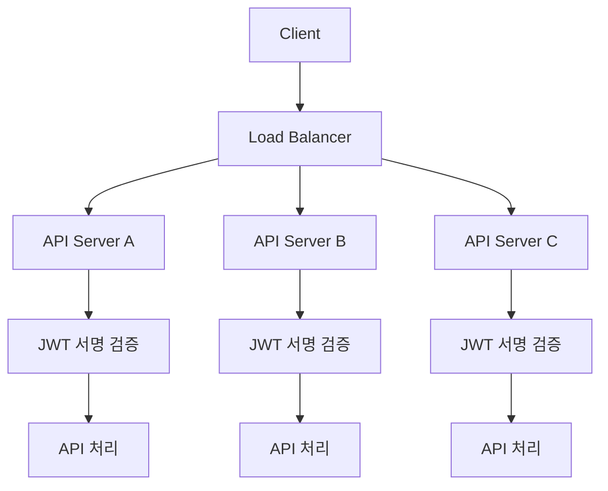
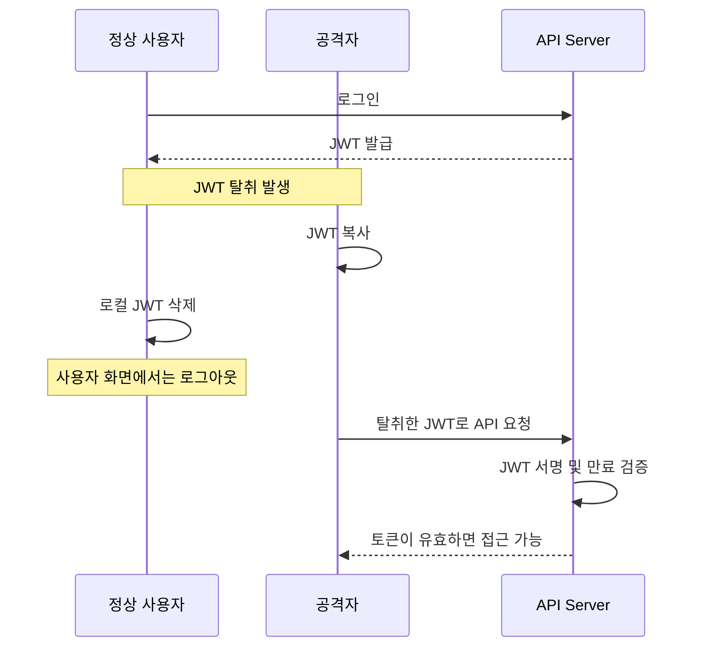
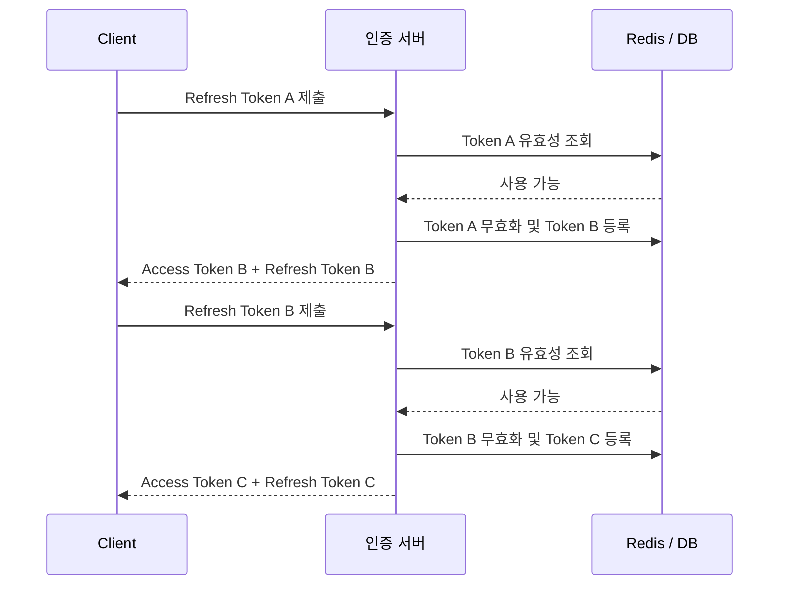
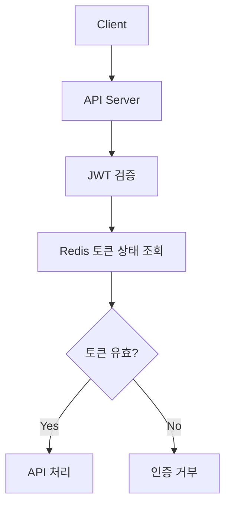
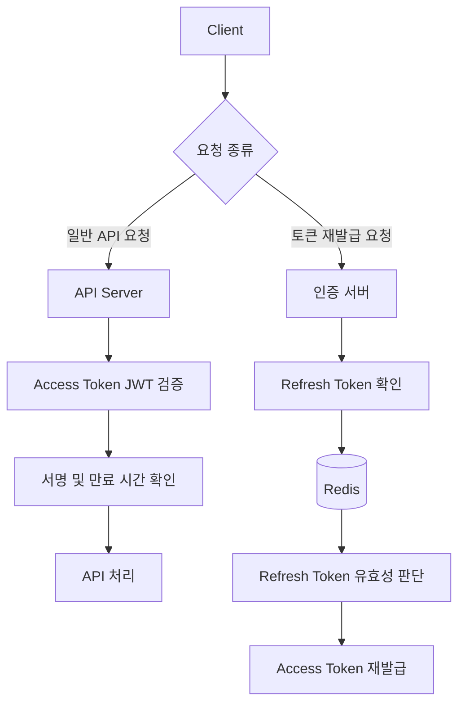
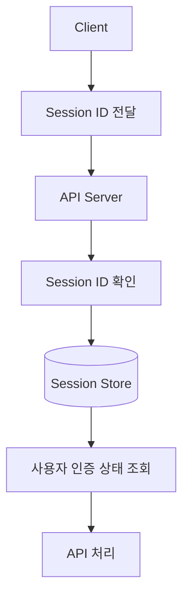
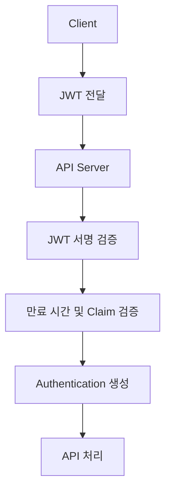
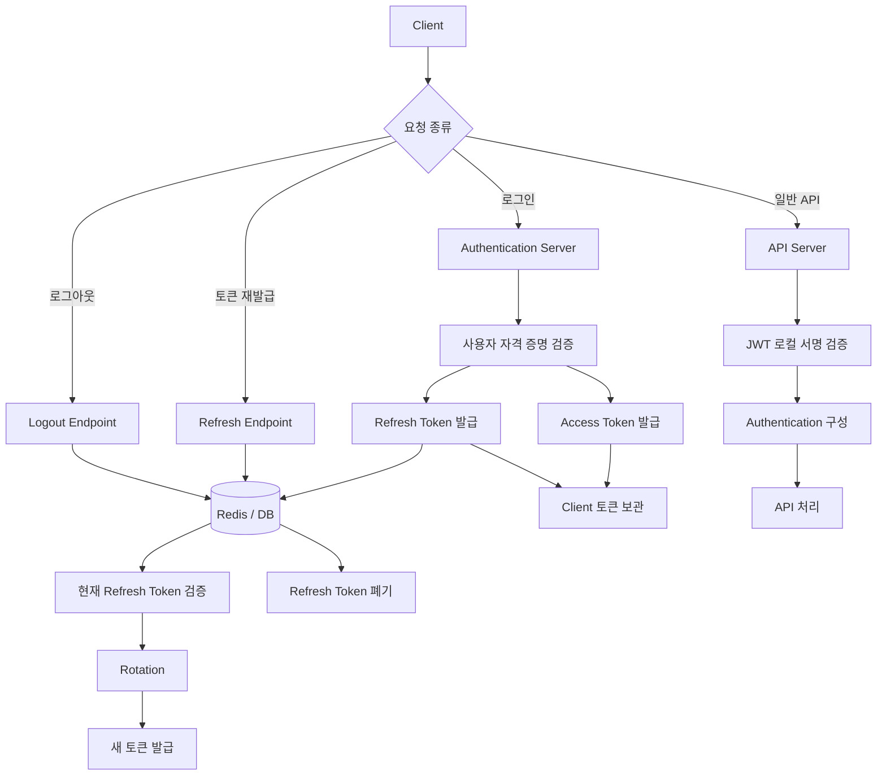
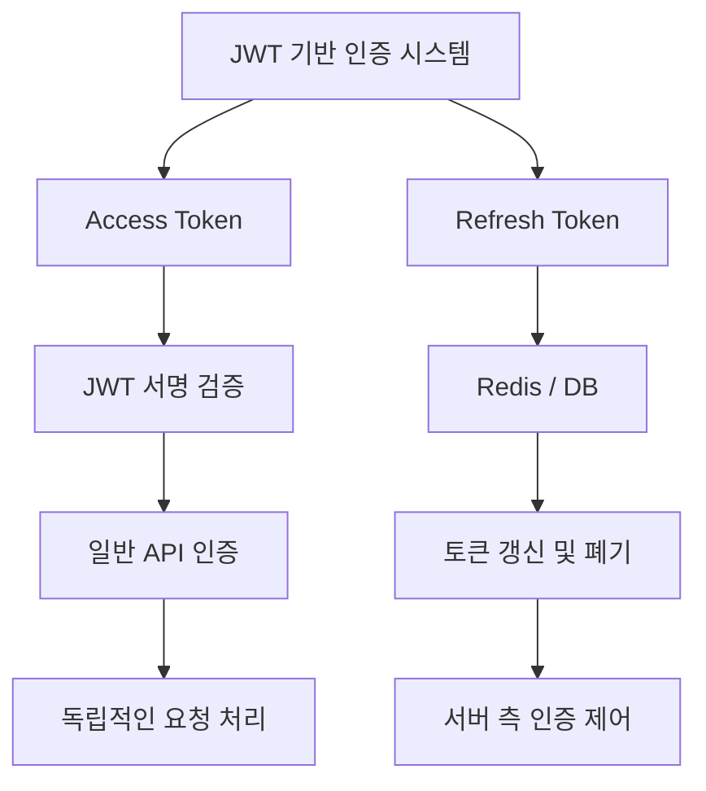

# 스프링 시큐리티 JWT - 14. JWT의 목표
[https://youtu.be/qIG-GNorXG4?si=rRrL3n5nAo4DhxsS](https://youtu.be/qIG-GNorXG4?si=rRrL3n5nAo4DhxsS)

# 스프링 시큐리티 JWT - 14. JWT의 목표
* toc
{:toc}

---

### JWT를 사용하는 진짜 이유: Stateless의 한계, Redis와 Refresh Token, 세션 인증과의 차이

Spring Security에서 JWT 기반 인증 시스템을 구현하다 보면 반복적으로 등장하는 개념이 있다.

바로 **Stateless(무상태)** 다.

JWT 인증 시스템은 일반적으로 다음과 같이 구성한다.

```java
http.sessionManagement(session -> session
        .sessionCreationPolicy(SessionCreationPolicy.STATELESS)
);
```

이 설정은 Spring Security가 인증 상태를 유지하기 위해 `HttpSession`을 생성하거나 사용하지 않도록 하는 설정이다.

이후 클라이언트가 JWT를 전달하면 서버는 토큰의 서명과 만료 시간을 검증하고 사용자 인증 정보를 구성한다.

```text
HTTP 요청
    ↓
Authorization: Bearer JWT
    ↓
JWTFilter
    ↓
JWT 서명 및 만료 시간 검증
    ↓
Authentication 생성
    ↓
SecurityContextHolder 등록
    ↓
Controller 실행
```

이러한 구조에서는 매 요청마다 서버에 저장된 로그인 세션을 조회하지 않고 인증을 수행할 수 있다.

그렇다면 JWT를 사용하는 가장 중요한 목적은 서버에 상태를 전혀 저장하지 않는 것일까?

이 질문을 깊이 생각하면 몇 가지 의문이 생긴다.

- JWT가 탈취되면 서버는 해당 토큰을 어떻게 무효화할 수 있을까?
- 로그아웃한 사용자의 JWT는 즉시 사용할 수 없게 될까?
- Refresh Token은 왜 Redis나 데이터베이스에 저장할까?
- Redis를 사용한다면 JWT의 Stateless 특성이 사라지는 것은 아닐까?
- 서버에 상태를 저장해야 한다면 차라리 세션 인증을 사용하는 것이 낫지 않을까?
- 그렇다면 JWT는 도대체 어떤 문제를 해결하기 위해 사용하는 것일까?

이러한 질문은 단순한 구현 방법을 넘어 인증 시스템의 아키텍처를 이해하는 데 매우 중요하다.

이번에는 JWT와 Stateless의 관계를 살펴보고, 토큰 탈취와 로그아웃 문제를 분석한 뒤, 실제 서비스에서 어떤 인증 구조를 선택해야 하는지 알아본다.

---

### 개념

#### JWT는 무엇을 해결하기 위한 기술일까?

JWT(JSON Web Token)는 두 주체 사이에서 Claim을 전달하기 위한 간결하고 URL에 사용하기 적합한 토큰 형식이다.

JWT에 포함된 Claim은 JSON으로 표현되며, 토큰은 서명 또는 암호화 등의 방법으로 보호할 수 있다.

JWT의 기본 구조는 다음과 같다.

```text
Header.Payload.Signature
```

일반적인 서명형 JWT는 다음 정보를 포함할 수 있다.

```json
{
  "sub": "10001",
  "role": "ROLE_USER",
  "iss": "https://auth.example.com",
  "aud": "https://api.example.com",
  "iat": 1790000000,
  "exp": 1790000900
}
```

각 Claim의 의미는 다음과 같다.

| Claim | 의미 |
|---|---|
| `sub` | 토큰의 대상 사용자 |
| `role` | 사용자 권한 |
| `iss` | 토큰 발급자 |
| `aud` | 토큰 사용 대상 |
| `iat` | 토큰 발급 시간 |
| `exp` | 토큰 만료 시간 |

여기서 중요한 점은 JWT가 사용자 로그인에만 사용되는 기술이 아니라는 사실이다.

JWT는 인증 시스템뿐 아니라 서로 다른 시스템 사이에서 검증 가능한 정보를 전달하는 데에도 활용할 수 있다.

RFC 7519는 JWT를 간결한 Claim 표현 형식으로 정의한다. **JWT의 표준적인 목적을 단순히 Stateless 로그인 구현으로 한정할 수는 없다.**

#### JWT와 Stateless는 같은 개념일까?

그렇지 않다.

JWT는 토큰의 형식이고, Stateless는 시스템이 상태를 관리하는 방식에 관한 개념이다.

두 개념을 비교하면 다음과 같다.

| 구분 | JWT | Stateless |
|---|---|---|
| 개념 | 토큰 형식 | 상태 관리 방식 |
| 목적 | Claim 전달 및 검증 | 요청 간 서버 상태 의존 최소화 |
| 인증에 사용 가능 | 가능 | 가능 |
| 서버 저장소 필수 여부 | 필수 아님 | 설계에 따라 다름 |
| 서로의 필수 조건 | 아님 | 아님 |

JWT를 사용하더라도 서버에 사용자 상태를 저장할 수 있다.

반대로 JWT를 사용하지 않아도 Stateless 인증 시스템을 구현할 수 있다.

예를 들어 HTTP Basic 인증은 요청마다 자격 증명을 전달하는 Stateless 인증 방식으로 사용할 수 있다.

따라서 다음과 같이 생각하는 것은 정확하지 않다.

```text
JWT = Stateless
```

보다 정확한 관계는 다음과 같다.

```text
JWT
    ↓
서명된 Claim 제공
    ↓
서버 측 세션 조회 없이 인증할 수 있음
    ↓
Stateless 인증 구조 구현에 활용 가능
```

즉 JWT는 Stateless 인증을 구현할 수 있도록 도와주는 수단이지, Stateless 자체와 동일한 개념은 아니다.

---

### 왜 사용하는가?

#### Stateless에만 집중하면 발생하는 문제

JWT 기반 인증을 처음 구현할 때는 다음과 같은 목표를 설정하기 쉽다.

> 서버에 사용자 로그인 상태를 전혀 저장하지 않는 인증 시스템을 만들자.

이 목표 자체가 잘못된 것은 아니다.

서버가 매 요청마다 세션 저장소를 조회하지 않고 JWT의 서명만으로 인증할 수 있다면 여러 장점이 있다.

예를 들어 다음과 같다.



각 API 서버는 JWT 검증에 필요한 키와 정책을 가지고 있으면 인증 정보를 확인할 수 있다.

이를 통해 매 요청마다 공통 세션 저장소에 접근해야 하는 의존성을 줄일 수 있다.

하지만 Stateless를 절대적인 목표로 설정하면 문제가 발생한다.

그 이유는 JWT를 이용한 실제 인증 시스템에서도 서버 측에서 관리해야 하는 상태가 생길 수 있기 때문이다.

대표적인 것이 다음 두 가지다.

**첫째, 로그아웃과 토큰 강제 무효화다.**

**둘째, Refresh Token의 발급·재발급·폐기 상태 관리다.**

이러한 요구사항이 등장하면 서버에 상태를 저장하는 구조를 검토해야 한다.

그때 Stateless를 절대적인 제약으로 생각하면 설계가 복잡해질 수 있다.

---

### JWT의 가장 큰 고민: 토큰 탈취

#### JWT가 탈취되면 어떤 문제가 발생할까?

일반적인 JWT 인증 시스템에서는 클라이언트가 다음과 같이 토큰을 전달한다.

```http
GET /api/me HTTP/1.1
Host: api.example.com
Authorization: Bearer <ACCESS_TOKEN>
```

서버는 JWT의 서명과 만료 시간을 검증한다.

```text
JWT 수신
    ↓
서명 검증
    ↓
만료 시간 검증
    ↓
사용자 정보 추출
    ↓
인증 성공
```

이때 중요한 사실이 있다.

**일반적인 Bearer Token은 해당 토큰을 가진 주체가 사용할 수 있다.**

서버는 JWT의 서명과 Claim을 검증하지만, 토큰을 전달한 주체가 원래 토큰을 발급받은 사용자와 동일한 기기에서 요청했는지까지 자동으로 확인하지는 않는다.

예를 들어 다음과 같은 상황을 생각해보자.

```text
정상 사용자
    ↓
로그인 성공
    ↓
JWT 발급
    ↓
토큰 탈취
    ↓
공격자가 동일한 JWT 사용
    ↓
API 서버 접근 시도
```

공격자가 탈취한 JWT를 그대로 사용하면 서버는 정상적으로 발급된 토큰이라고 판단할 수 있다.

서명도 정상이고 만료 시간도 지나지 않았기 때문이다.

일반적인 Bearer Token에서 이러한 재사용 공격은 중요한 보안 위험이다.

OAuth 2.0 보안 권고인 RFC 9700에서는 탈취된 Access Token의 악용을 줄이기 위한 수단으로 DPoP와 mTLS 같은 Sender-Constrained Token 방식을 설명한다.

---

### 클라이언트에서 JWT를 삭제하면 로그아웃이 완료될까?

가장 단순한 로그아웃 구현은 클라이언트에 저장된 JWT를 삭제하는 것이다.

예를 들어 브라우저 애플리케이션이 가지고 있는 Access Token을 삭제한다고 생각해보자.

```javascript
function logout() {
    accessToken = null;
}
```

클라이언트는 더 이상 JWT를 전송하지 않는다.

따라서 일반적인 사용자 관점에서는 로그아웃된 것처럼 동작한다.

하지만 JWT가 이미 탈취된 상태라면 이야기가 달라진다.



여기서 알 수 있는 사실은 다음과 같다.

**클라이언트에서 토큰을 삭제하는 것과 서버에서 토큰의 효력을 무효화하는 것은 서로 다른 작업이다.**

로컬 토큰 삭제만으로는 이미 복사된 토큰의 사용을 막을 수 없다.

이것이 JWT 기반 인증에서 로그아웃과 강제 무효화 정책을 고민해야 하는 이유다.

---

### JWT는 왜 즉시 무효화하기 어려울까?

일반적인 서명형 JWT에는 만료 시간이 포함되어 있다.

예를 들어 다음과 같다.

```json
{
  "sub": "10001",
  "role": "ROLE_USER",
  "exp": 1790000900
}
```

서버는 JWT를 검증할 때 다음 사항을 확인한다.

```text
1. 올바른 키로 서명되었는가?

2. 만료 시간이 지나지 않았는가?

3. 발급자와 대상 서비스가 올바른가?

4. 필요한 Claim이 존재하는가?
```

이러한 조건을 모두 충족하면 토큰 자체는 유효하다고 판단할 수 있다.

하지만 서버가 별도의 토큰 상태를 관리하지 않는다면 다음과 같은 사실을 알기 어렵다.

```text
이 토큰은 사용자가 방금 로그아웃했다.
```

또는 다음과 같다.

```text
이 토큰은 보안 사고로 인해 강제로 무효화되었다.
```

JWT의 서명에는 현재 로그아웃 상태를 자동으로 반영하는 기능이 없다.

따라서 이미 발급된 JWT를 즉시 무효화하려면 추가적인 제어 수단이 필요하다.

대표적으로 다음과 같은 방법이 있다.

| 방법 | 설명 | 특징 |
|---|---|---|
| 짧은 만료 시간 | 토큰의 사용 가능 시간 제한 | 즉시 무효화는 불가능 |
| Denylist | 무효화된 토큰의 식별자 저장 | 요청 시 상태 확인 필요 |
| Token Version | 사용자별 토큰 버전 비교 | 서버 측 버전 조회 필요 |
| Token Introspection | 인증 서버에 현재 토큰 상태 확인 | 네트워크 의존성 발생 |
| 서명 키 교체 | 기존 서명 검증 키 제거 | 영향 범위가 클 수 있음 |

이 중 어떤 방법을 사용할지는 서비스의 보안 요구사항과 운영 비용에 따라 달라진다.

OWASP도 JWT를 세션 인증에 사용하는 경우 토큰 무효화 요구사항 때문에 완전한 Stateless 구조의 장점이 줄어들 수 있다고 설명한다.

---

### Refresh Token을 도입하는 이유

JWT 기반 인증 시스템을 운영하다 보면 Access Token만 사용하는 구조에 한계가 생긴다.

예를 들어 Access Token의 만료 시간을 30일로 설정했다고 생각해보자.

```text
Access Token 만료 시간

30일
```

사용자는 장기간 로그인 상태를 유지할 수 있다.

하지만 토큰이 탈취되면 공격자가 해당 토큰을 악용할 수 있는 시간도 길어진다.

반대로 Access Token을 5분으로 설정하면 어떨까?

```text
Access Token 만료 시간

5분
```

토큰이 탈취되더라도 만료 이후에는 사용할 수 없다.

하지만 사용자는 너무 자주 다시 인증해야 할 수 있다.

이 두 가지 문제 사이에서 균형을 맞추기 위한 방법 중 하나가 **Access Token과 Refresh Token을 분리하는 구조**다.

#### Access Token

Access Token은 실제 API에 접근할 때 사용한다.

```text
Access Token
    ↓
API 요청에 사용
    ↓
비교적 짧은 유효기간
```

#### Refresh Token

Refresh Token은 새로운 Access Token을 발급받기 위해 사용한다.

```text
Refresh Token
    ↓
토큰 재발급 요청
    ↓
새로운 Access Token 발급
```

두 토큰의 역할은 다음과 같다.

| 구분 | Access Token | Refresh Token |
|---|---|---|
| 주요 목적 | API 접근 | Access Token 재발급 |
| 사용 빈도 | 일반적으로 높음 | 상대적으로 낮음 |
| 유효기간 | 상대적으로 짧게 설정 | 상대적으로 길게 설정 가능 |
| 전달 대상 | API 서버 | 토큰 발급 서버 |
| 탈취 시 위험 | API 접근 악용 | 새로운 Access Token 발급 악용 |
| 서버 상태 저장 | 필수 아님 | 상태 관리 정책이 필요한 경우가 많음 |

여기서 중요한 것은 Refresh Token이 반드시 JWT 형식이어야 하는 것은 아니라는 사실이다.

Refresh Token은 충분한 무작위성을 가진 Opaque Token으로 구현할 수도 있다.

즉 다음과 같은 조합도 가능하다.

```text
Access Token = JWT

Refresh Token = Opaque Token
```

이는 실제 서비스에서 고려할 수 있는 중요한 설계 방식이다.

---

### Refresh Token은 왜 서버에 저장할까?

Refresh Token을 사용하면 새로운 고민이 발생한다.

Refresh Token이 탈취되면 공격자가 새로운 Access Token을 발급받을 수 있기 때문이다.

예를 들어 다음 상황을 생각해보자.

```text
정상 사용자
    ↓
Refresh Token 보유
    ↓
Refresh Token 탈취
    ↓
공격자가 재발급 요청
    ↓
새로운 Access Token 획득
```

Access Token의 유효기간을 짧게 설정하더라도 Refresh Token이 탈취되면 공격자가 인증을 지속할 수 있는 경로가 생길 수 있다.

따라서 Refresh Token에는 별도의 보안 정책이 필요하다.

대표적으로 다음과 같은 요구사항이 있다.

- 로그아웃 시 Refresh Token 폐기
- 계정 정지 시 Refresh Token 사용 중단
- Refresh Token 재발급 시 기존 토큰 무효화
- 탈취된 토큰의 재사용 탐지
- 사용자별 활성 기기 관리
- Refresh Token 만료 및 비활성 기간 관리

이러한 정책을 구현하려면 서버가 특정 Refresh Token의 현재 상태를 확인할 수 있어야 한다.

이를 위해 Redis나 데이터베이스를 사용할 수 있다.

예를 들어 다음과 같은 정보를 저장할 수 있다.

```json
{
  "sessionId": "session-10001",
  "userId": 10001,
  "tokenHash": "<REFRESH_TOKEN_HASH>",
  "expiresAt": "2026-12-01T00:00:00Z",
  "revoked": false
}
```

여기서 `tokenHash`는 충분한 엔트로피를 가진 Opaque Refresh Token을 해시한 값이라고 가정한다.

Refresh Token 원문을 서버 저장소에 그대로 보관하는 것보다 해시나 적절한 보호 수단을 사용하는 방식이 유출 위험을 줄이는 데 도움이 될 수 있다.

단, Refresh Token을 저장한다고 해서 보안 문제가 자동으로 해결되는 것은 아니다.

토큰 재사용 검증과 원자적인 교체, 만료 및 폐기 정책까지 함께 구현해야 한다.

---

### Refresh Token Rotation이란?

Refresh Token Rotation은 Refresh Token을 사용하여 새로운 토큰을 발급받을 때 기존 Refresh Token을 무효화하고 새로운 Refresh Token을 함께 발급하는 방식이다.

예를 들어 다음과 같다.

```text
Refresh Token A
    ↓
재발급 요청
    ↓
Access Token B 발급
    ↓
Refresh Token B 발급
    ↓
Refresh Token A 무효화
```

이후 클라이언트는 Refresh Token B만 사용한다.

전체 흐름은 다음과 같다.



이 구조에서는 이미 사용된 Refresh Token이 다시 제출되면 비정상적인 재사용을 탐지할 수 있다.

예를 들어 다음과 같다.

```text
정상 사용자
    ↓
Refresh Token A 사용
    ↓
Refresh Token B 발급
    ↓
기존 Token A 무효화
```

그런데 이후 Refresh Token A가 다시 전달된다.

```text
공격자 또는 중복 요청
    ↓
Refresh Token A 제출
    ↓
이미 무효화된 토큰
    ↓
재사용 탐지
```

이때 보안 정책에 따라 해당 Refresh Token 계열을 폐기하고 재로그인을 요구할 수 있다.

OAuth 2.0 보안 권고인 RFC 9700은 Public Client에서 Refresh Token을 발급할 경우 Sender-Constrained Refresh Token 또는 Refresh Token Rotation과 같은 재사용 방어 수단을 요구한다.

#### Rotation 구현에서 주의할 점

Refresh Token을 교체하는 작업은 원자적으로 처리해야 한다.

동일한 Refresh Token으로 거의 동시에 두 개의 재발급 요청이 들어올 수 있기 때문이다.

예를 들어 다음과 같은 상황이다.

```text
Refresh Token A
    ├── 요청 1
    └── 요청 2
```

두 요청이 모두 기존 토큰이 유효하다고 판단하면 서로 다른 Refresh Token을 발급하는 문제가 발생할 수 있다.

따라서 데이터베이스의 트랜잭션과 행 잠금 또는 Redis의 원자적 연산 등을 사용해 한 번의 교체만 성공하도록 설계해야 한다.

또한 네트워크 재시도와 중복 요청 때문에 정상 사용자의 요청도 재사용으로 판단될 수 있으므로, 클라이언트의 중복 호출 방지와 서버 측 재사용 정책을 함께 고려해야 한다.

---

### Redis를 사용하면 JWT의 Stateless 특성이 사라질까?

이제 핵심적인 질문으로 돌아가 보자.

JWT를 사용하는 이유가 Stateless 인증을 구현하기 위한 것이라면, Refresh Token을 Redis에 저장하는 순간 Stateless의 장점이 사라지는 것은 아닐까?

이 질문에 답하려면 **어떤 요청에서 어떤 상태를 조회하는지** 구분해야 한다.

#### 모든 API 요청에서 Redis를 조회하는 구조

먼저 다음 구조를 생각해보자.



이 구조에서는 모든 API 요청에서 Redis를 조회한다.

따라서 매 요청마다 외부 상태 저장소에 의존한다.

토큰 강제 무효화와 같은 기능을 구현하기에는 유리하지만, JWT의 로컬 서명 검증만으로 인증하는 구조와는 다르다.

#### Access Token은 로컬 검증하고 Refresh Token만 저장하는 구조

반면 다음과 같은 아키텍처도 가능하다.



여기서 두 요청의 처리 방식은 서로 다르다.

**일반 API 요청**

```text
Access Token
    ↓
JWT 서명 검증
    ↓
추가 저장소 조회 없이 인증
```

**토큰 재발급 요청**

```text
Refresh Token
    ↓
Redis 또는 DB 조회
    ↓
토큰 상태 확인
    ↓
새로운 Access Token 발급
```

이렇게 구성하면 Access Token 검증 단계는 서버 측 로그인 세션 조회 없이 처리할 수 있다.

동시에 Refresh Token의 재발급과 폐기 상태는 서버에서 관리할 수 있다.

따라서 시스템 전체에 Redis가 존재한다고 해서 일반 API 요청의 Stateless 인증 특성이 반드시 사라지는 것은 아니다.

**중요한 것은 저장소의 존재 자체가 아니라, 각 요청 경로가 어떤 상태에 의존하는지다.**

---

### Stateless는 시스템 전체에 적용되는 절대적인 속성일까?

Stateless라는 개념을 이해할 때는 범위를 구분하는 것이 좋다.

예를 들어 다음과 같은 서비스가 있다고 생각해보자.

```text
API Server
    ↓
MySQL
```

이 서비스는 사용자 정보나 주문 정보를 MySQL에 저장한다.

그렇다면 데이터베이스에 상태가 존재하므로 무조건 Stateful 서비스라고 해야 할까?

그렇게 단순하게 판단하기는 어렵다.

HTTP 요청 처리의 Stateless와 비즈니스 데이터의 영속성은 서로 다른 문제이기 때문이다.

예를 들어 JWT를 이용한 API 서버도 다음과 같은 작업을 수행할 수 있다.

```text
JWT 인증
    ↓
사용자 확인
    ↓
주문 생성
    ↓
MySQL 저장
```

주문 데이터가 데이터베이스에 저장된다는 이유만으로 JWT 인증 방식의 특성이 사라지는 것은 아니다.

마찬가지로 Refresh Token을 Redis에 저장한다는 이유만으로 Access Token 검증 구조까지 반드시 Stateful이 되는 것은 아니다.

이를 구분하면 다음과 같다.

| 상태의 종류 | 예시 | 관리 목적 |
|---|---|---|
| 인증 상태 | Access Token, Session | 사용자 인증 |
| 재발급 상태 | Refresh Token | 재인증 및 토큰 교체 |
| 계정 상태 | 정지, 탈퇴, 권한 | 사용자 관리 |
| 비즈니스 상태 | 주문, 결제, 배송 | 서비스 기능 |
| 운영 상태 | Rate Limit, 장애 차단 | 안정성 및 보호 |

이 중 무엇을 서버에 보관할지는 시스템의 목적에 따라 달라진다.

따라서 **Stateless라는 하나의 개념으로 모든 상태 저장을 금지하는 것은 적절하지 않다.**

---

### JWT와 세션 인증은 무엇이 다를까?

JWT와 세션 인증을 비교해보자.

#### 세션 기반 인증

일반적인 서버 세션 기반 인증은 다음과 같이 동작할 수 있다.



사용자가 로그인하면 서버는 인증 상태를 저장한다.

클라이언트는 세션 ID를 전달한다.

서버는 해당 세션 ID를 이용해 인증 상태를 확인한다.

세션 저장소는 애플리케이션 메모리, Redis, 데이터베이스 등 다양한 방법으로 구성할 수 있다.

#### JWT 기반 인증

JWT 기반 인증에서는 다음과 같이 구성할 수 있다.



서버는 JWT의 서명과 Claim을 검증하여 사용자 정보를 확인한다.

별도의 세션 상태를 조회하지 않고도 인증할 수 있다.

#### 차이점 비교

| 구분 | 세션 인증 | JWT 인증 |
|---|---|---|
| 클라이언트가 전달하는 값 | Session ID | JWT |
| 인증 정보의 주요 위치 | 서버 측 세션 저장소 | 서명된 토큰의 Claim |
| 매 요청 상태 조회 | 세션 저장 방식에 따라 필요 | 순수 로컬 검증에서는 불필요 |
| 강제 로그아웃 | 세션 삭제로 구현 가능 | 추가 무효화 정책 필요 |
| 권한 변경 반영 | 세션 갱신 정책 필요 | 토큰 만료 또는 추가 조회 필요 |
| 여러 서버 지원 | 공유 세션 저장소 등을 사용 | 검증 키 공유 등으로 구현 |
| 저장소 장애 영향 | 구성에 따라 직접적 | 로컬 검증 요청에는 제한적 |
| 보안 고려사항 | 세션 탈취, CSRF 등 | 토큰 탈취, 재사용, 무효화 등 |
| 적합한 환경 | 중앙 제어가 중요한 환경 | 독립적 토큰 검증이 유리한 환경 |

여기서 중요한 사실은 **JWT가 세션 인증보다 항상 우수한 것은 아니라는 점**이다.

세션 인증도 Redis 등을 이용해 여러 서버에서 안정적으로 운영할 수 있다.

반대로 JWT 인증도 토큰 상태 확인이 많아지면 외부 저장소에 대한 의존성이 증가할 수 있다.

결국 중요한 것은 서비스에 적합한 인증 구조를 선택하는 것이다.

---

### 모바일 앱 때문에 JWT가 등장했을까?

JWT의 사용 목적을 고민하다 보면 모바일 애플리케이션과의 관계도 생각하게 된다.

모바일 앱에서는 브라우저 중심의 세션 쿠키 방식보다 Authorization 헤더 기반의 토큰 인증이 구현상 편리한 경우가 있다.

또한 여러 API 서버와 외부 서비스에 접근해야 하는 환경에서도 토큰 기반 인증은 유용할 수 있다.

하지만 **JWT가 모바일 앱 때문에 탄생했다고 단정하는 것은 정확하지 않다.**

JWT는 서로 다른 주체 사이에서 Claim을 전달하기 위한 표준 형식으로 정의되었다.

모바일 앱뿐 아니라 웹 애플리케이션, API 서버, 인증 서버, 서비스 간 통신 등 다양한 환경에서 활용된다.

반대로 모바일 앱에서도 쿠키와 세션 인증을 사용할 수 있다.

따라서 다음과 같이 이해하는 것이 적절하다.

```text
모바일 앱의 등장
    ↓
API 기반 서비스 확대
    ↓
토큰 인증의 활용 증가
    ↓
JWT 활용이 유리한 상황 증가
```

모바일 앱은 JWT 활용이 유리한 환경 중 하나이지만, JWT의 유일한 목적이나 필수 조건은 아니다.

또한 모바일 앱이 브라우저보다 토큰 탈취에 무조건 안전한 것도 아니다.

모바일 환경에서도 악성 앱, 취약한 저장 방식, 로그 노출, 단말기 탈취, 루팅 및 변조 환경 등으로 토큰이 유출될 수 있다.

따라서 모바일과 웹을 구분하기보다 **토큰을 어디에 저장하고, 어떤 경로로 전달하며, 탈취 시 어떻게 대응할 것인지**를 중심으로 보안 정책을 설계해야 한다.

---

### 장기간 로그인 유지가 JWT의 장점일까?

서비스에서는 사용자가 매번 로그인하지 않도록 장기간 인증 상태를 유지해야 하는 경우가 많다.

예를 들어 다음과 같은 기능이다.

```text
로그인 상태 유지

30일
```

이를 위해 JWT를 사용할 수 있다.

하지만 JWT만이 장기간 로그인을 구현할 수 있는 방법은 아니다.

서버 세션과 Persistent Session을 이용해 장기간 로그인 상태를 유지하는 것도 가능하다.

따라서 중요한 질문은 다음과 같다.

**장기간 로그인 상태를 유지하면서 토큰 탈취와 강제 로그아웃 문제를 어떻게 해결할 것인가?**

예를 들어 JWT 기반 시스템에서는 다음과 같은 구조를 선택할 수 있다.

```text
Access Token
    ↓
짧은 유효기간
```

```text
Refresh Token
    ↓
상대적으로 긴 유효기간
    ↓
서버 측 상태 관리
```

이렇게 하면 Access Token의 유효기간을 제한하면서도 Refresh Token을 통해 사용자 인증을 갱신할 수 있다.

다만 Refresh Token이 탈취되면 장기적으로 악용될 수 있으므로 별도의 방어 정책이 필요하다.

즉 JWT가 장기간 로그인을 가능하게 하는 유일한 기술이라기보다, **장기간 로그인 기능을 구현할 때 활용할 수 있는 인증 구조 중 하나**라고 이해해야 한다.

---

### 구조

#### 실무에서 고려할 수 있는 JWT 인증 아키텍처

지금까지의 내용을 바탕으로 실제 서비스에서 활용할 수 있는 인증 아키텍처를 구성해보자.

이번 구조에서는 다음 조건을 가정한다.

| 항목 | 정책 |
|---|---|
| Access Token | JWT |
| Refresh Token | 무작위 Opaque Token |
| Access Token 유효기간 | 15분 |
| Refresh Token 유효기간 | 14일 |
| Refresh Token 저장소 | Redis 또는 DB |
| Refresh Token 재발급 | Rotation 적용 |
| 일반 API 인증 | JWT 서명 로컬 검증 |
| 로그아웃 | Refresh Token 폐기 |
| Access Token 즉시 폐기 | 별도 정책 필요 |

위 시간은 구조를 설명하기 위한 예시이며 모든 서비스에 동일하게 적용해야 하는 기준은 아니다.

전체 구조는 다음과 같다.



이 구조의 특징은 다음과 같다.

**일반 API 요청에서는 Redis를 조회하지 않아도 된다.**

반면 Refresh Token을 재발급하거나 로그아웃할 때는 Redis 또는 데이터베이스를 사용한다.

이를 통해 일반 API 요청의 인증 비용을 줄이면서 서버 측 토큰 제어 기능을 제공할 수 있다.

다만 한 가지를 명확하게 이해해야 한다.

**Refresh Token을 폐기하더라도 이미 발급된 Access Token이 즉시 무효화되는 것은 아니다.**

Access Token이 자체 서명 검증만으로 인증되는 구조라면 해당 토큰은 만료될 때까지 사용할 수 있다.

즉시 무효화가 필요한 경우에는 별도의 Access Token 폐기 정책이 필요하다.

---

### Access Token과 Refresh Token의 로그아웃 차이

로그아웃을 처리할 때는 두 토큰의 특성을 구분해야 한다.

#### Refresh Token 폐기

서버에서 Refresh Token 상태를 관리한다면 로그아웃 시 해당 토큰을 폐기할 수 있다.

```text
로그아웃 요청
    ↓
Refresh Token 식별
    ↓
서버 저장소에서 폐기
    ↓
새로운 Access Token 발급 차단
```

이렇게 하면 해당 Refresh Token으로 새로운 Access Token을 발급받을 수 없게 만들 수 있다.

#### Access Token 폐기

하지만 기존 Access Token은 별도의 문제다.

```text
이미 발급된 Access Token
    ↓
서명 정상
    ↓
만료 시간 남음
    ↓
API 접근 가능
```

이 문제를 해결하려면 다음 중 하나를 선택해야 한다.

| 정책 | 장점 | 단점 |
|---|---|---|
| Access Token 짧은 만료 | 인증 검증이 단순함 | 즉시 무효화 불가능 |
| Access Token Denylist | 특정 토큰 즉시 차단 가능 | 요청 시 상태 조회 필요 |
| 사용자 Token Version | 사용자 단위 토큰 일괄 차단 가능 | 버전 조회 필요 |
| 중앙 Introspection | 실시간 상태 제어에 유리 | 네트워크 의존성 및 지연 발생 |

OAuth 2.0에서는 토큰 폐기를 위한 RFC 7009와 토큰 상태 확인을 위한 RFC 7662가 정의되어 있다.

다만 이러한 표준을 사용한다고 해서 모든 JWT Access Token의 효력이 각 API 서버에 즉시 전파되는 것은 아니다. API 서버가 어떤 검증 방식과 상태 확인 정책을 사용하는지도 중요하다.

---

### Redis를 활용한 Refresh Token 관리 예시

Refresh Token을 서버에서 관리한다면 Redis를 사용할 수 있다.

예를 들어 사용자별 로그인 세션을 다음과 같이 저장할 수 있다.

```text
refresh:session:{sessionId}
```

저장되는 정보는 다음과 같은 형태로 구성할 수 있다.

```json
{
  "userId": 10001,
  "tokenHash": "<HASH>",
  "familyId": "family-10001",
  "createdAt": "2026-11-06T01:00:00Z",
  "expiresAt": "2026-11-20T01:00:00Z",
  "revoked": false
}
```

각 필드의 의미는 다음과 같다.

| 필드 | 역할 |
|---|---|
| userId | 사용자 식별 |
| tokenHash | 현재 유효한 Refresh Token 검증 |
| familyId | Rotation 계열 식별 |
| createdAt | 최초 발급 시각 |
| expiresAt | 만료 시각 |
| revoked | 폐기 여부 |

여기서 Refresh Token 원문을 저장하지 않는 구조를 고려할 수 있다.

예를 들어 서버가 충분한 무작위성을 가진 Opaque Refresh Token을 생성하고, 해당 토큰의 해시를 저장하는 방식이다.

또한 Redis에서는 만료 시간을 설정할 수 있으므로 Refresh Token의 만료 정책과 데이터 보관 기간을 연결할 수 있다.

그러나 Redis에 저장했다고 해서 Rotation의 동시성 문제가 해결되는 것은 아니다.

다음 동작은 하나의 원자적인 작업으로 처리해야 한다.

```text
기존 Refresh Token 확인
    ↓
기존 토큰 사용 여부 확인
    ↓
기존 토큰 무효화
    ↓
새로운 Refresh Token 등록
```

서버가 여러 대인 환경에서는 Redis Lua Script나 데이터베이스 트랜잭션 등을 이용해 동시 요청을 제어할 수 있다.

이때 Redis 장애나 재시도, 중복 요청이 발생했을 때의 정책도 함께 결정해야 한다.

---

### 실무에서의 활용

#### 1. JWT를 사용할 이유부터 정의한다

JWT를 사용한다는 사실보다 중요한 것은 JWT가 해결해야 하는 문제다.

예를 들어 다음과 같은 요구사항이 있을 수 있다.

```text
여러 API 서버에서 인증 정보를 독립적으로 검증하고 싶다.
```

또는 다음과 같다.

```text
인증 서버의 조회 부하를 줄이고 싶다.
```

이러한 요구사항에서는 JWT가 유리할 수 있다.

반면 다음과 같은 요구사항이 있다면 다른 선택도 고려해야 한다.

```text
사용자 로그아웃을 모든 API에서 즉시 반영해야 한다.
```

이 경우 중앙 세션 저장소나 Introspection 기반 인증이 더 단순할 수 있다.

따라서 JWT를 사용하기 전에 해결하려는 문제를 먼저 정의하는 것이 중요하다.

#### 2. Stateless를 목표가 아닌 설계 특성으로 이해한다

서버가 어떤 상태도 저장하지 않는 것을 절대적인 목표로 삼으면 인증 기능을 확장하는 과정에서 불필요한 제약이 생긴다.

예를 들어 Refresh Token Rotation이나 강제 로그아웃을 위해 상태 저장이 필요할 수 있다.

따라서 다음 질문이 더 중요하다.

**어떤 요청에서 상태 조회를 줄여야 하는가?**

일반 API 요청의 인증 경로에서는 로컬 JWT 검증을 사용하고, 재발급과 폐기 경로에서는 상태 저장소를 활용할 수 있다.

#### 3. Access Token과 Refresh Token의 책임을 구분한다

Access Token은 API 접근에 사용한다.

Refresh Token은 새로운 Access Token을 발급받는 데 사용한다.

두 토큰의 목적이 다르므로 동일한 만료 시간과 동일한 검증 정책을 적용할 필요는 없다.

또한 Refresh Token을 일반 API에 전달하여 인증에 사용하지 않도록 설계해야 한다.

#### 4. Refresh Token을 반드시 JWT로 만들 필요는 없다

Refresh Token은 무작위로 생성한 Opaque Token으로 구현할 수 있다.

이 경우 서버는 전달받은 토큰을 저장된 해시나 상태 정보와 비교하여 검증한다.

JWT를 사용하면 Claim을 포함할 수 있다는 장점이 있지만, 서버 측 상태 확인이 필요한 Refresh Token에서는 반드시 JWT 형식이어야 할 이유가 없는 경우도 많다.

따라서 토큰의 용도에 따라 형식을 선택해야 한다.

#### 5. Refresh Token Rotation을 고려한다

Refresh Token을 장기간 사용할 수 있도록 허용하면 탈취 시 위험이 커진다.

따라서 Refresh Token을 사용할 때마다 새로운 토큰으로 교체하는 Rotation을 고려할 수 있다.

또한 이미 사용한 Refresh Token이 다시 전달되면 재사용 공격 가능성을 탐지하도록 구성할 수 있다.

단, 클라이언트의 중복 재발급 요청이나 네트워크 재시도도 함께 고려해야 한다.

#### 6. Access Token의 강제 무효화 요구사항을 명확하게 정의한다

모든 서비스가 Access Token을 즉시 무효화해야 하는 것은 아니다.

예를 들어 짧은 유효기간을 사용하고 해당 기간의 위험을 수용할 수 있다면 별도의 Denylist 없이 운영할 수도 있다.

하지만 관리자 계정이나 금융 거래 등 높은 보안 요구사항에서는 즉시 무효화가 필요할 수 있다.

따라서 **토큰을 폐기할 수 있는 최대 허용 지연 시간**을 먼저 정의해야 한다.

이 기준이 Access Token 만료 시간과 상태 조회 정책을 결정하는 중요한 요소가 된다.

#### 7. Denylist를 사용할 때는 토큰 식별자를 활용한다

특정 Access Token을 무효화해야 한다면 `jti`와 같은 토큰 식별자를 사용할 수 있다.

예를 들어 JWT에 다음 Claim을 포함한다.

```json
{
  "iss": "https://auth.example.com",
  "sub": "10001",
  "jti": "token-unique-id",
  "exp": 1790000900
}
```

서버는 무효화된 토큰의 `iss`와 `jti`를 저장하고 인증 과정에서 확인할 수 있다.

이때 원본 JWT 문자열을 저장할 필요는 없다.

또한 토큰마다 충분히 고유한 식별자를 발급해야 한다.

OWASP는 토큰의 원문이나 원문 해시를 Denylist 식별자로 사용하는 방식보다 서명된 Claim에 포함된 안정적인 식별자인 `jti` 등을 활용하는 방식을 설명한다.

#### 8. Redis가 있다고 무조건 Stateful 인증이라고 판단하지 않는다

Redis는 다양한 목적으로 사용할 수 있다.

```text
Redis
    ├── Refresh Token 저장
    ├── Rate Limit 관리
    ├── 인증 실패 횟수 관리
    ├── 분산 락
    └── 캐싱
```

Redis가 존재한다는 사실만으로 모든 API 요청이 Stateful 인증을 사용한다고 판단할 수는 없다.

중요한 것은 실제 인증 요청이 어떤 상태를 조회하는지다.

따라서 Redis의 존재 여부보다 요청별 상태 의존성을 분석해야 한다.

#### 9. 세션 기반 인증을 과소평가하지 않는다

세션 인증은 오래된 기술이라는 이유만으로 피해야 하는 방식이 아니다.

공유 세션 저장소를 사용하면 여러 서버에서도 세션 기반 인증을 운영할 수 있다.

또한 서버에서 세션을 폐기하는 방식으로 로그아웃과 강제 인증 종료를 구현할 수 있다.

사용자별 인증 상태를 즉시 제어해야 하는 환경에서는 오히려 세션 방식이 이해하기 쉽고 운영하기 편리할 수 있다.

따라서 JWT와 세션 인증은 우열 관계가 아니라 선택의 문제다.

#### 10. JWT가 항상 성능상 유리한 것은 아니다

JWT는 로컬에서 서명을 검증할 수 있으므로 매 요청마다 외부 인증 저장소에 접근하지 않는 구조를 만들 수 있다.

하지만 JWT의 검증에도 CPU 비용이 발생한다.

토큰 크기에 따른 네트워크 비용도 존재한다.

반면 세션 인증에서는 공유 저장소 조회 비용이 발생할 수 있지만, 적절한 캐싱과 인프라 구성을 통해 낮은 지연 시간을 달성할 수도 있다.

따라서 JWT가 무조건 더 빠르다고 단정하기보다 실제 요청량과 검증 비용, 저장소 지연 시간 등을 비교해야 한다.

#### 11. Token Version을 이용한 사용자 단위 무효화를 고려한다

사용자의 비밀번호가 변경되거나 계정이 정지되었을 때 기존 토큰을 모두 무효화해야 할 수 있다.

이때 사용자별 Token Version을 사용할 수 있다.

예를 들어 다음과 같다.

```json
{
  "sub": "10001",
  "tokenVersion": 3
}
```

서버에는 현재 버전이 저장되어 있다.

```text
user:10001:tokenVersion = 4
```

JWT의 버전과 현재 버전이 다르므로 인증을 거부할 수 있다.

다만 이 방식은 현재 버전을 확인하기 위한 조회가 필요하다.

버전 조회를 캐싱한다면 캐시 갱신 지연과 무효화 반영 시간도 고려해야 한다.

#### 12. 토큰 탈취를 IP 주소만으로 방어하지 않는다

토큰 탈취 문제를 해결하기 위해 IP 주소를 토큰과 연결하는 방법을 생각할 수 있다.

하지만 IP 주소는 사용자를 안정적으로 식별하는 수단이 아니다.

모바일 네트워크 전환이나 VPN 사용, NAT 환경 등으로 정상 사용자의 IP가 변경될 수 있다.

반대로 여러 사용자가 동일한 공인 IP를 공유할 수도 있다.

따라서 IP 주소는 이상 징후 탐지에 활용할 수 있지만, 토큰 소유자를 증명하는 유일한 수단으로 사용하기에는 한계가 있다.

#### 13. 토큰 탈취 대응에는 DPoP나 mTLS도 고려할 수 있다

일반적인 Bearer Token은 토큰을 가진 주체가 사용할 수 있다.

따라서 탈취된 토큰이 다른 환경에서 재사용될 수 있다.

이 문제를 줄이기 위해 Sender-Constrained Token을 고려할 수 있다.

대표적으로 DPoP와 mTLS가 있다.

이러한 방식은 토큰의 사용을 특정 키나 클라이언트에 연결하는 데 활용할 수 있다.

하지만 키까지 탈취되거나 클라이언트 환경이 침해된 경우에는 추가적인 위험이 존재하므로 완전한 해결책은 아니다.

#### 14. Redis 장애 시 인증 정책을 미리 정의한다

Refresh Token을 Redis에 저장하면 Redis의 가용성이 토큰 재발급 기능에 영향을 준다.

따라서 Redis가 장애 상태일 때 어떤 동작을 수행할지 결정해야 한다.

예를 들어 다음과 같은 정책이 가능하다.

```text
Redis 정상
    ↓
Refresh Token 검증
    ↓
재발급 허용
```

```text
Redis 장애
    ↓
Refresh Token 검증 불가
    ↓
재발급 중단
```

보안이 중요한 인증 작업에서는 상태를 확인할 수 없다고 해서 무조건 요청을 허용하는 방식은 위험할 수 있다.

또한 일반 Access Token 검증 경로가 Redis에 의존하지 않도록 설계했다면 Redis 장애 시에도 기존 Access Token을 이용한 일부 API 요청은 계속 처리할 수 있다.

이처럼 상태 저장소의 장애가 어떤 요청 경로에 영향을 주는지 구분하는 것이 중요하다.

#### 15. Refresh Token 재발급은 동시성 문제를 고려한다

클라이언트에서 Access Token이 만료되면 여러 API 요청이 동시에 실패할 수 있다.

이때 각 요청이 별도로 Refresh Token 재발급을 시도하면 문제가 발생한다.

```text
API 요청 A → 401
API 요청 B → 401
API 요청 C → 401
```

세 요청이 동시에 같은 Refresh Token을 사용하면 Rotation 충돌이 발생할 수 있다.

따라서 클라이언트에서는 하나의 재발급 요청만 실행하고 다른 요청들이 결과를 공유하도록 구성할 수 있다.

서버에서는 원자적 토큰 교체와 재사용 탐지 정책을 적용해야 한다.

이러한 설계가 없으면 정상적인 사용자도 불필요하게 로그아웃될 수 있다.

#### 16. 계정 상태와 토큰의 유효성을 구분한다

JWT의 서명과 만료 시간이 정상적이라고 해서 사용자 계정이 현재도 활성 상태라는 의미는 아니다.

예를 들어 다음과 같은 상황이 가능하다.

```text
JWT 유효
    ↓
하지만 사용자 계정 정지
```

또는 다음과 같다.

```text
JWT 유효
    ↓
하지만 사용자 권한 회수
```

따라서 계정 상태와 권한 변경을 얼마나 빠르게 반영해야 하는지 정책을 정해야 한다.

보안 민감도가 낮은 API에서는 Access Token 만료 시점까지의 지연을 허용할 수 있다.

반면 관리자 권한이나 중요한 거래를 처리하는 API에서는 최신 계정 상태를 추가로 확인해야 할 수 있다.

#### 17. 인증 서버와 API 서버의 책임을 분리한다

서비스 규모가 커지면 인증 서버와 API 서버의 역할을 분리할 수 있다.

예를 들어 다음과 같다.

```text
Authentication Server
    ↓
로그인
Refresh Token 관리
Access Token 발급
토큰 폐기
```

```text
API Server
    ↓
Access Token 검증
사용자 인증
권한 확인
비즈니스 요청 처리
```

이 구조에서는 인증 서버가 토큰 발급과 갱신을 담당한다.

API 서버는 전달받은 토큰을 검증한다.

여러 API 서버가 동일한 토큰 검증 정책을 사용하면 인증 로직의 중복을 줄일 수 있다.

또한 Spring Security의 OAuth 2.0 Resource Server 기능을 활용하면 JWT 검증과 인증 객체 구성에 필요한 기능을 직접 모두 구현하지 않고도 사용할 수 있다.

#### 18. 구현의 복잡성도 아키텍처의 비용으로 평가한다

JWT를 사용하면 인증 서버의 상태 조회를 줄일 수 있다.

하지만 로그아웃과 Refresh Token Rotation, Token Version, Denylist 등을 추가하면 구현 복잡성이 커질 수 있다.

반면 세션 인증은 중앙 저장소에 의존할 수 있지만 인증 상태 제어가 상대적으로 단순할 수 있다.

따라서 다음 요소를 함께 평가해야 한다.

| 평가 항목 | 주요 질문 |
|---|---|
| 인증 성능 | 요청마다 어떤 검증 비용이 발생하는가? |
| 운영 복잡성 | 장애 대응과 모니터링이 쉬운가? |
| 보안 | 탈취와 강제 무효화에 대응할 수 있는가? |
| 확장성 | API 서버를 독립적으로 확장할 수 있는가? |
| 사용자 경험 | 로그인 상태를 적절하게 유지할 수 있는가? |
| 개발 비용 | 구현과 유지보수 비용이 적절한가? |

아키텍처를 선택할 때는 특정 기술의 장점만 보는 것이 아니라 전체 시스템의 비용과 위험을 평가해야 한다.

---

### JWT와 세션 중 무엇을 선택해야 할까?

지금까지의 내용을 바탕으로 인증 방식 선택 기준을 정리해보자.

#### 세션 인증이 적합할 수 있는 경우

다음과 같은 요구사항이 있다면 세션 기반 인증을 고려할 수 있다.

```text
서버에서 로그인 상태를 즉시 제어해야 한다.
```

```text
로그아웃과 강제 세션 종료가 중요하다.
```

```text
인증 서버와 API 서버가 비교적 단순한 구조다.
```

```text
중앙 세션 저장소를 안정적으로 운영할 수 있다.
```

이러한 환경에서는 세션 인증이 구현과 운영 측면에서 더 적절할 수 있다.

#### JWT 인증이 적합할 수 있는 경우

다음과 같은 요구사항이 있다면 JWT 인증을 고려할 수 있다.

```text
여러 API 서버가 인증 정보를 독립적으로 검증해야 한다.
```

```text
매 요청마다 중앙 인증 저장소를 조회하는 비용을 줄이고 싶다.
```

```text
서로 다른 서비스 사이에서 서명된 Claim을 전달해야 한다.
```

```text
API 서버를 독립적으로 확장해야 한다.
```

이러한 환경에서는 JWT가 유리할 수 있다.

#### 하이브리드 인증이 적합할 수 있는 경우

실제 서비스에서는 두 구조의 장점을 조합하는 방법도 가능하다.

```text
Access Token
    ↓
JWT
    ↓
로컬 검증
```

```text
Refresh Token
    ↓
Redis 또는 DB
    ↓
서버 측 상태 관리
```

이 구조는 일반 API 요청의 인증 의존성을 줄이면서 Refresh Token의 폐기와 갱신 상태를 관리할 수 있다.

다만 Access Token의 즉시 무효화까지 보장하려면 별도의 정책을 추가해야 한다.

#### 인증 방식 선택 기준

| 서비스 요구사항 | 우선 검토할 방식 |
|---|---|
| 중앙에서 로그인 상태를 즉시 제어 | 세션 또는 중앙 검증 |
| API 서버의 독립적인 토큰 검증 | JWT |
| 매우 짧은 무효화 반영 시간 요구 | 상태 조회 기반 인증 |
| 장기간 로그인 유지 | 세션 또는 Refresh Token 기반 |
| 다수의 API 서버와 서비스 간 인증 | JWT 또는 중앙 인증 시스템 |
| 단순한 내부 관리 시스템 | 세션 인증 |
| 확장 가능한 API 인증 | JWT와 Refresh Token 관리 조합 |
| 복잡한 보안 정책과 강제 폐기 | 하이브리드 또는 중앙 인증 |

어떤 방식도 모든 상황에서 최선은 아니다.

서비스의 보안 요구사항과 운영 특성에 맞는 구조를 선택해야 한다.

---

### 문제를 다시 정의해보기

지금까지의 고민을 정리해보면 처음에는 다음과 같은 질문에서 출발했다.

> JWT를 사용하는데 Redis에 상태를 저장해도 되는가?

하지만 이 질문은 조금 다른 관점에서 바라볼 필요가 있다.

JWT를 선택하는 이유가 서버에 아무 상태도 저장하지 않기 위해서라면 Redis 도입은 모순처럼 보일 수 있다.

그러나 목표를 다시 정의하면 결론이 달라진다.

**원래 질문**

```text
어떻게 하면 서버에 상태를
전혀 저장하지 않을 수 있을까?
```

**재정의한 질문**

```text
어떤 인증 요청에서는
상태 조회를 최소화하고,

어떤 요청에서는
서버가 인증 상태를 제어해야 할까?
```

이렇게 질문을 바꾸면 시스템의 역할을 분리할 수 있다.

```text
일반 API 요청
    ↓
독립적인 JWT 검증
    ↓
인증 처리 비용과 의존성 감소
```

```text
토큰 재발급 및 로그아웃
    ↓
서버 측 상태 확인
    ↓
보안 및 사용자 세션 제어
```

이 구조에서는 Stateless와 Stateful이 무조건 대립하는 것이 아니다.

서로 다른 요구사항을 해결하기 위해 선택적으로 활용되는 설계 방식이 된다.

결국 중요한 것은 Stateless라는 특성을 끝까지 유지하는 것보다 **어떤 상태를 저장할 필요가 있고, 어떤 상태는 저장하지 않아도 되는지 판단하는 능력**이다.

---

### 정리

JWT 기반 인증을 구현하다 보면 Stateless라는 개념에 집중하기 쉽다.

서버가 매 요청마다 세션 저장소를 조회하지 않고 사용자 정보를 검증할 수 있다는 점은 JWT를 활용한 인증 구조의 중요한 장점이다.

하지만 실제 서비스를 운영하면 다음과 같은 요구사항이 등장한다.

```text
로그아웃
```

```text
토큰 탈취 대응
```

```text
Refresh Token 재발급
```

```text
계정 정지
```

```text
권한 변경
```

```text
강제 인증 종료
```

이러한 기능은 서버 측 상태 관리가 필요한 경우가 많다.

따라서 Redis나 데이터베이스를 도입하게 될 수 있다.

하지만 서버에 상태 저장소가 존재한다는 이유만으로 JWT 인증의 장점이 모두 사라지는 것은 아니다.

예를 들어 다음과 같이 역할을 분리할 수 있다.



Access Token은 JWT를 이용해 로컬에서 검증한다.

Refresh Token은 Redis나 데이터베이스를 이용해 상태를 관리한다.

이러한 구조를 통해 일반적인 API 요청의 외부 저장소 의존성을 줄이면서 사용자 인증 상태를 제어할 수 있다.

다만 Refresh Token을 폐기하더라도 이미 발급한 Access Token은 별도 무효화 정책이 없다면 만료될 때까지 사용할 수 있다는 점을 반드시 고려해야 한다.

또한 JWT는 모바일 앱을 위해서만 등장한 기술이 아니다.

JWT는 검증 가능한 Claim을 전달하기 위한 표준 형식이며, 인증 시스템에서 Stateless 검증을 구현하는 데 활용할 수 있다.

따라서 JWT와 세션 인증을 선택할 때는 다음 질문을 기준으로 판단하는 것이 좋다.

**첫째, 인증 상태를 얼마나 빠르게 무효화해야 하는가?**

**둘째, 일반 API 요청에서 중앙 저장소 조회를 줄여야 하는가?**

**셋째, 여러 서비스가 동일한 인증 정보를 검증해야 하는가?**

**넷째, 장기간 로그인 상태를 어떻게 유지할 것인가?**

**다섯째, 토큰 탈취와 재사용 공격에 어떻게 대응할 것인가?**

**여섯째, 시스템의 구현 및 운영 복잡성을 어느 수준까지 감당할 수 있는가?**

이러한 질문에 대한 답이 정리되면 JWT, 세션 인증, 중앙 Introspection, Refresh Token 기반의 하이브리드 구조 중 어떤 방식이 적절한지 판단할 수 있다.

가장 중요한 것은 특정 기술을 구현했다는 사실이 아니다.

**해결하려는 문제를 정확하게 정의하고, 그 문제에 적합한 기술과 상태 관리 방식을 선택하는 것**이다.

#### 한 줄 요약

JWT는 Stateless 인증을 구현할 수 있도록 도와주는 토큰 형식이지만, Stateless 자체가 JWT의 유일한 목적은 아니다. 실제 인증 시스템에서는 토큰 탈취 대응과 로그아웃, Refresh Token Rotation, 계정 상태 관리 등을 위해 Redis나 데이터베이스를 사용할 수 있다. 중요한 것은 상태 저장소를 완전히 제거하는 것이 아니라, 일반 API 인증에서는 독립적인 JWT 검증의 장점을 활용하고 토큰 갱신과 폐기처럼 서버 측 제어가 필요한 영역에서는 상태를 관리하도록 역할을 분리하는 것이다.
