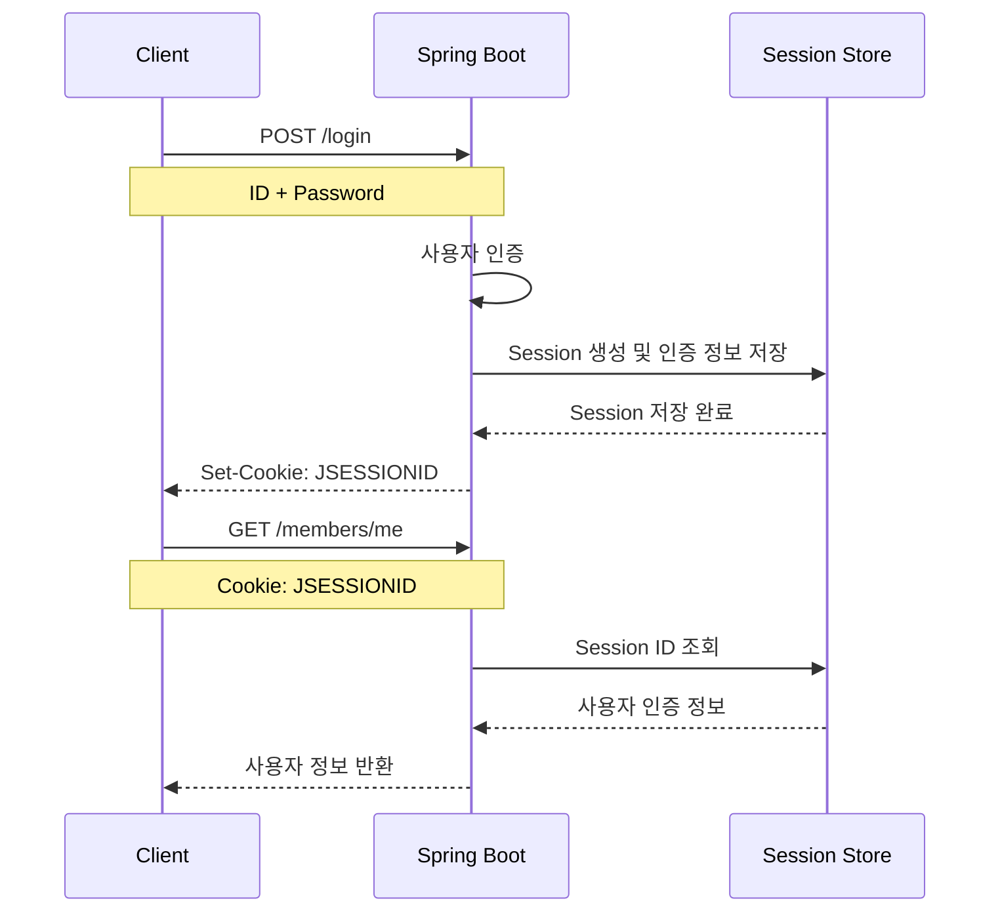
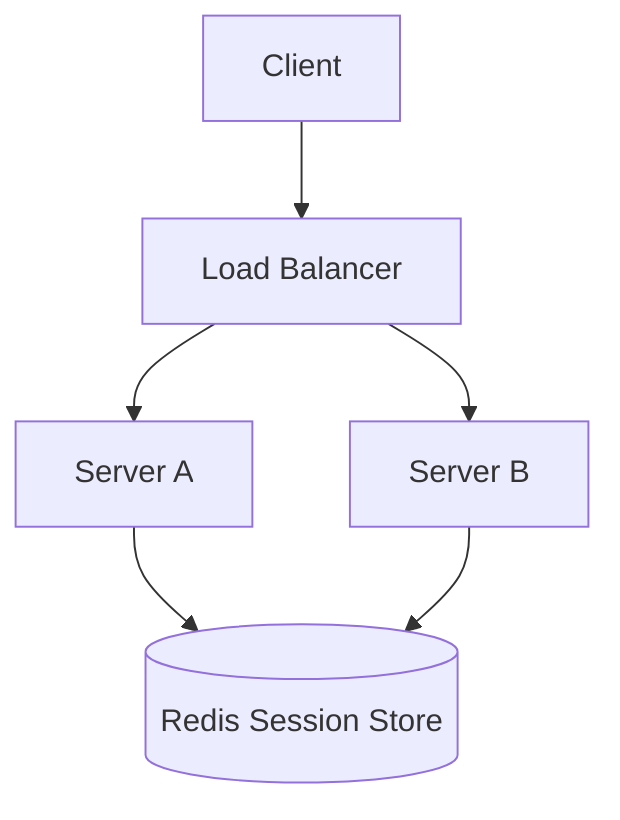
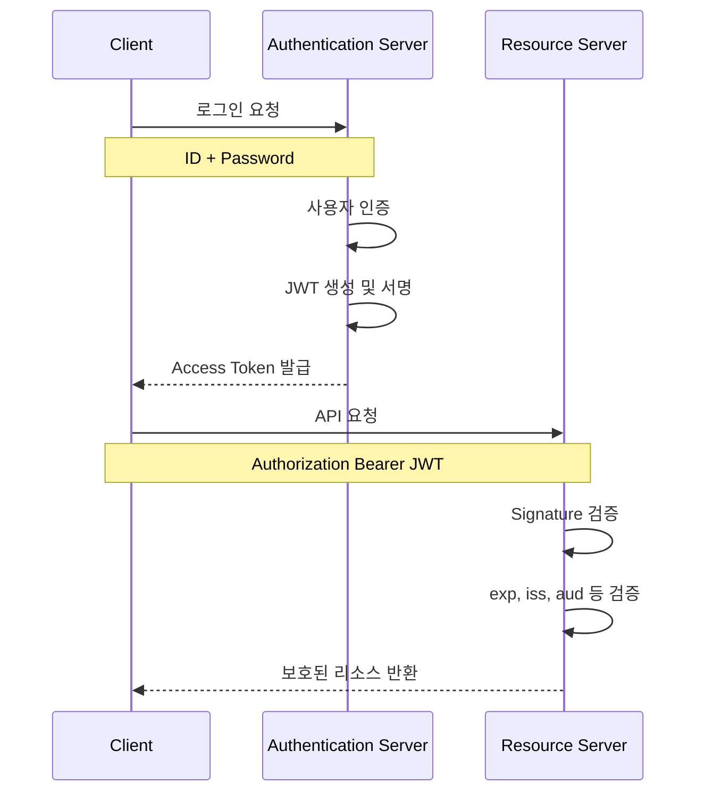
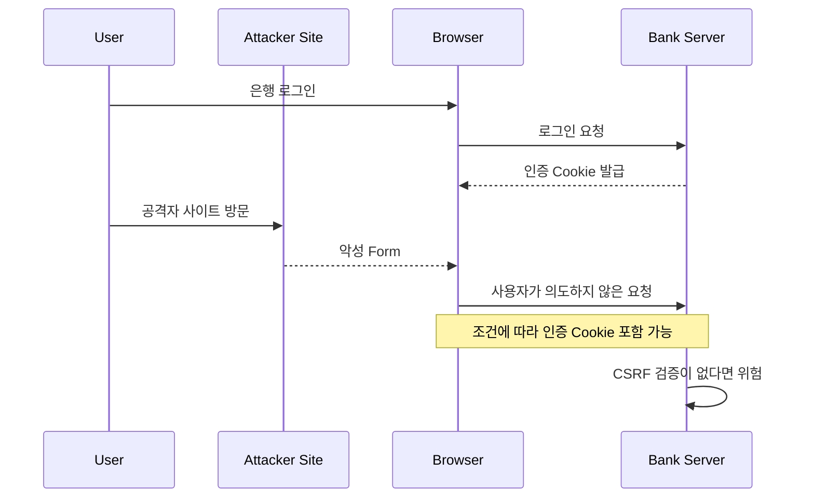
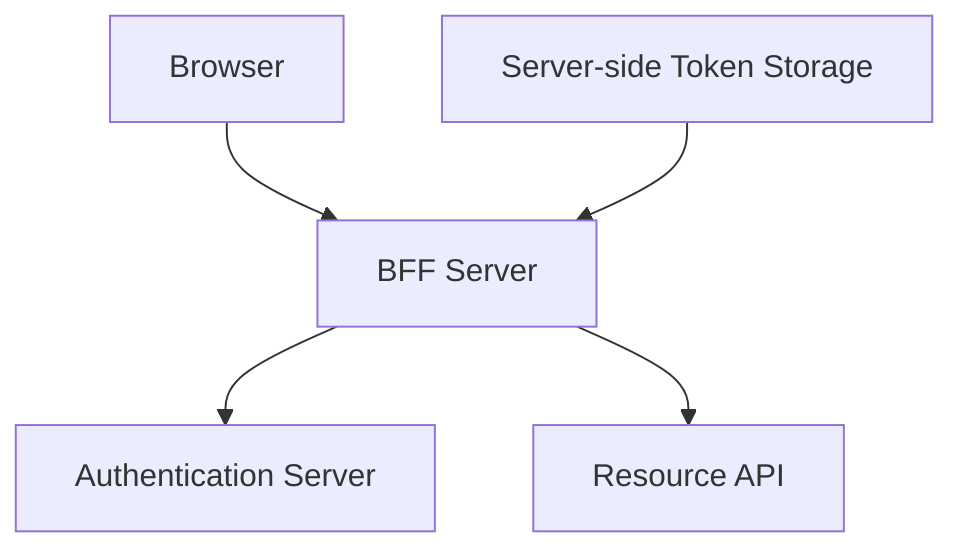
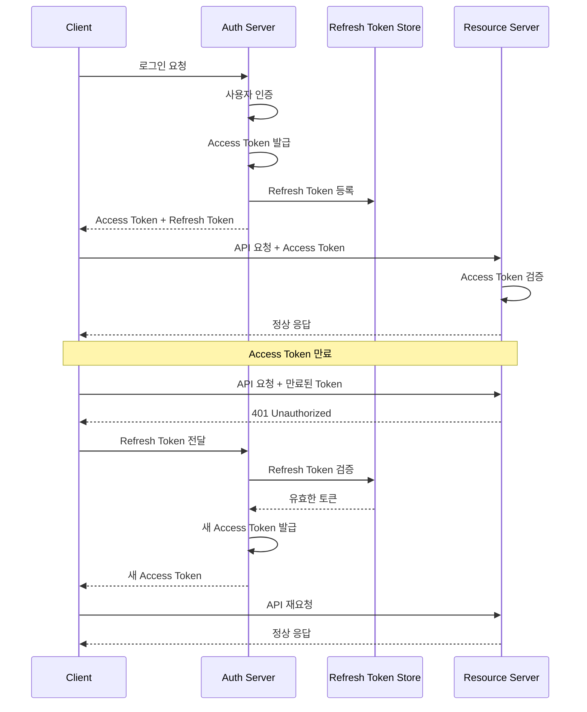
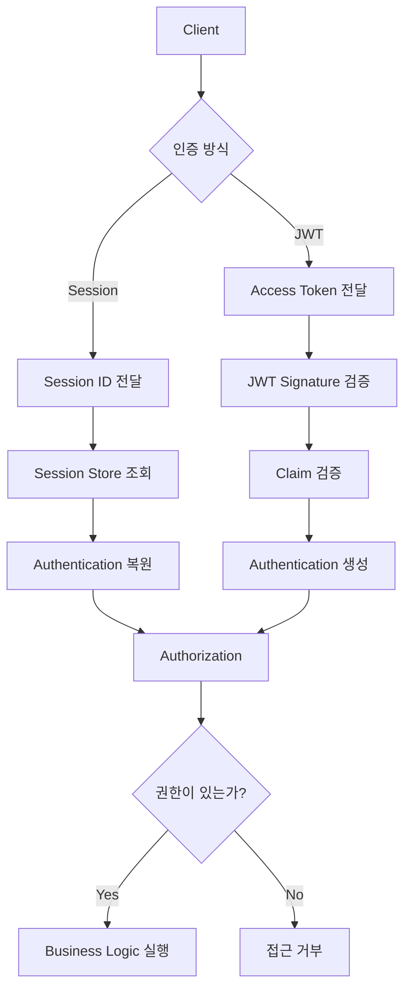

# 클라우디의 세션과 JWT
[https://youtu.be/AGZA59MjhCg?si=SoN44P_a1AmAdDrD](https://youtu.be/AGZA59MjhCg?si=SoN44P_a1AmAdDrD)

# 클라우디의 세션과 JWT
* toc
{:toc}

---

## 세션과 JWT는 무엇이 다를까? 로그인 인증 방식과 Access Token·Refresh Token 전략

Spring Boot로 웹 서비스를 개발하다 보면 거의 반드시 구현하게 되는 기능이 있다.

바로 로그인이다.

처음 로그인 기능을 구현할 때는 단순하게 생각하기 쉽다.

사용자가 아이디와 비밀번호를 입력한다.

서버가 회원 정보를 조회하고 비밀번호를 검증한다.

일치한다면 로그인에 성공한다.

```text
아이디 입력
    ↓
비밀번호 입력
    ↓
서버에서 사용자 확인
    ↓
로그인 성공
```

그런데 실제 로그인 기능은 여기서 끝나지 않는다.

사용자가 로그인한 뒤 상품을 조회하거나 주문을 생성한다고 생각해보자.

```http
GET /api/members/me
```

서버는 이 요청을 보낸 사용자가 누구인지 알아야 한다.

또 다음 요청에서도 같은 사용자인지 확인해야 한다.

```http
POST /api/orders
```

사용자가 이미 로그인했다는 사실을 어떻게 알 수 있을까?

HTTP는 기본적으로 이전 요청의 상태를 자동으로 기억하지 않는다.

그렇다면 서버와 클라이언트는 로그인 상태를 어떤 방식으로 유지해야 할까?

이 문제를 해결하기 위해 사용하는 대표적인 방식이 **세션(Session) 기반 인증과 토큰(Token) 기반 인증**이다.

토큰 기반 인증에서는 JWT(JSON Web Token)가 널리 사용된다.

두 방식은 인증 상태를 표현하고 검증하는 방법이 다르며, 각각 장점과 단점이 존재한다.

이를 제대로 이해하려면 먼저 HTTP의 무상태성부터 살펴봐야 한다.

---

## HTTP는 왜 무상태(Stateless) 프로토콜일까?

HTTP의 대표적인 특징 중 하나는 Stateless다.

Stateless는 서버가 이전 HTTP 요청의 상태를 다음 요청에 자동으로 연결하지 않는다는 의미다.

예를 들어 다음 요청이 들어왔다고 하자.

```http
POST /api/login
Content-Type: application/json

{
  "username": "yun",
  "password": "password123"
}
```

서버는 전달받은 아이디와 비밀번호를 검증한다.

그리고 로그인에 성공했다는 응답을 반환한다.

```http
HTTP/1.1 200 OK
```

그다음 클라이언트가 다른 요청을 보낸다.

```http
GET /api/members/me
```

이 요청에는 앞서 로그인에 성공했다는 사실이 자동으로 포함되지 않는다.

서버 입장에서는 새로운 요청을 받은 것이다.

```text
Request 1

POST /login

↓

로그인 성공


Request 2

GET /members/me

↓

이 요청은 누구의 요청인가?
```

즉 HTTP 자체는 두 요청이 동일한 사용자에게서 발생했다는 사실을 보장하지 않는다.

여기서 한 가지 정확하게 구분해야 한다.

**HTTP가 Stateless하다는 것이 서버가 사용자 상태를 저장할 수 없다는 뜻은 아니다.**

HTTP 요청 자체가 이전 상태를 자동으로 전달하지 않는다는 의미다.

애플리케이션은 쿠키나 인증 헤더 등을 이용해 요청 사이의 관계를 유지할 수 있다.

---

## 매번 아이디와 비밀번호를 전달하면 안 될까?

가장 단순한 해결책은 매 요청마다 아이디와 비밀번호를 전달하는 것이다.

```http
GET /api/members/me
Authorization: Basic <credentials>
```

실제로 HTTP Basic Authentication은 사용자 자격 증명을 요청마다 전달하는 인증 방식이다.

하지만 일반적인 웹 서비스에서는 로그인 이후에도 사용자의 비밀번호를 계속 인증 수단으로 사용하기보다 별도의 인증 자격을 발급하는 방식이 많이 사용된다.

그 이유는 다음과 같다.

비밀번호는 사용자의 장기적인 인증 정보다.

만약 인증 정보가 유출된다면 공격자는 해당 비밀번호가 변경되기 전까지 계정에 접근을 시도할 수 있다.

반면 별도로 발급한 세션 ID나 Access Token에는 유효기간을 설정하거나 폐기하는 정책을 적용할 수 있다.

따라서 로그인 시점에는 아이디와 비밀번호를 검증하고, 이후 요청에서는 별도의 인증 정보를 사용하는 구조가 일반적이다.

```text
최초 로그인

아이디 + 비밀번호

↓

인증 성공

↓

별도의 인증 정보 발급


이후 요청

발급받은 인증 정보 사용
```

이때 가장 전통적인 방법 중 하나가 세션 기반 인증이다.

---

## 세션(Session)이란 무엇인가?

세션 기반 인증은 서버가 사용자의 로그인 상태를 관리하는 방식이다.

사용자가 로그인하면 서버는 해당 사용자가 인증되었다는 정보를 저장한다.

그리고 이 정보를 찾을 수 있는 고유한 식별자를 클라이언트에 전달한다.

이 식별자가 **Session ID**다.

브라우저에서는 일반적으로 Session ID를 쿠키에 저장한다.

Spring Boot와 Servlet 기반 환경에서는 `JSESSIONID`라는 이름을 자주 볼 수 있다.

예를 들어 다음과 같은 응답이 내려올 수 있다.

```http
HTTP/1.1 200 OK
Set-Cookie: JSESSIONID=abc123...; Path=/; HttpOnly; Secure; SameSite=Lax
```

브라우저는 이 쿠키를 보관한다.

그리고 이후 해당 쿠키의 전송 조건에 맞는 요청을 보낼 때 자동으로 포함한다.

```http
GET /api/members/me
Cookie: JSESSIONID=abc123...
```

서버는 Session ID를 이용해 로그인 정보를 찾는다.

---

## 세션 기반 인증의 전체 흐름

세션 로그인 과정을 조금 더 자세히 살펴보자.



흐름을 정리하면 다음과 같다.

**1. 사용자가 로그인한다.**

서버에 아이디와 비밀번호를 전달한다.

**2. 서버가 사용자를 인증한다.**

회원 정보를 확인하고 비밀번호를 검증한다.

**3. 인증에 성공하면 세션을 생성한다.**

서버는 사용자의 인증 상태를 세션에 저장한다.

**4. 클라이언트에 Session ID를 전달한다.**

브라우저에서는 일반적으로 쿠키를 사용한다.

**5. 이후 요청에서 Session ID를 전달한다.**

브라우저가 쿠키를 자동으로 포함한다.

**6. 서버가 Session ID를 검증한다.**

Session Store에 해당 세션이 존재하는지 확인한다.

**7. 인증된 사용자로 요청을 처리한다.**

이제 사용자는 매번 비밀번호를 입력하지 않아도 된다.

---

## Session에는 무엇이 저장될까?

세션에는 애플리케이션이 필요로 하는 상태를 저장할 수 있다.

인증 관점에서는 다음과 같은 정보가 대표적이다.

```text
Session ID
    ↓
Session Data

├── 사용자 식별 정보
├── 인증 상태
├── 권한 정보
├── 생성 시간
└── 마지막 접근 시간
```

Spring Security에서는 인증된 사용자를 표현하는 `Authentication` 객체를 `SecurityContext`에 보관한다.

그리고 세션 기반 인증에서는 이 `SecurityContext`를 HTTP Session을 통해 요청 사이에 유지할 수 있다.

개념적으로 다음과 같다.

```text
HTTP Request
    ↓
JSESSIONID
    ↓
HttpSession
    ↓
SecurityContext
    ↓
Authentication
    ↓
현재 로그인 사용자
```

Spring Security는 인증 정보를 `SecurityContextHolder`와 `SecurityContextRepository` 등을 통해 관리하며, 세션 기반 환경에서는 `HttpSessionSecurityContextRepository`를 활용할 수 있다.

여기서 `SecurityContextHolder`는 현재 요청 처리 중 인증 정보를 사용하는 역할이고, HTTP Session은 요청 사이에 인증 정보를 유지하는 저장 수단이라는 점을 구분해야 한다.

---

## 세션은 반드시 데이터베이스에 저장해야 할까?

그렇지 않다.

세션 인증을 설명할 때 다음처럼 표현하는 경우가 많다.

```text
Session ID
    ↓
Database 조회
    ↓
사용자 인증
```

하지만 세션 저장소가 반드시 관계형 데이터베이스일 필요는 없다.

세션은 다양한 위치에 저장할 수 있다.

| 저장 방식     | 특징                     |
| --------- | ---------------------- |
| 서버 메모리    | 구현이 단순하지만 서버 간 공유가 어려움 |
| Redis     | 여러 서버가 세션을 공유하기 좋음     |
| RDBMS     | 영속 저장소를 이용한 세션 관리      |
| 기타 분산 저장소 | 시스템 구성에 따라 선택 가능       |

예를 들어 서버가 한 대뿐이라면 메모리 기반 세션 관리로도 동작할 수 있다.

```text
Client
   ↓
Spring Boot
   ↓
Session Memory
```

하지만 서버가 여러 대로 확장되면 문제가 조금 복잡해진다.

---

## 세션 기반 인증의 문제: 서버가 여러 대라면?

다음과 같은 구조를 생각해보자.

```text
                Load Balancer
                 /         \
                /           \
           Server A       Server B
```

사용자가 처음 로그인할 때 Server A로 요청이 전달되었다.

Server A는 자신의 메모리에 Session을 저장한다.

```text
Server A

Session abc123
→ Member 1
```

그다음 요청이 Server B로 전달된다.

```text
Server B

Session abc123
→ 존재하지 않음
```

Server B는 해당 사용자의 세션을 알지 못한다.

결국 사용자가 로그인했는데도 다른 서버에서는 인증되지 않은 것으로 판단할 수 있다.

이것이 세션 기반 인증에서 서버를 수평 확장할 때 고려해야 하는 대표적인 문제다.

---

## 세션 공유 문제를 해결하는 방법

대표적으로 두 가지 접근이 있다.

### Sticky Session

Load Balancer가 같은 사용자의 요청을 가능한 한 같은 서버로 전달하도록 한다.

```text
User A
   ↓
Load Balancer
   ↓
Server A
```

구현이 비교적 단순할 수 있지만 특정 서버가 종료되거나 장애가 발생했을 때 세션을 유지하기 어렵다는 문제가 남는다.

### Shared Session Store

세션을 각 서버의 로컬 메모리가 아니라 공통 저장소에 저장한다.



이제 어떤 서버로 요청이 전달되어도 동일한 Session Store를 조회할 수 있다.

Spring 생태계에서는 Spring Session을 이용해 Redis 등 외부 저장소에 HTTP Session을 보관하는 구성을 만들 수 있다.

이 구조는 서버의 수평 확장과 세션 공유 문제를 해결하는 데 유용하다.

물론 Redis 자체의 가용성과 네트워크 지연, 세션 만료 정책은 별도로 관리해야 한다.

---

## 세션 방식의 장점은 무엇일까?

세션 방식은 오래된 기술이기 때문에 비효율적이라고 생각하기 쉽다.

하지만 실제로는 분명한 장점이 있다.

가장 큰 장점은 **서버가 인증 상태를 직접 통제할 수 있다는 점**이다.

예를 들어 관리자가 특정 사용자를 강제로 로그아웃시키고 싶다고 하자.

세션 기반이라면 서버에서 해당 세션을 무효화할 수 있다.

```text
사용자 로그인
    ↓
Session 생성
    ↓
정상 요청
    ↓
관리자 강제 로그아웃
    ↓
Session 삭제
    ↓
이후 요청 인증 실패
```

세션 자체가 존재하지 않으므로 더 이상 사용할 수 없다.

또한 서버가 인증 상태를 관리하기 때문에 동시 로그인 수 제한, 세션 만료 정책, 특정 기기 로그아웃 같은 요구사항을 구현하기에도 적합하다.

즉 세션 방식의 장점은 단순히 구현이 쉽다는 것이 아니다.

**서버가 현재 유효한 로그인 상태를 관리하고 즉시 변경할 수 있다는 점**이 중요하다.

---

## 세션 기반 인증의 단점

반대로 세션 방식은 서버 측에서 인증 상태를 유지해야 한다.

사용자가 증가하면 관리해야 하는 세션 수도 증가한다.

특히 분산 환경에서는 다음 요소들을 고려해야 한다.

```text
Session Store

Session Expiration

Session Replication

Session Invalidation

Storage Availability
```

모든 요청에서 세션을 복원해야 한다면 저장소 접근 비용도 발생할 수 있다.

물론 실제 비용은 세션 저장 방식과 캐시 구조에 따라 달라진다.

세션을 사용한다고 반드시 느린 것은 아니다.

다만 서버가 인증 상태를 관리하기 위한 저장소와 운영 구조를 필요로 한다는 점은 분명하다.

---

## JWT란 무엇인가?

JWT는 JSON Web Token의 약자다.

JSON 형태의 정보를 토큰에 담아 전달하기 위한 표준 형식이다.

인증 시스템에서는 사용자 식별 정보와 토큰 만료 시간 등을 JWT에 담아 사용한다.

JWT의 중요한 특징은 **서명을 통해 토큰이 위조되거나 변조되지 않았는지 검증할 수 있다는 점**이다.

세션 방식이 서버에 저장된 인증 상태를 Session ID로 찾아가는 방식이라면, JWT 방식은 토큰에 포함된 정보를 검증해 요청을 처리할 수 있다.

다만 여기서 JWT 자체가 인증 시스템이나 로그인 프로토콜인 것은 아니다.

JWT는 정보를 표현하는 토큰 형식이며, 이를 어떻게 발급하고 검증하고 저장할지는 애플리케이션이나 인증 프로토콜의 설계에 따라 달라진다.

JWT 표준인 RFC 7519는 JWT를 JSON Claim 집합을 표현하는 방식으로 정의한다.

---

## JWT의 구조

일반적으로 인증에 사용하는 서명된 JWT는 세 부분으로 구성된다.

```text
Header.Payload.Signature
```

각 부분은 점(`.`)으로 구분된다.

```text
xxxxx.yyyyy.zzzzz
```

각 영역의 역할은 다음과 같다.

| 구성요소      | 역할                         |
| --------- | -------------------------- |
| Header    | 토큰 유형과 서명 알고리즘 등           |
| Payload   | 사용자 정보, 만료 시간 등의 Claim     |
| Signature | 토큰의 무결성과 발급 주체를 검증하기 위한 서명 |

단, 모든 JWT가 반드시 세 부분인 것은 아니다. 일반적인 서명형 JWT인 JWS Compact 형식은 세 부분이며, 암호화된 JWE Compact 형식은 다섯 부분을 사용한다.

우리가 로그인 인증에 자주 사용하는 것은 주로 서명된 JWT다.

---

## Header

Header에는 JWT의 유형과 서명 알고리즘에 관한 정보가 들어간다.

예를 들어 다음과 같다.

```json
{
  "alg": "HS256",
  "typ": "JWT"
}
```

`alg`는 서명에 사용한 알고리즘을 나타낸다.

`HS256`은 HMAC SHA-256 기반 서명 방식이다.

`typ`는 토큰 유형을 나타낼 수 있다.

Header는 Base64URL 방식으로 인코딩되어 JWT의 첫 번째 영역에 들어간다.

여기서 주의해야 할 점은 Header에 적혀 있는 알고리즘을 서버가 무조건 신뢰해서는 안 된다는 것이다.

검증 서버는 자신이 허용한 알고리즘과 키를 기준으로 서명을 검증해야 한다.

---

## Payload

Payload에는 Claim이라고 부르는 정보가 들어간다.

예를 들어 다음과 같다.

```json
{
  "sub": "member-123",
  "role": "USER",
  "iss": "https://auth.example.com",
  "aud": "order-api",
  "iat": 1791950400,
  "exp": 1791951300
}
```

각 Claim의 의미를 살펴보자.

| Claim | 의미                    |
| ----- | --------------------- |
| `sub` | 토큰의 주체, 일반적으로 사용자 식별자 |
| `iss` | 토큰 발급자                |
| `aud` | 토큰을 사용할 대상            |
| `iat` | 토큰 발급 시간              |
| `exp` | 토큰 만료 시간              |
| `nbf` | 토큰 사용 가능 시작 시간        |
| `jti` | JWT 고유 식별자            |

`role`처럼 애플리케이션이 자체적으로 정의하는 Claim도 사용할 수 있다.

Payload에 어떤 정보를 넣을지는 설계에 따라 달라진다.

하지만 중요한 원칙이 있다.

**JWT Payload에는 비밀번호나 민감한 개인정보를 넣지 않는 것이 좋다.**

왜 그럴까?

JWT는 기본적으로 암호화되는 것이 아니기 때문이다.

---

## JWT는 암호화된 데이터일까?

많이 헷갈리는 부분이다.

JWT의 Header와 Payload는 일반적으로 Base64URL 방식으로 인코딩된다.

하지만 인코딩은 암호화와 다르다.

```text
인코딩

↓

데이터 표현 방식 변환
```

```text
암호화

↓

허가된 키 없이는
원본 내용을 알기 어렵게 변환
```

일반적인 서명형 JWT의 Payload는 토큰 문자열을 가지고 있다면 디코딩해 내용을 확인할 수 있다.

예를 들어 다음 정보가 들어 있다고 하자.

```json
{
  "sub": "123",
  "email": "user@example.com"
}
```

서명 검증 키가 없어도 Payload 자체를 읽는 것은 가능하다.

서명은 내용을 숨기는 기능이 아니다.

서명은 해당 내용이 변조되지 않았는지 검증하는 데 사용한다.

따라서 다음 표현은 잘못된 이해다.

```text
JWT는 암호화되어 있으므로
안에 어떤 정보를 넣어도 안전하다.
```

보다 정확하게는 다음과 같다.

```text
일반적인 서명형 JWT는

Payload를 읽을 수 있지만

서명 검증에 성공하지 못하면
신뢰할 수 없다.
```

---

## Signature는 어떻게 만들어질까?

서명은 JWT의 무결성을 검증하기 위한 값이다.

HS256을 예로 들어보자.

먼저 Header와 Payload를 각각 Base64URL로 인코딩한다.

```text
Base64URL(Header)

Base64URL(Payload)
```

그리고 점으로 연결한다.

```text
Base64URL(Header).Base64URL(Payload)
```

이 데이터를 비밀 키와 함께 HMAC SHA-256 알고리즘에 전달한다.

개념적인 계산식은 다음과 같다.

```text
Signature = HMAC-SHA256(
    Base64URL(Header) + "." + Base64URL(Payload),
    SecretKey
)
```

이렇게 생성한 서명을 JWT의 마지막에 추가한다.

```text
Header.Payload.Signature
```

서버는 나중에 JWT를 전달받으면 동일한 서명 입력을 만들고 자신이 가진 키로 서명을 검증한다.

Payload의 한 글자라도 변경된다면 기존 Signature와 일치하지 않게 된다.

---

## JWT를 위조하기 어려운 이유

공격자가 다음 JWT를 탈취했다고 가정하자.

```json
{
  "sub": "member-123",
  "role": "USER"
}
```

공격자는 Payload를 수정할 수 있다.

```json
{
  "sub": "member-123",
  "role": "ADMIN"
}
```

하지만 Payload를 변경하면 기존 Signature는 더 이상 유효하지 않다.

정상적인 서명을 새로 만들려면 해당 알고리즘에 맞는 서명 키가 필요하다.

공격자가 그 키를 가지고 있지 않다면 유효한 서명을 생성하기 어렵다.

```text
기존 JWT

role=USER

↓

Payload 수정

role=ADMIN

↓

기존 Signature와 불일치

↓

검증 실패
```

다만 이것은 서버가 허용 알고리즘과 키를 올바르게 검증하고, 충분히 안전한 키를 사용한다는 전제가 필요하다.

또 HS256처럼 대칭 키를 사용하는 방식뿐 아니라 RS256처럼 비대칭 키 기반 서명을 사용하는 방식도 있다.

비대칭 서명에서는 개인 키로 서명하고 공개 키로 검증할 수 있으므로, 여러 API 서버가 토큰을 검증해야 하는 환경에서 유용하다.

---

## JWT 기반 인증의 전체 흐름

이번에는 JWT를 이용한 로그인 흐름을 살펴보자.



세션 방식과 가장 큰 차이는 인증 상태를 복원하는 방식이다.

세션에서는 일반적으로 Session Store에서 인증 정보를 조회한다.

JWT에서는 토큰의 서명과 Claim을 검증한 뒤 요청을 처리할 수 있다.

```text
Session

Session ID
    ↓
Session Store
    ↓
Authentication
```

```text
JWT

Access Token
    ↓
Signature 검증
    ↓
Claim 검증
    ↓
Authentication
```

JWT를 검증하는 과정에서 매번 Session Store를 조회할 필요는 없다.

이것이 JWT 기반 인증에서 얻을 수 있는 중요한 장점이다.

---

## JWT를 사용하면 데이터베이스 조회가 완전히 사라질까?

그렇지는 않다.

JWT 서명 검증 자체는 별도의 사용자 세션 조회 없이 처리할 수 있다.

하지만 애플리케이션의 요구사항에 따라 추가 조회가 필요할 수 있다.

예를 들어 다음과 같은 상황이다.

```text
사용자가 탈퇴했는가?

계정이 정지되었는가?

권한이 변경되었는가?

토큰이 강제로 폐기되었는가?

현재 주문에 접근할 권한이 있는가?
```

이런 정보를 매 요청마다 최신 상태로 확인해야 한다면 결국 DB나 Cache 등을 조회해야 할 수도 있다.

즉

```text
JWT 사용

=

DB 조회가 절대 발생하지 않음
```

은 아니다.

보다 정확하게는 **JWT는 매 요청마다 서버에 저장된 로그인 세션을 조회하지 않고도 토큰 자체의 유효성을 검증할 수 있다**는 의미다.

또 JWT를 사용한다고 자동으로 Stateless한 시스템이 되는 것도 아니다.

토큰 폐기 목록이나 Refresh Token 저장소를 사용하면 그 부분에서는 서버 상태를 관리해야 한다.

---

## Spring Security에서 JWT는 어떻게 검증할까?

Spring Security는 OAuth2 Resource Server 기능을 통해 JWT 기반 Bearer Token 인증을 지원한다.

예를 들어 클라이언트는 다음과 같이 요청할 수 있다.

```http
GET /api/members/me
Authorization: Bearer eyJhbGciOi...
```

Spring Security는 Bearer Token을 추출하고 검증하는 필터와 인증 구성요소를 제공한다.

대표적인 처리 흐름은 다음과 같다.

```text
HTTP Request
    ↓
BearerTokenAuthenticationFilter
    ↓
AuthenticationManager
    ↓
JwtAuthenticationProvider
    ↓
JwtDecoder
    ↓
JWT 검증
    ↓
Authentication 생성
    ↓
SecurityContextHolder
    ↓
Controller
```

`JwtDecoder`는 토큰의 서명을 검증하고 Claim을 검사한다.

인증된 결과는 `SecurityContextHolder`를 통해 현재 요청에서 사용할 수 있다.

Spring Security의 Resource Server는 JWT에 대해 서명과 `exp`, `nbf`, `iss` 등의 유효성을 검증할 수 있으며, 필요한 경우 `aud` 검증도 설정할 수 있다.

---

## Spring Boot에서 JWT 인증 설정 예제

Spring Security의 OAuth2 Resource Server를 사용하는 상황을 가정하자.

인증 서버는 다음 주소에서 JWT를 발급한다.

```text
https://auth.example.com
```

Resource Server는 해당 인증 서버가 발급한 JWT를 검증해야 한다.

`application.yml`에서 다음과 같이 설정할 수 있다.

```yaml
spring:
  security:
    oauth2:
      resourceserver:
        jwt:
          issuer-uri: https://auth.example.com
```

이 설정은 해당 인증 서버가 OIDC 또는 OAuth2 Authorization Server의 Metadata Endpoint를 제공한다는 전제에서 동작한다.

Spring Security는 발급자 정보와 공개 키 정보를 이용해 JWT를 검증할 수 있다.

보호할 API는 다음처럼 구성할 수 있다.

```java
@Configuration
@EnableWebSecurity
public class SecurityConfig {

    @Bean
    public SecurityFilterChain securityFilterChain(
            HttpSecurity http
    ) throws Exception {

        http
            .authorizeHttpRequests(auth -> auth
                .requestMatchers("/public/**").permitAll()
                .anyRequest().authenticated()
            )
            .sessionManagement(session -> session
                .sessionCreationPolicy(
                    SessionCreationPolicy.STATELESS
                )
            )
            .oauth2ResourceServer(oauth2 -> oauth2
                .jwt(Customizer.withDefaults())
            );

        return http.build();
    }
}
```

이 예제는 Authorization 헤더의 Bearer Token으로 인증하는 Resource Server 설정이다.

실제 운영에서는 인증 서버의 Claim 규약, 권한 매핑, Audience 검증, CSRF 적용 여부 등을 서비스 구조에 맞게 추가해야 한다.

특히 **브라우저가 쿠키를 자동으로 보내는 방식으로 인증한다면 JWT를 사용하더라도 CSRF 방어를 별도로 검토해야 한다.**

---

## Session과 JWT를 비교하면

지금까지 살펴본 두 방식의 특징을 비교해보자.

| 구분            | Session 기반 인증                | JWT 기반 인증             |
| ------------- | ---------------------------- | --------------------- |
| 인증 상태         | 서버의 Session Store            | 토큰의 Claim과 서명         |
| 클라이언트가 전달하는 값 | 일반적으로 Session ID             | 일반적으로 JWT             |
| 서버 측 인증 정보    | 세션에 보관                       | 토큰 자체에 포함 가능          |
| 요청 검증         | Session 조회                   | 서명과 Claim 검증          |
| 서버 확장         | 공유 Session Store 등이 필요할 수 있음 | 검증 키를 공유하면 독립 검증 가능   |
| 강제 로그아웃       | 세션 무효화                       | 별도 폐기 전략 필요           |
| 주요 고려사항       | 세션 저장소 운영                    | 탈취 토큰의 유효기간과 폐기       |
| 브라우저 저장       | 주로 Cookie                    | Cookie, 메모리 등         |
| 분산 환경         | Redis 등으로 대응 가능              | 서버별 로컬 세션 조회 없이 검증 가능 |

여기서 알아두어야 할 점이 있다.

Session과 JWT는 단순히

```text
Session = 구식

JWT = 최신
```

처럼 비교할 대상이 아니다.

두 방식은 인증 상태를 관리하는 책임을 어디에 둘 것인가에 대한 서로 다른 선택이다.

---

## JWT의 가장 큰 문제: 발급 후 즉시 무효화하기 어렵다

다음 상황을 생각해보자.

사용자가 로그인했다.

서버는 유효기간이 1시간인 JWT를 발급했다.

```text
Access Token

발급 시간: 12:00

만료 시간: 13:00
```

사용자는 12시 10분에 로그아웃했다.

그런데 서버가 JWT를 폐기하는 기능 없이 서명과 만료 시간만 검증한다면 어떨까?

```text
12:00

JWT 발급

↓

12:10

사용자 로그아웃

↓

12:20

기존 JWT로 요청

↓

서명 정상

만료 전

↓

인증 성공 가능
```

클라이언트에서 JWT를 삭제했다고 서버가 해당 JWT를 자동으로 무효화하는 것은 아니다.

이것이 순수한 Stateless JWT 인증에서 발생하는 대표적인 문제다.

---

## 그렇다면 JWT는 절대로 무효화할 수 없을까?

그렇지는 않다.

JWT도 별도 전략을 통해 폐기할 수 있다.

대표적으로 다음과 같은 방법들이 있다.

### 토큰 폐기 목록

JWT의 `jti` 같은 고유 식별자를 Redis 등에 저장해 폐기 여부를 확인한다.

```text
JWT 요청
    ↓
서명 검증
    ↓
폐기 목록 조회
    ↓
폐기되지 않았다면 인증 성공
```

단, 매번 Redis를 조회하면 JWT를 사용하면서 얻으려던 Stateless 검증의 장점이 일부 줄어든다.

### 사용자별 Token Version

사용자별 인증 버전을 관리한다.

예를 들어 서버에 다음 값이 있다고 하자.

```text
memberId = 123

tokenVersion = 3
```

JWT에는 다음 값이 포함된다.

```json
{
  "sub": "123",
  "tokenVersion": 3
}
```

사용자를 강제 로그아웃시키고 싶다면 서버의 버전을 증가시킬 수 있다.

```text
tokenVersion = 4
```

이제 기존 버전 3의 JWT는 유효하지 않다고 판단할 수 있다.

하지만 이 방법도 최신 버전을 확인하기 위한 저장소 조회나 일관성 있는 Cache 관리가 필요하다.

### 짧은 Access Token 유효기간

Access Token을 짧은 시간만 사용하게 한다.

```text
Access Token

유효기간 15분
```

탈취된 토큰의 사용 가능 시간을 줄이는 방법이다.

다만 이미 탈취된 Access Token이 남은 유효기간 동안 사용될 수 있다는 문제는 완전히 해결하지 못한다.

---

## 세션과 JWT의 저장 위치는 다른 문제다

여기서 개념을 하나 더 구분할 필요가 있다.

Session과 JWT는 인증 정보를 표현하고 검증하는 방식이다.

반면 Cookie와 Local Storage는 클라이언트에서 정보를 저장하거나 전달하는 수단이다.

따라서 다음처럼 대응시키는 것은 정확하지 않다.

```text
Session = Cookie

JWT = Local Storage
```

JWT도 Cookie에 저장할 수 있다.

반대로 Session ID를 반드시 Cookie에만 전달해야 하는 것도 아니다.

다만 웹 브라우저 기반 서비스에서는 보안과 사용 편의성 때문에 Cookie가 자주 사용된다.

이제 브라우저 저장 방식의 차이를 살펴보자.

---

## Cookie란 무엇인가?

Cookie는 서버가 브라우저에 저장하도록 전달하거나 브라우저가 관리할 수 있는 작은 데이터다.

서버는 다음과 같이 Cookie를 내려줄 수 있다.

```http
Set-Cookie: JSESSIONID=abc123; Path=/; Secure; HttpOnly; SameSite=Lax
```

브라우저는 해당 Cookie의 전송 조건에 맞는 요청을 보낼 때 자동으로 포함한다.

```http
Cookie: JSESSIONID=abc123
```

이 특징 때문에 Session 기반 인증과 잘 맞는다.

브라우저가 매 요청마다 별도의 JavaScript 코드 없이 Session ID를 전달할 수 있기 때문이다.

하지만 자동으로 전송된다는 특성은 보안 관점에서 주의할 부분도 있다.

대표적으로 CSRF 공격이다.

---

## CSRF란 무엇인가?

CSRF는 Cross-Site Request Forgery의 약자다.

사용자가 인증된 상태라는 점을 악용해, 사용자가 의도하지 않은 요청을 다른 사이트에서 발생시키는 공격이다.

은행 서비스를 예로 들어보자.

사용자가 다음 사이트에 로그인했다.

```text
https://bank.example
```

브라우저에는 인증 Cookie가 저장되어 있다.

그런데 사용자가 공격자가 만든 사이트에 접속한다.

```text
https://evil.example
```

공격자 사이트에는 다음과 같은 Form이 존재한다.

```html
<form
    action="https://bank.example/transfer"
    method="POST"
>
    <input
        type="hidden"
        name="targetAccount"
        value="attacker"
    >

    <input
        type="hidden"
        name="amount"
        value="100000"
    >
</form>
```

공격자가 이 Form을 제출하도록 만들었다고 하자.

만약 은행 서버가 Cookie만으로 요청을 인증하고 별도의 CSRF 방어가 없다면 문제가 발생할 수 있다.

브라우저가 Cookie 정책에 따라 인증 Cookie를 자동으로 포함할 수 있기 때문이다.



이 공격의 핵심은 공격자가 사용자의 비밀번호를 알아야만 하는 것은 아니라는 점이다.

이미 인증된 브라우저를 이용해 요청을 발생시키는 것이다.

---

## 모든 Cross-Site 요청에 Cookie가 전송될까?

그렇지는 않다.

현대 브라우저에는 `SameSite`라는 Cookie 속성이 있다.

`SameSite` 설정에 따라 다른 사이트에서 시작된 요청에 Cookie가 포함되는 범위가 달라진다.

예를 들어 `SameSite=Lax`를 명시적으로 설정하면 일반적인 Cross-Site POST 요청에는 Cookie가 포함되지 않는다.

반면 Cross-Site 최상위 페이지 이동 중 안전한 HTTP Method를 사용하는 요청에는 Cookie가 포함될 수 있다.

또 브라우저의 기본 설정과 명시적 설정 사이에도 일부 동작 차이가 존재한다.

따라서 CSRF 공격을 이해할 때 다음처럼 단순하게 생각하면 안 된다.

```text
Cookie가 존재한다.

↓

모든 외부 사이트 요청에
무조건 Cookie가 전송된다.
```

Cookie 전송 여부는 Domain, Path, SameSite, Secure 등의 조건에 영향을 받는다.

또 중요한 원칙이 하나 있다.

**GET 요청은 서버 상태를 변경하지 않도록 설계해야 한다.**

송금이나 결제처럼 상태를 변경하는 기능을 GET으로 구현하면 CSRF와 별개로 HTTP 의미 체계와 보안 측면에서 문제가 발생할 수 있다.

---

## Cookie의 주요 보안 옵션

Cookie를 인증 수단으로 사용할 때는 다음 속성들을 이해해야 한다.

| 속성         | 역할                                  |
| ---------- | ----------------------------------- |
| `HttpOnly` | JavaScript에서 Cookie 값에 접근하지 못하도록 제한 |
| `Secure`   | HTTPS 연결에서만 Cookie 전송               |
| `SameSite` | Cross-Site 요청에서 Cookie 전송 범위 제한     |
| `Domain`   | Cookie를 전송할 도메인 범위 지정               |
| `Path`     | Cookie를 전송할 URL 경로 범위 지정            |
| `Max-Age`  | Cookie의 유지 시간 설정                    |
| `Expires`  | Cookie 만료 시각 지정                     |

예를 들어 다음 설정을 생각해보자.

```http
Set-Cookie: JSESSIONID=abc123; Path=/; Secure; HttpOnly; SameSite=Lax
```

각 설정은 서로 다른 목적을 가지고 있다.

---

## HttpOnly

`HttpOnly`는 JavaScript가 `document.cookie` 등을 통해 해당 Cookie 값을 직접 읽지 못하도록 제한한다.

```javascript
console.log(document.cookie);
```

`HttpOnly`로 설정된 Cookie는 위 코드에서 노출되지 않는다.

따라서 XSS 공격으로 악성 JavaScript가 실행되더라도 해당 Cookie 값을 직접 읽어 외부로 전송하는 공격을 어렵게 만든다.

하지만 다음 표현은 주의해야 한다.

```text
HttpOnly를 설정하면
XSS 공격을 완전히 막을 수 있다.
```

그렇지는 않다.

악성 JavaScript가 페이지에서 실행된다면 브라우저를 이용해 인증된 요청을 발생시키는 것은 여전히 가능할 수 있다.

`HttpOnly`는 Cookie 값의 JavaScript 접근을 제한하는 기능이지, XSS 자체를 제거하는 기능은 아니다.

OWASP도 HttpOnly가 Cookie 탈취 방어에 도움을 주지만 악성 스크립트가 인증된 요청을 수행하는 문제까지 없애지는 못한다고 설명한다.

---

## Secure

`Secure`는 Cookie를 HTTPS 요청에서만 전송하도록 제한한다.

```http
Set-Cookie: JSESSIONID=abc123; Secure
```

인증 Cookie를 평문 HTTP 연결에 전송하는 위험을 줄인다.

다만 `Secure` 옵션을 설정했다고 모든 네트워크 공격과 애플리케이션 취약점이 사라지는 것은 아니다.

기본적으로 서비스 전체에 HTTPS를 적용하고, 인증 Cookie에도 `Secure` 옵션을 사용하는 것이 좋다.

---

## SameSite

`SameSite`는 다른 사이트에서 시작된 요청에 Cookie를 어느 범위까지 전송할지 결정한다.

대표적인 값은 세 가지다.

| 옵션       | 동작                                 |
| -------- | ---------------------------------- |
| `Strict` | Cross-Site 요청에서 Cookie 전송을 강하게 제한  |
| `Lax`    | 일부 Cross-Site 최상위 안전한 탐색 요청에 전송 허용 |
| `None`   | Cross-Site 요청에도 전송 가능, `Secure` 필요 |

예를 들어 다음과 같이 설정할 수 있다.

```http
Set-Cookie: JSESSIONID=abc123; SameSite=Strict; Secure; HttpOnly
```

`Strict`는 강한 제한을 제공하지만 외부 사이트의 링크를 통해 들어오는 사용자의 경험에 영향을 줄 수 있다.

`Lax`는 일반적인 웹 서비스에서 사용할 수 있는 현실적인 선택지다.

`None`은 Cross-Site Cookie가 필요한 특수한 환경에서 사용한다.

다만 `SameSite`만으로 CSRF 방어가 완성되는 것은 아니다.

OWASP는 SameSite를 추가 방어 수단으로 취급하고, Cookie 기반 인증 서비스에서는 적절한 CSRF 토큰 방어를 함께 적용하도록 권장한다.

---

## Domain과 Path는 보안 경계일까?

Cookie에는 Domain과 Path를 설정할 수 있다.

예를 들어 다음과 같다.

```http
Set-Cookie: JSESSIONID=abc123; Domain=example.com; Path=/
```

이 설정은 Cookie의 전송 범위를 결정한다.

하지만 Domain과 Path만으로 CSRF를 완전히 방지할 수 있다고 생각해서는 안 된다.

특히 Domain을 넓게 설정하면 하위 도메인까지 Cookie 범위가 확대될 수 있다.

따라서 특별한 이유가 없다면 Domain을 생략해 해당 Host에만 적용하는 방식도 고려할 수 있다.

보다 강한 Cookie 설정을 원한다면 `__Host-` 접두사를 활용할 수도 있다.

```http
Set-Cookie: __Host-SESSION=abc123; Path=/; Secure; HttpOnly; SameSite=Lax
```

`__Host-` 접두사를 사용하려면 `Secure`, `Path=/`, Domain 속성 생략 등의 조건을 만족해야 한다.

이를 통해 Cookie의 Host 범위를 더 명확하게 제한할 수 있다.

---

## Local Storage는 무엇이 다를까?

브라우저에는 Cookie 외에도 데이터를 저장하는 방법이 있다.

대표적으로 Local Storage가 있다.

JavaScript에서는 다음처럼 사용할 수 있다.

```javascript
localStorage.setItem(
    "accessToken",
    "eyJhbGciOi..."
);
```

저장한 값은 다음과 같이 읽는다.

```javascript
const accessToken =
    localStorage.getItem("accessToken");
```

이 값을 HTTP Authorization 헤더에 포함할 수 있다.

```javascript
fetch("/api/members/me", {
    headers: {
        Authorization: `Bearer ${accessToken}`
    }
});
```

이 방식의 장점은 JavaScript가 인증 정보를 직접 관리할 수 있다는 점이다.

또 Local Storage에 저장된 값은 Cookie와 달리 브라우저가 HTTP 요청에 자동으로 포함하지 않는다.

하지만 중요한 보안 문제가 있다.

---

## Local Storage의 보안 문제

Local Storage는 같은 Origin에서 실행되는 JavaScript가 접근할 수 있다.

따라서 XSS 취약점이 존재하면 악성 스크립트가 저장된 Access Token을 읽어갈 수 있다.

예를 들어 다음 코드가 실행되었다고 생각해보자.

```javascript
const token =
    localStorage.getItem("accessToken");
```

악성 스크립트가 이 값을 읽을 수 있다면 토큰이 탈취될 위험이 있다.

그리고 JWT는 일반적으로 Bearer Token으로 사용된다.

Bearer Token의 중요한 특징은 토큰을 제시하는 주체가 인증된 사용자처럼 요청을 수행할 수 있다는 것이다.

즉 토큰이 유출되면 공격자가 자신의 환경에서 해당 토큰을 사용할 수 있다.

OWASP는 인증 토큰이나 Session ID 같은 민감한 인증 정보를 Local Storage에 보관하지 않도록 권고한다.

---

## Session Storage는 안전할까?

Session Storage도 JavaScript가 접근할 수 있다.

Local Storage와는 데이터 유지 범위에 차이가 있지만, XSS로 악성 JavaScript가 실행되었을 때 토큰 값에 접근할 수 있다는 문제는 동일하게 존재한다.

따라서

```text
Local Storage는 위험하다.

↓

Session Storage에 저장하면 안전하다.
```

라고 단순하게 결론 내리면 안 된다.

보안 관점에서는 저장소의 유지 기간뿐 아니라 **악성 JavaScript가 해당 인증 정보를 읽을 수 있는지**가 중요하다.

---

## JWT를 Cookie에 저장하면 안전할까?

JWT를 `HttpOnly` Cookie에 저장하면 JavaScript가 JWT 문자열을 직접 읽지 못하도록 제한할 수 있다.

예를 들어 다음과 같다.

```http
Set-Cookie: accessToken=eyJhbGciOi...; Path=/; Secure; HttpOnly; SameSite=Lax
```

이 방식은 Local Storage에 토큰을 저장하는 것보다 JavaScript를 통한 토큰 문자열 탈취 위험을 줄일 수 있다.

하지만 Cookie는 브라우저가 자동으로 전송할 수 있다.

따라서 Cookie 기반 JWT 인증에서도 CSRF 공격을 고려해야 한다.

여기서 중요한 결론이 나온다.

**JWT를 사용한다고 CSRF 공격에서 자동으로 안전해지는 것은 아니다.**

CSRF 위험은 JWT라는 토큰 형식 자체보다, 브라우저가 인증 정보를 어떤 방식으로 요청에 포함하는지와 밀접하게 관련되어 있다.

---

## Cookie와 Local Storage를 비교하면

| 구분                      | HttpOnly Cookie  | Local Storage         |
| ----------------------- | ---------------- | --------------------- |
| JavaScript에서 인증 값 직접 읽기 | 불가               | 가능                    |
| HTTP 요청 자동 포함           | Cookie 정책에 따라 포함 | 자동 포함되지 않음            |
| XSS로 인증 값 직접 탈취         | 상대적으로 방어에 유리     | 취약                    |
| XSS로 인증된 작업 수행          | 여전히 위험 가능        | 여전히 위험                |
| CSRF 고려                 | 필요               | 인증 헤더 방식에서는 위험 특성이 다름 |
| 서버 설정                   | Cookie 옵션 관리     | 별도 저장 방식 설계           |
| 토큰 유지                   | Cookie 만료 정책     | 명시적 삭제 전까지 유지 가능      |

브라우저에서 사용하는 인증 정보의 보안을 중요하게 생각한다면 `HttpOnly`, `Secure`, `SameSite`를 설정한 Cookie 기반 방식을 우선 검토할 수 있다.

다만 어떤 저장소를 사용하더라도 XSS 취약점 자체를 방치해서는 안 된다.

---

## 브라우저에서는 BFF 패턴도 고려할 수 있다

SPA와 API 서버가 분리되어 있는 구조라면 BFF(Backend for Frontend) 패턴도 고려할 수 있다.

이 방식에서는 브라우저가 Access Token을 직접 관리하지 않도록 구성할 수 있다.



브라우저는 BFF와 세션 Cookie로 통신한다.

BFF는 서버 측에서 Access Token을 관리하고 필요한 API를 호출한다.

```text
Browser

↓

Session Cookie

↓

BFF

↓

Access Token

↓

Backend API
```

이 구조에서는 Access Token을 브라우저 JavaScript에 직접 노출하지 않을 수 있다.

대신 BFF의 세션 관리와 CSRF 방어, 서버 측 토큰 저장소 운영이 필요하다.

즉 보안 문제를 단순히 없애는 방식이 아니라, **인증 정보를 다루는 책임을 브라우저에서 서버로 이동시키는 설계**라고 이해할 수 있다.

---

## Session과 JWT 모두 탈취 위험이 존재한다

여기까지 보면 세션보다 JWT가 더 위험하다고 생각할 수 있다.

하지만 그렇지는 않다.

Session ID도 탈취되면 문제가 발생한다.

예를 들어 공격자가 다음 값을 획득했다고 하자.

```text
JSESSIONID=abc123
```

서버가 이 Session ID를 유효한 인증 정보로 인정한다면 공격자는 해당 사용자처럼 요청을 보낼 수 있다.

JWT도 마찬가지다.

```text
Authorization: Bearer eyJhbGciOi...
```

토큰이 탈취되면 공격자가 사용할 수 있다.

따라서 두 방식 모두 인증 자격의 탈취를 방지해야 한다.

핵심적인 차이는 탈취 이후 서버에서 인증 상태를 통제하는 방법이다.

세션은 서버에 저장된 상태를 무효화하기 쉽다.

JWT는 Stateless 검증을 유지하려면 토큰이 만료될 때까지 사용할 수 있는 문제가 존재한다.

---

## Access Token과 Refresh Token 전략

JWT의 가장 대표적인 고민 중 하나는 Token Expiration이다.

Access Token의 유효기간을 길게 설정하면 사용자가 편리하다.

하지만 토큰이 탈취되었을 때 공격자가 오랫동안 사용할 수 있다.

반대로 Access Token의 유효기간을 짧게 설정하면 탈취된 토큰의 사용 가능 시간을 줄일 수 있다.

하지만 사용자가 자주 로그인해야 한다면 불편하다.

```text
Access Token 7일

↓

사용자는 편리함

↓

탈취 시 위험 기간이 길어짐
```

```text
Access Token 5분

↓

탈취 시 위험 기간 감소

↓

잦은 재인증 필요
```

이 문제를 완화하는 대표적인 전략이 **Access Token과 Refresh Token을 분리하는 방식**이다.

---

## Access Token과 Refresh Token의 역할

두 토큰은 서로 다른 목적을 가진다.

### Access Token

실제 API 요청에서 사용하는 토큰이다.

상대적으로 짧은 유효기간을 설정한다.

```text
Access Token

↓

GET /members/me

POST /orders

GET /payments
```

### Refresh Token

Access Token이 만료되었을 때 새로운 Access Token을 발급받기 위해 사용하는 토큰이다.

Access Token보다 긴 유효기간을 가질 수 있다.

```text
Refresh Token

↓

POST /auth/refresh

↓

새로운 Access Token 발급
```

이 구조의 핵심은 실제 API에 자주 사용되는 인증 자격과, 로그인 상태를 연장하기 위한 인증 자격을 분리하는 것이다.

---

## Access Token과 Refresh Token의 전체 흐름



흐름을 단계별로 정리하면 다음과 같다.

**첫 번째, 로그인에 성공한다.**

서버가 Access Token과 Refresh Token을 발급한다.

**두 번째, Access Token으로 API를 호출한다.**

일반적인 비즈니스 API에서는 Refresh Token을 사용하지 않는다.

**세 번째, Access Token이 만료된다.**

서버는 만료된 Access Token을 거부한다.

**네 번째, Refresh Token으로 재발급을 요청한다.**

서버가 Refresh Token의 유효성을 검증한다.

**다섯 번째, 새로운 Access Token을 발급한다.**

클라이언트는 새 토큰으로 API 요청을 다시 수행할 수 있다.

이 방식은 매 API 요청에서 Refresh Token 저장소를 조회하지 않아도 된다는 장점이 있다.

---

## Refresh Token은 반드시 JWT여야 할까?

그렇지 않다.

Refresh Token은 JWT일 수도 있고, 무작위로 생성한 불투명 토큰(Opaque Token)일 수도 있다.

예를 들어 다음과 같은 형태다.

```text
Refresh Token

a8Fh2K...random...
```

서버는 이 값을 저장소에 등록하고 관리할 수 있다.

보안 관점에서는 Refresh Token이 내부 정보를 직접 포함해야 할 이유가 없다면 충분히 예측하기 어려운 무작위 토큰을 사용하는 방식도 적절하다.

중요한 것은 토큰 형식보다 다음 조건이다.

```text
충분한 무작위성

위조 어려움

만료 시간

서버 측 무효화

재사용 탐지

안전한 저장
```

또 운영 환경에서는 Refresh Token의 원본 값을 그대로 DB에 저장하기보다 Hash 형태로 저장하는 방법도 고려할 수 있다.

---

## Refresh Token Rotation이란 무엇인가?

Refresh Token 전략에서 꼭 알아야 할 개념이 있다.

바로 **Refresh Token Rotation**이다.

단순한 Refresh Token 전략에서는 다음처럼 동작할 수 있다.

```text
Refresh Token A

↓

Access Token 재발급

↓

Refresh Token A 계속 사용
```

하지만 이런 방식에서는 Refresh Token A가 탈취되었을 때 공격자가 장기간 토큰을 재사용할 수 있다.

Rotation은 Access Token을 재발급할 때 Refresh Token도 새로 발급하는 방식이다.

```text
Refresh Token A

↓

재발급 요청

↓

Access Token B

+

Refresh Token B

↓

Refresh Token A 무효화
```

다음 재발급에서는 Refresh Token B를 사용한다.

```text
Refresh Token B

↓

Access Token C

+

Refresh Token C

↓

Refresh Token B 무효화
```

이렇게 토큰을 계속 교체한다.

---

## Rotation은 왜 필요할까?

공격자가 Refresh Token A를 탈취했다고 생각해보자.

정상 사용자가 Refresh Token A를 이용해 재발급받았다.

서버는 Refresh Token A를 무효화하고 Refresh Token B를 발급했다.

그런데 공격자가 이전 Refresh Token A를 다시 사용한다.

```text
정상 사용자

Refresh Token A
    ↓
Refresh Token B 발급
    ↓
A 무효화


공격자

Refresh Token A 재사용
    ↓
이미 무효화된 Token
    ↓
재사용 탐지
```

이 상황은 Refresh Token이 외부에 노출되었을 가능성을 보여준다.

따라서 서버는 해당 Token Family 전체를 무효화하는 등의 대응을 할 수 있다.

OAuth 2.0 Security Best Current Practice인 RFC 9700은 Public Client의 Refresh Token에 대해 Sender-Constrained Token 또는 Refresh Token Rotation을 사용하도록 요구한다.

---

## Refresh Token Rotation 구현 시 주의사항

Rotation은 단순히 새로운 토큰을 생성하면 끝나는 기능이 아니다.

특히 **동시 재발급 요청**을 주의해야 한다.

예를 들어 브라우저에서 여러 API 요청이 동시에 발생했다고 하자.

```text
API A → 401

API B → 401

API C → 401
```

세 요청이 모두 Access Token 만료를 감지한다.

그리고 같은 Refresh Token으로 동시에 재발급을 요청한다.

```text
Refresh Request A

Refresh Request B

Refresh Request C
```

서버가 Rotation을 사용한다면 첫 번째 요청은 성공하고 나머지는 이미 사용된 Refresh Token을 전달하는 상황이 발생할 수 있다.

잘못 구현하면 정상 사용자의 로그인 상태가 해제될 수도 있다.

따라서 클라이언트에서는 **동시에 발생한 재발급 요청을 하나로 합치는 Single-Flight 전략** 등을 고려할 수 있다.

```text
API A → 401
API B → 401
API C → 401
        ↓
공통 Refresh 작업 1회
        ↓
새 Access Token
        ↓
대기 중이던 요청 재시도
```

서버에서도 Refresh Token 교체를 원자적으로 처리해야 한다.

---

## Refresh Token 저장소 설계

예를 들어 다음과 같은 데이터를 관리할 수 있다.

```text
refresh_token

id
member_id
token_hash
family_id
issued_at
expires_at
revoked_at
last_used_at
```

각 필드의 의미는 다음과 같다.

| 필드             | 역할                     |
| -------------- | ---------------------- |
| `member_id`    | 토큰 소유 사용자              |
| `token_hash`   | Refresh Token 검증용 Hash |
| `family_id`    | Rotation으로 연결된 토큰 그룹   |
| `issued_at`    | 발급 시간                  |
| `expires_at`   | 만료 시간                  |
| `revoked_at`   | 무효화 시간                 |
| `last_used_at` | 마지막 사용 시간              |

Refresh Token을 검증할 때는 다음 조건을 확인할 수 있다.

```text
토큰이 존재하는가?

Hash가 일치하는가?

만료되지 않았는가?

무효화되지 않았는가?

이미 사용된 토큰인가?

Token Family가 폐기되지 않았는가?
```

그리고 새 토큰 발급과 이전 토큰 무효화는 하나의 일관된 상태 변경으로 처리해야 한다.

---

## Refresh Token 교체는 트랜잭션으로 보호해야 한다

예를 들어 두 요청이 동시에 같은 Refresh Token을 사용했다고 하자.

```text
Transaction A

Refresh Token 조회
    ↓
유효함 확인
```

```text
Transaction B

Refresh Token 조회
    ↓
유효함 확인
```

동시성 제어가 없다면 두 요청 모두 새로운 Refresh Token을 발급할 수도 있다.

```text
Token A
   ├── Token B
   └── Token C
```

이런 상태는 Rotation의 일회성 사용 정책을 깨뜨릴 수 있다.

따라서 DB Transaction과 Lock 또는 조건부 UPDATE 등을 이용해 동일 Refresh Token이 한 번만 사용되도록 설계해야 한다.

예를 들어 다음과 같은 조건부 UPDATE를 생각할 수 있다.

```sql
UPDATE refresh_token
SET revoked_at = CURRENT_TIMESTAMP
WHERE id = ?
  AND revoked_at IS NULL
  AND expires_at > CURRENT_TIMESTAMP;
```

영향받은 Row가 정확히 1개인 경우에만 해당 Refresh Token의 사용 권한을 획득한 것으로 판단할 수 있다.

그다음 새로운 Refresh Token을 저장한다.

물론 실제 구현에서는 토큰 Hash 검증과 Rotation Family 처리, 동시성 제어를 함께 설계해야 한다.

중요한 것은 **Refresh Token Rotation도 결국 동시성 문제를 가진 상태 변경 작업**이라는 점이다.

---

## Access Token과 Refresh Token을 어디에 보관할까?

브라우저 기반 서비스에서는 여러 저장 전략을 사용할 수 있다.

대표적으로 다음과 같은 구성을 고려할 수 있다.

```text
Access Token

→ JavaScript 메모리


Refresh Token

→ HttpOnly Cookie
```

이 방식에서는 Access Token을 Local Storage에 장기간 보관하지 않는다.

Refresh Token은 JavaScript에서 직접 읽을 수 없는 Cookie에 저장한다.

Access Token이 만료되면 브라우저가 Refresh Cookie를 포함한 요청을 인증 서버에 보낸다.

```http
POST /auth/refresh
Cookie: refreshToken=...
```

인증 서버는 Refresh Token을 검증하고 새로운 Access Token을 발급한다.

단, Refresh Cookie를 사용한 재발급 API는 Cookie 기반 인증 정보를 자동으로 전달받을 수 있으므로 CSRF 방어 정책을 검토해야 한다.

---

## Refresh Token Cookie 예제

Refresh Token을 Cookie로 발급한다고 가정해보자.

Spring Boot에서는 다음처럼 `ResponseCookie`를 사용할 수 있다.

```java
ResponseCookie refreshCookie = ResponseCookie
        .from("refreshToken", refreshToken)
        .httpOnly(true)
        .secure(true)
        .sameSite("Strict")
        .path("/auth")
        .maxAge(Duration.ofDays(14))
        .build();

response.addHeader(
        HttpHeaders.SET_COOKIE,
        refreshCookie.toString()
);
```

각 설정의 의미는 다음과 같다.

```text
HttpOnly

JavaScript의 직접 접근 제한


Secure

HTTPS 전송


SameSite=Strict

Cross-Site Cookie 전송 제한


Path=/auth

인증 관련 경로로 전송 범위 제한


Max-Age=14일

Cookie 유지 기간 설정
```

다만 Cookie 만료 시간이 Refresh Token 자체의 서버 측 만료 시간까지 자동으로 관리해주는 것은 아니다.

서버에서도 별도로 만료와 폐기 상태를 검증해야 한다.

또 `SameSite=Strict`는 서비스의 도메인 구성과 로그인 흐름에 따라 적절하지 않을 수 있으므로 실제 배포 구조에 맞게 결정해야 한다.

---

## 로그아웃은 어떻게 처리해야 할까?

세션 방식과 JWT 방식의 차이가 가장 분명하게 나타나는 기능 중 하나가 로그아웃이다.

### 세션 기반 로그아웃

서버가 세션을 무효화한다.

```text
Logout Request
    ↓
Session 조회
    ↓
Session 무효화
    ↓
Cookie 삭제
    ↓
로그아웃 완료
```

이후 기존 Session ID로 요청하더라도 서버에서 유효한 Session을 찾을 수 없다.

### JWT 기반 로그아웃

클라이언트가 Access Token을 삭제한다.

서버는 Refresh Token을 무효화한다.

```text
Logout Request
    ↓
Refresh Token 폐기
    ↓
클라이언트 인증 정보 삭제
    ↓
추가 재발급 차단
```

하지만 기존 Access Token이 아직 유효하다면 별도의 폐기 정책이 없는 이상 계속 사용할 수 있다.

따라서 로그아웃을 즉시 반영해야 하는 서비스라면 Access Token 폐기 목록이나 별도의 인증 상태 검증이 필요할 수 있다.

---

## 비밀번호 변경 시에는 어떻게 해야 할까?

비밀번호 변경은 일반 로그아웃보다 더 민감한 상황이다.

예를 들어 사용자가 계정 탈취를 의심해 비밀번호를 변경했다고 하자.

이때 기존 로그인 세션이나 토큰을 어떻게 처리할지 정책이 필요하다.

세션 방식에서는 사용자의 기존 세션들을 무효화할 수 있다.

JWT 방식에서는 다음과 같은 조합을 사용할 수 있다.

```text
사용자 비밀번호 변경
    ↓
기존 Refresh Token 전체 폐기
    ↓
새로운 Refresh Token 발급 제한
    ↓
기존 Access Token 처리 정책 적용
```

Access Token에 대한 즉시 무효화가 필요하다면 추가 저장소 조회나 Token Version 검증이 필요할 수 있다.

즉 인증 시스템을 설계할 때는 단순히 로그인 성공 여부만 생각해서는 안 된다.

**로그인 상태를 언제, 어떤 조건에서 종료시킬 수 있어야 하는지**도 함께 정의해야 한다.

---

## Access Token 유효기간은 얼마나 짧아야 할까?

정답은 없다.

다만 Access Token 유효기간을 결정할 때는 다음 요소들을 고려해야 한다.

```text
서비스의 보안 요구사항

사용자 편의성

탈취 시 허용 가능한 위험 기간

Refresh API 호출 빈도

강제 로그아웃 요구사항

모바일 / 웹 환경
```

예를 들어 금융 서비스라면 인증 상태를 신속하게 무효화해야 하는 요구사항이 중요할 수 있다.

반대로 상대적으로 위험도가 낮은 콘텐츠 서비스에서는 사용자 편의성을 더 고려할 수 있다.

짧은 Access Token이 보안을 강화하는 데 도움을 줄 수 있지만, Refresh Token 관리가 부실하다면 전체 시스템의 보안 수준은 여전히 낮을 수 있다.

토큰의 만료 시간 하나만으로 보안을 판단해서는 안 된다.

---

## JWT 검증에서는 Signature만 확인하면 충분할까?

그렇지 않다.

JWT가 정상적으로 서명되어 있더라도 해당 API에서 사용할 수 있는 토큰인지 확인해야 한다.

예를 들어 다음 Claim이 있다고 하자.

```json
{
  "sub": "member-123",
  "iss": "https://auth.example.com",
  "aud": "payment-api",
  "exp": 1791951300
}
```

이 토큰은 `payment-api`를 대상으로 발급되었다.

그런데 `order-api`에서 해당 토큰을 받았다면 어떨까?

서명이 정상이라는 이유만으로 사용을 허용해서는 안 된다.

해당 토큰이 `order-api`를 대상으로 발급되었는지 확인해야 한다.

따라서 JWT를 검증할 때는 일반적으로 다음 요소를 고려한다.

```text
Signature

Expiration

Not Before

Issuer

Audience

허용 Algorithm

필요한 권한
```

특히 `iss`와 `aud` 검증은 토큰을 발급한 주체와 사용할 대상을 구분하는 데 중요하다.

JWT를 사용한다면 **서명 검증뿐 아니라 Claim 검증까지 인증 정책의 일부로 설계해야 한다.**

---

## 인증(Authentication)과 인가(Authorization)는 다르다

JWT를 설명할 때 함께 알아두면 좋은 개념이다.

인증은 사용자가 누구인지 확인하는 과정이다.

```text
Authentication

↓

이 요청을 보낸 사용자는 누구인가?
```

인가는 사용자가 특정 작업을 수행할 권한이 있는지 확인하는 과정이다.

```text
Authorization

↓

이 사용자가 이 주문을 조회할 수 있는가?
```

예를 들어 JWT에 다음 Claim이 있다고 하자.

```json
{
  "sub": "member-123",
  "role": "USER"
}
```

정상적으로 서명된 JWT다.

사용자 인증에도 성공했다.

하지만 다음 API를 요청했다고 하자.

```http
GET /api/orders/999
```

이 주문이 다른 사용자의 주문이라면 어떻게 될까?

JWT가 유효하다는 이유만으로 조회를 허용해서는 안 된다.

```text
JWT 검증 성공

↓

사용자 확인

↓

주문 소유자 확인

↓

접근 허용 여부 결정
```

인증과 인가는 서로 다른 책임이다.

이 구분을 하지 않으면 JWT 자체는 안전하게 검증했지만 다른 사용자의 데이터를 조회할 수 있는 취약점이 발생할 수 있다.

---

## 세션과 JWT 중 무엇을 선택해야 할까?

실무에서 가장 자주 고민하는 부분이다.

하지만 모든 서비스에 JWT가 더 적합한 것은 아니다.

반대로 세션이 항상 더 단순하고 안전한 것도 아니다.

서비스의 구조와 요구사항을 기준으로 선택해야 한다.

### 서버 중심의 일반적인 웹 서비스

서버가 브라우저 인증 상태를 직접 관리하고, 즉각적인 세션 무효화가 중요하다면 세션 기반 인증이 자연스러울 수 있다.

특히 Spring Security와 Spring Session을 이용하면 세션 생성과 저장, 만료, 무효화 등을 비교적 체계적으로 관리할 수 있다.

### 여러 API 서버가 토큰을 독립적으로 검증해야 하는 환경

중앙 인증 서버가 토큰을 발급하고 여러 Resource Server가 이를 검증하는 구조라면 JWT가 유용할 수 있다.

```text
Authentication Server
    ↓
JWT 발급
    ↓
Client
    ├── Order API
    ├── Payment API
    └── Member API
```

각 API 서버는 신뢰할 수 있는 검증 키를 통해 JWT를 확인할 수 있다.

### 브라우저 기반 SPA

SPA라고 해서 반드시 JWT를 선택해야 하는 것은 아니다.

서버 세션과 Cookie를 사용할 수도 있고, BFF 패턴을 활용할 수도 있다.

따라서 프론트엔드가 SPA인지 MPA인지보다 인증 상태를 어디에서 관리하고 어떤 보안 요구사항을 충족해야 하는지가 더 중요하다.

---

## 실무에서 확인해야 할 12가지 설계 포인트

로그인 시스템을 구현할 때는 다음 항목들을 함께 검토하는 것이 좋다.

**1. 인증 상태를 서버에서 관리해야 하는가?**

사용자별 로그아웃과 세션 통제가 중요하다면 세션이나 서버 측 토큰 상태 관리가 유용할 수 있다.

**2. 여러 서버가 인증 정보를 공유해야 하는가?**

세션 기반이라면 Redis 같은 공유 저장소를 고려할 수 있다.

**3. JWT를 사용하는 목적이 명확한가?**

단순히 최신 기술이라는 이유보다 독립적인 토큰 검증이나 시스템 간 인증 구조라는 목적이 있어야 한다.

**4. Access Token의 유효기간은 적절한가?**

탈취 위험과 사용자 편의성 사이에서 기준을 정해야 한다.

**5. Refresh Token은 어떻게 관리하는가?**

서버 측 폐기, 만료, 재사용 탐지 정책이 필요하다.

**6. Refresh Token Rotation을 적용하는가?**

재발급 시 이전 토큰을 무효화하고 재사용을 탐지할 수 있어야 한다.

**7. 동시 재발급 요청을 안전하게 처리하는가?**

여러 요청이 동시에 만료를 감지할 때 중복 Rotation 문제가 발생하지 않아야 한다.

**8. 브라우저 저장소 선택은 안전한가?**

Local Storage에 민감한 인증 자격을 장기간 보관하는 설계는 피하는 것이 좋다.

**9. Cookie 보안 옵션이 적절한가?**

`HttpOnly`, `Secure`, `SameSite`, Domain, Path 등을 확인해야 한다.

**10. CSRF와 XSS를 각각 방어하는가?**

두 공격은 성격이 다르므로 하나의 옵션만으로 모두 해결하려 해서는 안 된다.

**11. 로그아웃과 계정 정지 정책이 명확한가?**

토큰을 클라이언트에서 삭제하는 것과 서버에서 유효하지 않도록 만드는 것은 별개다.

**12. 인증과 인가를 구분하는가?**

JWT가 유효하더라도 해당 리소스에 접근할 권한이 있는지 별도로 확인해야 한다.

---

## 전체 구조

세션과 JWT 인증 흐름을 하나로 비교하면 다음과 같다.



두 방식은 인증 상태를 확인하는 방법이 다르다.

하지만 최종적으로는 인증된 사용자를 확인하고, 해당 사용자가 요청한 리소스에 접근할 권한이 있는지 검사한다는 목적이 같다.

---

## 실무에서의 활용

Spring Boot 기반 서비스를 개발한다면 먼저 시스템의 특성을 살펴보는 것이 좋다.

예를 들어 단일 웹 서비스에서 사용자 로그인과 관리자 페이지를 제공한다고 하자.

이 경우 Spring Security의 세션 기반 인증으로도 충분히 안정적인 구조를 만들 수 있다.

```text
Browser
    ↓
Spring Boot
    ↓
Spring Security
    ↓
HTTP Session
    ↓
Redis
```

반대로 별도의 인증 서버가 있고 여러 API 서비스에서 같은 인증 정보를 검증해야 한다면 JWT 기반 구성을 생각할 수 있다.

```text
Authentication Server
    ↓
Access Token 발급
    ↓
Client
    ↓
API Gateway
    ↓
Resource Server
    ↓
JWT 검증
```

그리고 사용자 편의성을 유지해야 한다면 Access Token과 Refresh Token 전략을 추가할 수 있다.

```text
Access Token

짧은 유효기간

↓

일반 API 요청


Refresh Token

긴 유효기간

↓

Access Token 재발급
```

하지만 Refresh Token을 사용한다고 모든 문제가 해결되는 것은 아니다.

Refresh Token 자체가 탈취되거나 동시 재발급 과정에서 중복 사용될 수 있기 때문이다.

따라서 Token Rotation과 서버 측 상태 관리, 로그아웃 정책까지 함께 설계해야 한다.

이런 요소들을 고려하면 결국 로그인 시스템의 핵심은 JWT를 발급하는 코드가 아니라는 사실을 알 수 있다.

**인증 정보의 발급부터 저장, 전달, 검증, 재발급, 만료, 폐기까지 전체 생명주기를 일관되게 관리하는 것**이 중요하다.

---

## 정리

HTTP는 기본적으로 Stateless한 프로토콜이다.

각 요청은 이전 요청의 인증 상태를 자동으로 전달하지 않는다.

따라서 로그인 기능을 구현하려면 사용자가 이미 인증되었다는 사실을 이후 요청에서도 확인할 수 있는 방법이 필요하다.

이 문제를 해결하는 대표적인 방식이 세션 기반 인증과 JWT 기반 인증이다.

### 세션 기반 인증

서버가 로그인 상태를 저장하고 Session ID로 이를 조회한다.

```text
Client

↓

Session ID

↓

Session Store

↓

사용자 인증 정보
```

세션 방식의 가장 큰 장점은 서버가 인증 상태를 직접 관리하고 필요할 때 무효화할 수 있다는 것이다.

하지만 분산 환경에서는 공유 Session Store나 세션 라우팅 전략을 고려해야 한다.

### JWT 기반 인증

JWT는 Header, Payload, Signature 등을 포함하는 토큰 형식이다.

일반적인 서명형 JWT에서는 토큰에 포함된 정보를 서버가 검증할 수 있다.

```text
Client

↓

JWT

↓

Signature 검증

↓

Claim 검증

↓

사용자 인증
```

이 과정에서 매 요청마다 세션 저장소를 조회할 필요는 없다.

하지만 토큰이 발급된 이후에는 별도의 폐기 정책이 없다면 만료 전까지 계속 사용할 수 있다는 문제가 있다.

또 JWT Payload는 일반적으로 암호화된 정보가 아니므로 민감한 데이터를 저장하지 않아야 한다.

### Cookie와 브라우저 저장소

Session과 JWT의 저장 방식은 별개의 문제다.

Session ID와 JWT 모두 Cookie에 저장할 수 있다.

다만 인증 정보를 Cookie에 저장할 때는 `HttpOnly`, `Secure`, `SameSite`와 CSRF 방어를 함께 검토해야 한다.

Local Storage나 Session Storage는 JavaScript에서 접근할 수 있으므로 XSS에 의해 인증 토큰이 노출될 위험이 있다.

### Access Token과 Refresh Token

Access Token과 Refresh Token 전략은 인증 정보의 수명과 역할을 분리한다.

```text
Access Token

↓

짧은 유효기간

↓

API 인증


Refresh Token

↓

상대적으로 긴 유효기간

↓

Access Token 재발급
```

이렇게 하면 짧은 Access Token을 사용하면서도 사용자가 매번 로그인해야 하는 불편을 줄일 수 있다.

하지만 Refresh Token 역시 중요한 인증 자격이기 때문에 서버 측 무효화와 Rotation, 재사용 탐지, 안전한 저장이 필요하다.

결국 가장 중요한 결론은 다음과 같다.

```text
Session이 더 안전한가?

JWT가 더 빠른가?

어떤 저장소가 정답인가?
```

라는 질문에는 모든 서비스에 적용할 수 있는 하나의 정답이 없다.

사용자 인증 상태를 즉시 폐기해야 하는지, 서버를 어떻게 확장할 것인지, 브라우저에서 어떤 방식으로 인증 정보를 전달할 것인지, 보안 요구사항은 어느 정도인지에 따라 선택이 달라진다.

로그인 시스템을 설계할 때는 단순히 인증에 성공하는 순간만 생각해서는 안 된다.

**인증 정보를 어떻게 발급하고, 어디에 저장하고, 어떤 방법으로 검증하며, 언제 무효화할 것인지까지 전체 생명주기를 설계해야 한다.**

### 한 줄 요약

**세션은 서버가 인증 상태를 저장하고 Session ID로 이를 조회하는 방식이며, JWT는 서명된 토큰의 정보를 검증해 인증할 수 있는 형식이다. 두 방식 모두 탈취 위험과 운영상의 트레이드오프가 있으므로 Cookie 보안, XSS·CSRF 방어, Access Token 만료, Refresh Token Rotation, 로그아웃과 강제 무효화 정책까지 함께 고려해야 안전한 인증 시스템을 만들 수 있다.**
