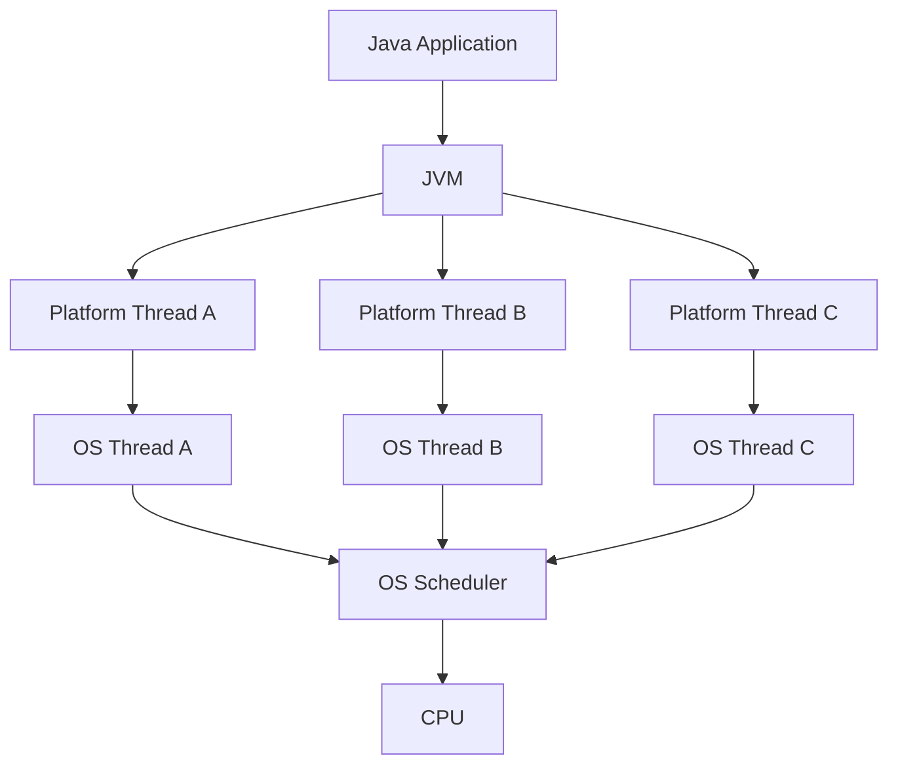
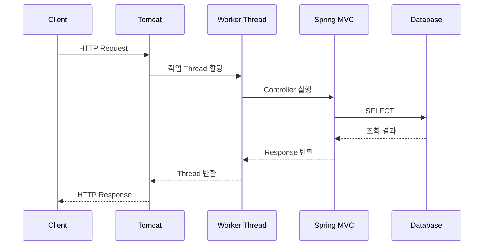
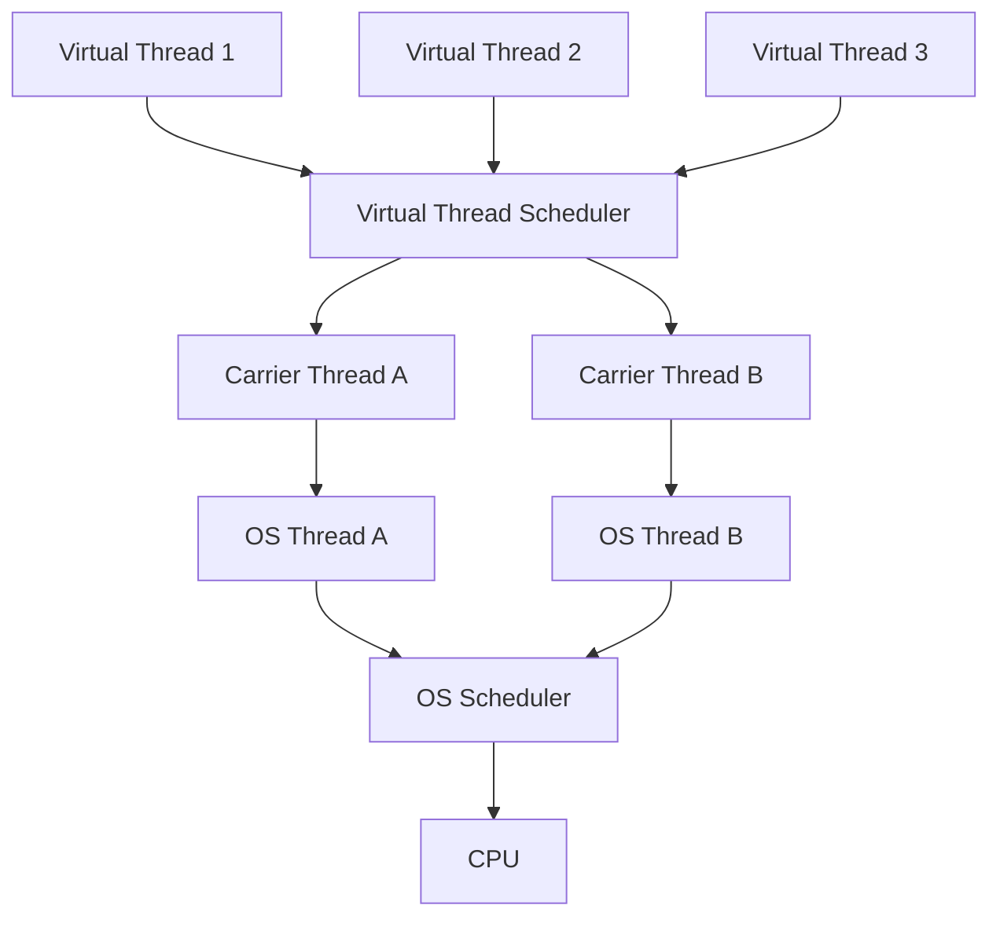
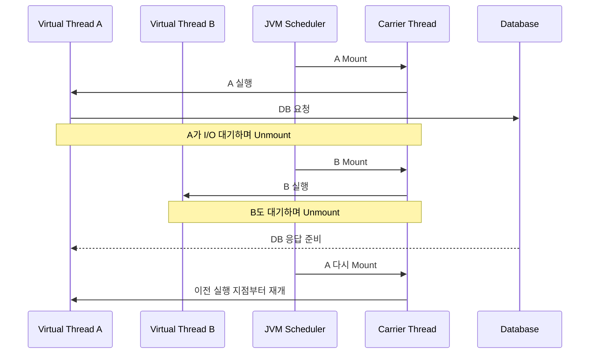
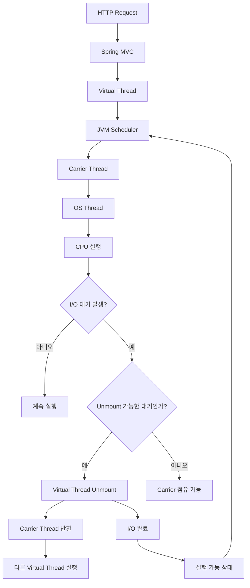

# 에덴의 Virtual Thread
[https://youtu.be/4pkVZhTVqac?si=Mq7qhtIXwaqNVY8w](https://youtu.be/4pkVZhTVqac?si=Mq7qhtIXwaqNVY8w)

# 에덴의 Virtual Thread
* toc
{:toc}

---

## Java Virtual Thread는 왜 등장했을까? Platform Thread의 한계와 동작 원리

Spring Boot로 웹 서비스를 개발하다 보면 Thread를 직접 생성하는 경우는 생각보다 많지 않다.

Controller를 작성하고, Service에서 비즈니스 로직을 처리하고, Repository를 통해 데이터베이스에 접근한다.

```java
@RestController
@RequiredArgsConstructor
public class OrderController {

    private final OrderService orderService;

    @GetMapping("/orders/{orderId}")
    public OrderResponse findOrder(
            @PathVariable Long orderId
    ) {
        return orderService.findOrder(orderId);
    }
}
```

개발자는 일반적인 Java 메서드를 호출하듯 코드를 작성한다.

하지만 실제로는 이 코드가 실행되기까지 여러 단계가 존재한다.

```text
Client Request
    ↓
Tomcat
    ↓
Thread 할당
    ↓
Controller
    ↓
Service
    ↓
Repository
    ↓
Database
```

기존 Spring MVC에서는 일반적으로 Tomcat의 Thread Pool에서 작업 Thread를 할당받아 요청을 처리한다.

요청 처리가 끝나면 Thread는 다시 Pool로 돌아가 다른 요청을 처리한다.

그런데 여기서 한 가지 문제가 생긴다.

**요청이 데이터베이스나 외부 API의 응답을 기다리는 동안에도 Thread 하나가 계속 점유된다.**

예를 들어 DB 응답을 받기까지 1초가 걸린다면, 해당 Thread는 그동안 다른 HTTP 요청을 처리하지 못할 수 있다.

트래픽이 적을 때는 문제가 되지 않는다.

하지만 동시에 수천, 수만 개의 요청이 들어온다면 어떨까?

Thread를 무한정 늘릴 수는 없다.

이런 문제를 해결하기 위해 Java는 기존 Thread 모델과 다른 접근 방식을 도입했다.

바로 **Virtual Thread**다.

Virtual Thread는 Java 19와 20에서 Preview 기능으로 제공되었으며, Java 21에서 JEP 444를 통해 정식 기능으로 도입되었다.

Virtual Thread를 이해하려면 먼저 기존 Java Thread가 어떻게 동작했는지 알아야 한다.

---

## Thread란 무엇인가?

Thread는 프로세스 안에서 실행되는 작업 흐름의 단위다.

하나의 프로그램에서도 여러 작업이 동시에 진행될 수 있다.

예를 들어 웹 서버에서는 다음과 같은 작업들이 발생한다.

```text
HTTP 요청 처리

Database 조회

외부 API 호출

파일 읽기

이벤트 처리

배치 작업
```

이 작업들을 순차적으로 하나씩 처리한다면 상당히 비효율적일 것이다.

그래서 Java는 여러 Thread를 이용해 작업을 동시에 진행할 수 있도록 지원한다.

다음 코드를 보자.

```java
public class ThreadExample {

    public static void main(String[] args) {

        Thread thread = new Thread(() -> {
            System.out.println(
                    "작업 실행: " + Thread.currentThread().getName()
            );
        });

        thread.start();
    }
}
```

`Thread` 객체를 생성하고 `start()`를 호출하면 별도의 실행 흐름에서 코드가 실행된다.

여기서 중요한 부분은 `start()`다.

```java
thread.start();
```

`run()`을 직접 호출하는 것과는 다르다.

```java
thread.run();
```

`run()`을 직접 호출하면 현재 Thread에서 일반 메서드를 실행하는 것과 같다.

반면 `start()`는 새로운 Thread를 시작하도록 JVM에 요청한다.

---

## 기존 Java Thread는 어떻게 동작했을까?

Java 21 이전에 일반적으로 사용하던 Thread 모델을 현재는 **Platform Thread**라고 부른다.

Platform Thread는 운영체제의 Thread와 연결되어 실행된다.

단순화하면 다음과 같다.



기존 Platform Thread는 일반적으로 OS Thread와 1:1로 연결된다.

```text
Platform Thread A
        ↕
OS Thread A
```

Java 코드가 실제 CPU에서 실행되려면 OS가 해당 Thread를 스케줄링해야 한다.

이때 어떤 OS Thread가 CPU를 사용할지는 운영체제의 Scheduler가 결정한다.

### JVM과 OS의 역할

두 영역의 역할을 나누면 다음과 같다.

| 구분              | 역할                          |
| --------------- | --------------------------- |
| JVM             | Java Thread 객체 관리 및 실행 지원   |
| OS              | 실제 Thread 스케줄링과 CPU 자원 관리   |
| OS Thread       | CPU에서 실행되는 운영체제의 Thread     |
| Platform Thread | OS Thread와 연결되는 Java Thread |

여기서 한 가지 정확하게 구분할 부분이 있다.

Java와 운영체제 사이에는 JVM의 Native 구현이 존재하지만, `Thread.start()`가 반드시 JNI를 통해 OS Thread를 생성한다고 설명하는 것은 정확하지 않다.

JNI는 Java 코드와 Native 코드의 상호 호출을 위한 인터페이스다.

Platform Thread 생성은 JVM 내부 구현이 운영체제의 기능을 사용하는 과정으로 이해하는 것이 적절하다.

핵심은 **Platform Thread가 OS Thread라는 상대적으로 비싼 자원을 점유한다는 것**이다.

---

## Platform Thread는 왜 비쌀까?

Platform Thread를 생성하면 단순히 Java 객체 하나만 만들어지는 것이 아니다.

운영체제가 관리하는 Thread 자원도 필요하다.

대표적으로 다음과 같은 비용이 발생한다.

* Thread Stack을 위한 메모리
* OS Thread 생성 및 관리 비용
* Scheduler가 관리해야 하는 실행 단위 증가
* Thread 간 Context Switching 비용
* Thread 수 증가에 따른 시스템 자원 사용

물론 Thread 하나를 만드는 것이 항상 큰 부담이라는 뜻은 아니다.

문제는 Thread 수가 수천, 수만 개로 증가할 때다.

예를 들어 요청마다 Platform Thread를 새로 만든다고 생각해보자.

```text
Request 1   → Platform Thread 1
Request 2   → Platform Thread 2
Request 3   → Platform Thread 3

...

Request 10000 → Platform Thread 10000
```

이 구조에서는 동시 요청 수에 비례해 OS Thread가 필요해진다.

OS Thread는 무한정 생성할 수 없으므로 애플리케이션의 확장성에도 한계가 생긴다.

그래서 일반적인 웹 서버는 Thread를 요청마다 새로 만들기보다 **Thread Pool**을 사용한다.

---

## Spring MVC의 Thread Per Request 모델

전통적인 Spring MVC 애플리케이션에서는 HTTP 요청 하나를 처리하는 동안 하나의 작업 Thread를 사용하는 방식이 일반적이다.

이를 **Thread Per Request** 모델이라고 부른다.



요청이 들어오면 Tomcat은 사용 가능한 Thread를 할당한다.

해당 Thread는 Controller부터 Service, Repository 호출까지 요청 처리 흐름을 담당한다.

요청이 완료되면 Thread는 다른 요청을 처리할 수 있게 된다.

이 구조에는 큰 장점이 있다.

코드를 순차적으로 작성할 수 있다는 것이다.

```java
public OrderResponse findOrder(Long orderId) {

    Order order = orderRepository.findById(orderId)
            .orElseThrow();

    Payment payment = paymentClient.findPayment(
            order.getPaymentId()
    );

    return OrderResponse.of(order, payment);
}
```

비즈니스 로직이 위에서 아래로 실행된다.

읽기도 쉽고 디버깅하기도 편하다.

하지만 요청 수가 증가하면 Thread Pool 크기가 처리량의 제약이 될 수 있다.

---

## Thread가 10개인데 요청이 100개 들어오면?

간단한 상황을 가정해보자.

```text
Thread Pool 크기: 10

요청 수: 100

요청 처리 시간: 1초
```

모든 요청이 정확히 1초가 걸리고, Thread 외의 병목이나 추가 오버헤드가 없다고 가정하겠다.

처음에는 10개 요청을 동시에 처리한다.

```text
0초 ~ 1초

Request 1 ~ 10
```

다음 10개를 처리한다.

```text
1초 ~ 2초

Request 11 ~ 20
```

이 과정을 반복하면 마지막 요청까지 처리하는 데 약 10초가 걸린다.

```text
100 Requests

÷

10 Threads

×

1초

=

약 10초
```

물론 실제 웹 서버의 처리 시간은 네트워크, DB Connection, 요청 분포, Queue 대기 등으로 인해 달라진다.

하지만 이 예시에서 확인해야 할 것은 계산 결과가 아니다.

**Thread Pool의 크기가 동시에 처리할 수 있는 요청 수를 제한한다는 점**이다.

---

## 그런데 Thread는 1초 동안 실제로 무엇을 했을까?

웹 애플리케이션의 요청 처리 시간을 생각해보자.

예를 들어 주문 상세 API가 있다고 하자.

```text
요청 파싱                  2ms

비즈니스 로직 처리         3ms

DB 응답 대기             700ms

외부 API 응답 대기        290ms

응답 객체 생성             5ms

----------------------------

총 1,000ms
```

전체 요청 시간은 1초다.

그런데 CPU가 직접 계산한 시간은 상대적으로 짧다.

대부분의 시간은 DB와 외부 API 응답을 기다리는 데 사용했다.

```text
CPU 연산

████

I/O 대기

████████████████████████████████
```

기존 Platform Thread 기반의 Blocking 코드에서는 이런 대기 시간에도 요청을 처리하는 Thread가 계속 점유된다.

실제로 CPU에서 계산하지 않더라도 다른 요청에 해당 Thread를 재사용할 수 없는 것이다.

이것이 Virtual Thread의 등장 배경을 이해하는 핵심이다.

---

## Blocking I/O란 무엇인가?

Blocking I/O는 I/O 작업이 완료될 때까지 호출한 실행 흐름이 대기하는 방식이다.

예를 들어 다음 코드를 보자.

```java
public Member findMember(Long memberId) {

    return memberRepository.findById(memberId)
            .orElseThrow();
}
```

Repository를 호출하면 DB 결과가 반환될 때까지 다음 코드로 진행하지 않는다.

```text
Thread 실행

↓

DB Query 요청

↓

DB 응답 대기

↓

응답 수신

↓

다음 코드 실행
```

코드를 작성하는 관점에서는 매우 직관적이다.

하지만 Platform Thread 하나가 이 대기 시간을 계속 점유한다면 동시 요청이 많아질수록 비효율이 커진다.

---

## Thread Pool을 늘리면 해결되지 않을까?

가장 먼저 떠오르는 방법은 Thread Pool 크기를 늘리는 것이다.

```text
Thread Pool 100

↓

Thread Pool 300

↓

Thread Pool 500
```

실제로 Thread가 부족한 상황이라면 일정 수준까지 효과를 얻을 수 있다.

하지만 계속 늘릴 수는 없다.

Thread 수가 증가하면 OS 자원과 메모리 사용량이 증가한다.

또 실행 가능한 Thread가 많아지면 Scheduling과 Context Switching 비용도 영향을 줄 수 있다.

무엇보다 외부 자원이 병목이라면 Thread 수를 늘려도 해결되지 않는다.

예를 들어 DB Connection이 10개뿐이라면 어떨까?

```text
Worker Thread: 500개

DB Connection: 10개
```

Thread가 500개여도 동시에 DB Connection을 사용할 수 있는 요청은 제한적이다.

나머지 요청은 Connection이 반환되기를 기다려야 한다.

결국 Thread를 늘리는 것은 모든 문제의 해결책이 아니다.

---

## 또 다른 해결 방법: 비동기 프로그래밍

Blocking I/O 문제를 줄이기 위해 비동기 방식도 사용할 수 있다.

대표적으로 Reactive Programming이 있다.

Spring 생태계에서는 WebFlux와 Reactor가 이런 모델을 제공한다.

기존 동기 코드는 다음과 같다.

```java
public OrderResponse findOrder(Long orderId) {

    Order order = findOrderFromDatabase(orderId);

    Payment payment = findPayment(order.getPaymentId());

    return OrderResponse.of(order, payment);
}
```

비동기 방식에서는 작업 완료를 기다리는 동안 Thread를 점유하지 않고 다른 작업을 처리할 수 있다.

예를 들어 Reactor를 사용하면 다음과 같은 형태가 된다.

```java
public Mono<OrderResponse> findOrder(Long orderId) {

    return orderRepository.findById(orderId)
            .flatMap(order ->
                    paymentClient.findPayment(order.getPaymentId())
                            .map(payment ->
                                    OrderResponse.of(order, payment)
                            )
            );
}
```

적절한 Non-blocking Driver와 Runtime을 사용한다면 적은 Thread로 많은 I/O 작업을 처리할 수 있다.

다만 기존 동기 코드와는 프로그래밍 모델이 달라진다.

`Mono`, `Flux`, Operator, Scheduler, Backpressure 등을 이해해야 한다.

이미 Spring MVC와 JPA를 중심으로 구성된 애플리케이션이라면 전환 범위도 상당할 수 있다.

여기서 새로운 질문이 생긴다.

**기존의 직관적인 동기 코드를 유지하면서도 I/O 대기 중에 OS Thread를 효율적으로 재사용할 수는 없을까?**

이 질문에 대한 Java의 접근 방식이 Virtual Thread다.

---

## Virtual Thread란 무엇인가?

Virtual Thread는 운영체제 대신 Java Runtime이 주로 스케줄링하는 경량 Thread다.

기존 Platform Thread와 마찬가지로 `java.lang.Thread`의 인스턴스다.

하지만 가장 큰 차이가 있다.

Platform Thread는 OS Thread와 연결되어 전체 생명주기 동안 해당 OS Thread를 점유한다.

Virtual Thread는 특정 OS Thread에 계속 묶여 있지 않다.

실행할 때는 OS Thread가 필요하지만, 적절한 대기 상황에서는 OS Thread에서 분리될 수 있다.

이를 통해 소수의 OS Thread로 많은 Virtual Thread를 번갈아 실행할 수 있다.

```text
Platform Thread

Java Thread A ↔ OS Thread A
Java Thread B ↔ OS Thread B
Java Thread C ↔ OS Thread C
```

```text
Virtual Thread

Virtual Thread A ─┐
Virtual Thread B ─┤
Virtual Thread C ─┼── Carrier Threads
Virtual Thread D ─┤
Virtual Thread E ─┘
```

Java 공식 문서에서도 Virtual Thread는 OS Thread에 고정되지 않고, Blocking I/O 중에 실행이 중단되면 OS Thread를 다른 Virtual Thread에 사용할 수 있다고 설명한다.

---

## Virtual Thread의 핵심 구성요소

Virtual Thread를 이해할 때 알아두어야 할 개념은 세 가지다.

| 구성요소                     | 역할                                       |
| ------------------------ | ---------------------------------------- |
| Virtual Thread           | 애플리케이션의 논리적인 작업 실행 흐름                    |
| Carrier Thread           | Virtual Thread를 실제로 실행하는 Platform Thread |
| Virtual Thread Scheduler | 실행 가능한 Virtual Thread를 Carrier에 배정       |

Virtual Thread가 직접 CPU에서 실행되는 것은 아니다.

실제 CPU 실행은 OS Thread를 통해 이루어진다.

따라서 Virtual Thread도 실행할 때는 Platform Thread가 필요하다.

이때 Virtual Thread를 실행하는 Platform Thread를 **Carrier Thread**라고 부른다.

---

## Carrier Thread는 특별한 종류의 Thread일까?

Carrier Thread는 새로운 종류의 OS Thread가 아니다.

Virtual Thread를 실행하는 역할을 맡은 Platform Thread다.

구조를 보면 다음과 같다.



Virtual Thread는 JVM이 스케줄링한다.

Carrier Thread는 OS가 스케줄링한다.

즉 두 단계의 스케줄링이 존재한다고 볼 수 있다.

```text
Virtual Thread

↓

JVM Scheduler

↓

Carrier Thread

↓

OS Scheduler

↓

CPU
```

JDK의 기본 Virtual Thread Scheduler는 ForkJoinPool 기반이며, 일반적으로 사용 가능한 Processor 수를 기준으로 병렬 실행 수준을 정한다.

다만 실제 Carrier 수가 언제나 CPU Core 수와 정확히 일치하거나 고정되는 것은 아니다.

---

## Mount와 Unmount

Virtual Thread를 이해하는 가장 중요한 개념이다.

### Mount

Virtual Thread가 Carrier Thread에 연결되어 실제로 실행되는 것을 Mount라고 한다.

```text
Virtual Thread A

↓

Mount

↓

Carrier Thread 1

↓

CPU 실행
```

### Unmount

Virtual Thread가 Carrier Thread에서 분리되는 것을 Unmount라고 한다.

```text
Virtual Thread A

↓

I/O 대기

↓

Unmount

↓

Carrier Thread 반환
```

이제 Carrier Thread는 다른 Virtual Thread를 실행할 수 있다.

다만 **모든 Blocking 작업에서 반드시 Unmount가 발생하는 것은 아니다.**

JDK가 지원하는 Blocking I/O나 특정 대기 연산에서는 Carrier를 반환할 수 있지만, Native 호출 등 일부 상황에서는 그렇지 않을 수 있다.

이 차이는 뒤에서 다룰 Pinning과 연결된다.

---

## Virtual Thread의 실제 실행 흐름

Carrier Thread가 하나만 있다고 가정해보자.

세 개의 HTTP 요청이 들어왔다.

```text
Request A

Request B

Request C
```

각 요청은 서로 다른 Virtual Thread가 처리한다.

```text
Request A → Virtual Thread A

Request B → Virtual Thread B

Request C → Virtual Thread C
```

처음에는 Virtual Thread A가 실행된다.

```text
Carrier Thread 1

↓

Virtual Thread A 실행
```

A가 DB에 Query를 보낸다.

```text
Virtual Thread A

↓

DB 조회 요청

↓

응답 대기
```

이때 지원되는 Blocking I/O 경로라면 JVM은 Virtual Thread A를 중단하고 Carrier에서 분리할 수 있다.

```text
Virtual Thread A

I/O Waiting


Carrier Thread 1

Free
```

이제 Carrier Thread는 Virtual Thread B를 실행한다.

```text
Carrier Thread 1

↓

Virtual Thread B 실행
```

B 역시 외부 API를 호출하고 응답을 기다린다.

그러면 B도 Carrier에서 분리될 수 있다.

그 사이 A의 DB 응답이 도착했다고 하자.

Virtual Thread A가 다시 실행 가능한 상태가 된다.

Scheduler는 사용 가능한 Carrier에 A를 Mount하여 작업을 이어서 실행한다.

중요한 점은 **처음 사용했던 Carrier와 다시 실행할 때 사용하는 Carrier가 반드시 같을 필요는 없다는 것**이다.

---

## Virtual Thread 실행 흐름을 그림으로 보면



Platform Thread 모델과 비교하면 차이가 명확해진다.

### Platform Thread

```text
Thread A

DB 응답 대기

↓

OS Thread A도 점유
```

### Virtual Thread

```text
Virtual Thread A

DB 응답 대기

↓

Carrier Thread 반환

↓

다른 Virtual Thread 실행
```

이것이 Virtual Thread가 높은 동시성을 지원할 수 있는 핵심 원리다.

---

## Virtual Thread는 Non-blocking Thread일까?

이 부분은 조금 정확하게 이해할 필요가 있다.

Virtual Thread를 사용하면 개발자는 여전히 Blocking 방식의 코드를 작성할 수 있다.

```java
Order order = orderRepository.findById(orderId)
        .orElseThrow();

Payment payment = paymentClient.findPayment(
        order.getPaymentId()
);
```

DB 조회가 끝나야 다음 코드가 실행된다.

프로그래밍 모델은 여전히 동기적이고 Blocking 방식이다.

하지만 JVM 내부에서는 지원되는 I/O 대기 중에 Virtual Thread를 중단하고 Carrier Thread를 다른 작업에 사용할 수 있다.

즉 다음 두 가지를 구분해야 한다.

```text
개발자가 작성하는 코드

동기식 Blocking 코드


JVM 내부 실행 방식

지원되는 I/O 대기에서
Carrier Thread를 반환
```

따라서 Virtual Thread를 단순히 Non-blocking I/O API라고 부르기보다는 **Blocking 코드의 작성 방식을 유지하면서 OS Thread 사용을 효율화하는 실행 모델**로 이해하는 것이 정확하다.

---

## Virtual Thread는 왜 생성 비용이 저렴할까?

Platform Thread는 OS Thread와 연결된다.

반면 Virtual Thread는 Java Runtime이 관리하는 경량 실행 단위다.

Virtual Thread마다 새로운 OS Thread를 만들 필요가 없다.

또한 실행 Stack을 기존 Platform Thread의 OS Stack과 같은 방식으로 항상 크게 확보하지 않는다.

Virtual Thread의 실행 상태는 필요한 만큼 관리되고, 중단된 실행 흐름은 JVM이 다시 실행할 수 있도록 보존한다.

그 결과 많은 수의 Virtual Thread를 생성할 수 있다.

하지만 다음 표현은 주의해야 한다.

```text
Virtual Thread는 무한정 생성할 수 있다.
```

실제로는 아니다.

Virtual Thread도 Java 객체이며 Stack 상태와 관련 데이터를 메모리에 유지해야 한다.

수백만 개의 Virtual Thread를 지원할 수 있다는 말이 모든 시스템에서 수백만 개를 만들어도 안전하다는 의미는 아니다.

Virtual Thread는 **상대적으로 저렴한 Thread**이지 비용이 없는 Thread는 아니다.

---

## Virtual Thread를 직접 생성해보자

Java 21 이상에서는 다음과 같이 Virtual Thread를 만들 수 있다.

```java
public class VirtualThreadExample {

    public static void main(String[] args)
            throws InterruptedException {

        Thread thread = Thread.ofVirtual()
                .name("virtual-worker")
                .start(() -> {

                    System.out.println(
                            Thread.currentThread().getName()
                    );

                    System.out.println(
                            Thread.currentThread().isVirtual()
                    );
                });

        thread.join();
    }
}
```

실행 결과는 다음과 같은 형태다.

```text
virtual-worker
true
```

`Thread.ofVirtual()`은 Virtual Thread를 생성하기 위한 Builder를 제공한다.

`isVirtual()`은 현재 Thread가 Virtual Thread인지 확인한다.

일반적인 Platform Thread와 비교하면 다음과 같다.

```java
Thread platformThread = Thread.ofPlatform()
        .start(() -> {
            System.out.println("Platform Thread");
        });

Thread virtualThread = Thread.ofVirtual()
        .start(() -> {
            System.out.println("Virtual Thread");
        });
```

코드 사용법 자체는 크게 다르지 않다.

차이는 내부 실행 모델에 있다.

---

## Virtual Thread에서는 ExecutorService를 어떻게 사용할까?

실무에서는 Thread를 직접 생성하기보다 ExecutorService를 사용하는 경우가 많다.

Virtual Thread를 위한 Executor는 다음과 같이 만들 수 있다.

```java
ExecutorService executor =
        Executors.newVirtualThreadPerTaskExecutor();
```

이 Executor는 작업마다 새로운 Virtual Thread를 생성한다.

```java
import java.util.concurrent.ExecutorService;
import java.util.concurrent.Executors;

public class VirtualThreadExecutorExample {

    public static void main(String[] args) {

        try (ExecutorService executor =
                     Executors.newVirtualThreadPerTaskExecutor()) {

            for (int i = 0; i < 100; i++) {

                executor.submit(() -> {
                    try {
                        Thread.sleep(1000);

                        System.out.println(
                                Thread.currentThread().isVirtual()
                        );

                    } catch (InterruptedException e) {
                        Thread.currentThread().interrupt();
                    }
                });
            }
        }
    }
}
```

여기서 중요한 점은 작업마다 Virtual Thread를 생성한다는 것이다.

```text
Task 1 → Virtual Thread 1

Task 2 → Virtual Thread 2

Task 3 → Virtual Thread 3
```

기존 Thread Pool처럼 정해진 개수의 Thread를 여러 작업이 재사용하는 구조와는 다르다.

---

## Platform Thread Pool과 Virtual Thread를 비교해보자

조금 더 직관적인 예제를 만들어보자.

1초 동안 대기하는 작업 100개를 실행한다.

먼저 Platform Thread Pool을 사용한다.

```java
ExecutorService executor =
        Executors.newFixedThreadPool(10);
```

이 경우 동시에 실행할 수 있는 작업은 10개다.

반면 Virtual Thread Executor를 사용한다.

```java
ExecutorService executor =
        Executors.newVirtualThreadPerTaskExecutor();
```

작업마다 새로운 Virtual Thread를 생성한다.

실제 비교 코드는 다음과 같다.

```java
import java.util.ArrayList;
import java.util.List;
import java.util.concurrent.ExecutorService;
import java.util.concurrent.Executors;
import java.util.concurrent.Future;

public class VirtualThreadComparison {

    private static final int TASK_COUNT = 100;

    public static void main(String[] args) throws Exception {

        measure(
                "Platform Thread Pool",
                Executors.newFixedThreadPool(10)
        );

        measure(
                "Virtual Thread",
                Executors.newVirtualThreadPerTaskExecutor()
        );
    }

    private static void measure(
            String name,
            ExecutorService executor
    ) throws Exception {

        long start = System.nanoTime();

        try (executor) {

            List<Future<?>> futures = new ArrayList<>();

            for (int i = 0; i < TASK_COUNT; i++) {

                futures.add(
                        executor.submit(() -> {

                            Thread.sleep(1000);

                            return null;
                        })
                );
            }

            for (Future<?> future : futures) {
                future.get();
            }
        }

        long elapsedMillis =
                (System.nanoTime() - start) / 1_000_000;

        System.out.println(
                name + ": " + elapsedMillis + "ms"
        );
    }
}
```

실행 방법은 다음과 같다.

```bash
javac VirtualThreadComparison.java
```

Java 소스 파일을 컴파일한다.

```bash
java VirtualThreadComparison
```

프로그램을 실행한다.

출력은 실행 환경에 따라 달라지지만 대략 다음과 같은 경향을 예상할 수 있다.

```text
Platform Thread Pool: 약 10000ms
Virtual Thread: 약 1000ms
```

Virtual Thread가 10배 빠른 CPU 연산을 수행한 것은 아니다.

**100개의 대기 작업을 동시에 진행할 수 있었기 때문에 전체 완료 시간이 줄어든 것**이다.

이 예제는 `Thread.sleep()`으로 대기 상황을 단순화한 것이며 실제 JDBC나 HTTP I/O 성능을 그대로 대표하지는 않는다.

---

## Virtual Thread의 목적은 Latency 감소보다 Throughput 향상이다

이 부분은 반드시 구분해야 한다.

Virtual Thread를 사용한다고 단일 DB Query가 빨라지는 것은 아니다.

```text
기존 DB Query

100ms


Virtual Thread에서 실행한 동일 Query

100ms
```

DB 성능이 같다면 Query 실행 시간 자체는 달라지지 않는다.

Virtual Thread의 장점은 **같은 시간에 더 많은 대기 작업을 처리할 수 있다는 것**이다.

예를 들어 기존에는 OS Thread 부족 때문에 요청들이 Queue에서 기다리고 있었다고 하자.

Virtual Thread를 사용하면 Thread 수 제약을 완화할 수 있다.

그 결과 많은 동시 요청을 처리할 수 있고, Thread Pool 대기로 인해 늘어나던 응답 시간도 개선될 수 있다.

하지만 개별 요청의 실제 작업이 빨라졌다는 의미는 아니다.

OpenJDK에서도 Virtual Thread의 주된 목표를 개별 코드의 실행 속도가 아니라 높은 동시성과 처리량 향상이라고 설명한다.

---

## Spring Boot에서 Virtual Thread를 사용하려면?

Spring Boot 3.2부터 Virtual Thread 지원이 추가되었다.

Java 21 이상을 사용한다면 설정을 통해 활성화할 수 있다.

`application.yml`에 다음과 같이 작성한다.

```yaml
spring:
  threads:
    virtual:
      enabled: true
```

이 설정을 사용하면 지원되는 Servlet Web Server와 Spring의 작업 실행 구성요소에서 Virtual Thread를 활용할 수 있다.

Spring Boot 3.2에서는 Tomcat과 Jetty의 요청 처리에 Virtual Thread를 적용할 수 있도록 지원을 추가했다.

단, 커스텀 Executor나 별도 Thread Pool을 직접 구성했다면 모든 작업이 자동으로 Virtual Thread에서 실행된다고 가정해서는 안 된다.

실제로 어떤 Executor가 사용되는지 확인해야 한다.

---

## Virtual Thread가 실제로 적용되었는지 확인하기

다음과 같은 Controller를 만들 수 있다.

```java
import org.springframework.web.bind.annotation.GetMapping;
import org.springframework.web.bind.annotation.RestController;

@RestController
public class ThreadController {

    @GetMapping("/thread")
    public String currentThread() {

        Thread thread = Thread.currentThread();

        return """
                threadName=%s
                virtual=%s
                """.formatted(
                thread.getName(),
                thread.isVirtual()
        );
    }
}
```

설정이 적용된 환경에서 요청을 보내보자.

```bash
curl http://localhost:8080/thread
```

Virtual Thread가 요청을 처리하고 있다면 다음과 같은 결과를 확인할 수 있다.

```text
threadName=...
virtual=true
```

반대로 기존 Platform Thread가 요청을 처리한다면 다음처럼 나타난다.

```text
virtual=false
```

이렇게 실제 실행 Thread를 확인하면 설정이 의도한 대로 적용되었는지 검증할 수 있다.

---

## Spring MVC에서 Virtual Thread를 사용하면 무엇이 달라질까?

기존에는 다음과 같은 구조였다.

```text
HTTP Request

↓

Tomcat Worker Thread

↓

Controller

↓

Service

↓

Repository

↓

DB 대기

↓

Worker Thread 점유
```

Virtual Thread를 적용하면 다음과 같은 구조로 생각할 수 있다.

```text
HTTP Request

↓

Virtual Thread 생성 또는 할당

↓

Controller

↓

Service

↓

Repository

↓

DB 대기

↓

Virtual Thread Unmount 가능

↓

Carrier Thread 재사용
```

기존에 작성한 Controller와 Service 코드를 크게 변경하지 않아도 된다.

```java
@GetMapping("/orders/{orderId}")
public OrderResponse find(
        @PathVariable Long orderId
) {
    return orderService.findOrder(orderId);
}
```

메서드는 여전히 동기적으로 실행되는 것처럼 작성한다.

하지만 실제 요청 Thread는 Virtual Thread가 될 수 있다.

이것이 Spring MVC와 Virtual Thread를 함께 사용할 때 가장 큰 장점이다.

---

## Virtual Thread와 WebFlux는 무엇이 다를까?

두 기술은 모두 I/O 대기가 많은 환경에서 높은 동시성을 지원하는 데 사용할 수 있다.

하지만 접근 방식이 다르다.

| 구분          | Spring MVC + Virtual Thread   | Spring WebFlux                       |
| ----------- | ----------------------------- | ------------------------------------ |
| 주요 모델       | 동기식 Thread Per Request        | Reactive / Event-driven              |
| 코드 스타일      | 일반적인 순차 코드                    | `Mono`, `Flux` 중심                    |
| I/O 처리      | 지원되는 Blocking 호출에서 Carrier 반환 | Non-blocking I/O                     |
| 기존 동기 코드 활용 | 상대적으로 쉬움                      | 변경이 필요할 수 있음                         |
| Thread 사용   | 작업마다 Virtual Thread           | 소수의 Event Loop Thread 중심             |
| 주요 고려사항     | Pinning, 외부 자원 제한             | Blocking 호출, Scheduler, Backpressure |

Virtual Thread가 등장했다고 WebFlux가 불필요해진 것은 아니다.

WebFlux에는 Reactive Stream과 Backpressure 같은 별도 장점이 있다.

반면 기존 Spring MVC와 JPA 중심의 서비스라면 Virtual Thread가 상대적으로 작은 코드 변경으로 동시성 처리 모델을 개선할 수 있는 선택지가 된다.

---

## Virtual Thread를 사용하면 무조건 성능이 좋아질까?

그렇지는 않다.

특히 다음 세 가지는 반드시 고려해야 한다.

```text
CPU-bound 작업

Pinning

외부 자원의 한계
```

각각을 살펴보자.

---

## 첫 번째 주의사항: CPU-bound 작업에는 큰 효과가 없다

Virtual Thread는 대기 시간이 많은 작업에서 효과가 크다.

반대로 CPU 연산이 대부분인 작업에서는 효과를 기대하기 어렵다.

예를 들어 다음 작업을 생각해보자.

```text
대용량 이미지 인코딩

복잡한 암호화 연산

대규모 정렬

수치 계산

CPU 기반 데이터 변환
```

이런 작업은 CPU를 계속 사용한다.

```text
Virtual Thread A

CPU 연산

CPU 연산

CPU 연산
```

I/O 대기처럼 Carrier Thread를 반환할 기회가 많지 않다.

또 CPU Core 수는 그대로다.

```text
CPU Core: 8개

Virtual Thread: 10,000개
```

Virtual Thread가 10,000개 존재하더라도 10,000개의 CPU 연산이 동시에 병렬 실행되는 것은 아니다.

결국 CPU 연산은 가용 Core와 스케줄링 자원의 제약을 받는다.

따라서 Virtual Thread는 CPU 성능을 높이는 기술이 아니다.

**대기 시간이 긴 작업을 더 효율적으로 다루기 위한 기술**이다.

---

## 두 번째 주의사항: Pinning

Virtual Thread의 핵심은 대기 중에 Carrier Thread를 반환할 수 있다는 것이다.

그런데 특정 상황에서는 Virtual Thread가 Carrier에서 분리되지 못한다.

이를 **Pinning**이라고 한다.

```text
정상적인 대기

Virtual Thread

↓

I/O 대기

↓

Unmount

↓

Carrier 반환
```

Pinning이 발생하면 다음과 같은 상태가 된다.

```text
Virtual Thread

↓

Blocking 작업

↓

Unmount 불가능

↓

Carrier 계속 점유
```

그러면 Virtual Thread를 사용하더라도 소중한 OS Thread 자원이 대기 작업에 묶이게 된다.

하지만 Pinning은 Java 버전에 따라 원인이 달라진다는 점을 반드시 알아야 한다.

---

## Java 21과 Java 24의 Pinning은 다르다

Virtual Thread를 설명할 때 자주 등장하는 예제가 있다.

```java
synchronized (lock) {
    callExternalApi();
}
```

Java 21에서는 Virtual Thread가 `synchronized` 영역 안에서 Blocking 작업을 수행할 때 Carrier Thread가 Pinning될 수 있었다.

따라서 오래 걸리는 I/O 작업을 `synchronized` 블록 안에서 실행하는 것은 확장성을 저하시킬 수 있었다.

하지만 **Java 24부터는 이 설명을 그대로 적용하면 안 된다.**

Java 24에는 JEP 491이 적용되었다.

JEP 491은 `synchronized` 메서드나 블록에서 발생하던 Virtual Thread Pinning 문제를 개선했다.

따라서 Java 24 이상에서는 `synchronized` 때문에 발생하던 대표적인 Pinning 문제가 대부분 해소되었다.

버전별로 정리하면 다음과 같다.

| 구분                                   | Java 21~23    | Java 24 이상              |
| ------------------------------------ | ------------- | ----------------------- |
| Virtual Thread 지원                    | 지원            | 지원                      |
| `synchronized` 내부 Blocking           | Pinning 발생 가능 | 기존 Pinning 문제 개선        |
| Native / Foreign Function 관련 Pinning | 발생 가능         | 여전히 주의 필요               |
| 운영 시 고려사항                            | Pinning 분석 중요 | 남아 있는 Pinning과 자원 제한 분석 |

이 차이는 실무에서 상당히 중요하다.

Java 21을 기준으로 작성된 설명을 Java 25 환경에도 그대로 적용하면 잘못된 최적화를 시도할 수 있다.

현재 Spring Boot 공식 문서에서도 Virtual Thread를 사용할 때 Java 21 이상이 필요하며, 더 나은 경험을 위해 Java 24 이상을 권장하고 있다.

---

## Pinning을 어떻게 확인할 수 있을까?

Pinning은 코드만 보고 추측하기보다 실제 실행 환경에서 확인하는 것이 좋다.

대표적인 방법이 JDK Flight Recorder(JFR)다.

JFR은 JVM 내부 이벤트를 기록해 성능과 실행 상태를 분석할 수 있도록 도와준다.

예를 들어 실행 중인 Java 프로세스의 PID를 확인한다.

```bash
jps -l
```

실행 중인 Java 프로세스 목록을 확인할 수 있다.

다음으로 JFR Recording을 시작한다.

```bash
jcmd <PID> JFR.start name=virtual-thread-check settings=profile duration=60s filename=virtual-threads.jfr
```

이 명령은 지정한 JVM 프로세스에서 약 60초 동안 프로파일링 정보를 수집하도록 요청한다.

Recording이 완료되면 다음 명령으로 Virtual Thread 관련 이벤트를 확인할 수 있다.

```bash
jfr print --events jdk.VirtualThreadPinned virtual-threads.jfr
```

Pinning 이벤트가 기록되어 있다면 해당 이벤트를 확인할 수 있다.

단, 관련 이벤트의 활성화 여부와 기록 임계값에 따라 실제 출력은 달라질 수 있다.

Java 21 환경에서는 다음 옵션을 이용해 Pinning 상황의 Stack Trace를 출력하는 방법도 제공되었다.

```bash
java -Djdk.tracePinnedThreads=full -jar app.jar
```

다만 Java 24 이상에서는 JEP 491 이후 동작이 달라졌으므로 JFR을 중심으로 분석하는 편이 적절하다.

---

## 세 번째 주의사항: 외부 자원은 Virtual Thread처럼 늘어나지 않는다

Virtual Thread를 10,000개 생성할 수 있다고 가정해보자.

그러면 Database Query도 10,000개를 동시에 실행할 수 있을까?

그렇지 않다.

예를 들어 HikariCP Connection Pool 크기가 20개라면 다음과 같은 구조가 된다.

```text
Virtual Thread

10,000개

↓

HikariCP

Connection 20개

↓

Database
```

Connection을 획득할 수 있는 요청 수는 제한된다.

나머지 Virtual Thread는 Connection을 기다려야 한다.

물론 지원되는 대기 경로에서는 Virtual Thread가 Carrier Thread를 반환할 수 있으므로 OS Thread 점유 비용은 줄어들 수 있다.

하지만 **DB 처리량 자체가 증가하는 것은 아니다.**

이것이 Virtual Thread 도입 시 반드시 이해해야 할 부분이다.

---

## DB Connection Pool을 무작정 늘려야 할까?

Virtual Thread를 사용한다고 다음처럼 변경하는 것은 위험할 수 있다.

```yaml
spring:
  datasource:
    hikari:
      maximum-pool-size: 1000
```

DB Connection을 많이 생성하면 오히려 DB Server에 부담이 커질 수 있다.

DB는 동시에 처리할 수 있는 Query 수, Lock 경합, CPU, Disk I/O 등 다양한 제약을 가진다.

Connection 수가 많을수록 항상 처리량이 증가하는 것은 아니다.

따라서 Virtual Thread 도입과 Connection Pool 증설은 별도로 판단해야 한다.

```text
Virtual Thread

→ 요청 처리 Thread 비용 완화


Connection Pool

→ DB 동시 접근량 제한


Database

→ 실제 Query 처리 능력
```

서로 다른 문제다.

---

## 외부 API에도 동일한 문제가 있다

예를 들어 결제 서비스에서 외부 PG API를 호출한다고 하자.

```text
PaymentService

↓

PG API
```

Virtual Thread를 적용하면 동시에 많은 요청을 처리할 수 있다.

하지만 PG API가 초당 100건만 안정적으로 처리할 수 있다면 어떨까?

애플리케이션에서 갑자기 초당 1,000건을 호출하면 외부 시스템에서 Rate Limit이나 Timeout이 발생할 수 있다.

따라서 외부 서비스의 처리 능력을 고려한 동시성 제한이 필요하다.

이때 사용할 수 있는 방법 중 하나가 Semaphore다.

---

## Virtual Thread에서는 Semaphore를 활용할 수 있다

예를 들어 외부 API 동시 호출 수를 20개로 제한한다고 하자.

```java
import java.util.concurrent.Semaphore;

public class ExternalApiService {

    private final Semaphore semaphore =
            new Semaphore(20);

    private final ExternalApiClient client;

    public ExternalApiService(ExternalApiClient client) {
        this.client = client;
    }

    public ApiResponse request(String requestId)
            throws InterruptedException {

        semaphore.acquire();

        try {
            return client.call(requestId);
        } finally {
            semaphore.release();
        }
    }
}
```

이 코드에서는 최대 20개의 호출만 외부 API에 동시에 접근한다.

```text
Virtual Thread 1  ─┐
Virtual Thread 2  ─┤
                   ├── 외부 API 동시 호출 20개
Virtual Thread 20 ─┘

Virtual Thread 21
        ↓
Semaphore 대기
```

이 구조의 장점은 Virtual Thread 수를 제한하는 것이 아니라 **실제 제한이 필요한 외부 자원의 동시 접근량을 통제한다는 것**이다.

실무에서는 무한 대기 대신 Timeout을 적용하거나 외부 시스템의 Rate Limit을 별도로 관리하는 것도 고려해야 한다.

또 이미 DB Connection Pool처럼 동시 접근을 제한하는 자원이 있다면 무조건 별도의 Semaphore를 추가할 필요는 없다.

Java 공식 가이드 역시 Virtual Thread 자체를 Pooling하지 말고, 제한해야 하는 자원에 대해 Semaphore 같은 동시성 제어 수단을 사용하도록 권장한다.

---

## Virtual Thread를 Pooling하면 안 되는 이유

기존 Platform Thread에서는 Thread Pool을 사용하는 것이 일반적이었다.

```java
Executors.newFixedThreadPool(20);
```

Platform Thread는 생성 비용이 크기 때문에 일정 개수를 만들어 재사용하는 것이 효과적이었다.

하지만 Virtual Thread는 작업마다 새롭게 생성하도록 설계되었다.

```java
Executors.newVirtualThreadPerTaskExecutor();
```

따라서 Virtual Thread를 다시 일정 개수로 제한하는 Pool을 만들면 Virtual Thread의 장점을 충분히 활용하지 못할 수 있다.

```text
Platform Thread

비싼 자원

↓

Pool에서 재사용
```

```text
Virtual Thread

상대적으로 저렴한 자원

↓

작업마다 생성
```

다만 작업 자체의 수가 무제한이어도 된다는 뜻은 아니다.

작업 수가 지나치게 증가하면 메모리와 Queue 대기, 외부 자원 사용량이 문제가 될 수 있다.

즉 Thread 생성 제한과 업무 동시성 제한을 구분해야 한다.

---

## ThreadLocal도 확인해야 한다

기존 Spring 애플리케이션에서는 ThreadLocal을 사용하는 경우가 있다.

대표적으로 다음과 같은 정보를 Thread와 연결해 관리한다.

```text
Security Context

Transaction Context

Logging MDC

Request Context
```

Virtual Thread에서도 ThreadLocal을 사용할 수 있다.

Virtual Thread가 Unmount되었다가 다른 Carrier에서 다시 실행되더라도, 논리적인 Virtual Thread에 연결된 ThreadLocal 상태는 유지된다.

따라서 단순히 Carrier가 변경된다는 이유로 `@Transactional`의 ThreadLocal 기반 Context가 사라지는 것은 아니다.

하지만 새로운 Virtual Thread를 생성하는 경우는 별도 문제다.

```text
Virtual Thread A

↓

새로운 Virtual Thread B 생성
```

ThreadLocal 값이 자동으로 모두 전달되는 것은 아니다.

특히 직접 Executor를 사용한다면 Security Context나 MDC 같은 요청 Context의 전달 방식을 확인해야 한다.

또 수많은 Virtual Thread에서 큰 객체를 ThreadLocal에 보관하면 메모리 사용량이 증가할 수 있다.

따라서 ThreadLocal 자체를 사용할 수 없다는 의미는 아니지만, 요청별 상태를 얼마나 오래 유지하는지 검토해야 한다.

---

## @Transactional과 Virtual Thread는 함께 사용할 수 있을까?

가능하다.

Virtual Thread는 Java의 일반적인 Thread API를 지원한다.

Spring이 ThreadLocal을 이용해 Transaction Context를 관리하는 구조도 Virtual Thread에서 활용할 수 있다.

예를 들어 다음과 같다.

```java
@Transactional
public void createOrder(OrderRequest request) {

    Order order = Order.create(request);

    orderRepository.save(order);
}
```

Spring MVC 요청이 Virtual Thread에서 실행된다면 해당 요청의 Transaction도 그 Virtual Thread의 실행 흐름 안에서 관리될 수 있다.

다만 다음 문제는 그대로 남아 있다.

```text
Transaction이 너무 오래 유지된다.

↓

DB Connection을 오래 점유한다.

↓

다른 요청이 Connection을 기다린다.
```

Virtual Thread는 OS Thread 점유 문제를 완화할 뿐, Transaction이 사용하는 DB Connection이나 Lock을 없애주지는 않는다.

따라서 Virtual Thread를 적용한 뒤에도 짧고 명확한 Transaction 경계를 유지하는 것이 중요하다.

---

## Virtual Thread가 오히려 문제를 드러내는 경우

Virtual Thread를 도입했더니 처리량이 늘어났다고 하자.

기존에는 동시 처리할 수 있는 요청이 제한되어 있었다.

```text
동시 요청

200개
```

Virtual Thread 적용 후에는 훨씬 많은 요청이 동시에 진행될 수 있다.

```text
동시 요청

5,000개
```

그런데 DB Connection Pool은 그대로다.

```text
Connection Pool

20개
```

결국 Connection 대기 시간이 증가할 수 있다.

```text
Virtual Thread 증가

↓

동시 DB 접근 시도 증가

↓

Connection 대기 증가

↓

Connection Timeout 발생
```

이 경우 Virtual Thread 자체가 잘못된 기술이라고 볼 수는 없다.

기존에는 Thread Pool이 동시성을 제한하는 역할까지 하고 있었는데, Virtual Thread 도입으로 그 제한이 완화되면서 다른 병목이 드러난 것이다.

따라서 성능 개선은 Thread 설정 하나만 바꾸는 작업으로 끝나지 않는다.

시스템 전체의 자원 사용 흐름을 함께 살펴봐야 한다.

---

## Virtual Thread 도입 시 어떤 지표를 확인해야 할까?

운영 환경에 Virtual Thread를 적용한다면 단순히 응답 시간이 줄었는지만 확인하는 것은 부족하다.

최소한 다음 지표들을 함께 보는 것이 좋다.

| 지표                    | 확인 목적                         |
| --------------------- | ----------------------------- |
| Throughput            | 초당 처리 요청 수 변화                 |
| Average Latency       | 평균 응답 시간                      |
| P95 / P99 Latency     | 느린 요청의 응답 시간                  |
| CPU Usage             | CPU 병목 여부                     |
| Heap Usage            | Virtual Thread 증가에 따른 메모리 영향  |
| GC Pause              | GC 부담 변화                      |
| DB Connection Active  | 실제 사용 중인 Connection 수         |
| DB Connection Pending | Connection을 기다리는 요청 수         |
| External API Timeout  | 외부 서비스 과부하 여부                 |
| Error Rate            | Timeout, Rate Limit, 장애 증가 여부 |

예를 들어 처리량은 증가했지만 P99 Latency가 크게 악화되었다면 주의해야 한다.

```text
Before

Throughput: 1,000 RPS

P99: 500ms
```

```text
After

Throughput: 1,500 RPS

P99: 3,000ms
```

처리량은 증가했지만 일부 요청이 지나치게 오래 기다리고 있을 수 있다.

따라서 Virtual Thread 도입 효과는 여러 지표를 함께 보고 판단해야 한다.

위 숫자는 설명을 위한 가상 예시다.

---

## Virtual Thread의 장점을 얻기 좋은 환경

Virtual Thread가 특히 잘 맞는 상황은 다음과 같다.

```text
높은 동시 요청 수

+

많은 Blocking I/O

+

기존 동기식 Java 코드
```

예를 들어 다음 서비스들을 생각해볼 수 있다.

### 외부 API를 많이 호출하는 서비스

여러 외부 시스템의 응답을 기다리는 시간이 길다면 Carrier Thread를 효율적으로 재사용할 여지가 있다.

### DB 조회가 많은 웹 서비스

많은 요청이 DB 응답을 기다리는 환경에서 요청 처리 Thread의 부담을 줄일 수 있다.

다만 DB Connection Pool과 실제 DB 처리량이 병목인지 함께 확인해야 한다.

### 기존 Spring MVC 기반 서비스

Reactive Programming으로 전체 구조를 변경하지 않고도 Virtual Thread를 적용할 수 있다.

### I/O 대기가 많은 배치 작업

독립적인 외부 요청이나 파일 I/O가 많다면 Virtual Thread를 활용할 수 있다.

다만 CPU 중심의 연산이나 이미 동시성 제어가 잘되어 있는 Batch에서는 효과가 제한적일 수 있다.

---

## Virtual Thread를 적용하기 전에 확인할 10가지

### 1. Java 버전을 확인한다

Virtual Thread는 Java 21부터 정식 기능이다.

가능하다면 Java 24 이상에서 개선된 Pinning 동작까지 고려한다.

### 2. 실제 병목이 Thread 부족인지 확인한다

Thread Pool 대기 때문에 처리량이 제한되는 상황인지 먼저 분석한다.

### 3. CPU-bound 작업인지 I/O-bound 작업인지 구분한다

CPU 중심 작업이라면 Virtual Thread만으로 처리량이 크게 증가하지 않는다.

### 4. JDBC Driver와 외부 라이브러리의 동작을 확인한다

일부 Native 호출이나 비호환 Blocking 경로에서는 기대한 방식으로 Carrier가 반환되지 않을 수 있다.

### 5. Pinning 여부를 관찰한다

특히 Java 21 환경에서는 `synchronized` 내부 Blocking I/O를 확인한다.

Java 24 이상에서는 Native / Foreign Function 관련 Pinning 등에 주의한다.

### 6. DB Connection Pool을 확인한다

Virtual Thread를 많이 생성할 수 있다는 이유로 Connection Pool까지 무조건 늘리지 않는다.

### 7. 외부 API의 처리 한계를 확인한다

Rate Limit과 Timeout, 동시 요청 허용량을 고려한다.

### 8. ThreadLocal과 Context 전달을 확인한다

Security Context, Transaction, MDC 등이 예상한 범위에서 유지되는지 점검한다.

### 9. Virtual Thread 자체를 Pooling하지 않는다

작업마다 Virtual Thread를 생성하고 제한된 외부 자원은 별도 동시성 제어로 관리한다.

### 10. 실제 부하 테스트를 통해 판단한다

Throughput뿐 아니라 P95, P99, CPU, 메모리, Connection 대기 시간까지 함께 비교한다.

---

## Spring Boot 설정에서 추가로 알아둘 부분

Virtual Thread를 활성화한 Spring Boot 애플리케이션에서는 다음 설정도 알아두면 좋다.

```yaml
spring:
  threads:
    virtual:
      enabled: true

  main:
    keep-alive: true
```

`spring.main.keep-alive`는 Virtual Thread가 Daemon Thread라는 특성과 관련된다.

Virtual Thread는 Daemon Thread이기 때문에, JVM에 남아 있는 Thread가 모두 Daemon Thread라면 프로세스가 종료될 수 있다.

특히 `@Scheduled` 작업만 수행하는 애플리케이션이라면 이 특성이 영향을 줄 수 있다.

Spring Boot 공식 문서 역시 Virtual Thread 환경에서 애플리케이션이 예상보다 일찍 종료되는 상황을 방지하기 위해 `spring.main.keep-alive=true` 설정을 권장한다.

또 Virtual Thread를 사용하는 실행 환경에서는 기존 Thread Pool 크기 설정이 동일한 의미로 적용되지 않을 수 있다.

따라서 Virtual Thread 활성화 이후에는 Thread Pool 관련 설정을 그대로 믿기보다 실제 Executor와 Scheduler 구성을 확인해야 한다.

---

## 전체 구조

지금까지 살펴본 Virtual Thread의 동작을 하나로 연결하면 다음과 같다.



핵심은 다음 세 가지다.

첫 번째, Virtual Thread는 OS Thread와 1:1로 고정되어 있지 않다.

두 번째, 지원되는 대기 작업에서는 Virtual Thread가 Carrier Thread에서 분리될 수 있다.

세 번째, 실제 CPU 연산과 외부 자원의 처리 능력까지 늘려주는 것은 아니다.

---

## 실무에서의 활용

Spring MVC와 JPA를 사용하는 일반적인 백엔드 서비스를 생각해보자.

```text
OrderController

↓

OrderService

↓

OrderRepository

↓

MySQL
```

기존 Platform Thread 모델에서는 DB 응답을 기다리는 동안 요청을 처리하던 Worker Thread가 점유된다.

Virtual Thread를 적용하면 해당 대기 작업에서 Carrier Thread를 다른 요청에 활용할 수 있다.

따라서 I/O 대기가 많고 동시 요청 수가 높은 환경에서는 처리량 개선을 기대할 수 있다.

하지만 다음과 같은 상황이라면 결과가 달라질 수 있다.

```text
DB CPU 사용률 95%

Connection Pool 대기 증가

외부 API Rate Limit 발생

긴 Transaction으로 Lock 경합 발생
```

이미 외부 자원이 포화 상태라면 Virtual Thread를 사용해 요청 동시성을 늘리는 것이 오히려 대기 요청을 증가시킬 수 있다.

그래서 실제 도입 시에는 다음 순서가 적절하다.

```text
현재 Thread Pool 사용량 측정

↓

I/O 대기 비율 확인

↓

Virtual Thread 활성화

↓

동일 조건에서 부하 테스트

↓

Throughput / Latency 비교

↓

DB Connection 및 외부 API 상태 확인

↓

Pinning과 ThreadLocal 문제 점검

↓

점진적 적용
```

이 과정은 단순히 Virtual Thread의 성능을 확인하기 위한 것이 아니다.

**기존에 Thread Pool이 담당하던 동시성 제한 역할이 사라지거나 달라졌을 때, 시스템 전체가 그 변화를 감당할 수 있는지 확인하는 과정**이다.

---

## 정리

기존 Java의 Platform Thread는 OS Thread와 연결되어 실행된다.

```text
Platform Thread

↕

OS Thread
```

따라서 Thread를 많이 생성할수록 운영체제의 자원 사용량이 증가한다.

전통적인 Spring MVC의 Thread Per Request 모델에서는 요청 처리 중 Blocking I/O가 발생하더라도 해당 Worker Thread가 계속 점유될 수 있다.

```text
HTTP Request

↓

Platform Thread

↓

DB Query

↓

응답 대기

↓

Platform Thread 점유
```

Thread Pool 크기를 늘리는 방법도 있지만 OS Thread는 무한정 늘릴 수 없다.

비동기 프로그래밍으로 해결할 수도 있지만 기존 동기 코드와 다른 프로그래밍 모델이 필요할 수 있다.

Virtual Thread는 이 문제에 다른 방식으로 접근한다.

```text
Virtual Thread

↓

Carrier Thread에서 실행

↓

I/O 대기

↓

Unmount 가능

↓

Carrier Thread 재사용
```

Virtual Thread 자체는 Java Runtime이 관리하는 경량 Thread이며, 실행할 때만 Carrier Thread를 이용한다.

지원되는 Blocking I/O 상황에서는 Virtual Thread를 Carrier에서 분리하고 다른 Virtual Thread를 실행할 수 있다.

덕분에 기존의 동기식 코드를 유지하면서 높은 동시성을 지원할 수 있다.

하지만 Virtual Thread가 모든 성능 문제를 해결하는 것은 아니다.

```text
CPU Core 수

DB Connection 수

Database 처리량

외부 API Rate Limit

Network Bandwidth
```

같은 제약은 여전히 존재한다.

또 Pinning에 주의해야 한다.

특히 Java 21~23에서 문제가 되었던 `synchronized` 관련 Pinning은 Java 24의 JEP 491을 통해 크게 개선되었지만, Native 또는 Foreign Function 관련 Pinning처럼 여전히 살펴봐야 할 상황도 남아 있다.

Spring Boot에서는 Java 21 이상과 Spring Boot 3.2 이상을 사용한다면 다음 설정으로 Virtual Thread를 활성화할 수 있다.

```yaml
spring:
  threads:
    virtual:
      enabled: true
```

다만 설정을 활성화했다고 무조건 성능이 향상되는 것은 아니다.

실제 요청 처리 Thread가 Virtual Thread인지 확인하고, 동시 요청 증가가 DB와 외부 시스템에 어떤 영향을 주는지 측정해야 한다.

결국 Virtual Thread의 핵심은 **Thread를 더 빠르게 만드는 것이 아니라, I/O를 기다리는 동안 비싼 OS Thread 자원을 불필요하게 점유하지 않도록 만들어 더 높은 동시성을 지원하는 것**이다.

### 한 줄 요약

**Java Virtual Thread는 OS Thread와 1:1로 연결되는 Platform Thread의 자원 한계를 완화하기 위해 등장한 경량 Thread로, I/O 대기 중 Carrier Thread를 반환해 높은 동시성을 지원하지만 CPU 연산이나 DB Connection 같은 외부 자원의 처리 능력을 늘려주지는 않으므로 실제 성능 개선 여부는 서비스의 I/O 특성과 전체 시스템 병목을 기준으로 판단해야 한다.**
