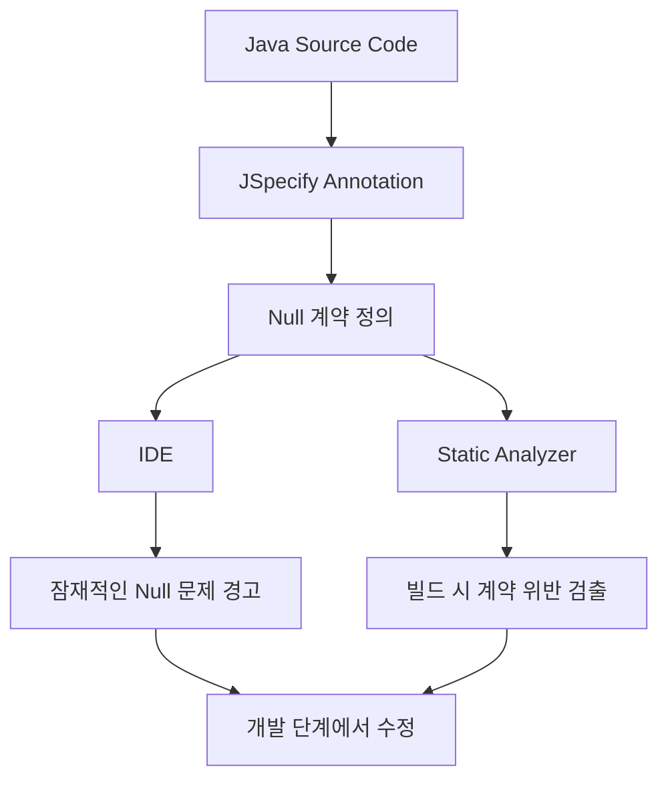
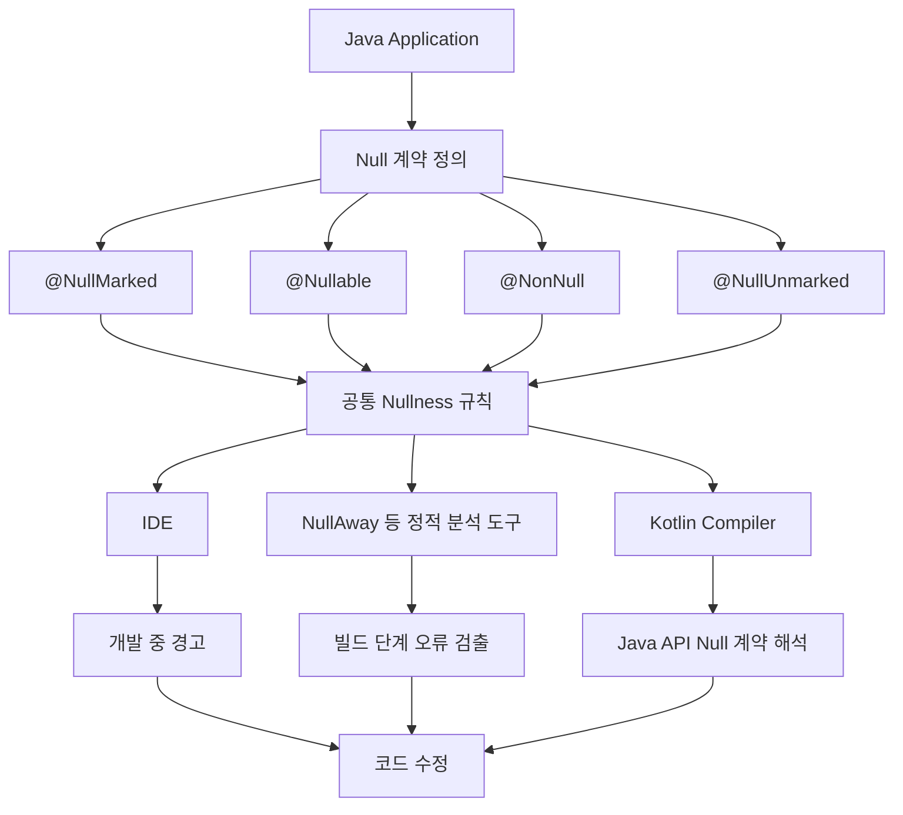

# 바니의 JSpecify로 살펴보는Java Null 처리의 새로운 표준
[https://youtu.be/iyNiyxUBCLQ?si=lbiISofPzGId1Ucn](https://youtu.be/iyNiyxUBCLQ?si=lbiISofPzGId1Ucn)

# 바니의 JSpecify로 살펴보는Java Null 처리의 새로운 표준
* toc
{:toc}

---

## JSpecify란 무엇인가? Java Null 처리의 새로운 표준과 Spring에서의 활용

Java로 개발하다 보면 가장 자주 마주하는 예외 중 하나가 `NullPointerException`이다.

처음에는 단순한 실수처럼 보인다.

```java
String name = member.getName();

System.out.println(name.length());
```

`getName()`이 정상적인 문자열을 반환한다면 아무런 문제가 없다.

하지만 `null`을 반환한다면 어떻게 될까?

```text
Exception in thread "main"
java.lang.NullPointerException
```

문제의 원인은 명확하다.

`null`인 객체에 대해 `length()`를 호출했기 때문이다.

그렇다면 이 문제를 해결하는 방법은 무엇일까?

가장 먼저 떠오르는 방법은 `null`을 확인하는 것이다.

```java
String name = member.getName();

if (name != null) {
    System.out.println(name.length());
}
```

이렇게 작성하면 해당 코드에서 `NullPointerException`이 발생하는 것을 방지할 수 있다.

하지만 실제 애플리케이션에서는 모든 곳에서 `null`을 확인하는 것이 좋은 해결책은 아니다.

어떤 값은 반드시 존재해야 한다.

어떤 값은 없어도 된다.

그런데 Java에서는 이 둘을 같은 타입으로 표현할 수 있다.

```java
String name;
```

이 선언만으로는 `name`이 반드시 존재해야 하는 값인지, `null`을 허용하는 값인지 알 수 없다.

바로 이 지점이 Java의 Null 처리에서 오래전부터 존재했던 문제다.

**NullPointerException이 발생한다는 사실보다, 어떤 값이 Null일 수 있는지에 대한 계약이 타입에 명확하게 드러나지 않는다는 점이 더 근본적인 문제다.**

이런 문제를 해결하기 위해 Java 생태계에서는 `Optional`, 다양한 Null 관련 어노테이션, 정적 분석 도구 등을 사용해 왔다.

그리고 서로 다른 도구와 라이브러리 사이에서 Null 계약을 공통된 방식으로 표현하기 위해 등장한 프로젝트가 **JSpecify**다.

---

## Java에서 Null이 문제가 되는 이유

Java의 참조 타입은 일반적으로 객체의 참조 또는 `null`을 가질 수 있다.

예를 들어 다음 코드를 살펴보자.

```java
String name = "Yun";
```

이 경우 `name`은 문자열 객체를 참조한다.

반면 다음 코드도 Java에서는 유효하다.

```java
String name = null;
```

두 변수의 타입은 동일하다.

```text
String
```

하지만 실제로 사용할 수 있는 연산에는 차이가 있다.

```java
name.length();
```

객체가 존재한다면 정상적으로 실행된다.

객체가 존재하지 않는다면 `NullPointerException`이 발생한다.

여기서 중요한 점은 Java의 기본 타입 선언만으로는 이러한 차이를 구분할 수 없다는 것이다.

다음 메서드를 생각해보자.

```java
public String findNickname(Long memberId) {
    // ...
}
```

호출하는 개발자는 반환 타입이 `String`이라는 사실만 알 수 있다.

그런데 이 메서드가 실제로는 다음처럼 구현되어 있다면 어떨까?

```java
public String findNickname(Long memberId) {

    Member member = memberRepository.findById(memberId)
            .orElseThrow();

    return member.getNickname();
}
```

`nickname`이 없는 회원에게는 `null`을 반환할 수 있다.

하지만 메서드 선언만 보면 이런 가능성이 드러나지 않는다.

결국 호출하는 쪽에서는 구현 코드를 확인하거나 문서를 찾아봐야 한다.

```text
findNickname()

↓

String 반환

↓

Null이 가능한가?

↓

구현 확인

↓

호출 코드에서 Null 처리
```

이런 과정이 여러 클래스와 라이브러리에 걸쳐 반복되면 코드의 유지보수 비용이 증가한다.

---

## Null 계약이란 무엇인가?

Null 계약은 간단히 말해 특정 값이 `null`을 허용하는지에 관한 약속이다.

예를 들어 회원 이름은 반드시 존재해야 한다고 가정하자.

```text
회원 이름

Null 허용 안 함
```

반면 회원의 별명은 선택적으로 입력할 수 있다.

```text
회원 별명

Null 허용
```

이 두 가지는 비즈니스적으로 서로 다른 규칙이다.

그런데 Java에서는 다음처럼 동일하게 선언할 수 있다.

```java
String name;

String nickname;
```

이 상태에서는 두 필드의 차이가 드러나지 않는다.

따라서 개발자는 별도 문서나 코드 분석을 통해 의도를 파악해야 한다.

Null 계약이 명확하다면 다음과 같은 정보를 쉽게 알 수 있다.

* 이 메서드는 `null`을 반환할 수 있는가?
* 이 파라미터에 `null`을 전달해도 되는가?
* 이 필드는 반드시 초기화되어야 하는가?
* Collection 자체가 `null`일 수 있는가?
* Collection의 원소에 `null`이 포함될 수 있는가?

JSpecify는 바로 이런 질문에 대한 답을 코드에 일관된 형태로 표현하기 위한 규격이다.

---

## 기존에는 Null을 어떻게 처리했을까?

JSpecify를 이해하려면 기존에 사용하던 방법부터 살펴볼 필요가 있다.

대표적으로 다음 두 가지가 있다.

```text
Optional

Null 관련 Annotation
```

각각 어떤 장점과 한계를 가지고 있었는지 살펴보자.

---

## Optional을 이용한 Null 처리

Java 8에서는 `Optional<T>`가 도입되었다.

`Optional`은 값이 존재할 수도 있고 존재하지 않을 수도 있다는 사실을 명시적으로 표현하는 컨테이너다.

예를 들어 기존 코드는 다음과 같다.

```java
public Member findMember(Long memberId) {

    return memberRepository.findById(memberId)
            .orElse(null);
}
```

이 메서드는 회원이 존재하지 않으면 `null`을 반환한다.

호출하는 쪽에서는 해당 사실을 모르고 사용할 수 있다.

```java
Member member = memberService.findMember(1L);

System.out.println(member.getName());
```

반면 `Optional`을 사용하면 반환값이 없을 수 있다는 사실을 타입으로 표현할 수 있다.

```java
public Optional<Member> findMember(Long memberId) {

    return memberRepository.findById(memberId);
}
```

호출하는 쪽에서도 값이 없을 수 있다는 사실을 고려하게 된다.

```java
Member member = memberService.findMember(1L)
        .orElseThrow(MemberNotFoundException::new);
```

또는 기본값을 지정할 수도 있다.

```java
String name = memberService.findMember(1L)
        .map(Member::getName)
        .orElse("Unknown");
```

이렇게 `Optional`은 반환값의 부재를 표현하는 데 유용하다.

---

## Optional에도 한계가 있다

그렇다면 모든 참조 타입을 `Optional`로 감싸면 되지 않을까?

예를 들어 다음과 같이 작성할 수 있다.

```java
public class Member {

    private Optional<String> nickname;
}
```

하지만 일반적으로 `Optional`은 메서드의 반환 타입으로 사용하는 것을 주된 목적으로 설계되었다.

필드나 메서드 파라미터에 무분별하게 사용하면 다음과 같은 문제가 생길 수 있다.

| 구분     | 고려할 문제                               |
| ------ | ------------------------------------ |
| 필드     | JPA 매핑이나 직렬화 도구와의 호환성                |
| 파라미터   | 호출 코드가 복잡해질 수 있음                     |
| 객체 생성  | Optional 래퍼를 사용하면서 발생하는 비용           |
| API 설계 | `Optional` 자체가 `null`일 가능성까지 생길 수 있음 |
| 데이터 모델 | 필드의 필수 여부를 표현하는 데 지나치게 복잡할 수 있음      |

예를 들어 다음 코드보다는

```java
public void updateNickname(Optional<String> nickname) {
    // ...
}
```

다음 형태가 더 자연스러운 경우가 있다.

```java
public void updateNickname(String nickname) {
    // ...
}
```

하지만 두 번째 코드만으로는 `null`을 허용하는지 명확하지 않다.

이런 부분을 보완하기 위해 개발자들은 Null 관련 어노테이션을 사용하기 시작했다.

---

## 기존 Null 어노테이션의 문제

Java에서는 다양한 라이브러리가 Null 관련 어노테이션을 제공해 왔다.

예를 들어 다음과 같은 것들이다.

```java
import org.springframework.lang.Nullable;
```

```java
import org.jetbrains.annotations.Nullable;
```

```java
import javax.annotation.Nullable;
```

이름은 모두 `Nullable`이다.

하지만 패키지가 다르다.

각 어노테이션이 만들어진 목적이나 정적 분석 도구에서 해석하는 방식도 완전히 같지는 않다.

어떤 프로젝트는 Spring의 어노테이션을 사용하고, 다른 프로젝트는 JetBrains의 어노테이션을 사용한다.

또 다른 프로젝트는 JSR-305 기반 어노테이션을 사용한다.

이런 상황에서는 다음과 같은 문제가 발생한다.

```text
Library A

Spring Nullable 사용


Library B

JetBrains Nullable 사용


Library C

JSR-305 Nullable 사용
```

개발자는 어떤 어노테이션을 선택해야 할지 고민하게 된다.

도구 제작자도 서로 다른 어노테이션들을 지원해야 한다.

특히 Generic과 배열처럼 복잡한 타입에서는 어노테이션을 어디에 붙여야 하는지, 그 위치가 어떤 의미인지에 관한 해석 차이도 문제가 된다.

이처럼 Null 관련 규칙이 여러 라이브러리와 도구에 분산된 상황을 개선하기 위해 JSpecify가 등장했다.

---

## JSpecify란 무엇인가?

JSpecify는 Java 코드에서 Null 가능성을 일관된 방식으로 표현하기 위한 어노테이션과 의미 규칙을 정의하는 프로젝트다.

핵심은 단순히 새로운 `@Nullable`을 만드는 것이 아니다.

**어노테이션이 어떤 위치에 사용되었을 때 어떤 의미를 가지는지 공통 규칙을 제공하는 것**이다.

JSpecify는 Java 언어 명세에 포함된 공식 기능은 아니다.

하지만 Java 생태계의 여러 라이브러리와 정적 분석 도구가 공통으로 이해할 수 있는 Nullness 규격을 제공한다.

공식 JSpecify 명세에서는 다음 네 가지 어노테이션을 정의하고 있다.

| 어노테이션           | 역할                            |
| --------------- | ----------------------------- |
| `@Nullable`     | 해당 타입 사용 위치에서 `null`을 허용      |
| `@NonNull`      | 해당 타입 사용 위치에서 `null`을 허용하지 않음 |
| `@NullMarked`   | 지정한 범위에서 기본적으로 Non-Null 계약 적용 |
| `@NullUnmarked` | 지정한 범위에서 기본 Non-Null 계약을 해제   |

이 네 가지를 조합하면 메서드 반환값부터 파라미터, 필드, Collection 원소까지 Null 계약을 표현할 수 있다.

---

## JSpecify는 어떻게 동작할까?

JSpecify의 동작을 이해할 때 가장 중요한 사실이 있다.

JSpecify는 런타임에서 `null`을 자동으로 검사하고 예외를 발생시키는 라이브러리가 아니다.

JSpecify는 코드의 Null 계약을 선언한다.

그리고 이를 이해하는 IDE나 정적 분석 도구가 계약 위반을 찾아낸다.



이 구조에서는 실제로 `NullPointerException`이 발생하기 전에 문제를 발견할 수 있다.

단, 사용하는 도구가 JSpecify를 지원하고 관련 분석 기능이 활성화되어 있어야 한다.

**어노테이션만 추가한다고 Java 컴파일러가 자동으로 모든 Null 문제를 검사하는 것은 아니다.**

---

## 첫 번째 핵심: @NullMarked

JSpecify에서 가장 먼저 이해해야 할 어노테이션은 `@NullMarked`다.

`@NullMarked`는 특정 범위에서 별도 표시가 없는 참조 타입을 기본적으로 Non-Null로 해석하도록 선언한다.

예를 들어 다음 클래스를 보자.

```java
import org.jspecify.annotations.NullMarked;
import org.jspecify.annotations.Nullable;

@NullMarked
public class Member {

    private final String name;

    private final @Nullable String nickname;

    public Member(
            String name,
            @Nullable String nickname
    ) {
        this.name = name;
        this.nickname = nickname;
    }

    public String getName() {
        return name;
    }

    public @Nullable String getNickname() {
        return nickname;
    }
}
```

이 클래스에서 `name`은 반드시 존재해야 하는 값이다.

반면 `nickname`은 존재하지 않을 수도 있다.

`@NullMarked`가 적용되었으므로 다음 선언은 기본적으로 Non-Null 계약을 가진다.

```java
private final String name;
```

다음 생성자 파라미터도 마찬가지다.

```java
public Member(String name, ...) {
    // ...
}
```

별도의 `@NonNull`을 반복해서 작성하지 않아도 된다.

반면 `null`을 허용하는 값에는 명시적으로 `@Nullable`을 붙인다.

```java
private final @Nullable String nickname;
```

이렇게 하면 코드의 의도가 분명해진다.

---

## @NullMarked가 없다면 어떻게 될까?

다음 코드를 보자.

```java
public class Member {

    private String name;

    private String nickname;
}
```

두 필드 모두 Null 계약이 명시되어 있지 않다.

JSpecify에서는 이런 상태를 **Unspecified Nullness**라고 부른다.

중요한 것은 Unspecified가 Nullable과 같지 않다는 점이다.

```text
Nullable

→ Null을 허용한다는 계약


Non-Null

→ Null을 허용하지 않는다는 계약


Unspecified

→ Null 가능성에 대한 계약이 명시되지 않음
```

즉 어노테이션이 없다는 이유만으로 반드시 `null`을 허용한다고 해석해서는 안 된다.

어떤 의도로 작성되었는지 알 수 없는 상태에 가깝다.

하지만 `@NullMarked`를 적용하면 기본 해석이 달라진다.

```java
@NullMarked
public class Member {

    private String name;
}
```

이제 `name`은 Non-Null 계약을 가진다.

JSpecify는 이처럼 기본 규칙을 정함으로써 코드 전체에 `@NonNull`을 반복해서 작성하는 문제를 줄인다.

---

## @Nullable은 언제 사용할까?

`@Nullable`은 해당 위치의 타입에 `null`이 포함될 수 있음을 표현한다.

예를 들어 회원의 별명을 조회하는 API를 생각해보자.

```java
@NullMarked
public class MemberService {

    public @Nullable String findNickname(Long memberId) {

        Member member = findMember(memberId);

        return member.getNickname();
    }
}
```

이 메서드는 `String`을 반환하지만 `null`일 수도 있다.

호출하는 쪽에서는 다음과 같이 처리해야 한다.

```java
String nickname = memberService.findNickname(1L);
```

여기까지는 문제가 없다.

하지만 곧바로 다음 메서드를 호출한다면 위험하다.

```java
System.out.println(nickname.length());
```

정적 분석 도구는 `findNickname()`의 반환값이 Nullable이라는 계약을 확인할 수 있다.

따라서 잠재적인 Null 참조 문제를 경고할 수 있다.

더 안전하게 작성하려면 다음처럼 처리해야 한다.

```java
String nickname = memberService.findNickname(1L);

if (nickname != null) {
    System.out.println(nickname.length());
}
```

또는 기본값을 사용할 수 있다.

```java
String nickname = memberService.findNickname(1L);

String displayName = nickname != null
        ? nickname
        : "Unknown";
```

핵심은 `null` 처리를 강제하는 코드를 작성하는 것이 아니라 **어떤 값이 `null`일 수 있는지 호출자에게 명확하게 알려준다는 점**이다.

---

## @Nullable은 파라미터에도 적용할 수 있다

메서드 반환값뿐 아니라 입력 파라미터에도 사용할 수 있다.

예를 들어 회원의 별명을 수정한다고 하자.

```java
@NullMarked
public class MemberService {

    public void updateNickname(
            Long memberId,
            @Nullable String nickname
    ) {
        Member member = findMember(memberId);

        member.updateNickname(nickname);
    }
}
```

이 메서드의 계약은 다음과 같다.

```text
memberId

Null 허용 안 함


nickname

Null 허용
```

호출하는 쪽에서는 `nickname`에 `null`을 전달할 수 있다.

```java
memberService.updateNickname(1L, null);
```

반면 다음 메서드는 다르다.

```java
@NullMarked
public void updateName(
        Long memberId,
        String name
) {
    // ...
}
```

`name`에는 `null`을 전달해서는 안 된다는 계약이다.

정적 분석 도구를 사용하면 다음 호출을 문제로 탐지할 수 있다.

```java
memberService.updateName(1L, null);
```

---

## @NullMarked는 패키지 단위로 적용할 수 있다

클래스마다 `@NullMarked`를 붙이는 방법도 있지만, 실제 프로젝트에서는 패키지 단위로 적용하는 방식이 유용하다.

Java에서는 `package-info.java`를 이용할 수 있다.

예를 들어 다음 프로젝트 구조를 생각해보자.

```text
src/main/java/
└── com/example/member/
    ├── package-info.java
    ├── Member.java
    ├── MemberService.java
    └── MemberRepository.java
```

`package-info.java`에 다음과 같이 작성한다.

```java
@NullMarked
package com.example.member;

import org.jspecify.annotations.NullMarked;
```

이렇게 하면 `com.example.member` 패키지 내의 코드에 기본적인 Non-Null 계약을 적용할 수 있다.

이후 클래스에서는 매번 `@NullMarked`를 선언하지 않아도 된다.

```java
package com.example.member;

import org.jspecify.annotations.Nullable;

public class Member {

    private final String name;

    private final @Nullable String nickname;

    public Member(
            String name,
            @Nullable String nickname
    ) {
        this.name = name;
        this.nickname = nickname;
    }
}
```

Spring Framework에서도 패키지 단위 `@NullMarked` 사용을 권장하는 형태로 활용하고 있다.

### 주의할 점: 하위 패키지까지 자동 적용되지는 않는다

예를 들어 다음 패키지에 `@NullMarked`를 선언했다고 하자.

```text
com.example.member
```

그렇다고 다음 하위 패키지까지 자동으로 적용되는 것은 아니다.

```text
com.example.member.service
```

Java의 패키지는 이름상 계층 구조처럼 보이지만, JSpecify의 패키지 단위 Null 계약은 하위 패키지로 자동 상속되지 않는다.

따라서 패키지별 적용 범위를 명확하게 관리해야 한다.

---

## @NonNull은 언제 사용할까?

`@NullMarked`가 적용된 코드에서는 별도 어노테이션이 없는 참조 타입이 기본적으로 Non-Null 계약을 가진다.

따라서 대부분의 경우 `@NonNull`을 직접 선언할 필요가 없다.

```java
@NullMarked
public class MemberService {

    public String findName(Long memberId) {
        // ...
    }
}
```

위 코드에서 `String`은 기본적으로 Non-Null이다.

다음처럼 작성할 필요가 없는 것이다.

```java
public @NonNull String findName(
        @NonNull Long memberId
) {
    // ...
}
```

다만 기본 규칙이 적용되지 않는 코드에서 명시적으로 Non-Null 계약을 표현하거나, Generic의 특정 타입 사용 위치를 명확하게 제한해야 할 때는 `@NonNull`을 활용할 수 있다.

일반적인 Spring Boot 애플리케이션에서는 `@NullMarked`와 `@Nullable`을 중심으로 시작해도 상당수 요구사항을 표현할 수 있다.

---

## @NullUnmarked는 무엇일까?

기존 프로젝트 전체에 JSpecify를 한 번에 적용하기는 쉽지 않다.

예를 들어 오래된 Legacy 코드가 상당히 많다고 가정하자.

```text
Legacy Application

├── Member
├── Order
├── Payment
├── Coupon
└── Settlement
```

현재 코드는 어떤 메서드가 `null`을 반환하는지 명확하지 않을 수 있다.

이 상태에서 프로젝트 전체를 즉시 `@NullMarked`로 선언하면 많은 계약 위반이 발견될 수 있다.

따라서 일부 코드만 먼저 적용하고 나머지 코드는 나중에 전환하는 전략이 필요하다.

이때 사용할 수 있는 것이 `@NullUnmarked`다.

```java
import org.jspecify.annotations.NullUnmarked;

@NullUnmarked
public class LegacyPaymentService {

    public String findPaymentStatus(Long paymentId) {
        // ...
    }
}
```

`@NullUnmarked`가 적용된 범위에서는 주변의 `@NullMarked` 기본 규칙이 해제된다.

따라서 별도 표시가 없는 타입은 다시 Unspecified Nullness로 해석된다.

이 기능은 기존 코드에 JSpecify를 단계적으로 적용할 때 유용하다.

하지만 영구적으로 모든 Legacy 코드를 `@NullUnmarked` 상태로 방치하는 것보다는 점진적으로 Null 계약을 명확하게 만드는 것이 좋다.

---

## 두 번째 핵심: Generic 타입의 Null 계약

JSpecify의 중요한 장점 중 하나는 Generic 내부의 Null 가능성을 구분할 수 있다는 것이다.

예를 들어 다음 코드를 생각해보자.

```java
List<String> names;
```

이 선언에서 두 가지 질문을 할 수 있다.

첫 번째는 `names`라는 List 객체 자체가 `null`일 수 있는가?

두 번째는 List 안에 저장된 String 원소가 `null`일 수 있는가?

이 둘은 서로 다른 문제다.

```text
List 객체

↓

String 원소
```

List 자체는 반드시 존재하지만 원소 중 일부가 `null`일 수도 있다.

반대로 List 자체가 없을 수 있지만 List가 존재한다면 모든 원소는 정상적인 문자열일 수도 있다.

JSpecify는 이런 차이를 어노테이션의 위치로 표현할 수 있다.

---

## 1. List 자체가 Null일 수 있는 경우

```java
@Nullable List<String> names;
```

`@NullMarked`가 적용된 범위라고 가정하자.

이 타입의 의미는 다음과 같다.

```text
List 자체

Null 가능


List 내부 String

Null 허용 안 함
```

따라서 다음 상태는 허용된다.

```java
names = null;
```

하지만 List가 존재한다면 내부 원소는 Non-Null이라는 계약이다.

```text
names

null

또는

["Yun", "Kim", "Lee"]
```

반면 List 안에 `null` 원소를 넣는 것은 해당 계약에 맞지 않는다.

---

## 2. List는 반드시 존재하지만 원소는 Null일 수 있는 경우

이번에는 어노테이션의 위치를 변경해보자.

```java
List<@Nullable String> names;
```

이번에는 List 자체가 아니라 Generic 안쪽에 `@Nullable`이 붙어 있다.

의미는 다음과 같다.

```text
List 자체

Null 허용 안 함


List 내부 String

Null 가능
```

따라서 다음과 같은 데이터가 가능하다.

```java
List<@Nullable String> names = new ArrayList<>();

names.add("Yun");
names.add(null);
names.add("Kim");
```

이 List를 순회한다면 원소가 `null`인지 확인해야 한다.

```java
for (String name : names) {

    if (name != null) {
        System.out.println(name.length());
    }
}
```

중요한 것은 List 객체 자체는 존재하지만 원소가 없을 수 있다는 점이다.

---

## 3. List와 원소 모두 Null일 수 있는 경우

다음과 같이 선언할 수도 있다.

```java
@Nullable List<@Nullable String> names;
```

의미는 다음과 같다.

```text
List 자체

Null 가능


List 내부 String

Null 가능
```

따라서 다음 상태가 모두 가능하다.

```text
names = null
```

또는

```text
names = ["Yun", null, "Kim"]
```

이 경우 List를 사용하기 전에도 확인해야 하고, List에서 원소를 꺼낸 이후에도 확인해야 한다.

---

## Generic에서 @Nullable 위치를 비교하면

`@NullMarked`가 적용된 범위를 기준으로 정리하면 다음과 같다.

| 선언                                 | List 자체  | 내부 원소    |
| ---------------------------------- | -------- | -------- |
| `List<String>`                     | Non-Null | Non-Null |
| `@Nullable List<String>`           | Nullable | Non-Null |
| `List<@Nullable String>`           | Non-Null | Nullable |
| `@Nullable List<@Nullable String>` | Nullable | Nullable |

JSpecify는 `@Nullable`이 어떤 타입 사용 위치에 붙었는지에 따라 이 의미를 구분한다.

이 기능은 단순한 Collection에서도 유용하지만, 여러 Generic이 중첩되는 코드에서 더욱 중요해진다.

---

## 복잡한 Generic에서도 활용할 수 있다

예를 들어 다음 타입을 생각해보자.

```java
Map<String, List<@Nullable String>> result;
```

여기에는 여러 단계가 존재한다.

```text
Map

↓

Key: String

↓

Value: List

↓

Element: String
```

`@NullMarked`가 적용된 환경에서는 다음 의미를 가진다.

* Map 자체는 `null`이 아니다.
* Key는 `null`이 아니다.
* Value인 List는 `null`이 아니다.
* List 내부의 String은 `null`일 수 있다.

조금 더 복잡하게 작성할 수도 있다.

```java
Map<String, @Nullable List<@Nullable String>> result;
```

이 경우 Map의 Value로 사용되는 List 자체도 `null`일 수 있다.

이처럼 JSpecify는 단순한 변수 선언뿐 아니라 Generic 구조의 특정 위치까지 Null 계약을 표현할 수 있다.

---

## Generic 타입을 직접 정의할 때는 주의해야 한다

Generic을 사용하는 것과 Generic 타입 자체를 정의하는 것은 조금 다르다.

예를 들어 다음 클래스를 생각해보자.

```java
@NullMarked
public class Box<T> {

    private final T value;

    public Box(T value) {
        this.value = value;
    }

    public T getValue() {
        return value;
    }
}
```

이 클래스는 타입 파라미터 `T`를 가진다.

JSpecify의 NullMarked 범위에서는 명시되지 않은 타입 파라미터의 상한도 중요한 의미를 가진다.

`<T>`는 암묵적으로 `<T extends Object>`와 같고, NullMarked 범위의 `Object`는 Non-Null로 해석된다.

따라서 이 정의는 Nullable 타입 인자를 자유롭게 허용하도록 선언한 것이 아니다.

만약 `Box<@Nullable String>` 같은 형태까지 허용하고 싶다면 타입 변수의 상한을 명시적으로 Nullable로 선언해야 한다.

```java
@NullMarked
public class Box<T extends @Nullable Object> {

    private final T value;

    public Box(T value) {
        this.value = value;
    }

    public T getValue() {
        return value;
    }
}
```

이제 타입 인자의 Null 가능성을 표현할 수 있다.

이 부분은 단순한 `List<@Nullable String>` 사용보다 복잡하며, 실제 정적 분석 도구의 Generic 지원 범위도 확인해야 한다.

JSpecify 공식 문서에서도 Generic 타입을 직접 정의할 때 Nullable Upper Bound를 명시적으로 고려하도록 설명한다.

---

## 배열에서도 Null 가능성을 구분할 수 있다

Generic뿐 아니라 배열에서도 JSpecify의 타입 사용 위치가 중요하다.

예를 들어 다음 선언을 살펴보자.

```java
@Nullable String[] names;
```

이 코드를 보고 배열 자체가 `null`일 수 있다고 생각하기 쉽다.

하지만 JSpecify의 TYPE_USE 규칙에서는 다르게 해석된다.

`@NullMarked`가 적용된 범위에서 위 선언은 배열의 원소인 String이 Nullable이라는 의미다.

즉 배열 자체는 Non-Null이고, 내부 원소가 `null`일 수 있다.

```text
names

["Yun", null, "Kim"]
```

그렇다면 배열 자체가 `null`일 수 있다는 계약은 어떻게 표현할까?

다음처럼 작성한다.

```java
String @Nullable [] names;
```

배열 자체에 `@Nullable`을 붙인 것이다.

```text
names

null

또는

["Yun", "Kim"]
```

배열 자체와 원소 모두 Nullable이라면 다음처럼 작성한다.

```java
@Nullable String @Nullable [] names;
```

정리하면 다음과 같다.

| 선언                              | 배열 자체    | 배열 원소    |
| ------------------------------- | -------- | -------- |
| `String[]`                      | Non-Null | Non-Null |
| `String @Nullable []`           | Nullable | Non-Null |
| `@Nullable String[]`            | Non-Null | Nullable |
| `@Nullable String @Nullable []` | Nullable | Nullable |

이 문법은 기존 Spring의 `@Nullable`에서 JSpecify로 전환할 때 특히 주의해야 하는 부분이다.

Spring Framework 공식 문서에서도 배열과 가변 인자의 Null 계약을 변경할 때 어노테이션 위치에 주의하도록 설명한다.

---

## JSpecify를 프로젝트에 적용해보자

이제 실제 Spring Boot 프로젝트에서 JSpecify를 사용하는 방법을 살펴보자.

JSpecify 어노테이션은 다음 패키지에 포함된다.

```text
org.jspecify.annotations
```

Maven Central에서는 다음 의존성으로 제공된다.

```text
org.jspecify:jspecify
```

2026년 10월 기준 Maven Central에 게시된 1.0.1 버전을 사용하는 예시를 살펴보겠다.

### Gradle 설정

`build.gradle.kts`를 사용한다면 다음과 같이 추가할 수 있다.

```kotlin
dependencies {
    implementation("org.jspecify:jspecify:1.0.1")
}
```

Java Library 프로젝트에서 외부 사용자에게 공개하는 API의 Null 계약을 정의한다면 `api` 의존성을 사용하는 것이 적절하다.

```kotlin
dependencies {
    api("org.jspecify:jspecify:1.0.1")
}
```

JSpecify 공식 문서도 공개 라이브러리 API에서 어노테이션 정보를 사용자에게 제공할 수 있도록 `api` 구성을 권장한다.

### Maven 설정

Maven을 사용한다면 다음과 같다.

```xml
<dependency>
    <groupId>org.jspecify</groupId>
    <artifactId>jspecify</artifactId>
    <version>1.0.1</version>
</dependency>
```

이제 Java 코드에서 다음 어노테이션을 사용할 수 있다.

```java
import org.jspecify.annotations.NullMarked;
import org.jspecify.annotations.Nullable;
```

---

## JSpecify만 추가하면 NullPointerException이 컴파일 에러가 될까?

이 부분은 반드시 구분해야 한다.

다음 코드를 보자.

```java
import org.jspecify.annotations.NullMarked;
import org.jspecify.annotations.Nullable;

@NullMarked
public class NullExample {

    public @Nullable String findName() {
        return null;
    }

    public int getNameLength() {
        return findName().length();
    }
}
```

`findName()`은 Nullable 값을 반환한다고 선언했다.

그런데 반환값을 확인하지 않고 `length()`를 호출한다.

분명 위험한 코드다.

하지만 **JSpecify 어노테이션 의존성만 추가한 상태에서는 일반 Java 컴파일러가 이 코드를 자동으로 컴파일 오류로 처리하지 않는다.**

JSpecify는 Null 계약을 정의할 뿐이다.

이를 검사하려면 JSpecify를 이해하는 정적 분석 도구가 필요하다.

대표적인 도구로 다음과 같은 것들이 있다.

```text
IntelliJ IDEA

NullAway

Checker Framework
```

다만 각 도구의 지원 범위는 다를 수 있다.

특히 Generic, 배열, Wildcard 등의 복잡한 Null 계약은 분석 도구에 따라 검사 수준이 달라질 수 있다.

JSpecify의 규칙이 표준화되었다는 것과 모든 도구가 모든 규칙을 동일한 수준으로 검증한다는 것은 다른 이야기다.

---

## NullAway와 함께 사용하면 어떻게 될까?

NullAway는 Java 코드에서 잠재적인 Null 관련 문제를 정적 분석하는 도구다.

JSpecify와 함께 사용하면 개발자가 작성한 Null 계약을 기반으로 위험한 코드를 발견할 수 있다.

예를 들어 다음 코드를 생각해보자.

```java
@NullMarked
public class MemberService {

    public @Nullable String findNickname(Long memberId) {
        return null;
    }

    public int getNicknameLength(Long memberId) {

        String nickname = findNickname(memberId);

        return nickname.length();
    }
}
```

`findNickname()`은 `null`을 반환할 수 있다.

따라서 `nickname.length()`는 위험하다.

NullAway를 설정하면 이런 종류의 코드에서 Null 계약 위반을 발견하고 빌드 오류로 처리하도록 구성할 수 있다.

---

## Gradle에 NullAway 설정하기

다음은 Kotlin DSL 기반 Java 프로젝트에서 JSpecify와 NullAway를 연결하는 예시다.

기본적인 Null 검사를 먼저 적용하는 구성이며, Generic 전체에 대한 엄격한 JSpecify 검사는 별도로 활성화해야 한다.

```kotlin
import net.ltgt.gradle.errorprone.CheckSeverity
import net.ltgt.gradle.errorprone.errorprone

plugins {
    java
    id("net.ltgt.errorprone") version "5.1.1"
}

repositories {
    mavenCentral()
}

java {
    toolchain {
        languageVersion.set(JavaLanguageVersion.of(21))
    }
}

dependencies {
    implementation("org.jspecify:jspecify:1.0.1")

    errorprone(
        "com.google.errorprone:error_prone_core:2.50.0"
    )

    errorprone(
        "com.uber.nullaway:nullaway:0.14.1"
    )
}

tasks.withType<JavaCompile>().configureEach {
    options.errorprone {
        check("NullAway", CheckSeverity.ERROR)
        option("NullAway:OnlyNullMarked", "true")
    }
}
```

위 예시에서 중요한 설정은 다음과 같다.

```kotlin
check("NullAway", CheckSeverity.ERROR)
```

NullAway에서 발견한 오류를 빌드 실패로 처리한다.

그리고 다음 설정이 있다.

```kotlin
option("NullAway:OnlyNullMarked", "true")
```

이 설정은 `@NullMarked`가 적용된 코드만을 대상으로 Null 분석을 수행하도록 한다.

따라서 기존 프로젝트에 JSpecify를 단계적으로 도입할 때 유용하다.

설정은 공식 Gradle Error Prone 플러그인과 NullAway의 `OnlyNullMarked` 옵션을 기반으로 한다.

실제 Spring Boot 프로젝트에서는 이미 적용된 Java 플러그인이나 의존성 버전 관리 방식에 맞춰 병합하면 된다.

---

## Gradle 빌드로 확인하기

설정이 완료되었다면 다음 명령을 실행한다.

```bash
./gradlew compileJava
```

이 명령은 프로젝트의 Java 소스를 컴파일한다.

NullAway가 활성화되어 있다면 컴파일 과정에서 Null 관련 문제를 분석한다.

예를 들어 다음 코드가 있다고 하자.

```java
@NullMarked
public class MemberService {

    public @Nullable String findNickname() {
        return null;
    }

    public int getLength() {
        return findNickname().length();
    }
}
```

정적 분석 결과 다음과 같은 오류를 확인할 수 있다.

```text
error: [NullAway]
dereferenced expression is @Nullable

return findNickname().length();
       ^
```

이는 예상 가능한 오류 출력의 예시이며 실제 메시지 형식은 도구 버전에 따라 달라질 수 있다.

이처럼 문제를 런타임까지 기다리지 않고 빌드 과정에서 발견할 수 있다.

---

## Generic까지 완전하게 검사할 수 있을까?

여기서 한 가지 주의할 점이 있다.

JSpecify는 Generic 내부의 Null 가능성을 표현할 수 있다.

하지만 정적 분석 도구가 그 규칙을 얼마나 검사할 수 있는지는 별도 문제다.

NullAway의 기본 검사와 JSpecify Mode는 지원 범위가 다르다.

NullAway에서는 다음 옵션을 제공한다.

```text
NullAway:JSpecifyMode=true
```

이 모드를 활성화하면 Generic과 배열 등 JSpecify의 보다 확장된 의미 규칙을 분석할 수 있다.

다만 2026년 10월 기준으로도 해당 모드는 일부 제한이 존재하며, 정상적인 코드를 잘못 경고하거나 특정 상황을 충분히 분석하지 못할 수 있다.

또 안정적으로 사용하려면 JDK 22 이상의 `javac`을 사용하는 것이 일반적으로 권장된다.

따라서 기존 프로젝트에 적용할 때는 다음과 같은 순서가 현실적이다.

```text
1. JSpecify Annotation 적용

↓

2. NullAway 기본 검사 활성화

↓

3. 발견된 Null 문제 수정

↓

4. JSpecify Mode 검토

↓

5. Generic / Array 검사 확대
```

처음부터 모든 검사를 가장 엄격한 수준으로 활성화하기보다 코드베이스의 상태에 맞춰 적용 범위를 넓히는 편이 운영하기 쉽다.

---

## JSpecify와 Spring Framework의 관계

Spring에서도 Null 계약은 오래전부터 중요한 주제였다.

Spring Framework 5부터는 다음과 같은 어노테이션을 제공했다.

```java
org.springframework.lang.Nullable
```

```java
org.springframework.lang.NonNull
```

```java
org.springframework.lang.NonNullApi
```

```java
org.springframework.lang.NonNullFields
```

이러한 어노테이션은 JSR-305 기반의 의미 체계를 활용했다.

하지만 JSpecify가 등장하면서 더 명확하고 일관된 Null 계약을 표현할 수 있게 되었다.

Spring Framework 7에서는 JSpecify 기반 Null 어노테이션을 적극적으로 도입했다.

기존 `org.springframework.lang`의 Null 관련 어노테이션은 Spring Framework 7에서 Deprecated 처리되었으며, JSpecify를 사용하는 방향으로 전환되었다.

또 Spring Framework 내부에서도 NullAway를 이용해 Null 계약을 검증한다.

---

## Spring에서 JSpecify를 적용하면 무엇이 달라질까?

예를 들어 기존 Spring 코드에서 다음과 같이 작성했다고 하자.

```java
import org.springframework.lang.Nullable;

public class MemberService {

    @Nullable
    public String findNickname(Long memberId) {
        // ...
    }
}
```

JSpecify로 전환하면 다음처럼 표현할 수 있다.

```java
import org.jspecify.annotations.Nullable;

public class MemberService {

    public @Nullable String findNickname(Long memberId) {
        // ...
    }
}
```

어노테이션의 패키지가 달라졌다.

그리고 JSpecify의 `@Nullable`은 TYPE_USE 어노테이션이므로 타입 사용 위치에 붙이는 방식이 중요하다.

이런 특성 덕분에 Generic과 배열 내부의 Null 가능성도 보다 정밀하게 표현할 수 있다.

---

## JSpecify와 Kotlin의 관계

JSpecify는 Java만 사용하는 프로젝트에서도 유용하지만 Kotlin과 함께 사용하는 환경에서도 의미가 크다.

Kotlin은 언어 차원에서 Nullable 타입을 구분한다.

예를 들어 다음과 같다.

```kotlin
val name: String
```

이 타입은 일반적으로 `null`을 허용하지 않는다.

반면 다음 타입은 Nullable이다.

```kotlin
val nickname: String?
```

문제는 Java 라이브러리와 Kotlin 코드가 함께 사용될 때다.

Java 코드에 Null 계약이 명확하지 않으면 Kotlin에서는 해당 값을 Platform Type으로 취급하는 상황이 발생할 수 있다.

이 경우 Null 안전성을 컴파일 단계에서 충분히 확인하기 어렵다.

하지만 Java API에 JSpecify 어노테이션이 선언되어 있다면 Kotlin 컴파일러는 해당 계약을 참고할 수 있다.

---

## Java API를 Kotlin에서 사용하는 예제

먼저 Java 코드를 보자.

```java
import org.jspecify.annotations.NullMarked;
import org.jspecify.annotations.Nullable;

@NullMarked
public class MemberService {

    public String findName(Long memberId) {
        return "Yun";
    }

    public @Nullable String findNickname(Long memberId) {
        return null;
    }
}
```

`findName()`은 Non-Null이다.

`findNickname()`은 Nullable이다.

이 코드를 Kotlin에서 호출한다고 하자.

```kotlin
val name = memberService.findName(1L)

println(name.length)
```

`findName()`은 Non-Null 계약이므로 일반적인 문자열처럼 사용할 수 있다.

반면 다음 코드는 문제가 될 수 있다.

```kotlin
val nickname = memberService.findNickname(1L)

println(nickname.length)
```

`nickname`은 Nullable이기 때문이다.

Kotlin에서는 다음처럼 안전 호출을 사용할 수 있다.

```kotlin
println(nickname?.length)
```

또는 기본값을 지정할 수 있다.

```kotlin
val displayName = nickname ?: "Unknown"
```

Kotlin 2.1부터는 JSpecify Null 계약 위반을 기본적으로 Error로 취급하도록 강화되었다.

따라서 Java와 Kotlin을 함께 사용하는 프로젝트라면 JSpecify 도입의 효과가 더 직접적으로 드러날 수 있다.

---

## JSpecify와 Bean Validation은 무엇이 다를까?

여기서 혼동하기 쉬운 개념이 하나 있다.

Spring Boot에서는 이미 다음과 같은 어노테이션을 사용하고 있다.

```java
@NotNull
```

이 어노테이션은 Jakarta Bean Validation에서 제공한다.

그렇다면 JSpecify의 `@NullMarked`와 `@Nullable`이 있으면 `@NotNull`은 더 이상 필요하지 않을까?

그렇지 않다.

두 기능은 목적이 다르다.

### JSpecify

코드에서 사용하는 타입의 Null 계약을 표현한다.

```java
public void updateName(String name) {
    // ...
}
```

이 메서드가 `@NullMarked` 범위에 있다면 `name`은 Non-Null 계약을 가진다.

정적 분석 도구는 코드의 계약 위반을 검사할 수 있다.

### Bean Validation

실행 시점에 입력 데이터가 조건을 만족하는지 검증한다.

예를 들어 다음과 같다.

```java
public record MemberRequest(

        @NotNull
        String name

) {
}
```

컨트롤러에서 `@Valid` 등을 통해 검증이 실행되면 실제 요청 데이터를 검사할 수 있다.

---

## JSpecify와 Bean Validation 비교

| 구분       | JSpecify                   | Bean Validation         |
| -------- | -------------------------- | ----------------------- |
| 대표 어노테이션 | `@NullMarked`, `@Nullable` | `@NotNull`, `@NotBlank` |
| 주요 목적    | 타입의 Null 계약 표현             | 실행 시점의 데이터 검증           |
| 검사 시점    | IDE, 정적 분석 및 빌드            | 일반적으로 런타임               |
| 자동 검증    | 별도 도구 필요                   | Validator 실행 필요         |
| 검증 대상    | Java 타입 사용 위치              | 객체의 제약조건                |
| 주요 활용    | 내부 API 계약, Null 안전성        | HTTP 요청 DTO, 입력값 검증     |

따라서 두 기술은 경쟁 관계라기보다 서로 다른 영역을 보완한다.

---

## Spring Boot 요청 DTO에 함께 적용하기

예를 들어 회원 가입 요청이 있다고 하자.

```java
import jakarta.validation.constraints.NotBlank;
import jakarta.validation.constraints.NotNull;
import org.jspecify.annotations.NullMarked;
import org.jspecify.annotations.Nullable;

@NullMarked
public record MemberCreateRequest(

        @NotBlank
        String name,

        @Nullable
        String nickname

) {
}
```

`name`은 반드시 존재해야 하는 값이다.

또 단순히 `null`이 아니기만 하면 되는 것이 아니라 빈 문자열이나 공백만 있는 문자열도 허용하지 않으려는 요구사항이다.

이런 검증은 `@NotBlank`가 담당한다.

반면 `nickname`은 선택 입력값이다.

따라서 `@Nullable`로 Null 가능성을 표현한다.

하지만 여기서 중요한 점이 있다.

**JSpecify의 Non-Null 계약만으로 외부 요청의 `null` 입력이 자동으로 거부되는 것은 아니다.**

필수 입력값의 런타임 검증은 Bean Validation이나 명시적인 검증 로직을 통해 수행해야 한다.

이 구분은 실제 REST API에서 특히 중요하다.

---

## JPA Entity에도 적용할 수 있을까?

가능하다.

다만 JPA Entity는 일반 Java 객체보다 고려할 사항이 많다.

예를 들어 다음과 같은 Entity를 생각해보자.

```java
@Entity
@NullMarked
public class Member {

    @Id
    @GeneratedValue(strategy = GenerationType.IDENTITY)
    private Long id;

    @Column(nullable = false)
    private String name;

    @Column
    private @Nullable String nickname;

    protected Member() {
    }

    public Member(String name) {
        this.name = name;
    }
}
```

이 예제에서는 필수 필드와 선택 필드가 구분된다.

하지만 JPA는 Reflection을 통해 객체를 생성하고 필드를 초기화하는 과정이 존재한다.

따라서 일반적인 생성자 기반 객체와 Null 분석 조건이 다를 수 있다.

특히 다음 요소를 함께 고려해야 한다.

```text
JPA 기본 생성자

Reflection 기반 필드 초기화

Lazy Loading

Nullable Column

Entity Lifecycle

정적 분석 도구의 초기화 검사
```

JSpecify가 선언한 계약과 실제 JPA 객체의 생성·초기화 시점이 일치하는지 확인해야 한다.

정적 분석 도구가 JPA의 내부 동작을 이해하지 못하는 경우에는 별도 모델이나 제한적인 예외 처리가 필요할 수 있다.

또 `@Column(nullable = false)`는 데이터베이스 매핑과 DDL 생성에 영향을 주는 설정이고, JSpecify의 `@NullMarked`는 Java 코드의 Null 계약이라는 점도 구분해야 한다.

---

## Optional과 @Nullable 중 무엇을 사용할까?

실무에서는 이 둘을 어떻게 구분할지가 중요하다.

일반적으로는 다음과 같은 기준을 사용할 수 있다.

### 조회 결과가 없을 수 있는 Repository 메서드

`Optional`이 자연스럽다.

```java
Optional<Member> findByEmail(String email);
```

호출자가 결과 부재를 명시적으로 처리하도록 유도할 수 있다.

### 선택적으로 존재하는 객체 필드

`@Nullable`이 자연스러운 경우가 많다.

```java
private @Nullable String nickname;
```

모든 선택 필드를 `Optional`로 감싸는 것보다 객체 모델을 단순하게 유지할 수 있다.

### 선택 입력 파라미터

`@Nullable`을 사용할 수 있다.

```java
public void updateNickname(@Nullable String nickname) {
    // ...
}
```

다만 `null`을 전달했을 때 어떤 의미를 갖는지는 명확해야 한다.

예를 들어 회원 정보 수정 API에서는 다음 두 상태가 서로 다를 수 있다.

```text
nickname 필드 미전달

→ 기존 값 유지


nickname = null

→ 기존 값 삭제
```

이 두 상황을 구분해야 한다면 단순 `@Nullable`만으로는 충분하지 않을 수 있다.

별도 요청 DTO나 변경 명령을 설계해야 한다.

---

## JSpecify는 NullPointerException을 완전히 없애줄까?

그렇지는 않다.

JSpecify를 사용하더라도 다음과 같은 상황에서는 `NullPointerException`이 발생할 수 있다.

첫 번째는 정적 분석 도구가 활성화되어 있지 않은 경우다.

```java
@NullMarked
public class Example {

    public String findName() {
        return null;
    }
}
```

JSpecify 어노테이션 자체는 런타임에서 이 코드를 막지 않는다.

두 번째는 Reflection이나 외부 라이브러리를 통해 Null 계약이 지켜지지 않는 경우다.

세 번째는 외부 라이브러리의 Null 계약이 명확하지 않은 경우다.

네 번째는 정적 분석 도구가 특정 코드를 충분히 분석하지 못하는 경우다.

따라서 JSpecify를 적용했다고 모든 Null 문제를 해결했다고 생각해서는 안 된다.

JSpecify가 제공하는 가장 중요한 가치는 **어떤 값이 Null일 수 있는지 공통된 규칙으로 표현하고, 이를 도구가 분석할 수 있도록 만드는 것**이다.

---

## JSpecify는 런타임 성능에 영향을 줄까?

JSpecify는 `Optional`처럼 값을 별도 객체로 감싸는 방식을 요구하지 않는다.

따라서 다음 코드에서

```java
private @Nullable String nickname;
```

JSpecify 때문에 새로운 래퍼 객체가 생성되는 것은 아니다.

또 `@Nullable`을 붙였다는 이유로 메서드 호출마다 자동 Null 검사 코드가 실행되는 것도 아니다.

즉 일반적인 사용에서는 Null 계약을 선언하는 과정에서 추가적인 비즈니스 실행 비용이 거의 발생하지 않는다.

다만 모든 경우에 런타임 비용이 절대적으로 0이라고 표현하는 것은 정확하지 않다.

JSpecify 어노테이션은 런타임에도 유지되는 메타데이터를 가지고 있으며, 이를 Reflection 등으로 읽는 도구가 있을 수 있기 때문이다.

정확하게는 **JSpecify가 자동적인 런타임 Null 검증이나 래퍼 객체 생성을 요구하지 않는다**고 이해하는 것이 좋다.

---

## 기존 프로젝트에 JSpecify를 도입하는 방법

이미 운영 중인 Spring Boot 프로젝트라면 한 번에 전체 코드를 변경하기보다 단계적으로 적용하는 것이 좋다.

특히 오래된 프로젝트는 다음과 같은 특징을 가지고 있을 수 있다.

```text
Nullable Annotation 혼재

Legacy 코드

Reflection 기반 객체 생성

JPA Entity

외부 API Response

명시되지 않은 Null 반환
```

이런 코드에 `@NullMarked`를 일괄적으로 적용하면 예상하지 못한 문제가 많이 발견될 수 있다.

따라서 다음 순서로 도입할 수 있다.

### 1. 기존 Null 관련 어노테이션 파악

먼저 프로젝트에서 사용하는 어노테이션을 확인한다.

```text
org.springframework.lang.Nullable

org.jetbrains.annotations.Nullable

javax.annotation.Nullable

lombok.NonNull
```

각 어노테이션이 어떤 목적으로 사용되는지 구분한다.

특히 Lombok의 `@NonNull`은 생성된 코드에 런타임 검증을 추가할 수 있으므로 단순히 JSpecify의 `@NonNull`로 치환하는 것이 동일한 동작을 보장하지는 않는다.

### 2. Null 반환이 명확한 메서드부터 정리

먼저 다음과 같은 코드를 찾는다.

```java
public String findNickname(Long id) {
    return null;
}
```

이 메서드의 Null 계약을 명시한다.

```java
public @Nullable String findNickname(Long id) {
    return null;
}
```

### 3. 작은 패키지에 @NullMarked 적용

처음부터 프로젝트 전체에 적용하지 않는다.

독립성이 높은 패키지부터 시작한다.

```text
com.example.member
```

해당 패키지에 `package-info.java`를 추가한다.

### 4. IDE에서 발견한 문제 수정

Nullable 값을 확인하지 않고 사용하는 부분을 수정한다.

### 5. NullAway를 빌드에 적용

정적 분석을 통해 계약 위반을 검사한다.

### 6. 적용 범위 확대

Member 패키지에서 안정적으로 동작한다면 Order, Payment 등 다른 영역으로 확대한다.

이런 단계적 도입 방식은 JSpecify 공식 가이드에서도 권장한다.

---

## 왜 패키지 단위로 점진적으로 적용하는 것이 좋을까?

예를 들어 다음과 같은 프로젝트가 있다고 하자.

```text
com.example

├── member
├── order
├── payment
├── notification
└── legacy
```

전체 프로젝트에 한 번에 적용하면 많은 오류가 발생할 수 있다.

```text
@NullMarked 전체 적용

↓

Null 계약 위반 다수 발견

↓

수정 범위 확대

↓

기존 기능에 영향
```

반면 작은 패키지부터 적용하면 변경 범위를 통제할 수 있다.

```text
Member 패키지 적용

↓

Null 관련 문제 수정

↓

빌드 검증

↓

Order 패키지 확대
```

이렇게 진행하면 Null 계약을 정리하는 과정이 대규모 리팩터링으로 번지는 것을 막을 수 있다.

---

## 실무에서 특히 유용한 활용 사례 10가지

JSpecify는 단순히 어노테이션을 붙이는 기술이 아니라 API의 계약을 명확하게 만드는 도구다.

따라서 다양한 영역에서 활용할 수 있다.

### 1. Service 반환값 계약 명확화

Service 메서드가 `null`을 반환할 수 있는지 명확하게 표시한다.

```java
public @Nullable String findNickname(Long memberId)
```

호출하는 쪽에서 Null 처리를 빠뜨리는 문제를 줄일 수 있다.

### 2. 외부 API 응답 모델링

외부 API에서 특정 필드가 누락되거나 `null`로 전달될 수 있다면 DTO에 이를 명시한다.

```java
public record ShippingResponse(
        String shipmentId,
        @Nullable String vesselName
) {
}
```

### 3. 결제 시스템의 선택 정보 표현

모든 결제 방식에서 동일한 정보가 존재하지는 않는다.

```java
public record PaymentResult(
        String paymentId,
        @Nullable String billingKey
) {
}
```

빌링키가 존재하지 않는 결제 방식에서도 올바른 타입 계약을 표현할 수 있다.

### 4. 캐시 조회 결과 처리

캐시에 값이 존재하지 않을 수 있다면 Null 계약을 명확하게 표현한다.

```java
public @Nullable String getCachedValue(String key)
```

다만 Spring Cache 등의 외부 API가 자체적으로 정의한 Null 계약과 충돌하지 않도록 확인해야 한다.

### 5. Batch 처리 데이터 검증

외부 파일이나 데이터 수집 과정에서 필수 필드와 선택 필드를 구분할 수 있다.

### 6. Collection 내부 원소 검증

Collection 자체와 원소의 Null 가능성을 구분한다.

```java
List<@Nullable String> values;
```

### 7. Java와 Kotlin 혼합 프로젝트

Java API의 Null 계약을 Kotlin에서 더 정확하게 해석하도록 돕는다.

### 8. 라이브러리 API 설계

외부 개발자가 사용하는 Public API의 Null 계약을 명확하게 표현한다.

### 9. 코드 리뷰 기준 통일

리뷰 과정에서 다음과 같은 질문을 반복하는 일을 줄일 수 있다.

```text
이 메서드는 Null을 반환하나요?

이 파라미터는 필수인가요?

List 안에 Null이 들어올 수 있나요?
```

### 10. CI 기반 Null 안전성 검사

NullAway 등을 CI에 연결하면 새롭게 작성한 코드의 Null 계약 위반을 빌드 단계에서 확인할 수 있다.

이렇게 하면 Null 관련 오류를 운영 환경에서 발견하기 전에 수정할 가능성을 높일 수 있다.

---

## JSpecify 도입 시 주의할 점

실무에서는 다음 사항을 기억하는 것이 좋다.

| 주의사항                | 설명                         |
| ------------------- | -------------------------- |
| 자동 런타임 검증 아님        | JSpecify만으로 NPE가 차단되지 않음   |
| 분석 도구 필요            | IDE나 NullAway 등의 검사 기능이 필요 |
| Generic 지원 차이       | 도구마다 분석 범위가 다를 수 있음        |
| 패키지 범위 주의           | 하위 패키지에 자동 적용되지 않음         |
| 배열 문법 주의            | 어노테이션 위치에 따라 의미가 달라짐       |
| JPA 초기화 주의          | Reflection과 필드 초기화 과정 고려   |
| Bean Validation과 구분 | 런타임 입력 검증은 별도로 필요          |
| Legacy 코드 점진 적용     | 무리한 전체 적용보다 단계적 전환 권장      |
| 외부 라이브러리 확인         | 계약이 불명확한 API는 추가 검증 필요     |
| Null 계약의 의미 유지      | 실제 구현과 어노테이션이 일치해야 함       |

가장 중요한 것은 마지막 항목이다.

어노테이션을 많이 붙이는 것 자체가 목표가 되어서는 안 된다.

코드에 선언한 계약이 실제로 지켜져야 한다.

---

## 구조

JSpecify가 Java 애플리케이션에서 어떤 역할을 수행하는지 전체 구조로 정리하면 다음과 같다.



JSpecify는 실행 흐름 자체를 변경하지 않는다.

대신 개발자가 작성한 Null 계약을 여러 도구가 공통으로 이해할 수 있게 만든다.

이를 통해 코드의 안정성과 API 계약의 명확성을 높일 수 있다.

---

## 정리

Java에서 `NullPointerException`이 자주 발생하는 이유 중 하나는 참조 타입의 기본 선언만으로 Null 가능성을 구분하기 어렵기 때문이다.

```java
String name;
```

이 코드만으로는 `name`이 반드시 존재해야 하는 값인지, 선택적인 값인지 명확하게 알 수 없다.

이를 해결하기 위해 `Optional`과 여러 Null 관련 어노테이션이 사용되어 왔다.

`Optional`은 반환값이 없을 수 있다는 사실을 표현하는 데 유용하다.

하지만 필드나 메서드 파라미터 등 모든 상황에 사용하기에는 적절하지 않을 수 있다.

또 기존 Null 관련 어노테이션은 Spring, JetBrains, JSR-305 등 여러 라이브러리에 분산되어 있어 공통된 규칙을 적용하기 어려웠다.

JSpecify는 이런 문제를 개선하기 위한 Nullness 규격이다.

대표적으로 네 가지 어노테이션을 제공한다.

```text
@Nullable

@NonNull

@NullMarked

@NullUnmarked
```

이 중 가장 중요한 것은 `@NullMarked`다.

`@NullMarked`를 사용하면 특정 범위에서 별도 표시가 없는 참조 타입을 기본적으로 Non-Null로 선언할 수 있다.

```java
@NullMarked
public class Member {

    private String name;

    private @Nullable String nickname;
}
```

이렇게 하면 필수 값과 선택 값을 명확하게 구분할 수 있다.

또 JSpecify는 Generic과 배열 내부의 Null 가능성까지 표현할 수 있다.

```java
@Nullable List<String>
```

```java
List<@Nullable String>
```

두 타입은 서로 다른 의미를 가진다.

첫 번째는 List 자체가 Null일 수 있다는 의미다.

두 번째는 List는 존재하지만 내부 원소가 Null일 수 있다는 의미다.

이처럼 JSpecify는 어노테이션의 위치에 따라 Null 계약을 정밀하게 표현할 수 있도록 한다.

하지만 JSpecify 자체가 `NullPointerException`을 자동으로 막아주는 것은 아니다.

```text
JSpecify

↓

Null 계약 선언


NullAway / IDE / Kotlin Compiler

↓

계약 위반 분석
```

이러한 구조로 이해해야 한다.

Spring Framework 7에서도 JSpecify를 도입해 프레임워크 API의 Null 계약을 명확하게 표현하고 있다.

따라서 Spring Boot 기반 프로젝트에서도 JSpecify는 기존 코드의 Null 안전성을 높이는 데 유용한 선택지가 될 수 있다.

다만 처음부터 모든 코드에 적용할 필요는 없다.

독립적인 패키지부터 `@NullMarked`를 적용하고, `@Nullable` 반환값과 파라미터를 정리한 뒤, NullAway 같은 정적 분석 도구를 연결하는 방식이 현실적이다.

결국 JSpecify의 핵심은 새로운 어노테이션을 사용하는 것 자체에 있지 않다.

**어떤 값이 Null일 수 있고 어떤 값은 반드시 존재해야 하는지에 관한 개발자의 의도를 코드의 명확한 계약으로 표현하고, 이를 다양한 도구가 일관되게 이해하도록 만드는 것**이 핵심이다.

### 한 줄 요약

**JSpecify는 Java 코드에서 Null 가능성을 일관된 규칙으로 표현하기 위한 표준화 프로젝트로, `@NullMarked`와 `@Nullable`을 통해 필수 값과 선택 값을 명확히 구분하고 Generic·배열 내부의 Null 계약까지 표현할 수 있으며, NullAway 같은 정적 분석 도구와 함께 사용하면 잠재적인 `NullPointerException`을 개발 단계에서 발견하는 데 도움을 준다.**
