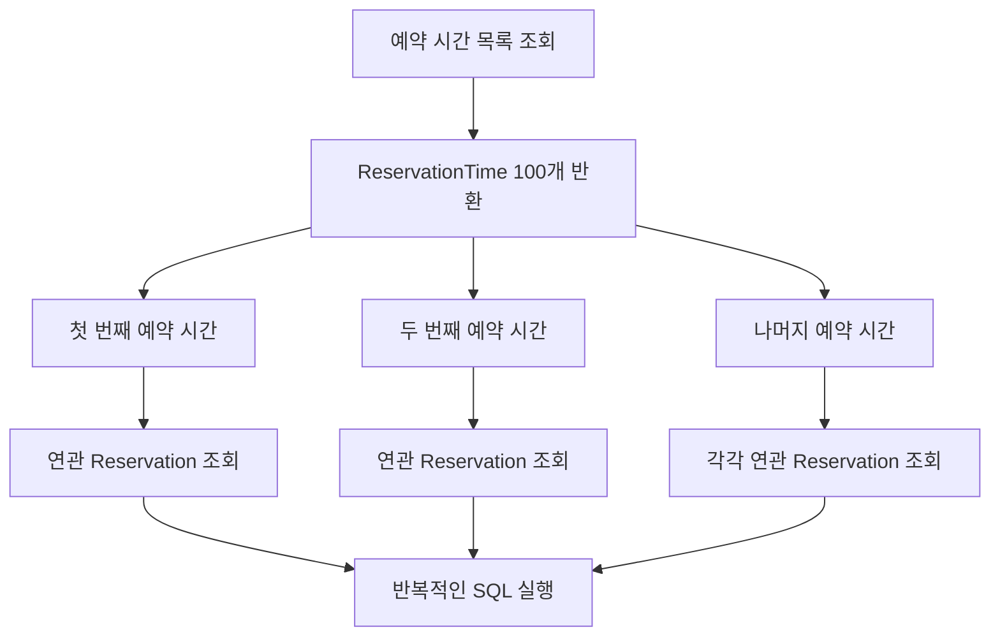
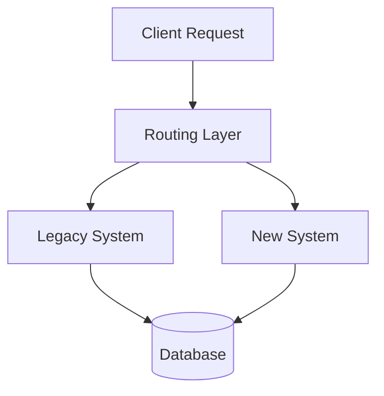
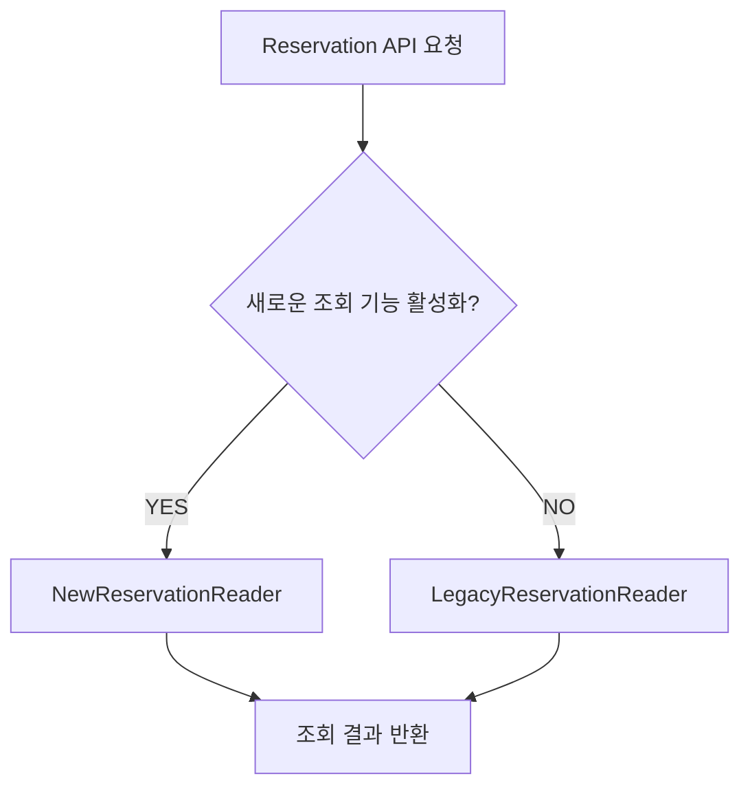
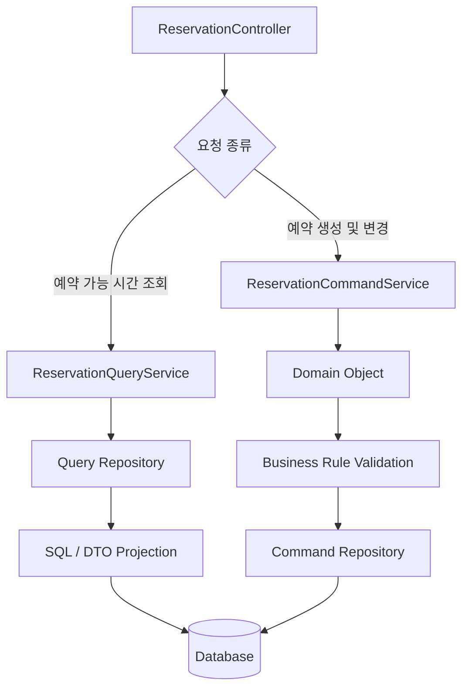

# 밍트의 Spring Framework에서 OOP 실천하기
[https://youtu.be/w-g3rTctwdw?si=4IBwShldR2AY_YPs](https://youtu.be/w-g3rTctwdw?si=4IBwShldR2AY_YPs)

# 밍트의 Spring Framework에서 OOP 실천하기
* toc
{:toc}

---

## 객체지향 설계는 현실에서도 정답일까? 성능과 유지보수 사이에서 균형 잡기

백엔드 개발을 하다 보면 객체지향적으로 설계하는 것이 항상 최선인지 고민하게 되는 순간이 있다.

객체에 책임을 부여하고, 데이터를 외부에 노출하지 않으며, 객체 스스로 자신의 상태를 관리하도록 설계한다. 이론적으로는 좋은 구조처럼 보인다.

하지만 실제 서비스를 개발하다 보면 예상하지 못한 문제가 발생한다.

대표적인 것이 데이터베이스 성능이다.

예를 들어 예약 시스템에서 사용자가 예약 가능한 시간을 조회하는 기능을 개발한다고 가정해 보자.

요구사항은 간단하다.

**사용자가 특정 날짜를 선택하면 예약 가능한 시간 목록을 보여준다.**

객체지향적으로 생각하면 예약 시간 객체가 자신이 예약 가능한 상태인지 판단하도록 만들 수 있다.

```java
public class ReservationTime {

    private final int capacity;
    private final List<Reservation> reservations;

    public boolean isAvailable() {
        long reservedCount = reservations.stream()
                .filter(Reservation::isConfirmed)
                .count();

        return reservedCount < capacity;
    }
}
```

사용하는 쪽에서도 코드가 직관적이다.

```java
List<ReservationTime> availableTimes =
        reservationTimes.stream()
                .filter(ReservationTime::isAvailable)
                .toList();
```

예약 가능 여부를 판단하는 책임이 `ReservationTime`에 있으므로 Service에서 세부 규칙을 알 필요가 없다.

그런데 이 코드를 JPA와 함께 사용하면 어떨까?

`reservations`가 지연 로딩으로 설정되어 있고, 예약 시간마다 연관된 예약을 조회해야 한다면 반복적인 SQL이 실행될 수 있다.

예약 시간 100개를 조회했는데 SQL은 101번 실행되는 상황이 발생하는 것이다.

이런 문제를 만나면 자연스럽게 고민하게 된다.

객체지향적으로 작성한 코드가 성능을 저하시킨다면, 성능을 위해 객체지향을 포기해야 할까?

반대로 성능을 위해 모든 비즈니스 규칙을 SQL에 작성한다면 유지보수하기 좋은 구조라고 할 수 있을까?

이 문제의 핵심은 객체지향과 데이터베이스 중심 개발 중 무엇이 더 우수한지 선택하는 데 있지 않다.

**어떤 책임을 객체가 가져야 하고, 어떤 작업을 데이터베이스가 수행하는 것이 적절한지 구분하는 것**이 중요하다.

---

## 객체지향 설계란 무엇인가?

객체지향 프로그래밍(Object-Oriented Programming)은 시스템을 객체들의 협력으로 구성하는 프로그래밍 방식이다.

객체는 자신의 상태와 행동을 가지며, 다른 객체와 메시지를 주고받으며 필요한 기능을 수행한다.

일반적으로 객체지향의 주요 특징을 다음과 같이 설명한다.

| 특징  | 설명                            |
| --- | ----------------------------- |
| 캡슐화 | 상태와 행동을 객체 내부에 묶고 불필요한 구현을 숨김 |
| 추상화 | 중요한 개념과 책임을 중심으로 모델링          |
| 다형성 | 동일한 인터페이스를 통해 서로 다른 구현을 사용    |
| 상속  | 기존 타입의 특성과 행동을 확장하거나 재사용      |

하지만 실무에서 중요한 것은 이러한 특징을 단순히 사용하는 것이 아니다.

**객체에 어떤 책임을 부여할 것인가?**

이 질문이 더 중요하다.

예를 들어 예약 취소 기능을 생각해 보자.

예약은 다음 상태를 가질 수 있다.

```java
public enum ReservationStatus {
    PENDING,
    CONFIRMED,
    CANCELLED
}
```

그리고 확정된 예약만 취소할 수 있다는 규칙이 있다고 가정하자.

이를 Service에서 구현할 수도 있다.

```java
@Transactional
public void cancel(Long reservationId) {
    Reservation reservation = reservationRepository.findById(reservationId)
            .orElseThrow(ReservationNotFoundException::new);

    if (reservation.getStatus() != ReservationStatus.CONFIRMED) {
        throw new IllegalStateException(
                "확정된 예약만 취소할 수 있습니다."
        );
    }

    reservation.setStatus(ReservationStatus.CANCELLED);
}
```

이 코드는 정상적으로 동작한다.

하지만 예약 취소에 관한 비즈니스 규칙이 Service에 존재한다.

다른 기능에서도 예약을 취소해야 한다면 동일한 검증 로직을 다시 작성할 가능성이 있다.

이제 책임을 객체로 이동해 보자.

```java
@Entity
public class Reservation {

    @Enumerated(EnumType.STRING)
    private ReservationStatus status;

    public void cancel() {
        if (status != ReservationStatus.CONFIRMED) {
            throw new IllegalStateException(
                    "확정된 예약만 취소할 수 있습니다."
            );
        }

        status = ReservationStatus.CANCELLED;
    }
}
```

Service는 다음과 같이 단순해진다.

```java
@Transactional
public void cancel(Long reservationId) {
    Reservation reservation = reservationRepository.findById(reservationId)
            .orElseThrow(ReservationNotFoundException::new);

    reservation.cancel();
}
```

이제 `Reservation` 객체가 자신의 상태를 변경하는 규칙을 관리한다.

Service는 예약 취소라는 작업을 조율한다.

이러한 구조는 상태 변경 규칙이 여러 곳에 흩어지는 것을 줄여준다.

---

## 객체지향의 목적은 클래스를 많이 만드는 것이 아니다

객체지향적으로 설계한다는 이유로 기능마다 인터페이스와 클래스를 추가하는 경우가 있다.

예를 들어 예약 가능 여부를 판단하는 단순한 규칙 하나를 구현하기 위해 다음과 같은 구조를 만들었다고 하자.

```text
ReservationAvailabilityInterface
    ↓
DefaultReservationAvailabilityService
    ↓
ReservationAvailabilityStrategy
    ↓
ReservationAvailabilityPolicy
    ↓
ReservationAvailabilityValidator
```

물론 실제 요구사항에 따라 여러 객체가 필요할 수도 있다.

하지만 복잡성이 크지 않은 문제를 해결하기 위해 지나치게 많은 추상화를 도입하면 오히려 코드의 흐름을 이해하기 어려워진다.

객체지향의 목적은 추상화 자체가 아니다.

**변경이 발생했을 때 영향을 받는 범위를 줄이고, 비즈니스 규칙을 이해하기 쉬운 위치에 배치하는 것**이다.

따라서 모든 로직을 객체로 분리해야 좋은 설계가 되는 것은 아니다.

단순한 데이터 조회라면 오히려 SQL과 DTO만으로 충분할 수 있다.

이 차이를 이해하려면 먼저 데이터베이스 조회 과정에서 발생하는 문제를 살펴봐야 한다.

---

## 객체지향 설계와 데이터베이스 성능이 충돌하는 이유

객체지향 프로그래밍은 객체 사이의 관계와 협력을 중심으로 생각한다.

반면 관계형 데이터베이스는 테이블과 행, 관계, 집합 연산을 중심으로 데이터를 처리한다.

두 모델은 데이터를 바라보는 관점이 다르다.

객체에서는 다음과 같이 관계를 탐색할 수 있다.

```java
reservationTime.getReservations();
```

하지만 데이터베이스에서는 해당 관계를 조회하기 위해 SQL이 필요할 수 있다.

```sql
SELECT *
FROM reservation
WHERE reservation_time_id = ?;
```

개발자가 객체의 메서드를 호출하는 순간 실제로는 네트워크를 통한 데이터베이스 접근이 발생할 수 있다.

이 차이를 이해하지 못하면 객체지향적으로 작성한 코드가 예상보다 많은 SQL을 실행하는 상황을 만나게 된다.

---

## 예약 가능 시간 조회 기능을 구현해 보자

다음과 같은 예약 시스템이 있다고 가정하겠다.

하루에 여러 예약 시간이 존재한다.

각 예약 시간에는 정해진 수용 인원이 있다.

해당 시간에 확정된 예약 수가 수용 인원보다 적다면 추가 예약이 가능하다.

예를 들어 다음과 같다.

| 예약 시간 | 수용 인원 | 확정 예약 수 | 예약 가능 여부 |
| ----- | ----: | ------: | -------- |
| 10:00 |     4 |       2 | 가능       |
| 11:00 |     4 |       4 | 불가능      |
| 13:00 |     6 |       3 | 가능       |
| 14:00 |     6 |       6 | 불가능      |

이 기능을 객체 중심으로 구현하면 다음과 같이 작성할 수 있다.

```java
@Entity
public class ReservationTime {

    @Id
    @GeneratedValue(strategy = GenerationType.IDENTITY)
    private Long id;

    private LocalTime startAt;

    private int capacity;

    @OneToMany(mappedBy = "reservationTime", fetch = FetchType.LAZY)
    private List<Reservation> reservations = new ArrayList<>();

    public boolean isAvailable() {
        long confirmedCount = reservations.stream()
                .filter(Reservation::isConfirmed)
                .count();

        return confirmedCount < capacity;
    }
}
```

Service에서는 모든 예약 시간을 조회한 뒤 객체의 메서드를 호출한다.

```java
@Transactional(readOnly = true)
public List<ReservationTimeResponse> findAvailableTimes() {
    return reservationTimeRepository.findAll().stream()
            .filter(ReservationTime::isAvailable)
            .map(ReservationTimeResponse::from)
            .toList();
}
```

코드 자체는 이해하기 쉽다.

예약 가능 여부에 관한 규칙이 `ReservationTime` 내부에 있기 때문이다.

하지만 데이터베이스 접근 관점에서는 문제가 발생할 수 있다.

---

## N+1 문제가 발생하는 이유

`ReservationTime`과 `Reservation`이 일대다 관계라고 가정하자.

먼저 예약 시간 목록을 조회한다.

```sql
SELECT *
FROM reservation_time;
```

이때 예약 시간 100개가 조회되었다고 하자.

이후 각각의 예약 시간에 대해 다음 메서드를 호출한다.

```java
reservationTime.isAvailable();
```

해당 메서드 내부에서는 연관된 예약 목록에 접근한다.

```java
reservations.stream()
```

만약 예약 목록이 아직 로딩되지 않았다면 Hibernate가 추가 SQL을 실행할 수 있다.

```sql
SELECT *
FROM reservation
WHERE reservation_time_id = 1;
```

다음 예약 시간에서도 실행된다.

```sql
SELECT *
FROM reservation
WHERE reservation_time_id = 2;
```

이 과정이 반복된다.

전체 구조는 다음과 같다.



결과적으로 다음과 같은 상황이 발생할 수 있다.

**예약 시간 조회 SQL 1번 + 예약 목록 조회 SQL 100번 = 총 101번.**

이것이 대표적인 N+1 문제다.

Hibernate는 연관 데이터를 조회하는 전략으로 SELECT, JOIN, BATCH, SUBSELECT 등을 제공하며, 조회 전략에 따라 N+1 문제가 발생할 수 있다.

---

## N+1 문제는 객체지향의 단점일까?

여기서 중요한 질문이 있다.

N+1 문제가 발생했으니 객체지향 설계가 잘못된 것일까?

반드시 그렇지는 않다.

객체가 자신의 예약 가능 여부를 판단하도록 설계한 것 자체는 자연스러울 수 있다.

문제는 **조회에 필요한 데이터를 어떤 방식으로 가져오는지 고려하지 않았다는 점**이다.

객체지향과 데이터베이스 조회 전략은 구분해야 한다.

예를 들어 같은 객체지향 설계를 유지하면서도 Fetch Join이나 Batch Fetching을 적용할 수 있다.

또 조회에 필요한 데이터만 별도로 가져오는 DTO Projection을 사용할 수도 있다.

따라서 다음처럼 생각하는 것은 지나치게 단순한 결론이다.

> 객체지향적으로 설계했더니 느리다. 따라서 SQL 중심으로 바꿔야 한다.

더 정확한 질문은 다음과 같다.

**현재 API가 필요로 하는 데이터와 비즈니스 규칙에 가장 적합한 조회 방식은 무엇인가?**

이 질문으로 접근해야 불필요한 설계 변경을 줄일 수 있다.

---

## 데이터베이스 중심 개발이란 무엇인가?

데이터베이스 중심 개발은 데이터베이스의 테이블 구조와 SQL을 중심으로 데이터를 처리하는 방식을 말한다.

객체 사이의 관계를 탐색하면서 필요한 데이터를 가져오는 대신, 조회 목적에 맞는 SQL을 작성해 한 번에 필요한 결과를 얻는 방식이다.

앞서 살펴본 예약 가능 시간 조회를 SQL로 구현해 보자.

예약 시간과 확정된 예약을 집계해 예약 가능 여부를 계산할 수 있다.

```sql
SELECT
    rt.id,
    rt.start_at,
    rt.capacity,
    COUNT(r.id) AS reserved_count
FROM reservation_time rt
LEFT JOIN reservation r
    ON r.reservation_time_id = rt.id
    AND r.reservation_date = :reservationDate
    AND r.status = 'CONFIRMED'
WHERE rt.is_active = TRUE
GROUP BY
    rt.id,
    rt.start_at,
    rt.capacity
HAVING COUNT(r.id) < rt.capacity
ORDER BY rt.start_at;
```

이 SQL은 다음 작업을 수행한다.

먼저 활성화된 예약 시간을 조회한다.

각 예약 시간에 연결된 확정 예약을 집계한다.

예약 수가 수용 인원보다 적은 시간만 반환한다.

결과적으로 애플리케이션에서 모든 예약 객체를 가져와 순회하지 않아도 된다.

데이터베이스가 집합 연산을 통해 필요한 결과를 계산한다.

위 SQL은 예약 테이블에 예약 날짜와 상태가 존재한다는 가정에 따른 예시다. 실제 스키마에서는 예약 상태나 날짜를 관리하는 위치에 맞춰 변경해야 한다.

---

## SQL 중심 조회의 장점

데이터베이스는 대량의 데이터를 필터링하고 집계하는 데 최적화되어 있다.

따라서 단순한 집계와 조건 검색을 위해 모든 데이터를 Java 애플리케이션으로 가져올 필요는 없다.

예를 들어 예약 데이터가 10만 건이라고 가정하자.

객체 중심의 비효율적인 조회 방식에서는 다음 과정이 발생할 수 있다.

1. 예약 시간 목록을 조회한다.
2. 연관된 예약 데이터를 추가 조회한다.
3. 조회한 데이터를 Entity로 변환한다.
4. Java 메모리에서 예약 수를 계산한다.
5. 예약 가능한 시간만 추출한다.

반면 SQL 집계 방식에서는 필요한 조건을 데이터베이스에서 처리한다.

```text
Database

예약 상태 필터링
    ↓
예약 시간별 집계
    ↓
예약 가능 여부 계산
    ↓
필요한 결과 반환
```

이 방식은 데이터 전송량과 Entity 생성 비용을 줄이는 데 도움이 될 수 있다.

특히 대량의 데이터를 조회하거나 단순한 집계를 수행하는 API에서 효과적이다.

하지만 모든 SQL이 객체 중심 구현보다 빠르다는 의미는 아니다.

실제 성능은 데이터 분포, 인덱스, 실행 계획, 네트워크, 캐시, 조회 대상의 크기에 따라 달라진다.

---

## 객체지향 방식과 SQL 방식의 성능 비교

같은 예약 가능 시간 조회를 두 방식으로 구현했다고 가정하자.

특정 테스트 환경에서는 다음과 같은 결과가 나올 수 있다.

| 구현 방식               | 평균 실행 시간 |
| ------------------- | -------: |
| Entity를 조회해 객체에서 판단 |      6ms |
| SQL에서 조건을 계산해 조회    |      2ms |

해당 결과만 보면 SQL 방식의 실행 시간이 3분의 1 수준이다.

하지만 이 결과를 모든 상황에 적용해서는 안 된다.

여기서 확인할 부분이 있다.

첫 번째는 두 구현이 동일한 데이터를 반환하는지다.

두 번째는 SQL 실행 횟수가 얼마나 차이 나는지다.

세 번째는 Entity 생성과 DTO 변환 시간을 포함했는지다.

네 번째는 충분히 반복 측정했는지다.

다섯 번째는 데이터가 증가해도 비슷한 차이가 유지되는지다.

평균 6ms와 2ms라는 수치만으로 특정 방식이 항상 세 배 빠르다고 결론 내릴 수는 없다.

또한 객체 중심 방식에 Fetch 전략을 개선하면 결과가 달라질 수 있다.

따라서 성능 비교를 할 때는 구현 방식뿐 아니라 실제 병목 지점을 확인해야 한다.

---

## 데이터베이스 중심 개발에도 한계가 있다

SQL을 통해 조회 문제를 해결했다고 모든 고민이 끝나는 것은 아니다.

처음에는 예약 가능 여부가 단순한 규칙이었다.

> 확정된 예약 수가 수용 인원보다 적으면 예약할 수 있다.

그런데 요구사항이 추가되었다고 하자.

VIP 회원은 일반 회원보다 먼저 예약할 수 있다.

일반 회원은 예약 시작 3일 전부터 예약할 수 있다.

예약 마감 30분 전에는 예약할 수 없다.

특정 시간은 VIP 전용이다.

하루에 예약할 수 있는 횟수도 제한된다.

이런 요구사항이 추가되면 비즈니스 규칙이 복잡해진다.

SQL만으로 모든 조건을 처리하려 한다면 다음과 같은 문제가 생길 수 있다.

```sql
SELECT
    rt.id,
    rt.start_at
FROM reservation_time rt
WHERE rt.is_active = TRUE
  AND (
      rt.vip_only = FALSE
      OR :memberGrade = 'VIP'
  )
  AND (
      :memberGrade = 'VIP'
      OR rt.reservation_open_at <= :now
  )
  AND rt.reservation_close_at > :now;
```

여기에 일일 예약 횟수 제한과 할인 정책, 특정 회원 등급의 예외 규칙까지 추가된다면 SQL은 계속 복잡해질 수 있다.

조건이 많은 SQL 자체가 나쁜 것은 아니다.

문제는 **같은 비즈니스 규칙이 여러 SQL과 Service, Entity에 중복해서 존재하기 시작할 때**다.

예를 들어 예약 가능 시간 조회 SQL에서는 VIP 조건을 검사한다.

그런데 실제 예약 생성 Service에서는 VIP 조건을 검사하지 않는다고 하자.

그러면 사용자에게는 예약 불가능한 시간으로 표시되지만, 직접 API를 호출하면 예약이 생성되는 문제가 발생할 수 있다.

조회 성능보다 더 심각한 비즈니스 규칙의 불일치가 생긴 것이다.

---

## 그렇다면 객체지향과 SQL 중 하나를 선택해야 할까?

실무에서는 반드시 하나만 선택할 필요가 없다.

오히려 **조회에 필요한 데이터는 데이터베이스가 효율적으로 계산하고, 비즈니스 규칙은 객체가 명확하게 관리하도록 설계하는 방식**을 고려할 수 있다.

여기서 중요한 것은 읽기와 쓰기의 성격이 다르다는 점이다.

예약 가능 시간 목록을 조회하는 기능은 현재 상태를 사용자에게 보여주는 역할이다.

반면 실제 예약을 생성하는 기능은 시스템의 상태를 변경하는 역할이다.

두 기능의 책임과 성능 요구사항이 다르므로 내부 구현이 반드시 같을 필요는 없다.

---

## 조회와 상태 변경을 분리해서 생각해 보자

예약 조회 기능은 다음처럼 구성할 수 있다.

```text
Controller
    ↓
Query Service
    ↓
조회 전용 Repository
    ↓
DTO
```

반면 실제 예약 생성은 다음처럼 구성한다.

```text
Controller
    ↓
Command Service
    ↓
Domain Object
    ↓
Repository
```

조회는 필요한 데이터를 효율적으로 가져오는 데 집중한다.

상태 변경은 비즈니스 규칙과 데이터 일관성을 유지하는 데 집중한다.

이러한 접근은 CQRS(Command Query Responsibility Segregation)의 기본적인 사고방식과도 연결된다.

다만 조회 Service와 상태 변경 Service를 구분한다고 해서 반드시 별도의 데이터베이스나 메시지 브로커를 도입해야 하는 것은 아니다.

**하나의 Spring Boot 애플리케이션과 하나의 데이터베이스 안에서도 조회 모델과 상태 변경 모델을 구분할 수 있다.**

---

## 조회에는 DTO Projection을 활용할 수 있다

예를 들어 다음과 같은 응답 DTO를 정의하자.

```java
public record ReservationTimeResponse(
        Long id,
        LocalTime startAt,
        int capacity,
        long reservedCount
) {
}
```

이 DTO는 예약 시간 조회에 필요한 데이터만 가지고 있다.

실제 비즈니스 로직을 수행하는 Entity가 아니다.

조회 결과를 표현하는 데 집중한다.

Spring Data JPA는 이러한 목적을 위해 Interface 기반 Projection과 DTO 기반 Projection을 지원한다. 필요한 속성만 선택적으로 조회하는 데 활용할 수 있다.

예를 들어 JPQL의 생성자 표현식을 사용할 수 있다.

```java
public interface ReservationTimeQueryRepository
        extends Repository<ReservationTime, Long> {

    @Query("""
        SELECT new com.example.reservation.dto.ReservationTimeResponse(
            rt.id,
            rt.startAt,
            rt.capacity,
            COUNT(r.id)
        )
        FROM ReservationTime rt
        LEFT JOIN rt.reservations r
            ON r.status = :status
            AND r.reservationDate = :date
        WHERE rt.active = true
        GROUP BY
            rt.id,
            rt.startAt,
            rt.capacity
        HAVING COUNT(r.id) < rt.capacity
        ORDER BY rt.startAt
        """)
    List<ReservationTimeResponse> findAvailableTimes(
            @Param("date") LocalDate date,
            @Param("status") ReservationStatus status
    );
}
```

위 예제는 JPQL을 활용한 구조를 보여주기 위한 코드다.

실제 프로젝트에서는 Entity의 필드명과 연관관계, Hibernate/JPA 버전의 JPQL 지원 범위에 맞춰 작성해야 한다.

이 방식에서는 전체 예약 Entity를 메모리에 올리지 않고도 조회 결과를 DTO로 받을 수 있다.

그리고 예약 조회를 수행하는 Service는 단순해진다.

```java
@Service
@RequiredArgsConstructor
public class ReservationTimeQueryService {

    private final ReservationTimeQueryRepository queryRepository;

    @Transactional(readOnly = true)
    public List<ReservationTimeResponse> findAvailableTimes(
            LocalDate date
    ) {
        return queryRepository.findAvailableTimes(
                date,
                ReservationStatus.CONFIRMED
        );
    }
}
```

조회 API에서는 불필요한 Entity 그래프를 생성하지 않는다.

하지만 실제 예약 생성에서는 별도의 비즈니스 규칙을 검증한다.

---

## 상태 변경에는 객체지향 설계를 유지하자

예약 생성에서는 단순 조회보다 더 중요한 문제가 존재한다.

예약 가능 여부를 판단하고 실제로 예약을 생성하는 작업 사이에 다른 요청이 들어올 수 있기 때문이다.

예를 들어 수용 인원이 4명이고 이미 3명이 예약했다고 하자.

두 사용자가 동시에 예약을 요청한다.

```text
현재 예약 수: 3명

수용 인원: 4명
```

사용자 A가 예약 가능 여부를 확인한다.

```text
3 < 4

예약 가능
```

사용자 B도 동시에 확인한다.

```text
3 < 4

예약 가능
```

두 요청이 모두 예약을 생성하면 어떻게 될까?

```text
최종 예약 수: 5명

수용 인원: 4명
```

정원을 초과하게 된다.

이 문제는 객체지향적으로 구현하느냐 SQL로 구현하느냐와 별개다.

**동시성 환경에서 비즈니스 불변식을 어떻게 보장할 것인가의 문제**다.

따라서 실제 예약 생성에서는 트랜잭션과 적절한 동시성 제어가 필요하다.

예를 들어 특정 예약 시간에 대해 비관적 락을 적용하거나, 정원 카운터를 조건부 UPDATE하는 방식을 고려할 수 있다.

중요한 것은 조회 API가 예약 가능하다고 표시한 결과를 실제 예약 성공의 보장으로 사용해서는 안 된다는 점이다.

조회는 사용자에게 현재 상태를 보여줄 뿐이다.

실제 예약 가능 여부는 **상태 변경 트랜잭션 안에서 다시 검증해야 한다.**

---

## 객체지향과 데이터베이스 성능을 함께 고려하는 방법

실무에서는 다음과 같이 역할을 구분하는 것이 유용하다.

| 상황         | 우선 고려할 접근                               |
| ---------- | --------------------------------------- |
| 단순 목록 조회   | DTO Projection                          |
| 대량 집계      | SQL의 GROUP BY, 집계 함수                    |
| 연관 객체 조회   | Fetch Join, EntityGraph, Batch Fetching |
| 복잡한 상태 변경  | Domain Object 중심                        |
| 비즈니스 규칙 검증 | Domain Service 또는 Entity                |
| 동시성 제어     | Transaction, Lock, 조건부 UPDATE           |
| 복잡한 검색     | SQL, QueryDSL 등                         |
| 외부 시스템 연동  | Application Service와 별도 Client          |

이 표는 절대적인 규칙이 아니다.

예를 들어 복잡한 집계도 도메인 개념에 해당할 수 있고, 일부 비즈니스 규칙은 데이터베이스의 제약조건으로 표현하는 것이 더 안전할 수 있다.

핵심은 특정 계층에 모든 책임을 몰아넣지 않는 것이다.

---

## 레거시 코드는 왜 객체지향적으로 개선하기 어려울까?

이제 성능 문제에서 조금 벗어나 기존 코드를 개선하는 상황을 생각해 보자.

오래된 시스템에는 다음과 같은 코드가 존재할 수 있다.

```java
public class Reservation {

    private Long id;
    private ReservationStatus status;

    public Long getId() {
        return id;
    }

    public ReservationStatus getStatus() {
        return status;
    }

    public void setStatus(ReservationStatus status) {
        this.status = status;
    }
}
```

`Reservation` 객체는 데이터를 보관하는 역할만 수행한다.

예약 취소나 상태 변경에 관한 비즈니스 규칙은 모두 Service에 존재한다.

```java
@Transactional
public void cancelReservation(Long reservationId) {

    Reservation reservation = repository.findById(reservationId)
            .orElseThrow();

    if (reservation.getStatus() != ReservationStatus.CONFIRMED) {
        throw new IllegalStateException(
                "예약을 취소할 수 없습니다."
        );
    }

    reservation.setStatus(ReservationStatus.CANCELLED);
}
```

이런 구조에서는 객체가 자신의 상태를 관리하지 않는다.

Service가 객체의 상태를 조회하고 변경한다.

이를 흔히 Anemic Domain Model, 즉 빈약한 도메인 모델과 연결해 설명하기도 한다.

하지만 여기서 주의할 점이 있다.

**데이터만 가진 객체가 존재한다는 사실 자체가 잘못된 설계를 의미하지는 않는다.**

DTO처럼 데이터를 전달하는 것이 목적인 객체라면 행동이 거의 없어도 자연스럽다.

문제가 되는 것은 비즈니스 규칙을 관리해야 하는 도메인 객체가 단순한 데이터 컨테이너로만 사용되고, 중요한 규칙이 여러 Service에 흩어지는 상황이다.

---

## 레거시 코드를 한 번에 바꾸면 안 될까?

다음과 같은 상황을 생각해 보자.

예약 관련 기능이 여러 곳에서 사용되고 있다.

```text
예약 생성
예약 조회
예약 변경
예약 취소
예약 통계
예약 정산
관리자 예약 관리
```

그리고 이 기능들이 모두 기존 `Reservation` 객체와 Service에 의존하고 있다.

이 상태에서 객체지향 설계를 적용하기 위해 전체 코드를 한 번에 변경한다면 어떨까?

변경 범위가 크게 증가한다.

```text
Reservation Entity 변경
    ↓
Service 변경
    ↓
Repository 변경
    ↓
Controller 변경
    ↓
Test 변경
    ↓
운영 영향 확인
```

일부 기능을 누락하거나 기존 동작을 변경할 위험이 커진다.

특히 운영 중인 시스템에서는 현재 코드가 어떤 의도로 작성되었는지 명확하지 않은 경우도 많다.

코드상으로는 불필요해 보이는 조건이 실제로는 과거 장애를 방지하기 위해 추가된 규칙일 수도 있다.

따라서 레거시를 개선할 때는 구조를 바꾸는 것만큼 **기존 동작을 보존하는 것**이 중요하다.

---

## 레거시 전환 전략: 점진적인 리팩터링

레거시를 개선하는 현실적인 방법 중 하나는 한 번에 전체 구조를 변경하지 않는 것이다.

작은 영역부터 책임을 이동하고 테스트로 동작을 검증한다.

예를 들어 앞서 살펴본 `Reservation` 객체를 다시 보자.

```java
public class Reservation {

    private Long id;
    private ReservationStatus status;

    public ReservationStatus getStatus() {
        return status;
    }

    public void setStatus(ReservationStatus status) {
        this.status = status;
    }
}
```

기존 Service는 `setStatus()`를 이용한다.

이 상태에서 모든 호출부를 한 번에 변경하기보다 새로운 행동 메서드를 추가할 수 있다.

```java
public class Reservation {

    private Long id;
    private ReservationStatus status;

    public ReservationStatus getStatus() {
        return status;
    }

    public void setStatus(ReservationStatus status) {
        this.status = status;
    }

    public void cancel() {
        if (status != ReservationStatus.CONFIRMED) {
            throw new IllegalStateException(
                    "확정된 예약만 취소할 수 있습니다."
            );
        }

        status = ReservationStatus.CANCELLED;
    }
}
```

이제 새롭게 변경하는 Service부터 `cancel()`을 사용한다.

```java
@Transactional
public void cancelReservation(Long reservationId) {

    Reservation reservation = repository.findById(reservationId)
            .orElseThrow();

    reservation.cancel();
}
```

기존 동작을 유지하면서 새로운 책임 배치를 도입한 것이다.

이런 방식은 한 번에 변경하는 범위를 줄이는 데 도움이 된다.

다만 기존 `setStatus()`가 계속 공개되어 있다면 다른 코드가 `cancel()`을 거치지 않고 상태를 변경할 수 있다.

따라서 이 방법은 최종 구조라기보다 **점진적인 전환 과정**으로 이해하는 것이 좋다.

호출부를 충분히 전환하고 나면 상태 변경 경로를 정리해야 한다.

---

## Strangler Fig 패턴이란 무엇인가?

레거시 시스템을 점진적으로 교체하는 대표적인 접근 중 하나가 Strangler Fig 패턴이다.

Strangler Fig는 기존 시스템을 한 번에 제거하는 대신, 새로운 시스템이나 구현을 주변에 만들고 기능을 조금씩 이전하는 방식이다.

처음에는 기존 시스템이 대부분의 요청을 처리한다.

이후 새로운 구현이 일부 기능을 담당한다.

시간이 지나면서 새로운 구현이 처리하는 범위를 늘린다.

마지막에는 기존 시스템을 제거할 수 있다.



이 패턴의 핵심은 **기존 시스템과 새로운 시스템을 일정 기간 공존시키면서 기능을 단계적으로 이전한다는 것**이다.

Martin Fowler가 설명한 Strangler Fig 접근 역시 대규모 재작성을 한 번에 완료하는 대신, 작은 기능을 점진적으로 교체해 위험을 줄이는 데 초점을 맞춘다.

### 기존 클래스에 메서드를 추가하는 것도 Strangler Fig일까?

앞서 `Reservation`에 `cancel()` 메서드를 추가한 사례는 점진적인 리팩터링이다.

하지만 그것만으로 Strangler Fig 패턴을 적용했다고 보기는 어렵다.

Strangler Fig는 일반적으로 **기존 구현과 새로운 구현의 경계를 만들고, 호출 경로를 단계적으로 새로운 구현으로 이동시키는 접근**에 가깝다.

반면 기존 Entity에 행동 메서드를 추가하는 것은 클래스 내부의 책임을 개선하는 리팩터링이다.

두 방법 모두 점진적인 개선이라는 공통점이 있지만 적용 범위는 다르다.

| 구분        | 점진적 리팩터링               | Strangler Fig           |
| --------- | ---------------------- | ----------------------- |
| 주요 목적     | 기존 코드 내부 구조 개선         | 기존 구현을 새로운 구현으로 단계적 대체  |
| 변경 범위     | 클래스, 메서드, 모듈           | 모듈 또는 시스템 경계까지 확장 가능    |
| 기존 구현과 공존 | 가능                     | 핵심적인 특징                 |
| 라우팅 전환    | 일반적으로 불필요              | 자주 사용                   |
| 적용 사례     | Service 로직을 Entity로 이동 | 기존 예약 서비스를 새 예약 서비스로 교체 |

실무에서는 두 접근을 함께 사용할 수도 있다.

---

## Strangler Fig를 예약 시스템에 적용해 보자

기존 예약 조회 시스템이 있다고 하자.

```text
ReservationController
    ↓
LegacyReservationService
    ↓
LegacyReservationRepository
```

그런데 기존 구현은 성능 문제가 있고, 예약 정책도 Service에 복잡하게 얽혀 있다.

이때 기존 시스템을 즉시 제거하지 않고 새로운 조회 서비스를 개발한다.

```text
ReservationController
    ↓
ReservationQueryFacade
    ├── LegacyReservationReader
    └── NewReservationReader
```

두 구현은 공통 인터페이스를 사용할 수 있다.

```java
public interface ReservationAvailabilityReader {

    List<ReservationTimeResponse> findAvailableTimes(
            LocalDate date
    );
}
```

기존 구현은 그대로 유지한다.

```java
@Component
@RequiredArgsConstructor
public class LegacyReservationReader
        implements ReservationAvailabilityReader {

    private final ReservationTimeRepository repository;

    @Override
    public List<ReservationTimeResponse> findAvailableTimes(
            LocalDate date
    ) {
        // 기존 조회 방식
        return List.of();
    }
}
```

새로운 구현에서는 최적화된 Query를 사용할 수 있다.

```java
@Component
@RequiredArgsConstructor
public class NewReservationReader
        implements ReservationAvailabilityReader {

    private final ReservationTimeQueryRepository repository;

    @Override
    public List<ReservationTimeResponse> findAvailableTimes(
            LocalDate date
    ) {
        return repository.findAvailableTimes(
                date,
                ReservationStatus.CONFIRMED
        );
    }
}
```

이제 두 구현 중 어떤 것을 사용할지 결정하는 계층을 추가할 수 있다.

여기에서 Feature Toggle을 활용할 수 있다.

---

## Feature Toggle이란 무엇인가?

Feature Toggle 또는 Feature Flag는 특정 기능의 활성화 여부를 설정으로 제어하는 방식이다.

예를 들어 다음과 같은 상황을 생각해 보자.

예약 조회 API를 새롭게 구현했다.

기존 방식보다 성능이 좋은 것으로 보인다.

하지만 모든 사용자를 대상으로 즉시 적용하기에는 위험하다.

새로운 구현에서 예상하지 못한 문제가 발생할 수도 있기 때문이다.

이때 Feature Toggle을 사용하면 요청을 기존 구현 또는 새로운 구현으로 전달할 수 있다.



Spring Boot 코드에서는 다음과 같은 구조를 만들 수 있다.

```java
@Service
public class ReservationQueryFacade {

    private final LegacyReservationReader legacyReader;
    private final NewReservationReader newReader;
    private final FeatureFlagService featureFlagService;

    public ReservationQueryFacade(
            LegacyReservationReader legacyReader,
            NewReservationReader newReader,
            FeatureFlagService featureFlagService
    ) {
        this.legacyReader = legacyReader;
        this.newReader = newReader;
        this.featureFlagService = featureFlagService;
    }

    public List<ReservationTimeResponse> findAvailableTimes(
            LocalDate date
    ) {
        boolean enabled =
                featureFlagService.isEnabled(
                        "new-reservation-query"
                );

        if (enabled) {
            return newReader.findAvailableTimes(date);
        }

        return legacyReader.findAvailableTimes(date);
    }
}
```

`FeatureFlagService`는 기능 활성화 여부를 제공하는 추상화다.

Redis, 데이터베이스, 전용 Feature Flag 서비스 등으로 구현할 수 있다.

이제 새로운 기능에 문제가 발생하면 플래그를 비활성화해 기존 구현으로 요청을 돌릴 수 있다.

다만 애플리케이션 시작 시에만 읽는 정적 설정값이라면 변경 후 재시작이 필요할 수 있다.

배포 없이 기능을 전환하려면 실행 중 설정을 변경할 수 있는 구조가 필요하다.

Feature Toggle은 운영 기능 전환, 단계적 배포, 실험 등 다양한 목적으로 사용할 수 있으며, 목적에 따라 관리 방식도 달라진다.

---

## Feature Toggle을 사용하면 안전한 롤백이 보장될까?

여기서는 중요한 점을 구분해야 한다.

Feature Toggle로 새로운 구현을 비활성화하는 것과 이미 변경된 데이터를 원래대로 되돌리는 것은 다르다.

예를 들어 조회 기능만 변경했다면 비교적 쉽게 기존 방식으로 돌아갈 수 있다.

```text
New Query
    ↓
문제 발생
    ↓
Feature Flag OFF
    ↓
Legacy Query
```

하지만 새로운 결제 기능이 실제로 결제 데이터를 변경했다고 하자.

기능을 비활성화하더라도 이미 처리된 결제나 정산 데이터가 자동으로 복구되지는 않는다.

```text
New Payment Logic
    ↓
결제 처리 완료
    ↓
Feature Flag OFF
    ↓
이미 처리된 결제는 그대로 존재
```

따라서 Feature Toggle을 안전장치로 사용하려면 변경 범위를 함께 고려해야 한다.

특히 다음과 같은 작업은 주의해야 한다.

* 데이터베이스 Schema 변경
* 기존 데이터 Migration
* 외부 API를 통한 결제 처리
* 메시지 발행
* 파일 생성 및 삭제
* 데이터 형식 변경

이런 작업에서는 Feature Toggle만으로 완전한 롤백을 보장할 수 없다.

별도의 데이터 복구 전략이나 호환성 유지 방안이 필요하다.

---

## Feature Toggle과 함께 새로운 구현을 검증하는 방법

새로운 구현을 만들었다고 바로 전체 사용자를 전환할 필요는 없다.

특히 조회 기능이라면 기존 구현과 새로운 구현의 결과를 비교하는 방법을 사용할 수 있다.

예를 들어 다음과 같은 흐름이다.

```text
사용자 요청
    ↓
기존 구현 실행
    ↓
새로운 구현도 별도 실행
    ↓
결과 비교
    ↓
사용자에게는 기존 결과 반환
```

이 방식은 Shadow Read 또는 병렬 검증과 유사한 접근이다.

중요한 것은 새로운 구현의 결과를 사용자에게 바로 노출하지 않고 검증할 수 있다는 점이다.

예를 들어 예약 가능한 시간 목록을 비교한다.

```java
List<ReservationTimeResponse> legacyResult =
        legacyReader.findAvailableTimes(date);

List<ReservationTimeResponse> newResult =
        newReader.findAvailableTimes(date);
```

단순히 객체의 리스트 순서를 비교하는 것보다 비즈니스적으로 동일한 결과인지 확인해야 한다.

예를 들어 정렬 순서가 다르더라도 같은 예약 시간을 반환한다면 동등한 결과로 판단할 수 있는지 정책을 정해야 한다.

또 동일한 데이터 스냅샷을 조회하지 않았다면 두 조회 사이에 예약이 생성되어 결과가 달라질 수도 있다.

따라서 결과 비교 과정에서는 데이터 일관성과 비교 기준을 함께 고려해야 한다.

---

## 레거시를 개선할 때 가장 먼저 해야 할 일

객체지향적인 구조로 변경하기 전에 기존 코드가 어떤 동작을 하는지 확인해야 한다.

예를 들어 예약 취소 기능을 개선한다고 하자.

겉으로 보면 예약 상태를 `CANCELLED`로 변경하는 단순한 기능이다.

하지만 실제로는 다음 작업이 포함되어 있을 수 있다.

```text
예약 취소
    ↓
예약 상태 변경
    ↓
결제 취소
    ↓
사용한 쿠폰 복구
    ↓
포인트 반환
    ↓
알림 발송
```

이 중 하나라도 누락되면 기존 기능과 동작이 달라진다.

따라서 새로운 구조를 만들기 전에 기존 동작을 테스트로 고정하는 것이 좋다.

이를 Characterization Test라고 부르기도 한다.

목적은 현재 코드가 이상적인지 판단하는 것이 아니다.

**현재 시스템이 실제로 어떤 결과를 만드는지 확인하고, 리팩터링 과정에서 그 동작이 의도치 않게 변경되지 않도록 보호하는 것**이다.

예를 들어 다음과 같은 테스트를 작성할 수 있다.

```java
@Test
void confirmedReservationCanBeCancelled() {
    Reservation reservation = ReservationFixture.confirmed();

    reservation.cancel();

    assertThat(reservation.getStatus())
            .isEqualTo(ReservationStatus.CANCELLED);
}
```

또 실제 서비스에서는 결제 취소나 포인트 반환 같은 외부 동작까지 검증해야 할 수 있다.

---

## 객체지향 설계를 현실에 적용하는 12가지 방법

객체지향 원칙을 현실적인 시스템에 적용하려면 단순히 좋은 설계 원칙을 외우는 것보다 실제 의사결정 기준을 만드는 것이 중요하다.

### 1. 조회 성능 문제와 객체 설계 문제를 구분한다

JPA에서 SQL이 많이 실행된다고 무조건 Entity 설계가 잘못된 것은 아니다. 먼저 N+1, 불필요한 연관관계 탐색, Fetch 전략, 조회 범위를 확인해야 한다. 객체의 책임을 바꾸기 전에 조회 방식을 개선하는 것만으로 문제를 해결할 수 있다.

### 2. 단순 조회에는 DTO Projection을 적극적으로 고려한다

목록 화면에 필요한 데이터가 예약 시간과 남은 인원뿐이라면 전체 예약 Entity를 조회할 이유가 없다. 필요한 값만 조회해 DTO로 반환하면 불필요한 Entity 생성과 연관관계 로딩을 줄일 수 있다.

### 3. 비즈니스 규칙이 변경되는 위치를 명확하게 만든다

VIP 예약 정책이 여러 Service에 흩어져 있다면 요구사항 변경 시 수정할 곳이 많아진다. 규칙을 Domain Object나 Policy 객체에 집중시키면 변경 범위를 줄일 수 있다. 단, 모든 규칙을 하나의 거대한 Policy 클래스에 몰아넣지 않도록 주의해야 한다.

### 4. 조회 모델과 상태 변경 모델의 목적을 구분한다

조회 기능은 필요한 데이터를 효율적으로 반환하는 것이 중요하다. 반면 상태 변경 기능은 비즈니스 불변식과 데이터 일관성을 유지하는 것이 중요하다. 두 기능이 반드시 동일한 Entity 그래프를 사용할 필요는 없다.

### 5. SQL을 사용했다고 객체지향을 포기한 것은 아니다

Repository가 SQL을 사용해 데이터를 조회하는 것은 자연스러운 일이다. 객체지향의 핵심은 SQL을 사용하지 않는 것이 아니라 책임과 의존관계를 적절히 분리하는 것이다. SQL을 사용하는 Repository도 충분히 객체지향적인 시스템의 일부가 될 수 있다.

### 6. 복잡한 조회는 SQL에 맡기되 의미 있는 규칙은 중복하지 않는다

집계와 필터링은 데이터베이스에서 처리하는 편이 효율적일 수 있다. 다만 실제 예약 가능 여부를 결정하는 중요한 규칙이 여러 SQL과 Service에 중복된다면 일관성 문제가 발생한다. 조회 결과와 실제 상태 변경의 검증 책임을 명확히 구분해야 한다.

### 7. 성능 최적화는 측정한 뒤 수행한다

객체지향적인 코드가 느릴 것이라는 예상만으로 SQL을 다시 작성할 필요는 없다. SQL 실행 횟수, 실행 계획, DB 응답 시간, Entity 생성 비용을 측정한 뒤 병목을 찾아야 한다. 실제로 문제가 없는 곳을 최적화하면 복잡성만 증가할 수 있다.

### 8. 작은 영역부터 레거시를 개선한다

모든 Service를 한 번에 Domain 중심 구조로 변경하기보다 예약 취소처럼 책임이 분명한 기능부터 개선한다. 작은 변경을 반복하면 기존 기능을 유지하면서 구조를 점진적으로 정리할 수 있다.

### 9. 기존 코드와 새로운 코드를 비교할 수 있는 경계를 만든다

복잡한 레거시를 교체할 때는 기존 구현과 새로운 구현을 공통 인터페이스 뒤에 배치하는 방법을 고려할 수 있다. 이렇게 하면 두 구현을 비교하고 단계적으로 전환하기 쉬워진다.

### 10. Feature Toggle은 실행 경로를 전환하는 도구로 사용한다

새로운 조회나 대기 기능을 단계적으로 활성화할 때 Feature Toggle이 유용하다. 하지만 이미 변경된 데이터나 외부 시스템의 작업을 자동으로 복구하는 수단은 아니다. 기능 비활성화와 데이터 롤백을 구분해야 한다.

### 11. 리팩터링 전에 현재 동작을 테스트로 보호한다

레거시 코드의 일부 조건은 과거 장애나 특수한 비즈니스 요구사항 때문에 추가되었을 수 있다. 구조를 개선하기 전에 중요한 입력과 출력, 상태 변경 결과를 테스트로 기록하면 의도하지 않은 변경을 발견하기 쉽다.

### 12. 객체지향 원칙을 목표가 아니라 판단 기준으로 사용한다

모든 코드를 객체지향적으로 만드는 것이 목표가 되어서는 안 된다. 성능, 개발 일정, 운영 안정성, 팀의 이해도, 향후 변경 가능성을 함께 고려해야 한다. 객체지향은 이러한 판단을 돕는 설계 원칙이지 모든 문제에 적용되는 단일한 정답은 아니다.

---

## 어떤 상황에서 어떤 방식을 선택해야 할까?

실무에서 사용할 수 있는 판단 기준을 정리하면 다음과 같다.

| 판단 기준          | 객체 중심 접근           | 데이터베이스 중심 접근     |
| -------------- | ------------------ | ---------------- |
| 비즈니스 규칙이 복잡함   | 적합                 | SQL 복잡도 증가 가능    |
| 단순 목록 조회       | 가능                 | 적합               |
| 대량 데이터 집계      | 비효율적일 수 있음         | 적합               |
| 상태 변경 규칙이 많음   | 적합                 | 규칙 분산에 주의        |
| 화면별 조회 형태가 다양함 | DTO 변환 부담 가능       | Projection 활용 가능 |
| 규칙 변경이 잦음      | 책임 분리 시 유리         | 여러 SQL 수정 가능     |
| 데이터 일관성 보장     | Transaction과 함께 설계 | DB 제약조건과 함께 설계   |
| 레거시 개선         | 점진적 리팩터링           | 기존 조회 최적화에 활용    |

실제 선택은 이 표만으로 결정할 수 없다.

예를 들어 대량 데이터를 집계하면서도 복잡한 비즈니스 규칙을 적용해야 하는 경우가 있다.

이때는 데이터베이스에서 필요한 후보와 집계 정보를 효율적으로 가져온 뒤, 객체에서 비즈니스 규칙을 평가하는 혼합 구조를 사용할 수 있다.

중요한 것은 한 가지 방식만 고집하지 않는 것이다.

---

## 객체지향과 성능을 함께 고려한 아키텍처

예약 시스템을 예로 들어 전체 구조를 정리해 보자.



조회에서는 필요한 데이터를 효율적으로 가져오는 데 집중한다.

상태 변경에서는 비즈니스 규칙과 데이터 일관성을 유지하는 데 집중한다.

이러한 구조를 사용하면 객체지향의 장점과 관계형 데이터베이스의 장점을 함께 활용할 수 있다.

다만 주의할 점도 있다.

조회와 상태 변경 모델을 분리했다고 해서 같은 비즈니스 규칙을 서로 다르게 구현해도 된다는 뜻은 아니다.

예를 들어 조회에서는 예약 가능으로 판단했지만 실제 예약 생성에서는 거부될 수 있다. 이는 두 요청 사이에 예약 상태가 변경되었기 때문일 수도 있다.

따라서 조회 결과는 현재 시점의 안내 정보로 사용하고, 최종적인 상태 변경은 트랜잭션 내부에서 검증해야 한다.

---

## 실무에서의 활용: 예약 시스템을 단계적으로 개선한다면

이미 운영 중인 예약 시스템이 있다고 가정해 보자.

현재는 모든 예약 시간을 Entity로 조회하고 연관 예약을 탐색해 예약 가능 여부를 판단하고 있다.

이 구조에서 N+1 문제가 발생하고 있다면 다음 순서로 개선할 수 있다.

### 첫 번째 단계: 현재 동작과 성능을 측정한다

먼저 실제 API가 어떤 데이터를 반환하는지 확인한다.

SQL 실행 횟수도 측정한다.

예를 들어 다음과 같은 지표를 기록할 수 있다.

| 지표          | 현재 상태 |
| ----------- | ----- |
| 예약 시간 조회 건수 | 100건  |
| SQL 실행 횟수   | 101회  |
| 평균 응답 시간    | 측정 필요 |
| P95 응답 시간   | 측정 필요 |
| DB 전송 데이터량  | 측정 필요 |

여기서 중요한 것은 최적화 전의 기준값을 확보하는 것이다.

### 두 번째 단계: 기존 동작을 테스트로 보호한다

예약 가능한 시간과 불가능한 시간을 구분하는 테스트를 작성한다.

VIP 회원, 예약 마감 시간, 취소된 예약 등 주요 조건도 함께 검증한다.

이렇게 해야 조회 구현을 변경해도 결과가 동일한지 확인할 수 있다.

### 세 번째 단계: 조회 전용 Repository를 만든다

기존 Entity 중심 조회는 유지한 채 DTO Projection을 사용하는 새 Repository를 추가한다.

기존 구현을 바로 삭제하지 않는다.

### 네 번째 단계: 기존 결과와 새로운 결과를 비교한다

동일한 입력에서 두 구현이 같은 예약 가능 시간을 반환하는지 확인한다.

단, 비교 중 데이터가 변경될 수 있으므로 필요한 경우 동일한 테스트 데이터나 일관된 조회 환경에서 검증한다.

### 다섯 번째 단계: 성능을 다시 측정한다

SQL 실행 횟수와 응답 시간을 비교한다.

평균뿐 아니라 P95, P99와 데이터 규모 증가에 따른 변화도 확인한다.

### 여섯 번째 단계: Feature Toggle을 통해 점진적으로 전환한다

처음에는 내부 사용자만 새로운 구현을 사용하도록 할 수 있다.

이후 일부 사용자에게 적용한다.

오류율과 응답 시간을 확인하면서 적용 범위를 확대한다.

### 일곱 번째 단계: 기존 구현을 제거한다

새로운 구현이 안정적으로 동작한다면 더 이상 사용하지 않는 코드를 제거한다.

이 과정에서 Feature Toggle도 함께 정리하는 것이 좋다.

사용하지 않는 Feature Toggle을 오래 유지하면 조건 분기가 남아 코드의 복잡도가 증가한다.

이렇게 개선하면 성능 문제를 해결하면서도 기존 기능을 유지할 수 있다.

---

## 객체지향 설계와 성능 최적화는 서로 반대되는 개념이 아니다

객체지향 설계는 변경하기 좋은 구조를 만들기 위한 중요한 방법이다.

데이터베이스 최적화는 요청을 효율적으로 처리하기 위한 중요한 방법이다.

두 목표는 서로 다르지만 충돌해야만 하는 것은 아니다.

예를 들어 다음과 같은 구조를 생각해 보자.

```text
Controller
    ↓
Application Service
    ↓
Domain Policy
    ↓
Repository
    ↓
Database
```

이 구조에서 Repository가 최적화된 SQL을 사용한다고 해서 객체지향 설계가 무너지는 것은 아니다.

반대로 모든 조회를 Entity의 메서드로 처리한다고 해서 좋은 객체지향 설계가 완성되는 것도 아니다.

핵심은 다음과 같다.

**데이터베이스는 데이터를 효율적으로 처리하고, 객체는 비즈니스 개념과 규칙을 명확하게 표현하도록 책임을 나눈다.**

실제로는 두 영역의 책임이 일부 겹칠 수 있다.

예를 들어 예약 가능한 시간을 조회할 때 데이터베이스에서도 예약 수를 집계하고, 실제 예약을 생성할 때도 예약 가능 여부를 검증해야 한다.

이런 경우에는 조회가 제공하는 정보와 상태 변경에서 보장해야 하는 불변식을 구분하는 것이 중요하다.

조회는 사용자에게 현재 상태를 안내한다.

상태 변경은 비즈니스 규칙을 실제로 보장한다.

이 구분이 명확하다면 조회 성능을 위해 DTO Projection을 도입하더라도 핵심 도메인 규칙을 객체에 유지할 수 있다.

---

## 정리

객체지향 설계는 시스템을 객체들의 협력으로 구성하고, 각 객체에 적절한 책임을 부여하는 접근이다.

객체가 자신의 상태와 행동을 관리하도록 만들면 비즈니스 규칙을 명확하게 표현하고 변경 범위를 줄이는 데 도움이 된다.

하지만 실제 백엔드 시스템에서는 객체지향 설계만으로 모든 문제를 해결할 수 없다.

특히 관계형 데이터베이스를 사용하는 환경에서는 조회 성능을 함께 고려해야 한다.

객체의 연관관계를 자연스럽게 탐색하는 코드가 실제로는 반복적인 SQL을 발생시킬 수 있다.

대표적인 예가 JPA의 N+1 문제다.

```text
Entity 목록 조회
    ↓
연관 객체 접근
    ↓
추가 SQL 반복 실행
    ↓
조회 성능 저하
```

이런 문제를 해결하기 위해 SQL 중심 조회나 DTO Projection을 활용할 수 있다.

하지만 성능 최적화를 위해 모든 비즈니스 규칙을 SQL에 작성하는 것이 항상 좋은 선택은 아니다.

예약 정책이나 회원 등급별 조건처럼 변경이 잦고 복잡한 규칙이 여러 SQL에 분산되면 유지보수와 일관성 관리가 어려워질 수 있다.

따라서 조회와 상태 변경의 목적을 구분하는 것이 좋다.

```text
조회 기능

→ SQL과 DTO Projection을 통한 효율적인 데이터 조회


상태 변경 기능

→ 객체지향 설계와 트랜잭션을 통한 비즈니스 규칙 보장
```

레거시 시스템을 개선할 때도 같은 원칙이 적용된다.

기존 코드가 객체지향적으로 설계되지 않았다고 해서 모든 구조를 한 번에 변경할 필요는 없다.

작은 기능부터 책임을 이동하고 기존 동작을 테스트로 보호하면서 점진적으로 개선할 수 있다.

더 큰 범위의 시스템 교체가 필요하다면 Strangler Fig 패턴을 활용해 기존 구현과 새로운 구현을 일정 기간 공존시키면서 기능을 단계적으로 이전할 수 있다.

Feature Toggle은 이러한 전환 과정에서 새로운 구현을 점진적으로 활성화하거나 문제가 발생했을 때 기존 구현으로 실행 경로를 되돌리는 데 도움이 된다.

하지만 이미 변경된 데이터나 외부 시스템의 작업까지 자동으로 복구하는 것은 아니므로 별도의 복구 전략이 필요하다.

결국 객체지향 설계를 현실적으로 적용한다는 것은 원칙을 포기하는 것도, 모든 원칙을 무조건 지키는 것도 아니다.

**성능, 유지보수성, 운영 안정성, 변경 가능성이라는 현실적인 조건을 고려하면서 적절한 책임과 경계를 찾는 것**이다.

객체지향은 그 과정에서 방향을 잡아주는 중요한 설계 원칙이다.

하지만 최종적인 설계의 품질은 원칙을 얼마나 많이 적용했는지가 아니라, 실제 문제를 얼마나 단순하고 안전하게 해결하는지에 따라 판단해야 한다.

### 한 줄 요약

**객체지향 설계와 데이터베이스 성능은 양자택일의 문제가 아니다. 조회에는 SQL과 DTO Projection을 활용해 성능을 확보하고, 상태 변경에는 객체지향 설계를 통해 비즈니스 규칙을 명확하게 유지하며, 레거시 시스템은 테스트와 Feature Toggle을 활용해 점진적으로 개선하는 것이 현실적인 접근이다.**
