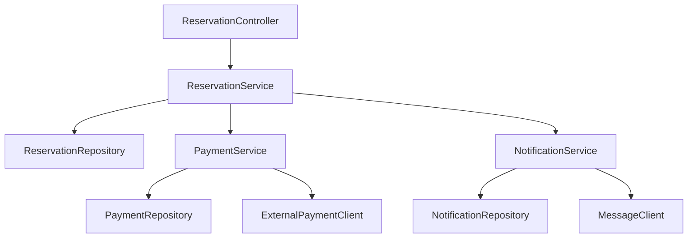
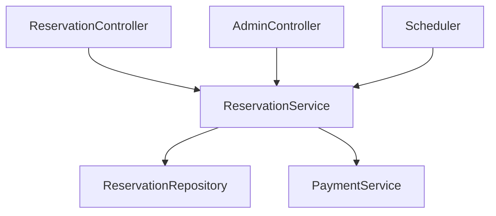
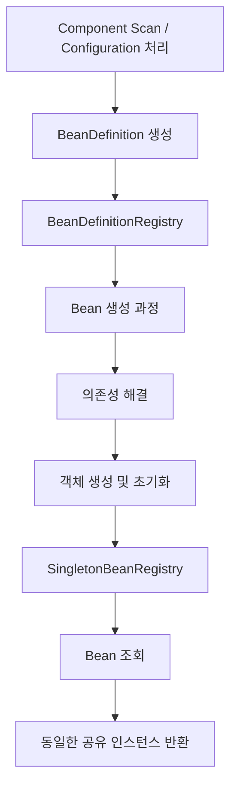
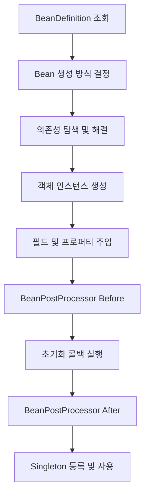
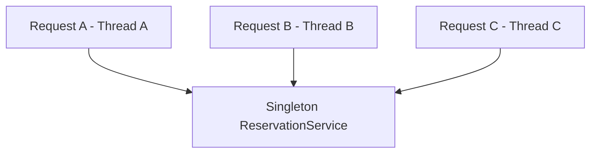
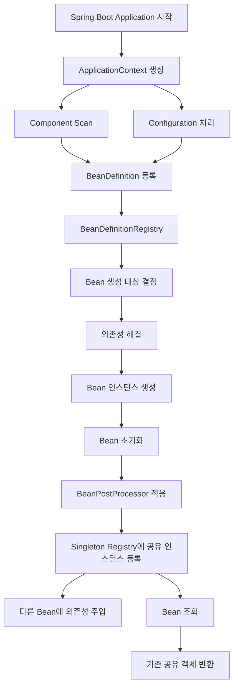

# 가콩의 Spring Bean은 왜
[https://youtu.be/JHuk4ouuvs4?si=h0yhYXyR_KitVKFP](https://youtu.be/JHuk4ouuvs4?si=h0yhYXyR_KitVKFP)

# 가콩의 Spring Bean은 왜
* toc
{:toc}

---

## Spring Bean은 왜 필요할까? DI와 Singleton의 필요성부터 Spring 컨테이너 내부 동작까지

Spring Boot로 애플리케이션을 개발하다 보면 `@Service`, `@Repository`, `@Controller` 같은 어노테이션을 자연스럽게 사용하게 된다.

```java
@Service
@RequiredArgsConstructor
public class ReservationService {

    private final ReservationRepository reservationRepository;
}
```

위 코드에서 `ReservationService` 객체를 직접 생성하는 코드는 보이지 않는다.

그런데 애플리케이션을 실행하면 Spring이 알아서 객체를 생성하고 `ReservationRepository`를 주입해 준다.

Controller에서도 마찬가지다.

```java
@RestController
@RequiredArgsConstructor
public class ReservationController {

    private final ReservationService reservationService;
}
```

`ReservationController`를 생성하는 코드도 없고, `ReservationService`를 직접 전달하는 코드도 없다.

그런데 모든 객체가 정상적으로 연결되어 동작한다.

처음에는 Spring이 제공하는 편리한 기능 중 하나라고 생각할 수 있다. 하지만 조금 더 깊이 생각해 보면 몇 가지 의문이 생긴다.

Spring을 사용하지 않더라도 개발자가 직접 객체를 생성하고 의존성을 주입할 수 있다. 그렇다면 굳이 Spring이 이 작업을 대신해야 할 이유가 있을까?

또 Spring은 기본적으로 Bean을 Singleton으로 관리한다. 왜 요청마다 새로운 객체를 생성하는 대신 하나의 객체를 여러 곳에서 공유하도록 설계했을까?

마지막으로 Java에는 이미 Singleton 패턴이 존재한다. Spring은 이 패턴을 그대로 사용하는 것일까?

이 질문들을 이해하면 Spring Bean이 단순한 객체 생성 자동화 기능이 아니라는 사실을 알 수 있다.

Spring Bean의 핵심은 **객체의 생성과 의존관계, 재사용 범위, 생명주기를 애플리케이션 코드에서 분리해 컨테이너가 관리하도록 만드는 것**이다.

## Spring Bean을 이해하기 전에 알아야 할 개념

Spring Bean은 Spring IoC Container가 생성하거나 등록받아 관리하는 객체다.

여기서 중요한 단어는 **관리**다.

일반적인 Java 객체는 개발자가 직접 생성할 수 있다.

```java
ReservationService service =
        new ReservationService(repository);
```

반면 Spring Bean은 Spring Container가 해당 객체의 생성과 의존관계, 초기화, Scope 등을 관리한다.

```java
@Service
public class ReservationService {

    private final ReservationRepository repository;

    public ReservationService(ReservationRepository repository) {
        this.repository = repository;
    }
}
```

두 코드는 같은 `ReservationService` 객체를 사용할 수 있지만 객체를 구성하는 책임의 위치가 다르다.

| 구분        | 일반 Java 객체 | Spring Bean           |
| --------- | ---------- | --------------------- |
| 객체 생성     | 개발자가 직접 수행 | 컨테이너가 생성하거나 등록받음      |
| 의존성 연결    | 개발자가 직접 연결 | 컨테이너가 주입 가능           |
| 생명주기      | 개발자가 관리    | 컨테이너가 관리              |
| 객체 재사용 범위 | 개발자가 결정    | Bean Scope로 관리        |
| AOP 적용    | 별도 구성 필요   | Spring 인프라 활용 가능      |
| 객체 조회     | 참조를 직접 관리  | BeanFactory를 통해 조회 가능 |

여기서 한 가지 구분할 점이 있다.

Spring이 관리하지 않는 일반 객체가 잘못된 객체라는 뜻은 아니다.

DTO, Entity, Value Object처럼 직접 생성하는 편이 자연스러운 객체도 많다.

Spring Bean은 모든 객체를 대신 생성하기 위한 수단이 아니라, **애플리케이션 전반에서 관리가 필요한 객체들을 구성하는 방법**에 가깝다.

---

## 1. 왜 의존성 주입(DI)이 필요할까?

의존성 주입을 이해하려면 먼저 의존관계가 무엇인지 알아야 한다.

다음과 같은 예약 서비스를 생각해 보자.

```java
public class ReservationService {

    private final ReservationRepository repository;

    public ReservationService() {
        this.repository = new JdbcReservationRepository();
    }
}
```

`ReservationService`는 예약 데이터를 저장하고 조회하기 위해 `ReservationRepository`가 필요하다.

따라서 두 객체 사이에는 의존관계가 존재한다.

문제는 `ReservationService`가 자신의 의존성을 직접 생성한다는 것이다.

```java
this.repository = new JdbcReservationRepository();
```

이 코드가 존재하는 순간 `ReservationService`는 특정 구현체를 직접 선택하고 생성하는 책임까지 가진다.

나중에 Repository 구현을 변경해야 한다면 어떻게 될까?

```java
this.repository = new JpaReservationRepository();
```

Service 코드를 수정해야 한다.

비즈니스 로직과 직접적인 관련이 없는 Repository 구현 변경이 Service 코드에 영향을 준 것이다.

### 의존성 주입으로 책임을 분리해 보자

이번에는 생성자에서 Repository를 전달받도록 변경해 보자.

```java
public class ReservationService {

    private final ReservationRepository repository;

    public ReservationService(ReservationRepository repository) {
        this.repository = repository;
    }
}
```

이제 `ReservationService`는 Repository를 직접 생성하지 않는다.

자신에게 어떤 구현체가 전달되는지도 알 필요가 없다.

객체를 생성하는 쪽에서 의존성을 연결한다.

```java
ReservationRepository repository =
        new JdbcReservationRepository();

ReservationService service =
        new ReservationService(repository);
```

이것이 생성자 기반 의존성 주입이다.

여기서 중요한 변화는 단순히 `new` 키워드가 다른 위치로 이동했다는 것이 아니다.

`ReservationService`의 책임이 달라졌다.

기존에는 다음 두 가지를 모두 담당했다.

```text
ReservationService

├── 예약 관련 비즈니스 로직
└── Repository 구현체 생성
```

DI를 적용하면 다음과 같이 분리된다.

```text
ReservationService

└── 예약 관련 비즈니스 로직


객체 구성 코드

└── Repository 구현체 생성 및 연결
```

이제 Service는 자신에게 필요한 기능을 사용하기만 하면 된다.

객체를 어떻게 구성할지는 외부에서 결정한다.

이러한 방식은 의존관계 역전 원칙(DIP)과도 연결된다. 다만 DI를 적용했다고 결합도가 자동으로 낮아지는 것은 아니다. 구체적인 구현체 대신 적절한 추상화에 의존할 때 변경에 더 유연한 설계를 만들 수 있다.

---

## 그런데 DI는 Spring 없이도 할 수 있지 않을까?

그렇다.

의존성 주입은 Spring만의 기능이 아니다.

일반 Java 코드만으로도 충분히 구현할 수 있다.

예를 들어 다음과 같은 구조를 생각해 보자.

```text
ReservationController
        ↓
ReservationService
        ↓
ReservationRepository
```

개발자가 직접 객체를 구성하면 다음과 같다.

```java
public class Application {

    public static void main(String[] args) {

        ReservationRepository repository =
                new JdbcReservationRepository();

        ReservationService service =
                new ReservationService(repository);

        ReservationController controller =
                new ReservationController(service);
    }
}
```

이 코드에는 특별한 문제가 없다.

오히려 규모가 작은 프로그램이라면 객체의 구성 과정이 명시적으로 드러난다는 장점도 있다.

그렇다면 Spring은 왜 DI를 대신 수행할까?

답을 찾으려면 애플리케이션이 커지는 상황을 생각해 봐야 한다.

---

## 애플리케이션이 커질수록 객체 구성도 복잡해진다

실제 백엔드 서비스에서는 Controller, Service, Repository 사이의 관계가 단순한 일직선이 아닌 경우가 많다.

예를 들어 예약 기능에 결제와 알림 기능이 추가되었다고 하자.



예약을 생성하는 과정에서 결제를 처리하고 알림을 전송해야 한다면 여러 객체를 연결해야 한다.

개발자가 직접 DI를 수행한다면 객체 생성 코드는 다음과 같이 늘어난다.

```java
ReservationRepository reservationRepository =
        new JdbcReservationRepository();

PaymentRepository paymentRepository =
        new JdbcPaymentRepository();

ExternalPaymentClient paymentClient =
        new ExternalPaymentClient();

NotificationRepository notificationRepository =
        new JdbcNotificationRepository();

MessageClient messageClient =
        new MessageClient();

PaymentService paymentService =
        new PaymentService(
                paymentRepository,
                paymentClient
        );

NotificationService notificationService =
        new NotificationService(
                notificationRepository,
                messageClient
        );

ReservationService reservationService =
        new ReservationService(
                reservationRepository,
                paymentService,
                notificationService
        );

ReservationController controller =
        new ReservationController(reservationService);
```

여기서 문제는 코드의 길이 자체가 아니다.

**객체 간 의존관계가 변경될 때 객체를 구성하는 코드도 함께 관리해야 한다는 점**이다.

예를 들어 `NotificationService`에 새로운 의존성이 추가되었다고 하자.

```java
public NotificationService(
        NotificationRepository repository,
        MessageClient messageClient,
        NotificationTemplateService templateService
) {
    // ...
}
```

그러면 객체 구성 코드에서도 `NotificationTemplateService`를 생성하고 전달해야 한다.

물론 잘 설계된 Composition Root를 사용하면 이러한 변경을 한곳에 집중시킬 수 있다.

다만 의존관계가 계속 늘어나고 환경별 객체 구성이 달라질수록 이를 수동으로 관리하는 부담도 커진다.

Spring은 이 부분을 컨테이너의 역할로 옮긴다.

---

## 2. Spring은 왜 DI를 대신 수행할까?

Spring에서는 필요한 객체와 의존관계를 선언하면 컨테이너가 이를 분석하고 연결한다.

```java
@Service
public class ReservationService {

    private final ReservationRepository reservationRepository;
    private final PaymentService paymentService;
    private final NotificationService notificationService;

    public ReservationService(
            ReservationRepository reservationRepository,
            PaymentService paymentService,
            NotificationService notificationService
    ) {
        this.reservationRepository = reservationRepository;
        this.paymentService = paymentService;
        this.notificationService = notificationService;
    }
}
```

여기에는 객체를 직접 생성하는 코드가 없다.

Spring은 생성자의 파라미터를 확인하고 필요한 Bean을 찾는다.

```text
ReservationService 생성 필요

↓

생성자 확인

↓

ReservationRepository 필요
PaymentService 필요
NotificationService 필요

↓

각 의존성에 해당하는 Bean 탐색

↓

의존성 해결

↓

ReservationService 생성
```

Spring 공식 문서에서는 DI를 IoC의 구체적인 형태로 설명한다. 객체가 직접 의존성을 생성하거나 찾는 대신, 컨테이너가 객체를 생성하면서 필요한 의존성을 전달하는 방식이다.

이때 역할이 명확하게 분리된다.

**개발자는 어떤 의존성이 필요한지 선언하고, Spring은 등록된 Bean을 이용해 그 의존성을 연결한다.**

### IoC와 DI는 같은 개념일까?

서로 밀접하지만 동일한 의미는 아니다.

IoC(Inversion of Control)는 제어의 역전이라는 의미다.

기존에는 개발자가 객체의 생성과 연결을 직접 제어했다.

```text
개발자 코드

↓

객체 생성

↓

의존성 연결

↓

객체 사용
```

Spring을 사용하면 다음과 같다.

```text
Spring Container

↓

Bean 생성

↓

의존성 연결

↓

생명주기 관리
```

애플리케이션 코드가 직접 수행하던 제어의 일부를 컨테이너가 담당하게 된다.

DI는 이러한 IoC를 구현하는 대표적인 방법 중 하나다.

| 구분               | 의미                                |
| ---------------- | --------------------------------- |
| IoC              | 객체의 생성과 실행 흐름 등에 관한 제어 책임을 외부로 이동 |
| DI               | 객체가 필요한 의존성을 외부에서 전달받는 방식         |
| Spring Container | IoC와 DI를 구현하는 객체 관리 시스템           |

따라서 Spring이 DI를 지원한다는 것은 단순한 코드 자동 생성이 아니다.

**객체 구성에 관한 책임을 비즈니스 코드에서 분리한다는 것**이 더 중요한 의미다.

---

## Spring을 사용하면 테스트도 편해질까?

DI가 가져오는 장점 중 하나는 테스트에서 의존성을 교체하기 쉽다는 것이다.

예를 들어 `ReservationService`가 다음 인터페이스에 의존한다고 하자.

```java
public interface ReservationRepository {

    void save(Reservation reservation);

    Reservation findById(Long id);
}
```

운영 환경에서는 실제 DB를 사용하는 구현체를 연결한다.

```java
@Repository
public class JdbcReservationRepository
        implements ReservationRepository {

    @Override
    public void save(Reservation reservation) {
        // JDBC 저장 로직
    }

    @Override
    public Reservation findById(Long id) {
        // JDBC 조회 로직
        return null;
    }
}
```

반면 단위 테스트에서는 Fake Repository를 사용할 수 있다.

```java
public class FakeReservationRepository
        implements ReservationRepository {

    private final Map<Long, Reservation> storage =
            new HashMap<>();

    @Override
    public void save(Reservation reservation) {
        storage.put(reservation.getId(), reservation);
    }

    @Override
    public Reservation findById(Long id) {
        return storage.get(id);
    }
}
```

테스트에서는 원하는 구현체를 직접 전달하면 된다.

```java
@Test
void reservationTest() {

    ReservationRepository repository =
            new FakeReservationRepository();

    ReservationService service =
            new ReservationService(
                    repository,
                    fakePaymentService,
                    fakeNotificationService
            );

    // 테스트 로직
}
```

여기서 한 가지 중요한 사실이 있다.

**DI를 적용한 코드의 단위 테스트에 반드시 Spring Container가 필요한 것은 아니다.**

생성자를 통해 의존성을 전달받는 구조라면 일반 Java 객체를 직접 생성해서 테스트할 수 있다.

이것이 DI의 장점이다.

Spring의 추가적인 장점은 애플리케이션 전체의 객체 구성과 환경별 Bean 선택을 일관된 방식으로 지원한다는 점이다.

---

## 3. Spring은 왜 Singleton을 기본으로 사용할까?

Spring의 기본 Bean Scope는 Singleton이다.

```java
@Service
public class ReservationService {
}
```

별도로 `@Scope`를 선언하지 않으면 일반적으로 Singleton으로 관리된다.

그렇다면 왜 Singleton일까?

먼저 Singleton이 아닌 상황부터 생각해 보자.

HTTP 요청이 들어올 때마다 다음 객체들을 새로 생성한다고 가정하겠다.

```text
ReservationController

ReservationService

ReservationRepository

PaymentService

NotificationService
```

요청이 1,000개라면 어떻게 될까?

```text
Request 1

Controller A
Service A
Repository A


Request 2

Controller B
Service B
Repository B


...


Request 1000

Controller ...
Service ...
Repository ...
```

객체 생성 횟수가 크게 증가한다.

객체가 생성될 때는 Heap 메모리를 사용하고, 사용되지 않는 객체는 결국 Garbage Collection의 대상이 된다.

물론 작은 객체의 생성 비용이 항상 큰 것은 아니다. 현대 JVM은 객체 할당을 상당히 효율적으로 처리한다.

하지만 재사용해도 되는 서비스 객체를 요청마다 반복해서 생성할 이유는 없다.

특히 서비스가 여러 의존 객체를 가지고 있다면 객체 그래프 전체를 반복해서 생성하거나 별도로 관리해야 하는 문제가 발생할 수 있다.

---

## Controller만 Singleton이면 충분하지 않을까?

조금 더 생각해 보자.

HTTP 요청이 가장 먼저 도착하는 Controller만 Singleton으로 관리하면 어떨까?

```text
Singleton Controller

↓

Service

↓

Repository
```

Controller가 생성될 때 Service를 한 번 주입받았다면 Controller는 계속 동일한 Service를 사용할 것이다.

따라서 이 구조만 보면 Controller 하나만 Singleton으로 관리해도 충분해 보인다.

실제로 **Controller가 생성될 때 주입받은 Service 참조는 특별한 재조회 로직이 없다면 계속 동일하다.**

하지만 여기에는 조건이 있다.

Controller가 Service를 한 번만 주입받아 보관하고 있다는 것이다.

실제 애플리케이션에서는 하나의 Service를 여러 객체가 사용할 수 있다.



이때 Controller들만 Singleton이고 Service가 매번 새롭게 생성되는 방식이라면 어떻게 될까?

```text
ReservationController
        ↓
ReservationService A


AdminController
        ↓
ReservationService B


Scheduler
        ↓
ReservationService C
```

같은 역할을 수행하는 객체가 여러 개 만들어진다.

Service가 다른 Service에 의존한다면 중복 생성되는 객체의 범위가 더 커질 수 있다.

따라서 객체 재사용을 Controller 수준에서만 생각하면 안 된다.

**애플리케이션 전체의 의존관계 그래프에서 어떤 객체를 공유할 수 있는지 판단해야 한다.**

Spring의 Singleton Scope는 특정 객체를 사용하는 모든 Bean이 동일한 Bean 인스턴스를 공유하도록 구성할 수 있다는 점에서 유용하다.

---

## Singleton의 장점은 단순히 메모리 절약일까?

Singleton을 사용하는 가장 직관적인 이유는 객체 재사용이다.

하지만 실제 장점은 조금 더 넓다.

첫 번째는 객체 생성 비용을 줄이는 것이다.

Controller, Service, Repository처럼 애플리케이션 전체에서 재사용할 수 있는 객체를 반복해서 생성할 필요가 없다.

두 번째는 공유해야 하는 의존성의 일관성을 유지할 수 있다는 점이다.

예를 들어 여러 Service가 동일한 설정 객체나 외부 API Client를 사용한다고 하자.

```text
OrderService ───────┐
                    │
PaymentService ─────┼── ExternalApiClient
                    │
RefundService ──────┘
```

모든 Service가 별도의 Client 인스턴스를 생성하는 것보다 컨테이너가 관리하는 공통 인스턴스를 공유하는 편이 적절한 경우가 있다.

단, 실제 HTTP Client나 Connection Pool의 공유 가능 여부는 해당 구현체의 Thread Safety와 생명주기에 따라 판단해야 한다.

세 번째는 객체 관리 범위가 명확해진다는 점이다.

애플리케이션 전체에서 사용할 객체를 생성하고 초기화한 뒤, 컨테이너가 종료될 때 정리할 수 있다.

결국 Singleton은 단순히 성능 최적화를 위한 설정이 아니라 **애플리케이션을 구성하는 공유 객체들의 생명주기를 관리하는 기본 전략**이라고 볼 수 있다.

---

## 4. Java의 Singleton 패턴과 Spring Singleton은 다르다

Java에서는 Spring 없이도 Singleton 패턴을 구현할 수 있다.

대표적인 형태는 다음과 같다.

```java
public class ReservationService {

    private static final ReservationService INSTANCE =
            new ReservationService();

    private ReservationService() {
    }

    public static ReservationService getInstance() {
        return INSTANCE;
    }
}
```

이 코드는 외부에서 생성자를 호출하지 못하도록 제한한다.

```java
new ReservationService();
```

따라서 외부에서는 다음 메서드를 통해 객체를 가져온다.

```java
ReservationService service =
        ReservationService.getInstance();
```

이것이 전통적인 GoF Singleton 패턴의 대표적인 구현 방식이다.

그런데 이 방식에는 몇 가지 문제가 있다.

### 생성 방식이 클래스 내부에 고정된다

다음 코드를 보자.

```java
private static final ReservationService INSTANCE =
        new ReservationService();
```

객체 생성 방식이 클래스 내부에 들어 있다.

따라서 생성자에 다양한 의존성을 전달하거나 환경에 따라 구현체를 변경하려면 별도 설계가 필요하다.

### 테스트에서 객체 교체가 불편해진다

다음과 같은 코드를 생각해 보자.

```java
ReservationService service =
        ReservationService.getInstance();
```

호출자가 특정 정적 접근 방식에 의존한다.

테스트에서 Fake 구현체를 전달하고 싶어도 단순한 생성자 주입 구조보다 교체가 어려워질 수 있다.

### 상속이 제한될 수 있다

위 예제처럼 생성자가 `private`인 클래스는 일반적인 방식으로 상속할 수 없다.

다만 이것은 해당 구현 방식의 제약이다. 모든 Singleton 구현이 반드시 동일한 형태를 사용하는 것은 아니다.

또한 Singleton이라는 사실만으로 테스트가 항상 불안정해지는 것은 아니다. 문제가 되는 것은 공유 객체가 변경 가능한 상태를 가지고 있고, 그 상태가 테스트 사이에 남는 경우다.

Spring은 객체를 Singleton으로 관리하되, 개발자가 모든 클래스에 이런 패턴을 직접 작성할 필요가 없도록 한다.

---

## Spring Singleton의 정확한 의미

Spring 공식 문서에서는 Singleton Scope를 다음과 같이 설명한다.

**하나의 Spring IoC Container 안에서 하나의 Bean Definition에 대해 하나의 공유 객체 인스턴스를 관리하는 방식**이다.

여기서 중요한 표현은 세 가지다.

`Spring Container`, `Bean Definition`, `Object Instance`.

Spring Singleton은 단순히 JVM 전체에서 특정 클래스의 객체가 하나만 존재한다는 의미가 아니다.

예를 들어 다음과 같은 설정이 가능하다.

```java
@Configuration
public class ClientConfig {

    @Bean
    public ExternalClient primaryClient() {
        return new ExternalClient("primary");
    }

    @Bean
    public ExternalClient secondaryClient() {
        return new ExternalClient("secondary");
    }
}
```

두 Bean은 동일한 클래스로 만들어진다.

```java
ExternalClient
```

하지만 Bean 이름이 다르다.

```text
primaryClient

secondaryClient
```

Spring은 서로 다른 Bean Definition에 따라 두 객체를 관리할 수 있다.

```text
Spring Container

├── primaryClient
│       └── ExternalClient Instance A
│
└── secondaryClient
        └── ExternalClient Instance B
```

즉 동일한 클래스라고 해서 반드시 하나의 객체만 존재하는 것은 아니다.

반대로 같은 Bean을 여러 번 조회하면 동일한 공유 객체가 반환된다.

---

## Spring Singleton을 코드로 확인해 보자

다음 클래스를 정의한다.

```java
public class ExternalClient {

    private final String name;

    public ExternalClient(String name) {
        this.name = name;
    }

    public String getName() {
        return name;
    }
}
```

Bean을 두 개 등록한다.

```java
@Configuration
public class ClientConfig {

    @Bean
    public ExternalClient primaryClient() {
        return new ExternalClient("primary");
    }

    @Bean
    public ExternalClient secondaryClient() {
        return new ExternalClient("secondary");
    }
}
```

이제 Spring Container를 생성하고 Bean을 조회해 보자.

```java
public class BeanExample {

    public static void main(String[] args) {

        try (AnnotationConfigApplicationContext context =
                     new AnnotationConfigApplicationContext(
                             ClientConfig.class
                     )) {

            ExternalClient first =
                    context.getBean(
                            "primaryClient",
                            ExternalClient.class
                    );

            ExternalClient second =
                    context.getBean(
                            "primaryClient",
                            ExternalClient.class
                    );

            ExternalClient third =
                    context.getBean(
                            "secondaryClient",
                            ExternalClient.class
                    );

            System.out.println(first == second);
            System.out.println(first == third);
        }
    }
}
```

실행 결과는 다음과 같다.

```text
true
false
```

`first`와 `second`는 같은 이름의 Singleton Bean을 조회했기 때문에 동일한 인스턴스다.

반면 `third`는 다른 Bean Definition에 의해 생성된 객체다.

따라서 서로 다른 인스턴스다.

이 예제에서 알 수 있는 점은 다음과 같다.

**Spring의 Singleton은 클래스 자체를 하나로 제한하는 방식이 아니라 컨테이너가 Bean 단위로 공유 객체를 관리하는 방식이다.**

다만 하나의 Bean에 여러 Alias를 등록할 수도 있으므로 Bean 이름이 여러 개라는 사실만으로 반드시 서로 다른 인스턴스라고 판단해서는 안 된다.

---

## 5. Spring은 Singleton을 어떻게 구현할까?

이제 Spring Container 내부에서 어떤 일이 일어나는지 살펴보자.

Spring Boot 애플리케이션은 일반적으로 다음과 같이 실행한다.

```java
@SpringBootApplication
public class Application {

    public static void main(String[] args) {
        SpringApplication.run(Application.class, args);
    }
}
```

`@SpringBootApplication`에는 Component Scan을 활성화하는 구성이 포함되어 있다.

Spring은 Component Scan을 통해 `@Component`와 이를 메타 어노테이션으로 사용하는 여러 클래스를 찾아 Bean으로 등록할 수 있다.

```text
@Component

@Service

@Repository

@Controller
```

하지만 클래스를 발견했다고 곧바로 모든 객체를 생성하는 것은 아니다.

먼저 Spring은 해당 Bean을 어떻게 생성하고 관리할지에 관한 정보를 등록한다.

바로 `BeanDefinition`이다.

---

## BeanDefinition이란 무엇인가?

`BeanDefinition`은 Spring이 Bean을 생성하고 관리하기 위해 사용하는 설정 메타데이터다.

쉽게 말하면 Bean의 설계도라고 이해할 수 있다.

예를 들어 다음 코드가 있다고 하자.

```java
@Service
public class ReservationService {

    private final ReservationRepository repository;

    public ReservationService(ReservationRepository repository) {
        this.repository = repository;
    }
}
```

Spring은 이 클래스를 단순히 `new ReservationService()`로 생성하는 것이 아니다.

어떤 클래스인지, 어떤 Scope인지, 어떤 의존성이 필요한지 등을 확인해야 한다.

`BeanDefinition`에는 다음과 같은 메타데이터가 포함될 수 있다.

| 정보                     | 설명                     |
| ---------------------- | ---------------------- |
| Bean Class             | Bean을 생성할 클래스          |
| Bean Name              | Bean을 구분하는 이름          |
| Scope                  | Singleton, Prototype 등 |
| Constructor Arguments  | 생성자에 전달할 값             |
| Dependency Information | 다른 Bean과의 의존관계         |
| Lazy Initialization    | 지연 생성 여부               |
| Init Method            | 초기화 메서드                |
| Destroy Method         | 종료 시 호출할 메서드           |
| Factory Method         | Bean을 생성하는 팩토리 메서드     |

Spring 공식 문서에서도 `BeanDefinition`을 실제 Bean 인스턴스를 생성하기 위한 구성 정보로 설명한다.

중요한 점은 **BeanDefinition과 실제 Bean 객체가 다르다는 것**이다.

```text
BeanDefinition

→ 객체를 어떻게 생성할 것인가?


Bean Instance

→ 실제 생성된 Java 객체
```

이 차이를 이해해야 Spring의 Singleton 관리 방식이 보인다.

---

## BeanDefinitionRegistry는 무엇을 관리할까?

Spring이 Component를 발견하면 해당 정보를 BeanDefinition으로 등록한다.

이 BeanDefinition을 등록하고 관리하는 역할을 하는 인터페이스가 `BeanDefinitionRegistry`다.

개념적으로 다음과 같은 구조다.

```text
BeanDefinitionRegistry

├── reservationController
│       └── ReservationController BeanDefinition
│
├── reservationService
│       └── ReservationService BeanDefinition
│
└── reservationRepository
        └── ReservationRepository BeanDefinition
```

여기에는 실제 Service 인스턴스가 아니라 Bean을 생성하기 위한 설정 정보가 저장된다.

Spring에서는 일반적으로 Bean 이름을 사용해 BeanDefinition을 구분한다.

예를 들어 `ReservationService`라는 클래스는 기본적인 이름 생성 규칙에 따라 `reservationService`라는 Bean 이름을 사용할 수 있다.

다만 이름 생성 전략은 설정에 따라 변경할 수 있다.

---

## BeanDefinitionRegistry와 SingletonBeanRegistry의 차이

이번 내용에서 가장 중요한 부분이다.

Spring에는 Bean의 정의를 관리하는 역할과 실제 Singleton 인스턴스를 관리하는 역할이 존재한다.

| 구분    | BeanDefinitionRegistry | SingletonBeanRegistry |
| ----- | ---------------------- | --------------------- |
| 관리 대상 | BeanDefinition         | Singleton Bean 인스턴스   |
| 핵심 목적 | Bean 생성 정보 등록          | 생성된 Singleton 객체 공유   |
| 대표 동작 | BeanDefinition 등록 및 조회 | Singleton 등록 및 조회     |
| 저장 정보 | 클래스, Scope, 생성 방식 등    | 실제 객체 참조              |

두 영역을 분리해서 보면 다음과 같다.



이 구조를 통해 Spring은 객체를 생성하기 위한 정보와 생성된 객체를 구분해서 관리한다.

---

## SingletonBeanRegistry의 실제 구현

Spring에는 `SingletonBeanRegistry`라는 인터페이스가 있다.

이 인터페이스의 대표적인 구현체가 `DefaultSingletonBeanRegistry`다.

실제 Spring Framework 소스에는 Singleton 객체를 관리하기 위한 다음 필드가 존재한다.

```java
private final Map<String, Object> singletonObjects =
        new ConcurrentHashMap<>(256);
```

`singletonObjects`는 Bean 이름을 키로 사용하고 실제 Singleton 객체를 값으로 관리하는 캐시다.

```text
singletonObjects

Key: reservationService
Value: ReservationService Instance
```

따라서 Bean이 한 번 생성되어 캐시에 등록되면 이후 같은 Bean을 조회할 때 저장된 인스턴스를 반환할 수 있다.

Spring의 `DefaultSingletonBeanRegistry`는 이러한 공유 인스턴스 등록과 조회를 담당하며, 실제 구현에는 생성 중인 Bean을 위한 별도의 캐시도 존재한다.

여기서 단순화된 구조를 생각해 보자.

```java
Map<String, Object> singletonObjects = new HashMap<>();

singletonObjects.put(
        "reservationService",
        reservationService
);
```

이후 Bean을 조회한다.

```java
ReservationService service =
        (ReservationService) singletonObjects.get(
                "reservationService"
        );
```

Spring 내부 구현이 정확히 이 코드만으로 이루어져 있다는 뜻은 아니다.

다만 핵심 원리는 비슷하다.

**한 번 생성한 Singleton 인스턴스를 컨테이너에 보관하고 필요할 때 다시 반환하는 것**이다.

---

## Bean을 조회할 때 내부적으로 일어나는 일

예를 들어 다음 코드를 실행한다고 하자.

```java
ReservationService service =
        context.getBean(ReservationService.class);
```

Spring은 요청한 타입에 해당하는 Bean을 찾는다.

Bean 이름이 결정되면 Singleton Scope인 경우 이미 생성된 객체가 있는지 확인할 수 있다.

개념적으로 다음과 같다.

```text
getBean(ReservationService.class)

↓

대상 Bean 결정

↓

Singleton 캐시에 객체가 존재하는가?

├── YES
│     ↓
│   기존 객체 반환
│
└── NO
      ↓
    BeanDefinition 확인
      ↓
    의존성 해결
      ↓
    객체 생성 및 초기화
      ↓
    Singleton 캐시 등록
      ↓
    객체 반환
```

단, 일반적인 Spring ApplicationContext에서는 지연 생성을 설정하지 않은 Singleton Bean을 애플리케이션 시작 과정에서 미리 생성하는 것이 기본 동작이다.

따라서 첫 번째 `getBean()` 호출 시점에 항상 객체가 생성되는 것은 아니다.

대부분의 Singleton Bean은 이미 초기화되어 있을 수 있다.

---

## 6. Bean 생성 과정은 어떻게 진행될까?

Bean 생성 과정을 조금 더 자세히 살펴보자.

일반적인 Spring Bean의 생성 흐름은 크게 다음과 같이 이해할 수 있다.



실제 내부 구현에서는 순환 참조 처리, FactoryBean, 프록시 생성 등으로 순서가 더 복잡해질 수 있다.

하지만 일반적인 생성 과정을 이해할 때는 위 흐름이 도움이 된다.

### 의존성 해결

생성자가 다음과 같다고 하자.

```java
public ReservationService(
        ReservationRepository repository
) {
    this.repository = repository;
}
```

Spring은 `ReservationRepository`에 해당하는 Bean을 찾는다.

이미 생성되어 있다면 해당 객체를 사용한다.

아직 생성되지 않았다면 해당 의존성을 먼저 생성할 수 있다.

### 객체 생성

필요한 의존성이 준비되면 생성자를 호출한다.

```java
new ReservationService(repository);
```

### 초기화

객체 생성 이후에는 필요한 초기화 작업이 수행된다.

예를 들어 다음과 같은 메서드가 있다.

```java
@PostConstruct
public void initialize() {
    // 초기화 작업
}
```

Bean 초기화 과정에서 해당 메서드가 호출될 수 있다.

### BeanPostProcessor 적용

Spring은 Bean 초기화 전후에 `BeanPostProcessor`를 호출한다.

이 과정은 단순한 초기화에만 사용되는 것이 아니다.

일부 Spring AOP 인프라는 Bean을 Proxy로 감싸는 작업에도 `BeanPostProcessor`를 활용한다.

따라서 실제로 컨테이너에서 조회되는 Bean이 개발자가 작성한 클래스의 원본 인스턴스가 아니라 Proxy 객체일 수도 있다.

---

## Bean 생성 과정과 @Transactional의 관계

다음 코드를 생각해 보자.

```java
@Service
public class ReservationService {

    @Transactional
    public void reserve() {
        // 예약 생성
    }
}
```

Spring은 트랜잭션 기능을 제공하기 위해 AOP Proxy를 사용할 수 있다.

```text
Client

↓

ReservationService Proxy

↓

Transaction Interceptor

↓

ReservationService 실제 로직
```

이때 컨테이너가 외부에 노출하는 Singleton Bean은 Proxy일 수 있다.

따라서 Singleton을 단순히 특정 클래스의 원본 객체가 하나만 생성된다는 의미로 이해하면 부족하다.

컨테이너에서 관리하고 외부에 제공하는 공유 Bean 참조가 무엇인지까지 생각해야 한다.

특히 `@Transactional`, `@Cacheable`, `@Async` 등을 사용하는 경우에는 프록시 구조가 실제 동작에 영향을 준다.

예를 들어 같은 객체 내부에서 메서드를 직접 호출하면 프록시를 거치지 않는 Self-Invocation 문제가 발생할 수 있다.

이는 Singleton 여부와 별개로 Spring AOP 구조를 이해해야 하는 이유다.

---

## 7. @Configuration과 @Bean은 어떻게 동작할까?

지금까지는 주로 `@Service`, `@Repository` 같은 Component Scan 기반 Bean을 살펴보았다.

하지만 Spring에서는 `@Configuration`과 `@Bean`을 이용해 객체를 등록할 수도 있다.

```java
@Configuration
public class ReservationConfig {

    @Bean
    public ReservationRepository reservationRepository() {
        return new JdbcReservationRepository();
    }

    @Bean
    public ReservationService reservationService(
            ReservationRepository repository
    ) {
        return new ReservationService(repository);
    }
}
```

여기서 `@Configuration`은 Bean 정의를 제공하는 설정 클래스임을 나타낸다.

`@Bean`은 해당 메서드가 반환하는 객체를 Spring Bean으로 등록하도록 선언한다.

기본적으로 `@Bean` 메서드의 이름이 Bean 이름으로 사용된다.

```text
reservationRepository()

↓

Bean Name: reservationRepository
```

```text
reservationService()

↓

Bean Name: reservationService
```

Spring은 설정 클래스의 `@Bean` 메서드를 처리해 BeanDefinition을 등록하고, 실제 인스턴스 생성이 필요할 때 해당 Factory Method를 사용할 수 있다.

### Component Scan과 @Bean은 생성 방식이 다르다

두 방식의 차이를 보면 다음과 같다.

| 구분       | Component Scan           | `@Bean`             |
| -------- | ------------------------ | ------------------- |
| 선언 위치    | 클래스                      | 설정 클래스의 메서드         |
| 대표 어노테이션 | `@Component`, `@Service` | `@Bean`             |
| 생성 방식    | 클래스 생성자 등을 활용            | 메서드가 객체 반환          |
| 적합한 경우   | 직접 작성한 애플리케이션 객체         | 외부 라이브러리 객체, 명시적 설정 |
| Bean 관리  | Spring Container         | Spring Container    |

등록 방식은 다르지만 등록된 이후에는 동일하게 Spring Bean의 관리 대상이 될 수 있다.

---

## @Configuration에 포함된 @Bean 메서드를 직접 호출하면?

여기서 흥미로운 부분이 있다.

다음 설정 클래스를 보자.

```java
@Configuration
public class AppConfig {

    @Bean
    public ReservationRepository reservationRepository() {
        return new JdbcReservationRepository();
    }

    @Bean
    public ReservationService reservationService() {
        return new ReservationService(
                reservationRepository()
        );
    }
}
```

`reservationService()` 안에서 `reservationRepository()`를 직접 호출하고 있다.

일반 Java 코드라면 다음과 같은 의미다.

```java
new JdbcReservationRepository();
```

그렇다면 `reservationRepository()`가 호출될 때마다 새로운 Repository 객체가 생성되는 것 아닐까?

일반 Java 메서드라면 그렇다.

하지만 Spring의 기본 `@Configuration`은 조금 다르게 동작한다.

### @Configuration과 CGLIB

Spring은 기본 설정의 `@Configuration` 클래스를 CGLIB 기반으로 확장해 `@Bean` 메서드 호출을 컨테이너 관리 흐름에 연결할 수 있다.

따라서 `@Bean` 메서드끼리 호출하더라도 이미 생성된 Singleton Bean을 반환하도록 처리한다.

```text
reservationService()

↓

reservationRepository() 호출

↓

Spring이 Bean 조회로 연결

↓

기존 Singleton Repository 반환
```

그 결과 `reservationService()`에 주입되는 Repository와 컨테이너에서 직접 조회한 Repository가 동일한 Bean일 수 있다.

Spring 공식 문서도 기본 `@Configuration`에서 Bean 간 메서드 호출이 컨테이너의 생명주기 관리로 연결된다고 설명한다.

---

## proxyBeanMethods=false에서는 어떻게 달라질까?

다음 설정을 보자.

```java
@Configuration(proxyBeanMethods = false)
public class AppConfig {

    @Bean
    public ReservationRepository reservationRepository() {
        return new JdbcReservationRepository();
    }

    @Bean
    public ReservationService reservationService() {
        return new ReservationService(
                reservationRepository()
        );
    }
}
```

`proxyBeanMethods = false`를 설정하면 `@Bean` 메서드 사이의 직접 호출을 가로채는 프록시 처리가 적용되지 않는다.

따라서 `reservationService()` 내부의 다음 코드는 일반 Java 메서드 호출로 동작한다.

```java
reservationRepository()
```

결과적으로 새로운 `JdbcReservationRepository` 객체가 만들어질 수 있다.

이 객체는 `reservationRepository`라는 이름으로 등록된 Singleton Bean과 별개다.

그렇다고 `@Bean`의 Singleton Scope 자체가 비활성화되는 것은 아니다.

**컨테이너를 통한 Bean 조회는 여전히 Singleton 규칙을 따르지만, 개발자가 작성한 메서드 직접 호출은 일반 Java 코드처럼 동작한다는 차이**가 있다.

이 문제를 피하는 방법은 간단하다.

### @Bean 메서드 파라미터로 의존성을 주입한다

```java
@Configuration(proxyBeanMethods = false)
public class AppConfig {

    @Bean
    public ReservationRepository reservationRepository() {
        return new JdbcReservationRepository();
    }

    @Bean
    public ReservationService reservationService(
            ReservationRepository repository
    ) {
        return new ReservationService(repository);
    }
}
```

이제 Spring이 필요한 `ReservationRepository` Bean을 찾아 전달한다.

이 방식은 메서드 직접 호출에 의존하지 않으므로 설정 클래스의 프록시 처리 여부와 관계없이 의도를 명확하게 표현할 수 있다.

---

## 8. Bean Scope가 Singleton만 있는 것은 아니다

Spring은 Singleton 외에도 다양한 Scope를 지원한다.

대표적으로 다음과 같다.

| Scope       | 특징                                 |
| ----------- | ---------------------------------- |
| Singleton   | 컨테이너의 Bean Definition당 하나의 공유 인스턴스 |
| Prototype   | Bean을 요청할 때 새로운 인스턴스 생성            |
| Request     | HTTP 요청 범위의 인스턴스                   |
| Session     | HTTP Session 범위의 인스턴스              |
| Application | ServletContext 범위의 인스턴스            |
| WebSocket   | WebSocket Session 범위의 인스턴스         |

Spring은 기본 Scope로 Singleton을 선택하지만 필요한 객체에는 다른 Scope를 적용할 수 있다.

예를 들어 Prototype Bean은 다음과 같이 선언한다.

```java
@Component
@Scope(ConfigurableBeanFactory.SCOPE_PROTOTYPE)
public class ReservationContext {

    private Long reservationId;

    public void setReservationId(Long reservationId) {
        this.reservationId = reservationId;
    }
}
```

이 객체를 직접 조회하면 호출할 때마다 새로운 인스턴스를 받을 수 있다.

```java
ReservationContext first =
        context.getBean(ReservationContext.class);

ReservationContext second =
        context.getBean(ReservationContext.class);

System.out.println(first == second);
```

결과는 다음과 같다.

```text
false
```

Singleton과는 다르게 동작한다.

하지만 Prototype에도 주의할 부분이 있다.

---

## Singleton Bean에 Prototype Bean을 주입하면?

다음 코드를 생각해 보자.

```java
@Service
public class ReservationService {

    private final ReservationContext reservationContext;

    public ReservationService(
            ReservationContext reservationContext
    ) {
        this.reservationContext = reservationContext;
    }
}
```

`ReservationService`는 Singleton이다.

`ReservationContext`는 Prototype이다.

그렇다면 `ReservationService`가 사용될 때마다 새로운 `ReservationContext`가 생성될까?

그렇지 않다.

생성자 주입은 일반적으로 `ReservationService`가 생성되는 시점에 수행된다.

따라서 주입받은 Prototype 인스턴스를 계속 사용할 수 있다.

```text
ReservationService 생성

↓

Prototype ReservationContext 생성

↓

생성자 주입

↓

ReservationService에서
같은 ReservationContext 참조 사용
```

이 문제는 Bean의 Scope가 서로 다르기 때문에 발생한다.

Spring 공식 문서에서도 Singleton Bean에 Prototype Bean을 직접 주입하면 Singleton 생성 시점에 Prototype이 한 번 주입된다고 설명한다.

### ObjectProvider를 사용하면?

매번 새로운 Prototype 인스턴스가 필요하다면 `ObjectProvider`를 사용할 수 있다.

```java
@Service
public class ReservationService {

    private final ObjectProvider<ReservationContext> contextProvider;

    public ReservationService(
            ObjectProvider<ReservationContext> contextProvider
    ) {
        this.contextProvider = contextProvider;
    }

    public void reserve(Long reservationId) {

        ReservationContext context =
                contextProvider.getObject();

        context.setReservationId(reservationId);

        // 예약 처리
    }
}
```

`getObject()`를 호출할 때 Prototype Bean을 새롭게 요청할 수 있다.

다만 모든 요청 상태를 Prototype Bean으로 관리할 필요는 없다.

단순한 요청별 데이터라면 메서드 파라미터나 지역변수로 처리하는 편이 더 자연스러운 경우가 많다.

---

## 9. Singleton Bean은 Thread Safe할까?

Spring Singleton에서 특히 주의해야 할 부분이다.

Singleton은 하나의 객체를 공유한다는 의미다.

하지만 **하나의 객체를 공유한다는 사실이 Thread Safety까지 보장한다는 뜻은 아니다.**

Spring MVC에서는 여러 요청이 서로 다른 Thread에서 실행될 수 있다.

그런데 해당 요청들이 동일한 Service Bean을 사용할 수 있다.



이 구조에서 Service가 변경 가능한 인스턴스 필드를 가지고 있다면 문제가 발생할 수 있다.

### 문제가 있는 예제

```java
@Service
public class ReservationService {

    private Long currentMemberId;

    public void reserve(Long memberId) {

        this.currentMemberId = memberId;

        saveReservation();

        addPoint(currentMemberId);
    }
}
```

요청 A가 들어온다.

```text
Thread A

currentMemberId = 100
```

그런데 작업이 완료되기 전에 요청 B가 들어온다.

```text
Thread B

currentMemberId = 200
```

이제 요청 A가 `currentMemberId`를 다시 사용한다면 어떻게 될까?

```text
Thread A

addPoint(currentMemberId)
```

의도했던 100번 회원이 아니라 200번 회원의 정보가 사용될 수 있다.

이것은 Singleton Bean이 여러 Thread에서 공유되기 때문에 발생하는 전형적인 동시성 문제다.

---

## Singleton Bean은 무상태로 설계하는 것이 좋다

위 코드를 다음과 같이 변경할 수 있다.

```java
@Service
public class ReservationService {

    public void reserve(Long memberId) {

        saveReservation(memberId);

        addPoint(memberId);
    }
}
```

이제 사용자별 데이터는 메서드 파라미터와 지역변수로 전달된다.

다른 요청이 같은 Service 객체를 사용하더라도 요청별 값을 인스턴스 필드에 저장하지 않는다.

보통 Singleton Service를 Stateless하게 설계하라고 이야기하는 이유가 여기에 있다.

다만 Singleton에 필드가 존재하면 무조건 안 된다는 뜻은 아니다.

다음과 같은 의존성 필드는 자연스럽다.

```java
@Service
public class ReservationService {

    private final ReservationRepository repository;

    public ReservationService(ReservationRepository repository) {
        this.repository = repository;
    }
}
```

여기서 `repository` 필드는 공유할 의존 객체의 참조다.

반면 다음과 같은 요청별 가변 상태는 위험하다.

```java
private Long currentMemberId;
```

또한 변경 가능한 상태가 필요한 경우라도 적절한 동기화나 Thread-safe 자료구조를 통해 안전하게 관리할 수 있다.

핵심은 **공유되는 객체의 내부 상태를 여러 Thread가 동시에 변경해도 안전한지 판단하는 것**이다.

---

## 10. Singleton Bean은 애플리케이션 전체에서 정말 하나일까?

Spring Singleton의 범위는 Spring Container다.

따라서 같은 JVM 안에서도 서로 다른 ApplicationContext를 생성하면 각각의 컨테이너에서 Singleton Bean을 관리할 수 있다.

예를 들어 다음과 같다.

```java
try (
        AnnotationConfigApplicationContext contextA =
                new AnnotationConfigApplicationContext(
                        ClientConfig.class
                );

        AnnotationConfigApplicationContext contextB =
                new AnnotationConfigApplicationContext(
                        ClientConfig.class
                )
) {

    ExternalClient clientA =
            contextA.getBean(
                    "primaryClient",
                    ExternalClient.class
            );

    ExternalClient clientB =
            contextB.getBean(
                    "primaryClient",
                    ExternalClient.class
            );

    System.out.println(clientA == clientB);
}
```

실행 결과는 다음과 같다.

```text
false
```

같은 설정 클래스를 사용했더라도 서로 다른 컨테이너이기 때문이다.

```text
ApplicationContext A

└── primaryClient Instance A


ApplicationContext B

└── primaryClient Instance B
```

따라서 다음 표현은 정확하지 않다.

```text
Spring Singleton은 JVM 전체에서 객체가 하나다.
```

정확한 표현은 다음과 같다.

**Spring Singleton은 특정 컨테이너 안에서 특정 Bean Definition에 대응하는 공유 인스턴스를 하나 관리하는 방식이다.**

이 차이는 여러 ApplicationContext를 사용하는 환경이나 테스트 환경에서 중요하게 작용한다.

또 여러 서버 인스턴스를 운영하는 분산 시스템이라면 각 서버의 Spring Container도 서로 다른 Singleton Bean을 관리한다.

즉 Singleton은 분산 환경의 전역 공유 상태를 제공하지 않는다.

---

## 11. BeanDefinition과 Singleton Registry를 실제로 확인해 보자

Spring Container가 내부적으로 등록한 BeanDefinition을 직접 조회할 수도 있다.

다음 예제를 보자.

```java
public class BeanDefinitionExample {

    public static void main(String[] args) {

        try (AnnotationConfigApplicationContext context =
                     new AnnotationConfigApplicationContext(
                             ClientConfig.class
                     )) {

            BeanDefinition definition =
                    context.getBeanDefinition(
                            "primaryClient"
                    );

            System.out.println(
                    definition.getScope()
            );

            System.out.println(
                    context.isSingleton("primaryClient")
            );

            System.out.println(
                    context.containsBean("primaryClient")
            );
        }
    }
}
```

이 예제에서는 `primaryClient`의 BeanDefinition과 Singleton 여부를 확인한다.

여기서 주의할 부분이 있다.

`BeanDefinition#getScope()`는 Scope가 명시적으로 지정되지 않았다면 빈 문자열을 반환할 수 있다.

반면 `context.isSingleton()`은 실제 Bean의 Scope 의미를 기준으로 판단한다.

따라서 기본 Singleton을 사용하는 상황에서 다음과 같은 결과가 나올 수 있다.

```text

true
true
```

첫 번째 줄은 빈 문자열이므로 출력상 비어 있는 줄처럼 보인다.

이것은 Scope가 Singleton이 아니라는 뜻이 아니다.

**BeanDefinition에 Scope가 명시되어 있는지와 실제 Bean이 Singleton인지 판단하는 것은 구분해야 한다.**

---

## 12. Spring Bean을 사용할 때 자주 놓치는 10가지

실제 프로젝트에서는 Bean의 등록 방법보다 Bean을 어떻게 구성하고 사용하는지가 더 중요한 경우가 많다.

다음은 Spring Bean을 활용하면서 함께 생각해 볼 만한 부분들이다.

### 1. 모든 클래스를 Bean으로 만들 필요는 없다

DTO나 Entity, Value Object까지 모두 Spring Bean으로 관리할 필요는 없다.

예를 들어 다음 객체는 요청마다 생성되는 것이 자연스럽다.

```java
public record ReservationRequest(
        Long memberId,
        Long reservationTimeId
) {
}
```

이런 객체는 Spring Container가 관리하는 공유 객체보다 일반 Java 객체로 사용하는 편이 적절하다.

반면 Service, Repository, 공통 Client, 설정 객체처럼 애플리케이션 전체에서 재사용할 대상은 Bean으로 관리할 수 있다.

### 2. Singleton이라는 이유로 모든 비용이 줄어드는 것은 아니다

Singleton은 객체 생성 횟수를 줄여줄 수 있다.

하지만 Singleton Bean 안에서 매번 새로운 객체를 만들거나 비싼 연산을 수행한다면 그 비용은 그대로 발생한다.

예를 들어 Singleton Service가 요청마다 대량의 데이터를 메모리에 적재한다면 Service 자체가 Singleton이라는 사실만으로 메모리 문제가 해결되지는 않는다.

따라서 객체 재사용과 실제 자원 사용량을 구분해야 한다.

### 3. 생성자 주입을 우선적으로 고려한다

생성자 주입은 객체가 정상적으로 동작하기 위해 필요한 의존성을 명확하게 표현한다.

```java
public ReservationService(
        ReservationRepository repository
) {
    this.repository = repository;
}
```

객체 생성 시점에 필수 의존성이 전달되므로 불완전한 상태의 객체를 줄이는 데 도움이 된다.

또 테스트에서도 원하는 구현체를 직접 전달하기 쉽다.

### 4. 같은 타입의 Bean이 여러 개라면 선택 기준이 필요하다

다음처럼 같은 인터페이스를 구현하는 Bean이 여러 개 존재할 수 있다.

```java
@Component
public class StripePaymentClient implements PaymentClient {
}
```

```java
@Component
public class PayPalPaymentClient implements PaymentClient {
}
```

이 상태에서 `PaymentClient` 하나만 주입받으려 하면 어떤 Bean을 선택해야 할지 모호해질 수 있다.

이럴 때는 `@Qualifier`나 `@Primary`를 사용할 수 있다.

```java
public PaymentService(
        @Qualifier("stripePaymentClient")
        PaymentClient paymentClient
) {
    this.paymentClient = paymentClient;
}
```

다만 여러 결제 수단을 동시에 지원해야 한다면 하나만 선택하는 대신 전략 패턴이나 `Map<String, PaymentClient>` 형태의 다중 주입이 더 적절할 수도 있다.

### 5. Bean 이름과 클래스 이름을 혼동하지 않는다

같은 클래스라도 서로 다른 이름으로 여러 Bean을 등록할 수 있다.

반대로 하나의 Bean에 Alias를 여러 개 부여할 수도 있다.

따라서 Bean을 구분할 때는 단순히 클래스 이름만 보는 것이 아니라 Bean Definition과 등록 이름을 함께 확인해야 한다.

### 6. @Bean 메서드의 직접 호출을 주의한다

`@Configuration(proxyBeanMethods = false)` 환경에서 다른 `@Bean` 메서드를 직접 호출하면 일반 Java 메서드 호출처럼 동작한다.

따라서 Bean 간 의존성을 구성할 때는 메서드 파라미터를 통해 주입받는 방식을 고려하는 것이 좋다.

### 7. Prototype은 요청마다 자동으로 생성된다는 뜻이 아니다

Prototype Bean은 컨테이너에 해당 Bean을 요청할 때 새로운 객체를 생성한다.

HTTP 요청이 들어올 때마다 무조건 자동 생성된다는 뜻은 아니다.

또 Singleton Bean의 생성자에 Prototype을 주입하면 해당 Singleton은 처음 전달받은 Prototype 객체를 계속 사용할 수 있다.

### 8. Singleton Bean의 가변 상태를 검토한다

Singleton Service에 요청별 데이터를 필드로 저장하면 동시성 문제가 발생할 수 있다.

상태가 필요한 경우에는 지역변수, 파라미터, 별도 저장소, Thread-safe 자료구조 등을 상황에 맞게 사용해야 한다.

특히 `@Async`, Virtual Thread, 다중 HTTP 요청 환경에서도 이 원칙은 중요하다.

### 9. AOP Proxy와 실제 객체를 구분한다

`@Transactional`, `@Cacheable`, `@Async` 등이 적용되면 Spring이 Proxy 객체를 사용할 수 있다.

이때 컨테이너에서 조회한 Bean의 실제 런타임 타입이 개발자가 작성한 클래스와 다를 수 있다.

Bean의 정체성과 Proxy가 호출을 가로채는 구조를 함께 이해해야 한다.

### 10. Spring이 모든 의존관계 변경을 자동으로 해결해 주지는 않는다

Spring은 등록된 Bean과 의존관계를 분석해 객체를 연결한다.

하지만 필요한 Bean이 없거나 동일 타입의 후보가 여러 개라면 애플리케이션 시작 중 오류가 발생할 수 있다.

또 객체 사이에 순환 의존성이 있다면 Spring이 자동으로 해결하지 못하는 경우도 있다.

특히 생성자 기반 순환 의존성은 일반적으로 정상적으로 생성할 수 없다.

따라서 Spring을 사용하더라도 의존관계 설계 자체는 개발자의 책임으로 남는다.

---

## 13. 실무에서는 Bean을 어떻게 설계하는 것이 좋을까?

Spring Bean의 가장 큰 장점은 객체의 생성과 관리 책임을 컨테이너가 담당한다는 것이다.

하지만 모든 문제를 Spring에 맡기는 방식으로 접근하면 오히려 설계가 복잡해질 수 있다.

예를 들어 다음과 같은 결제 시스템을 생각해 보자.

```text
PaymentController

↓

PaymentService

↓

PaymentClient

├── StripePaymentClient
└── PayPalPaymentClient
```

여기서 중요한 것은 Spring이 어떤 구현체를 생성할 수 있느냐가 아니다.

어떤 객체를 공유해야 하고, 어떤 객체는 요청마다 새롭게 생성해야 하며, 실제 결제 수단을 선택하는 책임을 어디에 둘 것인지가 더 중요하다.

`PaymentService`는 비즈니스 로직을 담당한다.

`PaymentClient`는 외부 결제 시스템과의 통신을 추상화한다.

각 PG 연동 Client는 재사용 가능한 HTTP Client나 설정을 포함할 수 있다.

반면 결제 요청 정보는 사용자와 거래마다 달라진다.

따라서 다음과 같은 구분이 가능하다.

```text
Singleton Bean

├── PaymentService
├── StripePaymentClient
├── PayPalPaymentClient
└── PaymentRepository


요청별 객체

├── PaymentRequest
├── PaymentCommand
├── PaymentResult
└── TransactionContext
```

이 구조에서는 여러 요청이 동일한 Service와 Client Bean을 사용하지만 결제 데이터 자체는 서로 공유하지 않는다.

결국 좋은 Spring Bean 설계는 Singleton을 많이 사용하는 것에 있지 않다.

**공유 가능한 객체와 요청별로 독립되어야 하는 데이터를 명확하게 구분하는 데 있다.**

---

## 14. Spring Bean의 전체 동작 구조

지금까지 살펴본 내용을 하나로 연결하면 다음과 같다.



이 구조에서 중요한 부분은 크게 세 가지다.

첫 번째는 `BeanDefinition`이다.

Bean을 어떤 방식으로 생성하고 관리할지 정의한다.

두 번째는 의존성 해결이다.

Spring은 객체가 필요로 하는 다른 Bean을 찾아 연결한다.

세 번째는 `SingletonBeanRegistry`다.

생성된 Singleton 인스턴스를 공유하고 재사용하도록 관리한다.

Spring은 이 세 가지를 연결해 개발자가 직접 객체 생성 순서와 재사용 범위를 관리해야 하는 부담을 줄인다.

---

## 정리

Spring Bean을 이해할 때 가장 먼저 생각해야 할 질문은 왜 Spring이 객체를 대신 관리하는가이다.

객체를 생성하는 것 자체는 어렵지 않다.

```java
new ReservationService(repository);
```

일반 Java 코드만으로도 의존성 주입을 구현할 수 있다.

하지만 애플리케이션의 규모가 커지면 여러 객체 사이의 의존관계와 생성 순서, 재사용 범위, 초기화와 종료 처리를 관리해야 한다.

Spring은 이 책임을 IoC Container로 분리한다.

개발자는 필요한 의존성을 선언한다.

```java
public ReservationService(
        ReservationRepository repository
) {
    this.repository = repository;
}
```

Spring은 등록된 Bean을 분석해 해당 의존성을 해결한다.

또 Spring은 기본적으로 Bean을 Singleton으로 관리한다.

그 이유는 Controller, Service, Repository처럼 여러 곳에서 재사용 가능한 객체를 반복해서 생성할 필요가 없기 때문이다.

하지만 Spring Singleton은 전통적인 Singleton 패턴과는 다르다.

전통적인 Singleton 패턴은 클래스의 생성 방식을 제한해 객체 수를 통제한다.

반면 Spring Singleton은 컨테이너가 Bean Definition에 대응하는 공유 인스턴스를 관리한다.

```text
GoF Singleton

클래스 내부에서 생성 제어


Spring Singleton

컨테이너에서 Bean 인스턴스 관리
```

따라서 같은 클래스라도 서로 다른 이름과 정의로 여러 Singleton Bean을 등록할 수 있다.

Spring 내부에서는 먼저 Bean을 생성하기 위한 정보를 `BeanDefinition`으로 관리한다.

그리고 필요한 의존성을 해결한 뒤 실제 Bean을 생성하고 초기화한다.

생성된 Singleton Bean은 `SingletonBeanRegistry`를 통해 재사용할 수 있다.

```text
Component Scan / @Configuration

↓

BeanDefinition 등록

↓

의존성 해결

↓

Bean 생성 및 초기화

↓

Singleton Registry

↓

공유 Bean 사용
```

이 구조에서 개발자가 꼭 기억해야 할 점이 있다.

**Spring이 객체의 생성과 관리를 대신할 수는 있지만, 객체의 책임과 의존관계를 올바르게 설계하는 일까지 대신해 주지는 않는다.**

어떤 객체를 Singleton으로 공유할지, 어떤 객체를 요청별로 생성할지, 어떤 추상화에 의존할지, 공유 객체의 동시성은 안전한지 판단해야 한다.

Spring Bean의 목적은 이런 설계 책임을 없애는 것이 아니다.

개발자가 객체 생성과 생명주기 관리에 반복적으로 사용하는 코드를 줄이고, 비즈니스 로직과 시스템 설계에 더 집중할 수 있도록 만드는 것이다.

### 한 줄 요약

**Spring Bean은 객체의 생성과 의존성 주입, Scope, 생명주기를 IoC Container가 관리하도록 하는 구조이며, Spring의 Singleton은 클래스 자체를 하나로 제한하는 패턴이 아니라 컨테이너가 Bean Definition별 공유 인스턴스를 생성하고 재사용하는 방식이다.**
