# 프리, 말론의 B-Tree 인덱스와 클러스터링 인덱스
[https://youtu.be/MuZ-Mx0N-dA?si=RypnyskhWXSw1Ecp](https://youtu.be/MuZ-Mx0N-dA?si=RypnyskhWXSw1Ecp)

# 프리, 말론의 B-Tree 인덱스와 클러스터링 인덱스
* toc
{:toc}

---

## MySQL B-Tree와 클러스터링 인덱스의 동작 원리

MySQL에서 조회 성능을 개선할 때 가장 먼저 고려하는 방법 중 하나가 인덱스(Index)다.

예를 들어 회원 정보가 100만 건 저장된 테이블이 있다고 가정해 보자.

```sql
SELECT *
FROM member
WHERE id = 500000;
```

인덱스가 없다면 MySQL은 조건에 맞는 데이터를 찾기 위해 테이블의 많은 행을 확인해야 할 수 있다.

하지만 `id` 컬럼에 적절한 인덱스가 존재한다면 모든 행을 순차적으로 확인하지 않고도 원하는 데이터를 찾을 수 있다.

일반적으로 인덱스는 검색 속도를 높이는 데이터베이스 객체라고 설명한다.

하지만 인덱스가 어떻게 데이터를 빠르게 찾는지 이해하려면 조금 더 깊이 살펴볼 필요가 있다.

인덱스는 단순히 데이터의 위치를 기억하는 목록이 아니다. 많은 데이터를 효율적으로 탐색할 수 있도록 특정한 자료구조로 구성된다.

MySQL의 InnoDB 스토리지 엔진에서는 일반적인 인덱스를 B-Tree 계열의 자료구조로 관리한다. 실제 구조는 흔히 B+Tree라고 부르는 방식의 특징을 가진다. 다만 MySQL 공식 문서에서는 이를 포괄적으로 B-tree 인덱스라고 표현한다.

여기서 몇 가지 질문이 생긴다.

왜 하필 B-Tree를 사용하는 걸까?

일반적인 이진 탐색 트리를 사용하면 안 되는 걸까?

B-Tree와 B+Tree는 무엇이 다를까?

그리고 MySQL에서 자주 등장하는 클러스터링 인덱스와 보조 인덱스는 이 자료구조와 어떤 관계가 있을까?

이 질문들을 이해하면 인덱스를 단순히 생성하는 수준을 넘어, **어떤 인덱스를 만들어야 하고 실제 쿼리가 왜 느려지는지**를 구조적으로 판단할 수 있다.

---

## 인덱스(Index)란 무엇인가?

인덱스는 특정 컬럼의 값을 기준으로 필요한 행을 빠르게 찾도록 도와주는 데이터베이스의 자료구조다.

책에서 특정 내용을 찾는 상황을 생각해 보자.

책의 모든 내용을 처음부터 읽으면서 원하는 단어를 찾는 방법이 있다.

하지만 책에 색인이 있다면 특정 단어가 어느 위치에 있는지 빠르게 확인할 수 있다.

데이터베이스 인덱스도 비슷한 역할을 한다.

예를 들어 다음과 같은 회원 테이블이 있다고 가정하자.

| id | name | email                                             |
| -: | ---- | ------------------------------------------------- |
|  1 | 김민수  | [minsu@example.com](mailto:minsu@example.com)     |
|  2 | 이서연  | [seoyeon@example.com](mailto:seoyeon@example.com) |
|  3 | 박지훈  | [jihoon@example.com](mailto:jihoon@example.com)   |
|  4 | 최하늘  | [haneul@example.com](mailto:haneul@example.com)   |
|  5 | 정유진  | [yujin@example.com](mailto:yujin@example.com)     |

이 테이블에서 이름으로 사용자를 찾는다고 하자.

```sql
SELECT *
FROM member
WHERE name = '박지훈';
```

`name` 컬럼에 인덱스가 없고 다른 효과적인 접근 경로도 없다면 MySQL은 테이블 스캔을 선택할 수 있다.

테이블 스캔은 테이블의 행을 읽으면서 조건에 맞는 데이터를 확인하는 방식이다.

데이터가 적을 때는 충분히 빠를 수 있다.

하지만 데이터가 수백만 건이라면 확인해야 하는 데이터가 많아진다.

그래서 `name` 컬럼에 인덱스를 생성할 수 있다.

```sql
CREATE INDEX idx_member_name
ON member (name);
```

이제 MySQL은 `name`을 기준으로 정렬된 인덱스 구조를 이용해 원하는 값을 탐색할 수 있다.

그러나 여기서 한 가지 의문이 남는다.

인덱스에 값이 정렬되어 있다고 해서 반드시 빠른 것일까?

---

## 단순한 순차 탐색의 한계

인덱스를 가장 단순하게 구현한다고 생각해 보자.

키와 해당 데이터의 위치 정보를 순서대로 저장하는 방식이다.

개념적으로는 다음과 같다.

| 인덱스 키 | 데이터 위치   |
| ----: | -------- |
|     1 | Record A |
|     2 | Record B |
|     3 | Record C |
|     4 | Record D |
|     5 | Record E |

원하는 키가 5라면 어떻게 찾을까?

첫 번째부터 순차적으로 비교하는 방법을 생각할 수 있다.

```text
1 확인
  ↓
2 확인
  ↓
3 확인
  ↓
4 확인
  ↓
5 확인
```

데이터가 N개라면 최악의 경우 N개를 확인해야 한다.

이러한 순차 탐색의 시간 복잡도는 O(N)이다.

물론 데이터가 정렬되어 있다면 이진 탐색을 적용할 수도 있으므로, 정렬된 배열이 무조건 O(N)의 탐색 비용을 가지는 것은 아니다.

다만 데이터베이스에서는 검색뿐 아니라 삽입과 삭제도 빈번하게 발생한다.

정렬된 배열을 유지하려면 중간 위치에 값을 삽입할 때 많은 데이터를 이동해야 할 수 있다.

또 디스크에 저장된 대량의 데이터를 효율적으로 읽어야 한다는 제약도 있다.

따라서 데이터베이스 인덱스에는 검색, 삽입, 삭제를 함께 고려한 자료구조가 필요하다.

---

## 이진 탐색 트리(Binary Search Tree)

B-Tree를 이해하기 전에 이진 탐색 트리를 살펴보자.

이진 탐색 트리는 각 노드가 최대 두 개의 자식 노드를 가지는 자료구조다.

일반적으로 다음 규칙을 만족한다.

왼쪽 자식에는 현재 노드보다 작은 값이 저장된다.

오른쪽 자식에는 현재 노드보다 큰 값이 저장된다.

예를 들어 다음과 같은 트리가 있다고 하자.

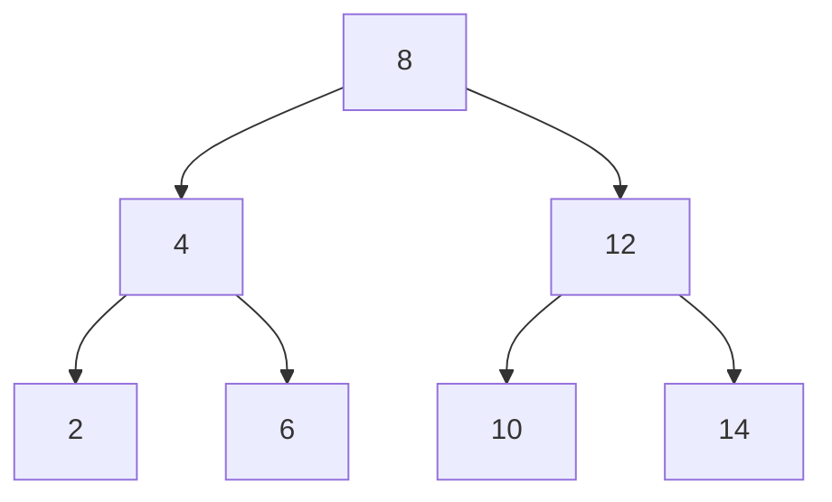

이 구조에서 10을 검색한다고 생각해 보자.

먼저 루트 노드인 8을 확인한다.

10은 8보다 크므로 오른쪽으로 이동한다.

다음 노드인 12를 확인한다.

10은 12보다 작으므로 왼쪽으로 이동한다.

마지막으로 10을 찾는다.

전체 탐색 과정은 다음과 같다.

```text
8
↓
12
↓
10
```

모든 노드를 순차적으로 탐색하지 않아도 된다.

트리가 균형 잡혀 있다면 탐색 시간 복잡도는 O(log N)이다.

하지만 일반적인 이진 탐색 트리에는 문제가 있다.

---

## 이진 탐색 트리는 항상 균형을 유지할까?

다음 순서로 값을 삽입한다고 가정하자.

```text
1 → 2 → 3 → 4 → 5
```

별도의 균형 조정이 없는 일반적인 이진 탐색 트리에서는 다음과 같은 구조가 만들어질 수 있다.

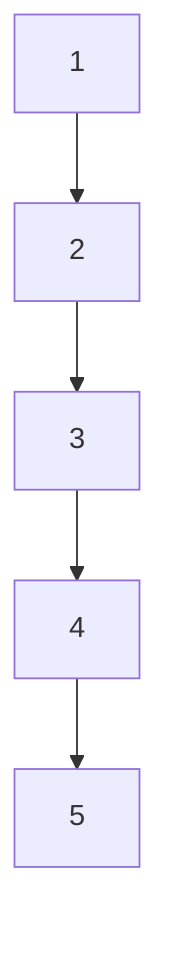

트리가 한쪽으로 기울어졌다.

이 상태에서 5를 찾으려면 모든 노드를 거쳐야 한다.

결과적으로 최악의 시간 복잡도는 O(N)이 된다.

물론 AVL Tree나 Red-Black Tree처럼 균형을 유지하는 이진 탐색 트리도 존재한다.

따라서 트리가 기울어지는 문제만으로 B-Tree가 필요한 이유를 전부 설명할 수는 없다.

데이터베이스에서는 더 중요한 문제가 있다.

바로 **디스크와 메모리 사이에서 데이터를 읽는 비용**이다.

---

## 데이터베이스에서는 트리의 높이가 중요한 이유

일반적인 이진 탐색 트리는 노드 하나에 하나의 키를 저장하고 최대 두 개의 자식을 가진다.

따라서 데이터가 증가하면 트리의 높이도 증가한다.

메모리 내부에서 포인터를 따라 이동하는 것과 디스크에서 데이터를 읽는 것은 비용이 다르다.

데이터베이스는 데이터를 일정한 크기의 블록 단위로 읽는다.

InnoDB에서는 이러한 저장 단위를 페이지(Page)라고 부른다.

InnoDB의 기본 인덱스 페이지 크기는 16KB다. 실제 크기는 MySQL 인스턴스를 초기화할 때 설정하는 `innodb_page_size`에 따라 달라질 수 있다.

만약 트리 노드 하나가 키 하나만 가지고 있다면 페이지 공간을 효율적으로 활용하기 어렵다.

또 트리의 높이가 깊어질수록 탐색 과정에서 더 많은 페이지에 접근해야 할 수 있다.

따라서 데이터베이스에서는 다음 두 가지가 중요하다.

**하나의 노드에 여러 키를 저장하는 것과 트리의 높이를 낮게 유지하는 것**이다.

이러한 요구에 잘 맞는 자료구조가 B-Tree다.

---

## B-Tree란 무엇인가?

B-Tree는 여러 개의 키와 자식 노드를 하나의 노드에 저장할 수 있는 균형 탐색 트리다.

1970년 Rudolf Bayer와 Edward McCreight가 대규모 정렬 인덱스를 효율적으로 관리하기 위한 연구에서 제안한 자료구조다.

B-Tree의 B는 흔히 Balanced의 약자라고 설명되지만, 정확한 명칭의 유래가 하나로 확정된 것은 아니다.

B-Tree가 균형을 유지한다는 사실이 중요한 특징이다.

일반적인 이진 탐색 트리와 가장 큰 차이는 하나의 노드에 여러 키를 저장할 수 있다는 것이다.

예를 들어 다음과 같은 구조를 생각해 보자.

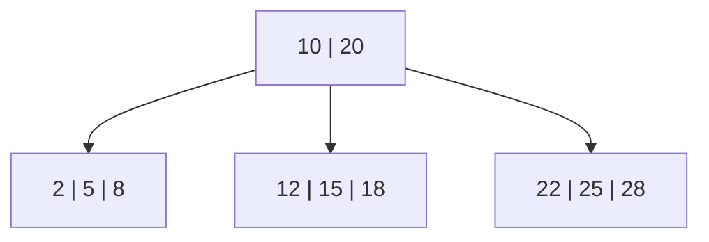

루트 노드에는 두 개의 키가 있다.

```text
10 | 20
```

이 노드는 세 개의 탐색 범위를 구분한다.

```text
10보다 작은 값

10 이상 20보다 작은 값

20 이상인 값
```

따라서 하나의 노드에서 여러 탐색 경로를 결정할 수 있다.

일반적으로 내부 노드에 K개의 구분 키가 있다면 K+1개의 자식 경로를 가질 수 있다.

실제 구현에서는 노드의 최소 점유율이나 자식 수에 관한 추가 규칙도 존재한다.

---

## B-Tree의 주요 특징

B-Tree는 여러 키를 한 노드에 저장할 수 있으며, 키는 정렬된 상태로 유지된다.

또 트리의 균형을 유지하므로 특정 경로만 지나치게 길어지는 문제를 방지한다.

대표적인 특징을 비교하면 다음과 같다.

| 구분         | 일반 이진 탐색 트리     | B-Tree           |
| ---------- | --------------- | ---------------- |
| 노드의 키      | 일반적으로 1개        | 여러 개             |
| 자식 수       | 최대 2개           | 여러 개             |
| 균형 유지      | 기본 BST는 보장하지 않음 | 균형 유지            |
| 최악의 탐색 복잡도 | O(N) 가능         | O(log N)         |
| 디스크 접근 효율  | 상대적으로 불리할 수 있음  | 높은 Fan-out으로 유리  |
| 활용         | 메모리 자료구조 등      | DB 인덱스, 파일 시스템 등 |

여기서 중요한 개념이 Fan-out이다.

Fan-out은 하나의 내부 노드가 가리킬 수 있는 자식 노드의 수를 의미한다.

Fan-out이 커지면 같은 수의 데이터를 관리하는 데 필요한 트리 높이가 낮아질 수 있다.

예를 들어 하나의 내부 노드가 100개의 자식 페이지를 가리킬 수 있다고 가정해 보자.

트리의 높이가 몇 단계 증가하지 않더라도 상당히 많은 데이터를 관리할 수 있다.

이는 단순한 노드 비교 횟수뿐 아니라 디스크 I/O 측면에서도 중요한 장점이다.

---

## B-Tree의 탐색 과정

다음과 같은 트리를 생각해 보자.

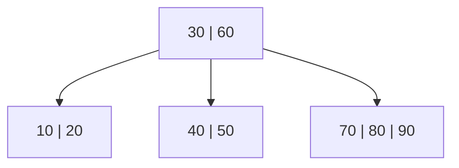

여기서 50을 검색한다.

먼저 루트 노드를 확인한다.

```text
30 | 60
```

50은 30보다 크고 60보다 작다.

따라서 가운데 자식으로 이동한다.

```text
40 | 50
```

해당 노드에서 50을 찾는다.

트리의 모든 노드를 방문할 필요가 없다.

데이터가 증가하더라도 B-Tree는 균형을 유지하기 때문에 탐색 경로의 길이가 과도하게 증가하지 않는다.

하지만 데이터베이스에서는 단일 값 조회뿐 아니라 범위 조회도 자주 사용한다.

```sql
SELECT *
FROM member
WHERE id BETWEEN 100 AND 200;
```

이러한 범위 조회를 더욱 효율적으로 수행할 수 있도록 발전한 구조가 B+Tree다.

---

## B-Tree와 B+Tree는 무엇이 다를까?

B+Tree는 B-Tree 계열의 자료구조다.

두 구조 모두 여러 키를 하나의 노드에 저장하고 균형을 유지한다.

하지만 데이터를 저장하는 위치와 범위 탐색 방식에 차이가 있다.

일반적인 B-Tree에서는 내부 노드에도 실제 레코드와 연결되는 데이터가 존재할 수 있다.

반면 B+Tree에서는 내부 노드가 탐색 경로를 결정하는 역할을 담당하고, 실제 데이터와 연결되는 인덱스 엔트리는 리프 노드에 저장된다.

또 B+Tree의 리프 노드는 일반적으로 키 순서에 따라 서로 연결되어 있다.

이 덕분에 범위 탐색을 효율적으로 수행할 수 있다.

### B-Tree와 B+Tree 비교

| 구분        | B-Tree             | B+Tree                |
| --------- | ------------------ | --------------------- |
| 내부 노드     | 키와 데이터 참조를 가질 수 있음 | 주로 탐색을 위한 구분 키        |
| 리프 노드     | 데이터 또는 데이터 참조      | 실제 인덱스 엔트리            |
| 데이터 위치    | 내부 및 리프 노드 가능      | 리프 노드 중심              |
| 범위 탐색     | 정렬 순회로 수행 가능       | 연결된 리프 순회에 유리         |
| 내부 노드의 역할 | 탐색과 데이터 저장         | 탐색 경로 안내              |
| 데이터베이스 활용 | 다양한 저장 구조          | 현대 관계형 DB의 대표적 인덱스 구조 |

여기서 주의할 부분이 있다.

B-Tree가 범위 탐색을 효율적으로 수행하지 못한다는 뜻은 아니다.

B-Tree 역시 정렬된 구조이므로 범위 조회를 수행할 수 있다.

다만 B+Tree는 리프 노드에 데이터가 모여 있고 리프 간 연결을 활용할 수 있어 연속적인 범위 탐색에 특히 적합하다.

---

## B+Tree의 내부 구조

다음과 같은 B+Tree를 생각해 보자.

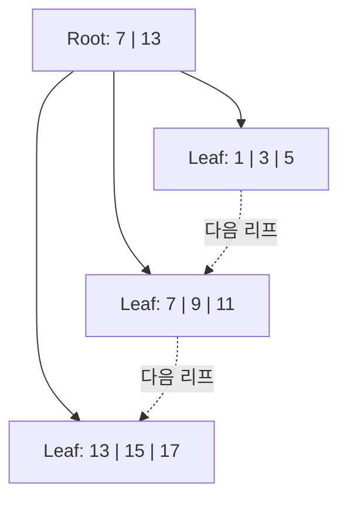

최상위 노드를 Root Node라고 한다.

Root와 Leaf 사이에 존재하는 내부 노드는 Branch Node라고 부를 수 있다.

가장 아래에서 인덱스 엔트리를 관리하는 노드는 Leaf Node다.

B+Tree에서는 실제 키를 이용한 검색이 최종적으로 리프 노드의 엔트리로 이어진다.

내부 노드에 존재하는 구분 키는 적절한 자식 노드로 이동하기 위한 정보다.

즉 같은 키가 내부 노드와 리프 노드에 나타날 수 있지만 역할은 다르다.

---

## B+Tree는 범위 검색을 어떻게 처리할까?

다음 SQL을 생각해 보자.

```sql
SELECT *
FROM member
WHERE id BETWEEN 7 AND 15;
```

B+Tree는 먼저 7이 존재하는 리프 노드를 찾는다.

```text
Root
  ↓
Leaf: 7 | 9 | 11
```

7을 찾았다면 해당 리프에서 다음 키를 순차적으로 확인할 수 있다.

```text
7 → 9 → 11
```

이후 다음 리프 노드로 이동한다.

```text
13 → 15
```

전체 탐색 과정은 다음과 같다.


이 과정에서 매번 Root Node로 돌아가 다음 키를 찾을 필요가 없다.

최초 탐색으로 시작 위치를 찾은 뒤 인접 리프를 순회할 수 있기 때문이다.

범위에서 반환할 엔트리가 K개라면 개념적으로 초기 탐색 비용과 K개 엔트리의 순회 비용을 합쳐 생각할 수 있다.

물론 실제 데이터베이스에서는 필요한 데이터 페이지가 메모리에 존재하는지, 추가적인 테이블 조회가 필요한지 등에 따라 비용이 달라진다.

---

## B+Tree에서 리프 노드의 연결이 중요한 이유

B+Tree의 장점을 가장 쉽게 이해할 수 있는 상황은 정렬된 데이터를 연속적으로 읽는 경우다.

예를 들어 게시글을 최신순으로 조회하는 API를 생각해 보자.

```sql
SELECT *
FROM post
WHERE id > 1000
ORDER BY id
LIMIT 20;
```

`id`가 적절한 인덱스의 키라면 MySQL은 시작 위치를 찾고 이후의 키를 순차적으로 확인할 수 있다.

인접 리프를 순회할 수 있으므로 모든 키를 처음부터 탐색할 필요가 없다.

이러한 구조는 다음과 같은 작업에 유용하다.

특정 기간의 주문 내역 조회, 회원 ID 범위 조회, 시간순 로그 검색, 특정 가격 범위의 상품 조회 등이다.

하지만 B+Tree가 모든 종류의 검색에 적합한 것은 아니다.

예를 들어 텍스트의 복잡한 형태소 검색이나 공간 좌표 기반 거리 검색에는 다른 인덱스와 검색 전략이 필요할 수 있다.

인덱스의 구조와 실제 조회 조건이 잘 맞아야 성능상의 이점을 얻을 수 있다.

---

## B+Tree는 삽입할 때 어떻게 균형을 유지할까?

B+Tree는 데이터를 계속 삽입하더라도 균형을 유지한다.

그 핵심 과정 중 하나가 Split이다.

Split은 노드가 저장할 수 있는 키의 수를 초과했을 때 노드를 분할하는 작업이다.

단순화된 예제로 살펴보자.

하나의 리프 노드에 최대 3개의 키를 저장할 수 있다고 가정하겠다.

처음에는 다음과 같은 키가 저장되어 있다.

```text
[5]
```

여기에 7을 삽입한다.

```text
[5, 7]
```

다음으로 6을 삽입한다.

```text
[5, 6, 7]
```

아직 한 노드에서 관리할 수 있다.

그런데 4를 삽입하면 어떻게 될까?

```text
[4, 5, 6, 7]
```

최대 저장 개수인 3개를 초과했다.

따라서 노드를 분할해야 한다.

---

## Leaf Node Split 과정

리프 노드를 두 개로 나눈다고 하자.

```text
[4, 5]    [6, 7]
```

이제 각 리프 노드는 최대 키 개수를 초과하지 않는다.

하지만 두 노드 중 어떤 노드로 이동해야 할지 결정하는 상위 노드가 필요하다.

따라서 오른쪽 리프의 시작 키인 6을 부모 노드의 구분 키로 사용할 수 있다.

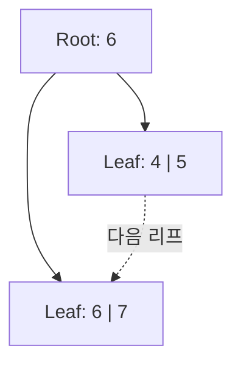

여기서 중요한 점은 상위 노드에 6이 존재하지만 리프 노드에도 6이 남아 있다는 것이다.

B+Tree에서는 내부 노드의 키가 탐색 경로를 결정하기 위한 구분 값이기 때문이다.

리프 노드의 인덱스 엔트리는 그대로 유지된다.

이러한 구조를 이용하면 다음 검색에서 어느 리프 노드로 이동해야 하는지 판단할 수 있다.

---

## Split이 반복되면 어떻게 될까?

새로운 키가 계속 추가된다고 생각해 보자.

```text
8, 9, 10, 11, 12
```

리프 노드가 가득 차면 다시 Split이 발생할 수 있다.

이 과정에서 부모 노드에도 새로운 구분 키가 추가된다.

그런데 부모 노드도 가득 차 있다면 어떻게 될까?

부모 노드 역시 분할할 수 있다.

분할이 위쪽으로 전파되다가 Root Node까지 가득 찬 경우에는 새로운 Root Node를 생성할 수 있다.

결과적으로 트리의 높이가 한 단계 증가할 수 있다.

하지만 B+Tree는 이러한 구조 조정을 통해 모든 리프가 같은 깊이에 있도록 유지한다.

```text
데이터 삽입
    ↓
리프 노드에 저장 가능한가?
    ├── YES → 삽입 완료
    └── NO
          ↓
        Leaf Split
          ↓
        부모 노드 갱신
          ↓
        부모 노드가 가득 찼는가?
          ├── NO → 완료
          └── YES → 상위 Split
```

이것이 B+Tree가 많은 데이터를 삽입해도 균형을 유지하는 핵심적인 방식이다.

---

## MySQL에서는 Split이 어떤 비용을 발생시킬까?

지금까지는 하나의 노드에 세 개의 키만 저장하는 단순한 예제를 사용했다.

하지만 실제 InnoDB에서는 하나의 인덱스 노드가 페이지 단위로 관리된다.

기본적으로 16KB 페이지에 여러 인덱스 레코드가 저장된다.

페이지에 새로운 레코드를 저장할 공간이 부족하면 분할이나 재구성이 필요할 수 있다.

이 과정에서는 새로운 페이지 할당과 레코드 이동, 부모 인덱스 정보 갱신 등이 발생할 수 있다.

따라서 INSERT가 항상 단순히 마지막 위치에 값을 추가하는 작업인 것은 아니다.

특히 삽입하는 키의 순서가 기존 데이터와 어떤 관계를 가지는지에 따라 영향을 받을 수 있다.

MySQL 공식 문서에서도 InnoDB의 인덱스 페이지에 새 레코드를 삽입할 때 공간이 부족하면 페이지 분할과 재구성이 필요할 수 있다고 설명한다.

---

## 연속적인 PK와 무작위 PK는 무엇이 다를까?

예를 들어 다음과 같이 증가하는 PK를 사용한다고 하자.

```text
1 → 2 → 3 → 4 → 5 → 6
```

새로운 레코드는 일반적으로 인덱스의 오른쪽 끝 부근에 삽입되는 경향이 있다.

반면 무작위 값으로 생성한 PK라면 어떨까?

```text
841 → 12 → 503 → 77 → 921
```

새로운 키가 트리의 여러 위치에 분산되어 삽입될 수 있다.

이때 다양한 인덱스 페이지를 수정해야 할 수 있다.

페이지에 여유 공간이 없다면 Split이 발생할 가능성도 있다.

따라서 삽입 순서가 예측 가능한 짧은 PK는 일반적인 InnoDB 테이블에서 유리한 선택이 되는 경우가 많다.

하지만 무작위 PK가 항상 나쁘다는 뜻은 아니다.

분산 시스템에서 ID를 생성해야 하거나 ID 노출을 피하고 싶은 경우에는 다른 요구사항도 고려해야 한다.

또 순차 증가 PK는 특정 페이지에 쓰기 작업이 집중되는 문제가 생길 수 있다.

결국 PK는 단순히 식별자이면서 동시에 **클러스터링 인덱스의 저장 순서를 결정하는 중요한 값**이라는 점을 이해해야 한다.

---

## 클러스터링 인덱스(Clustered Index)란 무엇인가?

이제 MySQL에서 중요한 개념인 클러스터링 인덱스를 살펴보자.

클러스터링 인덱스는 인덱스의 리프 노드에 실제 테이블 행의 데이터가 저장되는 구조다.

MySQL의 InnoDB에서는 일반적으로 Primary Key를 클러스터링 인덱스로 사용한다.

예를 들어 다음 테이블이 있다고 하자.

```sql
CREATE TABLE member (
    id BIGINT NOT NULL AUTO_INCREMENT,
    name VARCHAR(50) NOT NULL,
    email VARCHAR(100) NOT NULL,
    phone VARCHAR(20),
    created_at DATETIME(6) NOT NULL,
    PRIMARY KEY (id)
) ENGINE = InnoDB;
```

이 테이블의 PK는 `id`다.

InnoDB는 PK를 기준으로 클러스터링 인덱스를 구성한다.

여기서 중요한 특징이 있다.

**클러스터링 인덱스의 리프 노드에는 PK와 함께 실제 행 데이터가 저장된다.**

이는 단순히 레코드의 위치만 저장하는 인덱스와 다르다.

---

## 클러스터링 인덱스의 내부 구조

앞서 만든 `member` 테이블에 다음 데이터가 있다고 가정하자.

| id | name | email                                             |
| -: | ---- | ------------------------------------------------- |
| 10 | 김민수  | [minsu@example.com](mailto:minsu@example.com)     |
| 20 | 이서연  | [seoyeon@example.com](mailto:seoyeon@example.com) |
| 30 | 박지훈  | [jihoon@example.com](mailto:jihoon@example.com)   |
| 40 | 최하늘  | [haneul@example.com](mailto:haneul@example.com)   |

클러스터링 인덱스는 PK인 `id`를 기준으로 구성된다.

개념적으로 다음과 같다.

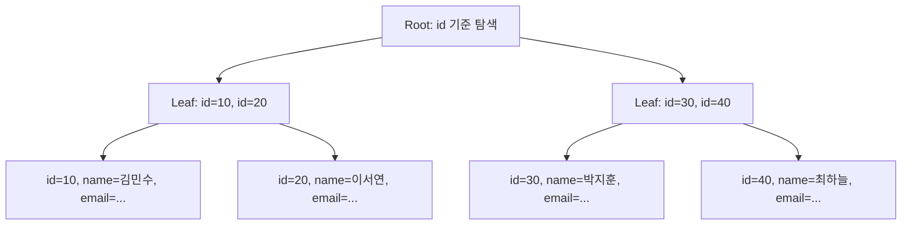

그림에서는 이해를 돕기 위해 리프의 인덱스 키와 레코드 내용을 나누어 표현했다.

실제로는 클러스터링 인덱스의 리프 레코드에 행 데이터가 포함된다.

따라서 PK를 이용해 검색하면 해당 레코드가 존재하는 리프에 도달하는 것만으로 필요한 행 데이터를 읽을 수 있다.

---

## PK를 이용한 조회가 빠른 이유

다음 쿼리를 실행한다고 하자.

```sql
SELECT *
FROM member
WHERE id = 30;
```

InnoDB는 클러스터링 인덱스에서 `id = 30`을 찾는다.

```text
Primary Key 검색
    ↓
Root Node
    ↓
Branch Node
    ↓
Leaf Node
    ↓
실제 행 데이터
```

리프 노드에 실제 레코드가 있으므로 별도의 보조 인덱스에서 다시 PK를 찾는 과정이 필요하지 않다.

이것이 InnoDB에서 PK 조회가 효율적인 중요한 이유다.

다만 인덱스를 이용한 조회라고 해서 항상 디스크 I/O가 발생하는 것은 아니다.

필요한 페이지가 InnoDB Buffer Pool에 이미 존재한다면 메모리에서 읽을 수 있다.

따라서 실제 조회 성능은 인덱스 구조뿐 아니라 Buffer Pool의 적중률과 데이터 접근 패턴에도 영향을 받는다.

---

## 클러스터링 인덱스는 물리적인 정렬을 보장할까?

클러스터링 인덱스를 설명할 때 자주 등장하는 표현이 있다.

> 테이블의 데이터가 PK 순서대로 물리적으로 정렬된다.

이 표현은 조금 주의해서 이해해야 한다.

InnoDB의 클러스터링 인덱스는 PK 순서로 탐색할 수 있도록 B+Tree 구조를 유지한다.

리프 노드의 레코드 역시 키 순서를 따른다.

하지만 모든 행이 디스크의 연속된 물리적 주소에 PK 순서대로 저장되어 있다는 의미는 아니다.

데이터베이스는 페이지를 할당하고 재배치하며, 페이지 분할도 발생한다.

따라서 **논리적인 키 정렬 순서와 디스크의 연속적인 물리적 배치는 구분해야 한다.**

또 SQL에서 다음처럼 조회한다고 하자.

```sql
SELECT *
FROM member;
```

클러스터링 인덱스가 존재한다는 이유만으로 결과가 항상 PK 순서대로 반환된다고 보장할 수 없다.

정렬된 결과가 필요하다면 반드시 `ORDER BY`를 사용해야 한다.

```sql
SELECT *
FROM member
ORDER BY id;
```

인덱스는 정렬된 데이터에 효율적으로 접근할 수 있는 구조를 제공하지만 SQL 결과의 정렬 계약을 대신하지는 않는다.

---

## 보조 인덱스(Secondary Index)란 무엇인가?

InnoDB에서 클러스터링 인덱스가 아닌 다른 인덱스를 보조 인덱스라고 부른다.

예를 들어 회원 이름으로 자주 검색한다고 하자.

```sql
SELECT *
FROM member
WHERE name = '박지훈';
```

이 쿼리를 효율적으로 처리하기 위해 다음 인덱스를 생성한다.

```sql
CREATE INDEX idx_member_name
ON member (name);
```

이 인덱스는 PK인 `id`가 아니라 `name`을 기준으로 구성된다.

그런데 보조 인덱스의 리프 노드에는 어떤 정보가 저장될까?

InnoDB에서는 보조 인덱스 엔트리에 인덱스 키와 해당 행의 PK 값이 포함된다.

예를 들어 다음과 같다.

| name | id |
| ---- | -: |
| 김민수  | 10 |
| 박지훈  | 30 |
| 이서연  | 20 |
| 최하늘  | 40 |

실제 내부 구현에서는 중복 키 처리와 인덱스 구성을 위해 보다 구체적인 레코드 형식이 사용되지만, 개념적으로는 이름으로 PK를 찾을 수 있는 구조다.

---

## 보조 인덱스 조회는 어떻게 동작할까?

다음 쿼리를 실행한다고 하자.

```sql
SELECT *
FROM member
WHERE name = '박지훈';
```

먼저 `idx_member_name`을 탐색한다.

```text
name = 박지훈
    ↓
Secondary Index 탐색
    ↓
id = 30
```

이제 PK를 얻었다.

하지만 보조 인덱스에는 전체 행 데이터가 저장되어 있지 않다.

따라서 전체 행을 조회하려면 클러스터링 인덱스를 다시 탐색해야 할 수 있다.

```text
id = 30
    ↓
Clustered Index 탐색
    ↓
실제 Member 레코드 조회
```

전체 과정을 그림으로 표현하면 다음과 같다.

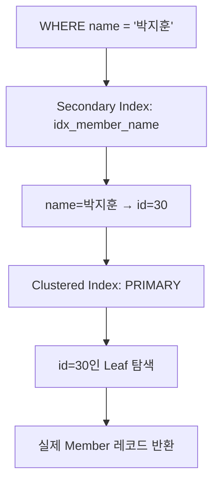

이것이 InnoDB의 보조 인덱스가 클러스터링 인덱스와 연결되는 기본적인 구조다.

---

## 보조 인덱스가 레코드 주소 대신 PK를 저장하는 이유

일반적인 인덱스 구조에서는 보조 인덱스가 데이터의 물리적인 위치를 직접 가리킬 수도 있다.

하지만 InnoDB는 보조 인덱스에 PK 값을 저장한다.

왜 그럴까?

클러스터링 인덱스는 실제 데이터를 PK 순서로 관리한다.

그 과정에서 페이지 분할이나 레코드 재배치가 발생할 수 있다.

만약 보조 인덱스가 특정 레코드의 물리적 위치를 직접 저장한다면 데이터의 위치가 바뀔 때 관련 인덱스도 수정해야 할 수 있다.

반면 PK를 이용하면 물리적 위치와 독립적인 논리적 식별자로 해당 레코드를 찾을 수 있다.

따라서 보조 인덱스는 PK를 이용해 클러스터링 인덱스의 레코드를 탐색한다.

여기서 PK는 **데이터베이스 내부에서 레코드를 식별하고 찾는 논리적인 주소 역할**을 한다고 이해할 수 있다.

단, PK가 레코드의 물리적인 디스크 주소 자체를 의미하지는 않는다.

---

## 클러스터링 인덱스와 보조 인덱스 비교

| 구분      | 클러스터링 인덱스          | 보조 인덱스         |
| ------- | ------------------ | -------------- |
| 대표적인 기준 | Primary Key        | 별도로 지정한 인덱스 컬럼 |
| 리프 노드   | 실제 행 데이터 포함        | 인덱스 키와 PK 값 포함 |
| 테이블당 개수 | 하나                 | 여러 개 가능        |
| PK 조회   | 직접 행 데이터 접근        | 해당 없음          |
| 보조 키 조회 | 필요하면 PK로 다시 탐색     | 먼저 보조 인덱스 탐색   |
| 저장 공간   | 실제 데이터 저장 구조       | 별도의 인덱스 공간 사용  |
| 주요 특징   | 레코드의 기본 저장 및 탐색 구조 | 다양한 조회 조건 지원   |

여기서 클러스터링 인덱스는 테이블당 하나라는 점이 중요하다.

하나의 테이블에서 여러 컬럼을 각각 클러스터링 인덱스로 만들 수는 없다.

다만 복합 PK를 사용하면 여러 컬럼으로 구성된 하나의 클러스터링 인덱스를 만들 수 있다.

---

## 보조 인덱스를 사용하면 항상 두 번 탐색해야 할까?

그렇지는 않다.

앞서 살펴본 쿼리를 다시 생각해 보자.

```sql
SELECT *
FROM member
WHERE name = '박지훈';
```

전체 행 데이터가 필요하다면 보조 인덱스에서 PK를 찾은 뒤 클러스터링 인덱스를 다시 탐색해야 할 수 있다.

하지만 다음 쿼리는 어떨까?

```sql
SELECT id, name
FROM member
WHERE name = '박지훈';
```

`idx_member_name` 보조 인덱스에는 `name`과 PK인 `id`가 포함되어 있다.

따라서 이 두 컬럼만 필요하다면 보조 인덱스에서 결과를 만들 수 있다.

```text
Secondary Index

name=박지훈
id=30

↓

필요한 컬럼 모두 존재

↓

Clustered Index 추가 조회 불필요
```

이러한 구조를 커버링 인덱스(Covering Index)라고 한다.

---

## 커버링 인덱스(Covering Index)란 무엇인가?

커버링 인덱스는 특정 쿼리를 처리하는 데 필요한 컬럼이 인덱스에 모두 포함되어 있어 추가적인 행 조회를 피할 수 있는 경우를 말한다.

예를 들어 다음 인덱스가 존재한다고 하자.

```sql
CREATE INDEX idx_member_name
ON member (name);
```

이 인덱스는 InnoDB에서 개념적으로 다음 정보를 가진다.

```text
name + id
```

따라서 다음 쿼리는 커버링 인덱스의 이점을 얻을 수 있다.

```sql
SELECT id, name
FROM member
WHERE name = '박지훈';
```

하지만 다음 쿼리는 다르다.

```sql
SELECT id, name, phone
FROM member
WHERE name = '박지훈';
```

`phone` 컬럼은 해당 보조 인덱스에 존재하지 않는다.

따라서 필요한 행 데이터를 가져오기 위해 클러스터링 인덱스에 접근해야 할 수 있다.

이 차이는 실제 쿼리 성능에 상당한 영향을 줄 수 있다.

특히 보조 인덱스 조건으로 많은 행을 찾는 경우, 각 행에 대한 추가 조회가 누적될 수 있기 때문이다.

---

## SELECT *가 성능에 영향을 줄 수 있는 이유

JPA나 MyBatis에서 조회 API를 작성하다 보면 습관적으로 모든 컬럼을 가져오는 경우가 있다.

```sql
SELECT *
FROM member
WHERE name = '박지훈';
```

하지만 화면에 필요한 정보가 ID와 이름뿐이라면 어떨까?

```sql
SELECT id, name
FROM member
WHERE name = '박지훈';
```

두 쿼리는 같은 조건으로 검색하지만 조회해야 하는 컬럼이 다르다.

첫 번째 쿼리는 전체 행 데이터가 필요하다.

두 번째 쿼리는 보조 인덱스만으로 결과를 만들 수 있는 가능성이 있다.

따라서 조회 API에서는 실제 필요한 컬럼을 명확하게 선택하는 것이 중요하다.

Spring Data JPA에서는 DTO Projection 등을 활용해 필요한 데이터만 가져오는 방식도 고려할 수 있다.

다만 커버링 인덱스를 만들기 위해 지나치게 많은 컬럼을 인덱스에 추가하면 인덱스 자체가 커지고 쓰기 비용이 증가한다.

따라서 쿼리 성능과 인덱스 유지 비용 사이의 균형이 필요하다.

---

## PK를 짧게 만드는 것이 중요한 이유

InnoDB의 보조 인덱스에는 PK 컬럼이 포함된다.

따라서 PK가 길어지면 보조 인덱스의 크기도 증가할 수 있다.

예를 들어 다음 두 가지 PK를 비교해 보자.

```sql
id BIGINT PRIMARY KEY
```

```sql
id CHAR(36) PRIMARY KEY
```

첫 번째는 일반적인 정수형 PK다.

두 번째는 문자열 UUID를 저장하는 경우를 가정한 것이다.

실제 인덱스 엔트리의 크기는 문자셋과 저장 형식 등에 따라 달라지지만, 일반적으로 긴 문자열 PK는 짧은 정수형 PK보다 많은 공간을 차지할 수 있다.

문제는 이 차이가 클러스터링 인덱스에서만 발생하는 것이 아니라는 점이다.

보조 인덱스에서도 PK가 저장되므로 비용이 누적될 수 있다.

```text
member 테이블

PRIMARY KEY (id)

INDEX (name)

INDEX (email)

INDEX (created_at)
```

PK가 길면 여러 보조 인덱스의 저장 공간에도 영향을 준다.

MySQL 공식 문서에서도 보조 인덱스에 PK가 포함되므로 짧은 PK가 저장 공간 측면에서 유리하다고 설명한다.

따라서 PK를 선택할 때는 단순히 유일한 값을 만들 수 있는지만 고려해서는 안 된다.

저장 크기와 값의 변경 가능성, 삽입 순서 등을 함께 고려해야 한다.

---

## Primary Key가 없는 테이블은 어떻게 될까?

InnoDB에서는 모든 테이블에 클러스터링 인덱스가 존재한다.

그렇다면 PK를 정의하지 않은 테이블은 어떻게 될까?

InnoDB는 다음과 같은 기준으로 클러스터링 인덱스를 결정한다.

먼저 명시적으로 선언된 Primary Key를 사용한다.

PK가 없다면 모든 키 컬럼이 `NOT NULL`인 적절한 첫 번째 Unique Index를 사용할 수 있다.

이마저 없다면 InnoDB가 내부적으로 숨겨진 클러스터링 인덱스를 생성한다.

이때 내부적으로 생성되는 인덱스는 `GEN_CLUST_INDEX`라고 알려져 있다.

```text
PRIMARY KEY 존재?
    ├── YES → PK로 클러스터링 인덱스 구성
    └── NO
          ↓
        적절한 UNIQUE NOT NULL 인덱스 존재?
          ├── YES → 해당 인덱스 사용
          └── NO → 숨겨진 클러스터링 인덱스 생성
```

따라서 테이블에 PK를 선언하지 않았다고 클러스터링 인덱스가 존재하지 않는 것은 아니다.

하지만 일반적인 애플리케이션에서는 PK를 명시적으로 정의하는 것이 좋다.

PK는 데이터의 안정적인 식별자이면서 클러스터링 인덱스의 기준이 되기 때문이다.

---

## Multi-Range Read(MRR)란 무엇인가?

이제 클러스터링 인덱스와 보조 인덱스의 관계를 이해했으므로 MRR을 살펴보자.

MRR은 Multi-Range Read의 약자다.

MySQL이 여러 인덱스 엔트리를 이용해 실제 행 데이터를 읽을 때 불필요한 랜덤 접근 비용을 줄이기 위한 최적화 방식이다.

특히 보조 인덱스로 여러 PK 값을 얻은 뒤 클러스터링 인덱스의 행을 조회해야 하는 상황에서 의미가 있다.

예를 들어 다음 쿼리를 생각해 보자.

```sql
SELECT *
FROM member
WHERE name BETWEEN '가' AND '하';
```

`name`에 보조 인덱스가 있다면 MySQL은 이름 순서로 인덱스를 탐색할 수 있다.

그런데 보조 인덱스에서 얻은 PK 값들이 다음과 같다고 하자.

```text
name 기준 탐색 결과

PK = 80
PK = 10
PK = 60
PK = 30
```

클러스터링 인덱스는 PK를 기준으로 정렬되어 있다.

따라서 보조 인덱스에서 얻은 순서대로 PK를 조회하면 서로 떨어진 위치에 접근해야 할 수 있다.

```text
80 → 10 → 60 → 30
```

특히 필요한 데이터가 Buffer Pool에 충분히 존재하지 않는다면 랜덤 페이지 접근 비용이 커질 수 있다.

이 문제를 줄이기 위한 방법이 MRR이다.

---

## MRR은 어떤 순서로 동작할까?

MRR은 필요한 인덱스 엔트리를 먼저 수집한 뒤 행을 읽는 순서를 조정하는 방식으로 동작할 수 있다.

개념적인 과정은 다음과 같다.

첫 번째로 보조 인덱스에서 조건을 만족하는 키를 찾는다.

```text
80, 10, 60, 30
```

두 번째로 관련 키를 버퍼에 모은다.

세 번째로 PK 순서에 맞게 정렬한다.

```text
10, 30, 60, 80
```

마지막으로 정렬된 순서에 따라 클러스터링 인덱스에서 행을 조회한다.

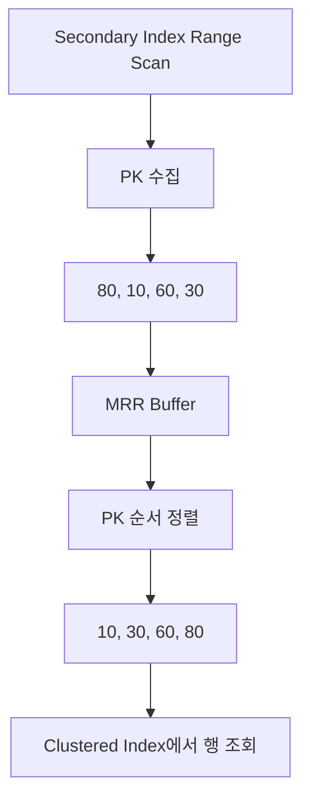

이렇게 하면 행을 읽기 위한 접근 순서를 보다 효율적으로 구성할 수 있다.

다만 MRR이 테이블 전체의 PK를 메모리에 모두 올려 정렬한다는 의미는 아니다.

필요한 범위의 인덱스 엔트리를 버퍼에 모아 배치 단위로 처리할 수 있다.

MySQL 공식 문서에서는 이러한 방식을 Disk-Sweep Multi-Range Read라고 설명하며, 랜덤 디스크 접근을 줄이고 보다 순차적인 행 접근을 유도하는 것이 목적이라고 설명한다.

---

## MRR은 모든 보조 인덱스 조회에서 사용될까?

그렇지는 않다.

MRR은 MySQL Optimizer가 비용과 쿼리 조건 등을 고려해 선택하는 최적화 방법이다.

따라서 보조 인덱스를 사용한다고 무조건 MRR이 수행되는 것은 아니다.

또 커버링 인덱스로 쿼리를 처리할 수 있다면 추가적인 테이블 행 조회가 필요하지 않으므로 MRR의 이점이 없다.

예를 들어 다음 쿼리를 생각해 보자.

```sql
SELECT id, name
FROM member
WHERE name BETWEEN '가' AND '하';
```

`idx_member_name`에 필요한 컬럼이 모두 포함되어 있다면 보조 인덱스만으로 결과를 반환할 수 있다.

이 경우 클러스터링 인덱스의 행을 다시 찾아야 하는 문제가 없다.

따라서 MRR이 필요한 상황과 커버링 인덱스로 처리할 수 있는 상황은 구분해야 한다.

MySQL에서는 Optimizer 설정에 따라 MRR을 활성화하거나 비용 기반 선택 여부를 조절할 수 있다.

---

## MySQL에서 MRR 사용 여부 확인하기

MRR이 사용되었는지는 실행 계획을 통해 확인할 수 있다.

예를 들어 다음 쿼리의 실행 계획을 확인해 보자.

```sql
EXPLAIN
SELECT *
FROM member
WHERE name BETWEEN '가' AND '하';
```

조건과 데이터 규모에 따라 실행 계획이 달라질 수 있다.

MRR이 선택된 경우 `Extra` 항목에서 다음과 같은 내용을 확인할 수 있다.

```text
Using MRR
```

이 값은 해당 쿼리에서 MRR 최적화가 사용된다는 의미다.

하지만 실제 실행 계획에서 `Using MRR`이 나타나지 않더라도 MySQL이 잘못 동작하고 있다는 뜻은 아니다.

Optimizer가 다른 접근 방식이 더 효율적이라고 판단했을 수 있다.

또 데이터가 적거나 대부분의 페이지가 메모리에 존재한다면 MRR의 이점이 크지 않을 수 있다.

따라서 단순히 MRR을 강제로 활성화하기보다 실행 계획과 실제 실행 시간을 함께 확인하는 것이 좋다.

---

## B+Tree에서 DELETE는 어떻게 동작할까?

B+Tree의 삽입에서는 Split을 통해 균형을 유지한다.

그렇다면 삭제할 때는 어떻게 될까?

일반적인 B+Tree 자료구조에서는 키를 삭제한 뒤 노드의 최소 점유율을 유지하기 위해 재분배하거나 인접 노드를 병합할 수 있다.

하지만 실제 InnoDB의 DELETE는 트랜잭션과 MVCC를 고려해야 하므로 더 복잡하다.

InnoDB에서는 DELETE가 실행되었다고 관련 인덱스 레코드를 즉시 물리적으로 제거하지 않을 수 있다.

먼저 삭제 대상으로 표시하고, 이후 해당 레코드가 더 이상 필요하지 않은 시점에 정리할 수 있다.

여기서 중요한 개념이 Purge다.

---

## InnoDB의 Delete Mark와 Purge

예를 들어 다음 SQL을 실행한다고 하자.

```sql
DELETE FROM member
WHERE id = 30;
```

InnoDB는 MVCC와 트랜잭션의 일관성을 유지해야 한다.

어떤 트랜잭션은 삭제 이전의 데이터를 여전히 참조해야 할 수도 있다.

따라서 삭제한 레코드를 즉시 제거하면 기존 트랜잭션의 읽기 결과에 영향을 줄 수 있다.

InnoDB는 삭제된 레코드와 관련된 정보를 일정 기간 유지할 수 있다.

그리고 해당 레코드가 더 이상 MVCC나 롤백을 위해 필요하지 않게 되면 Purge 작업을 통해 물리적으로 제거할 수 있다.

```text
DELETE 실행
    ↓
삭제 대상 표시
    ↓
트랜잭션 처리
    ↓
MVCC에서 더 이상 필요하지 않은지 확인
    ↓
Purge 작업
    ↓
인덱스 레코드 정리
```

따라서 InnoDB에서는 인덱스 키를 절대로 물리적으로 삭제하지 않는다는 설명은 정확하지 않다.

즉시 제거하지 않을 수 있을 뿐, 이후 Purge를 통해 실제로 정리한다.

MySQL 공식 문서에서도 DELETE 이후 행과 인덱스 레코드의 물리적인 제거가 Purge 과정에서 수행된다고 설명한다.

이러한 동작은 긴 트랜잭션이 유지될 때 InnoDB의 Undo Log와 Purge 지연이 왜 문제가 될 수 있는지 이해하는 데도 도움이 된다.

---

## 클러스터링 인덱스의 PK를 변경하면 어떤 일이 발생할까?

PK는 단순한 일반 컬럼이 아니다.

InnoDB에서는 클러스터링 인덱스의 키로 사용된다.

따라서 PK가 변경되면 레코드가 저장되는 인덱스상의 위치도 변경될 수 있다.

또 보조 인덱스에는 PK 값이 포함되어 있다.

따라서 PK가 변경되면 관련 보조 인덱스의 엔트리도 수정해야 한다.

예를 들어 다음 테이블이 있다고 하자.

```text
PRIMARY KEY (id)

INDEX (name)

INDEX (created_at)
```

`id` 값을 변경하는 경우 클러스터링 인덱스뿐 아니라 관련 보조 인덱스에도 영향이 발생할 수 있다.

따라서 PK는 가능하면 변경되지 않는 값으로 설계하는 것이 좋다.

예를 들어 이메일이나 전화번호처럼 변경 가능성이 있는 값을 PK로 사용할 때는 신중해야 한다.

이러한 값은 Unique Index로 제약을 설정하되, 별도의 안정적인 식별자를 PK로 사용하는 방식이 적절할 수 있다.

---

## 복합 인덱스도 B+Tree로 관리될까?

그렇다.

MySQL에서는 여러 컬럼을 조합한 복합 인덱스를 생성할 수 있다.

예를 들어 주문 테이블에서 사용자별 주문 내역을 최신순으로 조회한다고 하자.

```sql
SELECT *
FROM orders
WHERE member_id = 100
ORDER BY created_at DESC;
```

이 쿼리를 위해 다음 복합 인덱스를 고려할 수 있다.

```sql
CREATE INDEX idx_orders_member_created
ON orders (member_id, created_at);
```

이 인덱스는 `member_id`를 먼저 기준으로 삼고, 같은 `member_id` 안에서는 `created_at` 순서로 키가 정렬되는 구조다.

개념적으로 다음과 같다.

```text
(member_id, created_at)

(100, 2026-01-01)
(100, 2026-01-02)
(100, 2026-01-03)
(200, 2026-01-01)
(200, 2026-01-02)
```

따라서 `member_id = 100` 조건을 이용하면 해당 회원의 주문 범위를 효율적으로 탐색할 수 있다.

이러한 복합 인덱스를 이해할 때 중요한 원칙이 Leftmost Prefix Rule이다.

---

## 복합 인덱스의 Leftmost Prefix Rule

다음 인덱스가 있다고 하자.

```sql
CREATE INDEX idx_orders_member_created
ON orders (member_id, created_at);
```

이 인덱스의 컬럼 순서는 다음과 같다.

```text
member_id → created_at
```

따라서 다음 쿼리는 인덱스를 활용하기 좋은 조건이다.

```sql
SELECT *
FROM orders
WHERE member_id = 100;
```

또 다음과 같은 쿼리도 인덱스를 효과적으로 사용할 수 있다.

```sql
SELECT *
FROM orders
WHERE member_id = 100
  AND created_at >= '2026-01-01';
```

하지만 다음 쿼리는 다르다.

```sql
SELECT *
FROM orders
WHERE created_at >= '2026-01-01';
```

선행 컬럼인 `member_id`에 조건이 없다.

따라서 일반적인 범위 탐색에서는 복합 인덱스의 효율이 제한될 수 있다.

다만 MySQL Optimizer에는 Skip Scan 등 일부 예외적인 최적화가 있으므로 선행 컬럼 조건이 없으면 인덱스를 절대로 사용하지 않는다고 단정해서는 안 된다.

복합 인덱스는 단순히 자주 사용하는 컬럼을 나열하는 것이 아니라 **조회 조건과 정렬 조건에 맞게 컬럼 순서를 결정해야 하는 구조**다.

---

## 인덱스가 있으면 ORDER BY가 항상 빨라질까?

B+Tree의 키는 정렬되어 있다.

따라서 적절한 인덱스를 이용하면 별도의 정렬 작업 없이 결과를 읽을 수 있는 경우가 있다.

예를 들어 다음 쿼리를 생각해 보자.

```sql
SELECT *
FROM orders
WHERE member_id = 100
ORDER BY created_at DESC
LIMIT 20;
```

다음 인덱스가 있다.

```sql
CREATE INDEX idx_orders_member_created
ON orders (member_id, created_at);
```

MySQL은 `member_id = 100`에 해당하는 인덱스 범위를 탐색하면서 `created_at` 순서로 데이터를 읽는 전략을 선택할 수 있다.

이러한 방식은 별도의 정렬 비용을 줄이는 데 도움이 된다.

하지만 항상 그런 것은 아니다.

조회하는 컬럼과 조건, 인덱스 방향, 데이터 분포, 반환할 행의 수에 따라 Optimizer가 다른 실행 계획을 선택할 수 있다.

따라서 인덱스가 존재한다는 사실만으로 정렬 비용이 사라진다고 생각해서는 안 된다.

---

## 실제 SQL로 인덱스 동작 확인하기

이제 앞서 살펴본 내용을 직접 확인할 수 있는 예제를 구성해 보자.

MySQL 8.4와 InnoDB를 기준으로 한다.

먼저 회원 테이블을 생성한다.

```sql
CREATE TABLE member (
    id BIGINT NOT NULL AUTO_INCREMENT,
    name VARCHAR(50) NOT NULL,
    email VARCHAR(100) NOT NULL,
    phone VARCHAR(20),
    created_at DATETIME(6) NOT NULL,

    PRIMARY KEY (id),
    UNIQUE KEY uk_member_email (email),
    KEY idx_member_name (name)
) ENGINE = InnoDB;
```

이 테이블에는 세 가지 인덱스가 존재한다.

```text
PRIMARY

uk_member_email

idx_member_name
```

`PRIMARY`는 클러스터링 인덱스다.

`uk_member_email`과 `idx_member_name`은 보조 인덱스다.

데이터를 삽입한다.

```sql
INSERT INTO member (
    id,
    name,
    email,
    phone,
    created_at
)
VALUES
(10, '김민수', 'minsu@example.com', '010-1111-1111', NOW(6)),
(20, '이서연', 'seoyeon@example.com', '010-2222-2222', NOW(6)),
(30, '박지훈', 'jihoon@example.com', '010-3333-3333', NOW(6)),
(40, '최하늘', 'haneul@example.com', '010-4444-4444', NOW(6)),
(50, '정유진', 'yujin@example.com', '010-5555-5555', NOW(6));
```

이제 각각의 인덱스가 어떤 쿼리에서 선택되는지 확인해 보자.

---

## PRIMARY KEY 조회 실행 계획

먼저 PK로 회원을 조회한다.

```sql
EXPLAIN
SELECT *
FROM member
WHERE id = 30;
```

이 쿼리에서는 PK 인덱스를 활용하는 실행 계획을 기대할 수 있다.

실행 계획에서 확인할 주요 항목은 다음과 같다.

| 항목              | 의미            |
| --------------- | ------------- |
| `type`          | 테이블 접근 방식     |
| `possible_keys` | 사용 가능한 인덱스 후보 |
| `key`           | 실제 선택된 인덱스    |
| `rows`          | 예상 탐색 행 수     |
| `Extra`         | 추가적인 실행 정보    |

PK를 이용한 단일 행 조회라면 `key`에 `PRIMARY`가 나타날 수 있다.

또 `type`이 `const`와 같이 표시될 수 있다.

다만 실행 계획은 테이블의 크기와 통계 정보에 따라 달라질 수 있다.

이 예제는 데이터가 매우 적으므로 인덱스 효율을 측정하기 위한 성능 테스트로 사용하기에는 적절하지 않다.

실제 성능 차이를 확인하려면 더 많은 데이터를 준비해야 한다.

---

## 보조 인덱스 조회 실행 계획

이번에는 이름으로 회원을 조회한다.

```sql
EXPLAIN
SELECT *
FROM member
WHERE name = '박지훈';
```

Optimizer가 `idx_member_name`을 선택했다면 이름을 기준으로 보조 인덱스를 탐색한다.

전체 행 데이터가 필요하기 때문에 클러스터링 인덱스를 이용한 추가 조회가 발생할 수 있다.

반면 다음 쿼리는 어떨까?

```sql
EXPLAIN
SELECT id, name
FROM member
WHERE name = '박지훈';
```

필요한 컬럼이 보조 인덱스에서 모두 제공된다면 커버링 인덱스로 처리할 수 있다.

이러한 경우 실행 계획의 `Extra` 항목에서 `Using index`를 확인할 수 있다.

단, `Using index`가 단순히 인덱스를 사용했다는 뜻만은 아니라는 점에 주의해야 한다.

이 문구는 해당 테이블 접근에서 필요한 컬럼을 인덱스만으로 처리할 수 있다는 의미로 사용된다.

따라서 `key`에 인덱스 이름이 표시되는 것과 `Extra`에 `Using index`가 표시되는 것은 서로 다른 정보를 제공한다.

---

## EXPLAIN ANALYZE로 실제 실행 시간을 확인하기

일반적인 `EXPLAIN`은 Optimizer가 예상한 실행 계획을 보여준다.

하지만 예상 비용이 실제 실행 시간을 그대로 나타내는 것은 아니다.

MySQL 8.0.18부터는 `EXPLAIN ANALYZE`를 통해 쿼리를 실제 실행하고 처리 과정의 시간과 행 수 등을 확인할 수 있다.

예를 들어 다음과 같이 실행한다.

```sql
EXPLAIN ANALYZE
SELECT *
FROM member
WHERE name = '박지훈';
```

출력에는 다음과 같은 정보가 포함될 수 있다.

```text
actual time
rows
loops
```

`actual time`은 실제 실행 시간과 관련된 정보다.

`rows`는 실제로 처리된 행 수를 보여준다.

`loops`는 해당 실행 단계가 몇 번 반복되었는지 확인하는 데 도움이 된다.

이러한 정보는 단순히 인덱스가 사용되었는지 확인하는 것을 넘어 실제 병목이 어디에 있는지 파악할 때 유용하다.

다만 `EXPLAIN ANALYZE`는 쿼리를 실제 실행하므로 운영 환경에서는 실행 비용을 고려해야 한다.

---

## 인덱스를 너무 많이 만들면 왜 문제가 될까?

인덱스는 조회 성능을 높일 수 있다.

하지만 인덱스를 많이 만든다고 항상 좋은 것은 아니다.

예를 들어 다음과 같은 인덱스를 생성했다고 하자.

```sql
CREATE INDEX idx_member_name
ON member (name);

CREATE INDEX idx_member_created
ON member (created_at);

CREATE INDEX idx_member_name_created
ON member (name, created_at);
```

인덱스는 조회할 때만 사용되는 것이 아니다.

INSERT, UPDATE, DELETE가 발생하면 관련 인덱스도 함께 유지해야 한다.

회원이 추가되면 클러스터링 인덱스뿐 아니라 여러 보조 인덱스에도 엔트리가 삽입될 수 있다.

인덱스가 많아질수록 다음 비용이 증가할 수 있다.

저장 공간 사용량이 증가한다.

INSERT와 DELETE에서 인덱스 유지 비용이 발생한다.

인덱스 컬럼을 변경하는 UPDATE에서는 관련 인덱스 수정이 필요하다.

Buffer Pool에 보관해야 하는 인덱스 페이지도 증가할 수 있다.

따라서 인덱스는 조회 조건과 실제 사용 빈도를 기준으로 설계해야 한다.

MySQL 공식 문서에서도 불필요한 인덱스는 공간을 소비하고 쓰기 작업의 비용을 증가시키므로 적절한 균형이 필요하다고 설명한다.

---

## 실무에서 인덱스를 설계할 때 고려할 12가지

인덱스의 구조를 이해했다면 실제 테이블 설계와 쿼리 최적화에 연결해야 한다.

### 1. Primary Key는 가능하면 짧고 안정적인 값을 사용한다

InnoDB의 보조 인덱스에는 PK가 포함되므로 PK가 길어지면 보조 인덱스의 저장 공간에도 영향을 줄 수 있다.

또 PK를 변경하면 클러스터링 인덱스와 보조 인덱스에 추가적인 수정 비용이 발생할 수 있다.

따라서 가능하면 짧고 변경되지 않는 식별자를 사용하는 것이 좋다.

### 2. 무작위 PK의 삽입 비용을 고려한다

무작위 값으로 구성된 PK는 B+Tree의 여러 위치에 새로운 레코드를 삽입하게 만들 수 있다.

이에 따라 페이지 수정과 Split 비용이 증가할 수 있다.

하지만 분산 ID 생성과 보안, 시스템 간 데이터 통합 등 다른 요구사항이 있다면 함께 판단해야 한다.

### 3. 조회 조건에 맞는 보조 인덱스를 만든다

자주 사용하는 조회 조건을 확인해야 한다.

예를 들어 이메일로 회원을 찾는다면 이메일 인덱스가 유용하다.

하지만 실제로 사용하지 않는 컬럼에 인덱스를 생성하면 쓰기 비용과 저장 공간만 증가할 수 있다.

### 4. 복합 인덱스에서는 컬럼 순서를 신중하게 결정한다

`(member_id, created_at)`과 `(created_at, member_id)`는 같은 인덱스가 아니다.

선행 컬럼과 조회 조건에 따라 탐색 효율이 크게 달라질 수 있다.

따라서 복합 인덱스를 만들 때는 WHERE 조건과 정렬 조건, 데이터 분포를 함께 고려해야 한다.

### 5. 커버링 인덱스의 이점을 활용한다

조회에 필요한 컬럼이 인덱스에 모두 포함되어 있다면 추가적인 클러스터링 인덱스 조회를 줄일 수 있다.

하지만 커버링을 위해 너무 많은 컬럼을 포함하면 인덱스 크기가 커진다.

실제로 자주 실행되고 비용이 큰 쿼리를 중심으로 적용해야 한다.

### 6. SELECT * 사용을 검토한다

조회 API에서 실제로 필요한 컬럼만 가져오는 것이 좋다.

불필요한 컬럼을 조회하면 네트워크 전송량과 객체 생성 비용이 증가할 수 있으며 커버링 인덱스를 활용하기 어려워질 수도 있다.

### 7. 범위 조회에는 B+Tree의 정렬 특성을 활용한다

`BETWEEN`, 부등호 조건, 정렬, 일부 Prefix 검색 등은 B+Tree의 장점을 활용할 수 있는 대표적인 상황이다.

하지만 조회 조건이 인덱스의 선행 컬럼과 맞지 않거나 선택도가 낮다면 기대한 성능이 나오지 않을 수 있다.

### 8. 보조 인덱스 조회의 추가 비용을 이해한다

보조 인덱스에서 PK를 찾은 뒤 클러스터링 인덱스를 다시 탐색해야 할 수 있다.

특히 많은 행을 조회하면서 추가 컬럼까지 읽어야 하는 경우에는 이 비용이 누적될 수 있다.

### 9. MRR은 Optimizer가 선택하는 최적화라는 점을 기억한다

MRR은 보조 인덱스에서 얻은 키를 이용해 행을 읽는 순서를 조정할 수 있다.

하지만 모든 조회에서 사용되는 것은 아니다.

MRR을 강제로 활성화하기 전에 실행 계획과 실제 성능을 비교해야 한다.

### 10. 인덱스의 쓰기 비용을 함께 측정한다

조회 성능이 개선되더라도 INSERT와 UPDATE 성능이 악화될 수 있다.

트랜잭션 처리량이 중요한 시스템이라면 인덱스를 추가하기 전후의 읽기와 쓰기 성능을 함께 확인해야 한다.

### 11. EXPLAIN 결과를 기준으로 판단한다

인덱스를 생성했다고 실제 쿼리에서 반드시 사용되는 것은 아니다.

Optimizer가 다른 실행 계획을 선택할 수 있다.

따라서 `EXPLAIN`으로 인덱스 선택 여부와 예상 행 수를 확인하고, 필요한 경우 `EXPLAIN ANALYZE`로 실제 실행 비용을 살펴봐야 한다.

### 12. 데이터 증가에 따른 변화를 고려한다

데이터가 1,000건일 때와 1,000만 건일 때 적절한 실행 계획은 달라질 수 있다.

테이블의 데이터 분포와 Cardinality가 변경되면 Optimizer의 선택도 달라질 수 있다.

따라서 운영 환경에서 데이터가 증가하는 테이블은 인덱스 통계와 실행 계획을 주기적으로 확인하는 것이 좋다.

---

## B+Tree와 클러스터링 인덱스를 하나의 구조로 이해하기

지금까지 살펴본 내용을 연결하면 InnoDB의 인덱스 구조를 다음과 같이 이해할 수 있다.

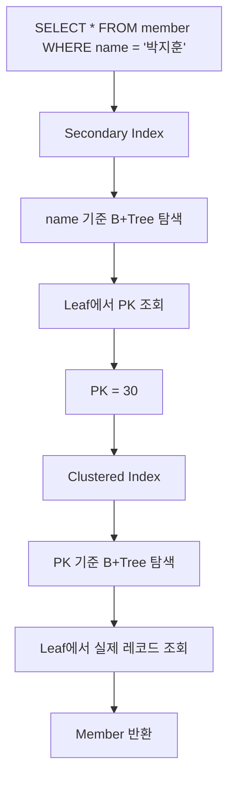

보조 인덱스에서는 검색 조건에 맞는 PK를 찾는다.

클러스터링 인덱스에서는 PK를 이용해 실제 행 데이터를 찾는다.

반면 PK를 직접 조회하는 경우에는 다음과 같이 단순해진다.

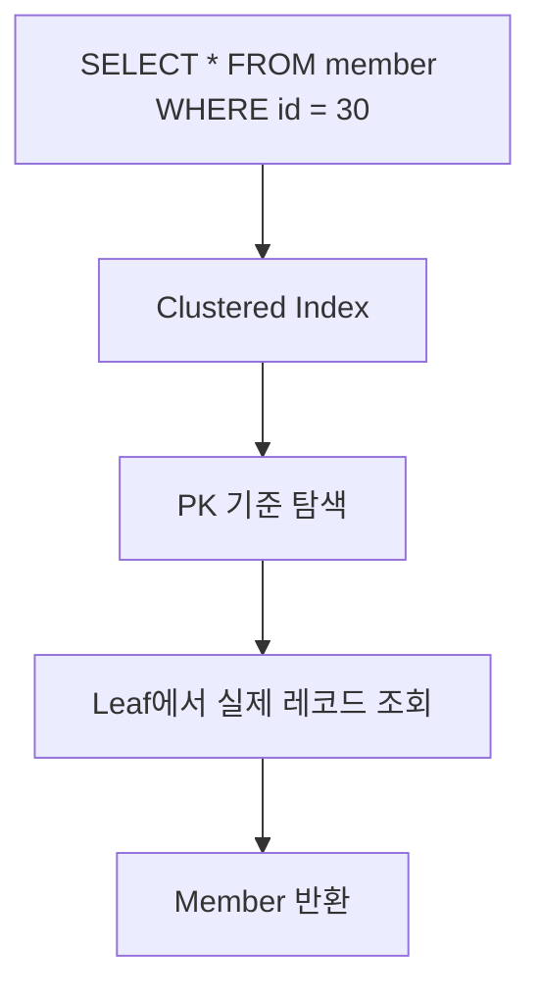

이 차이는 MySQL의 인덱스 성능을 이해하는 중요한 기준이다.

---

## 정리

B-Tree와 B+Tree는 많은 데이터를 효율적으로 검색하기 위해 사용되는 균형 탐색 트리다.

일반적인 이진 탐색 트리는 노드 하나에 저장할 수 있는 키가 제한적이고, 균형을 유지하지 않으면 트리가 한쪽으로 기울어질 수 있다.

반면 B-Tree는 하나의 노드에 여러 키를 저장하고 여러 자식 경로를 가질 수 있다.

이를 통해 트리의 높이를 낮게 유지하고 대량의 데이터를 효율적으로 탐색할 수 있다.

B+Tree는 내부 노드를 탐색에 활용하고 리프 노드에 실제 인덱스 엔트리를 저장하는 방식이다.

또 리프 노드 사이의 연결을 활용해 범위 조회를 효율적으로 처리할 수 있다.

```text
B-Tree

여러 키를 하나의 노드에 저장
균형 유지
높은 Fan-out


B+Tree

리프 노드에 인덱스 엔트리 저장
리프 간 연결
효율적인 범위 탐색
```

MySQL의 InnoDB에서는 이러한 B-Tree 계열 구조를 기반으로 클러스터링 인덱스와 보조 인덱스를 제공한다.

클러스터링 인덱스는 일반적으로 Primary Key를 기준으로 구성되며, 리프 노드에 실제 행 데이터를 저장한다.

반면 보조 인덱스는 인덱스 키와 PK 값을 관리한다.

따라서 보조 인덱스로 검색할 때는 PK를 얻은 다음 클러스터링 인덱스를 다시 탐색해야 할 수 있다.

```text
Secondary Index
    ↓
PK 조회
    ↓
Clustered Index
    ↓
실제 행 데이터
```

하지만 필요한 컬럼이 보조 인덱스에 모두 포함되어 있다면 추가적인 클러스터링 인덱스 조회 없이 결과를 반환할 수도 있다.

이것이 커버링 인덱스다.

또 InnoDB는 보조 인덱스를 통한 범위 조회에서 실제 행을 읽는 순서를 최적화하기 위해 MRR을 사용할 수 있다.

MRR은 관련 키를 모아 정렬한 뒤 행을 조회함으로써 랜덤 접근 비용을 줄이기 위한 방식이다.

다만 모든 쿼리에서 MRR이 사용되는 것은 아니며 Optimizer가 비용을 고려해 선택한다.

B+Tree는 삽입 과정에서도 Split을 통해 균형을 유지한다.

반대로 삭제 과정에서는 InnoDB의 MVCC와 Purge 구조를 함께 이해해야 한다.

DELETE가 실행되더라도 데이터가 즉시 물리적으로 제거되지 않을 수 있으며, 더 이상 필요하지 않은 시점에 Purge 작업으로 정리될 수 있다.

이러한 내부 구조를 이해하면 PK 선택이 왜 중요한지도 알 수 있다.

InnoDB에서는 PK가 클러스터링 인덱스의 키로 사용된다.

또 보조 인덱스에도 PK가 포함되므로 PK의 크기와 변경 가능성이 인덱스 전체에 영향을 줄 수 있다.

결국 인덱스 설계는 단순히 검색할 컬럼에 인덱스를 추가하는 작업이 아니다.

**데이터가 어떤 순서로 저장되고, 어떤 경로로 탐색되며, 조회와 변경 과정에서 어떤 비용이 발생하는지까지 고려하는 과정**이다.

이러한 구조를 이해한 상태에서 실행 계획을 분석하면 MySQL이 특정 인덱스를 선택한 이유와 쿼리가 느려지는 원인을 더 정확하게 파악할 수 있다.

### 한 줄 요약

**MySQL InnoDB는 B+Tree 계열의 인덱스 구조를 활용하며, 클러스터링 인덱스는 PK를 기준으로 실제 행 데이터를 저장하고 보조 인덱스는 인덱스 키와 PK를 관리한다. 따라서 PK 설계와 보조 인덱스 구성, 커버링 인덱스, MRR, 페이지 분할 등의 동작 원리를 이해하면 조회뿐 아니라 INSERT·UPDATE·DELETE의 성능까지 고려한 인덱스 설계가 가능해진다.**
