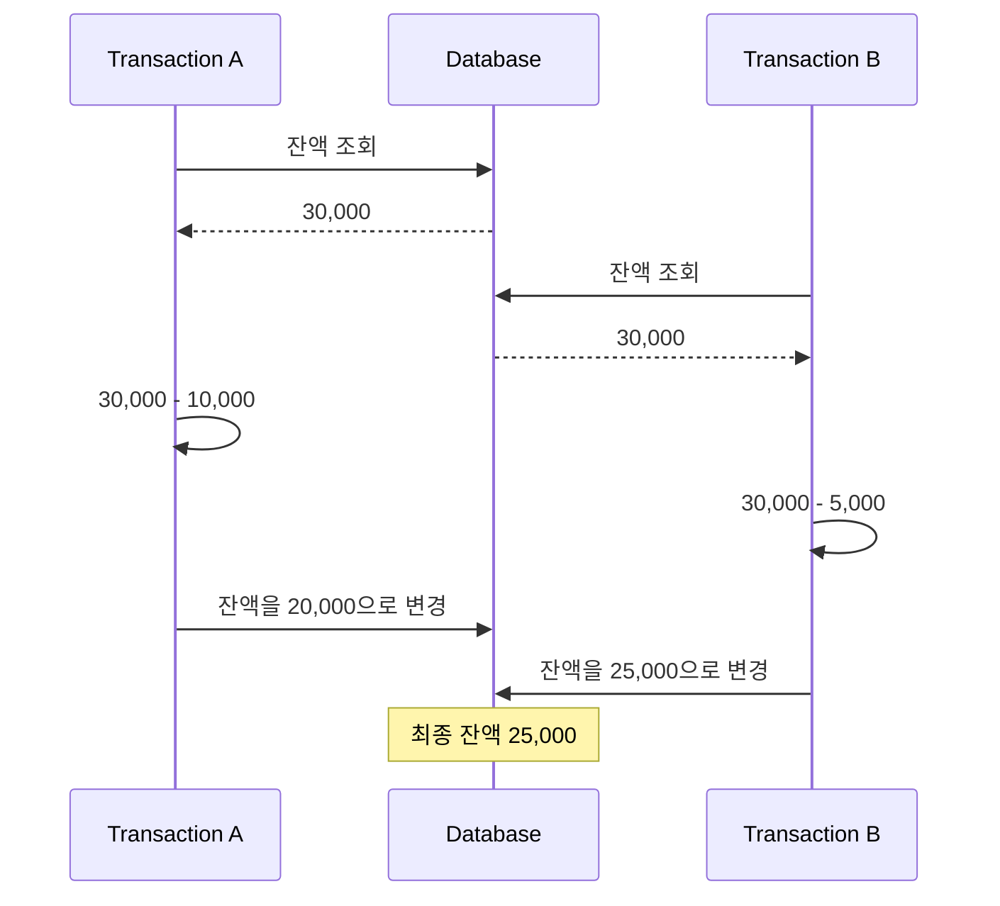
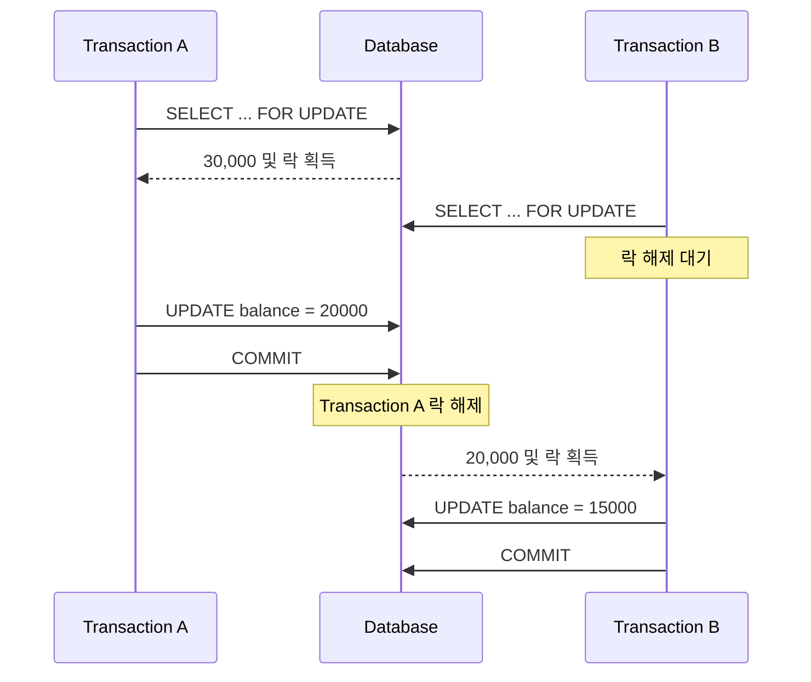
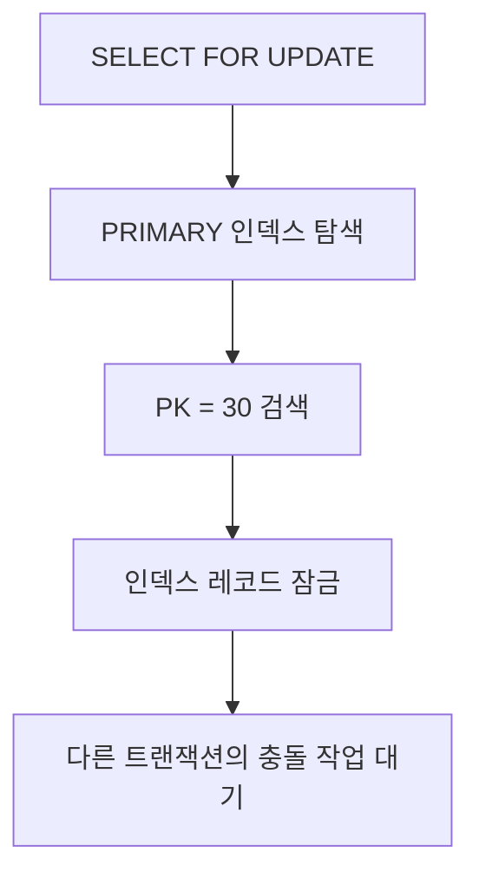
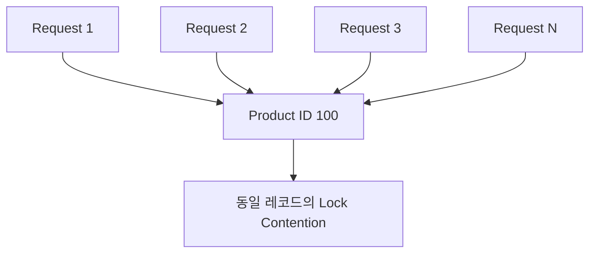
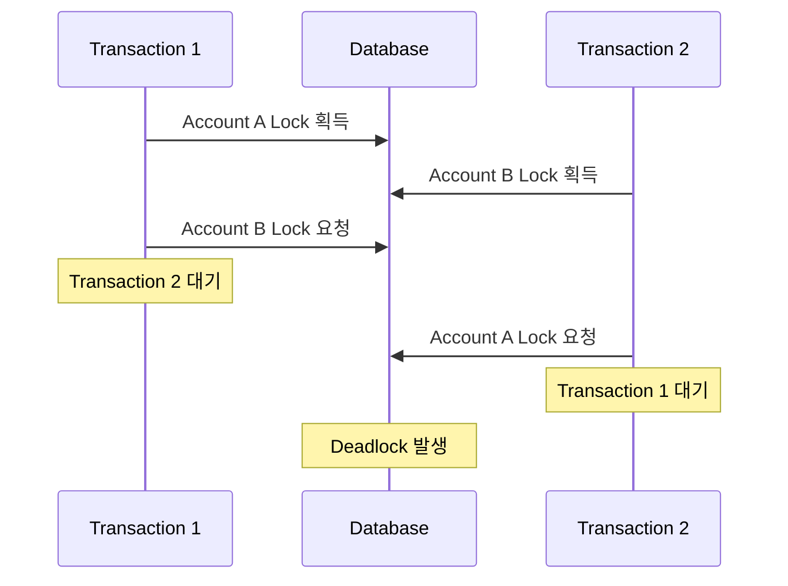
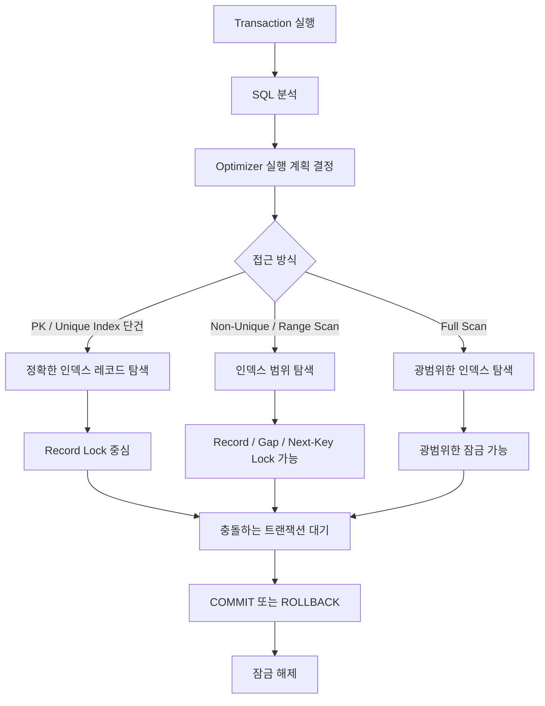

# 한스의 MySQL의 락
[https://youtu.be/-VzgLlSXm4g?si=stPLpGA_k5qxRFZt](https://youtu.be/-VzgLlSXm4g?si=stPLpGA_k5qxRFZt)

# 한스의 MySQL의 락
* toc
{:toc}

---

### MySQL InnoDB 락 완벽 이해: Record Lock, Gap Lock, Next-Key Lock과 인덱스의 관계

백엔드 애플리케이션에서는 여러 사용자가 동시에 같은 데이터에 접근하는 상황이 빈번하게 발생한다.

예를 들어 은행 계좌에서 금액을 출금하거나, 예약 시스템에서 마지막 남은 좌석을 예약하거나, 쇼핑몰에서 한정된 재고를 차감하는 상황을 생각해 보자.

각각의 요청은 정상적으로 작성된 비즈니스 로직을 실행하더라도, 여러 요청이 동시에 수행된다면 예상하지 못한 결과가 발생할 수 있다.

다음과 같은 계좌 정보가 있다고 가정하자.

| 계좌 ID | 소유자  |      잔액 |
| ----- | ---- | ------: |
| 1     | Hans | 30,000원 |

두 사용자가 동시에 같은 계좌에서 출금한다.

트랜잭션 A는 10,000원을 출금한다.

트랜잭션 B는 5,000원을 출금한다.

정상적으로 처리된다면 최종 잔액은 다음과 같아야 한다.

30,000원 - 10,000원 - 5,000원 = **15,000원**

그런데 두 트랜잭션이 동시에 기존 잔액을 읽고 계산한 결과를 각각 저장한다면 최종 잔액이 20,000원이나 25,000원이 될 수도 있다.

두 트랜잭션이 모두 성공했지만 실제로는 한쪽의 변경 결과가 사라진 것이다.

이러한 문제를 **Lost Update(갱신 손실)**&#xB77C;고 한다.

MySQL에서는 여러 트랜잭션이 동시에 데이터를 읽고 변경하더라도 일관성을 유지하기 위해 다양한 동시성 제어 기능을 제공한다.

대표적인 것이 Lock이다.

하지만 락을 이해할 때 단순히 데이터를 잠그는 기능이라고 생각하면 중요한 부분을 놓치기 쉽다.

실제 운영 환경에서는 다음과 같은 상황도 발생하기 때문이다.

* 서로 다른 회원 정보를 수정하는데도 요청이 대기한다.
* 특정 데이터 한 건을 삭제하려 했지만 다른 데이터의 수정까지 지연된다.
* 인덱스를 추가했더니 조회 성능뿐 아니라 동시 처리 성능도 개선된다.
* 데이터를 변경하지 않는 `SELECT ... FOR UPDATE` 때문에 INSERT가 대기한다.
* 트랜잭션 격리 수준을 변경했더니 잠금 범위가 달라진다.
* 서로 다른 행을 수정하는 두 트랜잭션 사이에서 데드락이 발생한다.

이러한 현상을 이해하려면 MySQL의 Lock을 **데이터, 인덱스, 트랜잭션, 격리 수준, 실행 계획**의 관점에서 함께 살펴봐야 한다.

---

### 락(Lock)이란 무엇인가?

Lock은 여러 트랜잭션이 동일한 데이터나 자원에 동시에 접근할 때 충돌을 제어하기 위한 동기화 메커니즘이다.

데이터베이스에서 락은 데이터의 일관성과 무결성을 유지하는 데 중요한 역할을 한다.

예를 들어 두 트랜잭션이 같은 계좌의 잔액을 수정하려고 한다면 한쪽 트랜잭션의 변경이 완료될 때까지 다른 트랜잭션의 변경을 대기시킬 수 있다.

이를 통해 서로 충돌하는 작업이 무분별하게 동시에 수행되는 상황을 방지한다.

하지만 여기서 중요한 점이 있다.

**락을 사용한다는 사실만으로 모든 동시성 문제가 자동으로 해결되는 것은 아니다.**

어떤 데이터를 언제 읽고, 어느 시점에 잠금을 획득하며, 그 잠금이 언제 해제되는지에 따라 결과가 달라진다.

따라서 락의 종류를 이해하기 전에 실제 동시성 문제가 어떻게 발생하는지 살펴볼 필요가 있다.

---

### 락이 필요한 이유: Lost Update 문제

앞서 살펴본 계좌 출금 상황을 조금 더 구체적으로 살펴보자.

초기 잔액은 30,000원이다.

```text
Account ID: 1
Balance: 30000
```

트랜잭션 A는 10,000원을 출금한다.

트랜잭션 B는 5,000원을 출금한다.

각 트랜잭션은 다음 순서로 동작한다고 가정하자.

1. 현재 잔액을 조회한다.
2. 출금 금액을 차감한다.
3. 계산된 잔액을 데이터베이스에 저장한다.

이때 두 트랜잭션이 동시에 실행되면 다음과 같은 상황이 발생할 수 있다.



트랜잭션 A는 20,000원을 계산했다.

트랜잭션 B는 25,000원을 계산했다.

이후 트랜잭션 B의 변경이 마지막에 반영되면 최종 잔액은 25,000원이 된다.

10,000원을 출금한 트랜잭션 A의 변경 결과가 사라진 것이다.

#### 왜 이런 문제가 발생했을까?

각 트랜잭션이 **동일한 과거의 잔액을 기준으로 새로운 값을 계산했기 때문**이다.

트랜잭션 B는 A의 출금이 반영된 20,000원이 아니라 기존 값인 30,000원을 읽었다.

따라서 계산된 값을 그대로 저장하면 이전 트랜잭션의 변경을 덮어쓰게 된다.

이 문제는 다음과 같은 코드에서 발생할 수 있다.

```java
@Transactional
public void withdraw(Long accountId, long amount) {

    Account account = accountRepository.findById(accountId)
            .orElseThrow();

    long newBalance = account.getBalance() - amount;

    account.setBalance(newBalance);
}
```

위 코드는 일반적인 조회 이후 Java 애플리케이션에서 잔액을 계산하고 변경하는 구조다.

두 트랜잭션이 같은 잔액을 읽었다면 갱신 손실이 발생할 가능성이 있다.

그렇다면 이를 어떻게 해결할 수 있을까?

---

### 해결 방법 1: 비관적 락으로 먼저 잠그기

가장 직관적인 방법은 잔액을 읽는 시점에 락을 획득하는 것이다.

MySQL InnoDB에서는 `SELECT ... FOR UPDATE`를 사용할 수 있다.

```sql
START TRANSACTION;

SELECT balance
FROM account
WHERE id = 1
FOR UPDATE;
```

`FOR UPDATE`는 조회한 데이터를 이후 변경할 목적으로 잠그는 Locking Read다.

다른 트랜잭션이 동일한 레코드에 충돌하는 잠금을 요청하면 기다려야 한다.

이제 트랜잭션 실행 순서를 살펴보자.



트랜잭션 B는 A가 보유한 잠금 때문에 대기한다.

A가 커밋한 뒤 B는 변경된 잔액을 기준으로 출금 작업을 수행할 수 있다.

최종 잔액은 15,000원이 된다.

이처럼 락은 충돌하는 작업의 실행 순서를 조정하는 역할을 한다.

다만 위 방식에서 중요한 조건은 **값을 읽기 전에 필요한 락을 획득해야 한다는 점**이다.

일반 `SELECT`로 오래된 값을 먼저 읽고 나중에 락을 획득한다고 해서 이미 계산한 값이 자동으로 갱신되지는 않는다.

---

### 해결 방법 2: 원자적인 UPDATE 사용하기

모든 출금 작업에서 반드시 `SELECT ... FOR UPDATE`를 사용할 필요는 없다.

MySQL은 다음과 같은 UPDATE도 지원한다.

```sql
UPDATE account
SET balance = balance - 10000
WHERE id = 1;
```

이 쿼리는 데이터베이스 내부에서 현재 잔액을 기준으로 차감한다.

다른 트랜잭션도 다음 쿼리를 실행한다고 하자.

```sql
UPDATE account
SET balance = balance - 5000
WHERE id = 1;
```

두 UPDATE는 동일한 레코드를 수정하므로 InnoDB의 쓰기 잠금에 의해 충돌이 제어된다.

따라서 정상적으로 직렬화되어 실행된다면 두 금액이 모두 차감된다.

이 방식은 애플리케이션이 과거 잔액을 읽고 새로운 절대값을 계산해서 저장하는 구조와 다르다.

또 잔액 부족까지 확인하려면 다음과 같은 조건부 UPDATE를 사용할 수 있다.

```sql
UPDATE account
SET balance = balance - 10000
WHERE id = 1
  AND balance >= 10000;
```

영향받은 행의 수가 1이면 출금이 반영되었다고 판단할 수 있다.

0이면 잔액이 부족하거나 계좌가 존재하지 않는 등의 상황을 처리해야 한다.

이처럼 동시성 문제를 해결할 때는 무조건 잠금 구문을 추가하기보다 **데이터베이스가 원자적으로 처리할 수 있는 연산인지 먼저 확인하는 것**도 중요하다.

---

### MySQL 락의 주요 종류

MySQL은 다양한 종류의 잠금을 제공한다.

그중 InnoDB의 동시성 제어를 이해할 때 중요한 것은 다음 네 가지다.

| 락 종류          | 잠금 대상          | 주요 목적                    |
| ------------- | -------------- | ------------------------ |
| Table Lock    | 테이블 전체         | 테이블 단위 접근 제어             |
| Record Lock   | 인덱스 레코드        | 특정 레코드의 충돌 제어            |
| Gap Lock      | 인덱스 레코드 사이의 간격 | 해당 범위에 새로운 인덱스 레코드 삽입 방지 |
| Next-Key Lock | 레코드와 그 앞의 Gap  | 레코드 변경과 범위 내 삽입 제어       |

이 네 가지는 잠금의 범위와 역할이 다르다.

다만 InnoDB는 이외에도 Shared Lock, Exclusive Lock, Intention Lock, Insert Intention Lock, AUTO-INC Lock 등을 제공한다.

따라서 위 네 가지는 MySQL 전체 락의 완전한 분류가 아니라, **잠금 범위를 이해하기 위한 대표적인 구분**이다.

각각의 구조를 살펴보자.

---

### Table Lock이란 무엇인가?

Table Lock은 테이블 단위로 접근을 제어하는 잠금이다.

예를 들어 다음 테이블이 있다고 가정하자.

```sql
CREATE TABLE account (
    id BIGINT NOT NULL,
    holder VARCHAR(50) NOT NULL,
    balance BIGINT NOT NULL,
    PRIMARY KEY (id)
) ENGINE = InnoDB;
```

데이터는 다음과 같다.

| id | holder | balance |
| -: | ------ | ------: |
|  1 | Hans   |  30,000 |
|  2 | Amy    |  50,000 |
|  3 | Randy  |  70,000 |

여기서 특정 세션이 테이블에 명시적인 쓰기 잠금을 획득한다고 가정해 보자.

```sql
LOCK TABLES account WRITE;
```

이 경우 다른 세션의 테이블 접근은 명시적 테이블 락과 충돌할 수 있다.

예를 들어 트랜잭션 A는 1번 계좌를 수정하고, 트랜잭션 B는 3번 계좌를 수정하려고 한다.

두 작업은 서로 다른 행을 대상으로 한다.

하지만 테이블 전체를 배타적으로 잠근 상황이라면 무관한 작업까지 대기할 수 있다.

```text
Transaction A

account 테이블에 WRITE Lock 획득

↓

id = 1 수정


Transaction B

id = 3 수정 시도

↓

테이블 락 때문에 대기
```

이러한 방식은 충돌을 막을 수 있지만 동시성을 크게 제한한다.

서로 다른 행을 수정하는 작업조차 동시에 수행하기 어려워질 수 있기 때문이다.

#### 모든 DDL은 Table Lock을 사용할까?

`ALTER TABLE`, `DROP TABLE` 같은 DDL은 테이블 구조를 변경하므로 다른 세션과의 접근을 조정해야 한다.

그러나 이를 모두 일반적인 Table Lock 하나로 설명하는 것은 정확하지 않다.

MySQL은 **Metadata Lock(MDL)** 을 사용해 테이블 구조와 관련된 동시 접근을 제어한다.

또 일부 DDL은 Online DDL을 지원해 특정 단계에서 다른 읽기나 쓰기 작업과 병행할 수 있다.

따라서 DDL을 실행하면 언제나 테이블의 모든 읽기와 쓰기가 즉시 차단된다고 이해해서는 안 된다.

실제 차단 범위는 DDL 종류와 실행 방식, Metadata Lock의 획득 상황에 따라 달라진다.

---

### Record Lock이란 무엇인가?

Record Lock은 특정 인덱스 레코드에 설정되는 잠금이다.

예를 들어 다음 쿼리를 실행한다고 하자.

```sql
START TRANSACTION;

SELECT *
FROM account
WHERE id = 1
FOR UPDATE;
```

`id`는 Primary Key다.

따라서 MySQL은 인덱스를 이용해 `id = 1`인 레코드를 정확하게 찾을 수 있다.

해당 레코드에 배타적인 잠금을 획득하면 다른 트랜잭션이 동일한 레코드를 수정하려는 작업을 대기시킬 수 있다.

```text
Account Table

id = 1  ← 잠금

id = 2  ← 잠금 대상 아님

id = 3  ← 잠금 대상 아님
```

이때 트랜잭션 B가 다음 UPDATE를 실행한다고 하자.

```sql
UPDATE account
SET balance = balance - 5000
WHERE id = 3;
```

트랜잭션 A가 `id = 1`에 대한 잠금을 가지고 있더라도, 특별한 다른 충돌 요인이 없다면 B는 `id = 3`을 수정할 수 있다.

반면 다음 UPDATE는 충돌한다.

```sql
UPDATE account
SET balance = balance - 5000
WHERE id = 1;
```

이 경우 트랜잭션 A의 잠금이 해제될 때까지 대기할 수 있다.

Record Lock을 이용하면 테이블 전체를 잠그는 것보다 훨씬 세밀하게 동시성을 제어할 수 있다.

---

### InnoDB의 Record Lock은 실제로 무엇을 잠글까?

여기서 중요한 사실이 있다.

InnoDB는 B+Tree 계열의 인덱스 구조를 이용해 데이터를 저장하고 탐색한다.

그리고 InnoDB의 Record Lock은 **실제 행을 추상적으로 잠그는 방식이 아니라 인덱스 레코드에 설정되는 잠금**이다.

MySQL 공식 문서에서도 Record Lock을 인덱스 레코드에 대한 잠금으로 설명한다.

예를 들어 Primary Key가 다음과 같다고 가정하자.

```text
PRIMARY INDEX

10
20
30
40
50
```

다음 쿼리를 실행한다.

```sql
SELECT *
FROM account
WHERE id = 30
FOR UPDATE;
```

InnoDB는 Primary Key 인덱스를 탐색해 30에 해당하는 인덱스 레코드를 찾고 잠금을 획득한다.



이 구조를 이해하면 왜 인덱스가 락의 범위에 영향을 주는지도 설명할 수 있다.

핵심은 다음과 같다.

**InnoDB의 잠금 범위는 단순히 WHERE 절에 작성된 조건이 아니라, 실제로 어떤 인덱스를 어떤 범위까지 탐색했는지에 크게 영향을 받는다.**

---

### 인덱스가 없는 컬럼으로 UPDATE하면 어떻게 될까?

다음 계좌 테이블을 생각해 보자.

```sql
CREATE TABLE account (
    id BIGINT NOT NULL,
    holder VARCHAR(50) NOT NULL,
    balance BIGINT NOT NULL,
    PRIMARY KEY (id)
) ENGINE = InnoDB;
```

`id`에는 Primary Key가 존재한다.

하지만 `holder`에는 인덱스가 없다.

이 상태에서 다음 쿼리를 실행한다.

```sql
UPDATE account
SET balance = balance + 1000
WHERE holder = 'Hans';
```

개발자는 `holder = 'Hans'`에 해당하는 계좌만 변경한다고 생각할 수 있다.

하지만 InnoDB가 해당 계좌를 찾는 과정에서는 어떤 일이 발생할까?

`holder`에 사용할 수 있는 인덱스가 없다면 테이블 전체를 스캔해야 할 수 있다.

```text
id = 1, holder = Hans   확인

id = 2, holder = Amy    확인

id = 3, holder = Randy  확인

id = 4, holder = Hans   확인

id = 5, holder = Kim    확인
```

MySQL은 조건에 맞는 데이터를 찾기 위해 많은 인덱스 레코드를 탐색하게 된다.

그런데 UPDATE나 DELETE는 단순 조회와 다르다.

데이터를 변경해야 하므로 충돌하는 변경을 제어하기 위한 잠금이 필요하다.

InnoDB의 잠금은 검색 과정에서 스캔한 인덱스 범위를 기준으로 설정될 수 있다.

특히 기본 격리 수준인 `REPEATABLE READ`에서는 많은 레코드와 Gap이 잠금 대상이 될 수 있다.

MySQL 공식 문서에서도 Locking Read, UPDATE, DELETE가 일반적으로 스캔한 인덱스 레코드에 잠금을 설정한다고 설명한다.

#### 중요한 차이: 실제 Table Lock이 발생하는 것은 아니다

인덱스가 없는 조건으로 UPDATE를 실행하면 마치 테이블 전체가 잠긴 것처럼 보일 수 있다.

하지만 이것을 반드시 **명시적인 Table Lock을 획득했다**는 의미로 이해해서는 안 된다.

실제로는 많은 인덱스 레코드와 범위에 잠금이 설정되어 결과적으로 테이블 전반의 변경 작업이 영향을 받는 상황일 수 있다.

즉 다음 두 상황은 구분해야 한다.

| 상황                               | 의미                                    |
| -------------------------------- | ------------------------------------- |
| 명시적인 Table Lock                  | 테이블 단위 잠금을 획득                         |
| 인덱스 Full Scan으로 광범위한 Record Lock | 많은 인덱스 레코드가 잠겨 테이블 전체가 막힌 것처럼 보일 수 있음 |

이 차이는 실제 락 모니터링과 장애 분석에서 중요하다.

---

### 인덱스를 추가하면 잠금 범위가 달라질까?

앞선 상황에서 `holder`에 인덱스를 생성해 보자.

```sql
CREATE INDEX idx_account_holder
ON account (holder);
```

이제 MySQL은 다음 조건을 처리할 때 해당 인덱스를 활용할 수 있다.

```sql
UPDATE account
SET balance = balance + 1000
WHERE holder = 'Hans';
```

인덱스가 사용된다면 테이블 전체를 스캔할 필요가 줄어든다.

`Hans`에 해당하는 인덱스 범위를 탐색할 수 있기 때문이다.

```text
Secondary Index: holder

Amy
Hans
Hans
Kim
Randy
```

이제 `Hans` 값 주변의 인덱스 범위를 중심으로 검색할 수 있다.

따라서 Full Scan보다 적은 레코드를 탐색하고 잠그는 실행 계획이 가능해진다.

하지만 여기서 한 가지 의문이 생긴다.

**`Hans`라는 값이 새로 삽입된다면 어떻게 될까?**

현재 존재하는 `Hans` 레코드만 잠그는 것으로 충분할까?

이 질문을 해결하기 위해 Gap Lock과 Next-Key Lock을 이해해야 한다.

---

### Gap Lock이란 무엇인가?

Gap Lock은 인덱스 레코드 사이의 간격에 설정되는 잠금이다.

Record Lock이 이미 존재하는 레코드를 대상으로 한다면, Gap Lock은 **특정 인덱스 범위에 새로운 레코드가 삽입되는 것을 제한하는 역할**을 한다.

다음과 같은 인덱스가 있다고 가정하자.

```text
10    20    30    40
```

여기서 20과 30 사이에는 새로운 값이 들어갈 수 있다.

```text
20    [21, 22, 23, ... 29]    30
```

트랜잭션 A가 20과 30 사이의 Gap을 잠갔다고 생각해 보자.

이 경우 트랜잭션 B는 해당 Gap에 새로운 인덱스 레코드를 삽입하려 할 때 대기할 수 있다.

```text
10      20        30      40
         |---------|
           Gap Lock

INSERT 25 → 대기
```

Gap Lock은 범위에 존재하지 않던 새로운 데이터가 추가되는 상황을 제어하는 데 사용된다.

여기서 중요한 점은 Gap Lock이 일반적인 Record Lock처럼 모든 작업을 막는 것은 아니라는 사실이다.

**Gap Lock의 핵심 목적은 해당 Gap에 대한 INSERT를 억제하는 것**이다.

따라서 Gap 안의 특정 기존 레코드를 수정하는 작업과는 잠금 의미가 다르다.

MySQL 문서에서도 Gap Lock을 새로운 레코드의 삽입을 방지하는 잠금으로 설명한다.

---

### Gap Lock은 왜 필요한가?

다음과 같은 예약 시스템을 생각해 보자.

예약 가능 시간 테이블에 다음 데이터가 저장되어 있다.

| id | reservation_time |
| -: | ---------------- |
|  1 | 10:00            |
|  2 | 11:00            |
|  3 | 13:00            |

어떤 트랜잭션이 특정 시간 범위에 예약이 존재하는지 확인하고 있다고 하자.

```sql
SELECT *
FROM reservation
WHERE reservation_time >= '11:00:00'
  AND reservation_time < '13:00:00'
FOR UPDATE;
```

현재 조회 결과에는 11시 예약만 존재한다고 가정하자.

그런데 다른 트랜잭션이 12시 예약을 새로 삽입한다면 어떻게 될까?

```sql
INSERT INTO reservation (
    reservation_time
)
VALUES (
    '12:00:00'
);
```

다음에 같은 조건으로 조회하면 기존에 없던 행이 추가될 수 있다.

이처럼 동일한 범위 조건을 다시 조회했을 때 새로운 행이 나타나는 현상을 **Phantom Read**라고 한다.

InnoDB는 `REPEATABLE READ`에서 Locking Read와 범위 잠금을 활용해 이러한 삽입을 제어할 수 있다.

이때 중요한 역할을 하는 것이 Gap Lock이다.

단, 일반적인 MVCC 기반 `SELECT`는 별도의 Locking Read가 아니므로 위와 동일한 잠금을 획득한다고 생각해서는 안 된다.

이 차이는 트랜잭션 격리 수준을 이해할 때 다시 살펴보겠다.

---

### Next-Key Lock이란 무엇인가?

Next-Key Lock은 Record Lock과 Gap Lock을 결합한 잠금이다.

구체적으로는 **인덱스 레코드 자체와 해당 레코드 바로 앞의 Gap을 함께 잠근다.**

다음과 같은 인덱스가 있다고 가정하자.

```text
10    20    30    40
```

30에 대한 Next-Key Lock은 개념적으로 다음 범위를 잠근다.

```text
(20, 30]
```

이 표기에서 괄호와 대괄호의 의미는 다음과 같다.

| 표기  | 의미           |
| --- | ------------ |
| `(` | 경계값을 포함하지 않음 |
| `]` | 경계값을 포함함     |

따라서 `(20, 30]`은 다음을 의미한다.

20과 30 사이의 Gap을 잠근다.

그리고 30이라는 인덱스 레코드도 잠근다.

정리하면 다음과 같다.

```text
Record Lock

→ 30이라는 레코드 잠금


Gap Lock

→ 20과 30 사이의 삽입 범위 잠금


Next-Key Lock

→ (20, 30] 잠금
```

이 구조를 통해 이미 존재하는 레코드의 변경 충돌뿐 아니라 해당 범위에 새로운 레코드가 삽입되는 상황도 제어할 수 있다.

---

### Next-Key Lock의 범위는 어떻게 결정될까?

다음과 같은 인덱스가 존재한다고 가정하자.

```text
10    20    30    40
```

가능한 Next-Key 구간을 단순화하면 다음과 같다.

```text
(-∞, 10]

(10, 20]

(20, 30]

(30, 40]

(40, +∞)
```

마지막 구간은 실제 레코드가 아닌 `supremum`이라는 가상 인덱스 레코드와 관련된다.

InnoDB는 이러한 구간을 활용해 인덱스 범위의 삽입을 제어한다.

예를 들어 다음 범위를 조회한다고 하자.

```sql
SELECT *
FROM lock_range
WHERE score BETWEEN 20 AND 30
FOR UPDATE;
```

인덱스에는 다음 값이 있다.

```text
10    20    30    40
```

MySQL은 조건에 해당하는 기존 레코드뿐 아니라 검색 경계를 유지하기 위해 인접한 Gap에도 잠금을 설정할 수 있다.

따라서 다음 삽입은 대기할 수 있다.

```sql
INSERT INTO lock_range (score)
VALUES (25);
```

25는 20과 30 사이에 들어가는 값이기 때문이다.

다만 실제로 어느 인덱스 레코드와 Gap이 잠기는지는 SQL 조건, 인덱스 구성, 실행 계획, 격리 수준에 따라 달라진다.

따라서 Next-Key Lock을 이해할 때는 **WHERE 조건에 해당하는 값만 기계적으로 잠근다고 생각하지 않는 것**이 중요하다.

---

### Record Lock, Gap Lock, Next-Key Lock 비교

세 가지 잠금을 정리하면 다음과 같다.

| 구분            | Record Lock    | Gap Lock             | Next-Key Lock   |
| ------------- | -------------- | -------------------- | --------------- |
| 대상            | 인덱스 레코드        | 인덱스 사이의 Gap          | 인덱스 레코드와 앞의 Gap |
| 기존 레코드 변경 제어  | 가능             | Gap Lock 자체의 주목적은 아님 | 가능              |
| 새로운 레코드 삽입 제어 | 레코드 잠금과 별개로 판단 | 가능                   | 가능              |
| 대표 사용 상황      | 유니크 키 단건 조회    | 범위 삽입 방지             | 범위 Locking Read |
| 인덱스 영향        | 있음             | 있음                   | 있음              |

여기서 중요한 사실은 Gap Lock끼리는 일반적인 배타적 잠금처럼 항상 서로 충돌하지 않는다는 점이다.

InnoDB는 같은 Gap에 대해 서로 다른 트랜잭션이 Gap Lock을 보유하는 것을 허용할 수 있다.

Gap Lock의 본질적인 목적이 다른 트랜잭션의 INSERT를 제한하는 데 있기 때문이다.

따라서 Gap Lock을 단순히 어떤 영역을 독점하는 잠금으로 이해하면 실제 동작을 잘못 해석할 수 있다.

---

### Primary Key로 조회하면 왜 잠금 범위가 작아질까?

다음 쿼리를 살펴보자.

```sql
SELECT *
FROM account
WHERE id = 1
FOR UPDATE;
```

`id`는 Primary Key다.

즉 유일한 값이다.

이미 `id = 1`인 레코드가 존재한다면 같은 PK 값을 가진 새로운 레코드를 추가할 수 없다.

따라서 조건을 만족하는 유일한 행을 정확하게 찾는 검색에서는 Gap Lock을 이용해 주변 범위를 추가로 보호할 필요가 줄어든다.

MySQL 공식 문서에 따르면 **유니크 인덱스를 사용해 기존의 유일한 레코드를 정확히 검색하는 경우에는 Record Lock만 사용할 수 있다.**

예를 들어 다음과 같다.

```text
PRIMARY KEY

1    2    3    4    5

     ↑
   id = 2
   Record Lock
```

기존의 유일한 레코드에 대한 정확한 조회이므로 관련 없는 주변 Gap까지 잠글 필요가 없다.

이것이 PK 기반 UPDATE와 DELETE가 동시성 측면에서도 유리한 이유 중 하나다.

하지만 예외도 있다.

존재하지 않는 PK를 검색하거나, 유니크 인덱스의 일부 컬럼만 조건으로 사용하거나, 범위 조건을 사용하는 경우에는 잠금 범위가 달라질 수 있다.

따라서 **PK를 사용하기만 하면 무조건 Record Lock 하나만 걸린다**고 일반화해서는 안 된다.

---

### 유니크 인덱스와 일반 인덱스는 잠금 방식이 다를까?

다음 두 인덱스를 비교해 보자.

```sql
CREATE UNIQUE INDEX uk_account_number
ON account (account_number);
```

```sql
CREATE INDEX idx_account_holder
ON account (holder);
```

첫 번째 인덱스는 유일성을 보장한다.

두 번째 인덱스는 중복된 값을 허용한다.

예를 들어 `holder = 'Hans'`인 계좌가 여러 개 존재할 수 있다.

```text
Amy
Hans
Hans
Hans
Kim
```

이 상태에서 다음 쿼리를 실행한다고 하자.

```sql
SELECT *
FROM account
WHERE holder = 'Hans'
FOR UPDATE;
```

InnoDB는 여러 `Hans` 레코드를 탐색해야 한다.

또 같은 값을 가진 새로운 인덱스 레코드가 삽입될 가능성도 고려해야 한다.

따라서 기본 격리 수준인 `REPEATABLE READ`에서는 Record Lock뿐 아니라 Gap Lock 또는 Next-Key Lock이 사용될 수 있다.

반면 유니크 인덱스를 이용해 기존 레코드를 정확히 찾는 경우에는 잠금 범위를 더 좁게 유지할 수 있다.

| 검색 조건                      | 잠금 특성                      |
| -------------------------- | -------------------------- |
| 기존 PK 값에 대한 동등 조건          | 일반적으로 해당 Record 중심         |
| 기존 Unique Key 전체에 대한 동등 조건 | 일반적으로 해당 Record 중심         |
| Non-Unique Index 동등 조건     | 여러 Record 및 Gap에 잠금 가능     |
| 인덱스 범위 조건                  | Next-Key Lock과 Gap Lock 가능 |
| 사용할 인덱스가 없는 조건             | 광범위한 인덱스 스캔과 잠금 가능         |

위 표는 일반적인 InnoDB `REPEATABLE READ`의 Locking Read와 DML을 이해하기 위한 기준이다.

실제 잠금은 실행 계획과 격리 수준에 따라 확인해야 한다.

---

### 트랜잭션 격리 수준에 따라 락이 달라질까?

그렇다.

MySQL InnoDB에서는 트랜잭션 격리 수준에 따라 읽기 방식과 잠금 범위가 달라질 수 있다.

대표적인 격리 수준은 다음과 같다.

| 격리 수준            | 주요 특징                             |
| ---------------- | --------------------------------- |
| READ UNCOMMITTED | 커밋되지 않은 데이터도 읽을 수 있음              |
| READ COMMITTED   | 커밋된 데이터를 기준으로 읽음                  |
| REPEATABLE READ  | 동일 트랜잭션의 일반적인 일관 읽기에서 스냅샷을 유지     |
| SERIALIZABLE     | 더 강한 격리를 위해 읽기에도 추가적인 잠금 제약 적용 가능 |

MySQL InnoDB의 기본 트랜잭션 격리 수준은 `REPEATABLE READ`다.

이 격리 수준에서는 범위 검색과 Locking Read에서 Next-Key Lock을 활용할 수 있다.

반면 `READ COMMITTED`에서는 일반적인 검색과 인덱스 스캔에 대한 Gap Lock 사용이 줄어든다.

MySQL 공식 문서에서도 `READ COMMITTED`에서 일반적인 검색과 인덱스 스캔의 Gap Lock이 비활성화되며, 외래 키 검사와 중복 키 검사 등에서는 예외적으로 사용된다고 설명한다.

---

### REPEATABLE READ와 READ COMMITTED의 잠금 차이

다음 조건을 생각해 보자.

```sql
DELETE FROM account
WHERE holder = 'Hans';
```

`holder`에 인덱스가 없다고 가정한다.

#### REPEATABLE READ

InnoDB가 전체 인덱스를 스캔하면서 많은 인덱스 레코드를 잠글 수 있다.

검색 과정에서 조건에 맞지 않는 레코드까지 광범위하게 잠금 대상이 될 수 있다.

특히 범위 검색에서는 Next-Key Lock을 활용해 새로운 레코드의 삽입을 제한할 수 있다.

#### READ COMMITTED

InnoDB는 WHERE 조건과 일치하지 않는 레코드에 대한 잠금을 조건 평가 이후 해제하는 동작을 지원한다.

또 일반적인 검색에서 Gap Lock 사용이 줄어든다.

따라서 같은 SQL이라도 `REPEATABLE READ`보다 잠금 충돌이 적어질 수 있다.

하지만 그렇다고 `READ COMMITTED`가 모든 잠금 문제를 해결해 주는 것은 아니다.

여전히 Record Lock이 필요하고, 동일한 데이터를 변경하는 작업 사이에는 충돌이 발생한다.

또 격리 수준을 변경하면 애플리케이션의 읽기 일관성에도 영향을 줄 수 있다.

따라서 잠금 충돌을 줄이기 위해 무조건 `READ COMMITTED`로 변경하는 것은 적절하지 않다.

**잠금 비용뿐 아니라 비즈니스가 요구하는 데이터 일관성 수준을 함께 고려해야 한다.**

---

### 일반 SELECT도 데이터를 잠글까?

이 부분은 반드시 구분해야 한다.

다음 쿼리를 생각해 보자.

```sql
SELECT *
FROM account
WHERE id = 1;
```

일반적인 InnoDB의 `READ COMMITTED` 또는 `REPEATABLE READ`에서 위 쿼리는 MVCC를 이용한 Consistent Read로 실행될 수 있다.

즉 행을 읽는 과정에서 일반적인 `FOR UPDATE`와 같은 배타적 Record Lock을 획득하지 않는다.

반면 다음 쿼리는 다르다.

```sql
SELECT *
FROM account
WHERE id = 1
FOR UPDATE;
```

이 쿼리는 Locking Read다.

데이터를 읽으면서 잠금도 요청한다.

두 방식의 차이는 다음과 같다.

| 구분              | 일반 SELECT                | SELECT FOR UPDATE  |
| --------------- | ------------------------ | ------------------ |
| 주요 목적           | 데이터 조회                   | 이후 변경을 고려한 조회 및 잠금 |
| 일반적인 읽기 방식      | MVCC Consistent Read     | Locking Read       |
| 배타적 Record Lock | 일반적으로 획득하지 않음            | 획득 가능              |
| 다른 UPDATE와 충돌   | 일반적인 스냅샷 읽기는 대체로 대기하지 않음 | 충돌 시 대기 가능         |
| 대표 사용           | 목록 조회, 상세 조회             | 재고 차감, 잔액 변경 전 잠금  |

따라서 **InnoDB는 조회한 데이터를 무조건 잠근다**고 이해해서는 안 된다.

일반 SELECT와 Locking Read는 서로 다른 동작을 한다.

---

### Shared Lock과 Exclusive Lock

InnoDB의 잠금을 이해할 때는 S Lock과 X Lock도 알아야 한다.

Shared Lock은 공유 잠금이다.

Exclusive Lock은 배타 잠금이다.

#### Shared Lock

여러 트랜잭션이 동일한 레코드에 대해 공유 잠금을 보유할 수 있다.

MySQL에서는 다음과 같이 사용할 수 있다.

```sql
SELECT *
FROM account
WHERE id = 1
FOR SHARE;
```

#### Exclusive Lock

데이터를 변경하거나 이후 변경할 목적으로 잠금을 획득할 때 사용한다.

```sql
SELECT *
FROM account
WHERE id = 1
FOR UPDATE;
```

기본적인 호환 관계는 다음과 같다.

| 기존 잠금  | 요청 S Lock | 요청 X Lock |
| ------ | --------- | --------- |
| S Lock | 호환        | 충돌        |
| X Lock | 충돌        | 충돌        |

이 표는 같은 레코드에 대한 기본적인 S/X Lock의 관계다.

Gap Lock과 Intention Lock 등은 별도의 규칙이 있으므로 모든 잠금에 그대로 적용해서는 안 된다.

---

### Intention Lock은 왜 필요할까?

InnoDB에는 Intention Lock이라는 잠금도 존재한다.

대표적으로 다음 두 가지가 있다.

* IS: Intention Shared Lock
* IX: Intention Exclusive Lock

Intention Lock은 테이블 수준에서 사용되지만, 테이블 전체의 행을 배타적으로 잠그는 Table Lock과는 목적이 다르다.

예를 들어 특정 레코드에 X Lock을 획득하려는 트랜잭션은 테이블 수준의 IX Lock도 획득할 수 있다.

```text
account 테이블

IX Lock

↓

id = 1

X Record Lock
```

IX Lock은 해당 테이블의 일부 레코드에 배타 잠금을 사용하거나 사용하려는 의도를 나타낸다.

이를 통해 테이블 단위 잠금과 레코드 단위 잠금 사이의 충돌 여부를 효율적으로 판단할 수 있다.

실제 락 정보를 조회하면 다음과 같은 결과를 볼 수 있다.

```text
LOCK_TYPE = TABLE

LOCK_MODE = IX
```

이 결과를 보고 테이블 전체가 배타적으로 잠겼다고 판단하면 안 된다.

IX는 전체 테이블에 대한 X Lock과 다르다.

**Intention Lock은 행 수준 잠금과 테이블 수준 잠금이 공존하도록 돕는 잠금**이다.

---

### 실습: MySQL에서 Record Lock 확인하기

이제 직접 실행할 수 있는 SQL로 락의 동작을 확인해 보자.

MySQL 8.4와 InnoDB를 기준으로 한다.

실습에서는 서로 다른 두 개의 데이터베이스 연결이 필요하다.

예를 들어 MySQL Client 또는 데이터베이스 도구에서 Session A와 Session B를 각각 열면 된다.

#### 1. 테스트 테이블 생성

```sql
CREATE DATABASE IF NOT EXISTS lock_study;

USE lock_study;

DROP TABLE IF EXISTS account;

CREATE TABLE account (
    id BIGINT NOT NULL,
    holder VARCHAR(50) NOT NULL,
    balance BIGINT NOT NULL,
    PRIMARY KEY (id)
) ENGINE = InnoDB;
```

데이터를 삽입한다.

```sql
INSERT INTO account (id, holder, balance)
VALUES
    (1, 'Hans', 30000),
    (2, 'Amy', 50000),
    (3, 'Randy', 70000),
    (4, 'Hans', 40000);
```

데이터를 확인한다.

```sql
SELECT *
FROM account
ORDER BY id;
```

예상 결과는 다음과 같다.

```text
+----+--------+---------+
| id | holder | balance |
+----+--------+---------+
|  1 | Hans   |   30000 |
|  2 | Amy    |   50000 |
|  3 | Randy  |   70000 |
|  4 | Hans   |   40000 |
+----+--------+---------+
```

#### 2. Session A에서 트랜잭션 시작

```sql
USE lock_study;

START TRANSACTION;

SELECT *
FROM account
WHERE id = 1
FOR UPDATE;
```

Session A는 1번 레코드에 대한 잠금을 획득한다.

아직 `COMMIT`이나 `ROLLBACK`을 실행하지 않는다.

#### 3. Session B에서 다른 레코드 수정

다른 연결에서 다음 쿼리를 실행한다.

```sql
USE lock_study;

START TRANSACTION;

UPDATE account
SET balance = balance + 1000
WHERE id = 3;
```

이 쿼리는 3번 레코드를 수정한다.

Session A가 1번 레코드를 잠그고 있지만 3번 레코드는 다른 대상이다.

따라서 특별한 다른 충돌이 없다면 정상적으로 실행된다.

작업이 끝났다면 Session B에서 커밋한다.

```sql
COMMIT;
```

#### 4. Session B에서 동일한 레코드 잠금 요청

이번에는 다시 트랜잭션을 시작하고 동일한 레코드를 잠그려고 시도한다.

```sql
START TRANSACTION;

SELECT *
FROM account
WHERE id = 1
FOR UPDATE NOWAIT;
```

Session A가 여전히 1번 레코드의 잠금을 가지고 있다면 `NOWAIT` 옵션으로 인해 즉시 오류가 발생할 수 있다.

대표적인 결과는 다음과 같다.

```text
ERROR 3572 (HY000): Do not wait for lock.
```

`NOWAIT`을 지정하지 않았다면 일반적으로 충돌하는 잠금이 해제될 때까지 대기한다.

이 실습에서 확인할 수 있는 점은 **PK로 정확한 레코드를 잠갔을 때 다른 레코드의 수정은 동시에 진행될 수 있지만 동일한 레코드의 충돌 작업은 제한된다는 것**이다.

실습이 끝나면 각 세션에서 트랜잭션을 정리한다.

```sql
ROLLBACK;
```

---

### 실습: 인덱스가 없는 조건의 잠금 범위 확인

이번에는 `holder` 컬럼을 이용해 데이터를 수정해 보자.

현재 `holder`에는 인덱스가 없다.

#### Session A

```sql
SET SESSION TRANSACTION ISOLATION LEVEL REPEATABLE READ;

START TRANSACTION;

UPDATE account
SET balance = balance + 1000
WHERE holder = 'Hans';
```

이 쿼리는 `holder = 'Hans'`인 계좌의 잔액을 수정한다.

하지만 해당 컬럼에 인덱스가 없으므로 광범위한 인덱스 스캔이 발생할 수 있다.

#### Session B

다른 연결에서 다음 쿼리를 실행한다.

```sql
START TRANSACTION;

SELECT *
FROM account
WHERE id = 3
FOR UPDATE NOWAIT;
```

3번 계좌의 소유자는 Randy다.

즉 Session A의 UPDATE 조건과 직접적인 관련이 없다.

그럼에도 불구하고 Session A가 Full Scan 과정에서 광범위한 Record Lock을 보유하고 있다면 Session B의 잠금 요청은 실패할 수 있다.

여기서 핵심은 SQL의 WHERE 조건만으로 잠금 범위를 결정할 수 없다는 점이다.

실제 실행 계획에서 탐색한 인덱스 레코드가 영향을 준다.

단, 실험 결과는 데이터 규모와 실행 계획, 격리 수준에 따라 달라질 수 있다.

따라서 아래의 실행 계획과 실제 락 정보를 함께 확인하는 것이 중요하다.

---

### EXPLAIN으로 인덱스 사용 여부 확인하기

앞서 실행한 UPDATE의 접근 방식을 확인하려면 다음 명령을 사용할 수 있다.

```sql
EXPLAIN
UPDATE account
SET balance = balance + 1000
WHERE holder = 'Hans';
```

`EXPLAIN`은 SQL을 실제로 변경 실행하지 않고 Optimizer가 선택한 실행 계획을 확인하는 데 사용할 수 있다.

확인할 항목은 다음과 같다.

| 항목              | 의미               |
| --------------- | ---------------- |
| `type`          | 테이블 또는 인덱스 접근 방식 |
| `possible_keys` | 사용 가능한 인덱스 후보    |
| `key`           | 실제 선택된 인덱스       |
| `rows`          | 예상 탐색 행 수        |
| `Extra`         | 추가 실행 계획 정보      |

인덱스가 없다면 Full Scan이 선택될 수 있다.

이제 `holder`에 인덱스를 추가한다.

```sql
CREATE INDEX idx_account_holder
ON account (holder);
```

다시 실행 계획을 확인한다.

```sql
EXPLAIN
UPDATE account
SET balance = balance + 1000
WHERE holder = 'Hans';
```

인덱스가 사용된다면 `key` 항목에서 `idx_account_holder`를 확인할 수 있다.

다만 인덱스가 존재한다고 반드시 해당 인덱스를 사용하는 것은 아니다.

테이블 크기와 데이터 분포, 통계 정보 등에 따라 MySQL이 Full Scan을 선택할 수도 있다.

따라서 인덱스를 추가했다는 사실보다 **실제 실행 계획에서 어떤 인덱스를 선택했는지 확인하는 것**이 중요하다.

---

### 실습: Gap Lock과 Next-Key Lock 확인하기

이번에는 별도의 테이블을 사용한다.

```sql
CREATE TABLE lock_range (
    id BIGINT NOT NULL AUTO_INCREMENT,
    score INT NOT NULL,
    PRIMARY KEY (id),
    INDEX idx_score (score)
) ENGINE = InnoDB;
```

데이터를 추가한다.

```sql
INSERT INTO lock_range (score)
VALUES
    (10),
    (20),
    (30),
    (40);
```

이제 `score` 인덱스에는 다음 값들이 존재한다.

```text
10    20    30    40
```

#### Session A

```sql
SET SESSION TRANSACTION ISOLATION LEVEL REPEATABLE READ;

START TRANSACTION;

SELECT *
FROM lock_range
WHERE score BETWEEN 20 AND 30
FOR UPDATE;
```

이 쿼리는 20부터 30까지의 범위를 Locking Read로 조회한다.

InnoDB는 검색 과정에서 관련 인덱스 레코드와 Gap에 잠금을 설정할 수 있다.

#### Session B

다른 연결에서 다음 삽입을 시도한다.

```sql
START TRANSACTION;

INSERT INTO lock_range (score)
VALUES (25);
```

25는 현재 인덱스에 존재하지 않는 값이다.

하지만 20과 30 사이의 Gap에 해당한다.

Session A가 해당 Gap에 잠금을 획득했다면 INSERT는 대기할 수 있다.

이는 기존 레코드를 수정하지 않더라도 **새로운 데이터의 삽입이 범위 잠금과 충돌할 수 있다는 것**을 보여준다.

Session A에서 커밋하면 해당 잠금이 해제된다.

```sql
COMMIT;
```

그 후 Session B의 INSERT가 진행될 수 있다.

실습이 끝나면 필요에 따라 Session B의 변경을 롤백하거나 커밋한다.

---

### 락은 언제 해제될까?

일반적으로 InnoDB의 트랜잭션 잠금은 트랜잭션이 종료될 때 해제된다.

대표적으로 다음과 같다.

```sql
COMMIT;
```

또는

```sql
ROLLBACK;
```

따라서 트랜잭션이 오랫동안 유지되면 해당 트랜잭션이 획득한 잠금도 오래 유지될 수 있다.

예를 들어 다음과 같은 코드를 생각해 보자.

```java
@Transactional
public void processPayment(Long paymentId) {

    Payment payment = paymentRepository.findByIdForUpdate(paymentId)
            .orElseThrow();

    externalPaymentClient.requestPayment(payment);

    payment.complete();
}
```

이 코드에서는 결제 데이터를 잠근 상태로 외부 결제 API를 호출한다.

외부 API 응답에 3초가 걸린다면 해당 잠금이 불필요하게 오래 유지될 수 있다.

다른 트랜잭션이 같은 결제 데이터를 수정하려 하면 그동안 대기해야 할 수 있다.

특히 외부 API가 느려지거나 타임아웃이 발생하면 잠금 대기 시간도 증가할 수 있다.

따라서 트랜잭션을 설계할 때는 다음을 고려해야 한다.

**락을 얼마나 좁게 획득하는가뿐 아니라, 락을 얼마나 짧게 유지하는가도 중요하다.**

다만 외부 호출을 트랜잭션 밖으로 분리하면 원자성과 실패 복구 문제가 새롭게 생길 수 있으므로, 단순히 `@Transactional`을 제거하기보다 보상 처리나 Outbox 같은 설계까지 함께 검토해야 한다.

---

### Spring Data JPA에서 비관적 락 사용하기

Spring Data JPA에서는 `@Lock` 어노테이션을 이용해 락 모드를 지정할 수 있다.

예를 들어 계좌 Repository를 다음과 같이 정의할 수 있다.

```java
public interface AccountRepository
        extends JpaRepository<Account, Long> {

    @Lock(LockModeType.PESSIMISTIC_WRITE)
    @Query("""
        SELECT a
        FROM Account a
        WHERE a.id = :id
        """)
    Optional<Account> findByIdForUpdate(
            @Param("id") Long id
    );
}
```

`PESSIMISTIC_WRITE`는 비관적 쓰기 잠금을 요청한다.

MySQL InnoDB를 사용하는 일반적인 Hibernate 환경에서는 `SELECT ... FOR UPDATE`와 같은 SQL로 변환될 수 있다.

이제 Service에서 해당 Repository 메서드를 호출한다.

```java
@Service
public class AccountService {

    private final AccountRepository accountRepository;

    public AccountService(AccountRepository accountRepository) {
        this.accountRepository = accountRepository;
    }

    @Transactional
    public void withdraw(Long accountId, long amount) {

        Account account = accountRepository.findByIdForUpdate(accountId)
                .orElseThrow(() ->
                        new IllegalArgumentException("계좌가 존재하지 않습니다.")
                );

        account.withdraw(amount);
    }
}
```

Entity에서는 자신의 잔액을 관리한다.

```java
@Entity
@Table(name = "account")
public class Account {

    @Id
    private Long id;

    private String holder;

    private long balance;

    protected Account() {
    }

    public void withdraw(long amount) {

        if (amount <= 0) {
            throw new IllegalArgumentException(
                    "출금 금액은 0보다 커야 합니다."
            );
        }

        if (balance < amount) {
            throw new IllegalStateException(
                    "잔액이 부족합니다."
            );
        }

        balance -= amount;
    }
}
```

이 구조에서는 계좌를 읽는 시점에 쓰기 잠금을 획득하고, 비즈니스 규칙을 검증한 뒤 잔액을 변경한다.

트랜잭션이 정상 종료되면 JPA의 변경 감지를 통해 UPDATE가 수행될 수 있다.

비관적 락을 사용하므로 같은 계좌를 동시에 수정하는 요청 간 충돌을 제어할 수 있다.

하지만 락을 사용한다고 해도 다음 조건을 반드시 고려해야 한다.

트랜잭션이 실제로 시작되어 있어야 한다.

조회 메서드가 예상한 잠금을 획득해야 한다.

다른 요청에서도 동일한 데이터에 대한 적절한 동시성 제어가 적용되어야 한다.

실제 잠금 범위는 실행된 SQL과 인덱스에 따라 달라진다.

또 데드락이나 락 대기 시간 초과가 발생할 수 있으므로 예외 처리도 필요하다.

---

### 비관적 락과 낙관적 락의 차이

JPA를 사용하는 환경에서는 비관적 락 외에도 낙관적 락을 사용할 수 있다.

낙관적 락은 데이터를 읽을 때부터 배타적으로 잠그기보다, 변경 시점에 다른 트랜잭션이 먼저 데이터를 수정했는지 확인하는 방식이다.

JPA에서는 `@Version`을 사용할 수 있다.

```java
@Entity
public class Account {

    @Id
    private Long id;

    private long balance;

    @Version
    private Long version;
}
```

예를 들어 두 트랜잭션이 같은 version 값을 읽었다고 하자.

첫 번째 트랜잭션이 변경을 완료하면 version이 증가한다.

두 번째 트랜잭션이 오래된 version을 기준으로 UPDATE하려 한다면 변경 충돌을 감지할 수 있다.

비관적 락과 낙관적 락의 차이는 다음과 같다.

| 구분               | 비관적 락               | 낙관적 락         |
| ---------------- | ------------------- | ------------- |
| 기본 접근            | 미리 잠금을 획득           | 변경 시 충돌 확인    |
| 대표적인 JPA 기능      | `PESSIMISTIC_WRITE` | `@Version`    |
| 충돌 시             | 대기 가능               | 버전 충돌 예외 가능   |
| 동시 수정이 빈번한 경우    | 고려할 수 있음            | 재시도 비용 증가 가능  |
| 읽기가 많고 충돌이 적은 경우 | 불필요한 대기 가능          | 유리할 수 있음      |
| 주요 고려사항          | 잠금 범위와 유지 시간        | 충돌 감지와 재시도 정책 |

어떤 방식이 항상 우수하다고 판단할 수는 없다.

충돌 빈도와 처리 시간, 실패 시 재시도 가능 여부를 기준으로 선택해야 한다.

---

### UPDATE와 DELETE는 인덱스를 어떻게 사용해야 할까?

실무에서 가장 중요한 부분 중 하나다.

다음 쿼리를 생각해 보자.

```sql
DELETE FROM member
WHERE email = 'test@example.com';
```

`email`이 Unique Index라면 조건에 해당하는 레코드를 효율적으로 찾을 수 있다.

반면 다음 쿼리는 어떨까?

```sql
DELETE FROM member
WHERE nickname = 'Hans';
```

`nickname`에 인덱스가 없다면 많은 레코드를 스캔해야 할 수 있다.

이러한 차이는 단순히 SQL 실행 시간에만 영향을 주는 것이 아니다.

검색 과정에서 획득하는 잠금의 범위에도 영향을 줄 수 있다.

따라서 UPDATE와 DELETE를 설계할 때는 다음을 확인해야 한다.

조회 조건에 적절한 인덱스가 존재하는가?

실제 Optimizer가 해당 인덱스를 사용하는가?

고유한 레코드를 정확하게 식별하는 조건인가?

범위 조회인가?

한 번에 수정하거나 삭제하는 데이터가 얼마나 많은가?

트랜잭션이 얼마나 오래 유지되는가?

**인덱스 설계는 조회 성능 최적화뿐 아니라 락 경합과 동시 처리량 개선에도 영향을 줄 수 있다.**

---

### 락 경합(Lock Contention)이란 무엇인가?

Lock Contention은 여러 트랜잭션이 충돌하는 잠금을 획득하려고 하면서 대기가 발생하는 현상이다.

예를 들어 인기 있는 상품의 재고를 수정한다고 하자.

```sql
UPDATE product
SET stock = stock - 1
WHERE id = 100;
```

동시에 1,000개의 요청이 들어온다면 모두 같은 상품의 재고를 수정하려 할 수 있다.

PK 인덱스를 이용해 특정 레코드만 잠그더라도 해당 레코드는 여러 요청이 공유하는 경쟁 지점이 된다.



이 경우 인덱스를 추가한다고 문제가 해결되는 것은 아니다.

이미 PK로 정확한 레코드를 찾고 있기 때문이다.

병목의 원인은 비효율적인 검색이 아니라 **모든 요청이 동일한 데이터에 쓰기 작업을 집중시키는 구조**다.

따라서 락 경합을 분석할 때는 두 가지를 구분해야 한다.

첫 번째는 불필요하게 넓은 범위를 잠그는 문제다.

두 번째는 필요한 잠금이지만 여러 요청이 동일한 레코드에 집중되는 문제다.

두 문제는 해결 방법이 다르다.

---

### 데드락(Deadlock)이란 무엇인가?

데드락은 두 개 이상의 트랜잭션이 서로 상대방이 보유한 잠금의 해제를 기다리면서 진행하지 못하는 상황이다.

예를 들어 계좌가 두 개 있다고 가정하자.

```text
Account A

Account B
```

트랜잭션 1은 A를 먼저 잠근 뒤 B를 잠그려고 한다.

트랜잭션 2는 B를 먼저 잠근 뒤 A를 잠그려고 한다.

실행 순서는 다음과 같을 수 있다.



두 트랜잭션은 서로가 잠금을 해제하기를 기다린다.

하지만 어느 쪽도 정상적으로 진행할 수 없다.

InnoDB는 기본적으로 데드락을 감지하고 관련 트랜잭션 중 하나를 롤백해 교착 상태를 해소한다.

그런데 애플리케이션 입장에서는 해당 작업이 실패한 것이다.

따라서 데드락 발생 가능성을 줄이는 설계와 적절한 재시도 전략이 필요하다.

---

### 데드락을 줄이는 방법

대표적인 방법은 여러 트랜잭션이 동일한 순서로 데이터를 잠그도록 설계하는 것이다.

예를 들어 모든 계좌 이체에서 계좌 ID가 작은 순서대로 잠금을 획득하도록 정할 수 있다.

```text
Account ID 1

↓

Account ID 2

↓

Account ID 3
```

이렇게 하면 서로 반대 순서로 잠금을 획득하는 상황을 줄일 수 있다.

또 트랜잭션을 가능한 한 짧게 유지해야 한다.

불필요하게 넓은 범위를 잠그는 UPDATE와 DELETE도 피하는 것이 좋다.

하지만 이러한 방법을 적용하더라도 데드락이 완전히 사라지는 것은 아니다.

외래 키 검사와 Unique Index 처리, 여러 인덱스의 수정 과정에서도 다양한 잠금이 발생할 수 있기 때문이다.

따라서 운영 시스템에서는 데드락이 발생할 수 있다는 사실을 전제로 예외 처리를 설계해야 한다.

특히 재시도하는 작업이 외부 결제나 메시지 발행 같은 부작용을 포함한다면 중복 실행에 대한 대비도 필요하다.

---

### Lock Wait Timeout과 Deadlock은 무엇이 다를까?

두 상황은 모두 데이터베이스 작업이 실패할 수 있다는 공통점이 있다.

하지만 발생 원인은 다르다.

| 구분           | Lock Wait Timeout    | Deadlock               |
| ------------ | -------------------- | ---------------------- |
| 발생 원인        | 잠금을 일정 시간 안에 획득하지 못함 | 서로 상대방의 잠금을 기다리는 순환 대기 |
| 대표적인 오류      | Error 1205           | Error 1213             |
| InnoDB 기본 처리 | 일반적으로 실패한 SQL 문을 롤백  | 선택된 트랜잭션 전체를 롤백        |
| 해결 방향        | 긴 트랜잭션, 경합, 타임아웃 분석  | 잠금 순서, 트랜잭션 구조 분석      |
| 재시도          | 상황에 따라 필요            | 전체 트랜잭션 재시도 고려         |

여기서 특히 중요한 것은 롤백 범위다.

InnoDB는 기본적으로 Lock Wait Timeout 발생 시 실패한 SQL 문만 롤백한다.

반면 데드락으로 선택된 트랜잭션은 전체가 롤백된다.

다만 설정에 따라 타임아웃 시의 롤백 동작은 변경될 수 있다.

따라서 Spring에서 예외를 처리할 때는 데이터베이스의 롤백 동작과 Spring 트랜잭션 경계를 함께 이해해야 한다.

---

### NOWAIT와 SKIP LOCKED는 언제 사용할까?

MySQL에서는 Locking Read에 `NOWAIT`이나 `SKIP LOCKED`를 사용할 수 있다.

#### NOWAIT

```sql
SELECT *
FROM account
WHERE id = 1
FOR UPDATE NOWAIT;
```

잠금을 즉시 획득할 수 없다면 대기하지 않고 오류를 반환한다.

요청을 오랫동안 기다리게 하기보다 빠르게 실패시키려는 상황에서 사용할 수 있다.

#### SKIP LOCKED

```sql
SELECT *
FROM jobs
WHERE status = 'PENDING'
ORDER BY id
LIMIT 10
FOR UPDATE SKIP LOCKED;
```

다른 트랜잭션이 잠근 행을 제외하고 조회한다.

예를 들어 여러 Worker가 작업 큐를 동시에 처리하는 상황에서 유용할 수 있다.

```text
Worker A

Job 1, Job 2 잠금


Worker B

이미 잠긴 Job 1, Job 2 제외

Job 3, Job 4 처리
```

하지만 `SKIP LOCKED`는 잠긴 데이터를 제외하므로 일반적인 데이터 조회 결과의 일관성을 기대하기 어렵다.

따라서 일반적인 예약 가능 여부 조회나 금융 데이터 조회에 무분별하게 사용해서는 안 된다.

MySQL 공식 문서에서도 `SKIP LOCKED`는 큐와 유사한 작업 처리에 유용할 수 있지만 일반적인 트랜잭션 작업에는 주의가 필요하다고 설명한다.

---

### MySQL에서 실제 락 정보를 확인하는 방법

운영 환경에서 락 문제를 분석할 때 가장 중요한 것은 추측이 아니라 실제 잠금 상태를 확인하는 것이다.

MySQL에서는 Performance Schema를 통해 관련 정보를 조회할 수 있다.

대표적인 테이블은 다음과 같다.

| 테이블                                  | 역할                       |
| ------------------------------------ | ------------------------ |
| `performance_schema.data_locks`      | 획득하거나 요청 중인 데이터 락        |
| `performance_schema.data_lock_waits` | 어떤 트랜잭션이 어떤 잠금 때문에 대기하는지 |
| `performance_schema.metadata_locks`  | Metadata Lock 상태         |
| `information_schema.innodb_trx`      | InnoDB 트랜잭션 상태           |

#### 현재 데이터 락 확인

```sql
SELECT
    ENGINE_TRANSACTION_ID,
    OBJECT_SCHEMA,
    OBJECT_NAME,
    INDEX_NAME,
    LOCK_TYPE,
    LOCK_MODE,
    LOCK_STATUS,
    LOCK_DATA
FROM performance_schema.data_locks
ORDER BY ENGINE_TRANSACTION_ID;
```

이 쿼리에서 중요한 항목은 다음과 같다.

| 항목                      | 의미                        |
| ----------------------- | ------------------------- |
| `ENGINE_TRANSACTION_ID` | 잠금을 요청한 InnoDB 트랜잭션 식별 정보 |
| `OBJECT_NAME`           | 대상 테이블                    |
| `INDEX_NAME`            | 잠금이 걸린 인덱스                |
| `LOCK_TYPE`             | TABLE 또는 RECORD 등         |
| `LOCK_MODE`             | S, X, IX 등의 잠금 모드         |
| `LOCK_STATUS`           | GRANTED 또는 WAITING        |
| `LOCK_DATA`             | 잠금 대상 레코드 관련 정보           |

예를 들어 다음과 같은 결과가 나타날 수 있다.

```text
LOCK_TYPE   TABLE
LOCK_MODE   IX
LOCK_STATUS GRANTED
```

이는 해당 트랜잭션이 테이블 수준의 Intention Exclusive Lock을 보유하고 있다는 의미다.

또 다음과 같은 결과가 나타날 수 있다.

```text
LOCK_TYPE   RECORD
LOCK_MODE   X,REC_NOT_GAP
LOCK_STATUS GRANTED
INDEX_NAME  PRIMARY
LOCK_DATA   1
```

이는 Primary Key 인덱스에서 특정 레코드에 대한 배타적인 Record Lock을 획득했다는 의미로 해석할 수 있다.

`REC_NOT_GAP`은 Record만 잠그고 Gap을 포함하지 않는 형태를 나타낸다.

실제 출력은 MySQL 버전과 잠금 상황에 따라 달라질 수 있다.

MySQL 공식 문서에서는 `data_locks`에 잠금 모드와 상태, 인덱스 이름, 잠금 대상 정보가 제공된다고 설명한다.

---

### 어떤 트랜잭션이 다른 트랜잭션을 막고 있을까?

락 대기 상황에서는 단순히 어떤 락이 존재하는지 확인하는 것보다 **누가 누구를 기다리는지** 파악하는 것이 중요하다.

다음 쿼리로 대기 관계를 확인할 수 있다.

```sql
SELECT
    REQUESTING_ENGINE_TRANSACTION_ID AS waiting_trx_id,
    BLOCKING_ENGINE_TRANSACTION_ID AS blocking_trx_id,
    REQUESTING_ENGINE_LOCK_ID AS waiting_lock_id,
    BLOCKING_ENGINE_LOCK_ID AS blocking_lock_id
FROM performance_schema.data_lock_waits;
```

예를 들어 다음과 같은 결과가 나올 수 있다.

```text
waiting_trx_id: 102
blocking_trx_id: 101
```

이는 102번 트랜잭션이 요청한 잠금이 101번 트랜잭션이 보유한 잠금 때문에 대기하고 있다는 의미다.

이 정보는 락 경합을 분석할 때 유용하다.

다만 트랜잭션 ID만 확인하고 곧바로 특정 세션을 종료하기보다는 해당 세션이 어떤 SQL을 실행하고 있는지, 어떤 트랜잭션 범위에 있는지 추가로 조사해야 한다.

---

### Metadata Lock은 어떻게 확인할까?

DDL이 오래 대기하는 상황에서는 Metadata Lock을 확인할 필요가 있다.

다음 쿼리를 사용할 수 있다.

```sql
SELECT
    OBJECT_TYPE,
    OBJECT_SCHEMA,
    OBJECT_NAME,
    LOCK_TYPE,
    LOCK_DURATION,
    LOCK_STATUS,
    OWNER_THREAD_ID
FROM performance_schema.metadata_locks
WHERE OBJECT_TYPE = 'TABLE';
```

여기서 `LOCK_STATUS`가 `PENDING`이라면 해당 Metadata Lock 요청이 대기 중일 수 있다.

예를 들어 어떤 트랜잭션이 테이블을 사용한 뒤 커밋하지 않은 상태라고 하자.

그 상태에서 다른 세션이 테이블 구조를 변경하려 하면 필요한 Metadata Lock을 획득하지 못해 대기할 수 있다.

이 경우 테이블의 데이터 행 자체에 대한 Record Lock만 확인해서는 원인을 찾기 어렵다.

**데이터 락과 Metadata Lock은 서로 다른 문제를 해결하는 잠금**이기 때문이다.

---

### 운영 환경에서 락 문제를 분석하는 순서

락 문제가 발생했을 때는 다음 순서로 접근하는 것이 효과적이다.

#### 1. 대기 중인 SQL을 확인한다

먼저 어떤 SQL이 대기하는지 확인한다.

UPDATE인지 DELETE인지, Locking Read인지, DDL인지 구분한다.

#### 2. 잠금 보유 트랜잭션을 확인한다

`data_lock_waits`를 이용해 대기 관계를 확인한다.

#### 3. 트랜잭션이 얼마나 오래 유지되는지 확인한다

트랜잭션이 시작된 시점부터 오래 유지되고 있는지 살펴본다.

#### 4. 실제 인덱스 사용 여부를 확인한다

`EXPLAIN`을 이용해 UPDATE, DELETE, SELECT가 어떤 접근 방식을 사용하는지 확인한다.

#### 5. 검색 조건이 유니크한지 확인한다

PK 또는 Unique Index로 정확히 한 건을 찾는지, 일반 인덱스의 범위를 탐색하는지 구분한다.

#### 6. 트랜잭션 격리 수준을 확인한다

`REPEATABLE READ`인지 `READ COMMITTED`인지에 따라 잠금 범위가 달라질 수 있다.

#### 7. 트랜잭션 내부의 불필요한 작업을 확인한다

외부 API 호출이나 긴 계산 작업이 잠금 보유 시간을 늘리고 있는지 확인한다.

#### 8. 데드락 여부를 확인한다

다음 명령으로 InnoDB 상태를 조회할 수 있다.

```sql
SHOW ENGINE INNODB STATUS;
```

이 명령의 출력에는 최근 데드락과 관련된 정보가 포함될 수 있다.

특히 `LATEST DETECTED DEADLOCK` 영역에서 어떤 트랜잭션이 어떤 잠금을 요청했는지 확인할 수 있다.

실제 운영 환경에서 데드락이 반복된다면 잠금 획득 순서와 트랜잭션 구조를 검토해야 한다.

---

### 실무에서 잠금 문제를 줄이는 12가지 설계 전략

MySQL Lock의 동작을 이해했다면 실제 시스템 설계에도 연결할 필요가 있다.

#### 1. 가능하면 PK 또는 Unique Index로 대상을 정확히 식별한다

특정 데이터 한 건을 변경하는 작업이라면 PK나 유니크한 식별자를 사용하는 것이 유리하다.

검색 범위를 줄이면 불필요한 인덱스 탐색과 잠금 범위도 줄일 가능성이 높아진다.

예를 들어 다음과 같은 쿼리가 있다.

```sql
UPDATE account
SET balance = balance - 1000
WHERE id = 1;
```

하지만 모든 UPDATE를 PK로만 작성해야 한다는 의미는 아니다.

업무상 범위 수정이 필요한 경우에는 적절한 인덱스와 트랜잭션 전략을 함께 설계해야 한다.

#### 2. UPDATE와 DELETE의 실행 계획을 확인한다

조회 SQL뿐 아니라 데이터 변경 SQL도 실행 계획을 확인해야 한다.

특히 대량 UPDATE나 DELETE에서는 Full Scan이 발생할 경우 잠금 범위가 커질 수 있다.

#### 3. 불필요하게 긴 트랜잭션을 피한다

트랜잭션 내부에서 외부 API 호출이나 긴 대기 작업을 수행하면 잠금 보유 시간이 늘어날 수 있다.

가능하다면 데이터 일관성을 유지하면서 트랜잭션 구간을 줄일 수 있는지 검토한다.

#### 4. 범위 잠금이 필요한지 판단한다

특정 값 하나만 수정하면 되는 작업과 특정 범위에 새로운 데이터가 들어오지 않아야 하는 작업은 요구사항이 다르다.

후자의 경우 Gap Lock이나 Next-Key Lock의 동작을 이해해야 한다.

#### 5. 격리 수준을 무조건 낮추지 않는다

`READ COMMITTED`는 일부 Gap Lock을 줄일 수 있다.

하지만 애플리케이션이 기대하는 읽기 일관성도 달라진다.

따라서 잠금 충돌을 줄이기 위한 목적만으로 격리 수준을 변경하는 것은 신중해야 한다.

#### 6. 단순한 수치 변경은 원자적 UPDATE를 고려한다

재고나 잔액처럼 단순한 값을 차감하는 작업은 다음과 같은 조건부 UPDATE가 효과적일 수 있다.

```sql
UPDATE product
SET stock = stock - 1
WHERE id = 100
  AND stock > 0;
```

이후 영향받은 행의 수를 확인하면 재고 부족 상황을 처리할 수 있다.

#### 7. 여러 데이터를 잠글 때 순서를 통일한다

계좌 이체나 다중 재고 차감처럼 여러 행을 변경해야 한다면 가능한 한 일관된 순서로 잠금을 획득한다.

이는 데드락 발생 가능성을 줄이는 데 도움이 된다.

#### 8. 데드락이 발생할 수 있다는 사실을 전제로 설계한다

데드락은 특정 상황에서 정상적인 동시성 제어 과정 중 발생할 수 있다.

따라서 실패한 트랜잭션을 안전하게 재시도할 수 있도록 설계하는 것이 중요하다.

다만 외부 결제나 메시지 발행이 포함되어 있다면 멱등성도 함께 고려해야 한다.

#### 9. JPA의 @Transactional만 믿고 동시성 문제를 방치하지 않는다

`@Transactional`은 트랜잭션 경계를 관리한다.

하지만 단순히 어노테이션을 붙였다고 모든 Lost Update나 재고 초과 문제가 해결되는 것은 아니다.

비관적 락, 낙관적 락, 원자적 UPDATE 등 요구사항에 맞는 방법을 선택해야 한다.

#### 10. 인덱스를 추가한 후에도 실제 잠금 범위를 확인한다

인덱스가 생성되었다고 Optimizer가 반드시 사용하지는 않는다.

또 인덱스를 사용하더라도 범위 조건에 따라 Gap Lock과 Next-Key Lock이 발생할 수 있다.

따라서 실행 계획과 실제 락 정보를 함께 확인해야 한다.

#### 11. SKIP LOCKED는 작업 큐와 같은 특수한 상황에 사용한다

여러 Worker가 서로 다른 작업을 병렬로 가져가는 구조에서는 유용할 수 있다.

하지만 모든 데이터가 빠짐없이 조회되어야 하는 일반적인 비즈니스 조회에는 적합하지 않을 수 있다.

#### 12. 락 모니터링을 운영 지표에 포함한다

데이터베이스 응답 시간이 갑자기 증가했다면 단순히 CPU나 메모리 사용량만 확인해서는 원인을 찾기 어려울 수 있다.

잠금 대기 시간, 데드락 발생 횟수, 장기 트랜잭션, 느린 UPDATE와 DELETE 등을 함께 확인해야 한다.

특히 트랜잭션이 많은 결제, 예약, 쿠폰, 재고 시스템에서는 이러한 지표가 중요하다.

---

### 문제를 다시 정의하면: 락을 줄이는 것이 항상 목표일까?

지금까지 여러 잠금의 동작과 잠금 범위를 줄이는 방법을 살펴보았다.

그런데 여기서 한 가지 생각해 볼 문제가 있다.

**락을 최대한 적게 사용하는 것이 항상 좋은 설계일까?**

반드시 그렇지는 않다.

예를 들어 잔액을 변경하는 금융 시스템을 생각해 보자.

잠금 때문에 처리량이 낮아졌다는 이유로 동시성 제어를 제거한다면 어떤 일이 발생할까?

갱신 손실이나 잘못된 잔액 계산이 발생할 수 있다.

반대로 정확한 잔액을 유지하기 위해 지나치게 넓은 범위에 잠금을 설정한다면 불필요한 요청 대기가 발생할 수 있다.

따라서 목표는 락을 없애는 것이 아니다.

**비즈니스가 요구하는 일관성을 지키면서 충돌하는 작업만 적절하게 제어하는 것**이다.

이 관점에서 데이터베이스 잠금을 살펴보면 다음 세 가지 질문이 중요해진다.

첫 번째는 어떤 데이터의 일관성을 보호해야 하는가이다.

두 번째는 해당 일관성을 보호하기 위해 어떤 범위까지 잠가야 하는가이다.

세 번째는 그 잠금을 얼마나 오래 유지해야 하는가이다.

이 세 가지 질문은 서로 연결되어 있다.

예를 들어 같은 상품의 재고를 정확하게 차감해야 한다면 특정 상품 레코드에 대한 충돌 제어는 필요하다.

하지만 전혀 다른 상품의 재고까지 잠글 이유는 없다.

또 재고를 잠근 상태에서 외부 API 응답을 오랫동안 기다릴 이유가 없는지 검토할 필요가 있다.

결국 좋은 동시성 제어는 단순히 락 종류를 선택하는 작업이 아니라 **데이터의 일관성 요구사항과 실제 처리 흐름을 함께 설계하는 과정**이다.

---

### MySQL InnoDB 잠금의 전체 구조

지금까지 살펴본 내용을 하나의 구조로 연결하면 다음과 같다.



이 구조에서 중요한 부분은 SQL과 Lock 사이에 Optimizer와 인덱스 탐색이 존재한다는 점이다.

개발자가 작성한 WHERE 조건이 잠금 범위를 직접 결정하는 것은 아니다.

MySQL이 실제로 어떤 인덱스를 선택하고 어떤 범위를 탐색하는지가 영향을 준다.

또 동일한 SQL이라도 트랜잭션 격리 수준에 따라 잠금 동작이 달라질 수 있다.

따라서 잠금 문제를 제대로 분석하려면 **SQL 조건, 인덱스, 실행 계획, 격리 수준, 트랜잭션 유지 시간**을 함께 확인해야 한다.

---

### 정리

MySQL InnoDB의 Lock은 여러 트랜잭션이 동시에 데이터에 접근할 때 충돌을 제어하고 일관성과 무결성을 유지하는 데 중요한 역할을 한다.

대표적인 잠금에는 Table Lock, Record Lock, Gap Lock, Next-Key Lock이 있다.

Table Lock은 테이블 단위로 접근을 제어한다.

Record Lock은 특정 인덱스 레코드에 잠금을 설정한다.

Gap Lock은 인덱스 레코드 사이의 간격에 새로운 데이터가 삽입되는 것을 제한한다.

Next-Key Lock은 Record Lock과 Gap Lock을 결합해 기존 레코드와 그 앞의 Gap을 함께 보호한다.

각각의 역할을 정리하면 다음과 같다.

| 락 종류          | 핵심 역할              |
| ------------- | ------------------ |
| Table Lock    | 테이블 단위 접근 제어       |
| Record Lock   | 특정 인덱스 레코드 보호      |
| Gap Lock      | 인덱스 사이의 삽입 범위 보호   |
| Next-Key Lock | 레코드와 앞의 Gap을 함께 보호 |

InnoDB에서는 Record Lock이 실제로 인덱스 레코드에 설정된다는 점이 중요하다.

따라서 인덱스가 없는 조건으로 UPDATE나 DELETE를 실행하면 많은 인덱스 레코드를 스캔하면서 광범위한 잠금이 발생할 수 있다.

반면 기존의 유일한 레코드를 PK나 Unique Index로 정확하게 찾는 경우에는 잠금 범위를 비교적 좁게 유지할 수 있다.

하지만 인덱스가 있다고 언제나 Record Lock 하나만 발생하는 것은 아니다.

Non-Unique Index나 범위 검색에서는 Gap Lock과 Next-Key Lock이 사용될 수 있다.

또 트랜잭션 격리 수준에 따라서도 잠금 방식이 달라진다.

특히 InnoDB의 기본 격리 수준인 `REPEATABLE READ`에서는 범위 검색과 Locking Read에서 Next-Key Lock을 활용할 수 있다.

반면 `READ COMMITTED`에서는 일반적인 검색에 대한 Gap Lock 사용이 줄어들 수 있다.

이러한 차이는 동시성 처리량과 데이터 일관성 모두에 영향을 준다.

실무에서 중요한 것은 다음과 같다.

**첫째, UPDATE와 DELETE에서는 실제 인덱스 사용 여부를 확인해야 한다.**

**둘째, 필요한 데이터만 잠그도록 검색 조건을 설계해야 한다.**

**셋째, 트랜잭션을 불필요하게 오래 유지하지 않아야 한다.**

**넷째, 데드락과 락 대기 시간 초과를 예외 상황으로 고려해야 한다.**

**다섯째, 문제가 발생하면 Performance Schema와 EXPLAIN을 이용해 실제 잠금 범위를 확인해야 한다.**

결국 MySQL의 Lock을 이해한다는 것은 단순히 잠금 종류를 암기하는 것이 아니다.

**데이터베이스가 어떤 인덱스를 탐색하고, 어떤 레코드와 범위를 잠그며, 그 잠금이 다른 트랜잭션에 어떤 영향을 주는지 이해하는 것**이다.

이 구조를 이해하면 단순한 SQL 성능 최적화를 넘어 예약, 결제, 쿠폰, 재고와 같은 동시성이 중요한 시스템에서 더 안정적인 트랜잭션 설계를 할 수 있다.

#### 한 줄 요약

**MySQL InnoDB의 잠금은 실제 인덱스 탐색 범위와 트랜잭션 격리 수준에 따라 결정되며, Record Lock은 기존 인덱스 레코드를, Gap Lock은 삽입 가능한 간격을, Next-Key Lock은 두 영역을 함께 보호한다. 따라서 잠금 경합을 줄이려면 적절한 인덱스와 정확한 검색 조건, 짧은 트랜잭션, 실제 락 모니터링을 함께 고려해야 한다.**
