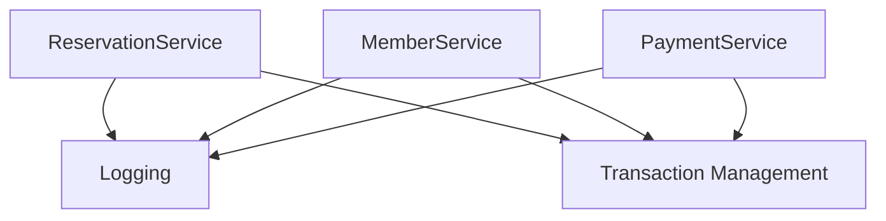
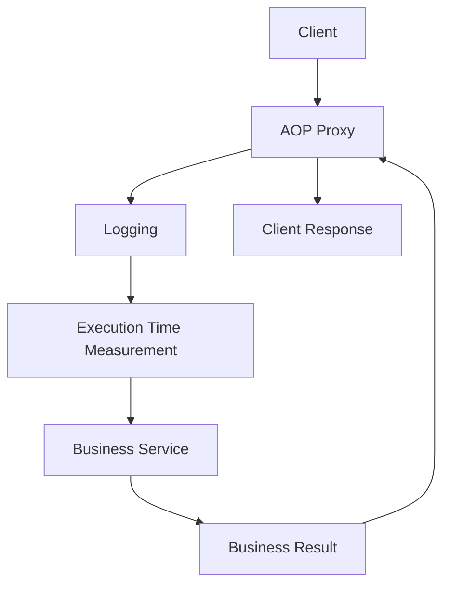
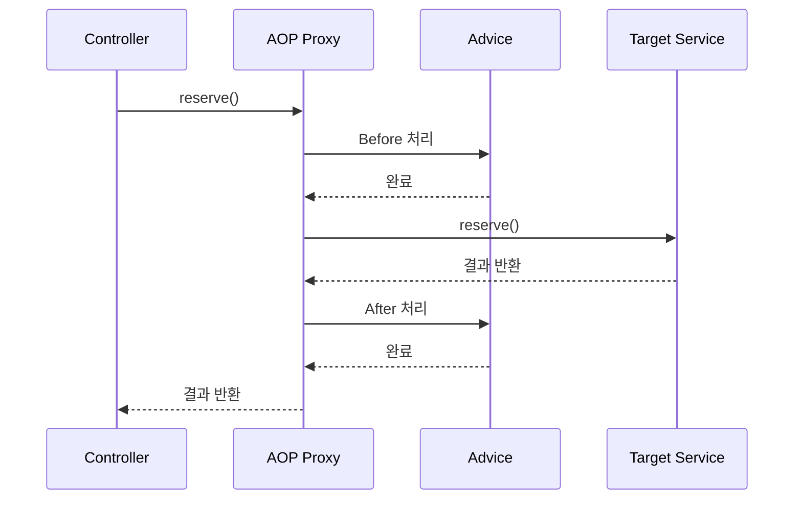
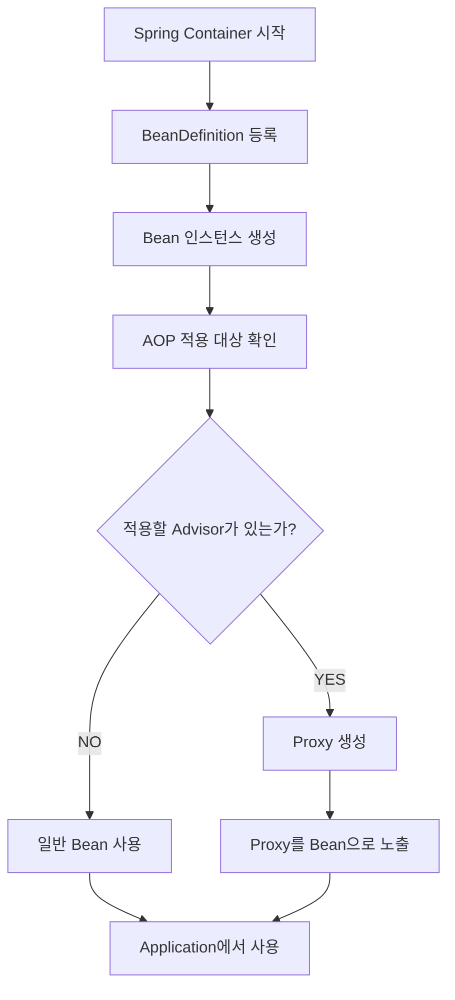
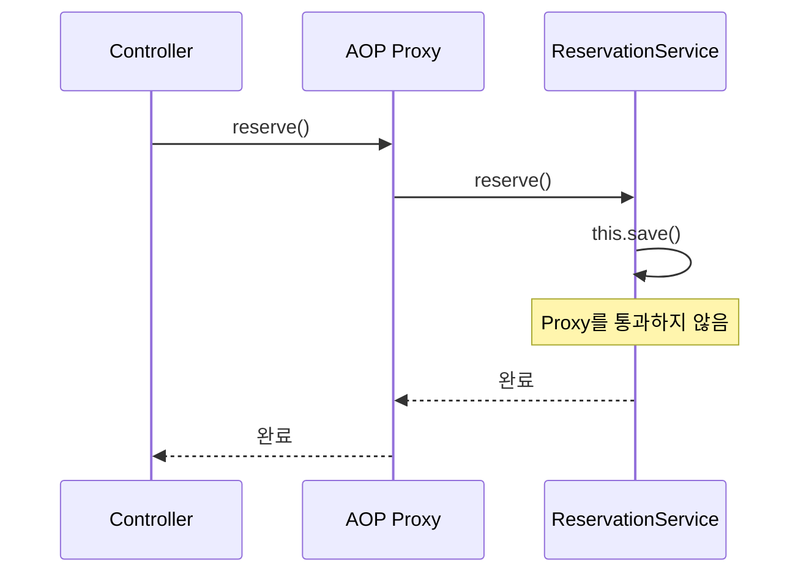
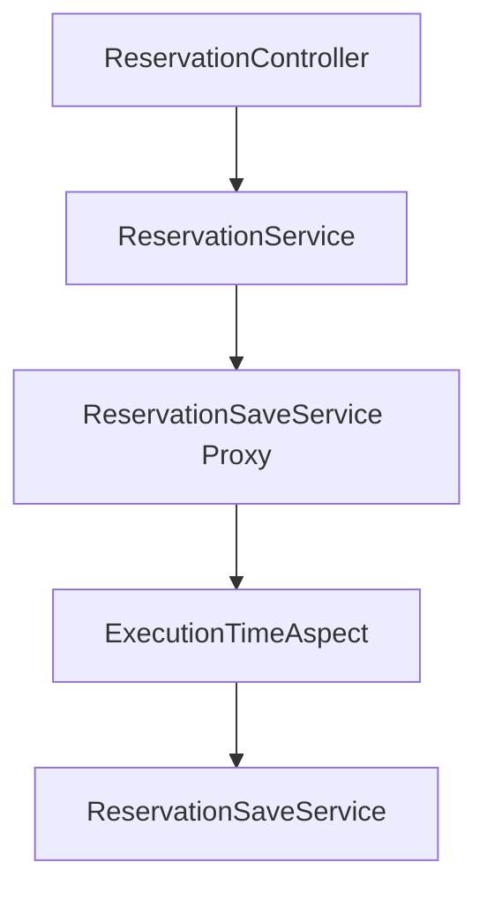
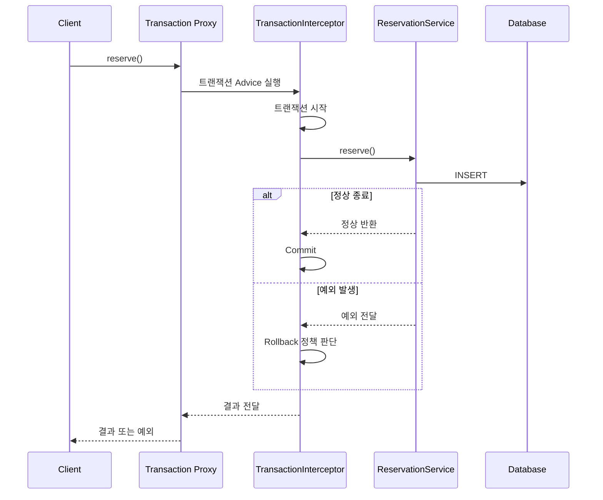
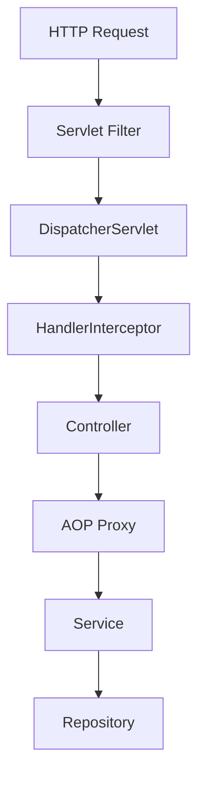
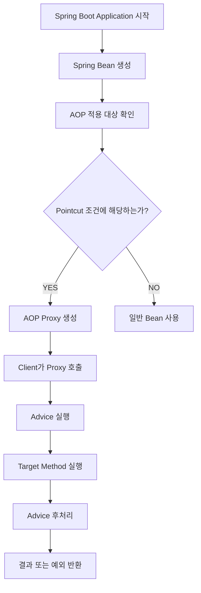

# 투다의 Spring AOP
[https://youtu.be/qdZvHRhfqhI?si=5d4WBGFuWUoVfQ_C](https://youtu.be/qdZvHRhfqhI?si=5d4WBGFuWUoVfQ_C)

# 투다의 Spring AOP
* toc
{:toc}

---

### Spring AOP는 왜 필요할까? 횡단 관심사와 프록시 동작 원리부터 실무 활용까지

Spring Boot로 애플리케이션을 개발하다 보면 `@Transactional`, `@Cacheable`, `@Async` 같은 어노테이션을 자연스럽게 사용하게 된다.

예를 들어 예약을 생성하는 서비스를 생각해 보자.

```java
@Service
public class ReservationService {

    private final ReservationRepository reservationRepository;

    public ReservationService(
            ReservationRepository reservationRepository
    ) {
        this.reservationRepository = reservationRepository;
    }

    @Transactional
    public void reserve(Long memberId, Long reservationTimeId) {
        Reservation reservation = Reservation.create(
                memberId,
                reservationTimeId
        );

        reservationRepository.save(reservation);
    }
}
```

예약 생성 로직은 단순하다.

예약 객체를 생성하고 Repository에 저장한다.

그런데 `@Transactional` 하나만 추가하면 Spring은 메서드 실행 과정에서 트랜잭션을 관리한다.

개발자가 직접 데이터베이스 커넥션을 가져오거나 트랜잭션을 시작하고 종료하는 코드를 작성하지 않아도 된다.

그렇다면 Spring은 어떻게 메서드 실행 전후에 트랜잭션 관련 작업을 수행할 수 있을까?

메서드 내부에는 트랜잭션을 시작하거나 커밋하는 코드가 존재하지 않는다.

그런데도 실행 시점에는 트랜잭션이 적용된다.

이러한 동작을 가능하게 하는 핵심 기술이 **AOP(Aspect-Oriented Programming)**&#xB2E4;.

AOP는 관점 지향 프로그래밍이라고 부른다.

하지만 이름만으로는 무엇을 해결하기 위한 기술인지 이해하기 어렵다.

AOP를 제대로 이해하려면 사용 방법보다 먼저 다음 질문을 생각해야 한다.

**객체지향적으로 코드를 잘 설계했는데도 여러 클래스에 동일한 기능을 반복해서 작성해야 한다면 어떻게 해결할 수 있을까?**

이 질문이 AOP의 출발점이다.

---

### AOP란 무엇인가?

AOP는 Aspect-Oriented Programming의 약자로, 여러 객체나 모듈에 공통으로 적용되는 관심사를 별도로 분리하고 필요한 위치에 적용하는 프로그래밍 방식이다.

Spring에서는 주로 다음과 같은 기능을 구현할 때 활용된다.

* 트랜잭션 관리
* 실행 시간 측정
* 공통 로깅
* 메서드 수준의 보안 검사
* 캐싱
* 특정 메서드의 실행 전후 처리

이러한 기능의 공통점은 여러 비즈니스 객체에서 반복적으로 필요하다는 것이다.

예를 들어 예약 시스템을 생각해 보자.

예약 생성, 예약 취소, 예약 조회, 회원 관리, 결제 처리 등 다양한 기능이 존재한다.

각 기능에는 서로 다른 비즈니스 로직이 있다.

하지만 로그를 기록하거나 트랜잭션을 관리하는 작업은 여러 기능에서 공통으로 필요할 수 있다.



여기서 로깅이나 트랜잭션 관리처럼 여러 모듈을 가로질러 적용되는 관심사를 **횡단 관심사(Cross-Cutting Concern)**&#xB77C;고 한다.

AOP의 핵심 목적은 이러한 횡단 관심사를 비즈니스 로직에서 분리하는 것이다.

Spring 공식 문서에서도 AOP를 OOP를 보완하는 방식으로 설명하며, 여러 객체를 가로지르는 공통 관심사를 Aspect라는 단위로 모듈화한다고 정의한다.

---

### 객체지향 프로그래밍만으로는 부족할까?

객체지향 프로그래밍(OOP)은 객체에 적절한 책임을 부여하고 객체들이 협력하도록 시스템을 구성하는 방식이다.

예를 들어 예약 시스템은 다음과 같이 설계할 수 있다.

```text
ReservationController
        ↓
ReservationService
        ↓
ReservationRepository
```

각 계층은 서로 다른 책임을 가진다.

Controller는 HTTP 요청을 처리한다.

Service는 비즈니스 작업을 조율한다.

Repository는 데이터베이스 접근을 담당한다.

이처럼 책임을 분리하면 하나의 클래스가 지나치게 많은 일을 담당하는 문제를 줄일 수 있다.

그런데 여기에 새로운 요구사항이 추가되었다고 가정해 보자.

예약을 처리하기 전에 사용자 권한을 확인해야 한다.

예약 생성에 소요된 시간을 측정해야 한다.

예약 처리 중 예외가 발생하면 로그를 기록해야 한다.

데이터베이스 작업은 하나의 트랜잭션으로 처리해야 한다.

이제 예약 서비스에는 비즈니스 로직 외에도 여러 기능이 필요해진다.

#### AOP 없이 구현한다면

예를 들어 다음과 같은 코드가 만들어질 수 있다.

```java
@Service
public class ReservationService {

    private static final Logger log =
            LoggerFactory.getLogger(ReservationService.class);

    private final ReservationRepository reservationRepository;
    private final AuthorizationService authorizationService;

    public ReservationService(
            ReservationRepository reservationRepository,
            AuthorizationService authorizationService
    ) {
        this.reservationRepository = reservationRepository;
        this.authorizationService = authorizationService;
    }

    public void reserve(Long memberId, Long reservationTimeId) {

        long startTime = System.nanoTime();

        log.info("예약 요청 시작: memberId={}", memberId);

        authorizationService.checkReservationPermission(memberId);

        try {
            Reservation reservation = Reservation.create(
                    memberId,
                    reservationTimeId
            );

            reservationRepository.save(reservation);

            log.info("예약 생성 완료");
        } catch (Exception exception) {
            log.error("예약 처리 실패", exception);
            throw exception;
        } finally {
            long elapsedTime = System.nanoTime() - startTime;

            log.info(
                    "예약 처리 시간: {} ms",
                    elapsedTime / 1_000_000.0
            );
        }
    }
}
```

이 예제에는 권한 확인, 로깅, 실행 시간 측정이 포함되어 있다.

트랜잭션 처리는 아직 추가하지 않았다.

그런데도 비즈니스 로직보다 부가적인 처리 코드가 차지하는 비중이 상당하다.

실제 예약 생성 로직은 다음 부분뿐이다.

```java
Reservation reservation = Reservation.create(
        memberId,
        reservationTimeId
);

reservationRepository.save(reservation);
```

나머지 코드는 비즈니스 작업을 지원하기 위한 공통 기능이다.

하나의 메서드만 보면 큰 문제가 없어 보일 수 있다.

하지만 예약 취소와 결제, 회원 정보 수정에도 동일한 요구사항이 추가된다면 어떻게 될까?

---

### 횡단 관심사는 왜 문제가 될까?

여러 서비스에 공통 기능을 직접 작성하는 상황을 생각해 보자.

```text
ReservationService
├── Logging
├── Authorization
├── Transaction
└── Reservation Logic

PaymentService
├── Logging
├── Authorization
├── Transaction
└── Payment Logic

MemberService
├── Logging
├── Authorization
├── Transaction
└── Member Logic
```

서로 다른 비즈니스 로직을 가진 클래스에 비슷한 코드가 반복된다.

이러한 구조에는 여러 문제가 존재한다.

#### 첫 번째 문제: 코드 중복

모든 서비스에서 실행 시간을 측정해야 한다면 각 메서드에 유사한 코드를 작성해야 한다.

서비스가 10개라면 10곳에서 관련 코드를 관리해야 할 수 있다.

#### 두 번째 문제: 변경 범위 증가

로그 형식이 변경되었다고 가정해 보자.

기존에는 실행 시간만 기록했지만 이제 메서드 이름도 기록해야 한다.

공통 처리 로직이 여러 클래스에 흩어져 있다면 모든 코드를 수정해야 할 수 있다.

#### 세 번째 문제: 비즈니스 로직의 가독성 저하

예약 생성 과정을 이해하려는데 로깅과 예외 처리, 실행 시간 측정 코드가 함께 존재한다.

개발자는 핵심 로직을 파악하기 위해 관련 없는 코드까지 읽어야 한다.

#### 네 번째 문제: 정책 불일치

어떤 서비스에서는 예외 발생 시 로그를 기록하지만 다른 서비스에서는 기록하지 않을 수 있다.

공통으로 적용되어야 할 정책이 클래스마다 달라질 수 있는 것이다.

이러한 문제는 코드 중복뿐 아니라 운영 정책의 일관성에도 영향을 준다.

AOP는 이런 문제를 해결하기 위한 접근 방식이다.

---

### 상속과 인터페이스로 해결할 수 없을까?

AOP를 사용하지 않고도 공통 기능을 분리하는 방법은 있다.

예를 들어 추상 클래스를 사용할 수 있다.

```java
public abstract class AbstractReservationService {

    private static final Logger log =
            LoggerFactory.getLogger(AbstractReservationService.class);

    public final void execute() {

        long start = System.nanoTime();

        try {
            doExecute();
        } finally {
            long elapsed = System.nanoTime() - start;

            log.info(
                    "실행 시간: {} ms",
                    elapsed / 1_000_000.0
            );
        }
    }

    protected abstract void doExecute();
}
```

실제 예약 서비스는 추상 클래스를 상속한다.

```java
public class ReservationService extends AbstractReservationService {

    @Override
    protected void doExecute() {
        // 예약 생성 로직
    }
}
```

이제 실행 시간 측정 코드가 예약 서비스에서 분리되었다.

템플릿 메서드 패턴을 활용한 것이다.

하지만 이 방법에는 한계가 있다.

Java 클래스는 하나의 클래스만 상속할 수 있다.

또 모든 Service가 공통 부모 클래스를 가져야 한다는 구조적인 제약이 생긴다.

트랜잭션이나 로깅 같은 기능 때문에 서로 다른 비즈니스 클래스가 동일한 상속 구조에 묶이는 것은 자연스럽지 않을 수 있다.

물론 상속이 유일한 해결책은 아니다.

Decorator 패턴이나 Proxy 패턴, Interceptor 등을 이용해 공통 기능을 분리할 수도 있다.

실제로 Spring AOP도 이러한 아이디어와 연결되어 있다.

중요한 것은 **객체지향으로 횡단 관심사를 절대 해결할 수 없다는 뜻이 아니라, 여러 모듈에 공통 기능을 선언적으로 적용하기 위한 별도의 구조가 유용하다는 것**이다.

---

### AOP는 어떤 문제를 해결하는가?

AOP를 적용하면 비즈니스 로직과 공통 기능을 분리할 수 있다.



비즈니스 서비스에는 핵심 기능만 남긴다.

```java
@Service
public class ReservationService {

    private final ReservationRepository reservationRepository;

    public ReservationService(
            ReservationRepository reservationRepository
    ) {
        this.reservationRepository = reservationRepository;
    }

    public void reserve(Long memberId, Long reservationTimeId) {
        Reservation reservation = Reservation.create(
                memberId,
                reservationTimeId
        );

        reservationRepository.save(reservation);
    }
}
```

로깅과 실행 시간 측정은 별도의 객체에서 처리한다.

이렇게 하면 핵심 로직을 변경하지 않고도 공통 기능을 적용할 수 있다.

다만 AOP를 적용한다고 모든 코드가 자동으로 좋아지는 것은 아니다.

공통 기능이 실제로 어디에 적용되는지 파악하기 어려워질 수 있기 때문이다.

따라서 AOP의 장점과 한계를 함께 이해해야 한다.

---

### Spring AOP의 핵심 개념

Spring AOP를 이해하려면 몇 가지 용어를 구분해야 한다.

대표적으로 다음 개념이 중요하다.

| 개념         | 의미                              |
| ---------- | ------------------------------- |
| Aspect     | 횡단 관심사를 모듈화한 단위                 |
| Advice     | 실제로 실행할 부가 기능                   |
| Join Point | Advice를 적용할 수 있는 실행 지점          |
| Pointcut   | Advice를 적용할 Join Point를 선택하는 조건 |
| Target     | 부가 기능이 적용되는 실제 객체               |
| Proxy      | Target 호출을 가로채 Advice를 실행하는 객체  |
| Weaving    | Aspect를 대상 실행 흐름에 연결하는 과정       |

이 용어들은 서로 다른 역할을 한다.

특히 Aspect, Advice, Join Point, Pointcut을 혼동하기 쉽다.

하나씩 살펴보자.

#### Aspect

Aspect는 공통 관심사를 하나의 단위로 묶은 것이다.

Spring에서는 일반적으로 `@Aspect`를 사용한다.

```java
@Aspect
@Component
public class LoggingAspect {
}
```

이 클래스는 로깅이라는 공통 기능을 담당하도록 구성할 수 있다.

여기서 `@Aspect` 자체가 Spring Bean 등록을 의미하지는 않는다.

Component Scan을 이용한다면 `@Component` 등을 통해 Spring Bean으로 등록해야 한다.

#### Advice

Advice는 실제로 수행할 작업이다.

예를 들어 다음과 같다.

```java
@Before("execution(* com.example.service..*(..))")
public void before() {
    log.info("메서드 실행 전");
}
```

메서드 실행 전에 로그를 기록하는 작업이 Advice다.

#### Join Point

Join Point는 부가 기능을 적용할 수 있는 실행 지점이다.

AOP라는 개념 전체에서는 메서드 호출이나 생성자 실행, 필드 접근 등 다양한 지점을 생각할 수 있다.

하지만 **Spring AOP는 Spring Bean의 메서드 실행을 대상으로 하는 프록시 기반 AOP**다.

따라서 일반적인 Spring AOP에서 Join Point는 메서드 실행 지점이라고 이해하면 된다.

#### Pointcut

Pointcut은 여러 Join Point 중 Advice를 적용할 위치를 선택하는 조건이다.

예를 들어 다음 표현식을 보자.

```java
execution(* com.example.service..*(..))
```

이 표현식은 지정한 패키지와 하위 패키지에 속하는 메서드 실행을 선택한다.

즉 Advice가 무엇을 실행할지 정의한다면 Pointcut은 **어디에 적용할지 결정한다.**

Spring 공식 문서에서도 Pointcut을 Advice가 실행될 Join Point를 선택하는 표현식으로 정의한다.

---

### Advice에는 어떤 종류가 있을까?

Spring AOP에서 자주 사용하는 Advice는 다음과 같다.

| Advice            | 실행 시점          | 대표적인 활용         |
| ----------------- | -------------- | --------------- |
| `@Before`         | 대상 메서드 실행 전    | 실행 로그, 사전 검사    |
| `@AfterReturning` | 메서드 정상 반환 후    | 정상 결과 기록        |
| `@AfterThrowing`  | 메서드가 예외를 던졌을 때 | 예외 로깅           |
| `@After`          | 메서드 실행 종료 시    | 성공·실패와 관계없는 정리  |
| `@Around`         | 메서드 실행 전후를 감쌈  | 실행 시간 측정, 호출 제어 |

각 Advice는 실행 시점과 제어할 수 있는 범위가 다르다.

#### @Before

대상 메서드가 실행되기 전에 부가 기능을 수행한다.

```java
@Before("execution(* com.example.service..*(..))")
public void before(JoinPoint joinPoint) {
    log.info(
            "실행 시작: {}",
            joinPoint.getSignature().getName()
    );
}
```

이 Advice는 메서드 실행 전에 로그를 기록한다.

다만 정상적인 `@Before` Advice만으로 대상 메서드의 반환값을 대체하는 용도로 사용하지는 않는다.

#### @AfterReturning

대상 메서드가 정상적으로 반환된 경우 실행된다.

```java
@AfterReturning(
        pointcut = "execution(* com.example.service..*(..))"
)
public void afterReturning(JoinPoint joinPoint) {
    log.info(
            "정상 종료: {}",
            joinPoint.getSignature().getName()
    );
}
```

대상 메서드에서 예외가 발생하여 정상 반환하지 못하면 실행되지 않는다.

#### @AfterThrowing

대상 메서드 실행 중 예외가 발생하면 실행된다.

```java
@AfterThrowing(
        pointcut = "execution(* com.example.service..*(..))",
        throwing = "exception"
)
public void afterThrowing(
        JoinPoint joinPoint,
        Throwable exception
) {
    log.error(
            "실행 실패: {}",
            joinPoint.getSignature().getName(),
            exception
    );
}
```

예외 발생 상황을 기록할 때 유용하다.

다만 이 Advice가 실행된다고 예외가 자동으로 처리되어 정상 응답으로 바뀌는 것은 아니다.

#### @After

대상 메서드가 정상적으로 끝나거나 예외를 발생시키더라도 실행되는 Advice다.

Java의 `finally`와 비슷한 목적으로 이해할 수 있다.

#### @Around

대상 메서드의 실행을 감싸는 Advice다.

실행 전 작업과 실행 후 작업을 모두 수행할 수 있다.

또 메서드 실행을 진행할지, 반환값을 어떻게 처리할지 제어할 수 있다.

```java
@Around("execution(* com.example.service..*(..))")
public Object around(ProceedingJoinPoint joinPoint) throws Throwable {

    log.info("메서드 시작");

    Object result = joinPoint.proceed();

    log.info("메서드 종료");

    return result;
}
```

여기서 `proceed()`가 중요하다.

이 메서드는 현재 Advice 체인에서 다음 단계로 실행을 진행한다.

일반적인 경우 최종적으로 실제 Target 메서드가 실행된다.

다만 다른 Advice가 여러 개 적용되어 있다면 그 Advice들을 거쳐 실제 메서드에 도달할 수 있다.

또 `proceed()` 호출을 생략하면 대상 메서드가 실행되지 않을 수도 있다.

따라서 `@Around`는 강력하지만 신중하게 사용해야 한다.

---

### Spring AOP는 내부적으로 어떻게 동작할까?

Spring AOP의 핵심은 Proxy다.

Proxy는 실제 객체를 대신해 요청을 받는 대리 객체다.

예를 들어 다음과 같은 서비스가 있다고 하자.

```java
@Service
public class ReservationService {

    public void reserve() {
        System.out.println("예약 생성");
    }
}
```

Controller는 일반적으로 `ReservationService`를 주입받아 사용한다.

```java
@RestController
public class ReservationController {

    private final ReservationService reservationService;

    public ReservationController(
            ReservationService reservationService
    ) {
        this.reservationService = reservationService;
    }
}
```

그런데 AOP가 적용된 경우 Controller에 주입된 객체는 원본 Service가 아니라 Proxy일 수 있다.



호출자는 `ReservationService`를 사용하는 것처럼 보이지만 실제 호출은 Proxy를 통해 전달된다.

Proxy는 대상 메서드를 실행하기 전후에 Advice를 수행할 수 있다.

이러한 구조 덕분에 비즈니스 코드를 직접 수정하지 않고 공통 기능을 적용할 수 있다.

---

### Spring은 언제 AOP Proxy를 생성할까?

Spring이 애플리케이션을 시작하면 BeanDefinition을 이용해 Bean을 생성하고 초기화한다.

이 과정에는 BeanPostProcessor라는 확장 지점이 존재한다.

Spring AOP는 `BeanPostProcessor` 계열의 인프라를 통해 AOP 적용 대상 Bean을 확인하고 필요한 경우 Proxy를 생성할 수 있다.

대표적인 자동 프록시 생성 인프라로 `AnnotationAwareAspectJAutoProxyCreator`가 있다.

개념적으로 다음과 같은 과정이다.



여기서 Spring은 Pointcut을 이용해 대상 메서드가 Advice 적용 조건에 해당하는지 판단한다.

그런 다음 Proxy를 통해 호출을 가로챌 수 있도록 구성한다.

이 때문에 AOP 적용 여부는 메서드 코드만 보고 판단하기 어려울 수 있다.

**AOP는 메서드 내부에서 직접 호출되는 기능이 아니라, 컨테이너가 구성한 호출 경로를 통해 동작하기 때문이다.**

---

### JDK Dynamic Proxy와 CGLIB의 차이

Spring AOP에서 사용하는 대표적인 Proxy 방식은 두 가지다.

첫 번째는 JDK Dynamic Proxy다.

두 번째는 CGLIB Proxy다.

두 방식은 Proxy를 생성하는 방법이 다르다.

#### JDK Dynamic Proxy

JDK Dynamic Proxy는 Java 인터페이스를 기반으로 Proxy를 생성한다.

예를 들어 다음과 같은 인터페이스가 있다고 하자.

```java
public interface ReservationService {

    void reserve(Long reservationTimeId);
}
```

구현체는 다음과 같다.

```java
@Service
public class ReservationServiceImpl
        implements ReservationService {

    @Override
    public void reserve(Long reservationTimeId) {
        // 예약 생성
    }
}
```

JDK Dynamic Proxy는 인터페이스를 구현하는 형태의 Proxy 객체를 생성할 수 있다.

```text
ReservationService Interface
          ↑
          │
JDK Dynamic Proxy
          │
          ↓
ReservationServiceImpl
```

호출자는 인터페이스를 통해 Proxy를 사용한다.

따라서 인터페이스에 정의되지 않은 구현체 전용 메서드를 동일한 방식으로 호출하는 데 제약이 있다.

#### CGLIB Proxy

CGLIB는 클래스를 상속하는 방식으로 Proxy를 생성한다.

```text
ReservationService
        ↑
        │
ReservationService Proxy
```

하지만 상속 기반이기 때문에 다음과 같은 제약이 존재한다.

`final` 클래스는 상속할 수 없다.

`final` 메서드는 오버라이드할 수 없다.

`private` 메서드도 오버라이드할 수 없다.

따라서 이런 메서드에는 클래스 기반 Proxy의 Advice를 적용할 수 없다.

두 방식을 비교하면 다음과 같다.

| 구분          | JDK Dynamic Proxy      | CGLIB            |
| ----------- | ---------------------- | ---------------- |
| 생성 방식       | 인터페이스 구현               | 클래스 상속           |
| 인터페이스       | 필요                     | 필수는 아님           |
| 구현체 전용 메서드  | 인터페이스 Proxy에서는 제약      | 오버라이드 가능하면 적용 가능 |
| `final` 클래스 | 인터페이스 기반 호출은 가능할 수 있음  | Proxy 생성 불가      |
| `final` 메서드 | 인터페이스를 통한 호출은 가로챌 수 있음 | 오버라이드 불가         |
| 주요 특징       | 인터페이스 중심               | 클래스 중심           |

Spring Boot는 일반적으로 클래스 기반 Proxy를 기본 설정으로 사용하며, `spring.aop.proxy-target-class=false` 설정으로 JDK Dynamic Proxy 사용을 선택할 수 있다.

---

### Spring Boot에서 AOP를 적용해 보자

이제 실제로 실행 시간을 측정하는 AOP를 구현해 보자.

예제의 목표는 다음과 같다.

예약 서비스의 비즈니스 로직에는 실행 시간 측정 코드를 작성하지 않는다.

대신 특정 어노테이션을 붙인 메서드에만 공통 기능을 적용한다.

메서드가 정상적으로 종료되든 예외가 발생하든 실행 시간을 기록한다.

#### 1. Gradle 의존성 설정

Spring Boot 버전에 따라 AOP Starter 이름이 다르다.

Spring Boot 3.x에서는 다음 의존성을 사용한다.

```kotlin
dependencies {
    implementation("org.springframework.boot:spring-boot-starter-web")
    implementation("org.springframework.boot:spring-boot-starter-aop")
}
```

Spring Boot 4.x에서는 다음 의존성을 사용할 수 있다.

```kotlin
dependencies {
    implementation("org.springframework.boot:spring-boot-starter-webmvc")
    implementation("org.springframework.boot:spring-boot-starter-aspectj")
}
```

Spring Boot 4에서는 기존 `spring-boot-starter-aop`가 `spring-boot-starter-aspectj`로 변경되었다. 이 Starter를 사용한다고 자동으로 AspectJ의 컴파일 타임 위빙을 사용하는 것은 아니며, 아래 예제는 Spring AOP의 프록시 방식을 사용한다.

#### 2. 사용자 정의 어노테이션 생성

먼저 실행 시간을 측정할 메서드를 표시하는 어노테이션을 만든다.

**TrackExecutionTime.java**

```java
package com.example.demo;

import java.lang.annotation.ElementType;
import java.lang.annotation.Retention;
import java.lang.annotation.RetentionPolicy;
import java.lang.annotation.Target;

@Target(ElementType.METHOD)
@Retention(RetentionPolicy.RUNTIME)
public @interface TrackExecutionTime {
}
```

`@Target(ElementType.METHOD)`는 메서드에 사용할 수 있는 어노테이션이라는 의미다.

`@Retention(RetentionPolicy.RUNTIME)`은 런타임에도 어노테이션 정보를 유지하도록 설정한다.

이제 실행 시간을 측정하고 싶은 메서드에 `@TrackExecutionTime`을 붙일 수 있다.

#### 3. Aspect 구현

**ExecutionTimeAspect.java**

```java
package com.example.demo;

import org.aspectj.lang.ProceedingJoinPoint;
import org.aspectj.lang.annotation.Around;
import org.aspectj.lang.annotation.Aspect;
import org.slf4j.Logger;
import org.slf4j.LoggerFactory;
import org.springframework.stereotype.Component;

@Aspect
@Component
public class ExecutionTimeAspect {

    private static final Logger log =
            LoggerFactory.getLogger(ExecutionTimeAspect.class);

    @Around("@annotation(com.example.demo.TrackExecutionTime)")
    public Object measureExecutionTime(
            ProceedingJoinPoint joinPoint
    ) throws Throwable {

        long startTime = System.nanoTime();

        try {
            return joinPoint.proceed();
        } finally {
            long elapsedNanos = System.nanoTime() - startTime;

            double elapsedMillis = elapsedNanos / 1_000_000.0;

            log.info(
                    "method={}, elapsed={}ms",
                    joinPoint.getSignature().toShortString(),
                    elapsedMillis
            );
        }
    }
}
```

이 코드에서 중요한 부분을 살펴보자.

```java
@Aspect
@Component
```

`@Aspect`는 해당 클래스가 Aspect임을 선언한다.

`@Component`는 Spring Bean으로 등록되도록 한다.

다음 코드는 Pointcut을 의미한다.

```java
@Around("@annotation(com.example.demo.TrackExecutionTime)")
```

`@TrackExecutionTime`이 적용된 메서드를 대상으로 Around Advice를 실행한다.

그리고 다음 코드가 실제 대상 메서드 실행을 진행한다.

```java
return joinPoint.proceed();
```

마지막으로 `finally`에서 실행 시간을 기록한다.

```java
finally {
    long elapsedNanos = System.nanoTime() - startTime;
}
```

`finally`를 사용했으므로 대상 메서드가 정상 종료되거나 예외를 던져도 실행 시간을 기록할 수 있다.

또 `System.nanoTime()`은 경과 시간 측정에 적합한 단조 시간 기반 API다.

`System.currentTimeMillis()`처럼 시스템 시계의 변경에 영향을 받는 방식보다 실행 시간 측정에 적합하다.

#### 4. 비즈니스 서비스 구현

**ReservationService.java**

```java
package com.example.demo;

import org.springframework.stereotype.Service;

@Service
public class ReservationService {

    @TrackExecutionTime
    public String reserve(Long reservationTimeId) {

        validateReservationTime(reservationTimeId);

        return "예약 생성 완료: " + reservationTimeId;
    }

    private void validateReservationTime(Long reservationTimeId) {

        if (reservationTimeId == null || reservationTimeId <= 0) {
            throw new IllegalArgumentException(
                    "올바른 예약 시간 ID가 아닙니다."
            );
        }
    }
}
```

예약 서비스에는 실행 시간 측정 코드가 없다.

비즈니스 로직은 예약 ID 검증과 결과 반환에 집중한다.

실행 시간 측정은 Aspect에서 담당한다.

#### 5. Controller 구현

**ReservationController.java**

```java
package com.example.demo;

import org.springframework.web.bind.annotation.PathVariable;
import org.springframework.web.bind.annotation.PostMapping;
import org.springframework.web.bind.annotation.RequestMapping;
import org.springframework.web.bind.annotation.RestController;

@RestController
@RequestMapping("/api/reservations")
public class ReservationController {

    private final ReservationService reservationService;

    public ReservationController(
            ReservationService reservationService
    ) {
        this.reservationService = reservationService;
    }

    @PostMapping("/{reservationTimeId}")
    public String reserve(
            @PathVariable Long reservationTimeId
    ) {
        return reservationService.reserve(reservationTimeId);
    }
}
```

#### 6. 애플리케이션 실행 클래스

**DemoApplication.java**

```java
package com.example.demo;

import org.springframework.boot.SpringApplication;
import org.springframework.boot.autoconfigure.SpringBootApplication;

@SpringBootApplication
public class DemoApplication {

    public static void main(String[] args) {
        SpringApplication.run(DemoApplication.class, args);
    }
}
```

이제 Spring Boot 애플리케이션을 실행한다.

```bash
./gradlew bootRun
```

애플리케이션이 정상적으로 시작되었다면 다음 요청을 실행할 수 있다.

```bash
curl -X POST http://localhost:8080/api/reservations/1
```

응답은 다음과 같다.

```text
예약 생성 완료: 1
```

애플리케이션 로그에서는 다음과 같은 정보를 확인할 수 있다.

```text
method=ReservationService.reserve(..), elapsed=1.25ms
```

실제 실행 시간은 환경과 실행 상황에 따라 달라진다.

이 예제의 핵심은 실행 시간을 측정하는 코드를 비즈니스 메서드에 직접 작성하지 않았다는 점이다.

`@TrackExecutionTime`을 적용한 메서드는 동일한 Aspect를 재사용할 수 있다.

---

### @Around의 proceed()는 왜 중요할까?

앞서 작성한 Aspect를 다시 살펴보자.

```java
@Around("@annotation(com.example.demo.TrackExecutionTime)")
public Object measureExecutionTime(
        ProceedingJoinPoint joinPoint
) throws Throwable {

    long startTime = System.nanoTime();

    try {
        return joinPoint.proceed();
    } finally {
        log.info(
                "실행 시간: {}",
                System.nanoTime() - startTime
        );
    }
}
```

여기서 `joinPoint.proceed()`를 제거하면 어떻게 될까?

```java
@Around("@annotation(com.example.demo.TrackExecutionTime)")
public Object measureExecutionTime(
        ProceedingJoinPoint joinPoint
) {
    return null;
}
```

이 경우 대상 메서드 실행이 진행되지 않는다.

즉 Around Advice는 단순히 메서드 실행 전후에 로그를 추가하는 기능보다 더 강력하다.

실제 호출 자체를 제어할 수 있다.

그러나 이 기능은 위험할 수도 있다.

예를 들어 다음과 같은 코드를 작성했다고 하자.

```java
Object first = joinPoint.proceed();
Object second = joinPoint.proceed();
```

Around Advice에서 `proceed()`를 여러 번 호출하면 대상 실행이 여러 번 진행될 수 있다.

물론 정확한 실행 경로는 Advice 체인과 실행 방식에 따라 달라진다.

하지만 예약 생성이나 결제 처리처럼 부작용이 있는 비즈니스 메서드에서는 중복 실행이 심각한 문제가 될 수 있다.

따라서 특별한 의도가 없다면 `proceed()`를 정확히 한 번 호출하고 반환값을 그대로 전달하는 것이 안전하다.

---

### Pointcut 표현식은 어떻게 작성할까?

Pointcut은 Advice를 적용할 메서드를 선택하는 조건이다.

Spring AOP에서는 AspectJ 표현식 문법의 일부를 사용할 수 있다.

대표적인 표현식을 살펴보자.

#### execution

메서드의 이름이나 반환 타입, 파라미터, 패키지 등을 기준으로 선택한다.

```java
@Around("execution(* com.example.service..*(..))")
```

이 표현식을 나누어 살펴보자.

| 요소                    | 의미         |
| --------------------- | ---------- |
| `execution`           | 메서드 실행을 선택 |
| `*`                   | 모든 반환 타입   |
| `com.example.service` | 기준 패키지     |
| `..`                  | 하위 패키지 포함  |
| `*`                   | 모든 메서드 이름  |
| `(..)`                | 모든 파라미터 조합 |

즉 Service 패키지와 하위 패키지의 메서드 실행에 적용할 수 있다.

#### within

특정 타입이나 패키지에 선언된 메서드를 선택한다.

```java
@Around("within(com.example.service..*)")
```

Service 패키지의 타입을 기준으로 선택할 수 있다.

#### @annotation

특정 어노테이션이 적용된 메서드를 선택한다.

```java
@Around("@annotation(com.example.demo.TrackExecutionTime)")
```

실무에서는 공통 기능을 어디에 적용할지 명시적으로 표현하고 싶을 때 유용하다.

예를 들어 실행 시간 측정, 감사 로그, 특정 정책 검사 등에 사용할 수 있다.

#### @Pointcut

Pointcut 표현식을 별도로 정의하고 재사용할 수도 있다.

```java
@Pointcut("execution(* com.example.service..*(..))")
public void serviceMethods() {
}
```

이후 다음처럼 사용할 수 있다.

```java
@Before("serviceMethods()")
public void beforeServiceMethod() {
    // 공통 처리
}
```

이 방식은 동일한 Pointcut을 여러 Advice에서 사용하는 경우에 유용하다.

다만 Pointcut 표현식을 지나치게 복잡하게 작성하면 실제 적용 범위를 파악하기 어려워질 수 있다.

따라서 가능한 한 명확한 기준을 사용하는 것이 좋다.

---

### Spring AOP의 가장 중요한 한계: Self-Invocation

Spring AOP에서 반드시 이해해야 하는 문제가 있다.

바로 Self-Invocation이다.

Self-Invocation은 같은 객체 내부에서 자신의 다른 메서드를 호출하는 상황을 의미한다.

다음 코드를 살펴보자.

```java
@Service
public class ReservationService {

    public void reserve() {
        validate();
        save();
    }

    @TrackExecutionTime
    public void save() {
        System.out.println("예약 저장");
    }

    private void validate() {
        System.out.println("예약 검증");
    }
}
```

`save()`에는 `@TrackExecutionTime`이 선언되어 있다.

그렇다면 `reserve()`를 호출하면 `save()`에 실행 시간 측정이 적용될까?

**Spring의 일반적인 프록시 기반 AOP에서는 적용되지 않는다.**

이유는 Proxy를 통하지 않고 같은 객체 내부에서 메서드를 직접 호출하기 때문이다.

---

### Self-Invocation의 내부 동작

일반적인 AOP 호출은 다음과 같다.

```text
Controller
    ↓
AOP Proxy
    ↓
Advice
    ↓
Target Method
```

하지만 같은 객체 내부에서 다른 메서드를 호출하면 다음과 같이 동작한다.

```text
Controller
    ↓
AOP Proxy
    ↓
ReservationService.reserve()
    ↓
this.save()
```

`this.save()`는 실제 Target 객체 내부의 메서드 호출이다.

Proxy를 다시 거치지 않는다.

따라서 `save()`에 적용할 Advice가 실행되지 않을 수 있다.



이 문제는 AOP가 메서드 자체에 코드를 삽입하는 방식이 아니라 Proxy를 통해 호출을 가로채는 방식이기 때문에 발생한다.

Spring 공식 문서에서도 Self-Invocation이 Proxy를 우회하여 Advice가 적용되지 않는다고 설명한다.

---

### Self-Invocation을 해결하는 방법

가장 일반적인 해결 방법은 AOP가 필요한 메서드를 다른 Spring Bean으로 분리하는 것이다.

예를 들어 다음과 같이 구성할 수 있다.

```java
@Service
public class ReservationService {

    private final ReservationSaveService reservationSaveService;

    public ReservationService(
            ReservationSaveService reservationSaveService
    ) {
        this.reservationSaveService = reservationSaveService;
    }

    public void reserve() {
        reservationSaveService.save();
    }
}
```

별도의 Service에 AOP를 적용한다.

```java
@Service
public class ReservationSaveService {

    @TrackExecutionTime
    public void save() {
        System.out.println("예약 저장");
    }
}
```

이제 호출 구조가 달라진다.



`ReservationService`가 주입받은 `ReservationSaveService`는 AOP Proxy일 수 있다.

따라서 다른 Bean을 통해 호출하면 Advice가 적용될 수 있다.

다만 Self-Invocation을 해결하기 위해 무조건 클래스를 나눌 필요는 없다.

실행 시간 측정만을 위해 도메인 설계를 과도하게 분리한다면 오히려 유지보수성이 떨어질 수 있다.

중요한 것은 **AOP의 호출 경계를 이해하고, 실제 객체의 책임에 맞게 설계하는 것**이다.

---

### @Transactional에서도 Self-Invocation 문제가 발생한다

Self-Invocation은 단순한 로깅 문제로 끝나지 않는다.

Spring의 선언적 트랜잭션 관리에서도 발생할 수 있다.

다음 코드를 생각해 보자.

```java
@Service
public class PaymentService {

    public void processPayment() {
        savePayment();
    }

    @Transactional
    public void savePayment() {
        // 결제 정보 저장
    }
}
```

`processPayment()`에서 `savePayment()`를 호출한다.

그런데 `savePayment()`는 같은 클래스 내부에서 호출된다.

따라서 트랜잭션 Proxy를 거치지 않는다.

외부에 이미 트랜잭션이 없는 상황이라면 `savePayment()`에 선언된 `@Transactional`이 기대한 방식으로 적용되지 않을 수 있다.

이 문제는 특히 다음과 같은 상황에서 위험하다.

```java
@Transactional(propagation = Propagation.REQUIRES_NEW)
public void savePaymentHistory() {
    // 별도의 트랜잭션으로 저장해야 하는 로직
}
```

개발자는 새로운 트랜잭션이 생성될 것으로 기대한다.

하지만 Self-Invocation이라면 `REQUIRES_NEW` 설정 자체가 가로채지지 않아 별도 트랜잭션이 생성되지 않을 수 있다.

실제 운영에서는 결제 이력, 정산, 감사 로그 등의 데이터 일관성에 영향을 줄 수 있다.

Spring의 선언적 트랜잭션은 기본적으로 AOP Proxy를 활용하며, 외부 호출이 Proxy를 통과할 때 트랜잭션을 적용한다.

---

### @Transactional은 내부적으로 어떻게 동작할까?

트랜잭션 관리에 AOP가 사용되는 이유를 조금 더 자세히 살펴보자.

다음 코드가 있다고 하자.

```java
@Transactional
public void reserve() {
    reservationRepository.save(...);
}
```

개발자는 `@Transactional`을 붙이기만 한다.

하지만 실제 실행에서는 여러 단계가 필요하다.

트랜잭션을 시작해야 한다.

적절한 데이터베이스 커넥션을 사용해야 한다.

메서드를 실행해야 한다.

정상 종료되면 커밋해야 한다.

예외가 발생하면 정책에 따라 롤백해야 한다.

이런 과정을 매번 직접 작성한다면 비즈니스 코드가 복잡해진다.

Spring은 `TransactionInterceptor`와 `TransactionManager`를 이용해 이러한 처리를 수행한다.



여기서 트랜잭션이 시작되거나 커밋되는 시점은 단순히 메서드에 어노테이션이 존재하기 때문만은 아니다.

**어노테이션에 선언된 메타데이터를 Spring의 트랜잭션 인프라가 읽고, Proxy를 통한 메서드 호출을 가로채 처리하기 때문**이다.

또한 `@Transactional`의 기본 롤백 정책은 모든 예외에서 롤백하는 것이 아니다.

일반적으로 `RuntimeException`과 `Error`가 발생하면 롤백하고, Checked Exception은 기본적으로 롤백하지 않는다.

필요하다면 `rollbackFor` 등을 이용해 정책을 변경할 수 있다.

이러한 세부 동작 역시 단순히 AOP를 사용한다고 자동으로 해결되는 것이 아니라 트랜잭션 인프라가 제공하는 정책의 일부다.

---

### Spring AOP와 AspectJ는 같은 기술일까?

이름이 비슷해 혼동하기 쉽지만 구분할 필요가 있다.

Spring AOP는 주로 Proxy를 이용해 Spring Bean의 메서드 실행을 가로챈다.

반면 AspectJ는 컴파일 시점이나 클래스 로딩 시점에 바이트코드를 변경하는 방식의 Weaving을 지원한다.

이 두 방식의 차이는 적용할 수 있는 범위에서도 나타난다.

| 구분              | Spring AOP            | AspectJ Weaving    |
| --------------- | --------------------- | ------------------ |
| 주요 방식           | Proxy                 | 바이트코드 Weaving      |
| 적용 대상           | Spring Bean 메서드 실행    | 더 다양한 실행 지점        |
| Self-Invocation | Proxy 우회 문제 존재        | 동일한 제약을 갖지 않음      |
| 생성자 실행          | 일반적인 Proxy AOP로 적용 불가 | 지원 가능              |
| 필드 접근           | 일반적인 Proxy AOP로 적용 불가 | 지원 가능              |
| 설정 난이도          | 상대적으로 단순              | Weaving 설정 필요      |
| 대표적인 활용         | Spring 애플리케이션의 공통 기능  | 더 넓은 Join Point 제어 |

Spring AOP에서 `@Aspect`, `@Around` 같은 AspectJ 어노테이션을 사용하더라도 실제 실행 방식은 Spring AOP Proxy일 수 있다.

즉 **AspectJ 문법을 사용한다는 사실과 AspectJ Weaving을 사용한다는 사실은 다르다.**

Spring 공식 문서에서도 `@AspectJ` 스타일의 선언을 Spring AOP에서 사용할 수 있지만, 이 경우 런타임 구현은 Spring의 프록시 방식이라고 명확히 설명한다.

---

### AOP는 모든 메서드에 적용할 수 있을까?

Spring AOP는 강력하지만 제약이 존재한다.

대표적인 상황을 살펴보자.

#### 1. Spring Bean이 아닌 객체

다음과 같이 개발자가 직접 생성한 객체는 일반적으로 Spring AOP가 관리하지 않는다.

```java
ReservationService service = new ReservationService();
```

Spring 컨테이너가 생성한 Proxy를 통해 호출하는 것이 아니기 때문이다.

따라서 해당 객체의 메서드에 Aspect 조건과 일치하는 어노테이션이 있더라도 자동으로 AOP가 적용되는 것은 아니다.

#### 2. private 메서드

CGLIB Proxy는 상속과 메서드 오버라이딩을 이용한다.

`private` 메서드는 오버라이드할 수 없다.

따라서 일반적인 Spring AOP에서 직접적인 Advice 적용 대상이 될 수 없다.

#### 3. final 메서드

CGLIB 기반 Proxy에서는 `final` 메서드를 오버라이드할 수 없다.

따라서 클래스 기반 AOP 적용에 제약이 있다.

#### 4. 같은 클래스 내부 호출

앞서 살펴본 Self-Invocation 문제다.

Proxy를 거치지 않는 호출에는 Advice가 적용되지 않는다.

#### 5. 생성자와 @PostConstruct

Spring AOP는 메서드 호출을 가로채는 Proxy 방식이다.

따라서 객체 생성자 자체를 일반적인 Pointcut 대상으로 처리하지 않는다.

또 `@PostConstruct`는 Bean 초기화 단계에서 실행되므로 AOP Proxy가 완전히 구성된 상태를 전제로 동작할 것이라고 기대해서는 안 된다.

이러한 제약을 이해하지 못하면 어노테이션을 선언했는데도 부가 기능이 실행되지 않는 문제를 만나게 된다.

---

### 여러 Aspect가 동시에 적용되면 어떻게 될까?

실무에서는 하나의 메서드에 여러 공통 기능이 적용될 수 있다.

예를 들어 예약 생성 메서드에 다음 기능들이 필요하다고 하자.

```text
Logging

Transaction

Execution Time Measurement
```

이 기능들이 모두 Around Advice로 구현되어 있다면 어떤 순서로 실행될까?

순서를 명확하게 정의하지 않았다면 개발자가 기대한 순서와 다를 수 있다.

Spring에서는 `@Order`를 통해 Aspect의 우선순위를 지정할 수 있다.

```java
@Aspect
@Component
@Order(1)
public class LoggingAspect {
}
```

```java
@Aspect
@Component
@Order(2)
public class ExecutionTimeAspect {
}
```

일반적으로 우선순위 값이 작을수록 높은 우선순위를 가진다.

높은 우선순위의 Around Advice는 호출이 들어갈 때 먼저 실행되고, 호출이 돌아올 때는 나중에 실행된다.

예를 들어 다음과 같은 형태가 될 수 있다.

```text
LoggingAspect 시작
    ↓
ExecutionTimeAspect 시작
    ↓
Business Method
    ↓
ExecutionTimeAspect 종료
    ↓
LoggingAspect 종료
```

이 구조는 중첩된 함수 호출과 비슷하다.

다만 `@Transactional`을 포함한 다른 Spring 인프라의 Advice까지 정확히 어떤 순서로 실행되는지는 각각의 Advisor 우선순위 설정을 함께 확인해야 한다.

---

### AOP 실행 순서가 중요한 이유

예를 들어 실행 시간을 측정하는 Aspect와 트랜잭션 Aspect가 동시에 적용된다고 하자.

다음 순서라면 실행 시간에 트랜잭션 시작과 커밋에 관련된 처리 시간이 포함될 수 있다.

```text
ExecutionTimeAspect
    ↓
TransactionInterceptor
    ↓
Business Method
    ↓
Transaction Commit
    ↓
ExecutionTimeAspect 종료
```

반면 순서가 반대라면 어떨까?

```text
TransactionInterceptor
    ↓
ExecutionTimeAspect
    ↓
Business Method
    ↓
ExecutionTimeAspect 종료
    ↓
Transaction Commit
```

이 경우 실행 시간 측정 범위에 트랜잭션 커밋 처리가 포함되지 않을 수 있다.

즉 같은 실행 시간 측정 Aspect라도 Advice 순서에 따라 측정값이 의미하는 범위가 달라진다.

따라서 성능 측정 목적으로 AOP를 사용할 때는 단순히 시간을 기록하는 것뿐 아니라 **무엇부터 무엇까지 측정하는지 정의하는 것**이 중요하다.

---

### AOP로 비즈니스 로직을 구현하면 안 될까?

여기서 중요한 질문이 있다.

AOP로 메서드 호출을 가로채고 원하는 작업을 실행할 수 있다면 비즈니스 로직도 AOP에서 구현할 수 있지 않을까?

기술적으로는 일부 기능을 그렇게 구현할 수 있다.

예를 들어 예약 서비스가 다음과 같다고 하자.

```java
@Service
public class ReservationService {

    public void reserve() {
        System.out.println("예약 요청");
    }
}
```

그런데 실제 예약 생성 로직은 별도의 Aspect에 존재한다.

```java
@Aspect
@Component
public class ReservationAspect {

    @Around("execution(* com.example.service.ReservationService.reserve(..))")
    public Object reserve(ProceedingJoinPoint joinPoint)
            throws Throwable {

        // 실제 예약 생성 로직
        // 결제 처리
        // 알림 전송

        return joinPoint.proceed();
    }
}
```

이러한 구조에서는 `ReservationService` 코드만 읽어도 예약 생성 과정이 어떻게 동작하는지 알기 어렵다.

서비스에는 예약 생성 로직이 없지만 실제 실행 과정에서는 결제나 알림 작업까지 발생할 수 있다.

코드의 명시성이 떨어지는 것이다.

AOP는 호출 경로에 숨겨진 동작을 추가할 수 있기 때문에 무분별하게 사용하면 디버깅이 어려워진다.

따라서 비즈니스 로직의 핵심적인 흐름은 일반적으로 Service와 Domain Object 등에서 명시적으로 관리하는 것이 좋다.

AOP는 이러한 객체들이 공통으로 필요로 하는 기술적 관심사를 처리하는 데 활용하는 편이 자연스럽다.

---

### AOP와 OOP는 경쟁 관계가 아니다

AOP와 OOP는 서로 다른 문제를 해결한다.

객체지향은 비즈니스 객체에 책임을 배치하고 협력 구조를 설계하는 데 집중한다.

AOP는 여러 객체에 공통으로 적용되는 기능을 분리하는 데 집중한다.

예를 들어 결제 시스템을 생각해 보자.

```text
PaymentService

├── 결제 요청 생성
├── 결제 금액 검증
├── 결제 수단 선택
├── PG 호출
└── 결제 결과 처리
```

이러한 흐름은 비즈니스 로직이다.

따라서 PaymentService와 관련 Domain 객체에서 명시적으로 구현하는 것이 자연스럽다.

반면 다음 기능은 여러 Service에 공통으로 필요할 수 있다.

```text
메서드 실행 시간 기록

트랜잭션 관리

공통 감사 로그

캐시 처리
```

이러한 기능은 AOP를 이용해 분리할 수 있다.

즉 OOP와 AOP는 다음과 같은 관계로 이해할 수 있다.

**OOP는 비즈니스 객체 사이의 책임을 분리하고, AOP는 여러 객체를 가로지르는 공통 관심사를 분리한다.**

AOP는 OOP를 대체하는 기술이 아니라 OOP를 보완하는 기술이다.

---

### Spring AOP와 Filter, Interceptor는 어떻게 다를까?

Spring 애플리케이션에서는 AOP 외에도 공통 기능을 처리할 수 있는 여러 확장 지점이 존재한다.

대표적으로 Servlet Filter와 Spring MVC HandlerInterceptor가 있다.

세 기술은 적용되는 위치가 다르다.



각각의 특징을 비교해 보자.

| 구분                 | Servlet Filter      | HandlerInterceptor       | Spring AOP         |
| ------------------ | ------------------- | ------------------------ | ------------------ |
| 적용 위치              | Servlet 처리 전후       | Spring MVC Handler 실행 전후 | Spring Bean 메서드 실행 |
| 주요 대상              | HTTP 요청과 응답         | Controller 처리 흐름         | Service 등 Bean 메서드 |
| HTTP 의존성           | 높음                  | 높음                       | 상대적으로 낮음           |
| 대표 활용              | 요청 필터링, CORS, 보안 필터 | 요청 로깅, Handler 관련 처리     | 트랜잭션, 실행 시간 측정     |
| Spring Bean 메서드 선택 | 직접적인 대상 아님          | 직접적인 대상 아님               | Pointcut으로 선택 가능   |

예를 들어 HTTP 요청 전체의 처리 시간을 측정한다면 Servlet Filter가 더 적절할 수 있다.

반면 특정 Service 메서드의 실행 시간을 측정하려면 AOP가 적절할 수 있다.

또 인증과 인가도 범위에 따라 적절한 확장 지점이 달라진다.

HTTP 요청 수준의 보안 정책은 Spring Security의 Filter Chain을 이용하는 경우가 일반적이다.

메서드 수준의 권한 검사는 Spring Security의 Method Security 기능을 활용할 수 있다.

따라서 공통 기능이라는 이유만으로 무조건 AOP를 선택해서는 안 된다.

**어떤 실행 지점을 기준으로 공통 기능을 적용해야 하는지가 기술 선택의 기준**이 되어야 한다.

---

### AOP를 사용하면서 자주 발생하는 실수

실제 Spring Boot 프로젝트에서 발생하기 쉬운 문제들을 정리해 보자.

#### 1. @Aspect만 붙이고 Bean으로 등록하지 않는 경우

```java
@Aspect
public class LoggingAspect {
}
```

이렇게 선언했다고 자동으로 Component Scan 대상이 되는 것은 아니다.

`@Component`를 추가하거나 `@Bean`으로 등록해야 한다.

#### 2. Self-Invocation을 고려하지 않는 경우

같은 클래스 내부에서 AOP가 필요한 메서드를 호출하면 Proxy를 통과하지 않아 Advice가 적용되지 않을 수 있다.

#### 3. private 메서드에 AOP를 기대하는 경우

Spring의 Proxy 기반 AOP는 일반적으로 private 메서드에 직접 적용되지 않는다.

#### 4. @Around에서 proceed()를 호출하지 않는 경우

대상 메서드 실행이 생략될 수 있다.

특히 결제나 예약 처리에서는 심각한 문제를 발생시킬 수 있다.

#### 5. @Around에서 예외를 삼키는 경우

```java
try {
    return joinPoint.proceed();
} catch (Throwable throwable) {
    return null;
}
```

이런 방식은 정상적인 예외 전달을 막는다.

호출자가 실패를 감지하지 못할 수 있고 트랜잭션 롤백 동작에도 영향을 줄 수 있다.

따라서 공통 로깅 목적의 Aspect에서는 예외를 기록하더라도 원래 예외를 전파하는 것이 일반적으로 안전하다.

#### 6. 모든 메서드에 무조건 Aspect를 적용하는 경우

Pointcut 범위가 지나치게 넓으면 예상하지 못한 메서드에도 공통 기능이 적용된다.

불필요한 성능 비용이나 로그 증가가 발생할 수 있다.

#### 7. Aspect에서 요청별 상태를 필드에 저장하는 경우

Aspect 역시 Spring Bean으로 관리되며 Singleton인 경우가 많다.

여러 Thread가 하나의 Aspect 인스턴스를 공유할 수 있다.

따라서 다음과 같은 코드는 위험하다.

```java
private long startTime;
```

여러 요청이 동시에 실행되면 `startTime` 값이 덮어써질 수 있다.

실행 시간 측정에 사용하는 값은 Advice 메서드의 지역변수로 관리하는 것이 안전하다.

#### 8. 트랜잭션과 Aspect의 실행 순서를 확인하지 않는 경우

Aspect가 트랜잭션 내부에서 실행되는지 외부에서 실행되는지에 따라 로그나 성능 측정 결과의 의미가 달라질 수 있다.

#### 9. Aspect에 비즈니스 로직을 숨기는 경우

코드의 실행 흐름을 추적하기 어려워질 수 있다.

특히 중요한 상태 변경 작업은 명시적인 비즈니스 계층에서 관리하는 것이 좋다.

#### 10. AOP를 사용하면 성능에 영향이 없다고 생각하는 경우

AOP Proxy를 통과하면서 Advice 체인이 실행되므로 추가적인 비용이 존재한다.

단순한 Advice는 비용이 작을 수 있지만, 모든 메서드에서 무거운 로깅이나 Reflection 작업을 수행한다면 성능에 영향을 줄 수 있다.

---

### 실무에서 AOP를 활용할 수 있는 12가지 방법

AOP의 사용 여부는 기능이 공통으로 필요한지뿐 아니라 어떤 실행 지점에서 처리해야 하는지에 따라 결정하는 것이 좋다.

#### 1. Service 메서드 실행 시간 측정

특정 서비스의 처리 시간을 확인할 수 있다.

다만 운영 환경에서는 모든 메서드를 상세하게 로깅하기보다 실제로 중요한 작업을 선택하는 것이 좋다.

짧은 메서드까지 모두 기록하면 로그의 양이 크게 증가할 수 있다.

#### 2. 트랜잭션 관리

Spring이 제공하는 `@Transactional`은 AOP를 활용하는 대표적인 기능이다.

비즈니스 코드와 트랜잭션 경계를 분리할 수 있다.

다만 Self-Invocation과 전파 속성, 롤백 정책을 함께 이해해야 한다.

#### 3. 메서드 수준의 권한 검사

특정 메서드를 실행하기 전에 접근 권한을 확인할 수 있다.

다만 직접 Aspect를 만드는 것보다 Spring Security에서 제공하는 `@PreAuthorize` 같은 기능을 먼저 검토하는 것이 좋다.

#### 4. 캐싱

동일한 입력에 대해 반복적으로 조회하는 결과를 캐시할 수 있다.

Spring의 `@Cacheable` 역시 선언적인 캐시 처리 방식이다.

다만 캐시 무효화와 데이터 일관성 문제를 함께 고려해야 한다.

#### 5. 감사 로그(Audit Log)

사용자나 관리자가 중요한 작업을 수행했을 때 감사 정보를 기록할 수 있다.

예를 들어 관리자 권한 변경이나 결제 취소 같은 작업에 적용할 수 있다.

하지만 감사 로그가 반드시 남아야 하는 요구사항이라면 단순한 비동기 로그 출력보다 트랜잭션과 저장 신뢰성을 고려한 구조가 필요할 수 있다.

#### 6. 외부 API 호출 시간 측정

외부 PG나 배송 API 호출을 수행하는 Client에 공통 측정 기능을 적용할 수 있다.

하지만 HTTP Client의 네트워크 요청 자체를 계측해야 한다면 Client Interceptor나 Micrometer 관측 기능이 더 적절할 수도 있다.

#### 7. 특정 메서드의 입력값 로깅

문제 분석을 위해 메서드 호출 파라미터를 기록할 수 있다.

다만 개인정보, 결제 정보, 비밀번호, 인증 토큰 같은 민감한 값이 로그에 남지 않도록 주의해야 한다.

#### 8. 예외 발생 지점 기록

특정 계층에서 발생한 예외를 공통으로 기록할 수 있다.

하지만 같은 예외가 ControllerAdvice와 여러 Aspect에서 중복으로 기록되지 않도록 정책을 정하는 것이 좋다.

#### 9. 특정 기능에 대한 실행 횟수 측정

중요한 기능이 얼마나 자주 호출되는지 측정할 수 있다.

운영 환경에서는 단순 로그보다 Micrometer Counter와 같은 Metric으로 집계하는 방식이 더 유용할 수 있다.

#### 10. 메서드 호출 추적

특정 서비스 호출 흐름을 기록해 장애 분석에 활용할 수 있다.

다만 분산 시스템 전체의 호출 관계를 추적하려면 Trace ID와 Span을 활용하는 분산 추적 도구가 더 적절하다.

#### 11. 공통 정책 검증

특정 어노테이션이 선언된 메서드에 공통 정책을 적용할 수 있다.

예를 들어 중요한 관리 기능을 수행하기 전에 추가적인 조건을 검사할 수 있다.

하지만 해당 검증이 핵심 비즈니스 불변식이라면 AOP에 숨기지 않는 편이 좋다.

#### 12. 레거시 코드의 공통 기능 분리

이미 여러 Service에 중복된 실행 시간 측정이나 공통 로깅 코드가 있다면 AOP를 이용해 분리할 수 있다.

다만 기존 코드의 예외 처리와 실행 순서가 변경되지 않도록 검증해야 한다.

AOP는 단순히 코드를 줄이기 위한 기술이 아니라 실행 흐름에 영향을 줄 수 있는 기술이기 때문이다.

---

### AOP를 도입할지 결정하는 기준

실무에서는 다음 질문을 기준으로 판단할 수 있다.

**첫 번째, 여러 모듈에서 반복적으로 필요한 기능인가?**

하나의 Service에서만 사용하는 기능이라면 AOP보다 일반 메서드나 객체로 분리하는 것이 더 단순할 수 있다.

**두 번째, 비즈니스 핵심 로직과 분리할 수 있는가?**

공통 로깅이나 실행 시간 측정처럼 분리해도 비즈니스 의미가 유지되는 기능이라면 AOP가 적절할 수 있다.

반면 예약 가능 여부나 결제 금액 검증 같은 규칙은 비즈니스 객체에 명시적으로 두는 것이 자연스럽다.

**세 번째, 메서드 실행 시점에 적용해야 하는 기능인가?**

HTTP 요청 전체를 대상으로 하는 기능은 Filter가 적합할 수 있다.

메서드 실행 전후를 대상으로 한다면 AOP를 고려할 수 있다.

**네 번째, 호출 경로와 적용 범위를 명확하게 관리할 수 있는가?**

Pointcut이 복잡하고 예상하지 못한 곳에 적용될 가능성이 높다면 설계를 다시 검토해야 한다.

**다섯 번째, Spring이 이미 제공하는 기능이 있는가?**

트랜잭션이나 캐싱, 보안처럼 Spring이 이미 제공하는 기능이라면 직접 Aspect를 구현하기 전에 공식 지원 기능을 활용하는 것이 좋다.

많은 예외 상황과 운영 경험이 반영된 기능을 직접 재구현할 이유가 없는 경우가 많다.

---

### Spring AOP의 전체 동작 구조

지금까지 살펴본 내용을 하나로 연결해 보자.



이 구조에서 중요한 부분은 Proxy다.

Spring AOP에서는 대상 메서드를 직접 호출하는 것이 아니라 Proxy를 거쳐 호출할 때 Advice가 적용된다.

이 원리를 이해하면 다음과 같은 문제도 설명할 수 있다.

`@Transactional`을 붙였는데 트랜잭션이 적용되지 않는 이유.

`@Cacheable`을 붙였는데 캐시가 동작하지 않는 이유.

같은 클래스 내부에서 호출한 메서드에 AOP가 적용되지 않는 이유.

`private` 메서드에 적용한 Aspect가 실행되지 않는 이유.

이러한 문제들은 서로 달라 보이지만 **Spring AOP의 프록시 기반 호출 구조**라는 공통된 원인으로 설명할 수 있다.

---

### 정리

AOP는 여러 객체나 모듈에 공통으로 적용되는 횡단 관심사를 분리하기 위한 프로그래밍 방식이다.

객체지향 프로그래밍은 비즈니스 객체의 책임과 협력 구조를 설계하는 데 집중한다.

하지만 실제 엔터프라이즈 애플리케이션에서는 트랜잭션, 로깅, 보안, 실행 시간 측정처럼 여러 객체를 가로질러 필요한 기능이 존재한다.

이런 기능을 모든 Service에 직접 작성하면 중복 코드가 증가하고 비즈니스 로직의 가독성이 떨어질 수 있다.

AOP를 이용하면 이러한 공통 기능을 별도로 분리할 수 있다.

Spring AOP에서는 Aspect, Advice, Join Point, Pointcut이라는 개념이 중요하다.

| 개념         | 핵심 역할                 |
| ---------- | --------------------- |
| Aspect     | 공통 관심사를 모듈화           |
| Advice     | 실제 실행할 부가 기능          |
| Join Point | 부가 기능을 적용할 수 있는 실행 지점 |
| Pointcut   | 적용할 실행 지점을 선택         |
| Proxy      | 호출을 가로채 Advice 실행     |

Spring AOP는 일반적으로 Proxy를 통해 동작한다.

따라서 메서드 호출이 Proxy를 통과해야 Advice가 적용될 수 있다.

```text
Client
    ↓
AOP Proxy
    ↓
Advice
    ↓
Target Method
    ↓
Advice
    ↓
Result
```

이 구조를 이해하면 Self-Invocation 문제가 발생하는 이유도 알 수 있다.

같은 객체 내부에서 자신의 메서드를 직접 호출하면 Proxy를 거치지 않는다.

따라서 해당 메서드에 선언된 AOP 기능이 적용되지 않을 수 있다.

이는 `@Transactional`과 `@Cacheable` 같은 Spring의 선언적 기능을 사용할 때도 중요한 문제다.

또한 Spring AOP는 일반적인 Spring Bean의 메서드 실행을 대상으로 하므로 생성자나 필드 접근 등에는 직접 적용할 수 없다.

더 다양한 실행 지점에 AOP를 적용해야 한다면 AspectJ Weaving 같은 다른 접근을 검토할 수 있다.

하지만 대부분의 Spring Boot 애플리케이션에서는 Proxy 기반 AOP만으로도 다양한 횡단 관심사를 처리할 수 있다.

마지막으로 가장 중요한 점은 AOP를 사용하는 목적이다.

AOP로 구현할 수 있다는 이유만으로 모든 기능을 AOP에 넣어서는 안 된다.

예약 생성이나 결제 처리처럼 중요한 비즈니스 로직은 명시적인 Service와 Domain 객체에 존재하는 것이 자연스럽다.

반면 여러 객체에 반복적으로 필요한 기술적인 공통 기능은 AOP를 이용해 분리할 수 있다.

**AOP는 비즈니스 로직을 숨기기 위한 기술이 아니라, 비즈니스 로직이 자신의 책임에 집중할 수 있도록 공통 관심사를 분리하는 기술이다.**

따라서 AOP를 도입할 때는 단순히 어노테이션 사용법을 아는 것보다 어떤 책임을 분리해야 하는지, 어떤 실행 지점에 적용해야 하는지, 실제 호출이 Proxy를 통과하는지 판단하는 것이 중요하다.

#### 한 줄 요약

**Spring AOP는 Proxy를 이용해 Spring Bean의 메서드 실행 전후에 공통 기능을 적용하는 기술이다. 트랜잭션, 로깅, 실행 시간 측정 같은 횡단 관심사를 비즈니스 로직에서 분리할 수 있지만, Self-Invocation과 Proxy 제약을 이해해야 하며 핵심 비즈니스 로직까지 AOP에 숨기지 않는 것이 중요하다.**
