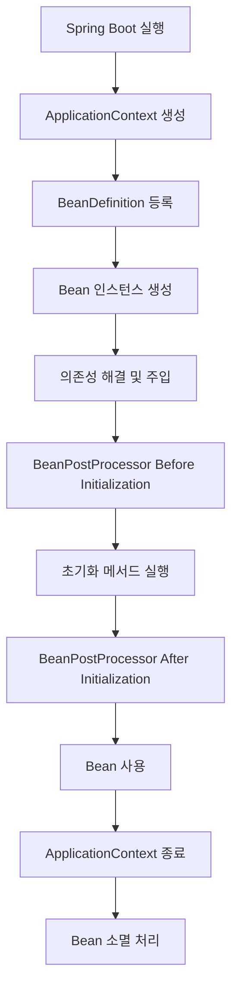
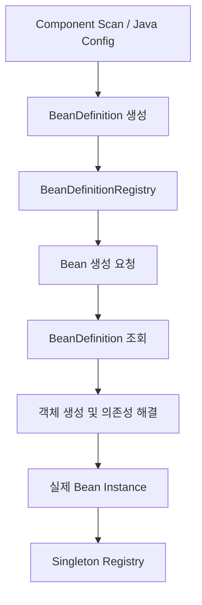
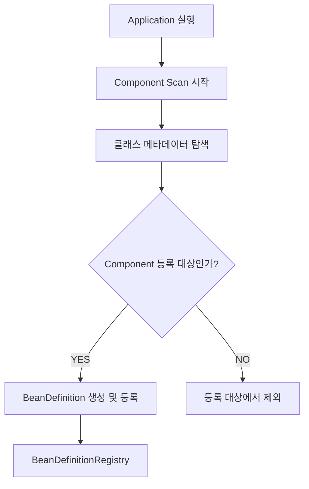
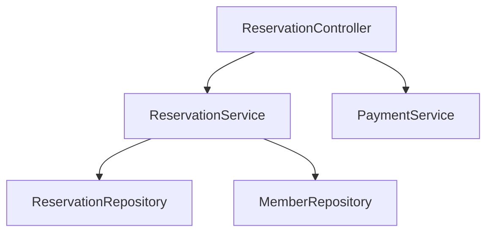
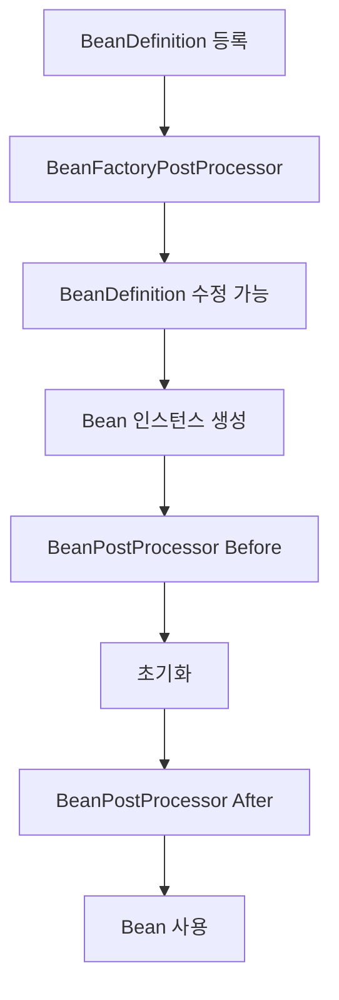

# 모루의 Spring Bean의 생명주기 들여다보기
[https://youtu.be/MdEIMzxUVbc?si=Sl36ZbPxhhh631AI](https://youtu.be/MdEIMzxUVbc?si=Sl36ZbPxhhh631AI)

# 모루의 Spring Bean의 생명주기 들여다보기
* toc
{:toc}

---

## Spring Bean 생명주기 완벽 이해: BeanDefinition부터 생성, 의존성 주입, 초기화, 소멸까지

Spring Boot로 애플리케이션을 개발하다 보면 `@Component`, `@Service`, `@Repository`, `@Controller` 같은 어노테이션을 자연스럽게 사용하게 된다.

예를 들어 다음과 같은 서비스가 있다고 생각해 보자.

```java
@Service
public class ReservationService {

    private final ReservationRepository reservationRepository;

    public ReservationService(
            ReservationRepository reservationRepository
    ) {
        this.reservationRepository = reservationRepository;
    }

    public void reserve(Long reservationId) {
        // 예약 처리
    }
}
```

개발자가 직접 `ReservationService` 객체를 생성하거나 `ReservationRepository`를 전달하는 코드는 보이지 않는다.

그런데 Spring Boot 애플리케이션을 실행하면 Spring이 알아서 객체를 생성하고 필요한 의존성을 주입한다.

이러한 기능은 Spring을 사용하는 가장 큰 이유 중 하나다.

하지만 조금 더 생각해 보면 여러 의문이 생긴다.

Spring은 어떤 클래스를 Bean으로 등록해야 하는지 어떻게 알 수 있을까?

Bean을 등록하는 순간 객체가 생성되는 것일까?

여러 Bean이 서로 의존한다면 어떤 순서로 생성될까?

생성자가 실행된 이후에는 어떤 작업이 이루어질까?

그리고 애플리케이션이 종료되면 Spring이 관리하던 객체는 어떻게 정리될까?

이러한 질문의 답을 이해하려면 **Spring Bean의 생명주기(Bean Lifecycle)**&#xB97C; 알아야 한다.

Spring Bean은 단순히 생성되고 사용되는 객체가 아니다.

Spring Container가 객체의 정의를 관리하고, 생성과 의존성 주입을 수행하며, 초기화와 소멸까지 관리하는 객체다.

이 전체 과정을 이해하면 Spring의 내부 동작뿐 아니라 애플리케이션 시작 오류, 의존성 주입 문제, AOP 적용 시점, 종료 시 자원 정리 문제까지 구조적으로 파악할 수 있다.

---

### Spring Bean이란 무엇인가?

Spring Bean은 Spring IoC Container가 생성하거나 등록받아 관리하는 객체를 의미한다.

일반적인 Java 객체는 개발자가 직접 생성할 수 있다.

```java
ReservationRepository repository =
        new ReservationRepository();

ReservationService service =
        new ReservationService(repository);
```

이 경우 객체를 생성하고 연결하는 책임은 개발자에게 있다.

반면 Spring에서는 필요한 객체와 의존관계를 선언하면 컨테이너가 이를 관리한다.

```java
@Repository
public class ReservationRepository {
}
```

```java
@Service
public class ReservationService {

    private final ReservationRepository repository;

    public ReservationService(
            ReservationRepository repository
    ) {
        this.repository = repository;
    }
}
```

Spring은 `ReservationService`를 생성하기 위해 `ReservationRepository`가 필요하다는 사실을 확인하고 적절한 Bean을 찾아 전달한다.

이때 중요한 것은 Spring이 단순히 `new`를 대신 호출하는 것이 아니라는 점이다.

Spring은 다음과 같은 작업까지 담당한다.

| 관리 대상             | 설명                                    |
| ----------------- | ------------------------------------- |
| Bean 등록           | 관리할 객체에 대한 정의 등록                      |
| Bean 생성           | 생성자 또는 Factory Method를 통해 객체 생성       |
| 의존성 주입            | 필요한 다른 Bean 연결                        |
| 초기화               | 사용하기 전 필요한 준비 작업 수행                   |
| BeanPostProcessor | Bean 생성 과정에 추가 기능 적용                  |
| Scope 관리          | Singleton, Prototype 등의 생성 및 공유 범위 관리 |
| 소멸                | 컨테이너 종료 시 정리 작업 수행                    |

이러한 작업이 일정한 순서와 규칙에 따라 이루어지는 과정을 Bean Lifecycle이라고 한다.

---

### Spring Bean의 전체 생명주기

일반적인 Singleton Bean을 기준으로 생명주기를 살펴보면 다음과 같다.

```text
Spring Container 생성
        ↓
BeanDefinition 등록
        ↓
Bean 인스턴스 생성
        ↓
의존성 해결 및 주입
        ↓
BeanPostProcessor 초기화 전 처리
        ↓
초기화 메서드 실행
        ↓
BeanPostProcessor 초기화 후 처리
        ↓
Bean 사용
        ↓
Spring Container 종료
        ↓
소멸 메서드 실행
```

이를 구조로 표현하면 다음과 같다.



여기서 중요한 것은 **BeanDefinition을 등록하는 단계와 실제 Bean 인스턴스를 생성하는 단계가 분리되어 있다는 점**이다.

또 모든 Bean이 반드시 애플리케이션 시작 시점에 생성되는 것도 아니다.

일반적인 Singleton Bean은 기본적으로 시작 과정에서 미리 생성되지만 `@Lazy`가 적용된 Bean이나 Prototype Bean은 다른 생성 시점을 가질 수 있다.

따라서 전체 생명주기를 이해하려면 먼저 BeanDefinition부터 살펴봐야 한다.

---

### BeanDefinition이란 무엇인가?

Spring은 Bean을 생성하기 전에 해당 객체를 어떤 방식으로 관리해야 하는지 알아야 한다.

예를 들어 다음과 같은 정보가 필요하다.

어떤 클래스를 생성할 것인가?

어떤 생성자나 Factory Method를 사용할 것인가?

Singleton으로 관리할 것인가?

의존성은 무엇인가?

초기화와 소멸 시 어떤 메서드를 실행할 것인가?

이러한 정보를 표현하는 것이 `BeanDefinition`이다.

**BeanDefinition은 Spring이 Bean을 생성하고 관리하기 위해 사용하는 메타데이터다.**

예를 들어 다음 코드를 살펴보자.

```java
@Service
public class ReservationService {

    private final ReservationRepository repository;

    public ReservationService(
            ReservationRepository repository
    ) {
        this.repository = repository;
    }
}
```

Spring이 이 클래스를 관리하려면 해당 클래스에 대한 BeanDefinition을 구성해야 한다.

개념적으로 다음과 같은 정보가 포함된다.

```text
BeanDefinition

Bean Name:
    reservationService

Bean Class:
    ReservationService

Scope:
    singleton

Lazy Initialization:
    false

Dependencies:
    ReservationRepository
```

다만 이것은 이해를 위한 단순화된 표현이다.

실제 BeanDefinition에는 생성자 인자, 프로퍼티, Factory Method, 초기화 메서드 등 다양한 메타데이터가 포함될 수 있다.

또 의존성 정보가 처음부터 모두 확정되어 저장되는 것은 아니다. 일부 의존관계는 실제 Bean 생성 과정에서 해결된다.

---

### BeanDefinition과 실제 Bean 객체는 다르다

다음 두 가지를 구분해야 한다.

```text
BeanDefinition

→ Bean을 어떻게 생성하고 관리할 것인가?


Bean Instance

→ 실제 생성된 Java 객체
```

예를 들어 설계도를 생각해 보자.

설계도에는 건물의 구조와 필요한 정보가 기록되어 있다.

하지만 설계도 자체가 실제 건물은 아니다.

Spring에서도 마찬가지다.

BeanDefinition은 Bean을 생성하기 위한 설정 정보다.

실제 객체는 BeanDefinition을 기반으로 이후에 생성된다.



이러한 구조 덕분에 Spring은 Bean을 등록하는 방식과 생성하는 과정을 분리할 수 있다.

예를 들어 `@Component`를 이용하든 `@Bean`을 이용하든 Spring은 공통적인 BeanDefinition 추상화를 기반으로 객체를 관리할 수 있다.

---

### BeanDefinitionRegistry란 무엇인가?

`BeanDefinitionRegistry`는 BeanDefinition을 등록하고 관리하기 위한 인터페이스다.

Spring은 Bean 이름을 기준으로 BeanDefinition을 등록하고 조회할 수 있다.

예를 들어 다음과 같은 객체들이 있다고 가정하자.

```text
ReservationController

ReservationService

ReservationRepository

PaymentService
```

각 클래스가 Bean 등록 대상이라면 개념적으로 다음과 같은 정보가 관리된다.

```text
BeanDefinitionRegistry

├── reservationController
│   └── ReservationController BeanDefinition
│
├── reservationService
│   └── ReservationService BeanDefinition
│
├── reservationRepository
│   └── ReservationRepository BeanDefinition
│
└── paymentService
    └── PaymentService BeanDefinition
```

여기에는 실제 객체가 아니라 Bean의 생성 정보가 등록되어 있다.

Spring은 이후 이 정보를 이용해 필요한 Bean을 생성한다.

여기서 혼동하기 쉬운 개념이 하나 있다.

바로 `SingletonBeanRegistry`다.

---

### BeanDefinitionRegistry와 SingletonBeanRegistry의 차이

두 인터페이스는 관리하는 대상이 다르다.

| 구분     | BeanDefinitionRegistry       | SingletonBeanRegistry   |
| ------ | ---------------------------- | ----------------------- |
| 관리 대상  | BeanDefinition               | 실제 Singleton 객체         |
| 주요 역할  | Bean 생성 정보 등록 및 관리           | 생성된 Singleton 인스턴스 관리   |
| 대표적인 키 | Bean Name                    | Bean Name               |
| 저장 정보  | 클래스, Scope, Factory Method 등 | 실제 객체 참조                |
| 사용 시점  | Bean 정의 등록 및 조회              | Singleton Bean 등록 및 재사용 |

예를 들어 다음과 같은 Bean이 있다고 하자.

```java
@Service
public class ReservationService {
}
```

Spring은 먼저 다음 정보를 등록할 수 있다.

```text
reservationService
    ↓
ReservationService BeanDefinition
```

그리고 Bean을 생성한다.

```java
new ReservationService();
```

실제 생성된 인스턴스는 Singleton Scope라면 공유 객체로 관리된다.

```text
reservationService
    ↓
ReservationService Instance
```

이렇게 **Bean의 정의와 실제 객체를 분리해서 관리하는 구조**가 Spring Container의 중요한 특징이다.

---

### Spring은 BeanDefinition을 어떻게 등록할까?

Spring에서 Bean을 등록하는 대표적인 방식은 두 가지다.

첫 번째는 Component Scan이다.

두 번째는 Java Config 방식이다.

두 방식 모두 Spring이 관리할 Bean을 정의하지만 BeanDefinition을 발견하는 방법과 실제 객체를 생성하는 방식에는 차이가 있다.

먼저 Component Scan부터 살펴보자.

---

### Component Scan 방식의 Bean 등록

Component Scan은 특정 패키지를 기준으로 Bean 등록 대상 클래스를 탐색하는 기능이다.

대표적으로 다음 어노테이션을 사용한다.

```java
@Component
```

그리고 `@Service`, `@Repository`, `@Controller` 등은 `@Component`를 메타 어노테이션으로 활용한다.

따라서 다음과 같은 클래스들도 Component Scan 대상이 될 수 있다.

```java
@Service
public class ReservationService {
}
```

```java
@Repository
public class ReservationRepository {
}
```

```java
@RestController
public class ReservationController {
}
```

Spring Boot에서는 일반적으로 다음 어노테이션을 사용한다.

```java
@SpringBootApplication
```

`@SpringBootApplication`은 Component Scan을 활성화하는 구성을 포함한다.

따라서 별도의 설정이 없다면 해당 클래스의 패키지를 기준으로 하위 패키지의 컴포넌트를 탐색한다.

---

### Component Scan은 내부적으로 어떻게 진행될까?

다음과 같은 프로젝트 구조를 생각해 보자.

```text
com.example

├── Application.java
│
├── reservation
│   ├── ReservationController.java
│   ├── ReservationService.java
│   └── ReservationRepository.java
│
└── payment
    └── PaymentService.java
```

`Application` 클래스에는 다음 코드가 있다.

```java
@SpringBootApplication
public class Application {

    public static void main(String[] args) {
        SpringApplication.run(Application.class, args);
    }
}
```

Spring은 설정된 패키지 범위에서 Bean 등록 대상을 탐색한다.

개념적인 흐름은 다음과 같다.



이 과정에서 중요한 역할을 하는 구성 요소 중 하나가 `ClassPathBeanDefinitionScanner`다.

이 구성 요소는 클래스패스에서 조건에 맞는 컴포넌트 후보를 찾고 BeanDefinition 등록을 수행한다.

하지만 한 가지 주의할 점이 있다.

**컴포넌트를 발견했다고 그 자리에서 반드시 실제 Bean 객체까지 생성하는 것은 아니다.**

일반적인 ApplicationContext에서는 BeanDefinition을 등록한 뒤, 컨테이너 초기화 과정에서 필요한 Bean들을 생성한다.

즉 컴포넌트를 발견하는 단계와 실제 객체 생성 단계는 구분해야 한다.

---

### Bean 생성 순서는 어떻게 결정될까?

다음과 같은 예약 시스템을 생각해 보자.



`ReservationController`는 두 개의 Service를 필요로 한다.

`ReservationService`는 두 개의 Repository를 필요로 한다.

각 클래스는 생성자 주입을 사용한다고 가정하자.

```java
@Service
public class ReservationService {

    private final ReservationRepository reservationRepository;
    private final MemberRepository memberRepository;

    public ReservationService(
            ReservationRepository reservationRepository,
            MemberRepository memberRepository
    ) {
        this.reservationRepository = reservationRepository;
        this.memberRepository = memberRepository;
    }
}
```

Spring이 `ReservationService`를 생성하려면 두 Repository가 필요하다.

따라서 생성자에 전달할 의존성부터 해결해야 한다.

개념적으로 다음과 같은 과정이 발생할 수 있다.

```text
ReservationService 생성 요청

↓

ReservationRepository 필요

↓

ReservationRepository 생성 및 초기화

↓

MemberRepository 필요

↓

MemberRepository 생성 및 초기화

↓

ReservationService 생성 완료
```

이미 Repository Bean이 생성되어 있다면 새로 생성하지 않고 기존 Singleton 인스턴스를 사용한다.

이러한 구조에서 중요한 사실은 **의존하는 객체보다 의존성이 먼저 준비되어야 한다는 점**이다.

Spring 공식 문서에서도 일반적인 의존성 해결 과정에서 협력 객체를 구성한 뒤 이를 의존 객체에 주입한다고 설명한다.

---

### BeanDefinition 등록 순서가 생성 순서를 결정할까?

BeanDefinition 등록 순서는 기본 Singleton Bean의 사전 생성 순서에 영향을 줄 수 있다.

예를 들어 먼저 등록된 Bean부터 생성 요청이 발생하는 모습을 관찰할 수 있다.

그러나 **Component Scan에서 발견된 순서가 항상 일정하고, 그 순서대로 Bean이 생성된다고 보장해서는 안 된다.**

다음과 같은 요소들이 실제 생성 순서에 영향을 준다.

| 요소                   | 영향                                |
| -------------------- | --------------------------------- |
| BeanDefinition 등록 순서 | 기본 Singleton 사전 생성 순서에 영향을 줄 수 있음 |
| 생성자 의존성              | 필요한 의존 Bean을 먼저 준비                |
| Factory Method 파라미터  | 필요한 Bean을 해결한 뒤 생성 메서드 호출         |
| `@DependsOn`         | 명시적인 초기화 선행 관계 설정                 |
| `@Lazy`              | Bean 생성 시점을 지연할 수 있음              |
| BeanPostProcessor    | 일부 인프라 Bean을 이른 시점에 생성            |
| Spring 내부 인프라        | Bean 처리와 초기화 순서에 영향               |

특히 생성자 파라미터에 선언한 순서를 모든 Bean의 생성 순서를 보장하는 수단으로 사용해서는 안 된다.

생성자 파라미터의 순서가 실제 의존성 해결 과정에서 관찰되는 순서에 영향을 줄 수는 있지만, 이를 컨테이너 전체의 초기화 순서를 보장하는 규칙으로 간주하는 것은 적절하지 않다.

**의도적으로 초기화 순서를 제어해야 한다면 명시적인 의존관계를 선언해야 한다.**

---

### @DependsOn을 이용한 생성 순서 제어

예를 들어 결제 서비스가 초기화되기 전에 특정 준비 작업이 완료되어야 한다고 가정하자.

이때 `@DependsOn`을 사용할 수 있다.

```java
@Component("paymentInitializer")
public class PaymentInitializer {

    @PostConstruct
    public void initialize() {
        System.out.println("결제 환경 초기화");
    }
}
```

```java
@Service
@DependsOn("paymentInitializer")
public class PaymentService {

    public PaymentService() {
        System.out.println("PaymentService 생성");
    }
}
```

이 경우 `PaymentService`를 초기화하기 전에 `paymentInitializer` Bean이 먼저 준비되도록 할 수 있다.

```text
PaymentInitializer 생성

↓

PaymentInitializer 초기화

↓

PaymentService 생성
```

다만 단순히 객체가 필요해서 의존하는 상황이라면 생성자 주입을 사용하는 것이 더 자연스럽다.

`@DependsOn`은 직접적인 객체 참조가 없어도 초기화 선행 관계를 명시해야 하는 경우에 유용하다.

또 Singleton Bean의 경우 `@DependsOn`은 종료 시 소멸 순서에도 영향을 준다. 의존하는 Bean이 먼저 소멸되고 그 의존 대상은 이후에 소멸한다.

---

### Java Config 방식의 Bean 등록

Spring은 Component Scan 외에도 `@Configuration`과 `@Bean`을 이용해 Bean을 등록할 수 있다.

다음 예제를 살펴보자.

```java
@Configuration
public class AppConfig {

    @Bean
    public ReservationRepository reservationRepository() {
        return new ReservationRepository();
    }

    @Bean
    public ReservationService reservationService(
            ReservationRepository repository
    ) {
        return new ReservationService(repository);
    }
}
```

Component Scan 방식에서는 클래스에 `@Service`, `@Repository` 등을 선언한다.

반면 Java Config 방식에서는 `@Bean` 메서드가 반환하는 객체를 Spring Bean으로 등록한다.

두 방식의 차이는 다음과 같다.

| 구분                   | Component Scan           | Java Config               |
| -------------------- | ------------------------ | ------------------------- |
| 대표 어노테이션             | `@Component`, `@Service` | `@Configuration`, `@Bean` |
| BeanDefinition 생성 기준 | 컴포넌트 후보 클래스              | 설정 클래스의 Bean 메서드          |
| 객체 생성 방식             | 생성자 등을 이용                | Factory Method를 이용        |
| 의존성 주입               | 생성자, 필드, Setter 등        | 메서드 파라미터 등                |
| 대표 활용                | 직접 작성한 애플리케이션 객체         | 외부 라이브러리 객체, 명시적인 구성      |

Java Config 방식에서도 BeanDefinition 등록과 실제 객체 생성은 분리되어 있다.

`@Bean` 메서드를 발견해 BeanDefinition을 등록하고, 실제 Bean 생성이 필요할 때 해당 메서드를 이용할 수 있다.

---

### Java Config에서 @Bean 메서드를 호출하면 어떻게 될까?

다음 코드를 생각해 보자.

```java
@Configuration
public class AppConfig {

    @Bean
    public ReservationRepository reservationRepository() {
        return new ReservationRepository();
    }

    @Bean
    public ReservationService reservationService() {
        return new ReservationService(
                reservationRepository()
        );
    }
}
```

`reservationService()` 내부에서 `reservationRepository()`를 직접 호출한다.

일반적인 Java 코드라면 해당 메서드가 호출될 때마다 다음 코드가 실행될 것이다.

```java
return new ReservationRepository();
```

그렇다면 호출할 때마다 새로운 Repository가 생성되는 것일까?

기본적인 `@Configuration` 설정에서는 그렇지 않다.

Spring은 `@Configuration` 클래스에 프록시 기반의 메서드 호출 제어를 적용할 수 있다.

Spring Framework는 이 과정에 CGLIB 기반 클래스 확장을 활용한다.

이를 통해 `@Bean` 메서드를 다른 `@Bean` 메서드에서 호출할 때 컨테이너가 관리하는 Bean을 반환하도록 처리할 수 있다.

```text
reservationService() 실행

↓

reservationRepository() 호출

↓

Spring의 설정 클래스 프록시가 호출 제어

↓

이미 등록된 Singleton Bean 조회

↓

동일한 Repository 인스턴스 사용
```

따라서 일반적인 Java 메서드 호출과 Spring이 확장한 설정 클래스의 Bean 메서드 호출은 서로 다른 동작을 할 수 있다.

---

### @Configuration(proxyBeanMethods = false)는 무엇이 다를까?

다음 코드를 살펴보자.

```java
@Configuration(proxyBeanMethods = false)
public class AppConfig {

    @Bean
    public ReservationRepository reservationRepository() {
        return new ReservationRepository();
    }

    @Bean
    public ReservationService reservationService() {
        return new ReservationService(
                reservationRepository()
        );
    }
}
```

이번에는 `proxyBeanMethods = false`를 설정했다.

이 경우 `@Bean` 메서드 사이의 직접 호출을 Spring이 가로채지 않는다.

따라서 다음 호출은 일반 Java 메서드처럼 동작한다.

```java
reservationRepository()
```

메서드가 실행되면서 새로운 객체가 생성될 수 있다.

중요한 것은 **Singleton Scope 자체가 비활성화되는 것이 아니라는 점**이다.

컨테이너를 통해 `reservationRepository` Bean을 조회하면 여전히 Singleton으로 관리된다.

하지만 `reservationService()` 내부에서 메서드를 직접 호출해 생성한 객체는 컨테이너가 등록한 Singleton 인스턴스와 별개일 수 있다.

이런 혼동을 피하려면 다음처럼 작성하는 것이 좋다.

```java
@Configuration(proxyBeanMethods = false)
public class AppConfig {

    @Bean
    public ReservationRepository reservationRepository() {
        return new ReservationRepository();
    }

    @Bean
    public ReservationService reservationService(
            ReservationRepository repository
    ) {
        return new ReservationService(repository);
    }
}
```

Spring이 메서드 파라미터에 필요한 Bean을 주입하도록 만드는 것이다.

이렇게 하면 설정 클래스의 프록시 처리 여부와 관계없이 의존관계를 명확하게 표현할 수 있다.

---

### Bean 인스턴스 생성과 의존성 주입

BeanDefinition 등록이 끝나면 Spring은 필요한 Bean을 생성한다.

이때 실제 생성 과정은 Bean의 생성 방식에 따라 달라질 수 있다.

일반적인 생성자 주입을 생각해 보자.

```java
@Service
public class ReservationService {

    private final ReservationRepository repository;

    public ReservationService(
            ReservationRepository repository
    ) {
        this.repository = repository;
    }
}
```

Spring은 `ReservationService`를 생성하기 위해 `ReservationRepository`를 먼저 해결해야 한다.

따라서 생성자 호출 전에 Repository 객체가 준비된다.

```text
ReservationRepository Bean 탐색

↓

필요하면 Repository 생성 및 초기화

↓

ReservationService 생성자 호출

↓

ReservationService 객체 생성
```

반면 필드 주입은 동작 시점이 다르다.

```java
@Service
public class ReservationService {

    @Autowired
    private ReservationRepository repository;
}
```

이 경우 객체 생성자를 호출한 이후 Spring이 필드에 의존성을 주입한다.

따라서 생성자 실행 시점에는 해당 필드가 아직 주입되지 않았을 수 있다.

이 차이가 중요한 이유가 있다.

---

### 생성자에서 의존성을 사용하면 안 될까?

다음 코드를 살펴보자.

```java
@Service
public class ReservationService {

    @Autowired
    private ReservationRepository repository;

    public ReservationService() {
        repository.initialize();
    }
}
```

이 코드는 위험하다.

생성자 실행 시점에는 필드 주입이 완료되지 않았기 때문이다.

따라서 `repository`는 `null`일 수 있다.

```text
ReservationService 생성자 실행

↓

repository 초기값 null

↓

repository.initialize()

↓

NullPointerException
```

반면 생성자 주입을 사용한다면 필요한 의존성이 생성자 파라미터로 전달된다.

```java
@Service
public class ReservationService {

    private final ReservationRepository repository;

    public ReservationService(
            ReservationRepository repository
    ) {
        this.repository = repository;
    }
}
```

따라서 생성자 주입은 필수 의존성을 명확하게 표현할 수 있다는 장점이 있다.

하지만 생성자 주입을 사용하더라도 모든 초기화 작업을 생성자에 넣는 것이 좋은 것은 아니다.

그 이유를 이해하려면 Bean 초기화 과정을 살펴봐야 한다.

---

### Bean 초기화(Initialization)란 무엇인가?

Bean 초기화는 생성된 객체가 실제로 사용되기 전에 필요한 준비 작업을 수행하는 과정이다.

객체 생성과 초기화는 서로 다른 개념이다.

예를 들어 다음 코드를 생각해 보자.

```java
public class ExternalApiClient {

    public ExternalApiClient() {
        System.out.println("객체 생성");
    }
}
```

생성자가 실행되면 객체가 만들어진다.

하지만 객체가 생성되었다고 해서 외부 API 호출에 필요한 모든 설정이 준비되었다고 볼 수는 없다.

다음과 같은 준비 작업이 필요할 수 있다.

인증 설정 검증, 설정값 로딩, 내부 캐시 초기화, 외부 자원 사용을 위한 준비 등이다.

이러한 작업을 생성자에 모두 넣을 수도 있지만 Spring은 별도의 초기화 단계도 제공한다.

초기화 시점에는 일반적으로 필요한 의존성 주입이 완료되어 있으므로 다른 Bean을 활용한 초기화 작업을 수행할 수 있다.

---

### @PostConstruct란 무엇인가?

`@PostConstruct`는 Bean의 의존성 주입이 완료된 이후 초기화 작업을 실행하기 위한 어노테이션이다.

Spring Boot에서는 다음 패키지의 어노테이션을 사용한다.

```java
import jakarta.annotation.PostConstruct;
```

다음 예제를 살펴보자.

```java
@Service
public class ReservationService {

    private static final Logger log =
            LoggerFactory.getLogger(ReservationService.class);

    private final ReservationRepository repository;

    public ReservationService(
            ReservationRepository repository
    ) {
        this.repository = repository;

        log.info("ReservationService 생성자 실행");
    }

    @PostConstruct
    public void initialize() {
        log.info("ReservationService 초기화");
    }
}
```

일반적인 생성 흐름은 다음과 같다.

```text
ReservationRepository 준비

↓

ReservationService 생성자 실행

↓

Bean 초기화 단계

↓

@PostConstruct 실행
```

`@PostConstruct`는 Spring Container가 Bean 초기화 과정에서 호출한다.

따라서 개발자가 직접 초기화 메서드를 호출할 필요가 없다.

Spring은 `CommonAnnotationBeanPostProcessor`를 통해 `@PostConstruct`와 `@PreDestroy` 같은 생명주기 어노테이션을 처리한다.

---

### @PostConstruct는 왜 생성자와 분리되어 있을까?

다음 두 코드의 차이를 생각해 보자.

첫 번째는 생성자에서 초기화 작업을 수행하는 방식이다.

```java
public PaymentService(PaymentClient paymentClient) {
    this.paymentClient = paymentClient;

    validateConfiguration();
}
```

두 번째는 별도 초기화 메서드를 사용하는 방식이다.

```java
public PaymentService(PaymentClient paymentClient) {
    this.paymentClient = paymentClient;
}

@PostConstruct
public void initialize() {
    validateConfiguration();
}
```

두 방식 모두 초기화 작업을 수행할 수 있다.

하지만 Bean의 생성과 초기화가 분리되면 객체 생성 과정과 이후 준비 작업을 서로 다른 단계에서 관리할 수 있다.

특히 Spring의 필드 주입이나 Setter 주입이 필요한 구조에서는 의존성이 준비된 이후에 초기화 메서드를 실행해야 한다.

또 Spring은 초기화 과정에서 BeanPostProcessor와 여러 생명주기 콜백을 실행한다.

따라서 **객체의 생성과 Spring Container가 관리하는 초기화는 같은 단계가 아니다.**

---

### 초기화 작업에서 예외가 발생하면 어떻게 될까?

다음 코드를 생각해 보자.

```java
@Component
public class PaymentConfigurationValidator {

    @PostConstruct
    public void validate() {

        boolean valid = false;

        if (!valid) {
            throw new IllegalStateException(
                    "결제 설정이 올바르지 않습니다."
            );
        }
    }
}
```

초기화 메서드에서 예외가 발생했다.

이 Bean은 정상적으로 초기화되지 못한다.

일반적인 Singleton Bean이 애플리케이션 시작 과정에서 생성되고 있었다면 Spring은 컨텍스트 초기화 실패로 처리할 수 있다.

결과적으로 애플리케이션 시작이 실패한다.

```text
Spring Boot 시작

↓

PaymentConfigurationValidator 생성

↓

@PostConstruct 실행

↓

예외 발생

↓

Bean 초기화 실패

↓

ApplicationContext 초기화 실패
```

이러한 특징을 이용하면 필수 설정이 잘못되었을 때 애플리케이션이 정상적으로 시작되는 것을 방지할 수 있다.

예를 들어 반드시 존재해야 하는 환경 변수나 필수 설정값을 검증하는 경우가 있다.

하지만 외부 API가 일시적으로 응답하지 않는다는 이유만으로 애플리케이션 시작을 실패시키는 것이 적절한지는 별도로 판단해야 한다.

외부 서비스의 일시적인 장애 때문에 여러 애플리케이션 인스턴스가 반복적으로 재시작하는 상황이 발생할 수 있기 때문이다.

---

### Bean 초기화에는 여러 가지 방법이 있다

Spring은 `@PostConstruct` 외에도 다양한 초기화 방법을 제공한다.

대표적인 방식은 다음 세 가지다.

| 방식                          | 특징                       |
| --------------------------- | ------------------------ |
| `@PostConstruct`            | 어노테이션으로 초기화 메서드 선언       |
| `InitializingBean`          | Spring 인터페이스 구현          |
| `@Bean(initMethod = "...")` | Java Config에서 초기화 메서드 지정 |

각각을 살펴보자.

#### @PostConstruct 방식

```java
@Component
public class CacheService {

    @PostConstruct
    public void initialize() {
        System.out.println("캐시 초기화");
    }
}
```

어노테이션만으로 초기화 시점을 선언할 수 있다.

일반적인 애플리케이션 코드에서 사용하기 좋은 방식이다.

#### InitializingBean 방식

Spring은 다음 인터페이스를 제공한다.

```java
public interface InitializingBean {

    void afterPropertiesSet() throws Exception;
}
```

직접 구현하면 다음과 같다.

```java
@Component
public class CacheService implements InitializingBean {

    @Override
    public void afterPropertiesSet() {
        System.out.println("캐시 초기화");
    }
}
```

Spring은 의존성 설정이 완료된 후 해당 메서드를 호출한다.

하지만 이 방식은 비즈니스 클래스가 Spring의 인터페이스에 직접 의존한다는 특징이 있다.

#### @Bean(initMethod) 방식

Java Config에서 초기화 메서드를 지정할 수도 있다.

```java
public class ExternalClient {

    public void initialize() {
        System.out.println("외부 Client 초기화");
    }
}
```

```java
@Configuration
public class ClientConfig {

    @Bean(initMethod = "initialize")
    public ExternalClient externalClient() {
        return new ExternalClient();
    }
}
```

이 방식은 외부 라이브러리 객체처럼 직접 소스 코드를 수정할 수 없는 경우에도 활용하기 좋다.

---

### 초기화 방식이 여러 개라면 어떤 순서로 실행될까?

하나의 Bean에 여러 초기화 방식을 함께 적용할 수도 있다.

예를 들어 다음 클래스를 생각해 보자.

```java
public class LifecycleBean implements InitializingBean {

    @PostConstruct
    public void postConstruct() {
        System.out.println("1. @PostConstruct");
    }

    @Override
    public void afterPropertiesSet() {
        System.out.println("2. InitializingBean");
    }

    public void customInit() {
        System.out.println("3. custom init");
    }
}
```

Bean 등록 시 사용자 정의 초기화 메서드를 지정한다.

```java
@Configuration
public class LifecycleConfig {

    @Bean(initMethod = "customInit")
    public LifecycleBean lifecycleBean() {
        return new LifecycleBean();
    }
}
```

초기화 단계에서는 다음 순서로 실행된다.

```text
1. @PostConstruct

2. InitializingBean.afterPropertiesSet()

3. Custom Init Method
```

Spring은 여러 초기화 메커니즘을 함께 사용할 때 이 순서를 정의하고 있다.

실무에서는 하나의 Bean에 여러 방식을 모두 적용해야 하는 경우가 많지는 않다.

하지만 외부 라이브러리와 Spring 인프라가 함께 사용하는 Bean에서는 이러한 순서를 이해하는 것이 도움이 된다.

---

### BeanPostProcessor란 무엇인가?

BeanPostProcessor는 Bean 생성 및 초기화 과정에 개입해 추가 작업을 수행할 수 있도록 제공하는 Spring의 확장 인터페이스다.

대표적인 메서드는 다음 두 가지다.

```java
public interface BeanPostProcessor {

    Object postProcessBeforeInitialization(
            Object bean,
            String beanName
    );

    Object postProcessAfterInitialization(
            Object bean,
            String beanName
    );
}
```

첫 번째는 Bean 초기화 콜백이 실행되기 전에 호출된다.

두 번째는 Bean 초기화 콜백이 실행된 이후에 호출된다.

개념적인 흐름은 다음과 같다.

```text
Bean 인스턴스 생성

↓

의존성 주입

↓

BeanPostProcessor
Before Initialization

↓

초기화 메서드 실행

↓

BeanPostProcessor
After Initialization

↓

Bean 사용
```

BeanPostProcessor는 객체를 검사하거나 필요한 처리를 추가할 수 있다.

또 기존 객체 대신 다른 객체를 반환할 수도 있다.

대표적인 사례가 Spring AOP Proxy 생성이다.

Spring AOP 인프라의 일부는 BeanPostProcessor를 통해 대상 Bean을 Proxy로 감싸는 방식으로 동작한다.

---

### BeanPostProcessor를 직접 구현해 보자

다음은 Bean의 초기화 전후에 로그를 기록하는 예제다.

```java
@Component
public class LifecycleLoggingProcessor
        implements BeanPostProcessor {

    private static final Logger log =
            LoggerFactory.getLogger(LifecycleLoggingProcessor.class);

    @Override
    public Object postProcessBeforeInitialization(
            Object bean,
            String beanName
    ) {
        if (beanName.equals("reservationService")) {
            log.info("초기화 전: {}", beanName);
        }

        return bean;
    }

    @Override
    public Object postProcessAfterInitialization(
            Object bean,
            String beanName
    ) {
        if (beanName.equals("reservationService")) {
            log.info("초기화 후: {}", beanName);
        }

        return bean;
    }
}
```

이제 다음 Bean이 있다고 가정하자.

```java
@Service
public class ReservationService {

    private static final Logger log =
            LoggerFactory.getLogger(ReservationService.class);

    public ReservationService() {
        log.info("생성자 실행");
    }

    @PostConstruct
    public void initialize() {
        log.info("@PostConstruct 실행");
    }
}
```

일반적으로 다음과 같은 순서를 관찰할 수 있다.

```text
생성자 실행

초기화 전: reservationService

@PostConstruct 실행

초기화 후: reservationService
```

이 예제를 통해 Bean의 생성자와 초기화 콜백이 서로 다른 시점에 실행된다는 사실을 확인할 수 있다.

또 BeanPostProcessor는 특정 Bean 하나에만 적용되는 개념이 아니라 컨테이너가 생성하는 다양한 Bean을 처리할 수 있다.

따라서 직접 구현할 때는 적용 대상을 명확히 제한하고 불필요하게 무거운 작업을 수행하지 않는 것이 좋다.

---

### @PostConstruct와 BeanPostProcessor의 관계

여기서 흥미로운 부분이 있다.

우리가 사용하는 `@PostConstruct` 역시 Spring 내부에서는 BeanPostProcessor 기반 인프라로 처리된다.

대표적으로 `CommonAnnotationBeanPostProcessor`가 있다.

이 구성 요소는 `@PostConstruct`와 `@PreDestroy` 같은 어노테이션을 인식한다.

그리고 적절한 생명주기 시점에 해당 메서드를 호출한다.

개념적으로 다음과 같다.

```mermaid
flowchart TD
    A[Bean 인스턴스 생성] --> B[의존성 주입]

    B --> C[BeanPostProcessor 실행]

    C --> D[생명주기 어노테이션 확인]

    D --> E[@PostConstruct 메서드 실행]

    E --> F[기타 초기화 콜백]

    F --> G[초기화 후 처리]

    G --> H[Bean 사용]
```

Spring 내부에는 생명주기 메서드의 메타데이터를 관리하기 위한 캐시도 존재한다.

대표적인 구현 구성 요소인 `InitDestroyAnnotationBeanPostProcessor`에서는 클래스의 초기화 및 소멸 메서드 정보를 분석하고 재사용한다.

이때 `lifecycleMetadataCache`와 같은 내부 구조를 활용한다.

이 캐시는 Bean마다 생명주기 어노테이션을 무조건 처음부터 반복 분석하지 않도록 돕는 내부 구현 요소다.

다만 `lifecycleMetadataCache`라는 필드 이름은 Spring의 외부 API 계약이 아니라 내부 구현 상세이므로, 애플리케이션 코드에서 직접 의존해서는 안 된다.

---

### BeanFactoryPostProcessor와 BeanPostProcessor는 무엇이 다를까?

이름이 비슷하지만 처리하는 대상이 다르다.

`BeanFactoryPostProcessor`는 BeanDefinition과 같은 Bean 구성 메타데이터를 다룬다.

반면 `BeanPostProcessor`는 실제 생성된 Bean 인스턴스를 다룬다.

| 구분    | BeanFactoryPostProcessor  | BeanPostProcessor    |
| ----- | ------------------------- | -------------------- |
| 처리 대상 | BeanDefinition 등 설정 메타데이터 | Bean 인스턴스            |
| 주요 시점 | 일반 Bean 인스턴스 생성 이전        | Bean 생성 및 초기화 과정     |
| 주요 목적 | Bean 정의 수정 또는 확장          | 객체 초기화 전후 처리         |
| 대표 활용 | 설정 메타데이터 변경               | 생명주기 어노테이션, Proxy 처리 |

전체적으로 보면 다음과 같다.



이 두 개념을 구분하면 Spring의 내부 확장 구조를 이해하기 쉬워진다.

---

### Bean 초기화와 AOP Proxy의 관계

Spring에서 자주 사용하는 `@Transactional`, `@Cacheable`, `@Async` 등은 Proxy 기반으로 동작할 수 있다.

그렇다면 Bean 생성 과정에서 Proxy는 언제 만들어질까?

일반적인 Spring AOP 자동 프록시 생성에서는 대상 Bean을 생성하고 초기화한 뒤 BeanPostProcessor 단계에서 Proxy를 구성할 수 있다.

개념적으로 다음과 같은 구조다.

```text
ReservationService 원본 객체 생성

↓

의존성 주입

↓

@PostConstruct 실행

↓

BeanPostProcessor After Initialization

↓

AOP Proxy 생성

↓

컨테이너에서 Proxy 제공
```

이 구조에서 주의해야 할 문제가 있다.

**`@PostConstruct` 내부에서 `@Transactional`이 적용된 메서드를 호출해도 기대한 트랜잭션 기능이 적용되지 않을 수 있다.**

예를 들어 다음 코드를 살펴보자.

```java
@Service
public class PaymentService {

    @PostConstruct
    public void initialize() {
        saveInitialData();
    }

    @Transactional
    public void saveInitialData() {
        // 초기 데이터 저장
    }
}
```

여기에는 두 가지 문제가 있다.

첫 번째는 초기화 과정에서 Proxy가 완전히 적용되기 전일 수 있다는 것이다.

두 번째는 같은 객체 내부에서 자신의 메서드를 호출한다는 점이다.

```java
saveInitialData();
```

이는 Self-Invocation에 해당한다.

따라서 일반적인 Spring의 프록시 기반 트랜잭션 기능이 적용되지 않을 수 있다.

이 문제를 이해하려면 **Bean 초기화와 Proxy 생성은 같은 단계가 아니라는 점**을 기억해야 한다.

Spring 공식 문서에서도 초기화 콜백은 일반적인 AOP Proxy가 적용되기 전의 객체에서 실행된다고 설명한다.

---

### 초기 데이터 저장은 어디에서 실행하는 것이 좋을까?

애플리케이션이 시작될 때 초기 데이터를 저장해야 하는 상황을 생각해 보자.

예를 들어 기본 관리자 권한이나 서비스 설정 데이터를 등록해야 할 수 있다.

이런 작업을 무조건 `@PostConstruct`에서 처리할 필요는 없다.

Spring Boot에서는 `ApplicationRunner`와 `CommandLineRunner`를 제공한다.

예를 들어 다음과 같이 작성할 수 있다.

```java
@Component
public class DataInitializationRunner implements ApplicationRunner {

    private final InitializationService initializationService;

    public DataInitializationRunner(
            InitializationService initializationService
    ) {
        this.initializationService = initializationService;
    }

    @Override
    public void run(ApplicationArguments args) {
        initializationService.initialize();
    }
}
```

실제 데이터 저장은 별도의 Service에서 처리한다.

```java
@Service
public class InitializationService {

    private final SettingRepository settingRepository;

    public InitializationService(
            SettingRepository settingRepository
    ) {
        this.settingRepository = settingRepository;
    }

    @Transactional
    public void initialize() {
        if (!settingRepository.existsByKey("DEFAULT_SETTING")) {
            settingRepository.save(
                    new Setting("DEFAULT_SETTING", "ENABLED")
            );
        }
    }
}
```

이 구조에서는 Runner가 초기화 서비스를 외부 Bean 호출로 실행한다.

따라서 해당 Service에 트랜잭션 Proxy가 적용되어 있다면 정상적인 트랜잭션 경계를 사용할 수 있다.

Spring Boot에서도 애플리케이션 시작 과정에서 수행할 작업에는 `ApplicationRunner`와 `CommandLineRunner`를 활용하도록 안내한다.

다만 여러 서버 인스턴스가 동시에 시작된다면 초기 데이터 등록 로직이 중복 실행될 수 있다.

따라서 중요한 초기 데이터는 Unique Constraint, 멱등성, Migration 도구 등을 함께 고려해야 한다.

---

### Spring Boot의 시작 완료와 Bean 초기화 완료는 같은 의미일까?

반드시 그렇지는 않다.

Spring Boot에서는 Bean 초기화 이후에도 애플리케이션 시작 과정에서 수행되는 작업이 존재한다.

대표적으로 `ApplicationRunner`, `CommandLineRunner` 등이 있다.

또 Spring Boot는 애플리케이션의 시작 상태를 나타내는 이벤트를 제공한다.

주요 이벤트의 흐름을 단순화하면 다음과 같다.

```text
ApplicationContext 준비

↓

ApplicationContext Refresh

↓

일반적인 Singleton Bean 생성 및 초기화

↓

ApplicationStartedEvent

↓

ApplicationRunner / CommandLineRunner 실행

↓

ApplicationReadyEvent

↓

ReadinessState.ACCEPTING_TRAFFIC
```

이때 `ApplicationReadyEvent`는 Runner가 실행된 이후 발생한다.

따라서 **Bean의 `@PostConstruct`가 실행되었다는 사실과 애플리케이션이 실제 요청을 처리할 준비가 완료되었다는 사실은 구분해야 한다.**

이는 Kubernetes 등의 환경에서 Readiness Probe를 설계할 때도 중요한 차이다.

---

### @Lazy를 사용하면 생명주기가 어떻게 달라질까?

지금까지는 일반적인 Singleton Bean이 애플리케이션 시작 시점에 생성된다고 가정했다.

Spring ApplicationContext는 기본적으로 지연 생성으로 설정되지 않은 Singleton Bean을 초기화 과정에서 미리 생성한다.

하지만 `@Lazy`를 이용하면 생성 시점을 변경할 수 있다.

```java
@Service
@Lazy
public class HeavyReportService {

    public HeavyReportService() {
        System.out.println("HeavyReportService 생성");
    }

    @PostConstruct
    public void initialize() {
        System.out.println("HeavyReportService 초기화");
    }
}
```

이 Bean은 기본적으로 처음 요청되는 시점까지 생성을 지연할 수 있다.

```text
Spring Boot 시작

↓

HeavyReportService 생성하지 않음

↓

HeavyReportService 요청

↓

생성자 실행

↓

의존성 주입

↓

@PostConstruct 실행
```

하지만 주의할 점이 있다.

`@Lazy` Bean이 일반적인 Eager Singleton Bean의 필수 의존성으로 주입되어야 한다면 시작 과정에서 함께 생성될 수 있다.

따라서 `@Lazy`를 선언했다고 반드시 첫 번째 API 요청 시점까지 생성되지 않는 것은 아니다.

---

### @Lazy는 언제 사용하면 좋을까?

예를 들어 관리자 전용 리포트 기능이 있다고 하자.

이 기능은 애플리케이션이 시작되자마자 필요한 것은 아니다.

실제로 관리자가 리포트를 요청할 때만 사용된다.

그런데 리포트 서비스를 초기화하는 비용이 크다면 지연 생성을 고려할 수 있다.

하지만 무조건 `@Lazy`를 적용하는 것은 좋지 않다.

초기화 과정에서 발생하는 오류가 애플리케이션 시작 시점이 아니라 실제 첫 번째 사용 시점에 드러날 수 있기 때문이다.

예를 들어 잘못된 외부 API 설정 때문에 Bean 초기화에 실패한다고 하자.

Eager Initialization이라면 시작 과정에서 오류를 확인할 수 있다.

반면 Lazy Initialization이라면 운영 중 첫 번째 요청에서 문제가 발생할 수 있다.

따라서 지연 생성은 시작 시간 개선뿐 아니라 **오류 발견 시점이 달라지는 문제**까지 고려해야 한다.

---

### Bean의 소멸(Destroy)이란 무엇인가?

Bean이 생성되고 초기화되어 정상적으로 사용되었다면 언젠가는 소멸 과정이 필요하다.

예를 들어 애플리케이션이 다음과 같은 자원을 직접 관리한다고 가정하자.

파일 핸들, 자체 생성한 네트워크 연결, 별도의 ExecutorService, 백그라운드 작업 등이다.

이러한 자원은 더 이상 사용하지 않을 때 적절하게 정리해야 한다.

그렇지 않으면 애플리케이션 종료가 지연되거나 자원이 정상적으로 해제되지 않을 수 있다.

Spring은 Bean 소멸 시점에 정리 작업을 수행할 수 있는 여러 메커니즘을 제공한다.

대표적인 것이 `@PreDestroy`다.

---

### @PreDestroy란 무엇인가?

`@PreDestroy`는 Bean이 소멸되는 과정에서 정리 작업을 수행하도록 선언하는 어노테이션이다.

```java
import jakarta.annotation.PreDestroy;
```

예를 들어 다음과 같이 사용할 수 있다.

```java
@Component
public class ResourceManager {

    private static final Logger log =
            LoggerFactory.getLogger(ResourceManager.class);

    @PostConstruct
    public void initialize() {
        log.info("ResourceManager 초기화");
    }

    @PreDestroy
    public void cleanup() {
        log.info("ResourceManager 자원 정리");
    }
}
```

정상적인 컨테이너 종료 과정에서는 다음 흐름을 기대할 수 있다.

```text
Spring Container 생성

↓

ResourceManager 생성

↓

@PostConstruct 실행

↓

Bean 사용

↓

Spring Container 종료

↓

@PreDestroy 실행
```

`@PreDestroy`는 일반적으로 Bean을 더 이상 사용하지 않게 되는 시점에 정리 작업을 수행하기 위한 메커니즘이다.

그러나 모든 상황에서 반드시 호출된다고 보장해서는 안 된다.

예를 들어 프로세스가 강제로 종료되거나 JVM이 즉시 종료되는 상황에서는 소멸 콜백이 실행되지 못할 수 있다.

따라서 데이터의 영속성이나 필수 복구 처리를 `@PreDestroy`에만 의존해서는 안 된다.

---

### Bean 소멸에는 어떤 방법이 있을까?

초기화와 마찬가지로 소멸에도 여러 방식이 존재한다.

대표적으로 다음 세 가지다.

| 방식                             | 설명                       |
| ------------------------------ | ------------------------ |
| `@PreDestroy`                  | 어노테이션 기반 소멸 콜백           |
| `DisposableBean`               | Spring 인터페이스 기반 소멸 콜백    |
| `@Bean(destroyMethod = "...")` | Java Config 기반 소멸 메서드 지정 |

#### @PreDestroy 방식

```java
@Component
public class FileResourceManager {

    @PreDestroy
    public void cleanup() {
        System.out.println("파일 관련 자원 정리");
    }
}
```

#### DisposableBean 방식

```java
@Component
public class FileResourceManager implements DisposableBean {

    @Override
    public void destroy() {
        System.out.println("파일 관련 자원 정리");
    }
}
```

#### @Bean(destroyMethod) 방식

```java
public class ExternalClient {

    public void shutdown() {
        System.out.println("ExternalClient 종료");
    }
}
```

```java
@Configuration
public class ClientConfig {

    @Bean(destroyMethod = "shutdown")
    public ExternalClient externalClient() {
        return new ExternalClient();
    }
}
```

세 방식 모두 Bean 소멸 과정에서 특정 작업을 수행할 수 있게 한다.

또 `@Bean`으로 등록된 객체는 공개된 `close()`나 `shutdown()` 메서드를 통해 소멸 메서드가 자동 추론되는 경우도 있다.

---

### 소멸 메서드도 실행 순서가 있을까?

초기화와 마찬가지로 여러 소멸 방식을 함께 사용할 수 있다.

예를 들어 다음 클래스를 생각해 보자.

```java
public class LifecycleBean implements DisposableBean {

    @PreDestroy
    public void preDestroy() {
        System.out.println("1. @PreDestroy");
    }

    @Override
    public void destroy() {
        System.out.println("2. DisposableBean");
    }

    public void customDestroy() {
        System.out.println("3. custom destroy");
    }
}
```

Bean을 다음과 같이 등록한다.

```java
@Configuration
public class LifecycleConfig {

    @Bean(destroyMethod = "customDestroy")
    public LifecycleBean lifecycleBean() {
        return new LifecycleBean();
    }
}
```

정상적인 소멸 과정에서는 다음 순서로 실행된다.

```text
1. @PreDestroy

2. DisposableBean.destroy()

3. Custom Destroy Method
```

이 순서 역시 Spring이 제공하는 생명주기 규칙에 포함된다.

---

### 생성과 소멸 과정을 직접 확인해 보자

이제 하나의 Bean에 여러 생명주기 메커니즘을 적용하고 호출 순서를 확인해 보자.

다음 예제는 Spring의 IoC Container만으로 실행할 수 있다.

#### LifecycleResource.java

```java
package com.example.lifecycle;

import jakarta.annotation.PostConstruct;
import jakarta.annotation.PreDestroy;
import org.springframework.beans.factory.DisposableBean;
import org.springframework.beans.factory.InitializingBean;

public class LifecycleResource
        implements InitializingBean, DisposableBean {

    public LifecycleResource() {
        System.out.println("1. Constructor");
    }

    @PostConstruct
    public void postConstruct() {
        System.out.println("2. @PostConstruct");
    }

    @Override
    public void afterPropertiesSet() {
        System.out.println("3. InitializingBean");
    }

    public void customInit() {
        System.out.println("4. Custom Init");
    }

    @PreDestroy
    public void preDestroy() {
        System.out.println("5. @PreDestroy");
    }

    @Override
    public void destroy() {
        System.out.println("6. DisposableBean");
    }

    public void customDestroy() {
        System.out.println("7. Custom Destroy");
    }
}
```

#### LifecycleConfig.java

```java
package com.example.lifecycle;

import org.springframework.context.annotation.Bean;
import org.springframework.context.annotation.Configuration;

@Configuration
public class LifecycleConfig {

    @Bean(
            initMethod = "customInit",
            destroyMethod = "customDestroy"
    )
    public LifecycleResource lifecycleResource() {
        return new LifecycleResource();
    }
}
```

#### LifecycleApplication.java

```java
package com.example.lifecycle;

import org.springframework.context.annotation.AnnotationConfigApplicationContext;

public class LifecycleApplication {

    public static void main(String[] args) {

        try (AnnotationConfigApplicationContext context =
                     new AnnotationConfigApplicationContext(
                             LifecycleConfig.class
                     )) {

            LifecycleResource resource =
                    context.getBean(LifecycleResource.class);

            System.out.println("Bean 사용");
        }
    }
}
```

`AnnotationConfigApplicationContext`는 Java Config를 이용해 Spring Container를 구성할 수 있는 클래스다.

이 예제에서는 `try-with-resources`를 사용했다.

따라서 블록이 종료되면 `ApplicationContext`의 `close()`가 호출된다.

실행 결과는 다음과 같다.

```text
1. Constructor
2. @PostConstruct
3. InitializingBean
4. Custom Init

Bean 사용

5. @PreDestroy
6. DisposableBean
7. Custom Destroy
```

이 예제를 통해 다음 사실을 확인할 수 있다.

객체 생성자가 먼저 실행된다.

그다음 초기화 콜백이 실행된다.

Bean은 초기화가 완료된 이후 사용된다.

컨테이너가 정상적으로 종료되면 소멸 콜백이 실행된다.

**생성과 초기화, 사용, 소멸은 서로 다른 생명주기 단계다.**

---

### Spring Boot는 종료 시 Bean을 어떻게 정리할까?

Spring Boot 애플리케이션은 정상적인 종료 과정에서 ApplicationContext를 닫고 Spring이 관리하는 Bean의 소멸 처리를 수행할 수 있다.

Spring Boot의 `SpringApplication`은 일반적으로 JVM Shutdown Hook을 등록해 정상적인 JVM 종료 시 ApplicationContext가 닫히도록 지원한다.

개념적으로 다음과 같다.

```mermaid
flowchart TD
    A[애플리케이션 종료 요청] --> B[JVM Shutdown Hook]

    B --> C[ApplicationContext Close]

    C --> D[Lifecycle Stop 처리]

    D --> E[Singleton Bean 소멸]

    E --> F[@PreDestroy]

    F --> G[DisposableBean]

    G --> H[Custom Destroy Method]

    H --> I[종료]
```

다만 위 흐름은 정상적인 종료를 전제로 한다.

예를 들어 `kill -9`처럼 프로세스를 강제로 종료하면 JVM이 Shutdown Hook을 실행할 기회를 얻지 못할 수 있다.

또 컨테이너 환경에서 종료 유예 시간이 충분하지 않다면 정리 작업을 모두 완료하지 못할 수도 있다.

따라서 종료 과정에서는 자원 정리를 수행하되, 중요한 데이터가 소멸 콜백에만 의존하지 않도록 설계해야 한다.

---

### @PreDestroy에서 DB Connection을 직접 닫아야 할까?

Spring Boot에서 데이터베이스를 사용하는 애플리케이션을 생각해 보자.

일반적으로 HikariCP와 같은 Connection Pool을 사용한다.

이때 데이터베이스 연결은 Service가 직접 생성한 것이 아니라 Connection Pool이 관리하는 자원이다.

그렇다면 다음과 같은 코드는 필요할까?

```java
@Service
public class ReservationService {

    private final DataSource dataSource;

    public ReservationService(DataSource dataSource) {
        this.dataSource = dataSource;
    }

    @PreDestroy
    public void cleanup() {
        // DataSource를 직접 종료해야 할까?
    }
}
```

일반적인 상황에서는 Service가 DataSource를 직접 종료할 필요가 없다.

Spring Container가 관리하는 DataSource Bean과 Connection Pool은 자신들의 생명주기에 맞춰 정리된다.

Service가 이를 임의로 종료하면 다른 Bean이 해당 자원을 사용하고 있는 상황에서 문제가 발생할 수 있다.

따라서 자원 정리에서 중요한 것은 **누가 자원의 소유자인지 구분하는 것**이다.

직접 생성한 ExecutorService라면 종료 책임을 가질 수 있다.

하지만 Spring이 관리하는 Connection Pool이라면 해당 자원의 관리 주체가 종료하도록 두는 것이 일반적으로 적절하다.

---

### SmartLifecycle은 언제 사용할까?

`@PreDestroy`는 Bean 소멸 시점에 정리 작업을 실행하는 데 유용하다.

하지만 일부 컴포넌트는 단순한 자원 정리보다 복잡한 시작과 종료 과정이 필요하다.

예를 들어 메시지를 소비하는 백그라운드 Worker가 있다고 하자.

종료 시 새로운 메시지 수신을 중단해야 한다.

이미 처리 중인 메시지는 가능하면 완료해야 한다.

이후 연결과 관련 자원을 정리해야 한다.

이처럼 시작과 종료 순서가 중요한 컴포넌트에는 `SmartLifecycle`을 고려할 수 있다.

Spring은 `SmartLifecycle`을 통해 시작과 종료 단계, 자동 시작 여부, 비동기 종료 완료 알림 등을 관리할 수 있다.

특히 `getPhase()`를 이용해 시작과 종료 순서를 제어할 수 있다.

```text
시작 시

Phase 값이 작은 컴포넌트부터 시작


종료 시

Phase 값이 큰 컴포넌트부터 종료
```

이는 `@PreDestroy` 하나로 표현하기 어려운 복잡한 종료 흐름을 구현할 때 유용하다.

---

### Prototype Bean도 @PreDestroy가 호출될까?

지금까지는 Singleton Bean을 기준으로 살펴보았다.

하지만 Spring에는 Prototype Scope도 존재한다.

```java
@Component
@Scope(ConfigurableBeanFactory.SCOPE_PROTOTYPE)
public class ReservationContext {
}
```

Prototype Bean은 컨테이너에 해당 Bean을 요청할 때 새로운 인스턴스를 생성한다.

그러면 소멸 과정도 Singleton과 동일할까?

그렇지 않다.

Spring은 Prototype Bean을 생성하고 초기화하는 과정에는 관여하지만, 생성한 이후에는 해당 인스턴스의 전체 생명주기를 추적해 자동으로 소멸시키지 않는다.

따라서 일반적인 Prototype Bean에 선언한 `@PreDestroy`는 컨테이너 종료 시 자동 호출되지 않는다.

다음과 같이 정리할 수 있다.

| 구분             | Singleton               | Prototype         |
| -------------- | ----------------------- | ----------------- |
| 생성             | 기본적으로 컨테이너에서 공유 인스턴스 생성 | 요청할 때 새 인스턴스 생성   |
| 의존성 주입         | 수행                      | 수행                |
| 초기화 콜백         | 수행                      | 수행                |
| 컨테이너의 자동 소멸 관리 | 일반적으로 수행                | 일반적으로 수행하지 않음     |
| 자원 정리 책임       | 컨테이너가 관리 가능             | 사용하는 쪽에서 별도 관리 필요 |

따라서 Prototype Bean에서 직접 자원을 생성한다면 그 자원의 정리 책임도 명확하게 설계해야 한다.

---

### 테스트 환경에서 Bean 생명주기는 어떻게 동작할까?

Spring Boot에서는 통합 테스트에서도 ApplicationContext를 생성할 수 있다.

예를 들어 다음과 같다.

```java
@SpringBootTest
class ReservationServiceTest {

    @Autowired
    ReservationService reservationService;

    @Test
    void reservationTest() {
        // 테스트
    }
}
```

이 테스트에서도 Spring Container가 Bean을 생성하고 초기화한다.

따라서 `@PostConstruct`가 적용된 Bean의 초기화 메서드가 실행될 수 있다.

하지만 테스트 메서드마다 반드시 ApplicationContext가 새롭게 생성되는 것은 아니다.

Spring Test는 테스트 성능을 개선하기 위해 ApplicationContext를 캐싱하고 재사용할 수 있다.

따라서 같은 컨텍스트를 재사용한다면 테스트 클래스가 달라져도 Singleton Bean이 동일하게 유지될 수 있다.

이 경우 다음과 같은 문제가 발생할 수 있다.

```text
Test A

↓

Singleton Bean 상태 변경

↓

ApplicationContext 재사용

↓

Test B

↓

이전 상태의 영향
```

특히 Singleton Bean에 변경 가능한 상태를 보관하면 테스트 간 간섭이 발생할 수 있다.

이러한 문제는 Bean 초기화와 테스트 격리의 관계를 이해해야 해결할 수 있다.

컨텍스트를 재생성하는 `@DirtiesContext` 등을 사용할 수 있지만, 비용이 크므로 무조건 적용하기보다 상태 관리 구조를 개선하는 것이 우선이다.

---

### Bean 초기화 순서와 테스트 실행 순서를 혼동하지 말자

통합 테스트를 실행하다 보면 다음과 같은 로그를 볼 수 있다.

```text
ReservationRepository 생성

MemberRepository 생성

ReservationService 생성

ReservationController 생성
```

이 로그를 보고 Spring이 언제나 해당 순서로 Bean을 생성한다고 생각하기 쉽다.

하지만 실제로는 의존관계와 BeanDefinition 등록 상태, 컨테이너의 초기화 전략 등에 따라 달라질 수 있다.

또 테스트 환경에서는 Mock Bean이나 테스트 설정에 따라 Bean의 구성 자체가 달라질 수 있다.

따라서 **특정 실행에서 관찰한 생성 순서를 애플리케이션 전체의 불변 규칙으로 사용해서는 안 된다.**

명시적인 선행 조건이 필요한 경우에는 생성자 의존성이나 `@DependsOn`, 적절한 생명주기 인터페이스 등을 이용해야 한다.

---

### 실무에서 Spring Bean 생명주기를 활용하는 12가지 방법

Spring Bean의 생명주기는 단순히 객체가 생성되고 소멸되는 과정을 이해하는 데 그치지 않는다.

실제 애플리케이션의 시작과 종료 안정성을 개선하는 데도 활용할 수 있다.

#### 1. 필수 설정값을 초기화 시점에 검증한다

외부 API Key나 필수 설정값이 존재하지 않는 상황을 애플리케이션 시작 과정에서 확인할 수 있다.

다만 Spring Boot의 설정 바인딩과 Bean Validation으로 해결할 수 있는 문제라면 해당 기능을 먼저 활용하는 것이 좋다.

필수 설정값 검증을 위해 무조건 `@PostConstruct`를 사용할 필요는 없다.

#### 2. 생성자에는 핵심 객체 구성만 남긴다

생성자에서 외부 API를 호출하거나 복잡한 작업을 수행하면 객체 생성 실패의 원인을 파악하기 어려워질 수 있다.

생성자는 필수 의존성을 전달받고 객체의 기본 상태를 구성하는 데 집중하는 것이 좋다.

추가적인 준비 작업이 필요하다면 적절한 초기화 시점을 선택한다.

#### 3. @PostConstruct에서 긴 네트워크 작업을 수행하지 않는다

초기화 메서드에서 외부 API 응답을 오래 기다리면 애플리케이션 시작 시간이 증가할 수 있다.

외부 시스템 장애로 인해 Bean 생성이 실패할 수도 있다.

따라서 외부 연결이 반드시 필요한 초기화인지, 시작 이후 별도로 수행할 수 있는 작업인지 구분해야 한다.

#### 4. 초기 데이터 저장에는 트랜잭션 경계를 명확히 한다

`@PostConstruct` 내부에서 같은 클래스의 `@Transactional` 메서드를 호출하면 트랜잭션 Proxy가 적용되지 않을 수 있다.

초기 데이터 저장이 필요하다면 Runner와 별도의 Transactional Service를 조합하는 방식을 고려할 수 있다.

#### 5. 초기 데이터 작업은 멱등성을 고려한다

Spring Boot 애플리케이션이 여러 인스턴스로 실행되는 환경에서는 각 인스턴스가 시작 작업을 수행할 수 있다.

따라서 초기 데이터를 단순히 INSERT하는 방식은 중복 데이터 문제를 만들 수 있다.

Unique Constraint와 멱등한 초기화 로직, 데이터베이스 Migration 등을 함께 고려해야 한다.

#### 6. @Lazy는 성능뿐 아니라 오류 발견 시점도 변경한다

Lazy Initialization은 애플리케이션 시작 시간을 줄이는 데 도움이 될 수 있다.

하지만 초기화 오류를 실제 첫 번째 Bean 사용 시점까지 지연시킬 수도 있다.

따라서 무조건 모든 Bean에 `@Lazy`를 적용하는 것은 적절하지 않다.

#### 7. Bean 생성 순서를 클래스 선언 순서에 의존하지 않는다

Component Scan 순서나 생성자 파라미터 순서를 이용해 암묵적으로 초기화 순서를 제어하려 해서는 안 된다.

필요한 Bean을 생성자로 주입하거나 명시적인 초기화 순서를 설정해야 한다.

#### 8. BeanPostProcessor는 공통 인프라 기능에 활용한다

BeanPostProcessor는 여러 Bean의 초기화 과정을 가로질러 동작할 수 있다.

하지만 실제로 모든 Bean에 복잡한 Reflection 작업을 수행하면 초기화 비용이 증가할 수 있다.

따라서 필요한 범위와 목적을 명확하게 정의해야 한다.

#### 9. AOP Proxy의 생성 시점을 이해한다

`@PostConstruct`는 일반적인 AOP Proxy 적용 이전에 실행될 수 있다.

따라서 초기화 메서드에서 트랜잭션이나 캐시 등의 Proxy 기반 기능이 정상적으로 적용될 것이라고 기대해서는 안 된다.

#### 10. 자원 정리 책임을 명확하게 한다

직접 생성한 ExecutorService나 외부 연결 객체는 적절한 시점에 정리해야 한다.

반면 Spring Container가 관리하는 Connection Pool 같은 자원을 일반 Service에서 임의로 종료하면 문제가 발생할 수 있다.

자원을 생성한 주체와 정리할 주체가 누구인지 구분해야 한다.

#### 11. 종료 작업은 실패 가능성을 고려한다

`@PreDestroy`가 항상 호출되는 것은 아니다.

비정상적인 종료에서는 소멸 콜백이 실행되지 못할 수 있다.

따라서 중요한 상태 변경이나 영속 데이터 저장을 종료 콜백에만 의존하지 않도록 해야 한다.

#### 12. 종료 순서가 중요한 작업에는 SmartLifecycle을 고려한다

백그라운드 Worker나 메시지 소비자처럼 종료 시 작업 중단과 정리 순서가 중요한 컴포넌트가 있다.

이런 경우 단순 `@PreDestroy`보다 `SmartLifecycle`과 Graceful Shutdown을 활용하는 것이 더 적절할 수 있다.

---

### Spring Bean 생명주기의 전체 구조

이제 BeanDefinition 등록부터 Bean 소멸까지 전체 흐름을 하나로 연결해 보자.

```mermaid
flowchart TD
    A[Spring Boot Application 실행] --> B[ApplicationContext 생성]

    B --> C[Component Scan / Java Config 분석]

    C --> D[BeanDefinition 생성 및 등록]

    D --> E[BeanFactoryPostProcessor 실행]

    E --> F[BeanPostProcessor 준비]

    F --> G[Singleton Bean 생성]

    G --> H[의존성 해결]

    H --> I[생성자 또는 Factory Method 실행]

    I --> J[의존성 주입 및 구성]

    J --> K[BeanPostProcessor Before Initialization]

    K --> L[@PostConstruct]

    L --> M[InitializingBean / Custom Init]

    M --> N[BeanPostProcessor After Initialization]

    N --> O[Bean 사용]

    O --> P[ApplicationContext 종료]

    P --> Q[Lifecycle Stop 처리]

    Q --> R[@PreDestroy]

    R --> S[DisposableBean / Custom Destroy]

    S --> T[종료]
```

이 구조에서 가장 중요한 부분은 크게 네 가지다.

첫 번째는 BeanDefinition이다.

Spring은 객체를 생성하기 전에 Bean의 구성 정보를 관리한다.

두 번째는 의존성 해결이다.

Bean이 생성되기 위해 필요한 의존성을 먼저 준비한다.

세 번째는 초기화다.

객체 생성과 의존성 주입 이후 BeanPostProcessor와 초기화 콜백이 실행될 수 있다.

네 번째는 소멸이다.

정상적인 컨테이너 종료 과정에서는 필요한 종료 및 자원 정리 작업을 수행한다.

이 네 단계를 이해하면 Spring Container가 Bean을 어떻게 관리하는지 큰 흐름을 파악할 수 있다.

---

### 정리

Spring Bean은 Spring IoC Container가 생성과 의존관계, 초기화, 사용 범위, 소멸 등을 관리하는 객체다.

Spring은 Bean을 생성하기 전에 먼저 BeanDefinition을 등록한다.

BeanDefinition에는 Bean의 클래스와 Scope, 생성 방식, 초기화 및 소멸에 관한 설정 정보 등이 포함된다.

이 정보를 이용해 Spring은 서로 다른 Bean 등록 방식을 공통적인 구조로 처리할 수 있다.

Bean을 등록하는 대표적인 방법은 Component Scan과 Java Config다.

Component Scan은 `@Component`, `@Service`, `@Repository` 같은 클래스를 탐색해 BeanDefinition을 등록한다.

Java Config는 `@Configuration` 클래스의 `@Bean` 메서드를 통해 Bean을 정의한다.

두 방식 모두 실제 Bean 인스턴스의 생성 및 관리는 Spring Container가 담당한다.

Bean을 생성할 때는 필요한 의존성을 해결해야 한다.

예를 들어 ReservationService가 ReservationRepository에 의존한다면 Repository가 먼저 준비되어야 한다.

그러나 BeanDefinition의 등록 순서나 생성자 파라미터의 순서만으로 전체 Bean 생성 순서를 확정해서는 안 된다.

초기화 선행 관계가 필요하다면 명시적인 의존성이나 `@DependsOn`을 사용할 수 있다.

Bean 생성 이후에는 초기화 과정이 진행된다.

대표적으로 다음과 같은 방식이 존재한다.

```text
@PostConstruct

InitializingBean.afterPropertiesSet()

Custom Init Method
```

여러 초기화 방식이 서로 다른 메서드로 함께 설정되어 있다면 일반적으로 위 순서로 실행된다.

BeanPostProcessor는 초기화 전후에 개입해 추가 작업을 수행할 수 있는 확장 지점이다.

Spring AOP의 Proxy 생성과 같은 기능도 이러한 Bean 후처리 메커니즘과 연결되어 있다.

따라서 Bean 초기화 시점에 AOP 기능이 완전히 적용되어 있다고 가정해서는 안 된다.

특히 `@PostConstruct`에서 같은 클래스의 `@Transactional` 메서드를 호출하는 구조는 주의해야 한다.

Bean을 사용한 뒤에는 정상적인 컨테이너 종료 과정에서 소멸 처리가 진행된다.

대표적인 소멸 방식은 다음과 같다.

```text
@PreDestroy

DisposableBean.destroy()

Custom Destroy Method
```

이러한 메커니즘을 통해 파일 핸들, 직접 관리하는 ExecutorService, 외부 연결 같은 자원을 정리할 수 있다.

하지만 비정상 종료에서는 소멸 콜백이 실행되지 않을 수 있으므로 중요한 데이터 처리를 소멸 메서드에만 의존해서는 안 된다.

또 모든 Bean이 동일한 생명주기를 가지는 것은 아니다.

일반적인 Singleton Bean은 컨테이너가 생성과 소멸을 관리하지만, Prototype Bean은 생성과 초기화 이후의 정리 책임이 사용자에게 남을 수 있다.

결국 Spring Bean의 생명주기를 이해한다는 것은 단순히 어노테이션의 호출 순서를 아는 것이 아니다.

**Spring Container가 어떤 정보를 기준으로 객체를 생성하고, 어떻게 의존성을 해결하며, 어느 시점에 초기화와 후처리를 수행하고, 종료 과정에서 자원을 어떻게 정리하는지 이해하는 것**이다.

이러한 내부 구조를 이해하면 Bean 생성 오류, 순환 참조, AOP 적용 문제, 애플리케이션 시작 지연, 자원 누수, 종료 실패 같은 문제를 더 정확하게 분석할 수 있다.

#### 한 줄 요약

**Spring Bean은 BeanDefinition 등록을 시작으로 인스턴스 생성, 의존성 주입, BeanPostProcessor 처리, 초기화, 사용, 소멸의 생명주기를 거치며, Spring Container가 이 과정을 관리한다. 특히 BeanDefinition과 실제 객체의 차이, 의존성에 따른 생성 순서, `@PostConstruct`와 `@PreDestroy`의 실행 시점, AOP Proxy와 초기화의 관계를 이해하는 것이 중요하다.**
