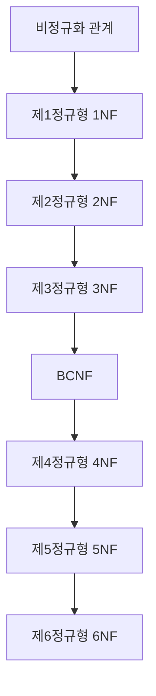
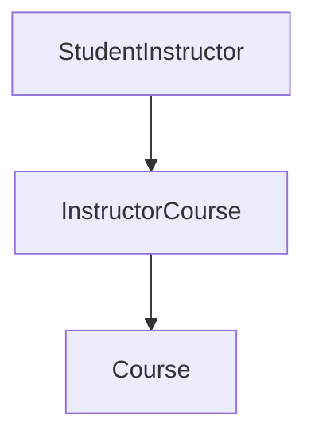
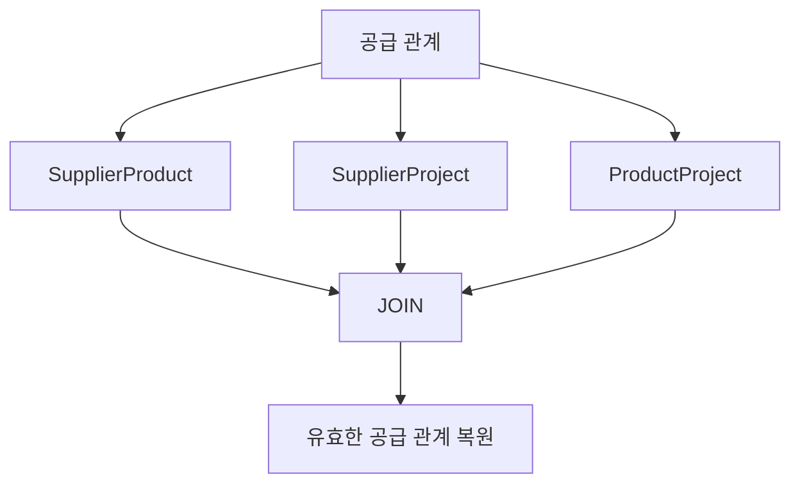
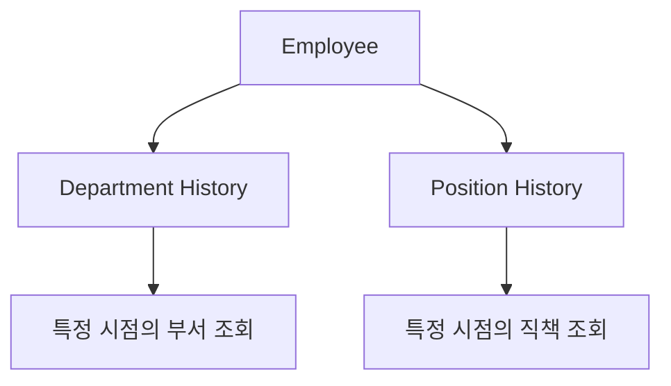
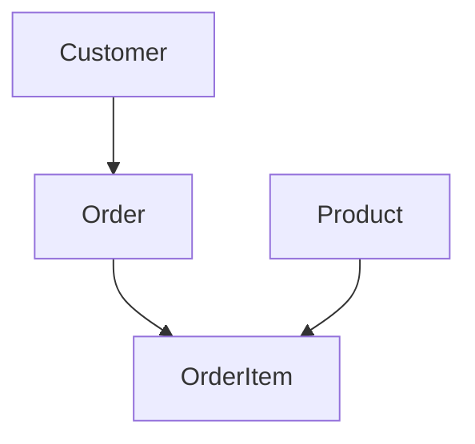
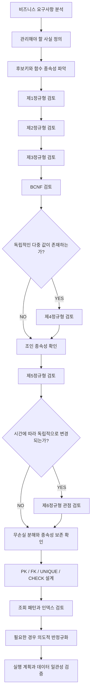

# 아마의 데이터베이스 정규화
[https://youtu.be/-R6YnlFYrIY?si=NK0lykYGQDUo2ByZ](https://youtu.be/-R6YnlFYrIY?si=NK0lykYGQDUo2ByZ)

# 아마의 데이터베이스 정규화
* toc
{:toc}

---

### 데이터베이스 정규화 완벽 이해: 제1정규형부터 제6정규형, BCNF와 JPA 실무 설계까지

관계형 데이터베이스를 설계할 때 가장 먼저 고민해야 하는 것 중 하나는 데이터를 어떤 테이블에 저장할 것인가이다.

예를 들어 온라인 쇼핑몰에서 주문 기능을 개발한다고 가정해 보자.

하나의 주문에는 고객 정보, 상품 정보, 주문 수량, 배송지, 결제 금액 등 다양한 데이터가 필요하다.

이러한 정보를 하나의 테이블에 모두 저장할 수도 있다.

```sql
CREATE TABLE orders (
    order_id BIGINT PRIMARY KEY,
    customer_id BIGINT,
    customer_name VARCHAR(100),
    customer_address VARCHAR(255),
    product_id BIGINT,
    product_name VARCHAR(100),
    product_price DECIMAL(15, 2),
    quantity INT
);
```

처음에는 이 구조가 편리해 보인다.

주문 정보를 조회할 때 다른 테이블과 JOIN할 필요가 없기 때문이다.

하지만 주문이 증가하고 요구사항이 복잡해지면 여러 문제가 발생한다.

고객이 주문을 100번 생성했다면 고객 이름과 주소도 100번 저장될 수 있다.

상품 가격이 변경되었을 때 어떤 값을 변경해야 하는지 명확하지 않을 수 있다.

상품 정보가 주문 데이터에만 존재한다면 아직 주문되지 않은 상품을 어떻게 관리할지도 고민해야 한다.

이러한 문제를 해결하기 위해 등장한 개념이 **데이터베이스 정규화(Database Normalization)**&#xB2E4;.

정규화를 단순히 중복 데이터를 제거하는 작업이라고 생각하기 쉽다.

하지만 정규화의 본질은 조금 더 깊다.

**데이터 사이의 종속관계를 분석하고, 서로 다른 사실을 적절한 테이블로 분리해 데이터의 일관성과 무결성을 유지하는 것**이다.

정규화를 제대로 이해하려면 테이블을 나누는 방법뿐 아니라 어떤 종속관계가 문제를 만드는지 알아야 한다.

또 제1정규형부터 제3정규형까지만 이해해서는 해결하기 어려운 데이터 구조도 존재한다.

이러한 문제를 다루기 위해 BCNF, 제4정규형, 제5정규형, 제6정규형 같은 개념이 등장한다.

각 정규형은 서로 다른 종류의 종속성과 데이터 이상 현상을 해결하기 위한 기준이다.

---

### 데이터베이스 정규화란 무엇인가?

데이터베이스 정규화는 관계형 데이터베이스의 테이블을 분석하고 재구성해 불필요한 데이터 중복과 이상 현상을 줄이는 설계 과정이다.

정규화를 수행할 때는 데이터 사이에 어떤 관계가 존재하는지 확인한다.

예를 들어 다음과 같은 테이블을 생각해 보자.

| 회원 ID | 회원 이름 | 소속 팀 |
| ----: | ----- | ---- |
|     1 | 아마    | 솔라팀  |
|     1 | 아마    | 솔라팀  |
|     1 | 아마    | 솔라팀  |
|     2 | 한스    | 네오팀  |

같은 회원의 소속 팀 정보가 여러 번 저장되어 있다.

아마 회원의 소속이 네오팀으로 변경되었다고 가정하자.

해당 회원과 관련된 모든 행을 수정해야 한다.

그런데 일부 행만 수정된다면 어떻게 될까?

| 회원 ID | 회원 이름 | 소속 팀 |
| ----: | ----- | ---- |
|     1 | 아마    | 네오팀  |
|     1 | 아마    | 솔라팀  |
|     1 | 아마    | 네오팀  |
|     2 | 한스    | 네오팀  |

동일한 회원이 두 팀에 소속된 것처럼 보인다.

실제 요구사항이 회원당 하나의 소속 팀을 허용한다면 데이터가 서로 모순되는 상황이다.

이 문제의 원인은 단순히 문자열이 여러 번 저장되었다는 사실이 아니다.

**회원 ID가 결정하는 소속 팀 정보가 다른 관계의 행마다 반복해서 저장되고 있기 때문**이다.

즉 데이터의 종속관계와 저장 위치가 적절하지 않은 것이다.

Microsoft의 데이터베이스 설계 지침에서도 정규화는 데이터의 중복과 비일관적인 종속관계를 개선하기 위한 과정으로 설명한다.

---

### 왜 정규화가 필요할까?

정규화가 필요한 가장 중요한 이유는 데이터 이상 현상(Anomaly)을 줄이기 위해서다.

대표적으로 세 가지가 존재한다.

#### 1. 갱신 이상(Update Anomaly)

동일한 사실이 여러 행에 저장되어 일부만 변경되는 문제다.

예를 들어 다음과 같은 데이터가 있다고 하자.

| 주문 ID | 고객 ID | 고객 이름 | 고객 등급 |
| ----: | ----: | ----- | ----- |
|   101 |     1 | 아마    | BASIC |
|   102 |     1 | 아마    | BASIC |
|   103 |     1 | 아마    | BASIC |

고객의 등급이 VIP로 변경되었다.

그런데 한 행만 수정된다면 어떻게 될까?

| 주문 ID | 고객 ID | 고객 이름 | 고객 등급 |
| ----: | ----: | ----- | ----- |
|   101 |     1 | 아마    | VIP   |
|   102 |     1 | 아마    | BASIC |
|   103 |     1 | 아마    | BASIC |

고객의 현재 등급이라는 동일한 사실이 서로 다르게 저장되었다.

이를 갱신 이상이라고 한다.

단, 주문 당시의 고객 등급을 의도적으로 기록한 이력이라면 이야기가 달라진다. 이러한 경우에는 각 행이 서로 다른 시점의 사실을 표현하므로 무조건 중복이라고 판단해서는 안 된다.

#### 2. 삽입 이상(Insertion Anomaly)

한 가지 사실을 저장하려면 관련 없는 다른 사실까지 함께 저장해야 하는 문제다.

예를 들어 상품 정보가 주문 테이블에만 존재한다고 가정하자.

```text
주문 테이블

주문 ID
고객 ID
상품 ID
상품명
상품 가격
```

새로운 상품을 등록했지만 아직 주문이 발생하지 않았다.

이때 상품 정보를 저장할 수 있는 별도 테이블이 없다면 상품만 독립적으로 등록하기 어렵다.

상품을 등록하기 위해 존재하지 않는 주문 정보를 만들어야 할 수도 있다.

이것이 삽입 이상이다.

#### 3. 삭제 이상(Deletion Anomaly)

특정 데이터를 삭제하면서 보존해야 할 다른 정보까지 사라지는 문제다.

예를 들어 마지막 주문을 삭제했더니 해당 상품의 정보도 함께 사라진다고 생각해 보자.

주문 정보와 상품 정보가 하나의 테이블에 종속되어 있기 때문에 발생하는 문제다.

원래 삭제하려던 것은 주문이다.

하지만 상품 정보까지 없어졌다.

정규화는 서로 다른 사실을 적절한 관계로 분리해 이러한 문제를 줄인다.

| 이상 현상 | 발생 원인              | 대표적인 문제                |
| ----- | ------------------ | ---------------------- |
| 갱신 이상 | 동일한 사실이 여러 위치에 저장됨 | 일부 값만 변경되어 불일치 발생      |
| 삽입 이상 | 서로 다른 사실이 한 행에 묶임  | 관련 없는 정보 없이는 데이터 저장 불가 |
| 삭제 이상 | 서로 다른 사실이 같은 행에 의존 | 하나의 데이터 삭제로 다른 정보까지 소멸 |

정규화의 목적은 단순한 저장 공간 절약을 넘어 **데이터의 의미와 일관성을 안정적으로 관리하는 것**이다.

---

### 정규화를 이해하기 위한 핵심 개념

정규형을 살펴보기 전에 몇 가지 개념을 이해해야 한다.

특히 함수 종속성과 후보키는 제2정규형 이후의 내용을 이해하는 데 중요하다.

#### 함수 종속성(Functional Dependency)

함수 종속성은 어떤 속성의 값이 다른 속성의 값을 결정하는 관계다.

일반적으로 다음과 같이 표현한다.

```text
A → B
```

이는 A의 값이 같다면 B의 값도 반드시 같아야 한다는 의미다.

예를 들어 다음과 같은 회원 테이블이 있다고 하자.

| member_id | member_name | team_id |
| --------: | ----------- | ------: |
|         1 | 아마          |      10 |
|         2 | 한스          |      20 |
|         3 | 모루          |      10 |

회원 ID가 회원 이름을 결정한다고 가정하면 다음 함수 종속성이 존재한다.

```text
member_id → member_name
```

또 회원당 하나의 팀에 소속된다는 정책이라면 다음 관계도 존재한다.

```text
member_id → team_id
```

회원 ID를 알면 회원 이름과 팀 ID를 결정할 수 있다.

하지만 반대 방향은 반드시 성립하지 않는다.

```text
member_name → member_id
```

동일한 이름을 가진 회원이 여러 명 존재할 수 있기 때문이다.

여기서 중요한 점이 있다.

**함수 종속성은 현재 저장된 데이터에서 우연히 나타나는 관계가 아니라 비즈니스 규칙에 의해 성립해야 하는 관계**다.

현재 회원 이름이 모두 다르다는 이유만으로 이름이 회원 ID를 결정한다고 판단하면 안 된다.

---

### 슈퍼키와 후보키, 기본키의 차이

함수 종속성을 정확하게 이해하려면 키의 종류도 알아야 한다.

#### 슈퍼키(Superkey)

슈퍼키는 테이블의 각 행을 유일하게 식별할 수 있는 속성의 집합이다.

예를 들어 회원 ID가 유일하다면 다음은 슈퍼키다.

```text
{member_id}
```

다음 조합도 슈퍼키가 될 수 있다.

```text
{member_id, member_name}
```

이미 `member_id`만으로 행을 식별할 수 있으므로 `member_name`이 추가되어도 유일성은 유지된다.

하지만 두 번째 조합에는 불필요한 속성이 포함되어 있다.

#### 후보키(Candidate Key)

후보키는 불필요한 속성을 제거해도 유일성이 유지되는 최소 슈퍼키다.

예를 들어 `member_id`만으로 행을 식별할 수 있다면 다음이 후보키다.

```text
{member_id}
```

반면 다음은 최소성을 만족하지 못하므로 후보키가 아니다.

```text
{member_id, member_name}
```

#### 기본키(Primary Key)

기본키는 여러 후보키 중에서 데이터베이스 설계자가 선택한 키다.

즉 후보키가 여러 개 존재할 수 있지만 일반적으로 그중 하나를 Primary Key로 선언한다.

| 구분                          | 의미                     |
| --------------------------- | ---------------------- |
| 슈퍼키                         | 행을 유일하게 식별할 수 있는 속성 집합 |
| 후보키                         | 최소성을 만족하는 슈퍼키          |
| 기본키                         | 후보키 중 선택한 대표 키         |
| 복합키                         | 둘 이상의 속성으로 구성된 키       |
| 주요 속성(Prime Attribute)      | 적어도 하나의 후보키에 포함되는 속성   |
| 비주요 속성(Non-Prime Attribute) | 어떤 후보키에도 포함되지 않는 속성    |

이 중 주요 속성과 비주요 속성의 차이는 제3정규형과 BCNF를 구분할 때 중요하다.

---

### 정규화는 어떤 순서로 진행할까?

일반적인 정규화 과정은 다음과 같다.



각 단계는 앞선 단계의 조건을 만족한다는 전제에서 더 엄격한 조건을 적용한다.

다만 모든 서비스에서 반드시 제6정규형까지 적용해야 한다는 의미는 아니다.

일반적인 업무 시스템에서는 제3정규형이나 BCNF를 중심으로 설계하는 경우가 많다.

제4정규형부터는 보다 복잡한 데이터 관계를 다루며, 제6정규형은 특히 시간에 따라 서로 독립적으로 변경되는 속성을 모델링할 때 의미가 있다.

각 정규형이 무엇을 해결하는지 살펴보자.

---

### 제1정규형(1NF): 하나의 속성에는 하나의 값만 저장한다

제1정규형은 관계형 데이터베이스 정규화의 출발점이다.

일반적으로 하나의 행과 컬럼이 만나는 위치에 하나의 원자적인 값이 존재하도록 구성하는 것을 의미한다.

예를 들어 회원이 수강하는 교육 과정 목록을 저장한다고 가정하자.

| member_id | member_name | course_names        |
| --------: | ----------- | ------------------- |
|         1 | 아마          | Java, Spring, MySQL |
|         2 | 한스          | Java, Redis         |

이 테이블에서는 하나의 컬럼에 여러 교육 과정이 문자열로 저장되어 있다.

```text
Java, Spring, MySQL
```

이런 구조에는 여러 문제가 있다.

회원이 Spring을 수강하는지 확인하려면 문자열을 분석해야 한다.

```sql
SELECT *
FROM member_course
WHERE course_names LIKE '%Spring%';
```

이 방식은 정확한 관계 조회에 적합하지 않다.

예를 들어 `Spring`과 `Spring Boot`를 구분해야 한다면 조건이 복잡해질 수 있다.

또 특정 교육 과정 하나만 삭제하거나 변경하려면 문자열을 수정해야 한다.

이를 개선해 보자.

#### 제1정규형 적용 전

| member_id | member_name | course_names        |
| --------: | ----------- | ------------------- |
|         1 | 아마          | Java, Spring, MySQL |

#### 제1정규형 적용 후

| member_id | member_name | course_name |
| --------: | ----------- | ----------- |
|         1 | 아마          | Java        |
|         1 | 아마          | Spring      |
|         1 | 아마          | MySQL       |

이제 각 행은 하나의 회원과 하나의 교육 과정 사이의 관계를 표현한다.

특정 과정만 추가하거나 제거할 수 있다.

```sql
DELETE FROM member_course
WHERE member_id = 1
  AND course_name = 'Spring';
```

문자열의 일부를 수정할 필요가 없다.

#### 제1정규형에서 주의할 점

원자적인 값이라는 개념은 단순히 문자열을 더 이상 분리할 수 없다는 뜻이 아니다.

예를 들어 날짜를 생각해 보자.

```text
2026-10-22
```

이 값은 연도, 월, 일로 구분할 수 있다.

하지만 날짜를 하나의 값으로 사용하는 것이 비즈니스 요구사항에 적절하다면 원자적인 속성으로 다룰 수 있다.

주소도 마찬가지다.

주소 전체를 하나의 값으로 관리할 수 있지만 국가, 도시, 우편번호를 독립적으로 검색해야 한다면 별도 속성으로 나누는 편이 적절할 수 있다.

따라서 제1정규형을 이해할 때는 다음 질문이 중요하다.

**해당 컬럼은 현재 데이터 모델에서 하나의 값인가, 아니면 여러 독립적인 사실을 억지로 묶어놓은 것인가?**

참고로 SQL의 JSON이나 배열 컬럼을 사용한다고 해서 모든 경우에 제1정규형 위반이라고 단정할 수는 없다. 관계형 이론에서 원자성은 도메인과 연산의 의미에 영향을 받는다. 다만 독립적으로 검색·수정해야 하는 여러 값을 하나의 JSON이나 문자열에 묶으면 관계 모델이 제공하는 제약과 조회 기능을 충분히 활용하기 어려울 수 있다.

---

### 제2정규형(2NF): 부분 함수 종속성을 제거한다

제2정규형을 이해하려면 부분 함수 종속성이라는 개념이 필요하다.

부분 함수 종속성은 어떤 비주요 속성이 후보키 전체가 아니라 그 일부에만 종속되는 관계다.

다음과 같은 교육 과정 수강 테이블을 생각해 보자.

| member_id | course_id | member_name | course_name | course_fee | attendance |
| --------: | --------: | ----------- | ----------- | ---------: | ---------- |
|         1 |       100 | 아마          | Java        |     100000 | Y          |
|         1 |       200 | 아마          | Spring      |     150000 | N          |
|         2 |       100 | 한스          | Java        |     100000 | Y          |

하나의 회원은 여러 교육 과정을 수강할 수 있다.

하나의 교육 과정에도 여러 회원이 참여할 수 있다.

따라서 다음 복합키가 하나의 수강 관계를 식별한다고 가정하자.

```text
(member_id, course_id)
```

함수 종속성을 분석하면 다음과 같다.

```text
member_id → member_name
```

회원 이름은 회원 ID에 종속된다.

또 다음 관계가 존재한다.

```text
course_id → course_name
course_id → course_fee
```

교육 과정 이름과 수강료는 과정 ID에 종속된다.

반면 출석 여부는 회원과 교육 과정의 조합으로 결정된다.

```text
(member_id, course_id) → attendance
```

문제는 다음 속성들이다.

```text
member_name

course_name

course_fee
```

이 속성들은 복합 후보키 전체가 아니라 일부에만 의존한다.

따라서 부분 함수 종속성이 존재한다.

#### 제2정규형을 위반하면 어떤 문제가 발생할까?

Java 교육 과정의 수강료가 변경되었다고 가정하자.

기존 수강료는 100,000원이다.

이를 120,000원으로 변경해야 한다.

그런데 같은 과정에 참여하는 회원이 1,000명이라면 수강료 정보가 1,000개 행에 반복되어 있을 수 있다.

모든 행을 수정해야 하는 것이다.

일부 행이 누락되면 동일한 교육 과정의 수강료가 서로 다르게 저장된다.

이 문제를 해결하기 위해 테이블을 분리할 수 있다.

#### Member 테이블

| member_id | member_name |
| --------: | ----------- |
|         1 | 아마          |
|         2 | 한스          |

#### Course 테이블

| course_id | course_name | course_fee |
| --------: | ----------- | ---------: |
|       100 | Java        |     100000 |
|       200 | Spring      |     150000 |

#### Enrollment 테이블

| member_id | course_id | attendance |
| --------: | --------: | ---------- |
|         1 |       100 | Y          |
|         1 |       200 | N          |
|         2 |       100 | Y          |

이제 회원 이름은 회원 테이블에서 관리한다.

교육 과정 이름과 수강료는 과정 테이블에서 관리한다.

수강 여부와 출석 상태는 수강 관계 테이블에서 관리한다.

각 테이블이 서로 다른 사실을 담당하도록 분리된 것이다.

#### SQL로 구현하면?

```sql
CREATE TABLE member (
    member_id BIGINT PRIMARY KEY,
    member_name VARCHAR(100) NOT NULL
);

CREATE TABLE course (
    course_id BIGINT PRIMARY KEY,
    course_name VARCHAR(100) NOT NULL,
    course_fee DECIMAL(12, 2) NOT NULL
);

CREATE TABLE enrollment (
    member_id BIGINT NOT NULL,
    course_id BIGINT NOT NULL,
    attendance BOOLEAN NOT NULL DEFAULT FALSE,

    PRIMARY KEY (member_id, course_id),

    CONSTRAINT fk_enrollment_member
        FOREIGN KEY (member_id)
        REFERENCES member (member_id),

    CONSTRAINT fk_enrollment_course
        FOREIGN KEY (course_id)
        REFERENCES course (course_id)
);
```

이제 수강료를 변경할 때는 과정 테이블의 한 행만 수정하면 된다.

```sql
UPDATE course
SET course_fee = 120000
WHERE course_id = 100;
```

다만 여기서 중요한 조건이 있다.

이 예제는 `course_fee`가 교육 과정의 **현재 표준 수강료**라는 규칙을 전제로 한다.

회원별 할인이나 등록 당시 확정된 결제 금액을 기록해야 한다면 그 값은 수강 관계 또는 별도의 결제 사실에 종속될 수 있다.

따라서 실제 설계에서는 가격의 의미를 먼저 정의해야 한다.

#### 단일 컬럼 기본키라면 제2정규형을 자동으로 만족할까?

여기서 흔히 오해하는 부분이 있다.

단일 컬럼 PK를 사용한다는 이유만으로 무조건 제2정규형을 만족하는 것은 아니다.

제2정규형은 단순히 선언된 Primary Key뿐 아니라 **후보키 전체를 기준으로 부분 함수 종속성을 판단**한다.

예를 들어 대체 후보키로 복합키가 존재한다면 해당 후보키에서도 부분 종속성을 확인해야 한다.

따라서 정규화 수준은 PK 컬럼 개수만으로 결정되지 않는다.

---

### 제3정규형(3NF): 이행 함수 종속성을 제거한다

제2정규형까지 적용하면 후보키 일부에만 종속되는 비주요 속성 문제를 해결할 수 있다.

하지만 여전히 다른 문제가 남을 수 있다.

다음과 같은 교육 과정 테이블이 있다고 가정하자.

| course_id | course_name | coach_id | coach_name | coach_birth |
| --------: | ----------- | -------: | ---------- | ----------- |
|       100 | Java        |       10 | 솔라         | 1990-01-01  |
|       200 | Spring      |       10 | 솔라         | 1990-01-01  |
|       300 | MySQL       |       20 | 네오         | 1992-05-10  |

여기서 교육 과정 ID가 해당 과정의 담당 코치를 결정한다고 가정하자.

```text
course_id → coach_id
```

또 코치 ID는 코치의 이름과 생년월일을 결정한다.

```text
coach_id → coach_name
coach_id → coach_birth
```

이 관계를 연결하면 다음과 같다.

```text
course_id
    ↓
coach_id
    ↓
coach_name, coach_birth
```

즉 다음 이행 함수 종속성이 존재한다.

```text
course_id → coach_id → coach_birth
```

코치의 생년월일은 교육 과정 자체의 정보가 아니다.

코치라는 별도 개체에 속하는 정보다.

그런데 이 정보를 교육 과정 테이블에서 반복적으로 저장하고 있다.

#### 제3정규형을 위반하면 어떤 문제가 발생할까?

솔라 코치의 이름이 변경되었다고 가정하자.

해당 코치가 담당하는 모든 교육 과정의 데이터를 수정해야 한다.

일부만 변경하면 동일한 코치 ID에 서로 다른 이름이 존재하게 된다.

또 코치가 아직 어떤 교육 과정도 담당하지 않는다면 코치 정보만 등록하기 어려울 수 있다.

이를 해결하기 위해 코치 정보를 별도 테이블로 분리한다.

#### Course 테이블

| course_id | course_name | coach_id |
| --------: | ----------- | -------: |
|       100 | Java        |       10 |
|       200 | Spring      |       10 |
|       300 | MySQL       |       20 |

#### Coach 테이블

| coach_id | coach_name | coach_birth |
| -------: | ---------- | ----------- |
|       10 | 솔라         | 1990-01-01  |
|       20 | 네오         | 1992-05-10  |

이제 코치 정보는 Coach 테이블에서 독립적으로 관리한다.

```sql
CREATE TABLE coach (
    coach_id BIGINT PRIMARY KEY,
    coach_name VARCHAR(100) NOT NULL,
    coach_birth DATE NOT NULL
);
```

Course 테이블에는 코치의 식별자만 저장한다.

```sql
CREATE TABLE course (
    course_id BIGINT PRIMARY KEY,
    course_name VARCHAR(100) NOT NULL,
    coach_id BIGINT NOT NULL,

    CONSTRAINT fk_course_coach
        FOREIGN KEY (coach_id)
        REFERENCES coach (coach_id)
);
```

이렇게 하면 코치의 이름과 생년월일을 한곳에서 관리할 수 있다.

#### 제3정규형의 정확한 기준

제3정규형을 설명할 때 흔히 다음과 같이 말한다.

> 모든 일반 속성은 기본키에 직접 종속되어야 한다.

직관적으로는 이해하기 쉽지만 엄밀한 정의는 아니다.

제3정규형의 정확한 조건은 다음과 같다.

모든 비자명한 함수 종속성 `X → A`에 대해 적어도 하나가 성립해야 한다.

1. X가 슈퍼키다.
2. A가 주요 속성이다.

즉 결정자가 슈퍼키가 아니더라도 결정되는 속성이 후보키에 포함되는 주요 속성이라면 일부 함수 종속성을 허용한다.

이러한 예외 때문에 제3정규형을 만족하지만 BCNF는 만족하지 못하는 테이블이 존재할 수 있다.

Microsoft의 일반적인 설계 지침에서는 제3정규형을 대부분의 업무 데이터베이스에 유용한 기준으로 설명하지만, 더 엄격한 종속성 분석을 위해서는 BCNF와 이후 정규형도 알아둘 필요가 있다.

---

### BCNF: 제3정규형보다 엄격한 함수 종속성 규칙

BCNF는 Boyce-Codd Normal Form의 약자다.

보이스-코드 정규형이라고 부른다.

BCNF는 제3정규형보다 엄격한 정규화 조건을 적용한다.

핵심 규칙은 다음과 같다.

**모든 비자명한 함수 종속성 `X → Y`에서 X는 반드시 슈퍼키여야 한다.**

제3정규형은 결정되는 속성이 주요 속성인 경우 예외를 허용한다.

하지만 BCNF는 이러한 예외를 허용하지 않는다.

이 차이를 이해하려면 후보키가 여러 개 존재하는 테이블을 살펴보는 것이 좋다.

---

### BCNF를 위반하는 테이블 예제

다음과 같은 수강 배정 시스템을 생각해 보자.

| student_id | course_id | instructor_id |
| ---------- | --------- | ------------- |
| S1         | C1        | T1            |
| S2         | C1        | T1            |
| S1         | C2        | T2            |
| S3         | C2        | T2            |

이 시스템에는 다음 비즈니스 규칙이 존재한다고 가정하자.

첫 번째 규칙은 하나의 강사가 하나의 교육 과정만 담당한다는 것이다.

```text
instructor_id → course_id
```

두 번째 규칙은 하나의 학생이 특정 교육 과정에서 하나의 담당 강사만 배정받는다는 것이다.

```text
(student_id, course_id) → instructor_id
```

이 조건에 따라 후보키를 분석해 보자.

#### 첫 번째 후보키

```text
(student_id, course_id)
```

학생과 교육 과정이 정해지면 담당 강사가 결정된다.

따라서 해당 조합은 후보키가 될 수 있다.

#### 두 번째 후보키

```text
(student_id, instructor_id)
```

강사는 하나의 교육 과정만 담당한다.

따라서 학생과 강사가 정해지면 교육 과정도 결정된다.

이 조합 역시 후보키가 될 수 있다.

즉 후보키가 두 개 존재한다.

```text
Candidate Key 1

(student_id, course_id)


Candidate Key 2

(student_id, instructor_id)
```

세 속성 모두 적어도 하나의 후보키에 포함된다.

따라서 모두 주요 속성이다.

---

### 이 테이블은 제3정규형일까?

앞서 살펴본 함수 종속성을 다시 보자.

```text
instructor_id → course_id
```

여기서 `instructor_id`는 슈퍼키가 아니다.

강사 한 명에게 여러 학생이 배정될 수 있으므로 강사 ID만으로 모든 행을 유일하게 식별할 수 없다.

하지만 `course_id`는 주요 속성이다.

`course_id`가 후보키 `(student_id, course_id)`에 포함되기 때문이다.

따라서 이 관계는 제3정규형에서 허용될 수 있다.

그런데 BCNF에서는 어떨까?

BCNF는 결정자인 `instructor_id`가 슈퍼키일 것을 요구한다.

하지만 `instructor_id`는 슈퍼키가 아니다.

따라서 **제3정규형은 만족하지만 BCNF는 위반하는 상황**이다.

---

### BCNF를 적용하면 어떻게 될까?

문제가 되는 함수 종속성은 다음과 같다.

```text
instructor_id → course_id
```

강사와 교육 과정의 관계를 별도 테이블로 분리할 수 있다.

#### InstructorCourse 테이블

| instructor_id | course_id |
| ------------- | --------- |
| T1            | C1        |
| T2            | C2        |

#### StudentInstructor 테이블

| student_id | instructor_id |
| ---------- | ------------- |
| S1         | T1            |
| S2         | T1            |
| S1         | T2            |
| S3         | T2            |

이제 강사가 담당하는 교육 과정은 InstructorCourse에서 관리한다.

학생과 강사의 배정 관계는 StudentInstructor에서 관리한다.



이렇게 분리하면 강사가 담당하는 교육 과정 정보를 여러 학생의 행에 반복해서 저장할 필요가 없다.

#### BCNF 적용 시 주의할 점

BCNF는 언제나 제3정규형보다 실무적으로 유리한 것은 아니다.

앞선 원본 테이블에는 다음 제약이 존재했다.

```text
(student_id, course_id) → instructor_id
```

즉 학생은 동일한 교육 과정에 두 명의 강사를 동시에 배정받을 수 없다.

그런데 테이블을 둘로 분리하면 이 제약을 단일 테이블의 Unique Constraint만으로 보장하기 어려워질 수 있다.

학생이 같은 교육 과정을 담당하는 서로 다른 강사 두 명에게 배정되는 상황을 막으려면 추가적인 검증이 필요할 수 있다.

이처럼 BCNF 분해는 데이터 중복을 줄일 수 있지만 일부 함수 종속성을 개별 테이블의 제약만으로 유지하기 어렵게 만들 수도 있다.

따라서 정규화에서는 중복 제거뿐 아니라 **종속성 보존(Dependency Preservation)**&#xB3C4; 중요하다.

---

### 제4정규형(4NF): 다치 종속성을 제거한다

지금까지 살펴본 정규형은 주로 함수 종속성을 다뤘다.

함수 종속성은 하나의 값이 다른 값을 결정하는 관계다.

하지만 데이터 사이에는 함수 종속성만 존재하는 것이 아니다.

하나의 대상이 서로 독립적인 여러 값의 집합을 가지는 경우도 있다.

예를 들어 개발자가 사용할 수 있는 프로그래밍 언어와 취미를 관리한다고 가정하자.

한 개발자는 여러 프로그래밍 언어를 사용할 수 있다.

또 여러 취미를 가질 수 있다.

문제는 프로그래밍 언어와 취미가 서로 독립적이라는 점이다.

다음 데이터를 살펴보자.

| developer_id | language | hobby |
| -----------: | -------- | ----- |
|            1 | Java     | 축구    |
|            1 | Java     | 독서    |
|            1 | Kotlin   | 축구    |
|            1 | Kotlin   | 독서    |

개발자 1번은 Java와 Kotlin을 사용한다.

그리고 축구와 독서를 즐긴다.

프로그래밍 언어와 취미는 서로 직접적인 관계가 없다.

하지만 하나의 테이블에 저장하면서 모든 조합이 만들어졌다.

```text
Java × 축구

Java × 독서

Kotlin × 축구

Kotlin × 독서
```

이런 데이터 구조에는 어떤 문제가 있을까?

---

### 독립적인 다중 값이 만드는 중복

개발자가 새로운 언어인 Python을 학습했다고 가정하자.

기존 구조에서는 어떻게 데이터를 추가해야 할까?

```text
Python × 축구

Python × 독서
```

언어 하나를 추가하기 위해 취미의 개수만큼 행을 추가해야 한다.

반대로 새로운 취미가 생겨도 모든 언어와 조합해야 한다.

언어가 10개이고 취미가 10개라면 최대 100개의 조합이 필요하다.

하지만 실제 사실은 다음 두 개의 집합뿐이다.

```text
사용 가능한 언어

Java
Kotlin
Python
```

```text
취미

축구
독서
```

이러한 문제를 설명하는 개념이 **다치 종속성(Multivalued Dependency)**&#xC774;다.

---

### 다치 종속성이란 무엇인가?

다치 종속성은 하나의 속성이 다른 속성의 독립적인 값 집합을 결정하는 관계다.

일반적으로 다음과 같이 표현한다.

```text
A →→ B
```

함수 종속성과 기호가 다르다.

```text
함수 종속성

A → B


다치 종속성

A →→ B
```

예를 들어 다음 관계를 생각해 보자.

```text
developer_id →→ language
```

한 개발자는 여러 언어를 가질 수 있다.

또 다음 관계도 존재한다.

```text
developer_id →→ hobby
```

한 개발자는 여러 취미를 가질 수 있다.

여기서 중요한 조건은 두 값의 집합이 서로 독립적이라는 것이다.

즉 특정 언어를 사용한다는 사실이 특정 취미와 연결되어 있지 않다.

제4정규형은 이러한 독립적인 다치 종속성 때문에 발생하는 중복을 제거한다.

형식적으로는 **모든 비자명한 다치 종속성 `X →→ Y`의 결정자 X가 슈퍼키여야 한다**는 조건을 가진다.

---

### 제4정규형을 적용하면 어떻게 될까?

앞선 테이블을 다음과 같이 분리할 수 있다.

#### DeveloperLanguage 테이블

| developer_id | language |
| -----------: | -------- |
|            1 | Java     |
|            1 | Kotlin   |

#### DeveloperHobby 테이블

| developer_id | hobby |
| -----------: | ----- |
|            1 | 축구    |
|            1 | 독서    |

이제 언어와 취미를 독립적으로 관리한다.

```sql
CREATE TABLE developer_language (
    developer_id BIGINT NOT NULL,
    language VARCHAR(50) NOT NULL,

    PRIMARY KEY (developer_id, language)
);
```

```sql
CREATE TABLE developer_hobby (
    developer_id BIGINT NOT NULL,
    hobby VARCHAR(50) NOT NULL,

    PRIMARY KEY (developer_id, hobby)
);
```

새로운 언어를 추가할 때는 한 행만 삽입하면 된다.

```sql
INSERT INTO developer_language (
    developer_id,
    language
)
VALUES (
    1,
    'Python'
);
```

취미 테이블은 수정할 필요가 없다.

반대로 새로운 취미가 생겨도 언어 테이블에 영향을 주지 않는다.

#### 제4정규형에서 중요한 점

언어와 취미가 독립적이라는 조건이 반드시 필요하다.

예를 들어 언어별로 특정 활동이 연결되어 있다면 이야기가 달라진다.

```text
Java → 백엔드 개발

JavaScript → 프론트엔드 개발
```

이처럼 두 속성 사이에 실제 관계가 존재한다면 단순히 독립적인 다치 종속성으로 판단해서는 안 된다.

따라서 제4정규형은 데이터의 모양만 보고 적용하는 것이 아니라 **서로 다른 다중 값 집합이 실제로 독립적인지 확인한 뒤 적용해야 한다.**

---

### 제5정규형(5NF): 조인 종속성을 제거한다

제5정규형은 Project-Join Normal Form(PJNF)이라고도 부른다.

제4정규형에서는 독립적인 다중 값 집합을 분리했다.

하지만 제5정규형에서는 더 복잡한 관계를 다룬다.

핵심 개념은 **조인 종속성(Join Dependency)**&#xC774;다.

조인 종속성을 이해하려면 먼저 테이블을 분해하고 다시 결합하는 과정을 생각해 봐야 한다.

---

### 조인 종속성이란 무엇인가?

어떤 테이블을 여러 개의 작은 테이블로 분리했을 때, 그 테이블들을 다시 JOIN하여 원래 데이터를 정확하게 복원할 수 있는 관계를 조인 종속성이라고 한다.

여기서 중요한 표현은 정확하게 복원한다는 것이다.

원래 존재하지 않았던 데이터가 추가되면 안 된다.

원래 존재했던 데이터가 누락되어도 안 된다.

제5정규형은 후보키로부터 따라 나오는 경우를 제외한 비자명한 조인 종속성이 없도록 하는 정규형이다.

이를 이해하기 위해 공급업체, 상품, 프로젝트 관계를 생각해 보자.

---

### 제5정규형을 위반할 수 있는 예제

다음과 같은 시스템이 있다고 가정하자.

공급업체는 여러 상품을 공급할 수 있다.

공급업체는 여러 프로젝트에 참여할 수 있다.

프로젝트에서는 여러 상품을 사용할 수 있다.

그리고 다음 비즈니스 규칙이 존재한다고 가정하겠다.

**공급업체가 공급할 수 있는 상품이고, 해당 공급업체가 참여하는 프로젝트이며, 해당 프로젝트에서 허용된 상품이라면 그 조합은 유효한 공급 관계다.**

이 규칙이 중요하다.

유효한 세 가지 조합은 세 종류의 2개 요소 관계에 의해 완전히 결정된다는 의미다.

현재 유효한 공급 관계는 다음과 같다.

| supplier_id | product_id | project_id |
| ----------- | ---------- | ---------- |
| S1          | P1         | J1         |
| S1          | P1         | J2         |
| S1          | P2         | J1         |

세 개의 컬럼으로 이루어진 테이블이다.

겉으로 보면 특별한 문제가 없어 보인다.

하지만 이 테이블에는 서로 다른 세 가지 관계가 포함되어 있다.

공급업체와 상품의 관계.

공급업체와 프로젝트의 관계.

상품과 프로젝트의 관계.

이를 분리해 보자.

---

### 제5정규형 적용: 세 가지 관계로 분리

#### SupplierProduct 테이블

| supplier_id | product_id |
| ----------- | ---------- |
| S1          | P1         |
| S1          | P2         |

공급업체가 어떤 상품을 공급할 수 있는지 저장한다.

#### SupplierProject 테이블

| supplier_id | project_id |
| ----------- | ---------- |
| S1          | J1         |
| S1          | J2         |

공급업체가 어떤 프로젝트에 참여하는지 저장한다.

#### ProductProject 테이블

| product_id | project_id |
| ---------- | ---------- |
| P1         | J1         |
| P1         | J2         |
| P2         | J1         |

프로젝트에서 어떤 상품을 사용할 수 있는지 저장한다.

이제 각 테이블은 독립적인 관계를 표현한다.

공급업체가 새로운 상품을 공급할 수 있게 되면 SupplierProduct에만 추가하면 된다.

새로운 프로젝트에 참여한다면 SupplierProject만 수정하면 된다.

특정 프로젝트에서 사용 가능한 상품이 변경된다면 ProductProject를 수정하면 된다.

---

### 다시 JOIN하면 원래 데이터를 복원할 수 있을까?

다음 SQL을 실행한다고 생각해 보자.

```sql
SELECT
    sp.supplier_id,
    sp.product_id,
    sj.project_id
FROM supplier_product sp
JOIN supplier_project sj
    ON sp.supplier_id = sj.supplier_id
JOIN product_project pj
    ON sp.product_id = pj.product_id
   AND sj.project_id = pj.project_id;
```

결과는 다음과 같다.

| supplier_id | product_id | project_id |
| ----------- | ---------- | ---------- |
| S1          | P1         | J1         |
| S1          | P1         | J2         |
| S1          | P2         | J1         |

원래 테이블과 동일한 결과가 만들어진다.

이 경우에는 세 가지 관계로 분리해도 정보가 손실되지 않는다.

개념적인 구조는 다음과 같다.



이러한 방식은 데이터가 여러 관계로 분해될 수 있고, 다시 결합해 원래 정보를 정확하게 복원할 수 있다는 비즈니스 규칙이 존재할 때 의미가 있다.

---

### 제5정규형을 잘못 적용하면 발생하는 문제

여기서 주의해야 할 중요한 문제가 있다.

세 개의 컬럼으로 이루어진 테이블이 있다고 해서 무조건 세 개의 2컬럼 테이블로 분리할 수 있는 것은 아니다.

예를 들어 다음 데이터가 있다고 하자.

| supplier_id | product_id | project_id |
| ----------- | ---------- | ---------- |
| S1          | P1         | J1         |
| S1          | P2         | J2         |
| S2          | P1         | J2         |

이 데이터를 세 가지 관계로 분리하면 다음 정보가 만들어진다.

```text
SupplierProduct

S1 - P1
S1 - P2
S2 - P1
```

```text
SupplierProject

S1 - J1
S1 - J2
S2 - J2
```

```text
ProductProject

P1 - J1
P2 - J2
P1 - J2
```

이제 세 테이블을 JOIN한다고 생각해 보자.

다음 조합을 만들 수 있다.

```text
S1 - P1 - J2
```

왜 가능할까?

세 가지 2개 요소 관계가 모두 존재하기 때문이다.

```text
S1 - P1 존재

S1 - J2 존재

P1 - J2 존재
```

하지만 원래 테이블에는 다음 데이터가 없었다.

```text
S1 - P1 - J2
```

즉 원래 존재하지 않았던 공급 관계가 새롭게 만들어졌다.

이러한 결과를 **가짜 튜플(Spurious Tuple)**&#xC774;라고 한다.

이 예제는 모든 세 가지 관계가 존재한다고 해서 반드시 해당 세 요소의 조합이 허용되는 것은 아니라는 사실을 보여준다.

따라서 실제 비즈니스가 세 요소의 조합을 개별적으로 승인해야 하는 구조라면 세 컬럼을 가진 원본 관계를 유지해야 한다.

**제5정규형의 핵심은 테이블을 최대한 작게 쪼개는 것이 아니라, 비즈니스 규칙에 의해 보장되는 무손실 분해만 수행하는 것**이다.

---

### 제6정규형(6NF): 더 이상 비자명하게 분해할 수 없는 관계

제6정규형은 제5정규형보다 더 엄격한 정규화 수준이다.

형식적으로는 다음 조건을 가진다.

**테이블에 비자명한 조인 종속성이 존재하지 않아야 한다.**

쉽게 말하면 의미 있는 사실을 더 작은 관계로 분해하고 다시 결합해 동일한 정보를 복원하는 비자명한 방법이 더 이상 존재하지 않는 상태를 의미한다.

제6정규형은 일반적인 CRUD 시스템보다 시간에 따라 변경되는 데이터를 다루는 시스템에서 특히 유용할 수 있다.

대표적으로 이력 데이터와 Temporal Database가 있다.

---

### 시간에 따라 변경되는 데이터는 왜 특별할까?

직원 정보를 관리하는 시스템을 생각해 보자.

직원에게는 다음 속성이 존재한다.

```text
employee_id

department

position
```

이때 부서와 직책이 항상 동시에 변경되는 것은 아니다.

예를 들어 직원 A의 부서와 직책이 다음과 같이 변한다고 하자.

2026년 1월에는 개발팀 소속 백엔드 개발자다.

2026년 4월에는 같은 개발팀에서 팀장으로 승진한다.

2026년 7월에는 플랫폼팀으로 이동하지만 팀장 직책은 유지한다.

이를 하나의 이력 테이블에 저장하면 다음과 같다.

| employee_id | department | position | valid_from | valid_to   |
| ----------- | ---------- | -------- | ---------- | ---------- |
| 1           | 개발팀        | 개발자      | 2026-01-01 | 2026-04-01 |
| 1           | 개발팀        | 팀장       | 2026-04-01 | 2026-07-01 |
| 1           | 플랫폼팀       | 팀장       | 2026-07-01 | NULL       |

여기서 날짜 구간은 시작일을 포함하고 종료일은 포함하지 않는 방식이라고 가정한다.

```text
[valid_from, valid_to)
```

이 구조에서 부서와 직책은 서로 독립적으로 변경된다.

하지만 하나의 테이블에 묶여 있기 때문에 부서가 변경될 때 직책 정보도 새로운 행에 반복해서 저장해야 한다.

반대로 직책이 변경될 때 부서 정보도 다시 저장해야 한다.

서로 다른 시간적 사실을 하나의 이력 행으로 관리하면서 불필요한 데이터 분할과 중복이 발생하는 것이다.

---

### 제6정규형을 고려한 시간 정보 분리

부서 변경 이력과 직책 변경 이력을 분리할 수 있다.

#### EmployeeDepartmentHistory

| employee_id | department | valid_from | valid_to   |
| ----------: | ---------- | ---------- | ---------- |
|           1 | 개발팀        | 2026-01-01 | 2026-07-01 |
|           1 | 플랫폼팀       | 2026-07-01 | NULL       |

#### EmployeePositionHistory

| employee_id | position | valid_from | valid_to   |
| ----------: | -------- | ---------- | ---------- |
|           1 | 개발자      | 2026-01-01 | 2026-04-01 |
|           1 | 팀장       | 2026-04-01 | NULL       |

이제 부서 정보가 변경되더라도 직책 이력을 수정할 필요가 없다.

직책이 변경되어도 부서 이력을 수정할 필요가 없다.

서로 독립적인 시간적 사실을 분리했기 때문이다.

다음과 같은 구조다.



단, 이 예제는 제6정규형의 활용 방향을 보여주는 개념적인 모델이다.

이력 테이블을 단순히 두 개로 분리했다고 반드시 형식적인 제6정규형이 보장되는 것은 아니다.

정확한 제6정규형 여부는 해당 관계의 조인 종속성을 기준으로 판단해야 한다.

또 부서와 직책의 유효 기간이 서로 겹칠 수 있으므로 특정 시점의 전체 직원 상태를 복원할 때는 기간 조건을 이용한 JOIN이 필요하다.

제6정규형은 더 이상 비자명한 조인 종속성이 존재하지 않는 구조를 요구하며, 시간에 따라 독립적으로 변경되는 사실을 모델링하는 분야에서 특히 의미가 있다.

---

### 제6정규형에서 중요한 것은 시간의 의미다

이력 데이터를 설계할 때는 날짜 컬럼을 추가하는 것만으로 문제가 해결되지 않는다.

예를 들어 다음 두 개의 시간을 구분해야 하는 시스템도 있다.

첫 번째는 실제 업무적으로 값이 유효했던 시간이다.

두 번째는 시스템이 해당 사실을 기록하거나 인지한 시간이다.

예를 들어 직원의 부서 이동이 4월 1일부터 유효했지만 인사 담당자가 4월 3일에 시스템에 등록했다고 가정하자.

```text
실제 부서 이동일

2026-04-01


시스템 등록일

2026-04-03
```

두 시점은 다르다.

이처럼 업무상 유효 시간과 시스템 기록 시간을 함께 관리하는 구조를 Bitemporal Database 모델과 연결해 생각할 수 있다.

물론 모든 시스템에 이러한 구조가 필요한 것은 아니다.

하지만 금융 거래, 계약, 인사 이력, 정산처럼 과거 특정 시점의 상태를 정확하게 복원해야 하는 경우에는 시간의 의미를 명확히 설계해야 한다.

---

### DKNF: 도메인과 키로 모든 제약을 설명할 수 있을까?

제6정규형 외에도 알아둘 만한 정규화 개념이 있다.

바로 DKNF(Domain-Key Normal Form)다.

DKNF는 도메인-키 정규형이라고 부른다.

핵심 개념은 다음과 같다.

**테이블에 존재하는 모든 제약조건이 도메인 제약과 키 제약으로부터 논리적으로 도출될 수 있다면 DKNF를 만족한다.**

먼저 도메인 제약과 키 제약을 구분해 보자.

#### 도메인 제약(Domain Constraint)

특정 컬럼에 어떤 값이 들어갈 수 있는지 제한하는 규칙이다.

예를 들어 주문 수량은 1 이상이어야 한다.

```sql
quantity INT NOT NULL CHECK (quantity >= 1)
```

또 주문 상태에는 정해진 값만 사용할 수 있다.

```sql
status VARCHAR(20) NOT NULL
    CHECK (status IN ('PENDING', 'PAID', 'CANCELLED'))
```

#### 키 제약(Key Constraint)

특정 속성의 조합이 행을 유일하게 식별하도록 만드는 규칙이다.

```sql
PRIMARY KEY (order_id)
```

또는 다음과 같은 고유 제약도 존재한다.

```sql
UNIQUE KEY uk_order_number (order_number)
```

DKNF는 이러한 도메인과 키 제약으로 데이터의 유효성을 충분히 표현할 수 있는 구조를 지향한다.

하지만 실제 업무 규칙은 이보다 복잡할 수 있다.

예를 들어 다음 규칙을 생각해 보자.

```text
동일한 회의실에는 시간이 겹치는 예약이 존재하면 안 된다.
```

이 규칙은 단순한 컬럼 값의 유효성이나 기본키 중복 검사만으로 표현하기 어렵다.

다른 행의 시간 구간과 비교해야 하기 때문이다.

이처럼 실제 시스템에는 여러 행이나 여러 테이블의 관계를 검사해야 하는 복잡한 제약이 존재한다.

따라서 DKNF는 이상적인 설계 기준으로 이해할 수 있지만 모든 업무 테이블에 쉽게 적용할 수 있는 실용적인 단계별 절차는 아니다.

또 DKNF는 제1정규형부터 제6정규형처럼 번호가 순차적으로 증가하는 정규형과는 다른 관점의 개념이다.

---

### 제1정규형부터 제6정규형까지 한눈에 비교하기

지금까지 살펴본 내용을 정리하면 다음과 같다.

| 정규형        | 해결하려는 문제             | 핵심 개념                |
| ---------- | -------------------- | -------------------- |
| 제1정규형(1NF) | 반복되는 값과 부적절한 복합 속성   | 원자적 값                |
| 제2정규형(2NF) | 후보키 일부에만 종속되는 비주요 속성 | 부분 함수 종속성            |
| 제3정규형(3NF) | 부적절한 이행 함수 종속성       | 함수 종속성               |
| BCNF       | 슈퍼키가 아닌 결정자의 함수 종속성  | 결정자와 슈퍼키             |
| 제4정규형(4NF) | 독립적인 다중 값 집합의 중복     | 다치 종속성               |
| 제5정규형(5NF) | 비자명한 조인 종속성으로 인한 중복  | 조인 종속성               |
| 제6정규형(6NF) | 비자명한 조인 종속성을 모두 제거   | 더 이상 무손실 분해할 수 없는 관계 |
| DKNF       | 도메인과 키만으로 모든 제약을 설명  | 도메인 제약과 키 제약         |

각 정규형은 서로 다른 문제를 해결한다.

특히 제4정규형 이후에는 단순히 기본키와 일반 컬럼 사이의 함수 종속성만으로는 설명하기 어려운 문제를 다룬다.

따라서 정규형의 숫자가 높아질수록 무조건 좋은 설계가 된다고 생각해서는 안 된다.

더 높은 정규형을 적용하는 데에도 비용과 제약이 존재하기 때문이다.

---

### 정규화에서 가장 중요한 두 가지 검증

테이블을 여러 개로 분리할 때는 반드시 확인해야 하는 조건이 있다.

대표적으로 다음 두 가지다.

**무손실 분해(Lossless Decomposition)**

**종속성 보존(Dependency Preservation)**

이 두 개념을 이해하지 못하고 테이블을 나누면 오히려 더 큰 문제가 발생할 수 있다.

---

### 무손실 분해란 무엇인가?

무손실 분해는 원본 테이블을 여러 테이블로 분리한 뒤 JOIN을 수행했을 때 원래 데이터를 정확하게 복원할 수 있는 성질이다.

예를 들어 다음 테이블이 있다고 하자.

| member_id | member_name | team_id |
| --------: | ----------- | ------: |
|         1 | 아마          |      10 |
|         2 | 한스          |      20 |

이를 Member와 MemberTeam 관계로 나눌 수 있다.

#### Member

| member_id | member_name |
| --------: | ----------- |
|         1 | 아마          |
|         2 | 한스          |

#### MemberTeam

| member_id | team_id |
| --------: | ------: |
|         1 |      10 |
|         2 |      20 |

이제 JOIN하면 원본 데이터를 복원할 수 있다.

```sql
SELECT
    m.member_id,
    m.member_name,
    mt.team_id
FROM member m
JOIN member_team mt
    ON m.member_id = mt.member_id;
```

결과는 원본과 동일하다.

하지만 모든 분해가 무손실인 것은 아니다.

앞서 제5정규형에서 살펴본 것처럼 테이블을 잘못 분리하면 원래 존재하지 않았던 조합이 만들어질 수도 있다.

따라서 분해 전에는 관련된 함수 종속성과 조인 종속성이 실제로 성립하는지 확인해야 한다.

---

### 종속성 보존이란 무엇인가?

종속성 보존은 원본 테이블에서 보장하던 제약조건을 분해된 테이블에서도 유지할 수 있는 성질이다.

예를 들어 다음 함수 종속성이 있다고 하자.

```text
customer_id → customer_name
```

고객 ID가 고객 이름을 결정한다.

이 정보를 Customer 테이블로 분리한다면 Customer의 PK를 통해 해당 제약을 자연스럽게 유지할 수 있다.

하지만 모든 분해가 이렇게 간단하지는 않다.

BCNF 예제에서 살펴본 것처럼 일부 제약은 분해된 두 테이블을 함께 확인해야만 검증할 수 있게 된다.

이런 경우 애플리케이션 로직이나 별도의 데이터베이스 제약을 추가해야 할 수 있다.

따라서 정규화의 좋은 결과를 평가할 때는 단순히 테이블이 작아졌는지보다 다음을 확인해야 한다.

**원래 데이터를 정확히 복원할 수 있는가?**

**기존 비즈니스 제약을 계속 보장할 수 있는가?**

---

### 정규화와 객체지향 설계는 어떤 관계가 있을까?

Spring Boot와 JPA를 사용하는 개발자라면 자연스럽게 다음 질문을 하게 된다.

객체를 적절하게 분리하면 데이터베이스도 자동으로 정규화될까?

예를 들어 주문 기능을 구현한다고 생각해 보자.

처음에는 다음과 같은 Entity를 만들 수 있다.

```java
@Entity
public class Order {

    @Id
    private Long id;

    private String customerName;

    private String customerAddress;

    private String productName;

    private BigDecimal productPrice;

    private int quantity;
}
```

모든 정보를 하나의 Entity에 저장한 구조다.

이 구조에서는 고객 정보와 상품 정보, 주문 정보가 뒤섞여 있다.

객체의 책임을 분리한다면 다음과 같은 모델을 생각해 볼 수 있다.

```text
Customer

Product

Order

OrderItem
```

이러한 객체 분리는 관계형 데이터베이스의 정규화 방향과 잘 맞는 경우가 많다.

하지만 중요한 차이가 있다.

**객체의 책임을 분리하는 것과 데이터베이스의 함수 종속성을 분석하는 것은 동일한 작업이 아니다.**

JPA에서 클래스를 여러 개로 나눴다고 데이터베이스가 자동으로 제3정규형이나 BCNF를 만족하는 것은 아니다.

정규화 여부는 최종적으로 만들어진 테이블과 속성 사이의 종속관계를 기준으로 판단해야 한다.

---

### JPA 환경에서 주문 도메인을 정규화해 보자

주문 시스템에서는 일반적으로 다음과 같은 관계를 생각할 수 있다.



Customer는 고객의 기본 정보를 관리한다.

Product는 상품의 현재 정보를 관리한다.

Order는 고객이 주문한 사실을 관리한다.

OrderItem은 주문에 포함된 상품과 수량, 주문 당시 확정된 가격을 관리한다.

여기서 Order와 Product가 직접 다대다 관계를 형성하는 것이 아니라 OrderItem이 그 관계를 구체적인 업무 사실로 표현한다는 점이 중요하다.

주문 항목에는 단순한 상품 연결 정보 외에도 수량과 확정 가격이 존재하기 때문이다.

---

### Customer Entity

```java
@Entity
@Table(name = "customer")
public class Customer {

    @Id
    private Long id;

    @Column(nullable = false, length = 100)
    private String name;

    protected Customer() {
    }
}
```

고객 이름과 같은 현재 고객 정보는 Customer에서 관리한다.

---

### Product Entity

```java
@Entity
@Table(name = "product")
public class Product {

    @Id
    private Long id;

    @Column(nullable = false, length = 100)
    private String name;

    @Column(
            name = "current_price",
            nullable = false,
            precision = 15,
            scale = 2
    )
    private BigDecimal currentPrice;

    protected Product() {
    }
}
```

Product는 상품의 현재 이름과 가격을 관리한다.

여기서 `currentPrice`는 상품의 현재 판매 기준 가격이라는 의미다.

이 값은 향후 변경될 수 있다.

---

### Order Entity

```java
@Entity
@Table(name = "sales_order")
public class Order {

    @Id
    private Long id;

    @ManyToOne(fetch = FetchType.LAZY)
    @JoinColumn(name = "customer_id", nullable = false)
    private Customer customer;

    @Embedded
    private ShippingAddress shippingAddress;

    @OneToMany(
            mappedBy = "order",
            cascade = CascadeType.ALL,
            orphanRemoval = true
    )
    private List<OrderItem> items = new ArrayList<>();

    protected Order() {
    }
}
```

Order는 주문 자체를 표현한다.

고객 정보는 Customer와의 연관관계로 표현한다.

주문 항목은 OrderItem과의 일대다 관계로 관리한다.

배송지는 `ShippingAddress`라는 값 객체로 표현할 수 있다.

```java
@Embeddable
public class ShippingAddress {

    @Column(nullable = false)
    private String recipientName;

    @Column(nullable = false)
    private String postalCode;

    @Column(nullable = false)
    private String addressLine;

    protected ShippingAddress() {
    }

    public ShippingAddress(
            String recipientName,
            String postalCode,
            String addressLine
    ) {
        this.recipientName = recipientName;
        this.postalCode = postalCode;
        this.addressLine = addressLine;
    }
}
```

여기서 중요한 점이 있다.

`@Embedded`를 사용했다고 별도의 ShippingAddress 테이블이 자동으로 생성되는 것은 아니다.

일반적으로 Embeddable의 컬럼은 해당 객체를 포함하는 Entity의 테이블에 저장된다.

Hibernate는 이러한 Embeddable을 여러 속성을 하나의 값 객체로 표현하기 위한 매핑 방식으로 지원한다.

---

### OrderItem Entity

```java
@Entity
@Table(name = "order_item")
public class OrderItem {

    @Id
    private Long id;

    @ManyToOne(fetch = FetchType.LAZY)
    @JoinColumn(name = "order_id", nullable = false)
    private Order order;

    @ManyToOne(fetch = FetchType.LAZY)
    @JoinColumn(name = "product_id", nullable = false)
    private Product product;

    @Column(nullable = false)
    private int quantity;

    @Column(
            name = "unit_price_at_order",
            nullable = false,
            precision = 15,
            scale = 2
    )
    private BigDecimal unitPriceAtOrder;

    protected OrderItem() {
    }
}
```

OrderItem은 주문에 포함된 상품과 수량을 저장한다.

그런데 여기서 다음 컬럼을 주목해야 한다.

```java
private BigDecimal unitPriceAtOrder;
```

왜 주문 항목에 가격을 다시 저장할까?

Product에 이미 현재 가격이 존재하지 않는가?

정규화 관점에서는 중복 데이터처럼 보일 수 있다.

하지만 이 값은 반드시 중복이라고 볼 수 없다.

---

### 정규화에서 가장 중요한 것은 데이터의 의미다

상품 A의 현재 판매 가격이 10,000원이라고 가정하자.

고객이 해당 상품을 주문했다.

그런데 일주일 후 상품 가격이 12,000원으로 변경되었다.

이때 과거 주문 금액도 12,000원으로 변경되어야 할까?

그렇지 않다.

과거 주문은 10,000원에 확정된 거래 사실이다.

따라서 Product의 현재 가격과 OrderItem의 주문 당시 가격은 서로 다른 의미를 가진다.

```text
Product.currentPrice

→ 현재 상품 가격


OrderItem.unitPriceAtOrder

→ 주문 당시 확정된 단가
```

이 둘은 같은 상품과 관련된 값이지만 동일한 사실은 아니다.

함수 종속성도 다르게 해석해야 한다.

```text
product_id → current_price
```

현재 상품 가격이 상품에 종속된다는 모델이라면 위 관계를 생각할 수 있다.

반면 주문 당시 가격은 다음과 같이 주문 항목에 종속된다.

```text
order_item_id → unit_price_at_order
```

특정 주문 항목에서 확정된 가격이라는 별도의 사실이기 때문이다.

따라서 **중복된 값이 보인다는 이유만으로 무조건 다른 테이블로 분리해서는 안 된다.**

정규화에서는 같은 값인지보다 같은 사실인지를 구분해야 한다.

이 원칙은 주문 당시 배송지, 할인율, 세율, 회원 등급, 결제 환율을 저장할 때도 중요하다.

---

### 정규화와 반정규화는 서로 반대되는 개념일까?

정규화가 데이터의 종속관계를 정리하고 이상 현상을 줄이는 과정이라면, 반정규화(Denormalization)는 특정 목적을 위해 정규화된 구조에 의도적인 중복이나 파생 데이터를 추가하는 설계다.

예를 들어 주문 목록 API를 생각해 보자.

사용자는 다음 정보를 확인하고 싶어 한다.

```text
주문 ID

주문 일시

주문 상품 수

주문 총액
```

정규화된 구조에서는 주문 총액을 조회하기 위해 OrderItem을 집계해야 할 수 있다.

```sql
SELECT
    o.id,
    SUM(oi.quantity * oi.unit_price_at_order) AS total_amount
FROM sales_order o
JOIN order_item oi
    ON oi.order_id = o.id
GROUP BY o.id;
```

주문이 수백만 건이고 집계가 자주 발생한다면 성능 문제가 생길 수 있다.

이 경우 Order 테이블에 확정된 주문 총액을 저장하는 방식을 고려할 수 있다.

```text
sales_order

id

customer_id

ordered_at

total_amount
```

이렇게 하면 주문 목록을 조회할 때 매번 OrderItem을 집계하지 않아도 된다.

하지만 새로운 문제가 생긴다.

주문 항목이 변경되었을 때 주문 총액도 함께 변경해야 한다.

즉 다음 관계의 일관성을 유지해야 한다.

```text
OrderItem 변경

↓

Order.totalAmount 재계산
```

이것이 반정규화의 대표적인 비용이다.

조회 성능은 개선할 수 있지만 중복된 정보를 관리해야 한다.

따라서 반정규화를 적용할 때는 다음을 확인해야 한다.

**얼마나 자주 조회되는가?**

**실제로 JOIN이나 집계가 성능 병목인가?**

**중복된 값을 어떻게 일관되게 갱신할 것인가?**

**값이 불일치할 때 어떻게 복구할 것인가?**

참고로 주문 확정 시점의 총액을 변경 불가능한 거래 기록으로 저장하는 경우에는 단순한 캐시성 중복과 구분해서 생각할 수도 있다. 금액의 법적·업무적 의미에 따라 모델링 기준이 달라지기 때문이다.

---

### 정규화를 많이 하면 조회 성능이 나빠질까?

정규화를 적용하면 일반적으로 테이블 수가 증가할 수 있다.

따라서 하나의 화면에 필요한 정보를 가져오기 위해 여러 테이블을 JOIN해야 할 수도 있다.

하지만 테이블이 많아졌다고 쿼리 성능이 반드시 나빠지는 것은 아니다.

예를 들어 다음 두 가지를 비교해 보자.

#### 정규화되지 않은 큰 테이블

```text
Order

고객 정보

상품 정보

배송 정보

주문 정보

결제 정보
```

모든 정보가 하나의 테이블에 존재한다.

JOIN은 적을 수 있다.

하지만 중복된 데이터 때문에 테이블과 인덱스 크기가 커질 수 있다.

#### 정규화된 테이블

```text
Customer

Product

Order

OrderItem

Payment
```

테이블은 분리되어 있다.

필요한 조회에서는 JOIN이 발생한다.

하지만 각 테이블이 관리하는 데이터의 의미가 명확하고 불필요한 중복을 줄일 수 있다.

또 적절한 인덱스가 존재한다면 JOIN도 효율적으로 실행할 수 있다.

따라서 단순히 다음과 같이 판단해서는 안 된다.

```text
JOIN이 많다 = 성능이 나쁘다
```

실제 성능은 데이터 분포, 인덱스, 실행 계획, 반환되는 행의 수, Buffer Pool 적중률 등에 따라 달라진다.

MySQL을 사용하는 경우에는 `EXPLAIN ANALYZE` 등을 이용해 실제 실행 계획을 분석하는 것이 좋다.

정규화와 반정규화의 선택은 이론적인 선호가 아니라 실제 조회 패턴과 데이터 일관성 요구사항을 기반으로 결정해야 한다.

---

### 실무에서 정규화를 적용하는 12가지 설계 전략

정규형을 이해했다고 해서 실제 데이터베이스를 쉽게 설계할 수 있는 것은 아니다.

현실의 업무 데이터는 다양한 예외와 변경 이력을 가지고 있기 때문이다.

다음은 정규화 이론을 실제 백엔드 설계에 연결하기 위한 전략이다.

#### 1. 컬럼을 나누기 전에 비즈니스 규칙부터 정의한다

정규화의 시작은 테이블을 분리하는 것이 아니다.

각 데이터가 무엇을 의미하고 어떤 값에 의해 결정되는지 정의하는 것이다.

예를 들어 `product_price`라는 컬럼이 있다고 하자.

이 값이 현재 판매 가격인지, 특정 계약의 가격인지, 주문 당시 확정된 가격인지에 따라 종속관계가 달라진다.

현재 가격이라면 Product에 종속될 수 있다.

계약 가격이라면 Customer와 Product, 계약 기간의 조합에 종속될 수 있다.

주문 확정 가격이라면 OrderItem에 종속될 수 있다.

따라서 컬럼 이름만 보고 정규화 여부를 판단하지 말고 해당 값의 비즈니스 의미를 먼저 확인해야 한다.

#### 2. 기본키보다 후보키를 먼저 생각한다

JPA에서는 모든 Entity에 `Long id` 같은 단일 식별자를 사용하는 경우가 많다.

하지만 데이터베이스 정규화는 단순히 선언된 PK만을 기준으로 판단하지 않는다.

예를 들어 예약 테이블에 다음 컬럼이 있다고 하자.

```text
id

member_id

reservation_time_id
```

`id`가 PK라는 사실과 별개로 회원이 같은 예약 시간에 하나의 예약만 만들 수 있다는 규칙이 존재할 수 있다.

이 경우 `(member_id, reservation_time_id)`가 유일해야 할 수 있다.

따라서 대체 후보키와 Unique Constraint를 함께 분석해야 한다.

단일 `id`를 사용한다고 데이터 모델이 자동으로 정규화되는 것은 아니다.

#### 3. 이름보다 안정적인 식별자를 사용한다

회원 이름이나 상품명처럼 변경될 수 있고 중복될 수 있는 값은 안정적인 식별자가 아닐 수 있다.

예를 들어 다음 종속성을 가정하는 것은 위험하다.

```text
customer_name → customer_address
```

동일한 이름을 가진 고객이 여러 명 존재할 수 있기 때문이다.

실제로는 다음 관계가 더 적절할 수 있다.

```text
customer_id → customer_name
customer_id → customer_address
```

함수 종속성을 분석할 때는 비즈니스 규칙에 따라 유일성이 보장되는 식별자를 사용해야 한다.

#### 4. 변경 가능한 정보와 확정된 이력을 구분한다

고객의 현재 배송지와 주문 당시 배송지는 다른 사실이다.

상품의 현재 가격과 주문 당시 판매 가격도 다른 사실이다.

정규화를 과도하게 적용해 과거 주문이 항상 현재 고객이나 상품 정보를 참조하도록 만들면 이력의 정확성이 훼손될 수 있다.

따라서 거래나 계약이 확정되는 순간의 값이 필요한 경우에는 별도의 스냅샷을 저장하는 것이 적절할 수 있다.

이런 스냅샷은 단순한 중복 데이터가 아니라 독립적인 업무 사실이다.

#### 5. 다대다 관계에 비즈니스 속성이 있다면 별도 Entity를 고려한다

예를 들어 주문과 상품은 다대다 관계처럼 보인다.

하지만 실제 주문에서는 수량, 확정 가격, 할인 금액 같은 추가 속성이 필요하다.

이런 경우 단순한 `@ManyToMany`보다 OrderItem 같은 연결 Entity를 도입하는 것이 자연스럽다.

이는 객체지향 설계뿐 아니라 데이터베이스의 관계를 명확하게 표현하는 데도 도움이 된다.

#### 6. 독립적인 다중 값은 서로 다른 관계로 관리한다

하나의 회원이 여러 관심 분야와 여러 자격증을 가진다고 하자.

관심 분야와 자격증이 서로 독립적이라면 하나의 테이블에 모든 조합을 저장할 필요가 없다.

다음과 같이 분리할 수 있다.

```text
MemberInterest

MemberCertificate
```

이 구조는 제4정규형의 사고방식과 연결된다.

다만 두 값 사이에 실제 연관관계가 존재한다면 독립적인 집합으로 분리하면 안 된다.

#### 7. JOIN 결과가 원래 데이터와 동일한지 검증한다

테이블을 여러 개로 분리할 때는 JOIN으로 원본 데이터를 복원할 수 있는지 확인해야 한다.

특히 세 개 이상의 속성으로 이루어진 관계를 여러 개의 2컬럼 테이블로 분리하는 경우 주의해야 한다.

잘못된 분해는 실제로 존재하지 않았던 조합을 만들 수 있다.

따라서 무손실 분해가 가능한지 확인하고, 이를 가능하게 하는 비즈니스 규칙이 정말 존재하는지도 검증해야 한다.

#### 8. 정규화 이후에도 제약조건이 보존되는지 확인한다

정규화를 통해 테이블을 분리하면 어떤 제약은 단일 테이블에서 검증하기 어려워질 수 있다.

예를 들어 BCNF 분해 과정에서 원본 테이블의 Unique Constraint로 관리하던 규칙이 여러 테이블을 JOIN해야 확인되는 규칙으로 바뀔 수 있다.

따라서 분해 이후에도 주요 업무 제약을 어떻게 보장할지 설계해야 한다.

단순히 애플리케이션에서 중복 조회 후 INSERT하는 방식만으로는 동시성 문제를 완전히 막지 못할 수도 있다.

#### 9. 시간에 따라 독립적으로 변경되는 속성을 분리한다

직원의 부서와 직책처럼 서로 다른 시점에 변경되는 데이터는 하나의 이력 테이블에 저장할 때 불필요한 구간 분할이 발생할 수 있다.

이런 경우 시간적 사실을 분리하는 제6정규형의 관점을 고려할 수 있다.

다만 이력 테이블이 많아지면 특정 시점의 전체 상태를 복원하기 위한 쿼리가 복잡해질 수 있다.

따라서 데이터 변경 빈도와 이력 조회 요구사항을 함께 고려해야 한다.

#### 10. 정규화 이후에는 인덱스를 다시 설계한다

테이블을 분리하면 JOIN에 사용되는 Foreign Key와 조회 조건도 달라질 수 있다.

예를 들어 주문 항목을 OrderItem 테이블로 분리했다면 `order_id`를 이용한 조회가 빈번해질 수 있다.

이 경우 적절한 인덱스가 필요할 수 있다.

```sql
CREATE INDEX idx_order_item_order_id
ON order_item (order_id);
```

정규화는 데이터의 논리적 구조를 개선하는 작업이다.

인덱스는 실제 접근 성능을 개선하기 위한 물리적 설계 요소다.

두 작업은 구분하면서 함께 고려해야 한다.

#### 11. 반정규화할 때는 일관성 유지 방안을 함께 설계한다

주문 총액이나 조회 횟수 같은 파생 데이터를 별도로 저장하면 조회 성능을 개선할 수 있다.

하지만 원본 데이터가 변경되었을 때 파생 데이터도 함께 갱신해야 한다.

따라서 반정규화할 때는 값의 생성 시점과 수정 시점, 갱신 트랜잭션, 장애 복구 방법을 함께 설계해야 한다.

데이터 변경이 여러 서비스에 걸쳐 발생한다면 메시지 기반 갱신이나 Outbox 패턴을 고려할 수도 있다.

다만 비동기 갱신은 일시적인 불일치를 허용하는지까지 확인해야 한다.

#### 12. 가장 높은 정규형보다 유지 가능한 구조를 선택한다

제6정규형까지 분리하면 데이터의 특정 종속성을 더욱 엄격하게 표현할 수 있다.

하지만 테이블 수가 증가하고 조회와 관리가 복잡해질 수 있다.

반대로 모든 데이터를 하나의 테이블에 저장하면 초기 개발은 단순해 보여도 변경 이상과 데이터 불일치 문제가 증가할 수 있다.

따라서 실제 시스템에서는 데이터 일관성, 변경 가능성, 조회 성능, 팀의 이해도, 운영 복잡성을 함께 고려해야 한다.

정규화는 무조건 가장 높은 단계를 달성하기 위한 경쟁이 아니다.

**업무 규칙을 정확하게 표현하면서 데이터의 변경과 조회를 안전하게 수행하기 위한 설계 도구**다.

---

### 데이터베이스 정규화를 실무에 적용하는 순서

새로운 테이블을 설계하거나 기존 테이블을 개선할 때는 다음과 같은 흐름으로 접근할 수 있다.



이 과정에서 중요한 것은 각 정규형의 이름을 외우는 것이 아니다.

어떤 종속관계가 존재하는지 설명할 수 있어야 한다.

예를 들어 특정 테이블을 분리해야 하는 이유를 다음과 같이 설명할 수 있어야 한다.

```text
customer_id가 customer_name을 결정한다.

product_id가 현재 상품 가격을 결정한다.

order_item_id가 주문 당시 확정 가격을 결정한다.

직원의 부서 이력과 직책 이력은 서로 독립적으로 변경된다.

공급업체, 상품, 프로젝트의 유효한 조합은
실제 업무 규칙에 따라 결정된다.
```

이런 종속관계를 명확하게 표현할 수 있다면 테이블 분리의 근거도 자연스럽게 드러난다.

반대로 종속관계를 설명할 수 없다면 테이블을 나누는 것이 오히려 잘못된 모델링으로 이어질 수 있다.

---

### 정리

데이터베이스 정규화는 관계형 데이터베이스에서 데이터의 종속관계를 분석하고, 서로 다른 사실을 적절한 테이블로 분리해 이상 현상을 줄이는 과정이다.

정규화하지 않은 테이블에서는 동일한 사실이 여러 행에 저장될 수 있다.

이러한 구조는 갱신 이상, 삽입 이상, 삭제 이상을 발생시킬 수 있다.

정규화는 이러한 문제를 해결하기 위해 여러 단계의 정규형을 제공한다.

제1정규형은 하나의 속성에 독립적인 여러 값을 묶어 저장하는 문제를 개선한다.

제2정규형은 후보키의 일부에만 종속되는 비주요 속성을 분리한다.

제3정규형은 부적절한 이행 함수 종속성을 제거한다.

BCNF는 제3정규형보다 엄격하게 모든 비자명한 함수 종속성의 결정자가 슈퍼키일 것을 요구한다.

제4정규형은 서로 독립적인 다중 값 집합을 하나의 테이블에 저장하면서 발생하는 중복을 제거한다.

제5정규형은 조인 종속성을 분석해 여러 관계로 분해해도 원래 데이터를 정확하게 복원할 수 있는 구조를 다룬다.

제6정규형은 비자명한 조인 종속성이 더 이상 존재하지 않는 관계를 요구하며, 특히 독립적으로 변경되는 시간적 사실을 모델링할 때 유용하다.

DKNF는 모든 제약조건을 도메인과 키 제약으로 설명할 수 있는 구조를 지향한다.

전체 내용을 다시 정리하면 다음과 같다.

| 정규형  | 기억해야 할 질문                             |
| ---- | ------------------------------------- |
| 1NF  | 하나의 컬럼에 여러 독립적인 값을 묶어놓지는 않았는가?        |
| 2NF  | 비주요 속성이 후보키의 일부에만 종속되는가?              |
| 3NF  | 부적절한 이행 함수 종속성이 존재하는가?                |
| BCNF | 슈퍼키가 아닌 결정자가 존재하는가?                   |
| 4NF  | 서로 독립적인 다중 값 집합이 한 테이블에 섞여 있는가?       |
| 5NF  | 여러 관계로 무손실 분해할 수 있는 비자명한 조인 종속성이 있는가? |
| 6NF  | 더 이상 분해할 수 없는 독립적인 사실 단위로 관리하고 있는가?   |
| DKNF | 모든 제약을 도메인과 키만으로 설명할 수 있는가?           |

하지만 정규화에서는 반드시 기억해야 할 두 가지가 있다.

첫 번째는 **정규화의 기준이 단순한 데이터 중복 여부가 아니라 종속관계라는 점**이다.

같은 값이 여러 테이블에 존재하더라도 의미가 서로 다르다면 정상적인 데이터 구조일 수 있다.

대표적인 사례가 상품의 현재 가격과 주문 당시 확정 가격이다.

두 번째는 **정규형이 높다고 무조건 좋은 시스템이 되는 것은 아니라는 점**이다.

정규화를 통해 데이터 일관성을 높일 수 있지만 JOIN이 증가하거나 제약조건을 보존하기 어려워지는 상황도 존재한다.

따라서 실제 시스템에서는 일반적으로 제3정규형이나 BCNF를 중심으로 설계하되, 독립적인 다중 값과 복잡한 조인 종속성, 시간 이력 등의 요구사항이 있다면 제4정규형부터 제6정규형까지 검토하는 것이 좋다.

또 정규화된 논리 구조를 바탕으로 적절한 PK와 FK, Unique Constraint, 인덱스를 설계해야 한다.

조회 성능 문제가 실제로 확인된다면 의도적인 반정규화도 고려할 수 있다.

다만 반정규화된 값의 일관성을 어떻게 유지할 것인지 반드시 함께 설계해야 한다.

결국 좋은 데이터베이스 설계는 테이블을 많이 분리하거나 적게 분리하는 데 있지 않다.

**하나의 테이블이 어떤 사실을 책임지고, 해당 사실이 어떤 키와 종속관계에 의해 결정되며, 변경이 발생했을 때 다른 데이터의 일관성을 훼손하지 않는지 명확하게 설명할 수 있는 구조**를 만드는 데 있다.

#### 한 줄 요약

**데이터베이스 정규화는 단순히 중복 데이터를 제거하는 작업이 아니라 함수 종속성, 다치 종속성, 조인 종속성을 분석해 데이터의 일관성과 무결성을 유지하는 설계 과정이다. 제1정규형부터 제6정규형과 BCNF는 서로 다른 종속성 문제를 해결하며, 실무에서는 무손실 분해와 종속성 보존, 조회 성능, 이력 데이터의 의미까지 함께 고려해야 한다.**
