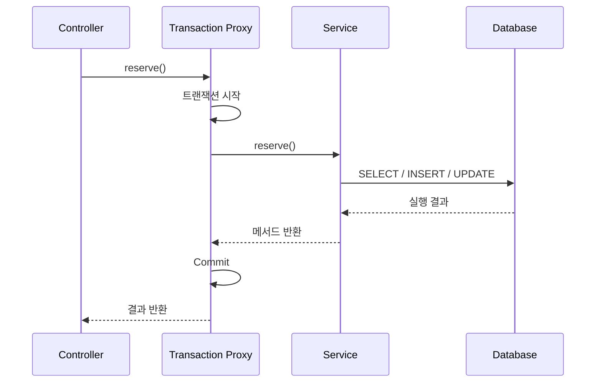
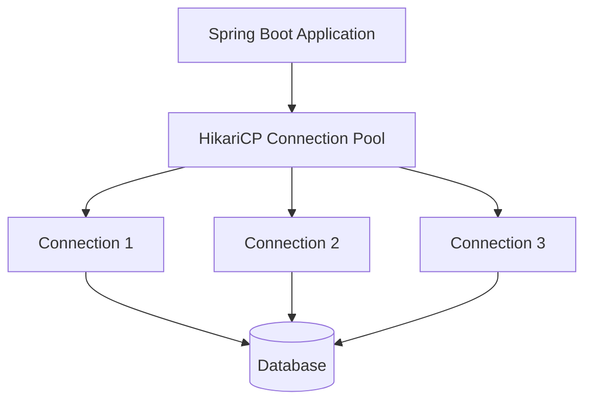
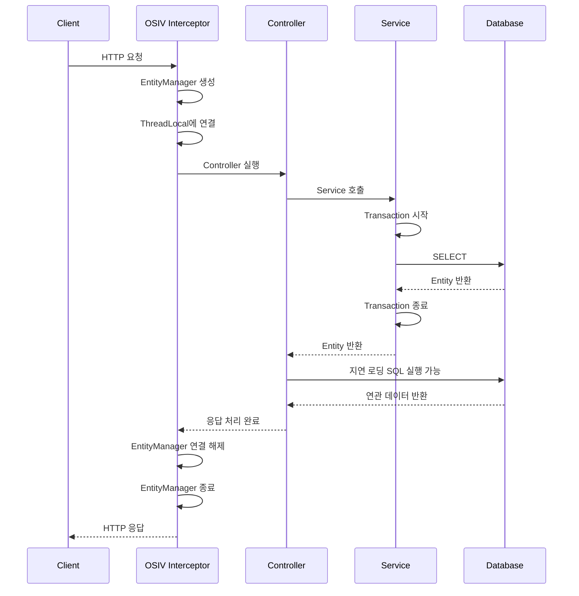
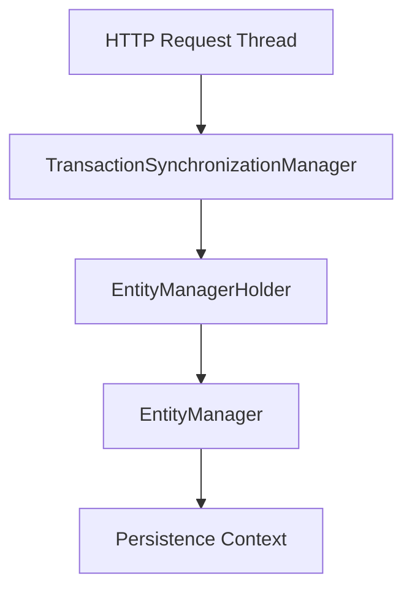
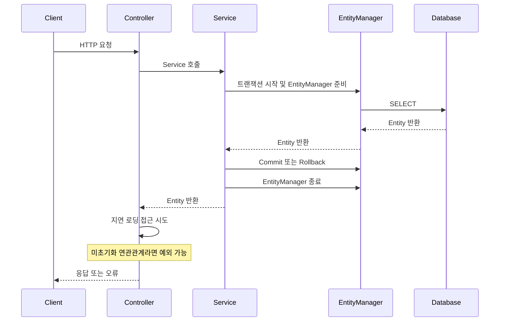
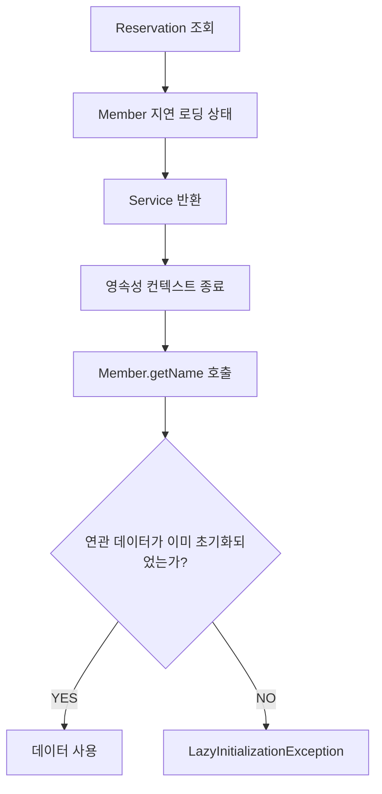
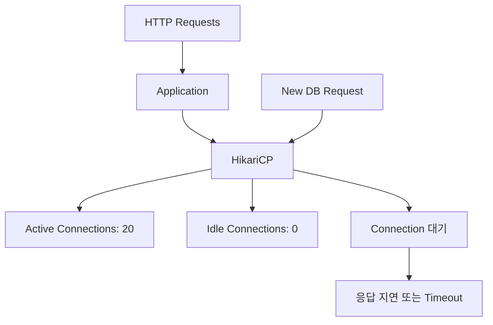
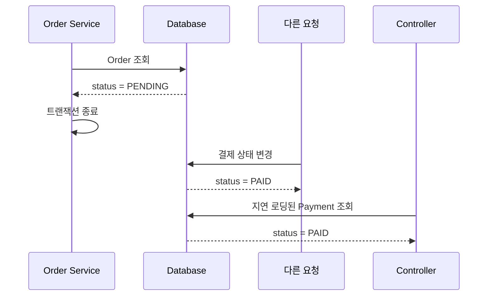
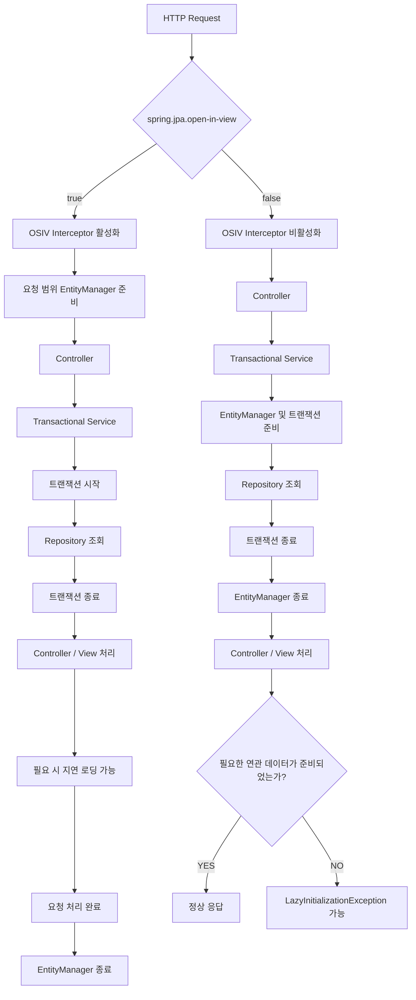

# 웨이드의 OSIV
[https://youtu.be/Q2n9I86mav4?si=vhccDVdJLwh3gfOd](https://youtu.be/Q2n9I86mav4?si=vhccDVdJLwh3gfOd)

# 웨이드의 OSIV
* toc
{:toc}

---

### Spring Boot OSIV 완벽 이해: 영속성 컨텍스트 생명주기부터 지연 로딩과 커넥션 풀 문제까지

Spring Boot와 JPA를 사용하는 애플리케이션에서는 엔티티 간 연관관계를 지연 로딩(Lazy Loading)으로 설정하는 경우가 많다.

예를 들어 예약 시스템에서 예약 정보와 회원 정보가 연관되어 있다고 가정하자.

```java
@Entity
public class Reservation {

    @Id
    private Long id;

    @ManyToOne(fetch = FetchType.LAZY)
    private Member member;
}
```

예약을 조회할 때 항상 회원 정보가 필요한 것은 아니다.

따라서 `FetchType.LAZY`를 사용하면 예약을 조회하는 시점에 회원 엔티티까지 반드시 조회하지 않고, 실제 회원 정보에 접근하는 시점에 필요한 SQL을 실행하도록 할 수 있다.

그런데 다음과 같은 상황을 생각해 보자.

```java
@RestController
public class ReservationController {

    private final ReservationService reservationService;

    public ReservationController(
            ReservationService reservationService
    ) {
        this.reservationService = reservationService;
    }

    @GetMapping("/reservations/{id}")
    public String findReservation(@PathVariable Long id) {

        Reservation reservation = reservationService.findById(id);

        return reservation.getMember().getName();
    }
}
```

Controller는 Service에서 예약 엔티티를 반환받는다.

그리고 회원의 이름에 접근한다.

이 코드는 정상적으로 실행될까?

정답은 **영속성 컨텍스트가 해당 시점까지 유지되는지, 그리고 연관 엔티티가 이미 초기화되었는지에 따라 달라진다**는 것이다.

어떤 프로젝트에서는 문제없이 실행되지만 다른 프로젝트에서는 다음 예외가 발생할 수 있다.

```text
org.hibernate.LazyInitializationException:
could not initialize proxy - no Session
```

동일한 엔티티와 유사한 코드인데도 서로 다른 결과가 발생하는 이유는 무엇일까?

핵심은 Spring Boot의 OSIV 설정에 있다.

OSIV는 JPA를 사용하는 웹 애플리케이션에서 **영속성 컨텍스트의 생명주기를 HTTP 요청 처리 범위까지 확장할 수 있도록 하는 메커니즘**이다.

이를 이해하려면 먼저 EntityManager와 영속성 컨텍스트, 데이터베이스 트랜잭션의 관계부터 구분해야 한다.

---

### OSIV란 무엇인가?

OSIV는 **Open Session In View**의 약자다.

일반적으로 웹 요청을 처리하는 동안 Hibernate Session을 유지해, Service 계층의 트랜잭션이 종료된 이후에도 View 계층에서 지연 로딩을 사용할 수 있도록 하는 패턴을 의미한다.

JPA 기반으로 설명할 때는 다음 표현도 사용한다.

**OEIV(Open EntityManager In View)**

두 용어는 유사한 목적을 가지고 있지만 사용되는 추상화가 다르다.

| 구분                | OSIV                    | OEIV                               |
| ----------------- | ----------------------- | ---------------------------------- |
| 전체 이름             | Open Session In View    | Open EntityManager In View         |
| 주요 대상             | Hibernate Session       | JPA EntityManager                  |
| 기술적 관점            | Hibernate 구현 API        | JPA 표준 API                         |
| 목적                | 요청 처리 중 Session 유지      | 요청 처리 중 EntityManager 유지           |
| 대표적인 Spring 구성 요소 | OpenSessionInViewFilter | OpenEntityManagerInViewInterceptor |
| 공통적인 효과           | 트랜잭션 종료 후 지연 로딩 지원 가능   | 트랜잭션 종료 후 지연 로딩 지원 가능              |

Hibernate는 JPA의 대표적인 구현체다.

JPA에서는 영속성 관리를 위한 인터페이스로 `EntityManager`를 제공하고, Hibernate는 `Session`을 제공한다.

일반적인 Spring Data JPA 애플리케이션에서는 JPA의 `EntityManager`를 중심으로 기능을 사용하므로 기술적으로는 OEIV라는 표현이 더 구체적일 수 있다.

하지만 Spring 생태계에서는 관례적으로 두 방식을 통틀어 OSIV라고 부르는 경우가 많다.

이 글에서도 특별히 구현체를 구분해야 하는 경우를 제외하고 OSIV라는 용어를 사용하겠다.

Spring의 `OpenEntityManagerInViewInterceptor`는 HTTP 요청 처리 동안 JPA EntityManager를 현재 실행 스레드에 연결하여, 트랜잭션 종료 이후에도 지연 로딩이 가능하도록 지원하는 구성 요소다.

그렇다면 이러한 기능이 왜 필요한 것일까?

---

### OSIV를 이해하기 전에 알아야 할 세 가지 개념

OSIV를 이해할 때 가장 혼동하기 쉬운 부분은 다음 세 가지를 동일한 것으로 생각하는 것이다.

* 영속성 컨텍스트(Persistence Context)
* 데이터베이스 트랜잭션(Transaction)
* 데이터베이스 커넥션(Connection)

이 세 가지는 서로 관련되어 있지만 같은 개념이 아니다.

예를 들어 다음과 같이 생각하기 쉽다.

> 영속성 컨텍스트가 열려 있다면 트랜잭션도 진행 중이고, 데이터베이스 커넥션도 계속 사용 중일 것이다.

하지만 반드시 그렇지는 않다.

각각의 역할과 생명주기가 다르기 때문이다.

이 차이를 정확하게 이해해야 OSIV의 동작을 설명할 수 있다.

---

### 영속성 컨텍스트(Persistence Context)란 무엇인가?

영속성 컨텍스트는 JPA가 엔티티를 관리하는 논리적인 환경이다.

Hibernate에서는 Session과 밀접하게 연결되어 있다.

애플리케이션에서 엔티티를 조회하면 JPA는 해당 엔티티를 영속성 컨텍스트에 등록하고 관리할 수 있다.

```java
Member member = entityManager.find(Member.class, 1L);
```

이때 조회한 Member는 일반적으로 영속성 컨텍스트가 관리하는 상태가 된다.

영속성 컨텍스트는 여러 기능을 제공한다.

| 기능       | 설명                                |
| -------- | --------------------------------- |
| 1차 캐시    | 동일 영속성 컨텍스트에서 엔티티 식별자를 기준으로 객체 관리 |
| 동일성 보장   | 같은 엔티티 식별자에 대해 동일한 관리 객체 사용       |
| 변경 감지    | 관리 중인 엔티티의 변경 사항 추적               |
| 쓰기 지연    | 적절한 Flush 시점까지 SQL 실행을 지연할 수 있음   |
| 지연 로딩    | 필요한 시점에 연관 엔티티를 조회                |
| 영속 상태 관리 | 엔티티의 생명주기를 관리                     |

예를 들어 다음 코드를 살펴보자.

```java
Member first = entityManager.find(Member.class, 1L);
Member second = entityManager.find(Member.class, 1L);

System.out.println(first == second);
```

동일한 영속성 컨텍스트에서 관리되는 같은 엔티티 식별자를 조회했다면 두 참조가 같은 객체를 가리킬 수 있다.

```text
true
```

영속성 컨텍스트는 이렇게 엔티티의 상태를 관리한다.

하지만 여기서 중요한 점이 있다.

**영속성 컨텍스트가 존재한다는 사실만으로 데이터베이스 트랜잭션이 실행 중이라는 뜻은 아니다.**

OSIV를 활성화한 경우 이 차이가 특히 중요해진다.

---

### 트랜잭션(Transaction)이란 무엇인가?

트랜잭션은 여러 데이터베이스 작업을 하나의 논리적인 작업 단위로 관리하기 위한 개념이다.

예를 들어 예약을 생성하고 예약 가능 수량을 차감하는 기능을 생각해 보자.

```java
@Transactional
public void reserve(Long reservationTimeId) {

    ReservationTime reservationTime =
            reservationTimeRepository.findById(reservationTimeId)
                    .orElseThrow();

    reservationTime.decreaseAvailableCount();

    reservationRepository.save(
            Reservation.create(reservationTime)
    );
}
```

이 작업에서는 예약 가능 수량 차감과 예약 생성이 함께 성공하거나, 실패 시 적절히 롤백되어야 한다.

Spring은 `@Transactional`을 통해 트랜잭션 경계를 관리한다.

일반적인 프록시 기반 트랜잭션 처리에서는 다음과 같이 동작한다.



여기서 트랜잭션은 일반적으로 `@Transactional` 메서드의 호출 경계를 기준으로 시작하고 종료된다.

하지만 HTTP 요청 전체가 반드시 하나의 트랜잭션으로 실행되는 것은 아니다.

Controller는 Service를 여러 번 호출할 수도 있고, 각 Service가 서로 다른 트랜잭션을 사용할 수도 있다.

예를 들어 다음 코드가 있다고 하자.

```java
public void processOrder() {

    orderService.createOrder();

    externalPaymentClient.requestPayment();

    orderService.completeOrder();
}
```

각 Service 메서드에 개별적으로 `@Transactional`이 적용되어 있다면 다음과 같은 흐름이 만들어질 수 있다.

```text
주문 생성 트랜잭션 시작
        ↓
주문 생성
        ↓
Commit
        ↓
외부 결제 API 호출
        ↓
주문 완료 트랜잭션 시작
        ↓
주문 상태 변경
        ↓
Commit
```

즉 HTTP 요청은 하나지만 트랜잭션은 두 번 실행될 수 있다.

이때 영속성 컨텍스트가 각 트랜잭션에 맞춰 생성되고 종료되는지, 아니면 HTTP 요청 전체에서 유지되는지가 OSIV의 핵심적인 차이다.

---

### 데이터베이스 커넥션(Connection)이란 무엇인가?

데이터베이스 커넥션은 애플리케이션이 데이터베이스와 SQL을 주고받기 위해 사용하는 연결 자원이다.

Spring Boot에서 HikariCP를 사용하는 경우 일반적으로 커넥션 풀을 통해 연결을 관리한다.



애플리케이션이 SQL을 실행하려면 일반적으로 JDBC Connection이 필요하다.

하지만 영속성 컨텍스트를 생성하는 순간 반드시 물리적인 데이터베이스 커넥션을 획득해야 하는 것은 아니다.

Hibernate는 실제로 커넥션이 필요한 시점까지 획득을 지연할 수 있다.

이를 **Lazy Connection Acquisition**이라고 한다.

또 커넥션을 획득한 이후 언제 반환할지는 Hibernate의 Connection Handling Mode에 영향을 받는다.

따라서 다음 세 가지를 구분해야 한다.

| 개념              | 생성 또는 시작의 기준             | 종료 또는 반환의 기준          |
| --------------- | ------------------------ | --------------------- |
| 영속성 컨텍스트        | EntityManager 생성 및 관리 방식 | EntityManager 종료 등    |
| 트랜잭션            | 트랜잭션 경계 진입               | Commit 또는 Rollback    |
| JDBC Connection | 실제 연결이 필요한 시점 및 연결 관리 정책 | Connection Release 정책 |

**OSIV가 영속성 컨텍스트의 생명주기를 확장한다고 해서 JDBC Connection이 무조건 요청 시작부터 종료까지 점유된다는 의미는 아니다.**

이 차이는 뒤에서 커넥션 풀 문제를 살펴볼 때 자세히 다루겠다.

---

### OSIV가 필요한 이유는 무엇일까?

OSIV가 없던 상황을 생각해 보자.

웹 애플리케이션에서는 오래전부터 서버에서 HTML을 생성하는 서버 사이드 렌더링 방식이 널리 사용되었다.

일반적인 처리 흐름은 다음과 같다.

```text
HTTP 요청
    ↓
Controller
    ↓
Service
    ↓
Repository
    ↓
Entity 조회
    ↓
Controller
    ↓
View Rendering
    ↓
HTTP 응답
```

이때 Service는 데이터베이스에서 조회한 Entity를 Controller에 반환하고, Controller는 Entity를 View에 전달할 수 있다.

예를 들어 다음과 같은 코드다.

```java
@GetMapping("/members/{id}")
public String memberDetail(
        @PathVariable Long id,
        Model model
) {
    Member member = memberService.findById(id);

    model.addAttribute("member", member);

    return "member-detail";
}
```

View에서는 다음과 같이 회원의 연관 정보를 사용한다고 가정하자.

```html
<span th:text="${member.team.name}"></span>
```

그런데 `member.team`이 지연 로딩으로 설정되어 있다면 어떻게 될까?

Service의 트랜잭션이 이미 종료되어 영속성 컨텍스트가 닫힌 상태라면 View가 팀 이름을 읽는 과정에서 추가 SQL을 실행할 수 없다.

결과적으로 `LazyInitializationException`이 발생할 수 있다.

이를 해결하기 위한 한 가지 방법은 View가 렌더링되는 시점까지 EntityManager를 유지하는 것이다.

이것이 OSIV가 등장한 중요한 배경이다.

OSIV를 사용하면 Service의 트랜잭션이 종료되어도 영속성 컨텍스트가 요청 처리 범위에서 유지될 수 있다.

따라서 View가 지연 로딩된 연관 정보에 접근하더라도 추가 SQL을 실행할 수 있다.

---

### Spring Boot에서 OSIV를 설정하는 방법

Spring Boot에서는 다음 설정으로 OSIV를 활성화하거나 비활성화할 수 있다.

#### OSIV 활성화

```yaml
spring:
  jpa:
    open-in-view: true
```

#### OSIV 비활성화

```yaml
spring:
  jpa:
    open-in-view: false
```

`application.properties`를 사용한다면 다음과 같이 작성한다.

```properties
spring.jpa.open-in-view=false
```

Spring Boot의 웹 MVC 기반 JPA 자동 설정에서는 `spring.jpa.open-in-view`의 기본값이 `true`다.

즉 별도로 설정하지 않았다면 일반적인 Spring Boot JPA 웹 애플리케이션에서 OSIV가 활성화될 수 있다.

Spring Boot 4.1의 공식 설정 문서에서도 해당 설정의 기본값을 `true`로 명시하고 있다.

OSIV가 기본값으로 활성화되어 있고 개발자가 명시적으로 설정하지 않았다면 애플리케이션 시작 시 다음과 같은 경고가 나타날 수 있다.

```text
spring.jpa.open-in-view is enabled by default.
Therefore, database queries may be performed during view rendering.
Explicitly configure spring.jpa.open-in-view to disable this warning
```

이 메시지는 OSIV가 반드시 오류를 일으킨다는 뜻이 아니다.

트랜잭션이 종료된 후에도 View 렌더링 과정에서 SQL이 실행될 수 있으므로 해당 동작을 인지하고 명시적으로 설정하라는 의미다.

단, 위 설정은 일반적인 Spring MVC와 JPA 조합을 기준으로 한다.

WebFlux의 Reactive 처리 모델에서는 동일한 ThreadLocal 기반 전략을 그대로 적용한다고 생각해서는 안 된다.

---

### OSIV가 활성화되면 영속성 컨텍스트는 어떻게 동작할까?

이제 실제 HTTP 요청 흐름을 기준으로 살펴보자.

`spring.jpa.open-in-view=true`라고 가정하겠다.

Spring Boot는 일반적인 Servlet 기반 JPA 웹 애플리케이션에서 `OpenEntityManagerInViewInterceptor`를 등록할 수 있다.

이 Interceptor는 Controller가 실행되기 전에 EntityManager를 준비하고, 요청 처리 과정에서 사용할 수 있도록 현재 스레드에 연결한다.

개념적인 처리 과정은 다음과 같다.



이 흐름에서 중요한 부분은 두 가지다.

첫 번째는 Service의 트랜잭션이 종료되더라도 EntityManager는 유지될 수 있다는 것이다.

두 번째는 Controller나 View에서 지연 로딩을 수행할 수 있다는 것이다.

따라서 일반적인 OSIV 활성화 환경에서는 다음과 같은 호출이 가능할 수 있다.

```java
Reservation reservation = reservationService.findById(id);

String memberName = reservation.getMember().getName();
```

Service에서 `Reservation`을 반환했더라도 동일한 요청에 연결된 EntityManager가 열려 있다면 Hibernate가 연관 엔티티를 추가로 조회할 수 있다.

하지만 이 동작이 항상 좋은 것은 아니다.

Controller가 DB 접근을 수행한다는 사실을 코드에서 명확하게 드러내지 않기 때문이다.

---

### EntityManager는 어떻게 현재 요청과 연결될까?

Spring은 트랜잭션과 영속성 자원을 관리하기 위해 `TransactionSynchronizationManager`라는 구성 요소를 사용한다.

이 클래스는 현재 실행 스레드와 연결된 자원을 관리하는 기능을 제공한다.

OSIV에서 중요한 부분은 EntityManager를 현재 스레드에 연결하는 과정이다.

개념적으로 다음과 같다.

```java
EntityManager entityManager =
        entityManagerFactory.createEntityManager();

TransactionSynchronizationManager.bindResource(
        entityManagerFactory,
        new EntityManagerHolder(entityManager)
);
```

이 코드는 OSIV의 핵심 동작을 단순화한 예시다.

실제 Spring 내부 구현에는 이미 연결된 자원이 존재하는지 확인하는 처리와 비동기 요청 지원, 예외 처리 등의 로직이 추가되어 있다.

위 흐름을 보면 EntityManager를 생성한 뒤 `EntityManagerHolder`로 감싸 현재 스레드의 자원 저장소에 연결한다.

이후 같은 요청 흐름에서 트랜잭션 매니저가 EntityManager를 필요로 하면 이미 연결된 EntityManager를 활용할 수 있다.



요청 처리가 끝나면 연결을 해제하고 필요에 따라 EntityManager를 닫는다.

이 구조 덕분에 Controller와 Service가 동일한 요청 범위에서 영속성 컨텍스트를 공유할 수 있다.

다만 **하나의 HTTP 요청이 언제나 정확히 하나의 EntityManager만 사용한다는 뜻은 아니다.**

예를 들어 서로 다른 EntityManagerFactory를 사용하거나, 트랜잭션 전파 정책에 따라 별도의 영속성 컨텍스트가 필요한 경우에는 여러 EntityManager가 관여할 수 있다.

또 비동기 요청에서는 실행 스레드가 바뀔 수 있으므로 스레드 연결과 해제 처리가 추가로 필요하다.

따라서 OSIV의 핵심은 HTTP 요청 범위에서 EntityManager를 사용할 수 있도록 관리한다는 것이지, 모든 상황에서 EntityManager 객체가 단 하나라는 규칙은 아니다.

---

### OSIV가 비활성화되면 어떻게 동작할까?

이번에는 다음과 같이 설정했다고 가정하자.

```yaml
spring:
  jpa:
    open-in-view: false
```

이 경우 Spring Boot의 일반적인 OSIV Interceptor가 등록되지 않는다.

따라서 HTTP 요청 전체에 걸쳐 EntityManager를 열어두는 동작이 제공되지 않는다.

대신 Service의 트랜잭션을 실행할 때 필요한 영속성 컨텍스트가 생성되고, 해당 트랜잭션이 종료되면 함께 정리되는 일반적인 트랜잭션 범위 관리가 적용된다.



이 상태에서 다음 코드를 실행한다고 가정하자.

```java
Reservation reservation = reservationService.findById(id);

String memberName = reservation.getMember().getName();
```

Service가 종료되면서 관련 영속성 컨텍스트도 닫혔다면 Reservation은 준영속 상태가 될 수 있다.

그리고 Member 연관관계가 아직 초기화되지 않았다면 Hibernate는 추가 조회를 수행할 수 없다.

결과적으로 `LazyInitializationException`이 발생할 수 있다.

하지만 여기서 중요한 예외가 있다.

**OSIV를 비활성화했다고 모든 Controller의 연관관계 접근이 무조건 실패하는 것은 아니다.**

다음과 같은 경우에는 정상적으로 동작할 수 있다.

* Service에서 연관 엔티티를 미리 조회한 경우
* Fetch Join으로 필요한 정보를 함께 가져온 경우
* EntityGraph를 사용해 필요한 연관관계를 로딩한 경우
* 이미 초기화된 연관 데이터를 읽는 경우
* Controller 자체가 별도의 유효한 영속성 컨텍스트와 트랜잭션 범위에서 동작하도록 구성된 경우

즉 핵심은 Controller라는 위치 자체가 아니라 **해당 엔티티가 지연 로딩을 수행할 수 있는 영속성 컨텍스트에 연결되어 있는가**이다.

---

### OSIV 활성화와 비활성화의 차이

일반적인 Spring MVC 애플리케이션에서 Service 계층에 트랜잭션을 적용한 경우를 비교해 보자.

| 구분                              | OSIV 활성화           | OSIV 비활성화           |
| ------------------------------- | ------------------ | ------------------- |
| 설정                              | `true`             | `false`             |
| 일반적인 EntityManager 범위           | HTTP 요청 처리 범위      | 트랜잭션 범위             |
| Service 트랜잭션 종료 후 EntityManager | 유지 가능              | 일반적으로 종료            |
| Controller 지연 로딩                | 가능할 수 있음           | 미초기화 연관관계는 예외 발생 가능 |
| View 지연 로딩                      | 가능할 수 있음           | 미초기화 연관관계는 예외 발생 가능 |
| 응답 직렬화 중 추가 SQL                 | 발생 가능              | 분리된 엔티티라면 실패 가능     |
| DB 조회 위치 파악                     | 상대적으로 어려울 수 있음     | 명시적인 로딩 설계 유도       |
| 커넥션 풀 영향                        | 연결 관리 정책에 따라 영향 가능 | 트랜잭션 중심으로 관리하기 쉬움   |
| 주요 장점                           | 개발 편의성             | 예측 가능한 영속성 경계       |
| 주요 단점                           | 숨겨진 SQL과 자원 점유 위험  | 로딩 전략을 명시적으로 설계해야 함 |

이 비교에서 특히 주의해야 하는 부분은 트랜잭션이다.

**OSIV가 활성화되어 있다고 HTTP 요청 전체가 하나의 데이터베이스 트랜잭션으로 처리되는 것은 아니다.**

Service의 트랜잭션이 종료된 뒤에도 EntityManager가 열려 있을 수 있다는 의미다.

---

### OSIV가 활성화되어 있으면 Controller에서 데이터를 수정할 수 있을까?

이 부분은 오해하기 쉽다.

OSIV를 활성화하면 Controller에서도 영속성 컨텍스트에 연결된 엔티티를 사용할 수 있다.

그렇다면 Controller에서 엔티티 값을 변경하면 자동으로 데이터베이스에 반영될까?

예를 들어 다음 코드를 생각해 보자.

```java
Reservation reservation = reservationService.findById(id);

reservation.changeStatus(ReservationStatus.CANCELLED);
```

OSIV가 활성화되어 있다면 요청 범위의 EntityManager가 열려 있을 수 있다.

하지만 Service의 트랜잭션은 이미 종료되었다.

이 상태에서 Java 객체의 필드를 변경하는 것과 데이터베이스에 UPDATE를 실행해 커밋하는 것은 다른 작업이다.

일반적인 JPA 환경에서는 데이터 변경을 데이터베이스에 확정하기 위해 적절한 트랜잭션이 필요하다.

따라서 단순히 OSIV가 활성화되었다는 이유만으로 Controller의 필드 변경이 즉시 커밋되는 것은 아니다.

그렇다고 OSIV 활성화 환경에서 Controller의 데이터 변경이 절대 DB에 반영될 수 없다고 생각해서도 안 된다.

예를 들어 Controller에서 별도의 트랜잭션 메서드를 호출할 수 있고, 요청 범위에서 같은 영속성 컨텍스트가 재사용되는 구성이라면 변경 상태와 Flush 동작이 복잡하게 연결될 수 있다.

이러한 이유로 엔티티 변경은 명확한 트랜잭션 경계 안에서 수행하는 것이 좋다.

```java
@Service
public class ReservationService {

    @Transactional
    public void cancel(Long reservationId) {
        Reservation reservation = reservationRepository.findById(reservationId)
                .orElseThrow();

        reservation.cancel();
    }
}
```

**OSIV는 쓰기 트랜잭션의 범위를 확장하는 기능이 아니라, 영속성 컨텍스트를 웹 요청 범위까지 유지하는 기능이다.**

이 두 개념을 반드시 구분해야 한다.

---

### LazyInitializationException이 발생하는 이유

이제 지연 로딩 예외를 조금 더 깊게 살펴보자.

JPA에서 연관관계를 지연 로딩으로 설정하면 Hibernate는 실제 연관 엔티티를 조회하는 시점을 늦출 수 있다.

예를 들어 다음과 같은 관계가 있다고 하자.

```text
Reservation
    ↓
Member
```

Reservation을 조회할 때 Member를 함께 조회하지 않았다고 가정하자.

```sql
SELECT *
FROM reservations
WHERE id = 1;
```

이후 코드에서 다음 메서드를 호출한다.

```java
reservation.getMember().getName();
```

Hibernate는 Member의 이름을 가져오기 위해 추가 SQL을 실행해야 할 수 있다.

```sql
SELECT *
FROM members
WHERE id = ?;
```

하지만 이 작업을 수행하려면 해당 연관관계를 초기화할 수 있는 Hibernate Session이 필요하다.

이미 EntityManager가 닫혀 있고 엔티티가 준영속 상태라면 Hibernate는 추가 조회를 수행할 수 없다.

이때 발생하는 대표적인 예외가 `LazyInitializationException`이다.



여기서 중요한 점은 지연 로딩이 잘못된 기술이라는 뜻이 아니라는 것이다.

지연 로딩은 필요한 시점에 데이터를 가져오기 위한 전략이다.

문제는 그 시점에 데이터를 가져올 수 있는 영속성 컨텍스트가 더 이상 존재하지 않는다는 점이다.

따라서 예외를 해결할 때는 OSIV를 활성화하는 방법뿐 아니라 필요한 데이터를 어떤 시점에 조회해야 하는지 함께 고려해야 한다.

---

### Spring Boot에서 OSIV의 차이를 직접 확인해 보자

이제 간단한 Spring Boot 애플리케이션을 구성해 OSIV 활성화와 비활성화에 따른 차이를 확인해 보자.

예제의 목표는 다음과 같다.

1. Reservation과 Member를 지연 로딩 관계로 설정한다.
2. Service에서 Reservation만 조회한다.
3. Controller에서 Member 이름에 접근한다.
4. OSIV 설정에 따라 결과를 비교한다.
5. 필요한 데이터를 Service에서 DTO로 변환하는 방식으로 개선한다.

Spring Boot 3.x와 Java 17 이상을 기준으로 작성한다.

Spring Boot 4.x에서도 같은 원리를 적용할 수 있지만 일부 Starter 구성은 버전에 맞게 변경해야 한다.

---

### 예제 프로젝트 의존성 설정

기존 Spring Boot 3.x 프로젝트에 다음 의존성을 추가한다.

```kotlin
dependencies {
    implementation("org.springframework.boot:spring-boot-starter-web")
    implementation("org.springframework.boot:spring-boot-starter-data-jpa")

    runtimeOnly("com.h2database:h2")

    testImplementation("org.springframework.boot:spring-boot-starter-test")
}
```

H2는 동작 차이를 확인하기 위한 예제 데이터베이스다.

실제 운영에서는 MySQL이나 PostgreSQL을 사용하더라도 OSIV와 영속성 컨텍스트의 기본적인 관계는 동일하게 이해할 수 있다.

---

### Member Entity

먼저 회원 엔티티를 생성한다.

```java
package com.example.osiv;

import jakarta.persistence.Entity;
import jakarta.persistence.GeneratedValue;
import jakarta.persistence.GenerationType;
import jakarta.persistence.Id;
import jakarta.persistence.Table;

@Entity
@Table(name = "members")
public class Member {

    @Id
    @GeneratedValue(strategy = GenerationType.IDENTITY)
    private Long id;

    private String name;

    protected Member() {
    }

    public Long getId() {
        return id;
    }

    public String getName() {
        return name;
    }
}
```

회원 정보에는 ID와 이름만 존재한다.

---

### Reservation Entity

예약 엔티티는 Member와 다대일 관계를 가진다.

```java
package com.example.osiv;

import jakarta.persistence.Entity;
import jakarta.persistence.FetchType;
import jakarta.persistence.GeneratedValue;
import jakarta.persistence.GenerationType;
import jakarta.persistence.Id;
import jakarta.persistence.JoinColumn;
import jakarta.persistence.ManyToOne;
import jakarta.persistence.Table;

@Entity
@Table(name = "reservations")
public class Reservation {

    @Id
    @GeneratedValue(strategy = GenerationType.IDENTITY)
    private Long id;

    @ManyToOne(fetch = FetchType.LAZY)
    @JoinColumn(name = "member_id", nullable = false)
    private Member member;

    protected Reservation() {
    }

    public Long getId() {
        return id;
    }

    public Member getMember() {
        return member;
    }
}
```

핵심은 다음 부분이다.

```java
@ManyToOne(fetch = FetchType.LAZY)
```

예약을 조회하는 시점에 Member 전체를 즉시 조회하지 않고, 실제 Member 데이터가 필요한 시점까지 조회를 지연하도록 설정한다.

단, 지연 로딩은 JPA 구현체의 프록시와 바이트코드 처리 방식에 영향을 받는다.

여기서는 일반적인 Hibernate의 `@ManyToOne(fetch = LAZY)` 동작을 전제로 한다.

---

### ReservationRepository

Spring Data JPA Repository를 작성한다.

```java
package com.example.osiv;

import java.util.Optional;

import org.springframework.data.jpa.repository.JpaRepository;
import org.springframework.data.jpa.repository.Query;
import org.springframework.data.repository.query.Param;

public interface ReservationRepository
        extends JpaRepository<Reservation, Long> {

    @Query("""
            select r
            from Reservation r
            join fetch r.member
            where r.id = :id
            """)
    Optional<Reservation> findByIdWithMember(@Param("id") Long id);
}
```

여기에는 두 가지 조회 방식이 존재한다.

첫 번째는 JpaRepository에서 제공하는 `findById()`다.

두 번째는 직접 작성한 `findByIdWithMember()`다.

두 메서드의 차이는 회원 연관관계의 로딩 방식이다.

`findById()`는 기본적인 엔티티 조회 방식을 따른다.

`findByIdWithMember()`는 Fetch Join을 통해 Reservation과 Member를 함께 조회한다.

---

### ReservationService

Service에서는 두 가지 메서드를 작성한다.

첫 번째는 Reservation Entity를 그대로 반환한다.

두 번째는 필요한 데이터를 DTO로 변환해 반환한다.

```java
package com.example.osiv;

import org.springframework.stereotype.Service;
import org.springframework.transaction.annotation.Transactional;

@Service
public class ReservationService {

    private final ReservationRepository reservationRepository;

    public ReservationService(
            ReservationRepository reservationRepository
    ) {
        this.reservationRepository = reservationRepository;
    }

    @Transactional(readOnly = true)
    public Reservation findEntity(Long reservationId) {

        return reservationRepository.findById(reservationId)
                .orElseThrow(() ->
                        new IllegalArgumentException(
                                "예약이 존재하지 않습니다."
                        )
                );
    }

    @Transactional(readOnly = true)
    public ReservationResponse findResponse(Long reservationId) {

        Reservation reservation =
                reservationRepository.findByIdWithMember(reservationId)
                        .orElseThrow(() ->
                                new IllegalArgumentException(
                                        "예약이 존재하지 않습니다."
                                )
                        );

        return new ReservationResponse(
                reservation.getId(),
                reservation.getMember().getName()
        );
    }
}
```

첫 번째 메서드는 영속성 컨텍스트의 범위에 따라 Controller에서 문제가 발생할 수 있다.

반면 두 번째 메서드는 트랜잭션 내부에서 필요한 정보를 모두 조회하고 DTO를 만든다.

따라서 Service가 종료된 이후에는 추가적인 지연 로딩이 필요하지 않다.

---

### ReservationResponse

응답 DTO는 다음과 같이 정의한다.

```java
package com.example.osiv;

public record ReservationResponse(
        Long reservationId,
        String memberName
) {
}
```

DTO는 JPA 영속성 컨텍스트에 의존하지 않는 일반적인 데이터 객체다.

필요한 데이터가 이미 들어 있으므로 응답을 직렬화하는 과정에서 추가 SQL을 실행할 필요가 없다.

---

### ReservationController

Controller에서는 두 방식의 API를 제공한다.

```java
package com.example.osiv;

import org.springframework.web.bind.annotation.GetMapping;
import org.springframework.web.bind.annotation.PathVariable;
import org.springframework.web.bind.annotation.RequestMapping;
import org.springframework.web.bind.annotation.RestController;

@RestController
@RequestMapping("/api/reservations")
public class ReservationController {

    private final ReservationService reservationService;

    public ReservationController(
            ReservationService reservationService
    ) {
        this.reservationService = reservationService;
    }

    @GetMapping("/{id}/unsafe")
    public ReservationResponse findUnsafe(@PathVariable Long id) {

        Reservation reservation =
                reservationService.findEntity(id);

        return new ReservationResponse(
                reservation.getId(),
                reservation.getMember().getName()
        );
    }

    @GetMapping("/{id}/safe")
    public ReservationResponse findSafe(@PathVariable Long id) {

        return reservationService.findResponse(id);
    }
}
```

`unsafe` API는 Controller에서 지연 로딩을 수행한다.

`safe` API는 Service에서 모든 데이터를 준비한 DTO를 반환한다.

이 차이를 기억해 두자.

---

### application.yml 설정

다음과 같이 설정한다.

```yaml
spring:
  datasource:
    url: jdbc:h2:mem:osivdb;DB_CLOSE_DELAY=-1
    driver-class-name: org.h2.Driver
    username: sa
    password:

  jpa:
    open-in-view: true
    defer-datasource-initialization: true

    hibernate:
      ddl-auto: create-drop

    show-sql: true

    properties:
      hibernate:
        format_sql: true

logging:
  level:
    org.hibernate.SQL: DEBUG
```

이 설정은 로컬 실험용이다.

`ddl-auto: create-drop`은 애플리케이션 종료 시 테이블을 제거하므로 운영 환경에 그대로 사용해서는 안 된다.

---

### 초기 데이터 준비

`src/main/resources/data.sql` 파일을 생성한다.

```sql
INSERT INTO members (id, name)
VALUES (1, '아마');

INSERT INTO reservations (id, member_id)
VALUES (1, 1);
```

앞서 `defer-datasource-initialization: true`를 설정했으므로 Hibernate가 스키마를 생성한 뒤 초기 데이터를 삽입하도록 구성할 수 있다.

---

### OSIV가 활성화된 상태에서 실행하기

먼저 설정을 확인한다.

```yaml
spring:
  jpa:
    open-in-view: true
```

애플리케이션을 실행한다.

```bash
./gradlew bootRun
```

이제 첫 번째 API를 호출한다.

```bash
curl http://localhost:8080/api/reservations/1/unsafe
```

정상적으로 동작한다면 다음과 같은 응답을 받을 수 있다.

```json
{
  "reservationId": 1,
  "memberName": "아마"
}
```

중요한 것은 SQL 로그다.

Service에서 Reservation을 조회하기 위한 SQL이 먼저 실행된다.

개념적으로 다음과 같다.

```sql
SELECT
    r.id,
    r.member_id
FROM reservations r
WHERE r.id = ?;
```

Service 메서드가 종료된 뒤 Controller에서 다음 코드를 실행한다.

```java
reservation.getMember().getName();
```

이때 추가 SQL이 실행될 수 있다.

```sql
SELECT
    m.id,
    m.name
FROM members m
WHERE m.id = ?;
```

즉 Service의 트랜잭션이 종료되었지만 Controller에서 추가 조회가 발생한 것이다.

OSIV가 EntityManager를 요청 범위까지 유지했기 때문에 가능한 동작이다.

---

### OSIV가 비활성화된 상태에서 실행하기

이번에는 설정을 변경한다.

```yaml
spring:
  jpa:
    open-in-view: false
```

애플리케이션을 다시 실행한다.

동일한 API를 호출한다.

```bash
curl http://localhost:8080/api/reservations/1/unsafe
```

이번에는 다음 예외가 발생할 수 있다.

```text
org.hibernate.LazyInitializationException:
could not initialize proxy
- no Session
```

원인은 다음과 같다.

1. Service의 트랜잭션이 시작된다.
2. Reservation을 조회한다.
3. Member는 지연 로딩 상태로 남아 있다.
4. Service의 트랜잭션이 종료된다.
5. 관련 EntityManager가 종료된다.
6. Controller에서 Member 이름에 접근한다.
7. 추가 조회를 수행할 Session이 없어 예외가 발생한다.

이제 두 번째 API를 호출해 보자.

```bash
curl http://localhost:8080/api/reservations/1/safe
```

응답은 다음과 같다.

```json
{
  "reservationId": 1,
  "memberName": "아마"
}
```

OSIV가 비활성화되어 있어도 정상적으로 동작한다.

왜 그럴까?

Service에서 Fetch Join으로 Member를 조회한 뒤 DTO로 변환했기 때문이다.

즉 Controller에서는 추가적인 지연 로딩이 필요하지 않다.

이 실험의 핵심은 다음과 같다.

**OSIV를 비활성화해도 지연 로딩을 사용할 수 있다. 다만 필요한 데이터는 영속성 컨텍스트가 살아 있는 적절한 범위에서 준비해야 한다.**

---

### OSIV의 가장 중요한 문제: EntityManager와 Connection은 같은 자원이 아니다

OSIV를 설명할 때 자주 등장하는 주장이 있다.

> OSIV를 활성화하면 HTTP 요청이 끝날 때까지 데이터베이스 커넥션을 계속 점유한다.

이 설명은 특정 환경에서 나타날 수 있는 현상을 설명하지만 모든 Hibernate 환경에 그대로 적용되는 일반 법칙은 아니다.

정확하게 이해하려면 두 가지를 구분해야 한다.

**EntityManager가 열려 있는 기간**

**JDBC Connection을 실제로 획득해 점유하고 있는 기간**

OSIV가 직접적으로 확장하는 것은 EntityManager의 생명주기다.

반면 JDBC Connection은 Hibernate의 Connection Handling 정책에 따라 획득과 반환 시점이 달라진다.

---

### Hibernate의 Lazy Connection Acquisition

Hibernate는 Session이나 EntityManager를 생성했다고 반드시 즉시 데이터베이스 커넥션을 획득하지 않는다.

필요한 시점에 Connection을 획득할 수 있다.

예를 들어 다음과 같은 흐름을 생각해 보자.

```text
HTTP 요청 시작
    ↓
EntityManager 생성
    ↓
Controller 진입
    ↓
Service 호출
    ↓
트랜잭션 시작
    ↓
Connection 획득
    ↓
SQL 실행
```

이 경우 EntityManager가 생성된 시점과 Connection이 획득된 시점은 서로 다르다.

또 Hibernate는 다양한 커넥션 처리 모드를 제공한다.

| Connection Handling Mode                          | 획득 시점        | 반환 시점        |
| ------------------------------------------------- | ------------ | ------------ |
| IMMEDIATE_ACQUISITION_AND_HOLD                    | Session 생성 시 | Session 종료 시 |
| DELAYED_ACQUISITION_AND_HOLD                      | 필요할 때        | Session 종료 시 |
| DELAYED_ACQUISITION_AND_RELEASE_AFTER_STATEMENT   | 필요할 때        | SQL 문 실행 후   |
| DELAYED_ACQUISITION_AND_RELEASE_AFTER_TRANSACTION | 필요할 때        | 트랜잭션 종료 후    |

일반적인 Hibernate의 리소스 로컬 트랜잭션에서는 `DELAYED_ACQUISITION_AND_RELEASE_AFTER_TRANSACTION` 모드가 기본적으로 사용된다.

다만 실제 연결 획득 시점은 Auto-commit 설정이나 Connection Pool 설정 등의 영향을 받을 수 있다.

따라서 OSIV가 활성화되어 있다고 무조건 요청이 시작되는 순간부터 커넥션을 점유하는 것은 아니다.

반대로 Service의 트랜잭션이 종료되었다는 이유만으로 이후 요청 처리 구간의 모든 JDBC 자원 점유 위험이 사라지는 것도 아니다.

특히 트랜잭션 밖에서 지연 로딩을 수행하거나, 커넥션을 오래 유지하는 정책이 적용된 경우에는 실제 커넥션 점유 시간이 증가할 수 있다.

이 차이를 이해하지 못하면 OSIV의 성능 문제를 과장하거나 반대로 지나치게 가볍게 생각하게 된다.

---

### OSIV가 커넥션 풀 고갈과 연결되는 이유

이제 실제 운영 상황을 생각해 보자.

주문 API의 처리 과정이 다음과 같다고 가정하겠다.

```text
주문 조회
    ↓
외부 결제 API 호출
    ↓
주문 상태 변경
    ↓
응답 반환
```

각 작업의 소요 시간은 다음과 같다.

| 작업        |   처리 시간 |
| --------- | ------: |
| 주문 조회     |   100ms |
| 외부 결제 API | 3,000ms |
| 주문 상태 변경  |   100ms |
| 응답 생성     |    50ms |

전체 요청 처리 시간은 약 3,250ms다.

여기서 두 가지 상황을 비교할 수 있다.

#### 상황 A: 필요한 DB 작업 구간에서만 Connection을 점유

```text
DB Connection 획득
    ↓
주문 조회: 100ms
    ↓
Connection 반환

외부 결제 API: 3,000ms

DB Connection 획득
    ↓
주문 상태 변경: 100ms
    ↓
Connection 반환
```

이 경우 데이터베이스 커넥션이 실제로 사용되는 시간은 상대적으로 짧다.

#### 상황 B: Connection이 외부 API 처리 중에도 유지되는 구성

```text
DB Connection 획득
    ↓
주문 조회: 100ms
    ↓
외부 결제 API: 3,000ms
    ↓
주문 상태 변경: 100ms
    ↓
Connection 반환
```

이 경우 외부 API가 응답하는 동안에도 커넥션을 점유한다.

전체 요청 시간 중 대부분이 데이터베이스 작업과 무관한 외부 API 대기 시간인데도 커넥션을 사용할 수 없게 되는 것이다.

OSIV가 활성화된 환경에서는 이러한 위험을 고려해야 한다.

다만 **어떤 환경에서 실제로 상황 B가 발생하는지는 Hibernate 버전, 연결 처리 모드, 트랜잭션 경계, SQL 실행 위치 등을 확인해야 한다.**

특히 최근 Hibernate 버전에서는 트랜잭션 밖의 Auto-commit 모드에서 커넥션을 반환하는 동작도 개선되어 왔으므로, OSIV가 활성화되어 있다는 사실만으로 커넥션을 요청 종료까지 점유한다고 단정해서는 안 된다.

중요한 것은 설정값 자체보다 실제 운영 환경에서 Connection Pool의 점유 시간을 확인하는 것이다.

---

### 커넥션 풀 고갈은 왜 위험할까?

HikariCP의 최대 커넥션 수가 20개라고 가정하자.

```yaml
spring:
  datasource:
    hikari:
      maximum-pool-size: 20
```

동시에 처리되는 요청들이 커넥션을 오래 점유한다면 다른 요청들은 사용 가능한 커넥션이 반환될 때까지 대기할 수 있다.



예를 들어 외부 API가 느려지는 문제가 발생했다고 생각해 보자.

문제의 시작은 외부 시스템이다.

하지만 해당 API를 호출하는 요청들이 데이터베이스 커넥션도 오래 점유하고 있다면 HikariCP의 가용 커넥션 수가 부족해질 수 있다.

그 결과 외부 API와 관계없는 다른 조회 API까지 영향을 받을 수 있다.

이런 장애에서는 데이터베이스 자체의 CPU 사용량이 높지 않을 수도 있다.

SQL이 느린 것이 아니라 애플리케이션이 커넥션을 반환하지 못해 대기하는 상황일 수 있기 때문이다.

따라서 다음 두 지표를 구분해야 한다.

**SQL 실행 시간**

**Connection 점유 시간**

SQL이 10ms 만에 끝났더라도 커넥션을 3초 동안 점유한다면 커넥션 풀 관점에서는 상당히 다른 비용이 발생한다.

---

### OSIV를 비활성화하면 모든 커넥션 문제가 해결될까?

그렇지는 않다.

예를 들어 다음 코드를 살펴보자.

```java
@Transactional
public void processPayment(Long paymentId) {

    Payment payment = paymentRepository.findById(paymentId)
            .orElseThrow();

    externalPaymentClient.requestPayment(payment);

    payment.complete();
}
```

여기서는 Service 전체가 하나의 트랜잭션이다.

외부 결제 API를 호출하는 동안에도 트랜잭션이 유지된다.

따라서 OSIV를 비활성화하더라도 이 트랜잭션 자체가 데이터베이스 커넥션을 오래 점유할 수 있다.

```text
@Transactional 시작
        ↓
DB 조회
        ↓
외부 API 호출
        ↓
DB 변경
        ↓
Commit
```

OSIV가 비활성화되어도 트랜잭션 경계가 길면 커넥션 점유 시간 역시 길어질 수 있다.

따라서 커넥션 풀 문제를 해결하려면 다음 두 가지를 함께 검토해야 한다.

첫 번째는 OSIV로 인해 영속성 컨텍스트와 DB 접근이 웹 계층까지 확장되는지다.

두 번째는 Service의 트랜잭션이 불필요하게 오래 유지되는지다.

**OSIV 설정과 트랜잭션 설계는 서로 관련되어 있지만 다른 문제다.**

---

### OSIV가 활성화되어 있을 때 발생할 수 있는 N+1 문제

OSIV의 또 다른 문제는 N+1 쿼리를 발견하기 어렵게 만들 수 있다는 점이다.

예를 들어 예약 목록 API를 생각해 보자.

```java
@GetMapping("/reservations")
public List<ReservationResponse> findReservations() {

    List<Reservation> reservations =
            reservationService.findAll();

    return reservations.stream()
            .map(reservation ->
                    new ReservationResponse(
                            reservation.getId(),
                            reservation.getMember().getName()
                    )
            )
            .toList();
}
```

Service는 예약 목록만 조회한다.

```sql
SELECT *
FROM reservations;
```

예약이 100건이라고 가정하자.

Controller에서 각 예약의 Member 이름에 접근하면 추가 SQL이 발생할 수 있다.

```sql
SELECT *
FROM members
WHERE id = ?;
```

이 작업이 반복되면 예약 목록 조회 SQL 1개에 추가 SQL이 다수 발생할 수 있다.

```text
예약 목록 조회
    ↓
1 Query

예약 1의 회원 조회
    ↓
1 Query

예약 2의 회원 조회
    ↓
1 Query

...

예약 N의 회원 조회
    ↓
N Query
```

이를 N+1 문제라고 부른다.

물론 실제 SQL 개수는 같은 Member가 여러 Reservation에서 재사용되는지, 1차 캐시에 이미 존재하는지, 배치 로딩이 적용되는지 등에 따라 달라질 수 있다.

중요한 것은 요청 처리 중 연관관계에 접근하면서 예상하지 못한 추가 SQL이 발생할 수 있다는 점이다.

OSIV가 활성화되어 있으면 Controller에서도 이 SQL들이 정상적으로 실행될 수 있다.

따라서 기능 자체는 정상적으로 동작하지만 응답 시간이 늘어나거나 DB 부하가 증가할 수 있다.

반면 OSIV가 비활성화되어 있다면 미초기화 연관관계 접근 시 예외가 발생할 수 있으므로 필요한 로딩 전략을 더 명시적으로 설계하게 된다.

하지만 OSIV를 비활성화한다고 N+1 문제가 자동으로 해결되는 것은 아니다.

Service 내부에서 연관관계를 반복해서 조회한다면 여전히 N+1 문제가 발생할 수 있다.

---

### N+1 문제를 해결하는 방법 1: Fetch Join

Fetch Join은 특정 쿼리에서 연관 엔티티를 함께 로딩하도록 지정하는 방법이다.

예를 들어 다음 JPQL을 생각해 보자.

```java
@Query("""
        select r
        from Reservation r
        join fetch r.member
        where r.id = :id
        """)
Optional<Reservation> findByIdWithMember(
        @Param("id") Long id
);
```

`join fetch`를 사용하면 해당 조회에서 Reservation과 Member를 함께 로딩할 수 있다.

개념적인 SQL은 다음과 같다.

```sql
SELECT
    r.id,
    r.member_id,
    m.id,
    m.name
FROM reservations r
JOIN members m
    ON r.member_id = m.id
WHERE r.id = ?;
```

이렇게 하면 Service에서 반환한 Reservation의 Member 연관관계가 이미 초기화되어 있을 수 있다.

따라서 Controller에서 Member 이름에 접근해도 추가적인 지연 로딩 SQL이 필요하지 않다.

하지만 Fetch Join이 항상 정답인 것은 아니다.

특히 컬렉션 연관관계를 Fetch Join하면서 페이징까지 적용하는 경우에는 주의해야 한다.

---

### 컬렉션 Fetch Join과 페이징의 문제

예를 들어 하나의 주문에 여러 주문 항목이 있다고 가정하자.

```text
Order 1
├── OrderItem 1
├── OrderItem 2
└── OrderItem 3

Order 2
├── OrderItem 4
└── OrderItem 5
```

다음과 같은 JPQL을 생각해 보자.

```java
@Query("""
        select o
        from Order o
        join fetch o.items
        """)
Page<Order> findOrders(Pageable pageable);
```

여기서 문제가 발생할 수 있다.

데이터베이스 JOIN 결과는 Order 단위가 아니라 OrderItem과 결합된 행 단위로 늘어나기 때문이다.

즉 하나의 Order가 여러 SQL 결과 행으로 나타날 수 있다.

이 상태에서 단순히 SQL 결과에 `LIMIT`을 적용하면 기대한 Order 개수만큼 정확하게 페이징되지 않을 수 있다.

Hibernate는 상황에 따라 메모리에서 페이징하거나 경고를 남길 수 있다.

따라서 컬렉션 Fetch Join과 페이징을 무분별하게 결합해서는 안 된다.

실무에서는 다음과 같은 접근을 고려할 수 있다.

먼저 Order ID를 기준으로 페이징한다.

그다음 해당 ID에 대한 연관 데이터를 별도로 조회한다.

또는 배치 로딩을 활용한다.

컬렉션 연관관계의 데이터 크기가 크다면 별도의 조회 API로 분리하는 것도 방법이다.

**OSIV를 비활성화한 뒤 모든 연관관계를 Fetch Join으로 해결하려는 접근 역시 새로운 성능 문제를 만들 수 있다.**

---

### N+1 문제를 해결하는 방법 2: EntityGraph

Spring Data JPA에서는 `@EntityGraph`를 사용할 수도 있다.

예를 들어 다음과 같다.

```java
public interface ReservationRepository
        extends JpaRepository<Reservation, Long> {

    @EntityGraph(attributePaths = "member")
    @Query("""
            select r
            from Reservation r
            where r.id = :id
            """)
    Optional<Reservation> findDetail(@Param("id") Long id);
}
```

이 메서드는 `member` 연관관계를 조회 계획에 포함한다.

Fetch Join과 유사한 목적을 달성할 수 있지만, 쿼리와 로딩 계획을 구분해 표현할 수 있다는 장점이 있다.

다만 EntityGraph를 사용했다고 반드시 SQL이 하나만 실행되는 것은 아니다.

JPA 구현체와 연관관계의 종류, Fetch Plan에 따라 실제 SQL 실행 방식은 달라질 수 있다.

따라서 `@EntityGraph`를 적용한 뒤에도 실제 SQL을 확인해야 한다.

Spring Data JPA는 `@EntityGraph`를 통해 Repository 메서드의 Fetch Plan을 지정하는 기능을 공식적으로 제공한다.

---

### N+1 문제를 해결하는 방법 3: Batch Fetching

Fetch Join 없이 지연 로딩을 사용하면서도 N+1 문제를 완화하는 방법이 있다.

Hibernate의 Batch Fetching이다.

예를 들어 다음과 같이 설정할 수 있다.

```yaml
spring:
  jpa:
    properties:
      hibernate:
        default_batch_fetch_size: 50
```

이 설정은 Hibernate가 지연 로딩된 엔티티나 컬렉션을 조회할 때 여러 대상을 묶어 조회할 수 있도록 한다.

예를 들어 예약 100건을 조회한 뒤 각각의 Member에 접근하는 상황에서 다음처럼 동작할 수 있다.

```text
기존 방식

Member 1 조회
Member 2 조회
Member 3 조회
...
Member 100 조회
```

Batch Fetching을 적용하면 여러 식별자를 모아 조회할 수 있다.

```sql
SELECT *
FROM members
WHERE id IN (?, ?, ?, ...);
```

이를 통해 추가 SQL 개수를 줄일 수 있다.

다만 Batch Fetching 역시 만능 해결책은 아니다.

실제 쿼리 수는 연관 엔티티의 식별자 중복, 배치 크기, Hibernate 설정 등에 영향을 받는다.

또 DTO Projection으로 필요한 컬럼만 조회하는 것과 비교하면 여전히 엔티티를 로딩하는 비용이 존재한다.

따라서 조회 목적에 따라 적절한 전략을 선택해야 한다.

---

### N+1 문제를 해결하는 방법 4: DTO Projection

조회 API에서 실제로 필요한 데이터가 적다면 엔티티 전체를 반환할 필요가 없을 수 있다.

예를 들어 예약 상세 API에서 필요한 정보가 다음 두 가지뿐이라고 하자.

```text
reservationId

memberName
```

이 경우 Repository에서 곧바로 DTO를 조회할 수 있다.

```java
public record ReservationResponse(
        Long reservationId,
        String memberName
) {
}
```

Repository에서는 다음과 같은 쿼리를 작성할 수 있다.

```java
@Query("""
        select new com.example.osiv.ReservationResponse(
            r.id,
            m.name
        )
        from Reservation r
        join r.member m
        where r.id = :id
        """)
Optional<ReservationResponse> findResponseById(
        @Param("id") Long id
);
```

이 쿼리는 필요한 컬럼을 직접 선택해 DTO를 생성한다.

따라서 Reservation이나 Member 엔티티의 지연 로딩 상태를 Controller에서 고려할 필요가 없다.

DTO Projection의 장점은 다음과 같다.

| 장점             | 설명                       |
| -------------- | ------------------------ |
| 명확한 조회 대상      | 필요한 컬럼이 쿼리에 드러남          |
| 영속성 컨텍스트 의존 감소 | DTO는 지연 로딩을 수행하지 않음      |
| 불필요한 엔티티 생성 감소 | 필요한 데이터 중심으로 결과 구성 가능    |
| API 응답 안정성     | Entity 내부 구조가 직접 노출되지 않음 |
| 성능 예측 가능성      | 조회에 필요한 데이터가 명확함         |

다만 DTO Projection을 사용한다고 모든 SQL이 자동으로 최적화되는 것은 아니다.

복잡한 JOIN이나 집계 쿼리는 여전히 성능 분석이 필요하다.

또 도메인 로직을 수행하기 위해 실제 Entity의 상태와 동작이 필요한 경우에는 Entity를 조회하는 것이 적절할 수 있다.

따라서 조회 전용 API와 상태 변경 기능을 구분하는 것이 좋다.

Spring Data JPA 역시 필요한 속성만 선택하는 Class-based Projection을 공식적으로 지원한다.

---

### OSIV와 @Transactional(readOnly = true)는 어떤 관계일까?

다음 코드를 살펴보자.

```java
@Transactional(readOnly = true)
public Reservation findById(Long id) {

    return reservationRepository.findById(id)
            .orElseThrow();
}
```

여기서 `readOnly = true`를 설정했다.

그렇다면 이 메서드에서 반환한 엔티티는 Controller에서도 안전하게 지연 로딩할 수 있을까?

그렇지 않다.

`@Transactional(readOnly = true)`는 트랜잭션의 읽기 전용 의도를 선언하는 기능이다.

OSIV처럼 영속성 컨텍스트의 생명주기를 HTTP 요청 전체로 확장하는 기능이 아니다.

따라서 OSIV가 비활성화되어 있다면 읽기 전용 트랜잭션이 종료된 이후에 미초기화 연관관계를 사용하는 과정에서 예외가 발생할 수 있다.

또 `readOnly = true`라고 해서 데이터베이스 쓰기가 모든 환경에서 기술적으로 완전히 차단되는 것은 아니다.

Spring과 Hibernate는 읽기 전용 트랜잭션에서 Flush와 변경 감지 관련 최적화를 적용할 수 있지만, 실제 쓰기 제한은 DB와 드라이버, 트랜잭션 매니저의 동작에도 영향을 받는다.

따라서 두 설정의 책임을 구분해야 한다.

| 구분                  | @Transactional(readOnly = true) | OSIV                    |
| ------------------- | ------------------------------- | ----------------------- |
| 주요 목적               | 읽기 전용 트랜잭션 처리 및 최적화             | 요청 범위의 EntityManager 유지 |
| 적용 위치               | 트랜잭션 경계                         | 웹 요청 처리 범위              |
| 트랜잭션 범위 확장          | 해당 메서드의 트랜잭션 관리                 | 직접적인 목적 아님              |
| Controller 지연 로딩 보장 | 보장하지 않음                         | 가능하도록 지원                |
| SQL 실행 시점           | 트랜잭션 내부에서 관리                    | 트랜잭션 밖에서도 SQL 발생 가능     |

이 둘은 서로 다른 문제를 해결하는 기능이다.

---

### OSIV가 데이터 일관성에도 영향을 줄 수 있을까?

OSIV를 사용할 때 자주 간과하는 문제 중 하나는 트랜잭션 종료 후의 지연 로딩이 가진 일관성 문제다.

예를 들어 주문 상세 API를 생각해 보자.

Service는 주문을 조회한다.

```java
@Transactional(readOnly = true)
public Order findOrder(Long orderId) {
    return orderRepository.findById(orderId)
            .orElseThrow();
}
```

이때 주문의 상태는 `PENDING`이라고 가정하자.

Service의 트랜잭션이 종료된다.

그 사이 다른 요청이 주문의 결제 상태를 `PAID`로 변경한다.

이후 Controller에서 지연 로딩된 결제 정보를 조회한다.

```java
order.getPayment().getStatus();
```

OSIV가 활성화되어 있다면 이 시점에 새로운 SQL이 실행될 수 있다.

여기서 중요한 것은 최초 주문 조회와 이후 결제 정보 조회가 하나의 데이터베이스 트랜잭션에 포함되어 있지 않을 수 있다는 점이다.

따라서 요청 응답에 포함된 데이터가 서로 다른 시점의 상태를 반영할 가능성이 있다.



이는 항상 잘못된 결과가 나온다는 뜻은 아니다.

또 실제 값의 가시성은 데이터베이스 격리 수준과 SQL 실행 시점에 영향을 받는다.

중요한 것은 **동일 HTTP 요청에 포함된 데이터라고 해서 모두 동일한 데이터베이스 스냅샷에서 조회되었다고 보장할 수는 없다는 점**이다.

복수의 데이터에 대해 일관된 스냅샷이 필요한 기능이라면 명확한 트랜잭션 범위에서 필요한 데이터를 조회해 DTO로 구성하는 것이 좋다.

---

### REST API에서 Entity를 직접 반환하면 발생할 수 있는 문제

전통적인 서버 사이드 렌더링 환경뿐 아니라 REST API에서도 OSIV는 영향을 줄 수 있다.

예를 들어 다음 Controller를 생각해 보자.

```java
@GetMapping("/orders/{id}")
public Order findOrder(@PathVariable Long id) {
    return orderService.findById(id);
}
```

Controller는 Entity를 직접 반환한다.

Spring MVC에서는 반환 객체를 JSON으로 변환하기 위해 Jackson 등의 메시지 컨버터를 사용한다.

이때 직렬화 과정에서 Entity의 Getter에 접근할 수 있다.

만약 해당 Getter가 지연 로딩된 연관관계를 반환한다면 추가 SQL이 발생할 수 있다.

```text
Controller 반환
    ↓
Jackson 직렬화
    ↓
Order.getItems()
    ↓
지연 로딩 SQL 실행
    ↓
JSON 응답 생성
```

OSIV가 활성화되어 있다면 이 과정이 정상적으로 진행될 수 있다.

하지만 다음 문제가 발생할 수 있다.

첫 번째는 예상하지 못한 SQL이 실행될 수 있다는 것이다.

두 번째는 직렬화 과정에서 N+1 문제가 발생할 수 있다는 것이다.

세 번째는 엔티티의 양방향 연관관계 때문에 순환 참조 문제가 발생할 수 있다는 것이다.

네 번째는 응답에 포함할 의도가 없었던 필드까지 노출될 수 있다는 것이다.

다섯 번째는 OSIV 비활성화 시 직렬화 중 `LazyInitializationException`이 발생할 수 있다는 것이다.

따라서 REST API에서는 엔티티를 직접 반환하기보다 응답 DTO를 명확하게 정의하는 방식이 일반적으로 유리하다.

이는 OSIV 설정과 별개로 API의 응답 계약을 안정적으로 관리하는 데 도움이 된다.

---

### OSIV를 비활성화할 때 발생하기 쉬운 실수

OSIV 설정을 `false`로 변경하면 기존에 정상적으로 동작하던 코드에서 지연 로딩 예외가 발생할 수 있다.

이를 해결하기 위해 흔히 사용하는 방법 중 하나가 모든 연관관계를 `EAGER`로 변경하는 것이다.

```java
@ManyToOne(fetch = FetchType.EAGER)
private Member member;
```

하지만 이 접근은 주의해야 한다.

지연 로딩 예외를 없애기 위해 모든 연관관계를 즉시 로딩으로 변경하면 불필요한 데이터를 항상 조회하게 될 수 있다.

특히 연관관계가 복잡한 도메인에서는 다음과 같은 문제가 발생할 수 있다.

```text
Order 조회
    ↓
Customer 조회
    ↓
Customer의 다른 연관관계 조회
    ↓
추가 SQL 발생
```

또 EAGER라고 해서 항상 하나의 SQL로 조회되는 것도 아니다.

JPA 구현체의 조회 방식에 따라 추가 SQL이 실행될 수 있다.

따라서 OSIV를 비활성화한 뒤에는 다음과 같은 방식으로 문제를 해결하는 것이 좋다.

**필요한 연관관계를 명확히 선택한다.**

**조회 목적에 따라 Fetch Join과 EntityGraph를 사용한다.**

**응답에 필요한 데이터가 제한적이라면 DTO Projection을 사용한다.**

**컬렉션 조회에서는 페이징과 Batch Fetching을 함께 고려한다.**

OSIV를 비활성화하는 목적은 지연 로딩 자체를 사용하지 않기 위해서가 아니다.

**데이터를 조회하는 시점과 책임을 명확하게 만들기 위해서다.**

---

### OSIV Interceptor와 OSIV Filter의 차이

Spring에서는 EntityManager를 요청 범위에 연결하는 방법으로 Interceptor와 Filter를 제공한다.

대표적인 구성 요소는 다음과 같다.

```text
OpenEntityManagerInViewInterceptor

OpenEntityManagerInViewFilter
```

두 구성 요소는 비슷한 목적을 가진다.

하지만 웹 요청 처리 과정에서 개입하는 위치가 다르다.

#### Interceptor 방식

Interceptor는 Spring MVC의 요청 처리 흐름에 통합된다.

개념적인 실행 순서는 다음과 같다.

```text
HTTP Request
    ↓
Servlet Filter Chain
    ↓
DispatcherServlet
    ↓
OSIV Interceptor
    ↓
Controller
    ↓
Service
```

`OpenEntityManagerInViewInterceptor`는 일반적으로 Controller 실행 전에 EntityManager를 현재 실행 스레드에 연결한다.

이후 요청 처리가 완료되면 연결을 해제하고 EntityManager를 정리한다.

#### Filter 방식

Filter는 Servlet Filter Chain에서 동작한다.

```text
HTTP Request
    ↓
OSIV Filter
    ↓
DispatcherServlet
    ↓
Controller
    ↓
Service
```

Filter 방식에서는 DispatcherServlet보다 앞선 단계에서 EntityManager를 연결할 수 있다.

따라서 적용 범위가 Spring MVC Handler 실행 흐름과 다를 수 있다.

두 방식을 비교하면 다음과 같다.

| 구분               | OSIV Interceptor                   | OSIV Filter                   |
| ---------------- | ---------------------------------- | ----------------------------- |
| 구현 기반            | Spring MVC Interceptor             | Servlet Filter                |
| 개입 위치            | DispatcherServlet 내부 처리 흐름         | Servlet Filter Chain          |
| 대표 클래스           | OpenEntityManagerInViewInterceptor | OpenEntityManagerInViewFilter |
| EntityManager 관리 | 요청 처리 중 연결 및 해제                    | Filter 실행 범위에서 연결 및 해제        |
| 주요 활용            | Spring MVC 기반 웹 요청                 | Servlet Filter 기반 요청 관리       |

Spring은 두 방식을 모두 제공하지만, 일반적인 Spring Boot JPA 웹 자동 설정에서는 Interceptor 방식이 사용된다.

또 비동기 요청 환경에서는 단순히 하나의 스레드에 계속 EntityManager를 연결해 두는 방식으로만 동작하지 않는다.

비동기 처리의 시작과 완료 과정에서 필요한 연결 관리가 이루어져야 한다.

Spring의 OSIV Filter와 Interceptor 모두 이러한 요청 처리 구조를 고려해 설계되어 있다.

---

### 특정 API에서만 OSIV를 적용할 수 있을까?

OSIV를 전체 애플리케이션에 적용하거나 비활성화하는 것 외에 특정 요청 경로에만 적용하고 싶은 경우도 있을 수 있다.

예를 들어 다음과 같은 요구사항을 생각해 보자.

```text
/api/admin/**

관리자용 화면
OSIV 허용


/api/public/**

일반 공개 API
OSIV 비활성화
```

기술적으로는 Filter 등록 범위나 커스텀 웹 설정을 통해 요청별 적용 범위를 조정하는 방식을 고려할 수 있다.

하지만 Spring Boot의 기본 설정인 다음 값은 애플리케이션의 자동 구성 동작을 제어한다.

```yaml
spring:
  jpa:
    open-in-view: false
```

즉 이 설정을 API마다 자동으로 다르게 적용하는 기능이 기본 제공되는 것은 아니다.

요청별로 선택적인 OSIV 전략을 도입하려면 직접 등록한 Filter나 Interceptor의 적용 범위를 신중하게 관리해야 한다.

특히 다음 사항을 고려해야 한다.

* 기본 OSIV 자동 설정과 중복 등록되지 않아야 한다.
* 비동기 요청에서도 EntityManager가 정상적으로 정리되어야 한다.
* 예외 발생 시 자원 누수가 없어야 한다.
* 요청별로 실제 영속성 컨텍스트 경계가 명확해야 한다.
* Controller나 직렬화 단계에 숨겨진 SQL이 발생하지 않는지 확인해야 한다.

따라서 일부 API에서만 편의성을 얻기 위해 OSIV를 선택적으로 적용하는 설계가 반드시 가장 단순한 해결책은 아니다.

대부분의 REST API에서는 OSIV를 비활성화하고 필요한 데이터를 명시적으로 조회하는 방식이 오히려 일관된 설계를 유지하기 쉬울 수 있다.

---

### 비동기 요청과 OSIV를 함께 사용할 때 주의할 점

Spring MVC에서는 비동기 요청 처리를 지원한다.

예를 들어 `Callable`, `DeferredResult` 등을 사용할 수 있다.

이 경우 하나의 HTTP 요청을 처리하는 동안 실행 스레드가 변경될 수 있다.

그런데 일반적인 EntityManager는 여러 스레드에서 동시에 안전하게 공유하도록 설계된 객체가 아니다.

또 OSIV는 실행 스레드에 EntityManager를 연결하는 메커니즘을 사용한다.

따라서 다음과 같은 상황을 구분해야 한다.

```text
HTTP Request Thread
        ↓
OSIV EntityManager 연결
        ↓
비동기 처리 시작
        ↓
Worker Thread에서 작업
        ↓
HTTP 응답 완료
```

Spring의 OSIV 인프라는 지원하는 비동기 웹 요청 흐름에서 필요한 자원 연결과 해제를 처리할 수 있다.

하지만 개발자가 직접 생성한 `CompletableFuture`, `@Async`, 별도 Executor의 실행 흐름까지 동일한 EntityManager가 자동으로 안전하게 전달된다고 생각해서는 안 된다.

특히 다음과 같은 코드는 주의해야 한다.

```java
CompletableFuture.supplyAsync(() ->
        reservation.getMember().getName()
);
```

이 코드에서는 별도의 스레드에서 Entity의 지연 로딩을 수행한다.

요청 스레드의 EntityManager가 해당 스레드에 적절하게 연결되어 있지 않을 수 있고, EntityManager의 동시 사용 자체도 안전하지 않다.

따라서 비동기 작업에서는 엔티티를 스레드 사이로 무분별하게 전달하기보다 필요한 데이터를 DTO로 변환해서 전달하거나, 비동기 작업 내부에서 별도의 트랜잭션과 조회를 수행하도록 설계하는 것이 좋다.

---

### OSIV를 활성화할지 비활성화할지 어떻게 결정할까?

OSIV는 반드시 사용해야 하는 기능도 아니고 모든 환경에서 무조건 비활성화해야 하는 기능도 아니다.

어떤 종류의 애플리케이션인지, 데이터 조회가 어디에서 이루어지는지, 성능 요구사항이 무엇인지에 따라 판단할 수 있다.

#### OSIV 활성화를 고려할 수 있는 상황

서버 사이드 렌더링 중심의 비교적 단순한 애플리케이션이다.

View에서 연관 엔티티의 정보에 접근하는 기존 구조가 존재한다.

프로젝트의 규모와 트래픽이 크지 않다.

쿼리 실행 위치와 커넥션 사용량을 충분히 관리하고 있다.

기존 시스템의 구조를 단기간에 변경하기 어렵다.

이런 경우에는 OSIV의 편의성이 도움이 될 수 있다.

#### OSIV 비활성화를 우선 검토할 수 있는 상황

REST API를 중심으로 개발하는 애플리케이션이다.

Controller에서 Entity를 직접 사용하지 않고 DTO를 반환한다.

높은 동시성과 안정적인 응답 시간이 중요하다.

외부 API 호출 등 처리 시간이 긴 작업이 존재한다.

SQL 실행 위치와 트랜잭션 경계를 명확하게 관리하고 싶다.

다수의 개발자가 여러 도메인을 동시에 개발하는 대규모 서비스다.

이런 환경에서는 OSIV를 비활성화하고 데이터 조회 책임을 명확하게 분리하는 방식이 유리할 수 있다.

다만 성능에 대한 판단은 실제 측정을 통해 확인해야 한다.

OSIV를 끄는 것만으로 N+1 문제가 해결되거나 커넥션 풀이 자동으로 최적화되는 것은 아니기 때문이다.

---

### 실무에서 OSIV를 다룰 때 중요한 12가지 전략

OSIV를 이해한 이후에는 단순히 설정값을 변경하는 것보다 전체 데이터 접근 구조를 함께 개선하는 것이 중요하다.

#### 1. 새로운 REST API 프로젝트에서는 OSIV 비활성화를 우선 검토한다

REST API는 일반적으로 Controller가 Entity를 직접 View에 전달하는 구조보다 DTO를 반환하는 구조에 적합하다.

따라서 처음부터 다음 설정을 적용하는 방식을 고려할 수 있다.

```yaml
spring:
  jpa:
    open-in-view: false
```

이렇게 하면 데이터 조회가 Service와 Repository의 명확한 범위에서 이루어지도록 설계를 유도할 수 있다.

다만 기존 프로젝트에서 바로 적용하면 지연 로딩 오류가 발생할 수 있으므로 영향 범위를 확인해야 한다.

#### 2. Service에서 Entity를 반환할지 DTO를 반환할지 구분한다

비즈니스 로직을 수행하는 메서드에서는 Entity가 필요할 수 있다.

하지만 조회 전용 API에서는 DTO만으로 충분한 경우가 많다.

Service에서 Entity를 반환한 뒤 Controller가 연관관계를 탐색하는 구조라면 데이터 조회 책임이 분산될 수 있다.

따라서 API 응답에 필요한 데이터는 Service에서 준비하는 방식을 고려하는 것이 좋다.

#### 3. Fetch Join을 무조건 사용하는 방식은 피한다

OSIV를 비활성화하면 지연 로딩 예외를 해결하기 위해 Fetch Join을 남발하기 쉽다.

하지만 실제로 필요하지 않은 연관관계까지 조회하면 SQL 결과의 크기와 메모리 사용량이 증가한다.

특히 일대다 컬렉션을 여러 개 Fetch Join하는 경우에는 중복 행과 페이징 문제를 고려해야 한다.

따라서 조회 요구사항에 맞는 Fetch Plan을 설계해야 한다.

#### 4. DTO Projection을 적극적으로 활용한다

조회 API가 실제로 몇 개의 컬럼만 필요로 한다면 DTO Projection이 유용할 수 있다.

예를 들어 예약 목록에서 예약 ID와 회원 이름만 필요하다면 Entity 전체를 조회할 필요가 없을 수 있다.

필요한 컬럼을 명시적으로 선택하면 데이터 조회의 의도가 분명해지고 지연 로딩 문제도 줄일 수 있다.

#### 5. N+1 문제를 OSIV 문제와 구분한다

OSIV를 활성화하면 Controller나 직렬화 단계에서 N+1 문제가 발생할 수 있다.

하지만 N+1은 OSIV가 없어도 발생할 수 있다.

따라서 OSIV 비활성화 자체를 N+1 해결책으로 생각하지 말고 SQL 로그와 실제 쿼리 개수를 확인해야 한다.

#### 6. 트랜잭션 내부에서 긴 외부 API 호출을 수행하지 않도록 검토한다

OSIV를 비활성화해도 `@Transactional` 안에서 외부 API를 오래 호출하면 커넥션 점유 시간이 늘어날 수 있다.

따라서 외부 호출을 분리하거나 트랜잭션 경계를 재설계할 수 있는지 검토해야 한다.

다만 결제나 정산과 같은 작업에서는 외부 호출을 분리할 때 실패 복구와 멱등성 문제가 새롭게 발생할 수 있으므로 함께 설계해야 한다.

#### 7. 커넥션 풀 지표를 반드시 확인한다

OSIV가 실제로 커넥션 풀에 영향을 주는지 판단하려면 HikariCP 지표를 확인해야 한다.

대표적인 지표는 다음과 같다.

| 지표                  | 의미                      |
| ------------------- | ----------------------- |
| Active Connections  | 현재 사용 중인 커넥션            |
| Idle Connections    | 사용 가능한 유휴 커넥션           |
| Pending Connections | 커넥션 획득을 기다리는 요청         |
| Connection Timeout  | 설정된 시간 안에 커넥션을 얻지 못한 상황 |

특히 외부 API 응답 시간이 증가할 때 Active Connections와 Pending Connections가 함께 증가하는지 확인하는 것이 중요하다.

#### 8. OSIV 활성화 여부와 커넥션 점유 시간을 동일시하지 않는다

EntityManager가 열려 있는 기간과 JDBC Connection을 점유하는 기간은 다를 수 있다.

Hibernate 버전과 Connection Handling Mode에 따라 실제 획득 및 반환 시점이 달라진다.

따라서 OSIV가 활성화되어 있다는 이유만으로 커넥션 점유 시간을 단정하지 말고 실제 환경을 측정해야 한다.

#### 9. JSON 직렬화 과정에서 SQL이 발생하지 않도록 설계한다

Controller가 Entity를 직접 반환하면 Jackson 직렬화 과정에서 연관 엔티티 접근이 발생할 수 있다.

이때 추가 SQL이나 N+1 문제, 순환 참조 문제가 생길 수 있다.

따라서 응답 DTO를 사용하고 필요한 데이터를 직렬화 전에 준비하는 것이 좋다.

#### 10. 비동기 작업에는 Entity보다 DTO를 전달한다

OSIV는 일반적으로 요청 처리와 실행 스레드의 자원 연결을 관리한다.

별도의 Executor에서 실행되는 작업까지 동일한 EntityManager를 자동으로 전달한다고 가정하면 안 된다.

비동기 작업에서 필요한 데이터는 DTO로 전달하거나 해당 작업 내부에서 별도의 트랜잭션을 이용해 조회하는 것이 좋다.

#### 11. 데이터 일관성이 필요한 조회는 명확한 트랜잭션에서 수행한다

OSIV가 활성화된 상태에서는 Service의 트랜잭션이 종료된 후에도 지연 로딩 SQL이 실행될 수 있다.

이때 서로 다른 시점의 데이터를 하나의 응답에 포함할 가능성이 있다.

주문과 결제 상태처럼 함께 일관되게 조회해야 하는 데이터라면 하나의 적절한 트랜잭션 범위에서 필요한 정보를 준비하는 방식이 좋다.

#### 12. 기존 프로젝트에서 OSIV를 변경할 때는 단계적으로 검증한다

운영 중인 프로젝트에서 OSIV를 바로 비활성화하면 기존의 숨겨진 지연 로딩 의존성이 드러날 수 있다.

따라서 먼저 Controller와 응답 직렬화 과정에서 Entity의 연관관계를 탐색하는 코드를 확인해야 한다.

그다음 필요한 연관관계를 명시적으로 조회하도록 변경하고, 통합 테스트와 실제 HTTP 응답을 기준으로 검증하는 것이 좋다.

특히 Service 단위 테스트만으로는 Controller나 Jackson 직렬화 단계의 문제를 발견하지 못할 수 있으므로 실제 웹 요청 기반 테스트가 중요하다.

---

### OSIV 변경 전후의 성능을 어떻게 측정할까?

OSIV 설정을 변경했을 때 실제 성능이 개선되었는지 확인하려면 여러 지표를 함께 봐야 한다.

단순히 API 평균 응답 시간만 비교하는 것으로는 부족하다.

예를 들어 응답 시간이 줄어들었더라도 SQL 실행 횟수가 증가했을 수 있다.

또 평균 응답 시간은 비슷하지만 높은 동시성 환경에서 커넥션 풀 대기가 크게 줄어들었을 수도 있다.

따라서 다음 지표를 확인하는 것이 좋다.

| 지표                                | 확인 목적                |
| --------------------------------- | -------------------- |
| API 평균 응답 시간                      | 일반적인 처리 성능 확인        |
| P95/P99 응답 시간                     | 지연이 큰 요청의 변화 확인      |
| 요청당 SQL 실행 횟수                     | 숨겨진 지연 로딩과 N+1 확인    |
| SQL 실행 시간                         | DB 쿼리 자체의 비용 확인      |
| HikariCP Active Connections       | 커넥션 점유 상태 확인         |
| HikariCP Pending Connections      | 커넥션 풀 대기 확인          |
| Connection Timeout 횟수             | 커넥션 부족 장애 확인         |
| LazyInitializationException 발생 횟수 | 비활성화 이후 누락된 로딩 설계 확인 |

Spring Boot Actuator를 사용하는 경우 HikariCP 관련 Metric을 확인할 수 있다.

예를 들어 Actuator가 설치되어 있고 관련 Endpoint가 노출되어 있다면 다음과 같이 조회할 수 있다.

```bash
curl http://localhost:8080/actuator/metrics/hikaricp.connections.active
```

활성 커넥션 수에 관한 Metric을 확인할 수 있다.

또 다음 Metric을 조회할 수 있다.

```bash
curl http://localhost:8080/actuator/metrics/hikaricp.connections.pending
```

이는 사용 가능한 커넥션을 기다리는 요청을 확인하는 데 도움이 된다.

실제 Metric 이름과 태그, 노출 여부는 Spring Boot와 Micrometer 구성에 따라 확인해야 한다.

운영 환경에서는 Actuator 관리 Endpoint를 외부에 무분별하게 공개하지 않도록 접근 제어도 함께 적용해야 한다.

---

### OSIV를 판단할 때 문제를 다시 정의해 보자

OSIV를 둘러싼 논쟁은 흔히 다음 질문으로 시작된다.

> OSIV는 좋은 기술일까, 나쁜 기술일까?

하지만 실제 설계에서는 질문을 조금 다르게 바라보는 것이 좋다.

**데이터베이스 조회를 어느 계층에서 완료하도록 책임을 배치할 것인가?**

OSIV가 활성화되어 있으면 Controller나 View에서 필요한 데이터를 추가로 조회할 수 있다.

이는 개발 편의성을 높일 수 있다.

하지만 데이터 조회 시점이 여러 계층으로 분산되면 다음과 같은 문제가 생길 수 있다.

Controller를 읽는 것만으로는 SQL이 실행되는지 알기 어렵다.

응답 직렬화 과정에서도 추가 SQL이 발생할 수 있다.

응답 데이터가 서로 다른 트랜잭션의 결과로 구성될 수 있다.

외부 API 호출과 데이터베이스 자원 관리가 예상하지 못한 방식으로 연결될 수 있다.

반면 OSIV를 비활성화하면 Service에서 필요한 데이터를 미리 준비해야 한다.

개발자는 어떤 연관 데이터를 조회할지 더 명시적으로 설계해야 한다.

초기 개발 과정에서는 코드가 조금 더 늘어날 수 있다.

하지만 API의 데이터 접근 패턴이 명확해진다.

결국 두 방식의 차이는 단순한 설정값 하나의 차이가 아니다.

**편의성을 위해 영속성 컨텍스트의 사용 범위를 넓힐 것인지, 데이터 조회의 책임과 실행 시점을 더 엄격하게 관리할 것인지에 관한 설계 선택**이다.

---

### Spring Boot OSIV의 전체 동작 구조

지금까지 살펴본 내용을 하나의 흐름으로 정리하면 다음과 같다.



이 구조에서 가장 중요한 부분은 EntityManager의 생명주기다.

OSIV가 활성화되면 트랜잭션이 종료되어도 EntityManager가 요청 범위에서 유지될 수 있다.

반면 OSIV가 비활성화되면 일반적인 트랜잭션 범위에서 영속성 컨텍스트가 관리된다.

하지만 두 경우 모두 JDBC Connection의 실제 획득과 반환은 별도의 정책에 따라 달라질 수 있다.

또 OSIV 비활성화 환경에서도 Fetch Join, EntityGraph, DTO Projection 등으로 필요한 데이터를 미리 준비하면 지연 로딩 예외 없이 정상적으로 API를 제공할 수 있다.

---

### 정리

OSIV(Open Session In View)는 웹 요청 처리 중 Hibernate Session을 유지해 트랜잭션이 종료된 이후에도 지연 로딩을 사용할 수 있도록 하는 패턴이다.

JPA에서는 EntityManager를 사용하는 OEIV(Open EntityManager In View)라는 표현도 사용한다.

Spring Boot의 일반적인 JPA 웹 자동 설정에서는 `spring.jpa.open-in-view` 속성으로 활성화 여부를 제어한다.

기본값은 `true`지만 운영 환경에 적합한 값을 명시적으로 설정하는 것이 좋다.

OSIV가 활성화되어 있으면 EntityManager가 HTTP 요청 범위에서 유지될 수 있다.

따라서 Service의 트랜잭션이 종료되어도 Controller나 View에서 연관 엔티티의 지연 로딩을 수행할 수 있다.

반면 OSIV가 비활성화되어 있으면 일반적으로 트랜잭션 범위에서 영속성 컨텍스트가 생성되고 종료된다.

따라서 Service에서 반환한 Entity의 미초기화 연관관계에 Controller가 접근하면 `LazyInitializationException`이 발생할 수 있다.

이때 OSIV를 활성화하는 것만이 해결책은 아니다.

Fetch Join이나 EntityGraph를 사용해 필요한 연관 엔티티를 미리 조회할 수 있다.

DTO Projection을 사용하면 Entity 전체를 조회하지 않고 필요한 데이터만 가져올 수도 있다.

또 Batch Fetching으로 여러 지연 로딩 요청을 묶어 N+1 문제를 완화할 수 있다.

OSIV를 사용할 때 가장 중요한 성능 문제 중 하나는 데이터베이스 커넥션이다.

하지만 영속성 컨텍스트와 JDBC Connection은 다른 자원이다.

OSIV가 활성화되었다고 무조건 HTTP 요청 시작부터 종료까지 JDBC Connection을 점유하는 것은 아니다.

실제 Connection의 획득과 반환 시점은 Hibernate의 Connection Handling Mode와 트랜잭션 구조, SQL 실행 위치 등에 영향을 받는다.

따라서 OSIV의 성능 문제를 판단할 때는 HikariCP의 Active Connections와 Pending Connections를 비롯한 실제 운영 지표를 확인해야 한다.

또 OSIV를 비활성화하더라도 트랜잭션 내부에서 긴 외부 API 호출을 수행한다면 커넥션 점유 문제가 계속 발생할 수 있다.

따라서 OSIV 설정과 트랜잭션 설계는 함께 고려해야 한다.

REST API를 중심으로 개발하는 경우에는 일반적으로 다음과 같은 구조를 우선 검토할 수 있다.

```text
Controller
    ↓
Service
    ↓
@Transactional
    ↓
Repository 조회
    ↓
필요한 연관 데이터 로딩
    ↓
DTO 변환
    ↓
Transaction 종료
    ↓
Controller
    ↓
DTO 반환
```

이 구조에서는 응답에 필요한 데이터가 Service의 명확한 트랜잭션 범위에서 준비된다.

따라서 Controller나 JSON 직렬화 과정에서 예상하지 못한 지연 로딩 SQL이 실행되는 상황을 줄일 수 있다.

하지만 OSIV를 비활성화했다는 사실만으로 성능 최적화가 완료되는 것은 아니다.

조회 목적에 적합한 Fetch Plan과 DTO Projection, 페이징 전략, 인덱스 설계가 함께 필요하다.

결국 중요한 것은 OSIV 설정의 옳고 그름을 단정하는 것이 아니다.

**EntityManager와 트랜잭션, JDBC Connection의 생명주기를 구분하고, 데이터베이스 조회가 언제 어디에서 실행되어야 하는지 명확하게 설계하는 것**이다.

이러한 구조를 이해하면 `LazyInitializationException`, N+1 문제, 커넥션 풀 고갈, 예상하지 못한 데이터 조회와 같은 문제를 더 정확하게 분석할 수 있다.

#### 한 줄 요약

**OSIV는 영속성 컨텍스트를 HTTP 요청 범위까지 유지해 트랜잭션 종료 후에도 지연 로딩을 가능하게 하는 기능이다. 하지만 EntityManager와 JDBC Connection의 생명주기는 다르므로 실제 커넥션 점유 시간은 별도로 확인해야 하며, REST API에서는 OSIV 비활성화와 명시적인 Fetch Plan, DTO 변환을 통해 데이터 조회 책임을 명확하게 관리하는 방식을 우선 검토할 수 있다.**
