# 히스타, 미소의 마인크래프트로 배우는 네트워크 기초
[https://youtu.be/M9gEeaaQ1eE?si=Z8Kjb6ariQSDowBy](https://youtu.be/M9gEeaaQ1eE?si=Z8Kjb6ariQSDowBy)

# 히스타, 미소의 마인크래프트로 배우는 네트워크 기초
* toc
{:toc}

---

### 네트워크 기초 완벽 이해: IP, Port, LAN, WAN, NAT, 포트포워딩과 방화벽의 동작 원리

백엔드 개발자는 매일 네트워크를 사용한다.

Spring Boot 애플리케이션을 실행하고 REST API를 호출하거나, 데이터베이스에 연결하고, Redis와 Kafka에 메시지를 전달하는 모든 과정에서 네트워크가 사용된다.

예를 들어 다음 주소로 API를 호출한다고 생각해 보자.

```http
GET http://192.168.0.10:8080/api/users/1
```

개발자에게는 익숙한 요청이다.

하지만 이 요청이 실제로 어떻게 동작하는지 생각해 보면 여러 의문이 생긴다.

`192.168.0.10`은 무엇을 의미할까?

`8080`이라는 숫자는 왜 필요할까?

클라이언트가 서버와 같은 네트워크에 있을 때와 다른 네트워크에 있을 때는 무엇이 달라질까?

집에서 실행한 Spring Boot 서버는 왜 같은 Wi-Fi에 연결된 기기에서는 접속되지만 외부에서는 접속되지 않을까?

공유기 하나에 여러 컴퓨터가 연결되어 있는데도 각 컴퓨터는 어떻게 인터넷을 사용할 수 있을까?

그리고 외부에서 들어온 요청을 공유기는 어떤 기준으로 올바른 컴퓨터에 전달할까?

이러한 질문을 이해하려면 네트워크를 단순히 두 컴퓨터를 연결하는 기술로 생각해서는 안 된다.

네트워크는 **장치들이 서로 연결되고, 목적지를 식별하며, 정해진 통신 규약에 따라 데이터를 주고받는 전체 시스템**이다.

이번에는 두 사용자가 같은 장소에서 게임 서버에 접속하는 상황부터 시작해, 서로 다른 장소에서 인터넷을 통해 통신하는 상황까지 살펴보자.

이 과정에서 네트워크의 핵심 개념들이 어떻게 연결되는지 이해할 수 있다.

---

### 네트워크란 무엇인가?

네트워크(Network)는 여러 장치가 서로 연결되어 데이터를 주고받을 수 있도록 구성된 통신 시스템이다.

네트워크에는 물리적인 요소와 논리적인 요소가 존재한다.

#### 물리적인 요소

실제 장치와 장치를 연결하거나 데이터 신호를 전달하는 요소다.

대표적으로 다음과 같은 것들이 있다.

* 이더넷 케이블
* 광케이블
* 무선 네트워크 장치
* 스위치
* 라우터
* 네트워크 인터페이스 카드(NIC)

이러한 장치들은 데이터가 이동할 수 있는 물리적인 기반을 제공한다.

#### 논리적인 요소

데이터를 어떤 형식으로 전달하고, 어디로 보낼지 결정하며, 수신한 데이터를 어떻게 처리할지 정의하는 규칙이다.

대표적으로 다음과 같은 프로토콜이 존재한다.

| 프로토콜     | 주요 역할                |
| -------- | -------------------- |
| Ethernet | 유선 LAN에서 프레임 전달      |
| IP       | 네트워크 간 주소 지정과 패킷 전달  |
| TCP      | 신뢰성 있는 바이트 스트림 통신    |
| UDP      | 데이터그램 기반 통신          |
| DNS      | 도메인 이름을 IP 주소 등으로 변환 |
| HTTP     | 웹 애플리케이션의 요청과 응답 규칙  |
| TLS      | 통신 구간의 암호화와 인증       |

예를 들어 Spring Boot 서버에 HTTP 요청을 전달한다고 생각해 보자.

이때 HTTP만 사용하는 것은 아니다.

일반적인 HTTP/1.1 요청에서는 다음과 같은 통신 계층들이 함께 사용된다.

```text
HTTP
 ↓
TCP
 ↓
IP
 ↓
Ethernet 또는 Wi-Fi
 ↓
물리적인 네트워크
```

HTTP는 요청과 응답의 의미를 정의한다.

TCP는 데이터를 신뢰성 있게 전달하기 위한 기능을 제공한다.

IP는 목적지 주소를 기반으로 패킷을 전달한다.

Ethernet이나 Wi-Fi는 실제 네트워크 구간에서 데이터를 전송한다.

각 프로토콜이 서로 다른 책임을 담당하기 때문에 복잡한 네트워크 통신이 가능해진다.

---

### 네트워크 통신의 시작: 클라이언트와 서버

네트워크를 이해하기 위해 가장 먼저 클라이언트와 서버의 관계를 살펴보자.

두 사용자가 같은 공간에서 게임을 실행한다고 가정하자.

우가는 자신의 컴퓨터에서 게임 서버를 실행한다.

부기는 자신의 컴퓨터에서 우가의 게임 서버에 접속하려고 한다.

이때 두 컴퓨터의 역할은 다음과 같다.

| 구분    | 우가의 컴퓨터             | 부기의 컴퓨터           |
| ----- | ------------------- | ----------------- |
| 역할    | 서버                  | 클라이언트             |
| 주요 동작 | 접속 요청 수신 및 게임 상태 관리 | 서버에 접속 요청         |
| 데이터   | 게임 월드와 사용자 상태 관리    | 사용자 입력 및 서버 응답 처리 |
| 통신 방향 | 요청을 받고 응답           | 요청을 보내고 응답 수신     |

여기서 중요한 것은 서버와 클라이언트가 반드시 서로 다른 종류의 컴퓨터를 의미하지 않는다는 점이다.

일반적인 노트북도 서버 프로그램을 실행하면 서버 역할을 할 수 있다.

반대로 고성능 서버 컴퓨터도 다른 서버에 요청을 보내는 순간 클라이언트 역할을 수행할 수 있다.

즉 서버와 클라이언트는 장치의 종류가 아니라 **특정 통신에서 담당하는 역할**을 의미한다.


그렇다면 부기의 컴퓨터는 우가의 컴퓨터를 어떻게 찾을 수 있을까?

여기서 등장하는 개념이 IP 주소다.

---

### IP란 무엇인가?

IP는 Internet Protocol의 약자다.

IP는 네트워크에서 패킷을 전달하기 위한 주소 지정과 라우팅 규칙을 정의하는 프로토콜이다.

여기서 중요한 것은 **IP와 IP 주소는 서로 다른 개념**이라는 점이다.

IP는 통신 프로토콜이다.

IP 주소는 그 프로토콜에서 사용하는 주소 정보다.

예를 들어 다음과 같다.

```text
IP

→ 네트워크 계층의 통신 규칙


IP Address

→ 통신에 사용하는 주소
```

백엔드 개발 관점에서 비유하면 IP는 특정 규약을 정의한 인터페이스와 비슷하게 이해할 수 있다.

IP 패킷에는 출발지 주소와 목적지 주소를 비롯한 여러 제어 정보가 포함된다.

네트워크 장비는 이러한 정보를 기반으로 패킷을 전달한다.

다만 IP는 Java 인터페이스와 동일한 개념은 아니다. 통신에 참여하는 장치들이 이해해야 하는 프로토콜 규칙이라는 의미에서 비슷하다고 생각하면 된다.

---

### IP 주소는 무엇을 식별할까?

IP 주소는 IP 네트워크에서 통신 대상을 찾기 위해 사용하는 논리적인 주소다.

예를 들어 우가의 컴퓨터에 다음 주소가 할당되어 있다고 가정하자.

```text
192.168.0.10
```

부기의 컴퓨터에는 다음 주소가 할당되어 있다.

```text
192.168.0.20
```

두 컴퓨터가 같은 네트워크에 있다면 다음과 같은 통신을 생각할 수 있다.

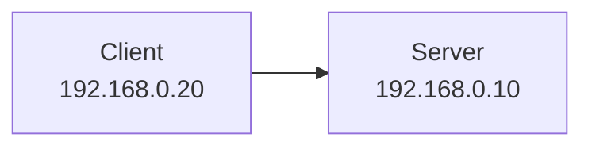

부기는 목적지 IP를 이용해 우가의 컴퓨터에 패킷을 전달하려고 한다.

하지만 IP 주소가 항상 물리적인 컴퓨터 하나를 영구적으로 식별한다는 의미는 아니다.

IP 주소는 일반적으로 네트워크 인터페이스에 할당된다.

하나의 컴퓨터가 여러 IP 주소를 가질 수 있고, 네트워크 환경에 따라 IP 주소가 변경될 수도 있다.

예를 들어 노트북이 Wi-Fi와 유선 LAN에 동시에 연결되어 있다면 서로 다른 IP 주소를 사용할 수 있다.

또 DHCP에 의해 네트워크에 다시 연결할 때 다른 주소를 할당받을 수도 있다.

따라서 IP 주소는 컴퓨터의 고유한 일련번호라기보다 **현재 네트워크에서 통신 대상을 찾기 위한 논리적 주소**라고 이해하는 것이 정확하다.

---

### IPv4란 무엇인가?

IPv4는 Internet Protocol Version 4의 약자다.

IPv4 주소는 32비트로 구성된다.

일반적으로 8비트씩 네 부분으로 나누어 십진수로 표현한다.

예를 들어 다음과 같다.

```text
192.168.0.10
```

각 부분을 옥텟(Octet)이라고 부른다.

```text
192     168      0       10
 |       |       |        |
8비트   8비트   8비트    8비트
```

하나의 옥텟은 8비트이므로 0부터 255까지의 값을 표현할 수 있다.

전체 IPv4 주소는 다음과 같이 구성된다.

```text
8비트 + 8비트 + 8비트 + 8비트

= 32비트
```

따라서 IPv4의 전체 주소 공간은 다음과 같다.

```text
2^32

= 4,294,967,296개
```

약 42억 9천만 개다.

하지만 이 숫자가 모두 일반적인 인터넷 공인 주소로 사용 가능하다는 의미는 아니다.

일부 주소는 사설 네트워크, 루프백, 멀티캐스트, 특정 프로토콜 용도 등에 예약되어 있다.

실제로 IANA의 IPv4 주소 관리 현황에서도 일반적으로 할당된 주소와 특수 용도 주소를 구분한다.

#### IPv4 주소는 왜 부족해졌을까?

인터넷에 연결되는 장치의 수가 빠르게 증가했기 때문이다.

과거에는 컴퓨터와 서버가 주요 인터넷 연결 장치였다.

하지만 지금은 다음과 같은 장치들도 네트워크를 사용한다.

스마트폰, 태블릿, 스마트워치, TV, 가전제품, 산업용 센서, IoT 장치 등이다.

이러한 장치에 모두 서로 다른 공인 IPv4 주소를 할당하려면 주소 공간이 부족해진다.

이를 완화하기 위해 다양한 기술이 사용되었다.

대표적으로 다음과 같다.

* 사설 IP 주소
* NAT와 NAPT
* CIDR 기반 주소 할당
* IPv6

이 중 우리가 일상적으로 사용하는 가정용 공유기와 밀접한 관련이 있는 것이 사설 IP와 NAT다.

---

### IP 주소는 누가 관리할까?

IPv4 주소는 전 세계에서 중복이나 충돌 없이 관리될 필요가 있다.

이를 위해 인터넷 주소 자원은 계층적인 관리 체계를 가진다.

대표적인 최상위 관리 기관이 IANA다.

IANA는 Internet Assigned Numbers Authority의 약자다.

IANA는 전 세계 IP 주소 공간을 조정하고 지역 인터넷 등록 기관에 주소 자원을 배분하는 역할을 수행한다.

개념적인 구조는 다음과 같다.

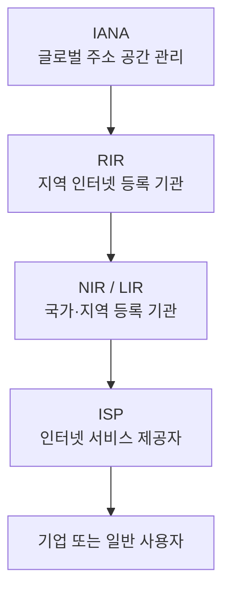

실제 관리 체계에서는 지역에 따라 NIR이나 LIR의 역할과 구조가 달라질 수 있다.

한국은 APNIC이 담당하는 아시아·태평양 지역에 속한다.

또 KRNIC이 국내 인터넷 주소 자원 관리에 관여한다.

중요한 점은 IANA가 일반 가정의 공유기에 직접 IP 주소를 하나씩 할당하는 방식은 아니라는 사실이다.

일반 사용자는 보통 인터넷 서비스 제공자를 통해 주소를 할당받는다.

---

### 포트(Port)란 무엇인가?

이제 IP 주소를 이용해 우가의 컴퓨터를 찾았다고 가정하자.

그런데 우가의 컴퓨터에서는 여러 프로그램이 실행되고 있다.

예를 들어 다음과 같다.

```text
우가의 컴퓨터

├── 웹 브라우저
├── 메신저
├── Spring Boot 서버
├── MySQL
└── 게임 서버
```

부기가 게임 서버에 접속하려면 컴퓨터뿐 아니라 해당 컴퓨터에서 실행 중인 게임 서버의 통신 종점까지 지정해야 한다.

여기서 사용하는 것이 포트다.

**포트는 TCP나 UDP 같은 전송 계층 프로토콜에서 통신의 종점을 식별하기 위해 사용하는 번호**다.

IP 주소가 목적지 호스트나 인터페이스를 찾는 데 사용된다면, 포트는 해당 호스트에서 어떤 네트워크 서비스와 통신할 것인지를 구분하는 데 사용된다.

예를 들어 다음과 같은 구성이 가능하다.

| 서비스             | IP 주소        |    포트 | 프로토콜 |
| --------------- | ------------ | ----: | ---- |
| Spring Boot API | 192.168.0.10 |  8080 | TCP  |
| MySQL           | 192.168.0.10 |  3306 | TCP  |
| Redis           | 192.168.0.10 |  6379 | TCP  |
| 게임 서버           | 192.168.0.10 | 12345 | TCP  |

위 게임 서버는 TCP를 사용하는 예시로 가정했다.

각 서비스는 같은 IP 주소를 사용하더라도 서로 다른 포트를 이용할 수 있다.

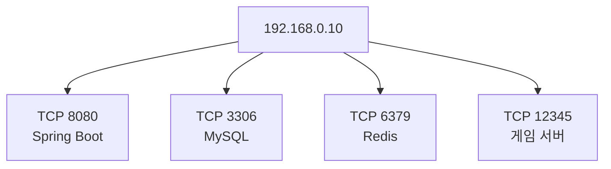

따라서 부기는 다음과 같이 목적지를 지정할 수 있다.

```text
192.168.0.10:12345
```

이 표현에서 각 부분은 다음 의미를 가진다.

```text
192.168.0.10 : 12345
      |           |
   IP 주소       포트
```

운영체제는 목적지 IP와 전송 프로토콜, 포트 등 소켓 정보를 활용해 데이터를 적절한 통신 종점으로 전달한다.

단순히 포트 번호만으로 전 세계의 프로세스를 구분하는 것은 아니다.

---

### 포트 번호는 어떻게 구성될까?

TCP와 UDP의 포트 번호는 각각 16비트다.

따라서 다음 범위의 값을 사용할 수 있다.

```text
0 ~ 65535
```

일반적으로 포트 번호는 다음과 같이 구분한다.

| 범위          | 분류                    | 대표적인 용도        |
| ----------- | --------------------- | -------------- |
| 0~1023      | Well-Known Ports      | 표준적으로 알려진 서비스  |
| 1024~49151  | Registered Ports      | 등록된 애플리케이션 서비스 |
| 49152~65535 | Dynamic/Private Ports | 동적으로 할당되는 포트 등 |

예를 들어 다음과 같은 포트가 널리 사용된다.

|    포트 | 대표적인 서비스                        |
| ----: | ------------------------------- |
|    22 | SSH                             |
|    53 | DNS                             |
|    80 | HTTP                            |
|   443 | HTTPS                           |
|  3306 | MySQL                           |
|  5432 | PostgreSQL                      |
|  6379 | Redis                           |
|  8080 | HTTP 애플리케이션에서 자주 사용             |
| 25565 | Minecraft Java Edition 기본 서버 포트 |

이러한 포트는 관례적인 기본값이므로 실제 애플리케이션에서는 설정에 따라 변경할 수 있다.

또 동일한 숫자라도 TCP 포트와 UDP 포트는 서로 다른 전송 프로토콜에 속한다.

예를 들어 TCP 53과 UDP 53은 같은 번호를 사용하지만 서로 다른 소켓이다.

Minecraft 역시 에디션에 따라 통신 방식이 다르다.

일반적인 Java Edition 서버의 기본 포트는 TCP 25565이며, Bedrock Edition은 기본적으로 UDP 19132를 사용해 왔다.

---

### TCP와 UDP는 무엇이 다를까?

IP 주소와 포트가 등장했다면 TCP와 UDP도 함께 알아야 한다.

TCP와 UDP는 전송 계층에서 사용되는 대표적인 프로토콜이다.

#### TCP

TCP는 연결 지향적인 프로토콜이다.

데이터를 신뢰성 있게 전달하기 위한 여러 기능을 제공한다.

대표적으로 다음과 같다.

* 연결 설정
* 데이터 순서 보장
* 손실된 데이터의 재전송
* 흐름 제어
* 혼잡 제어

일반적인 HTTP/1.1과 HTTP/2 통신에서 TCP가 사용된다.

MySQL이나 PostgreSQL의 일반적인 네트워크 연결에서도 TCP가 사용된다.

#### UDP

UDP는 데이터그램 기반 프로토콜이다.

TCP처럼 연결 설정과 재전송, 순서 보장 등의 기능을 기본적으로 제공하지 않는다.

따라서 상대적으로 단순한 전송 모델을 가진다.

대표적인 활용 분야에는 실시간 통신, DNS 질의, 일부 게임 네트워크 등이 있다.

다만 UDP를 사용한다고 반드시 데이터 손실을 그대로 허용해야 하는 것은 아니다.

애플리케이션 프로토콜이 UDP 위에 자체적으로 신뢰성이나 순서 제어 기능을 구현할 수도 있다.

HTTP/3에서 사용하는 QUIC도 UDP를 기반으로 하지만 별도의 전송 제어 기능을 제공한다.

| 구분       | TCP                     | UDP             |
| -------- | ----------------------- | --------------- |
| 통신 방식    | 연결 지향                   | 데이터그램 기반        |
| 기본 순서 보장 | 지원                      | 지원하지 않음         |
| 기본 재전송   | 지원                      | 지원하지 않음         |
| 흐름 제어    | 지원                      | 기본 제공하지 않음      |
| 대표 활용    | HTTP/1.1, HTTP/2, DB 연결 | DNS, 게임, QUIC 등 |
| 주요 특징    | 신뢰성 있는 바이트 스트림          | 단순하고 유연한 전송 방식  |

따라서 포트포워딩이나 방화벽을 설정할 때도 해당 서비스가 TCP를 사용하는지 UDP를 사용하는지 확인해야 한다.

---

### 같은 네트워크에 있는 컴퓨터들은 어떻게 통신할까?

다시 우가와 부기의 상황으로 돌아가 보자.

두 컴퓨터가 동일한 공유기에 연결되어 있다고 가정하자.

```text
공유기: 192.168.0.1

우가: 192.168.0.10

부기: 192.168.0.20
```

두 컴퓨터는 다음과 같은 네트워크에 속한다고 가정한다.

```text
192.168.0.0/24
```

여기서 `/24`는 무엇일까?

이 개념을 이해하려면 서브넷을 알아야 한다.

---

### 서브넷(Subnet)이란 무엇인가?

서브넷은 IP 네트워크를 논리적으로 구분한 네트워크 범위다.

IP 주소는 네트워크 부분과 호스트 부분으로 해석할 수 있다.

이때 네트워크 부분이 몇 비트인지 나타내는 것이 프리픽스 길이(Prefix Length)다.

예를 들어 다음과 같다.

```text
192.168.0.10/24
```

IPv4 주소는 32비트다.

그중 24비트가 네트워크 부분이라는 의미다.

```text
192.168.0.10/24

네트워크 부분: 24비트

호스트 부분: 8비트
```

해당 프리픽스를 서브넷 마스크로 표현하면 다음과 같다.

```text
255.255.255.0
```

일반적인 `/24` 네트워크에서 다음 범위를 생각할 수 있다.

```text
네트워크 주소

192.168.0.0


일반적인 호스트 주소 범위

192.168.0.1 ~ 192.168.0.254


브로드캐스트 주소

192.168.0.255
```

이 구성에서 우가와 부기는 같은 IP 서브넷에 속한다.

```text
우가: 192.168.0.10/24

부기: 192.168.0.20/24
```

따라서 두 장치는 별도의 IP 라우터를 거치지 않고 같은 로컬 링크에서 직접 통신할 수 있는 조건을 갖춘다.

다만 같은 서브넷이라고 해서 방화벽이나 무선 AP의 클라이언트 격리 설정까지 무시할 수 있는 것은 아니다.

실제 통신 가능 여부는 네트워크 설정에 영향을 받는다.

---

### LAN이란 무엇인가?

LAN은 Local Area Network의 약자다.

일반적으로 집, 사무실, 학교, 건물처럼 제한된 범위에서 구성된 네트워크를 의미한다.

예를 들어 가정용 공유기에 여러 장치가 연결되어 있다고 생각해 보자.

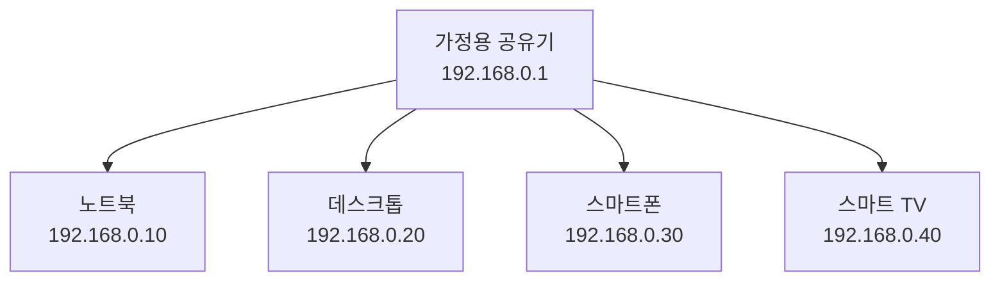

이러한 환경을 LAN으로 볼 수 있다.

이때 공유기는 여러 역할을 동시에 수행할 수 있다.

대표적으로 다음과 같다.

* IP 라우팅
* NAT
* DHCP 서버
* 방화벽
* 무선 AP
* 유선 스위칭

실제 장비 내부에서는 각각 다른 기능이지만 가정용 공유기 한 대에 통합되어 제공되는 경우가 많다.

따라서 공유기를 하나의 네트워크 기능으로만 생각하면 안 된다.

---

### 같은 LAN에서는 공유기가 데이터를 어떻게 전달할까?

부기가 다음 서버에 접속한다고 가정하자.

```text
192.168.0.10:12345
```

부기의 IP는 다음과 같다.

```text
192.168.0.20/24
```

부기의 컴퓨터는 목적지 IP가 같은 로컬 서브넷에 있는지 확인한다.

같은 서브넷이라면 일반적으로 로컬 링크에서 해당 장치에 직접 전달하려고 한다.

그런데 여기서 새로운 문제가 발생한다.

IP 주소는 알지만 실제 Ethernet 프레임을 전달하기 위한 MAC 주소는 어떻게 알 수 있을까?

이때 등장하는 개념이 ARP다.

---

### ARP란 무엇인가?

ARP는 Address Resolution Protocol의 약자다.

IPv4 네트워크에서 IP 주소에 대응하는 로컬 링크의 MAC 주소를 알아내는 데 사용된다.

예를 들어 부기는 다음 정보를 알고 있다.

```text
목적지 IP

192.168.0.10
```

하지만 우가의 MAC 주소를 아직 모른다고 가정하자.

부기는 로컬 네트워크에서 ARP 요청을 보낼 수 있다.

개념적으로 다음과 같은 질문이다.

```text
192.168.0.10을 사용하는 장치는 누구인가?
```

우가의 컴퓨터는 자신의 IP 주소에 대한 ARP 요청을 받으면 MAC 주소를 알려줄 수 있다.

```text
192.168.0.10의 MAC 주소는

AA:BB:CC:DD:EE:FF
```

이 주소는 이해를 위한 예시다.

이후 부기는 알아낸 MAC 주소를 이용해 Ethernet 프레임을 전달할 수 있다.

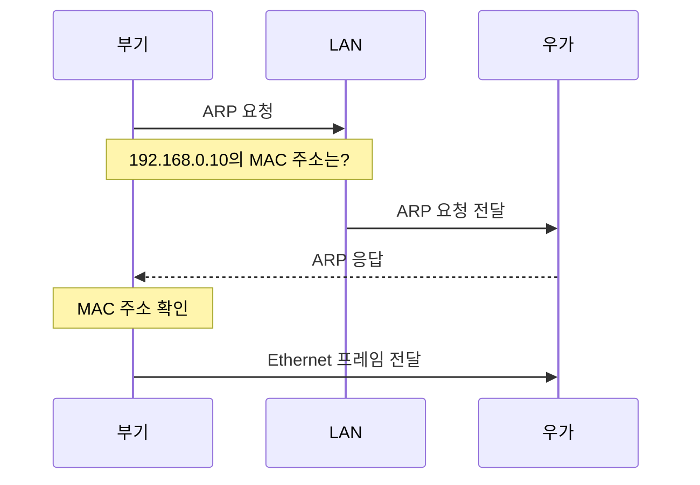

여기서 중요한 점이 있다.

**IP 주소와 MAC 주소는 서로 다른 역할을 한다.**

IP 주소는 네트워크 간 전달과 라우팅에 사용된다.

MAC 주소는 Ethernet과 같은 링크 계층에서 프레임을 전달하는 데 사용된다.

또 ARP는 IPv4에서 사용하는 메커니즘이다.

IPv6에서는 일반적으로 ARP 대신 ICMPv6 기반의 Neighbor Discovery를 사용한다.

---

### 같은 LAN에서 통신할 때도 라우터를 거칠까?

반드시 그렇지는 않다.

두 컴퓨터가 같은 IP 서브넷과 로컬 링크에 있다면 일반적으로 IP 라우터를 경유할 필요가 없다.

하지만 가정용 공유기에 두 컴퓨터를 연결했다면 물리적으로는 공유기 장비를 통과할 수 있다.

이때 장비 내부의 스위치 기능이나 무선 AP가 프레임을 전달할 수 있다.

따라서 다음 두 표현은 구분해야 한다.

```text
공유기 장비를 통과한다.
```

```text
IP 라우팅을 수행한다.
```

두 표현은 동일한 의미가 아니다.

같은 공유기 장비 안에서도 스위칭과 라우팅은 서로 다른 기능이다.

이러한 차이는 네트워크 장애를 분석할 때 중요하다.

---

### WAN이란 무엇인가?

WAN은 Wide Area Network의 약자다.

일반적으로 넓은 지역에 걸쳐 여러 네트워크를 연결하는 네트워크를 의미한다.

예를 들어 서울의 사무실과 부산의 데이터센터를 연결하는 네트워크를 생각할 수 있다.

또 인터넷 자체도 수많은 네트워크가 연결된 거대한 네트워크다.

LAN과 WAN을 비교하면 다음과 같다.

| 구분       | LAN                  | WAN                      |
| -------- | -------------------- | ------------------------ |
| 전체 이름    | Local Area Network   | Wide Area Network        |
| 일반적인 범위  | 집, 사무실, 건물 등         | 도시, 국가, 지역 간             |
| 주요 목적    | 제한된 영역 내 장치 연결       | 서로 떨어진 네트워크 연결           |
| 대표적인 구성  | Ethernet, Wi-Fi, 스위치 | 라우터, 통신사업자망 등            |
| 인터넷과의 관계 | 인터넷 연결 없이도 구성 가능     | 인터넷은 대표적인 대규모 네트워크 연결 사례 |

여기서 중요한 점은 LAN과 WAN이 단순히 사설 IP와 공인 IP를 구분하는 개념이 아니라는 사실이다.

LAN에서도 공인 IP를 사용할 수 있다.

WAN에서도 사설 IP를 사용하는 전용망이나 VPN 환경을 구성할 수 있다.

따라서 다음처럼 이해하면 안 된다.

```text
LAN = 반드시 사설 IP

WAN = 반드시 공인 IP
```

LAN과 WAN은 주로 네트워크의 구성 범위와 연결 특성을 설명하는 개념이다.

---

### 기본 게이트웨이(Default Gateway)란 무엇인가?

우가와 부기가 같은 네트워크에 있을 때는 직접 통신할 수 있었다.

하지만 부기가 다른 네트워크에 있는 서버로 접속하려고 한다면 어떻게 될까?

예를 들어 다음 목적지를 생각해 보자.

```text
목적지 IP

203.0.113.10
```

이 주소는 실제 인터넷 연결에 사용하지 않는 예시용 IP다.

부기의 네트워크 설정은 다음과 같다.

```text
IP 주소

192.168.0.20


서브넷 마스크

255.255.255.0


기본 게이트웨이

192.168.0.1
```

부기는 목적지 IP가 자신의 로컬 서브넷에 속하지 않는다는 사실을 확인한다.

그러면 라우팅 테이블에 따라 다음 홉(Next Hop)을 선택한다.

해당 목적지에 대한 더 구체적인 경로가 없을 경우 기본 게이트웨이를 이용할 수 있다.

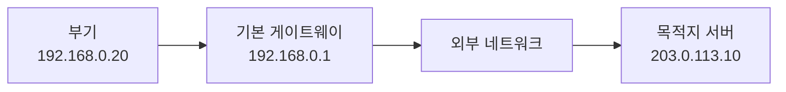

기본 게이트웨이는 다른 네트워크로 패킷을 전달하기 위한 기본적인 다음 홉이다.

실제 라우터는 목적지 IP와 라우팅 테이블을 기준으로 어느 인터페이스를 통해 패킷을 전달할지 결정한다.

따라서 기본 게이트웨이를 인터넷으로 나가는 출입구라고 비유할 수 있지만, 정확하게는 **더 구체적인 경로가 없는 목적지에 대해 선택되는 기본 라우팅 경로의 다음 홉**이라고 이해해야 한다.

---

### 공인 IP와 사설 IP는 무엇이 다를까?

이제 서로 다른 네트워크에서 통신할 때 중요한 개념을 살펴보자.

공인 IP(Public IP)는 일반적으로 글로벌 인터넷에서 라우팅 가능한 주소를 의미한다.

사설 IP(Private IP)는 사설 네트워크에서 사용하도록 예약된 주소다.

예를 들어 우가의 집 네트워크가 다음과 같다고 가정하자.

```text
공유기의 공인 IP

203.0.113.10


우가의 컴퓨터

192.168.0.10


우가의 스마트폰

192.168.0.20


우가의 태블릿

192.168.0.30
```

공유기는 외부 네트워크와 통신할 때 공인 IP를 사용할 수 있다.

반면 집 안의 장치들은 사설 IP를 사용한다.

이렇게 하면 여러 내부 장치가 하나의 공인 IPv4 주소를 공유하는 구성을 만들 수 있다.

다만 `203.0.113.10`은 RFC 5737에서 예시용으로 예약된 주소이므로 실제 인터넷에서 라우팅 가능한 주소는 아니다. 이후의 공인 IP 예제도 설명을 위한 가상의 주소로 사용한다.

---

### 사설 IPv4 주소의 범위

사설 IPv4 주소는 RFC 1918에서 정의한다.

대표적으로 다음 세 가지 범위가 존재한다.

| 주소 범위                         | CIDR 표기        |
| ----------------------------- | -------------- |
| 10.0.0.0 ~ 10.255.255.255     | 10.0.0.0/8     |
| 172.16.0.0 ~ 172.31.255.255   | 172.16.0.0/12  |
| 192.168.0.0 ~ 192.168.255.255 | 192.168.0.0/16 |

이 주소들은 서로 다른 사설 네트워크에서 반복해서 사용할 수 있다.

예를 들어 우가의 집 컴퓨터와 부기의 집 컴퓨터가 모두 다음 IP를 사용할 수도 있다.

```text
192.168.0.10
```

주소가 같아도 네트워크가 서로 분리되어 있다면 문제가 되지 않는다.

하지만 두 네트워크를 직접 연결하려는 경우에는 주소 중복 때문에 라우팅 문제가 발생할 수 있다.

이러한 사설 주소 범위는 IANA와 RFC 1918에 정의되어 있다.

---

### 사설 IP를 사용하면 인터넷에 접속할 수 없을까?

사설 IP는 일반적인 글로벌 인터넷 라우팅에 직접 사용되지 않는다.

하지만 사설 IP를 가진 컴퓨터도 인터넷을 사용할 수 있다.

우리 주변에서 가장 흔하게 사용하는 네트워크 구성이 바로 이것이다.

예를 들어 집 안의 노트북에는 다음 주소가 할당되어 있다.

```text
192.168.0.10
```

그런데 웹 브라우저에서 외부 웹사이트에 접속할 수 있다.

어떻게 가능할까?

여기서 NAT가 등장한다.

---

### NAT란 무엇인가?

NAT는 Network Address Translation의 약자다.

네트워크 주소 변환을 의미한다.

NAT는 네트워크 경계에서 IP 패킷의 주소 정보를 변환하는 기술이다.

예를 들어 사설 IP를 사용하는 내부 컴퓨터가 외부 인터넷에 접근할 때 출발지 IP를 공유기의 공인 IP로 변환할 수 있다.


내부 컴퓨터는 다음 목적지로 요청을 보낸다고 가정하자.

```text
198.51.100.25:443
```

이때 공유기는 내부 사설 IP를 외부 주소로 변환해 요청을 전달할 수 있다.

응답이 돌아오면 기존 변환 상태를 참조해 올바른 내부 컴퓨터로 전달한다.

하지만 여기서 중요한 부분이 있다.

일반 가정용 공유기에서는 IP 주소뿐 아니라 TCP/UDP 포트 번호도 함께 변환하는 경우가 많다.

이러한 방식은 엄밀하게는 NAPT라고 부른다.

---

### NAT와 NAPT는 무엇이 다를까?

NAT는 넓은 의미의 주소 변환 기술이다.

그중에서도 Basic NAT는 IP 주소를 다른 IP 주소로 변환하는 방식이다.

NAPT(Network Address Port Translation)는 IP 주소뿐 아니라 TCP/UDP 포트도 함께 변환한다.

이 때문에 하나의 공인 IPv4 주소로 여러 내부 장치의 연결을 구분할 수 있다.

| 구분       | NAT             | NAPT               |
| -------- | --------------- | ------------------ |
| 주요 변환 대상 | IP 주소           | IP 주소와 포트          |
| 대표적인 구성  | 주소 간 매핑         | 다수 내부 연결의 공인 주소 공유 |
| 포트 변환    | 필수 아님           | 사용                 |
| 가정용 공유기  | 넓은 의미로 NAT라고 부름 | 일반적인 실제 동작 방식      |

RFC 3022에서도 Basic NAT와 NAPT를 구분하며, NAPT가 주소와 전송 계층 포트의 매핑을 활용한다고 설명한다.

이제 실제 통신 흐름을 살펴보자.

---

### NAT는 실제로 어떻게 동작할까?

우가의 집에 두 컴퓨터가 있다고 가정하자.

```text
Computer A

192.168.0.10


Computer B

192.168.0.20
```

두 컴퓨터 모두 같은 외부 웹 서버에 접속하려고 한다.

목적지는 다음과 같다.

```text
198.51.100.25:443
```

Computer A는 다음 연결을 사용한다고 가정하자.

```text
192.168.0.10:51000
```

Computer B는 다음 연결을 사용한다.

```text
192.168.0.20:51001
```

여기서 `51000`과 `51001`은 클라이언트가 사용한 출발지 포트의 예시다.

공유기의 공인 IP는 다음과 같다고 가정한다.

```text
203.0.113.10
```

공유기는 내부 연결들을 외부 연결로 변환한다.

예를 들어 다음과 같은 매핑이 만들어질 수 있다.

| 내부 IP:포트           | 변환된 외부 IP:포트       |
| ------------------ | ------------------ |
| 192.168.0.10:51000 | 203.0.113.10:40001 |
| 192.168.0.20:51001 | 203.0.113.10:40002 |

두 컴퓨터는 서로 다른 내부 IP를 사용하지만 외부에서는 같은 공인 IP를 이용할 수 있다.

다만 포트가 다르므로 두 연결을 구분할 수 있다.

---

### NAT 변환 테이블은 어떤 역할을 할까?

공유기는 연결 상태와 변환 정보를 관리한다.

개념적으로 다음과 같은 정보가 존재할 수 있다.

```text
내부 주소:포트

192.168.0.10:51000


변환된 외부 주소:포트

203.0.113.10:40001


목적지 주소:포트

198.51.100.25:443


프로토콜

TCP
```

실제 NAT 구현에서는 연결 추적과 포트 매핑 정책에 따라 관리하는 정보가 달라질 수 있다.

단순히 출발지 IP와 목적지 IP 두 개만 저장하는 것은 아니다.

TCP/UDP 포트와 프로토콜, 연결 상태, 시간 정보 등을 함께 활용할 수 있다.

개념적인 요청 흐름은 다음과 같다.

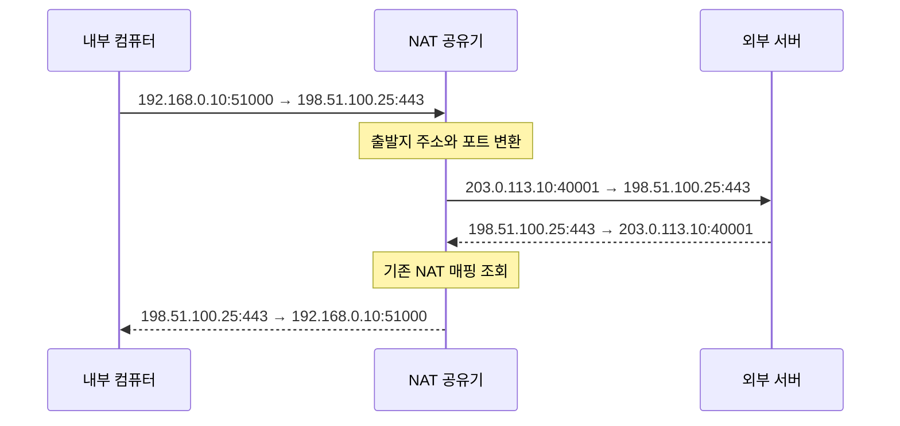

요청과 응답을 비교해 보자.

외부로 나갈 때는 내부 주소가 공인 주소로 변환된다.

응답이 돌아올 때는 기존 매핑을 이용해 내부 주소로 다시 전달된다.

이렇게 여러 장치가 하나의 공인 IPv4 주소를 공유하면서 인터넷에 접속할 수 있다.

---

### NAT는 왜 필요한가?

NAT가 널리 사용되는 중요한 이유 중 하나는 IPv4 주소 부족 문제를 완화하기 위해서다.

예를 들어 하나의 가정에 다음 장치들이 있다고 생각해 보자.

```text
노트북 2대

스마트폰 3대

태블릿 1대

스마트 TV 1대

게임 콘솔 1대
```

모두 인터넷을 사용한다.

각 장치에 별도의 공인 IPv4 주소를 할당하지 않고, 내부에서는 사설 IP를 사용하며 외부 통신에는 공인 IPv4 주소를 공유하도록 구성할 수 있다.

이 외에도 NAT는 내부 주소 체계와 외부 주소 체계를 분리하는 데 활용될 수 있다.

하지만 NAT가 모든 네트워크 문제를 해결하는 것은 아니다.

특히 외부에서 내부 서버에 직접 접속하려고 하면 새로운 문제가 발생한다.

---

### 외부에서는 왜 내부 서버에 접속하지 못할까?

이제 우가와 부기가 서로 다른 집에 있다고 가정하자.

우가의 집 네트워크는 다음과 같다.

```text
공인 IP

203.0.113.10


우가의 컴퓨터

192.168.0.10


게임 서버 포트

12345
```

부기의 컴퓨터는 외부 네트워크에 있다.

부기가 다음 주소로 접속하려고 한다.

```text
192.168.0.10:12345
```

이 요청은 일반적인 인터넷을 통해 우가의 집으로 직접 라우팅되지 않는다.

`192.168.0.10`은 사설 IP이기 때문이다.

사설 주소는 서로 다른 네트워크에서 중복되어 사용될 수 있다.

따라서 글로벌 인터넷 라우터는 이 주소를 특정 가정의 컴퓨터로 직접 전달하지 않는다.

그렇다면 공유기의 공인 IP를 사용하면 될까?

부기는 다음 주소로 요청을 보낸다.

```text
203.0.113.10:12345
```

이번에는 우가의 공유기까지 도달할 수 있다고 가정해 보자.

하지만 공유기에는 다음과 같은 내부 장치들이 존재한다.

```text
192.168.0.10

192.168.0.20

192.168.0.30
```

외부에서 처음 들어온 요청을 어느 내부 장치로 전달해야 할까?

기존 NAT 테이블에 대응하는 연결 상태가 없고 별도의 전달 규칙도 없다면 공유기는 목적지를 결정할 수 없다.

일반적인 가정용 NAT 공유기는 이러한 미요청 인바운드 연결을 기본적으로 허용하지 않는 경우가 많다.

따라서 외부에서 내부 서버에 직접 접속하려면 별도의 설정이 필요할 수 있다.

여기서 등장하는 개념이 포트포워딩이다.

---

### 포트포워딩(Port Forwarding)이란 무엇인가?

포트포워딩은 외부에서 특정 주소와 포트로 들어온 트래픽을 지정한 내부 주소와 포트로 전달하도록 설정하는 방식이다.

일반적인 IPv4 NAT 공유기에서는 정적인 목적지 주소 및 포트 변환 규칙을 이용해 구현할 수 있다.

예를 들어 다음과 같은 구성이 있다고 가정하자.

```text
공유기 공인 IP

203.0.113.10


게임 서버 내부 IP

192.168.0.10


외부 포트

12345


내부 포트

25565
```

포트포워딩 규칙은 다음과 같다.

```text
203.0.113.10:12345

↓

192.168.0.10:25565
```

즉 외부에서 공인 IP의 TCP 12345 포트로 들어온 연결을 내부 컴퓨터의 TCP 25565 포트로 전달한다.


이제 부기는 공유기의 공인 IP와 외부 포트를 이용해 우가의 게임 서버에 접속할 수 있다.

단, 실제로 성공하려면 인터넷에서 공유기까지 해당 트래픽이 도달할 수 있어야 하고, 공유기와 서버의 방화벽이 연결을 허용해야 하며, 서버가 올바른 주소와 포트에서 실행되고 있어야 한다.

---

### NAT와 포트포워딩은 무엇이 다를까?

두 개념은 밀접하게 관련되어 있지만 동일하지 않다.

일반적인 가정용 공유기에서 외부로 나가는 통신은 NAT가 동적으로 매핑을 생성해 처리할 수 있다.

반면 외부에서 처음 시작하는 연결은 기존에 대응하는 매핑이 없을 수 있다.

포트포워딩은 이러한 연결을 특정 내부 서버로 보내기 위한 명시적인 규칙을 구성한다.

| 구분       | 일반적인 아웃바운드 NAT | 포트포워딩                     |
| -------- | -------------- | ------------------------- |
| 주된 목적    | 내부 장치의 외부 통신   | 외부에서 내부 서비스 접근            |
| 연결 시작 방향 | 내부에서 외부        | 외부에서 내부                   |
| 매핑 생성    | 동적으로 생성 가능     | 관리자가 규칙 지정                |
| 대표적인 사용  | 웹사이트 접속        | 게임 서버, 자체 서버 공개           |
| 주요 설정    | NAT 기능과 연결 추적  | 외부 포트, 내부 IP, 내부 포트, 프로토콜 |

따라서 포트포워딩을 NAT 테이블에 값을 단순히 수동으로 추가하는 작업이라고만 이해하면 충분하지 않다.

실제로는 **외부에서 들어온 패킷의 목적지 주소와 포트를 변환하고 전달할 수 있도록 하는 정책을 구성하는 것**이다.

또 NAT 변환 규칙과 방화벽 허용 정책은 논리적으로 구분해야 한다.

일부 공유기는 포트포워딩을 설정하면서 관련 방화벽 정책을 함께 적용하지만, 모든 환경에서 자동으로 허용되는 것은 아니다.

---

### 포트포워딩의 전체 동작 과정

앞선 구성을 기준으로 실제 통신을 살펴보자.

```text
외부 클라이언트

198.51.100.25


공유기

203.0.113.10


내부 서버

192.168.0.10
```

게임 서버는 내부 TCP 25565 포트를 사용한다.

공유기에서는 외부 TCP 12345를 내부 TCP 25565로 전달하도록 설정했다.

외부 클라이언트는 다음 주소로 접속한다.

```text
203.0.113.10:12345
```

공유기는 요청을 수신한다.

그리고 포트포워딩 규칙을 확인한다.

```text
외부 TCP 12345

↓

내부 192.168.0.10:25565
```

이후 요청을 내부 서버에 전달한다.

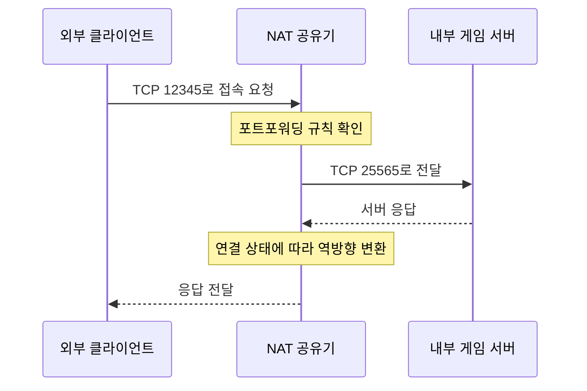

여기서 중요한 점은 **외부 포트와 내부 포트가 반드시 같을 필요는 없다**는 사실이다.

예를 들어 다음과 같은 설정도 가능하다.

```text
외부 포트 30000

↓

내부 포트 25565
```

또는 다음처럼 동일하게 구성할 수도 있다.

```text
외부 포트 25565

↓

내부 포트 25565
```

다만 실제 포트포워딩 기능과 지원 범위는 공유기 제품과 펌웨어에 따라 달라질 수 있다.

---

### 포트포워딩을 설정했는데도 접속이 안 되는 이유

실무에서는 포트포워딩을 설정했는데도 외부에서 접속하지 못하는 상황이 자주 발생한다.

이때 확인해야 할 대표적인 원인은 다음과 같다.

첫 번째는 내부 서버가 실행되지 않은 경우다.

두 번째는 서버가 잘못된 포트에서 실행 중인 경우다.

세 번째는 서버가 `127.0.0.1`에만 바인딩된 경우다.

네 번째는 운영체제 방화벽이 연결을 차단하는 경우다.

다섯 번째는 공유기의 포트포워딩 규칙이 잘못된 경우다.

여섯 번째는 내부 서버의 IP 주소가 변경된 경우다.

일곱 번째는 인터넷 서비스 제공자가 CGNAT를 사용하는 경우다.

여덟 번째는 외부 접속을 같은 내부 네트워크에서 테스트하면서 NAT Loopback 문제를 만난 경우다.

이러한 문제를 제대로 이해하려면 서버의 바인딩 주소와 CGNAT를 알아야 한다.

---

### 서버가 127.0.0.1에 바인딩되어 있으면 어떻게 될까?

백엔드 개발에서 매우 중요한 개념이다.

다음 두 주소를 생각해 보자.

```text
127.0.0.1
```

```text
0.0.0.0
```

둘은 의미가 다르다.

`127.0.0.1`은 IPv4 루프백 주소다.

일반적으로 현재 컴퓨터 내부에서 자기 자신과 통신하는 데 사용한다.

반면 서버가 `0.0.0.0`에 바인딩한다는 것은 일반적으로 사용 가능한 모든 IPv4 로컬 인터페이스에서 연결을 받을 수 있도록 설정한다는 의미다.

`0.0.0.0`은 원격 클라이언트가 서버를 찾아가기 위해 입력하는 일반적인 목적지 주소가 아니다.

예를 들어 다음과 같은 차이가 있다.

| 서버 바인딩 주소    | 의미                |
| ------------ | ----------------- |
| 127.0.0.1    | 로컬 루프백 인터페이스      |
| 192.168.0.10 | 지정한 로컬 네트워크 인터페이스 |
| 0.0.0.0      | 모든 IPv4 로컬 인터페이스  |

서버가 다음과 같이 실행되고 있다고 가정하자.

```text
127.0.0.1:8080
```

현재 컴퓨터에서는 접속할 수 있다.

하지만 다른 컴퓨터에서 다음 주소로 접속하더라도 서버가 해당 네트워크 인터페이스에서 연결을 받지 않는다면 실패한다.

```text
192.168.0.10:8080
```

즉 포트가 열려 있는지뿐 아니라 **어떤 주소에 바인딩되어 있는지도 확인해야 한다.**

---

### Spring Boot에서 서버 IP와 포트를 설정하는 방법

Spring Boot에서는 `application.yml`을 통해 서버의 포트와 바인딩 주소를 설정할 수 있다.

예를 들어 다음과 같다.

```yaml
server:
  address: 0.0.0.0
  port: 8080
```

이 설정은 일반적인 Spring Boot 내장 웹 서버가 모든 IPv4 로컬 인터페이스에서 TCP 8080 포트의 연결을 수신하도록 구성한다.

Spring Boot의 공식 설정에서도 `server.address`는 서버가 바인딩할 네트워크 주소를, `server.port`는 HTTP 포트를 지정하는 속성이다.

이제 다음과 같은 Controller를 작성한다고 가정하자.

```java
@RestController
@RequestMapping("/api")
public class NetworkController {

    @GetMapping("/hello")
    public String hello() {
        return "Hello Network";
    }
}
```

서버를 실행한다.

```bash
./gradlew bootRun
```

같은 컴퓨터에서는 다음 주소로 접속할 수 있다.

```bash
curl http://localhost:8080/api/hello
```

예상 결과는 다음과 같다.

```text
Hello Network
```

그리고 같은 LAN에 있는 다른 컴퓨터에서도 서버의 사설 IP를 이용해 접속할 수 있다.

```bash
curl http://192.168.0.10:8080/api/hello
```

예상 결과는 동일하다.

```text
Hello Network
```

다만 실제 서버의 IP가 `192.168.0.10`이어야 하며, 운영체제 방화벽과 네트워크 설정이 해당 연결을 허용해야 한다.

**서버를 `0.0.0.0`에 바인딩하는 것은 네트워크 인터페이스에서 연결을 수신할 수 있도록 하는 설정이지, 인터넷 전체에서 자동으로 접속 가능해지는 설정은 아니다.**

---

### localhost와 127.0.0.1은 항상 같은가?

`localhost`는 일반적으로 현재 컴퓨터를 가리키는 호스트 이름이다.

대부분의 환경에서 다음 주소 중 하나로 해석될 수 있다.

```text
127.0.0.1
```

또는 IPv6 루프백 주소인 다음 값이다.

```text
::1
```

따라서 `localhost`가 언제나 IPv4 주소 `127.0.0.1`로만 해석되는 것은 아니다.

예를 들어 서버가 IPv4 루프백에만 바인딩되어 있는데 클라이언트가 IPv6 루프백으로 연결하려고 하면 접속 문제가 발생할 수 있다.

이런 경우에는 다음 두 요청을 비교하면 원인을 파악하는 데 도움이 된다.

```bash
curl -4 http://localhost:8080/api/hello
```

```bash
curl -6 http://localhost:8080/api/hello
```

첫 번째 명령은 IPv4 연결을 요청한다.

두 번째 명령은 IPv6 연결을 요청한다.

단, IPv6 연결이 성공하려면 서버 역시 해당 주소 체계에서 연결을 수신하도록 구성되어 있어야 한다.

---

### DHCP란 무엇인가?

앞서 각 컴퓨터에 사설 IP가 할당되어 있다고 가정했다.

그렇다면 일반 가정에서는 누가 IP 주소를 할당할까?

대표적인 방법이 DHCP다.

DHCP는 Dynamic Host Configuration Protocol의 약자다.

네트워크 장치에 필요한 IP 설정을 자동으로 제공하기 위한 프로토콜이다.

일반적인 가정용 공유기는 DHCP 서버 역할을 수행할 수 있다.

노트북이 Wi-Fi에 연결되면 DHCP를 통해 다음과 같은 정보를 전달받을 수 있다.

```text
IP 주소

192.168.0.10


서브넷 마스크

255.255.255.0


기본 게이트웨이

192.168.0.1


DNS 서버

192.168.0.1
```

이렇게 하면 사용자가 모든 장치에 IP 주소를 직접 설정할 필요가 없다.

#### DHCP의 기본 동작

일반적인 DHCPv4의 초기 주소 할당 과정은 다음과 같이 설명할 수 있다.

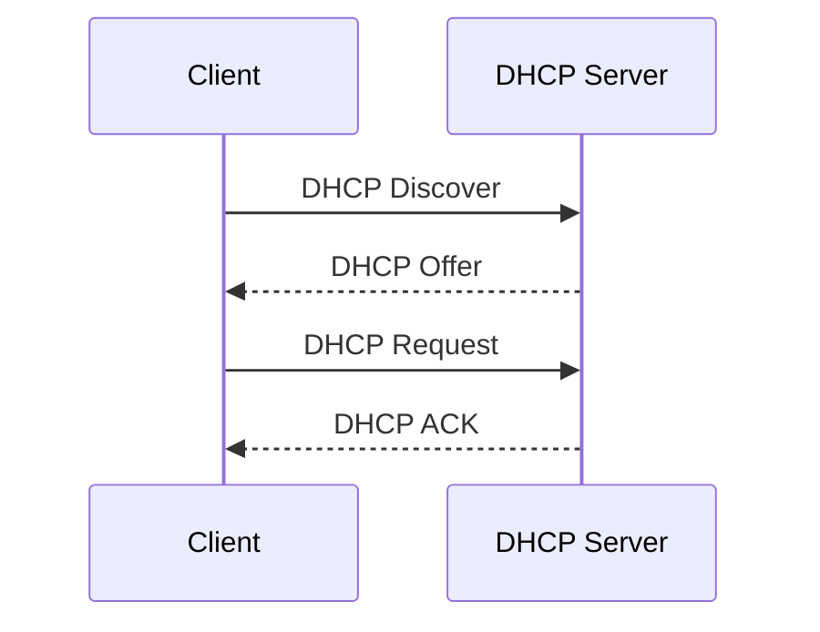

각 단계의 의미는 다음과 같다.

| 단계       | 의미               |
| -------- | ---------------- |
| Discover | DHCP 서버 탐색       |
| Offer    | 사용 가능한 주소와 설정 제안 |
| Request  | 제안받은 주소 요청       |
| ACK      | 주소 할당 승인         |

실제 DHCP에는 기존 임대 갱신이나 주소 충돌 검사 등 더 다양한 동작이 존재한다.

#### 왜 DHCP를 알아야 할까?

포트포워딩과 관련이 있기 때문이다.

예를 들어 공유기가 다음 설정을 가지고 있다고 가정하자.

```text
외부 TCP 12345

↓

192.168.0.10:25565
```

그런데 우가의 컴퓨터가 재부팅 후 DHCP에서 다음 IP를 할당받았다고 생각해 보자.

```text
192.168.0.30
```

이제 포트포워딩 규칙은 예전 IP를 가리킨다.

따라서 외부 접속이 실패할 수 있다.

이를 방지하기 위해 공유기에서 DHCP 예약을 설정하거나 네트워크 정책에 맞는 고정 IP 구성을 사용할 수 있다.

---

### DNS란 무엇인가?

지금까지는 서버에 접속할 때 IP 주소를 직접 입력했다.

하지만 실제 인터넷에서는 대부분 도메인 이름을 사용한다.

예를 들어 다음과 같다.

```text
www.example.com
```

이러한 이름을 IP 주소와 연결해 주는 시스템이 DNS다.

DNS는 Domain Name System의 약자다.

DNS는 도메인 이름에 대한 다양한 리소스 레코드를 관리하고 조회할 수 있도록 하는 분산 시스템이다.

대표적으로 다음 레코드가 존재한다.

| 레코드   | 주요 역할              |
| ----- | ------------------ |
| A     | 도메인 이름에 대한 IPv4 주소 |
| AAAA  | 도메인 이름에 대한 IPv6 주소 |
| CNAME | 다른 정규 이름에 대한 별칭    |
| MX    | 메일 수신 서버 정보        |
| TXT   | 문자열 기반의 다양한 설정 정보  |

예를 들어 사용자가 다음 URL을 입력한다고 가정하자.

```text
https://www.example.com
```

클라이언트는 네트워크 통신을 위해 도메인 이름을 IP 주소로 해석해야 할 수 있다.

이 과정에서 DNS를 사용할 수 있다.

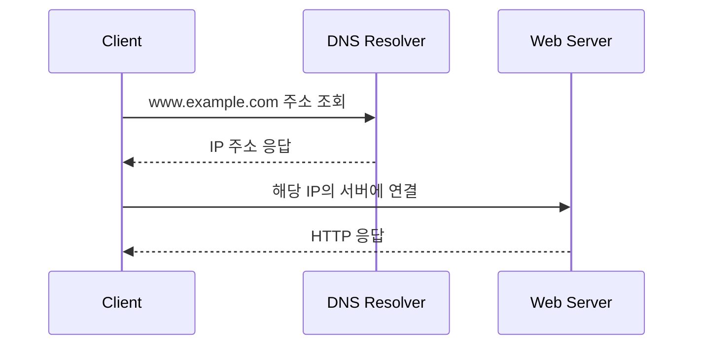

여기서 중요한 점은 DNS와 포트가 서로 다른 개념이라는 것이다.

DNS는 일반적으로 호스트 이름을 주소 정보로 해석하는 데 사용한다.

포트는 해당 호스트에서 어떤 서비스로 연결할지 결정하는 데 사용한다.

URL에 포트 번호가 생략되어 있다면 사용된 URL 스킴과 프로토콜에 따른 기본 포트를 사용할 수 있다.

예를 들어 다음과 같다.

```text
http://www.example.com

→ 기본적으로 TCP 80


https://www.example.com

→ 일반적인 HTTPS의 기본 포트 443
```

다만 HTTPS는 HTTP/3를 사용하는 경우 UDP 기반 QUIC을 사용할 수 있으므로 언제나 TCP만 사용한다고 단정해서는 안 된다.

---

### CGNAT란 무엇인가?

이제 포트포워딩에서 자주 발생하는 중요한 문제를 살펴보자.

공유기에서 포트포워딩을 정확하게 설정했다.

서버도 실행 중이다.

운영체제 방화벽도 확인했다.

그런데 외부 접속이 여전히 실패한다.

이때 인터넷 서비스 제공자가 CGNAT를 사용하고 있을 가능성을 확인해야 한다.

CGNAT는 Carrier-Grade NAT의 약자다.

통신사업자 수준에서 여러 가입자의 IPv4 연결을 주소 변환으로 처리하는 기술이다.

가정용 공유기의 NAT보다 상위 네트워크에서 추가 NAT가 수행될 수 있다.

개념적인 구조는 다음과 같다.

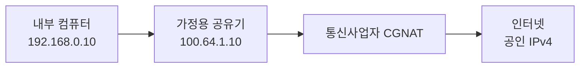

이때 가정용 공유기의 WAN 인터페이스에는 일반적인 공인 IPv4가 아닌 공유 주소가 할당될 수 있다.

대표적인 주소 범위는 다음과 같다.

```text
100.64.0.0/10
```

이는 RFC 6598에서 정의한 Shared Address Space다.

이 범위는 일반적인 RFC 1918 사설 주소와 구분되며 통신사업자의 주소 공유 환경에서 사용할 수 있다.

---

### CGNAT 환경에서 포트포워딩이 어려운 이유

일반적인 가정용 NAT 환경에서는 외부 요청이 공유기의 WAN 주소까지 직접 도달할 수 있다고 가정한다.

하지만 CGNAT에서는 그 앞에 통신사업자의 NAT 장비가 추가로 존재한다.

```text
인터넷

↓

통신사업자 CGNAT

↓

가정용 공유기

↓

내부 서버
```

사용자가 가정용 공유기에서 다음 규칙을 설정했다고 생각해 보자.

```text
외부 TCP 12345

↓

192.168.0.10:25565
```

이 규칙은 가정용 공유기에 적용된다.

하지만 외부에서 들어온 요청이 통신사업자의 CGNAT 장비를 통과해 공유기까지 전달되지 않는다면 아무런 효과가 없다.

따라서 공유기 설정만으로는 외부에서 내부 서버에 접속할 수 없을 수 있다.

이 경우 다음과 같은 대안을 고려할 수 있다.

* 통신사업자에서 공인 IPv4 제공 여부 확인
* IPv6 연결 사용
* VPN이나 사설 오버레이 네트워크 사용
* 외부 서버를 통한 리버스 터널 구성
* 클라우드 서버에 서비스 배포

어떤 방법이 가능한지는 통신사업자의 정책과 서비스 요구사항에 따라 달라진다.

---

### IPv6는 무엇이고 왜 필요할까?

IPv6는 Internet Protocol Version 6의 약자다.

IPv4 주소 부족 문제를 해결하기 위한 중요한 기술이다.

IPv4는 32비트 주소를 사용한다.

반면 IPv6는 128비트 주소를 사용한다.

```text
IPv4

32비트


IPv6

128비트
```

따라서 IPv6는 IPv4보다 훨씬 넓은 주소 공간을 제공한다.

예를 들어 IPv6 주소는 다음과 같은 형식으로 표현한다.

```text
2001:db8::10
```

이는 문서 예제용 IPv6 주소다.

IPv6는 콜론으로 구분되는 16진수 표현을 사용한다.

동일한 0이 반복되는 구간을 축약해 표현할 수도 있다.

#### IPv6에서는 NAT가 필요 없을까?

IPv6는 매우 넓은 주소 공간을 제공하므로 IPv4처럼 공인 주소 부족을 완화하기 위해 모든 내부 장치가 하나의 주소를 공유해야 하는 필요성이 크게 줄어든다.

따라서 각 장치가 글로벌 유니캐스트 IPv6 주소를 사용할 수 있는 구성이 가능하다.

하지만 이것이 IPv6에서는 NAT가 기술적으로 존재하지 않거나, 모든 장치에 외부에서 무조건 접속할 수 있다는 의미는 아니다.

IPv6에서도 방화벽과 라우팅 정책이 적용된다.

외부에서 내부 서비스로 연결하려면 해당 통신을 허용하는 보안 정책이 필요하다.

즉 다음 개념을 구분해야 한다.

```text
주소가 글로벌하게 라우팅 가능하다.
```

```text
외부 연결을 허용한다.
```

두 조건은 동일하지 않다.

---

### 방화벽(Firewall)이란 무엇인가?

방화벽은 네트워크 트래픽에 정책을 적용해 허용하거나 차단하는 보안 기능이다.

방화벽은 네트워크 장비에도 존재할 수 있고, 운영체제나 클라우드 서비스에서도 제공할 수 있다.

예를 들어 다음과 같은 정책을 설정할 수 있다.

```text
TCP 8080

외부 접근 차단
```

```text
TCP 443

허용
```

```text
SSH 22

관리자 네트워크에서만 허용
```

일반적인 방화벽은 다음 정보를 기준으로 트래픽을 제어할 수 있다.

* 출발지 IP
* 목적지 IP
* 출발지 포트
* 목적지 포트
* 전송 프로토콜
* 연결 상태
* 추가적인 애플리케이션 정보

다만 실제로 어떤 정보를 검사할 수 있는지는 방화벽 종류와 기능에 따라 달라진다.

---

### NAT와 방화벽은 무엇이 다를까?

NAT와 방화벽은 함께 사용되는 경우가 많지만 서로 다른 개념이다.

NAT의 주요 목적은 네트워크 주소와 포트를 변환하는 것이다.

방화벽의 주요 목적은 네트워크 트래픽에 접근 제어 정책을 적용하는 것이다.

| 구분    | NAT             | Firewall      |
| ----- | --------------- | ------------- |
| 주요 목적 | 주소 및 포트 변환      | 통신 허용과 차단     |
| 주요 기준 | 주소 변환 규칙과 매핑 상태 | 보안 정책과 연결 상태  |
| 대표 활용 | 사설 IPv4의 인터넷 연결 | 불필요한 외부 접근 차단 |
| 관계    | 방화벽과 함께 동작 가능   | NAT와 함께 동작 가능 |

예를 들어 포트포워딩을 설정했다고 생각해 보자.

```text
공인 IP:12345

↓

내부 IP:25565
```

NAT는 이 연결을 내부 서버로 전달할 수 있도록 설정한다.

하지만 방화벽이 TCP 12345 또는 TCP 25565에 대한 통신을 차단한다면 연결이 실패할 수 있다.

따라서 **포트포워딩 규칙이 존재한다는 사실과 네트워크 연결이 허용된다는 사실은 구분해야 한다.**

---

### DoS와 DDoS는 무엇이 다를까?

네트워크 보안에서 자주 등장하는 용어가 DoS와 DDoS다.

DoS는 Denial of Service의 약자다.

서비스 거부 공격을 의미한다.

서비스가 정상적인 사용자에게 응답하지 못하도록 시스템 자원을 고갈시키거나 서비스 동작을 방해하는 공격을 말한다.

DDoS는 Distributed Denial of Service의 약자다.

분산 서비스 거부 공격을 의미한다.

여러 시스템이나 분산된 공격 자원을 이용해 대량의 트래픽이나 요청을 발생시키는 방식이다.

| 구분    | DoS                 | DDoS                          |
| ----- | ------------------- | ----------------------------- |
| 전체 이름 | Denial of Service   | Distributed Denial of Service |
| 핵심 특징 | 서비스 이용 방해           | 분산된 공격 자원을 이용한 서비스 이용 방해      |
| 공격 출처 | 단일 또는 제한적인 출처일 수 있음 | 다수의 분산된 출처가 일반적               |
| 대응    | 자원 보호, 요청 제한 등      | 네트워크 수준의 분산 방어까지 필요할 수 있음     |

여기서 중요한 점이 있다.

**DoS와 DDoS를 단순히 요청 개수만으로 구분하지 않는다.**

요청이 매우 많더라도 하나의 공격 주체에서 발생한 서비스 거부 공격일 수 있다.

반대로 분산된 여러 장치가 공격에 참여하면 DDoS에 해당할 수 있다.

또 DDoS는 단순히 특정 IP 하나를 차단하는 방식으로 완전히 해결하기 어렵다.

네트워크 대역폭 자체가 포화되는 공격에서는 애플리케이션이나 가정용 공유기까지 트래픽이 도달하기 전에 상위 네트워크에서 대응해야 할 수 있다.

이러한 경우에는 통신사업자나 DDoS 방어 서비스를 통한 트래픽 필터링과 분산 처리 전략이 필요할 수 있다.

---

### 방화벽만 있으면 네트워크 보안은 충분할까?

그렇지 않다.

방화벽은 중요한 보안 수단이지만 모든 공격을 방지하지는 못한다.

예를 들어 웹 서버가 다음 포트를 외부에 공개했다고 가정하자.

```text
TCP 443
```

정상적인 HTTPS 요청을 받으려면 해당 포트에 대한 연결을 허용해야 한다.

그렇다면 HTTP 요청 안에 악성 입력이 포함되어 있는지까지 일반적인 네트워크 방화벽이 모두 판단할 수 있을까?

반드시 그렇지는 않다.

따라서 네트워크 보안은 여러 계층에서 고려해야 한다.

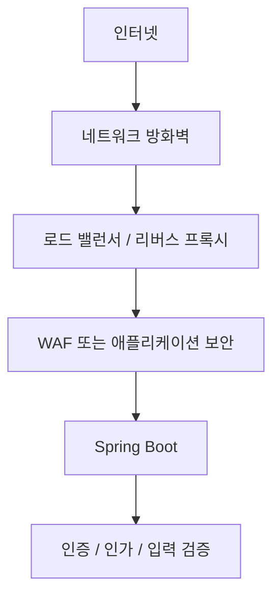

각 구성 요소는 서로 다른 보안 문제를 해결한다.

방화벽은 접근 가능한 네트워크 경로를 제한한다.

WAF는 웹 요청의 특성을 분석해 특정 공격 패턴을 차단하는 데 활용할 수 있다.

Spring Security는 애플리케이션의 인증과 인가를 구현하는 데 사용된다.

또 입력 검증과 데이터 접근 제어도 필요하다.

따라서 특정 포트를 외부에 공개할 때는 방화벽 설정뿐 아니라 애플리케이션 자체의 보안도 함께 검토해야 한다.

---

### 네트워크 통신의 전체 흐름을 이해해 보자

이제 지금까지 살펴본 개념들을 하나의 상황으로 연결해 보자.

우가가 자신의 컴퓨터에서 Spring Boot 서버를 실행했다고 가정하자.

서버 설정은 다음과 같다.

```yaml
server:
  address: 0.0.0.0
  port: 8080
```

우가의 컴퓨터는 다음 사설 IP를 사용한다.

```text
192.168.0.10
```

공유기의 내부 주소는 다음과 같다.

```text
192.168.0.1
```

공유기의 공인 IP는 예시로 다음과 같이 가정한다.

```text
203.0.113.10
```

공유기에서는 다음 포트포워딩 규칙을 적용했다.

```text
외부 TCP 18080

↓

내부 192.168.0.10:8080
```

이제 외부 클라이언트는 다음 주소로 요청을 보낸다.

```http
GET http://203.0.113.10:18080/api/hello
```

이 요청의 전체 흐름을 살펴보자.

---

### 1단계: 클라이언트가 목적지를 확인한다

클라이언트는 요청하려는 목적지의 IP 주소와 포트를 확인한다.

```text
목적지 IP

203.0.113.10


목적지 포트

18080


프로토콜

TCP
```

도메인 이름이 사용되었다면 먼저 DNS 조회가 필요할 수 있다.

이번에는 IP 주소를 직접 사용하므로 도메인 이름을 해석하는 과정은 생략한다.

---

### 2단계: 로컬 네트워크에서 다음 홉을 결정한다

클라이언트는 목적지 IP가 자신의 로컬 서브넷에 속하는지 확인한다.

다른 네트워크라면 라우팅 테이블에 따라 적절한 다음 홉을 선택한다.

일반적인 가정용 네트워크에서는 기본 게이트웨이가 사용될 수 있다.

필요하다면 ARP를 통해 다음 홉의 MAC 주소를 알아낸다.

이후 패킷을 로컬 링크로 전달한다.

---

### 3단계: TCP 연결을 설정한다

일반적인 HTTP/1.1 통신에서는 TCP 연결을 먼저 설정한다.

TCP 연결 설정 과정은 흔히 3-Way Handshake라고 부른다.

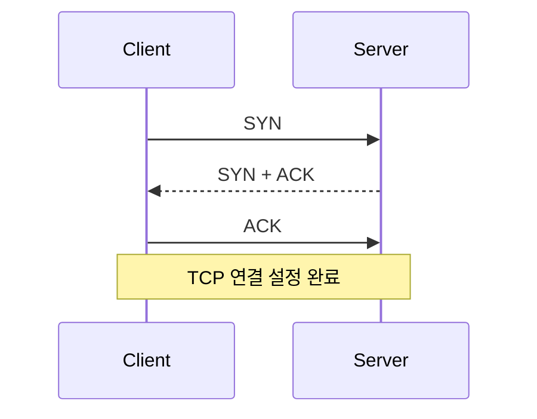

여기서 TCP는 연결 설정과 데이터 전송을 위한 전송 계층 프로토콜이다.

네트워크 중간에 NAT 장비가 존재한다면 TCP 연결 설정에 필요한 패킷 역시 NAT 변환을 거칠 수 있다.

---

### 4단계: 인터넷을 통해 서버 네트워크로 전달된다

클라이언트가 전송한 IP 패킷은 여러 라우터를 통과할 수 있다.

각 라우터는 목적지 IP와 자신의 라우팅 테이블을 기준으로 다음 홉을 선택한다.

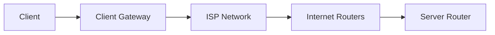

이때 라우터는 일반적으로 최종 애플리케이션의 비즈니스 로직을 알 필요가 없다.

목적지 IP를 기반으로 패킷을 전달한다.

실제 경로는 네트워크 구성과 라우팅 정책에 따라 달라질 수 있다.

---

### 5단계: 공유기에서 포트포워딩을 수행한다

요청이 우가의 공유기까지 도달했다고 가정하자.

공유기는 다음 목적지로 들어온 패킷을 확인한다.

```text
203.0.113.10:18080
```

그리고 포트포워딩 규칙을 적용한다.

```text
192.168.0.10:8080
```

요청의 목적지 주소와 포트를 내부 서버에 맞게 변환해 전달한다.

---

### 6단계: 운영체제가 올바른 소켓에 전달한다

패킷이 우가의 컴퓨터에 도착한다.

운영체제는 TCP 연결과 로컬 주소, 포트 등의 정보를 기반으로 해당 연결을 수신하는 소켓에 데이터를 전달한다.

Spring Boot의 내장 웹 서버가 TCP 8080 포트에서 연결을 수신하고 있다면 해당 요청을 처리할 수 있다.

```text
192.168.0.10:8080

↓

Spring Boot

↓

DispatcherServlet

↓

Controller
```

Controller가 다음 메서드를 실행한다고 가정하자.

```java
@GetMapping("/api/hello")
public String hello() {
    return "Hello Network";
}
```

응답은 다음과 같다.

```text
Hello Network
```

---

### 7단계: 응답이 클라이언트로 돌아간다

Spring Boot는 HTTP 응답을 생성한다.

이 응답은 TCP와 IP를 통해 다시 클라이언트로 전달된다.

중간의 NAT 공유기는 기존 연결 상태를 이용해 필요한 역방향 주소 및 포트 변환을 수행한다.

결과적으로 클라이언트는 요청한 서버에서 보낸 응답을 받을 수 있다.

전체 구조는 다음과 같다.

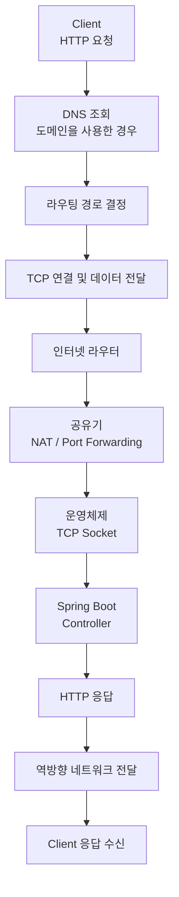

이 구조를 이해하면 IP, Port, Router, NAT, Firewall이 각각 어떤 역할을 수행하는지 연결해서 생각할 수 있다.

---

### 네트워크 장애를 분석하는 방법

이제 Spring Boot 서버에 접속할 수 없다는 상황을 생각해 보자.

예를 들어 다음 명령을 실행했다.

```bash
curl http://192.168.0.10:8080/api/hello
```

그런데 응답이 오지 않는다.

이때 무작정 Spring Boot 코드부터 수정하는 것은 효율적이지 않다.

네트워크 문제는 여러 계층에서 발생할 수 있기 때문이다.

따라서 단계적으로 확인해야 한다.

---

### 1. 서버 프로세스가 실행 중인지 확인한다

먼저 Spring Boot 애플리케이션이 실행 중인지 확인한다.

```bash
ps aux | grep java
```

이 명령은 실행 중인 프로세스 목록에서 `java` 문자열이 포함된 항목을 찾는다.

`ps aux`는 프로세스 목록을 출력한다.

`grep java`는 그중 Java 관련 문자열을 검색한다.

다만 Java 프로세스가 존재한다는 사실만으로 원하는 Spring Boot 서버가 정상적으로 요청을 처리하고 있다고 판단할 수는 없다.

다음 단계에서 실제 포트의 상태를 확인해야 한다.

---

### 2. 포트가 LISTEN 상태인지 확인한다

macOS나 Linux에서는 다음 명령을 사용할 수 있다.

```bash
lsof -nP -iTCP:8080 -sTCP:LISTEN
```

각 옵션의 의미는 다음과 같다.

| 옵션             | 의미                      |
| -------------- | ----------------------- |
| `-n`           | 호스트 이름 해석 생략            |
| `-P`           | 포트 번호를 서비스 이름으로 변환하지 않음 |
| `-iTCP:8080`   | TCP 8080 포트 확인          |
| `-sTCP:LISTEN` | 연결을 수신 중인 소켓만 조회        |

예상 결과는 환경에 따라 다음과 비슷할 수 있다.

```text
COMMAND  PID   USER   FD   TYPE  NAME
java     1234  user   42u  IPv4  TCP *:8080 (LISTEN)
```

여기서 중요한 부분은 다음과 같다.

```text
TCP *:8080 (LISTEN)
```

일반적으로 TCP 8080 포트에서 연결을 수신하고 있다는 의미다.

만약 다음처럼 표시된다면 어떨까?

```text
TCP 127.0.0.1:8080 (LISTEN)
```

이 경우 서버가 IPv4 루프백 주소에만 바인딩되어 있을 수 있다.

따라서 다른 컴퓨터에서 접속하지 못하는 원인이 될 수 있다.

Linux에서는 다음 명령도 사용할 수 있다.

```bash
ss -lntp
```

이 명령은 TCP LISTEN 소켓과 관련 프로세스 정보를 확인하는 데 사용한다.

---

### 3. 서버의 실제 사설 IP를 확인한다

macOS에서 Wi-Fi 인터페이스가 `en0`인 경우 다음 명령을 사용할 수 있다.

```bash
ipconfig getifaddr en0
```

예상 결과는 다음과 같다.

```text
192.168.0.10
```

다만 인터페이스 이름은 환경에 따라 다를 수 있다.

Linux에서는 다음 명령을 사용할 수 있다.

```bash
ip -4 addr
```

이 명령은 네트워크 인터페이스에 할당된 IPv4 주소를 확인한다.

여기서 확인한 IP를 이용해 다른 컴퓨터에서 접속해야 한다.

---

### 4. 기본 게이트웨이를 확인한다

Linux에서는 다음 명령을 사용할 수 있다.

```bash
ip route
```

예상 결과는 다음과 비슷할 수 있다.

```text
default via 192.168.0.1 dev eth0

192.168.0.0/24 dev eth0
```

첫 번째 줄은 기본 경로의 다음 홉이 `192.168.0.1`이라는 의미다.

두 번째 줄은 `192.168.0.0/24` 네트워크가 해당 인터페이스에 직접 연결되어 있다는 의미다.

macOS에서는 다음 명령을 사용할 수 있다.

```bash
route -n get default
```

출력되는 `gateway` 항목에서 기본 게이트웨이를 확인할 수 있다.

---

### 5. 목적지 포트에 연결할 수 있는지 확인한다

다른 컴퓨터에서 다음 명령을 실행한다.

```bash
nc -vz 192.168.0.10 8080
```

`nc`는 Netcat이다.

`-v`는 자세한 출력 모드다.

`-z`는 데이터를 실제로 주고받기보다 포트 연결 가능 여부를 확인하는 방식으로 사용된다.

연결에 성공하면 환경에 따라 다음과 비슷한 결과가 나타날 수 있다.

```text
Connection to 192.168.0.10 port 8080 [tcp/*] succeeded!
```

이는 TCP 연결이 가능하다는 의미다.

하지만 HTTP API까지 정상적으로 동작한다는 사실을 보장하지는 않는다.

따라서 다음 단계에서 실제 HTTP 요청을 확인해야 한다.

---

### 6. HTTP 요청 자체를 확인한다

다음 명령을 사용한다.

```bash
curl -v http://192.168.0.10:8080/api/hello
```

`-v`는 요청과 응답에 관한 상세 정보를 출력한다.

정상적인 경우 다음과 같은 결과를 확인할 수 있다.

```text
* Connected to 192.168.0.10
> GET /api/hello HTTP/1.1
> Host: 192.168.0.10:8080

< HTTP/1.1 200

Hello Network
```

실제 출력에는 User-Agent, Content-Type 등 더 많은 정보가 포함될 수 있다.

여기서 각 결과의 의미를 구분해야 한다.

TCP 연결이 성공했다면 네트워크 연결 자체는 가능하다.

HTTP 200이 반환되었다면 서버가 요청을 정상 처리한 것이다.

HTTP 404라면 서버에 연결했지만 요청한 경로를 찾지 못했을 가능성이 있다.

HTTP 500이라면 애플리케이션 내부 처리 중 오류가 발생했을 가능성이 있다.

즉 네트워크 연결 실패와 애플리케이션 처리 실패는 구분해서 분석해야 한다.

---

### Connection Refused와 Timeout은 무엇이 다를까?

네트워크 문제를 분석할 때 자주 등장하는 두 가지 오류가 있다.

#### Connection Refused

연결 요청에 대해 연결을 거부하는 응답이 돌아온 경우다.

대표적으로 해당 주소와 포트에서 연결을 수신하는 서비스가 없거나, 네트워크 장비가 명시적으로 거부했을 때 발생할 수 있다.

```text
Connection refused
```

확인해야 할 사항은 다음과 같다.

* 서버 프로세스 실행 여부
* 포트 LISTEN 여부
* 바인딩 주소
* 방화벽의 거부 정책

#### Connection Timeout

정해진 시간 안에 연결이 완료되지 않은 경우다.

```text
Connection timed out
```

대표적으로 다음 원인을 생각할 수 있다.

* 패킷이 네트워크에서 차단됨
* 목적지 라우팅 문제
* NAT 또는 포트포워딩 문제
* 서버나 중간 장비의 응답 지연
* 방화벽의 패킷 폐기 정책

하지만 Timeout이라고 해서 반드시 방화벽 문제라고 단정할 수는 없다.

실제 원인은 네트워크 경로와 장비 상태를 확인해야 한다.

| 오류                     | 우선적으로 의심할 부분             |
| ---------------------- | ------------------------ |
| Connection Refused     | 서버 LISTEN 여부, 포트, 명시적 거부 |
| Connection Timeout     | 라우팅, 방화벽, NAT, 응답 지연     |
| HTTP 404               | 요청 경로와 라우팅 설정            |
| HTTP 500               | 애플리케이션 내부 오류             |
| DNS Resolution Failure | DNS 설정과 도메인 해석           |
| TLS Handshake Failure  | 인증서, TLS 설정, 프로토콜 호환성    |

이처럼 오류가 발생한 계층을 먼저 분리하면 문제를 훨씬 빠르게 좁힐 수 있다.

---

### 실제 포트포워딩 문제를 분석하는 순서

외부에서 Spring Boot 서버에 접속되지 않는다고 가정하자.

먼저 같은 컴퓨터에서 확인한다.

```bash
curl http://localhost:8080/api/hello
```

성공한다면 애플리케이션이 로컬에서 응답하고 있다는 의미다.

다음으로 같은 LAN의 다른 컴퓨터에서 확인한다.

```bash
curl http://192.168.0.10:8080/api/hello
```

이 요청도 성공한다면 내부 네트워크에서 서버에 접근할 수 있다는 의미다.

그다음 외부 네트워크에서 공유기의 공인 IP와 포트포워딩 포트로 접속해 본다.

```text
http://공인IP:18080/api/hello
```

여기서 실패한다면 다음을 확인한다.

공유기 포트포워딩 규칙이 올바른가?

서버의 사설 IP가 변경되지 않았는가?

공유기의 WAN 주소가 실제 공인 IPv4인가?

CGNAT 환경인가?

공유기 방화벽이 외부 연결을 허용하는가?

인터넷 서비스 제공자가 해당 연결을 제한하는가?

또한 외부 접속 테스트는 실제로 다른 네트워크에서 수행하는 것이 좋다.

같은 집에서 공유기의 공인 IP로 접속하는 방식은 NAT Loopback 또는 Hairpin NAT 지원 여부에 영향을 받을 수 있기 때문이다.

따라서 외부 접속 여부를 확인할 때는 스마트폰의 모바일 데이터처럼 별도의 네트워크를 이용할 수 있다.

단, 실제 서버를 인터넷에 공개하기 전에는 인증과 접근 제어 등 필요한 보안 설정을 먼저 적용해야 한다.

---

### NAT Loopback(Hairpin NAT)이란 무엇인가?

NAT Loopback은 내부 네트워크의 장치가 공유기의 외부 주소를 이용해 다시 내부 서버에 접근할 수 있도록 하는 기능이다.

예를 들어 다음과 같은 상황을 생각해 보자.

```text
내부 클라이언트

192.168.0.20


내부 서버

192.168.0.10


공유기 공인 IP

203.0.113.10
```

포트포워딩 규칙은 다음과 같다.

```text
203.0.113.10:18080

↓

192.168.0.10:8080
```

같은 내부 네트워크의 클라이언트가 다음 주소로 접속하려고 한다.

```text
203.0.113.10:18080
```

이때 공유기가 Hairpin NAT를 지원한다면 내부에서 외부 주소를 통해 다시 내부 서버로 연결할 수 있다.

하지만 해당 기능을 지원하지 않거나 관련 설정이 비활성화되어 있다면 접속에 실패할 수 있다.

이 경우 외부에서는 정상적으로 접속되는데 내부에서 공인 IP를 사용하면 실패하는 현상이 발생할 수 있다.

따라서 다음 두 상황은 서로 다르다.

```text
내부에서 공인 IP 접속 실패
```

```text
외부에서 공인 IP 접속 실패
```

첫 번째 상황만으로 포트포워딩이 잘못되었다고 단정해서는 안 된다.

---

### 실무에서 네트워크를 이해하고 활용하는 12가지 방법

지금까지 살펴본 네트워크 개념은 단순히 가정용 공유기를 설정하는 데만 사용되는 것이 아니다.

백엔드 시스템을 개발하고 운영할 때도 직접적으로 활용할 수 있다.

#### 1. IP와 Port를 하나의 주소로 생각하지 않는다

IP 주소와 포트는 서로 다른 계층의 식별 정보다.

IP는 네트워크에서 목적지를 찾는 데 사용된다.

포트는 TCP/UDP 통신의 종점을 구분하는 데 사용된다.

따라서 네트워크 문제를 분석할 때는 먼저 IP에 도달할 수 있는지와 해당 포트에서 연결을 수신하고 있는지를 구분해야 한다.

예를 들어 서버에 Ping이 성공하더라도 TCP 8080 포트가 열려 있다는 뜻은 아니다.

반대로 Ping에 실패해도 ICMP가 차단된 환경에서는 TCP 연결이 정상적으로 동작할 수 있다.

#### 2. 서버 바인딩 주소를 확인한다

Spring Boot를 실행했는데 다른 컴퓨터에서 접속할 수 없다면 서버가 어떤 주소에 바인딩되어 있는지 확인해야 한다.

`127.0.0.1`과 `0.0.0.0`의 차이를 이해하는 것이 중요하다.

다만 `0.0.0.0` 바인딩은 모든 IPv4 로컬 인터페이스에서 연결을 받을 수 있게 하는 설정이므로 불필요한 외부 노출 위험을 함께 고려해야 한다.

특히 개발용 관리자 API나 테스트 서버를 인터넷에 그대로 공개해서는 안 된다.

#### 3. 서버 포트와 클라이언트 출발지 포트를 구분한다

HTTP 서버가 TCP 8080 포트를 사용한다고 해서 클라이언트도 TCP 8080 포트를 사용하는 것은 아니다.

클라이언트는 일반적으로 운영체제가 선택한 임시 출발지 포트를 사용할 수 있다.

예를 들어 다음과 같다.

```text
Client

192.168.0.20:51000


Server

192.168.0.10:8080
```

서버는 TCP 8080에서 연결을 수신한다.

클라이언트는 TCP 51000을 출발지 포트로 사용한다.

이러한 구분은 NAT 테이블과 TCP 연결 상태를 분석할 때 중요하다.

#### 4. 서브넷과 라우팅 테이블을 이해한다

서로 다른 서버가 통신하지 못할 때 반드시 애플리케이션 오류인 것은 아니다.

두 서버가 서로 다른 네트워크에 있다면 적절한 라우팅 경로가 필요하다.

예를 들어 클라우드 환경에서 서로 다른 서브넷에 있는 서버가 통신할 때는 라우팅 테이블과 보안 정책을 함께 확인해야 한다.

CIDR과 기본 게이트웨이의 의미를 이해하면 이러한 문제를 분석하기 쉬워진다.

#### 5. 사설 IP는 인터넷에서 직접 접근할 수 있다고 가정하지 않는다

사설 IP는 여러 네트워크에서 반복해서 사용할 수 있다.

따라서 인터넷의 일반적인 라우팅을 통해 특정 사설 IP에 직접 접근할 수 있다고 생각해서는 안 된다.

외부에서 접근해야 하는 서비스라면 적절한 라우팅, NAT, VPN 또는 리버스 프록시 등의 구조를 설계해야 한다.

클라우드의 Private Subnet에 배치한 데이터베이스 역시 동일한 관점에서 이해할 수 있다.

#### 6. NAT가 보안 정책을 대신한다고 생각하지 않는다

NAT는 주소 변환 기술이다.

일반적인 가정용 공유기에서는 미요청 인바운드 트래픽이 기본적으로 차단되기도 하지만, 이는 NAT의 동작과 연결 추적 및 방화벽 정책이 함께 만들어내는 결과일 수 있다.

따라서 NAT가 존재한다는 사실만으로 서비스의 보안이 보장된다고 생각해서는 안 된다.

외부에 공개하는 포트는 최소한으로 제한하고, 인증과 인가, 암호화도 함께 고려해야 한다.

#### 7. 포트포워딩과 방화벽을 각각 확인한다

외부 접속이 실패하는 상황에서는 포트포워딩만 확인해서는 안 된다.

공유기의 외부 포트와 내부 서버의 포트가 올바르게 연결되어 있는지 확인해야 한다.

또 공유기 방화벽과 서버 운영체제 방화벽이 해당 트래픽을 허용하는지 확인해야 한다.

이 두 영역은 서로 다른 역할을 수행한다.

#### 8. DHCP로 인해 내부 서버의 IP가 변경될 수 있음을 고려한다

포트포워딩은 특정 내부 주소를 대상으로 설정하는 경우가 많다.

그런데 DHCP에서 새로운 IP가 할당되면 기존 포트포워딩 규칙이 잘못된 서버를 가리킬 수 있다.

따라서 장기간 운영하는 내부 서버라면 DHCP 예약이나 적절한 고정 주소 정책을 고려해야 한다.

서버 운영 환경에서는 주소 관리 방식도 서비스 안정성의 일부다.

#### 9. DNS 장애와 서버 장애를 구분한다

사용자가 도메인 이름으로 접속하지 못하더라도 서버 자체는 정상적으로 실행 중일 수 있다.

이 경우 DNS 조회가 올바르게 이루어지는지 확인해야 한다.

예를 들어 다음 명령을 사용할 수 있다.

```bash
dig +short example.com
```

이 명령은 도메인에 대한 DNS 응답을 간결하게 확인하는 데 사용된다.

기본적으로 A 레코드 조회 결과를 확인할 수 있다.

실제 출력되는 IP 주소는 DNS 구성과 조회 시점에 따라 달라질 수 있다.

도메인 해석이 정상적인지와 해당 IP의 서버가 실제로 연결을 수신하는지는 별도로 확인해야 한다.

#### 10. CGNAT 여부를 확인한다

개인 네트워크에서 서버를 공개할 때 외부 연결이 실패한다면 CGNAT 환경인지 확인해야 한다.

공유기의 WAN IP가 `100.64.0.0/10`에 속하거나 공인 IPv4가 아닌 주소인 경우 추가적인 주소 변환이 존재할 수 있다.

이런 환경에서는 공유기 포트포워딩만으로 외부 연결이 가능하지 않을 수 있다.

따라서 서버를 외부에 공개해야 하는 요구사항이 있다면 공인 IPv4 제공 여부나 대체 연결 방식을 함께 검토해야 한다.

#### 11. IPv6 환경에서는 주소와 방화벽 정책을 함께 확인한다

IPv6는 넓은 주소 공간을 제공한다.

따라서 IPv4와 동일한 방식의 주소 공유가 필요하지 않을 수 있다.

하지만 글로벌 IPv6 주소가 존재한다고 외부에서 해당 서비스에 자동으로 접속할 수 있는 것은 아니다.

라우팅 경로와 방화벽 정책이 올바르게 구성되어야 한다.

또 IPv4와 IPv6를 함께 사용하는 Dual Stack 환경에서는 두 주소 체계의 설정 차이도 확인해야 한다.

#### 12. 네트워크 장애를 계층별로 분리해서 분석한다

네트워크 문제가 발생하면 가장 먼저 어느 계층에서 실패했는지 파악해야 한다.

예를 들어 다음과 같이 구분할 수 있다.

```text
DNS 실패

→ 이름 해석 문제


IP 도달 실패

→ 주소 또는 라우팅 문제


TCP 연결 실패

→ 포트, 방화벽, NAT, 서버 LISTEN 문제


TLS 실패

→ 인증서 또는 보안 프로토콜 문제


HTTP 404

→ 애플리케이션 라우팅 문제


HTTP 500

→ 애플리케이션 처리 문제
```

이처럼 문제를 계층별로 분리하면 불필요한 추측을 줄일 수 있다.

특히 Spring Boot 애플리케이션이 다른 서비스와 통신하는 환경에서는 네트워크 계층의 오류와 애플리케이션 계층의 오류를 구분하는 것이 중요하다.

---

### 네트워크 설계를 다시 생각해 보자

지금까지 살펴본 네트워크 구조를 조금 더 넓은 관점에서 생각해 보자.

예를 들어 Spring Boot 서버를 외부에 공개해야 한다고 가정하자.

가장 단순한 방법은 서버를 공인 IP가 연결된 네트워크에 배치하고 필요한 포트를 허용하는 것이다.

하지만 이 방법이 항상 좋은 설계일까?

서버가 직접 인터넷에 노출된다면 불필요한 요청이나 공격 트래픽에 더 직접적으로 노출될 수 있다.

또 여러 서버를 운영하거나 TLS 인증서, 접근 제어, 배포 변경 등을 관리해야 하는 상황에서는 구조가 복잡해질 수 있다.

이런 경우에는 리버스 프록시나 로드 밸런서를 도입하는 구조를 고려할 수 있다.

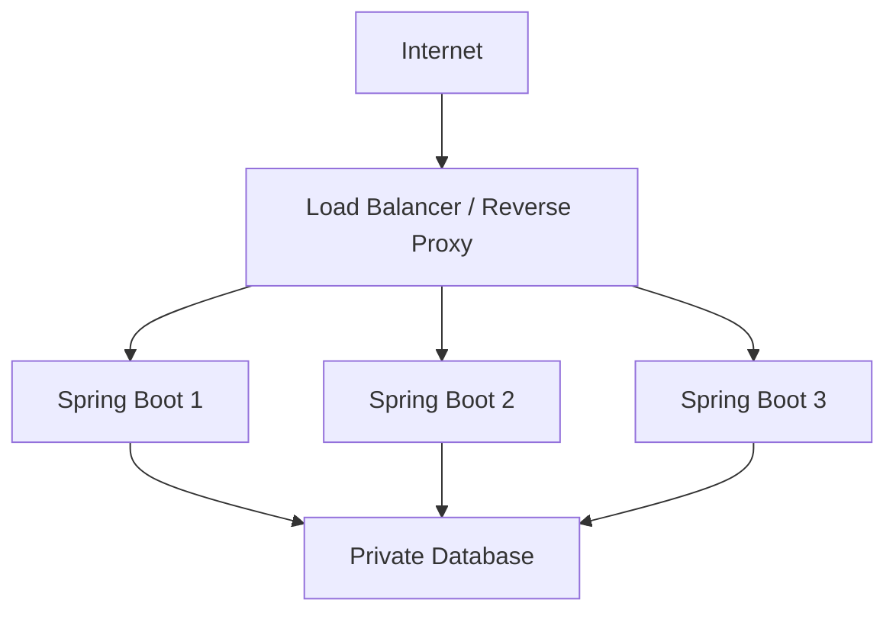

이 구조에서는 외부 클라이언트가 직접 각 Spring Boot 인스턴스에 접속하지 않아도 된다.

리버스 프록시나 로드 밸런서가 요청을 받아 적절한 서버로 전달할 수 있다.

또 내부 데이터베이스는 사설 네트워크에 배치하고 외부에서 직접 접근하지 못하도록 제한할 수 있다.

이러한 설계에는 네트워크에서 살펴본 개념들이 그대로 사용된다.

IP 주소는 서버를 식별하는 데 사용된다.

포트는 서비스의 통신 종점을 구분한다.

라우터는 서로 다른 네트워크를 연결한다.

NAT는 필요한 경우 주소와 포트를 변환한다.

방화벽은 허용할 통신을 제한한다.

DNS는 클라이언트가 서비스의 이름을 사용하도록 돕는다.

즉 네트워크의 기본 개념을 이해하면 단순히 개인 서버를 실행하는 것을 넘어 실제 서비스 아키텍처도 더 정확하게 이해할 수 있다.

---

### 네트워크 개념의 전체 구조

지금까지의 내용을 하나의 구조로 정리하면 다음과 같다.

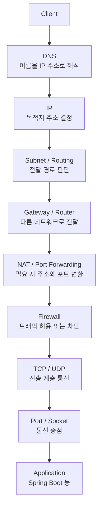

이 도식은 이해를 위해 논리적인 역할을 순서대로 배치한 것이다.

실제로 DNS는 별도의 네트워크 질의를 통해 수행될 수 있고, IP 라우팅과 NAT, 방화벽, 전송 계층 처리는 각 장치와 운영체제에서 다양한 순서로 상호작용한다.

따라서 모든 패킷이 위 구성 요소를 정확히 한 번씩 같은 순서로 통과한다는 의미는 아니다.

핵심은 각 기술이 담당하는 책임을 구분하는 것이다.

---

### 정리

네트워크는 여러 장치가 연결되어 데이터를 주고받기 위한 통신 시스템이다.

네트워크에는 케이블과 스위치, 라우터 같은 물리적인 구성 요소뿐 아니라 IP, TCP, UDP, HTTP 같은 논리적인 통신 규칙도 포함된다.

네트워크 통신을 이해할 때 가장 먼저 알아야 하는 개념은 클라이언트와 서버다.

클라이언트는 요청을 보내고 서버는 요청을 처리하는 역할을 수행한다.

클라이언트가 서버에 접속하려면 목적지를 식별할 수 있어야 한다.

이때 IP 주소가 사용된다.

IP는 네트워크에서 패킷을 전달하기 위한 프로토콜이며, IP 주소는 해당 프로토콜에서 사용하는 논리적 주소다.

IPv4는 32비트 주소를 사용하므로 전체 주소 공간이 약 42억 9천만 개로 제한된다.

이러한 주소 공간의 한계를 완화하기 위해 사설 IP와 NAT, IPv6 같은 기술이 사용된다.

포트는 TCP나 UDP에서 통신 종점을 구분하는 번호다.

같은 IP 주소에서 여러 서비스가 실행되더라도 각각 다른 포트를 사용할 수 있다.

LAN은 일반적으로 제한된 지역에서 구성되는 네트워크다.

WAN은 넓은 지역의 네트워크를 연결하는 개념이다.

같은 로컬 서브넷에서는 ARP 등을 이용해 다음 홉의 MAC 주소를 확인하고 통신할 수 있다.

다른 네트워크에 접근할 때는 라우팅 테이블에 따라 적절한 경로를 선택하며, 필요한 경우 기본 게이트웨이를 사용한다.

공인 IPv4는 일반적인 인터넷에서 라우팅 가능한 주소를 의미한다.

사설 IPv4는 사설 네트워크에서 사용하도록 예약된 주소다.

NAT는 IP 주소를 변환하는 기술이다.

가정용 공유기에서 널리 사용하는 NAPT는 IP 주소와 포트를 함께 변환해 여러 내부 장치가 하나의 공인 IPv4 주소를 공유하도록 할 수 있다.

하지만 외부에서 내부 서버에 접속하려면 기존의 아웃바운드 NAT 매핑만으로는 부족할 수 있다.

이때 포트포워딩을 이용해 특정 외부 포트로 들어온 연결을 내부 서버로 전달하도록 설정할 수 있다.

단, 실제 연결이 성공하려면 포트포워딩 규칙뿐 아니라 서버의 바인딩 주소와 방화벽, 네트워크 라우팅, 통신사업자의 연결 정책 등이 올바르게 구성되어야 한다.

CGNAT 환경에서는 가정용 공유기보다 상위 네트워크에서 NAT가 추가로 수행되므로 공유기 포트포워딩만으로 외부 접근이 어려울 수 있다.

방화벽은 네트워크 트래픽에 접근 제어 정책을 적용하는 기능이다.

NAT와 방화벽은 함께 사용되지만 서로 다른 역할을 수행한다.

또 방화벽 하나만으로 모든 네트워크 공격을 방지할 수는 없다.

DoS나 DDoS 같은 공격에 대응하려면 공격의 종류와 규모에 맞는 네트워크 및 애플리케이션 보안 전략이 필요하다.

주요 개념을 다시 비교하면 다음과 같다.

| 개념              | 핵심 역할                       |
| --------------- | --------------------------- |
| IP              | 패킷의 주소 지정과 전달 규칙            |
| IP Address      | 네트워크 통신에 사용하는 논리적 주소        |
| Port            | TCP/UDP 통신 종점 식별            |
| TCP             | 신뢰성 있는 바이트 스트림 통신           |
| UDP             | 데이터그램 기반 통신                 |
| MAC Address     | 링크 계층의 주소                   |
| ARP             | IPv4 주소에 대한 로컬 링크 주소 확인     |
| Subnet          | IP 네트워크의 논리적인 범위            |
| Gateway         | 다른 네트워크로 전달할 때 사용하는 다음 홉    |
| LAN             | 제한된 영역의 네트워크                |
| WAN             | 넓은 영역을 연결하는 네트워크            |
| Public IP       | 일반적인 글로벌 인터넷 라우팅에 사용 가능한 주소 |
| Private IP      | 사설 네트워크용으로 예약된 주소           |
| DHCP            | 네트워크 설정 자동 할당               |
| DNS             | 도메인 이름에 대한 주소 등 조회          |
| NAT             | 네트워크 주소 변환                  |
| NAPT            | IP 주소와 TCP/UDP 포트 변환        |
| Port Forwarding | 외부 연결을 지정한 내부 서비스로 전달       |
| Firewall        | 네트워크 트래픽 접근 제어              |
| CGNAT           | 통신사업자 수준의 주소 변환             |
| IPv6            | 128비트 IP 주소 체계              |

결국 백엔드 개발자가 네트워크를 이해해야 하는 이유는 단순히 개념을 알아두기 위해서가 아니다.

실제 애플리케이션은 항상 다른 시스템과 통신하기 때문이다.

Spring Boot 서버는 클라이언트의 HTTP 요청을 받는다.

애플리케이션은 데이터베이스와 Redis에 연결한다.

외부 결제 API를 호출한다.

메시지 브로커에 메시지를 발행한다.

클라우드 환경에서는 여러 서브넷과 라우터, 로드 밸런서, 방화벽을 거쳐 통신한다.

이러한 과정에서 문제가 발생했을 때 네트워크 구조를 이해하고 있다면 어느 지점에서 통신이 실패했는지 더 빠르게 파악할 수 있다.

**네트워크를 이해한다는 것은 단순히 IP 주소와 포트 번호를 아는 것이 아니라, 데이터가 출발지에서 목적지까지 어떤 경로와 규칙을 통해 전달되는지 설명할 수 있다는 의미다.**

#### 한 줄 요약

**네트워크 통신에서는 IP 주소로 목적지를 찾고, TCP/UDP 포트로 통신 종점을 구분하며, 서브넷과 라우팅을 통해 전달 경로를 결정한다. 사설 IPv4 환경에서는 NAT와 포트포워딩을 통해 외부 통신을 구성할 수 있고, 방화벽은 접근을 제어한다. 이러한 구조를 이해하면 Spring Boot 서버의 외부 접속 문제부터 클라우드 네트워크 아키텍처와 실제 서비스의 통신 장애까지 체계적으로 분석할 수 있다.**
