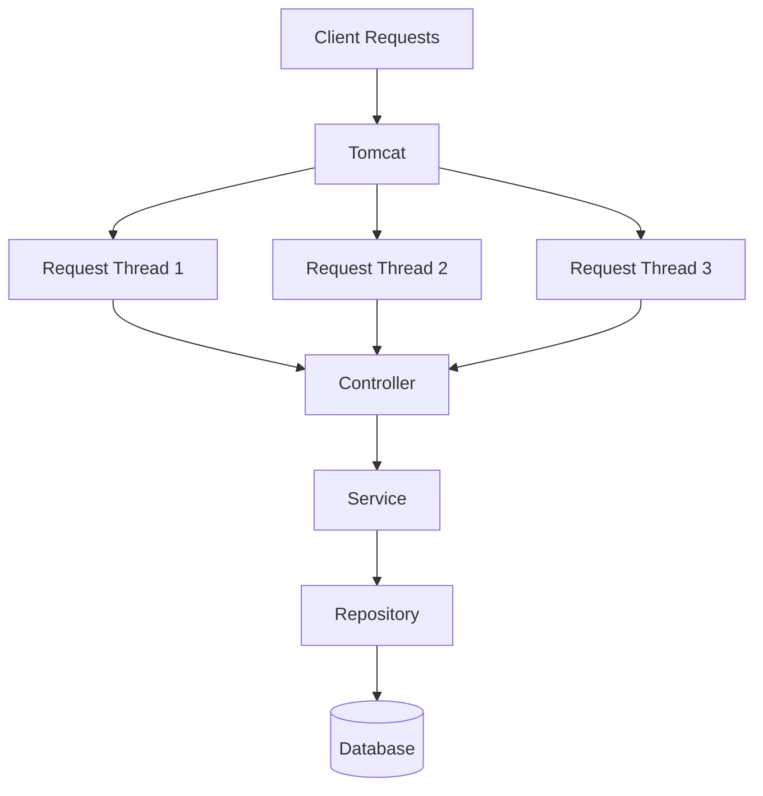
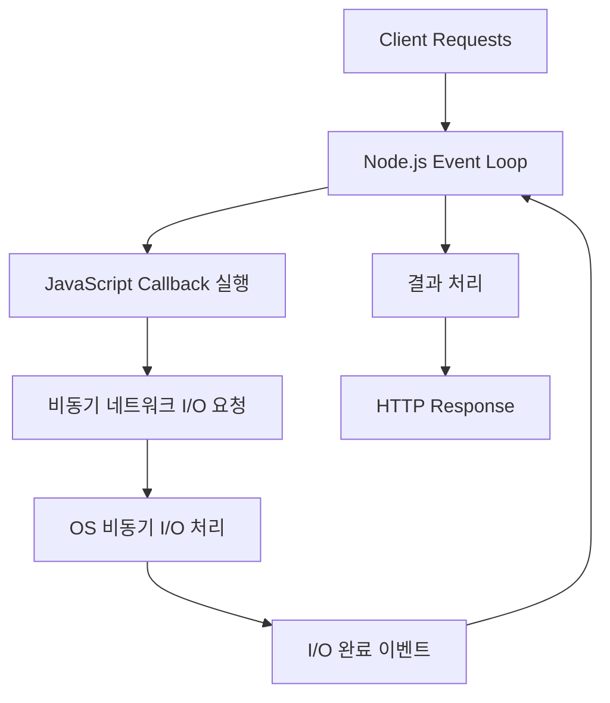
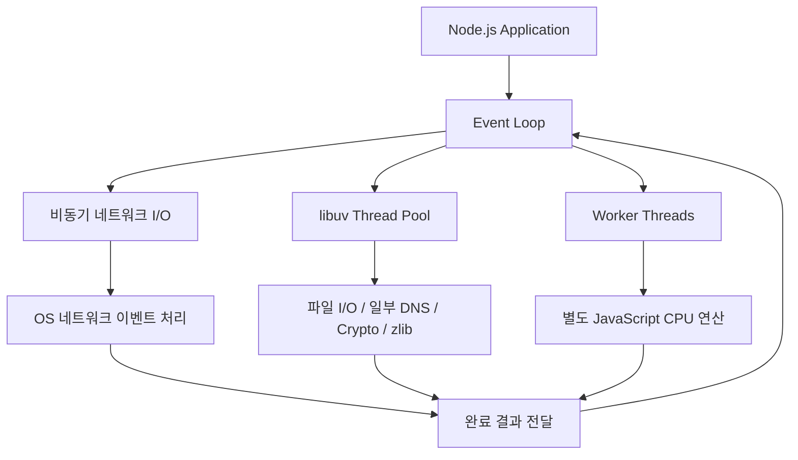
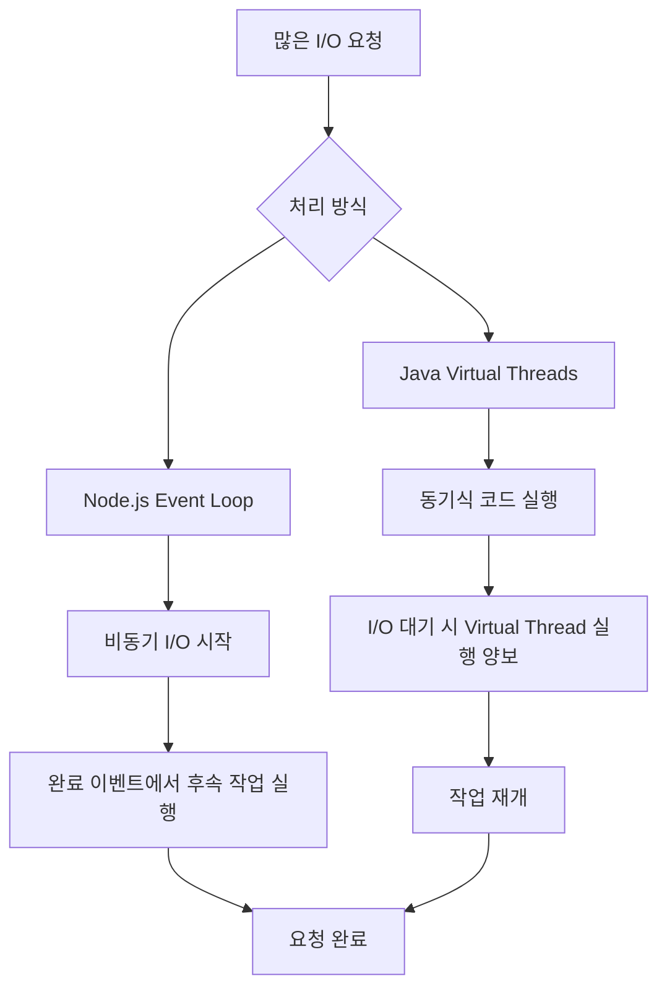
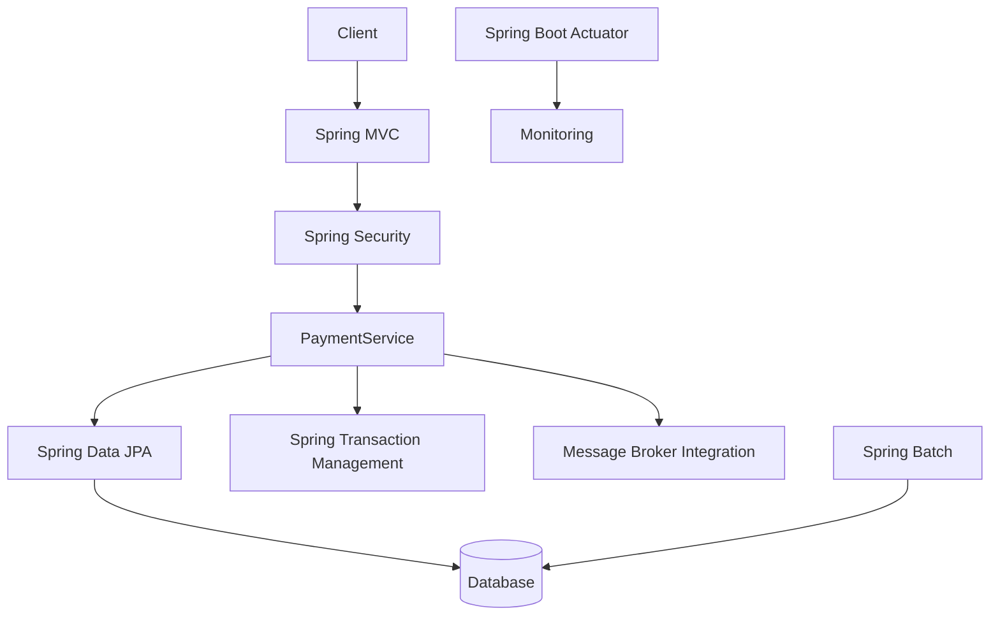
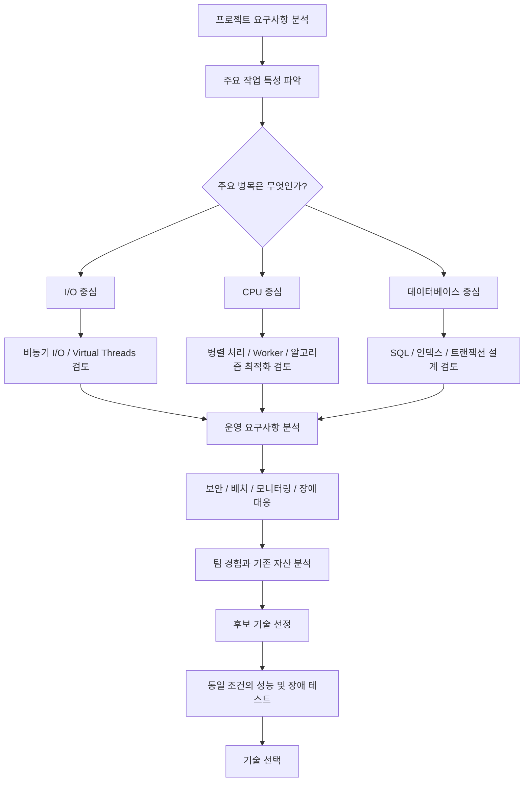

# 체체의 우리가 스프링 프레임워크를 사용하는 이유는 무엇인가?
[https://youtu.be/hqwDRhO4vUA?si=6q7PzpEK6MmuJewm](https://youtu.be/hqwDRhO4vUA?si=6q7PzpEK6MmuJewm)

# 체체의 우리가 스프링 프레임워크를 사용하는 이유는 무엇인가?
* toc
{:toc}

---

### Java와 Spring Framework를 사용하는 이유: Spring MVC와 Node.js의 성능, 안정성, 아키텍처 비교

백엔드 애플리케이션을 개발할 때 가장 먼저 결정해야 하는 것 중 하나는 어떤 언어와 프레임워크를 사용할 것인가이다.

Java와 Spring Boot를 사용할 수도 있고, JavaScript 또는 TypeScript와 Node.js를 사용할 수도 있다.

Python의 Django나 FastAPI, Go의 표준 라이브러리나 웹 프레임워크를 선택하는 것도 가능하다.

그런데 Java와 Spring Boot를 사용하는 개발자라면 한 번쯤 다음 질문을 생각해 볼 필요가 있다.

**왜 Java와 Spring Framework를 사용하는 것일까?**

기업에서 많이 사용하기 때문일까?

오랜 기간 사용되어 안정적이기 때문일까?

성능이 다른 프레임워크보다 뛰어나기 때문일까?

아니면 복잡한 비즈니스 요구사항을 처리하는 데 적합하기 때문일까?

모두 어느 정도 관련이 있지만, 특정 이유 하나만으로 설명하기는 어렵다.

실제로 간단한 REST API를 개발하는 상황에서는 Spring Boot와 Node.js 모두 충분한 성능을 제공할 수 있다.

반면 대규모 결제 시스템이나 복잡한 트랜잭션을 처리하는 시스템에서는 단순한 API 응답 속도보다 데이터 일관성, 장애 대응, 유지보수성, 운영 도구 등의 요소가 더욱 중요해질 수 있다.

그렇다면 어떤 관점에서 두 기술을 비교해야 할까?

핵심은 **프레임워크 자체의 우열을 판단하는 것이 아니라, 애플리케이션의 요구사항과 실행 환경에 어떤 특성이 적합한지 이해하는 것**이다.

이를 위해 Spring Framework와 Spring Boot의 관계부터 살펴보고, Spring MVC와 Node.js의 요청 처리 구조, 성능 특성, 생태계, 아키텍처 및 운영 측면을 비교해 보자.

---

### Spring Framework란 무엇인가?

Spring Framework는 Java 애플리케이션을 개발하기 위한 프레임워크다.

특히 객체의 생성과 의존관계 관리, 트랜잭션 처리, 웹 애플리케이션 개발 등 다양한 기능을 제공한다.

Spring Framework를 이해할 때 가장 중요한 개념은 다음 세 가지다.

* IoC와 DI
* AOP
* PSA

각각의 역할을 이해하면 Spring이 단순한 웹 프레임워크보다 더 넓은 영역을 담당한다는 사실을 알 수 있다.

#### IoC와 DI

IoC(Inversion of Control)는 객체의 생성과 제어 책임을 개발자가 직접 수행하는 대신 외부 컨테이너나 프레임워크에 위임하는 설계 원칙이다.

DI(Dependency Injection)는 필요한 의존 객체를 외부에서 전달받도록 만드는 방식이다.

예를 들어 다음과 같은 서비스가 있다고 가정하자.

```java
@Service
public class PaymentService {

    private final PaymentRepository paymentRepository;

    public PaymentService(
            PaymentRepository paymentRepository
    ) {
        this.paymentRepository = paymentRepository;
    }

    public void completePayment(Long paymentId) {
        Payment payment = paymentRepository.findById(paymentId)
                .orElseThrow();

        payment.complete();
    }
}
```

`PaymentService`는 직접 Repository 객체를 생성하지 않는다.

Spring Container가 적절한 Bean을 생성하고 의존성을 해결한다.

이렇게 하면 객체의 생성과 연결에 대한 책임을 비즈니스 로직에서 분리할 수 있다.

또 실제 Repository 대신 테스트용 구현체를 전달하는 것도 가능하다.

#### AOP

AOP(Aspect-Oriented Programming)는 여러 객체에 공통으로 적용되는 관심사를 분리하는 프로그래밍 방식이다.

대표적인 사례는 트랜잭션 관리다.

```java
@Transactional
public void completePayment(Long paymentId) {
    Payment payment = paymentRepository.findById(paymentId)
            .orElseThrow();

    payment.complete();
}
```

개발자는 트랜잭션을 시작하고 커밋하는 코드를 직접 작성하지 않는다.

Spring의 트랜잭션 인프라가 메서드 호출을 가로채 해당 작업을 수행한다.

이를 통해 핵심 비즈니스 로직과 기술적 관심사를 분리할 수 있다.

#### PSA

PSA(Portable Service Abstraction)는 특정 기술의 구현 세부사항을 추상화하여 일관된 방식으로 사용할 수 있도록 하는 설계 개념이다.

예를 들어 Spring의 트랜잭션 추상화는 다양한 데이터 접근 기술에 공통적인 프로그래밍 모델을 제공한다.

```java
@Transactional
public void update() {
    // 데이터 변경
}
```

개발자는 사용하는 트랜잭션 매니저와 데이터 접근 기술에 따라 구체적인 실행 방식이 달라지더라도 유사한 선언적 프로그래밍 모델을 사용할 수 있다.

물론 JPA와 JDBC가 완전히 동일하게 동작한다는 뜻은 아니다.

각 기술의 영속성 관리 방식과 트랜잭션 처리에는 차이가 존재한다.

Spring은 이러한 차이를 모두 없애기보다 공통적인 사용 방식을 제공해 애플리케이션이 특정 구현에 지나치게 결합되는 문제를 줄여준다.

---

### Spring Framework와 Spring Boot는 무엇이 다를까?

Spring Framework와 Spring Boot는 동일한 기술이 아니다.

Spring Framework는 애플리케이션 개발의 핵심 기능을 제공하는 프레임워크다.

Spring Boot는 Spring 기반 애플리케이션을 더 편리하게 구성하고 실행하도록 지원하는 프로젝트다.

예를 들어 Spring Framework만으로 웹 애플리케이션을 구성하려면 여러 설정을 직접 관리해야 할 수 있다.

반면 Spring Boot는 자동 설정과 Starter 의존성을 제공한다.

```kotlin
dependencies {
    implementation("org.springframework.boot:spring-boot-starter-web")
    implementation("org.springframework.boot:spring-boot-starter-data-jpa")
    implementation("org.springframework.boot:spring-boot-starter-security")
}
```

Spring Boot 3.x 프로젝트에서는 이러한 Starter를 이용해 웹, JPA, 보안 관련 기능을 구성할 수 있다.

Spring Boot 4.x에서는 일부 Starter 명칭과 모듈 구성이 달라졌으므로 사용하는 버전에 맞는 의존성을 확인해야 한다.

Spring Boot가 제공하는 주요 기능은 다음과 같다.

| 기능                         | 설명                           |
| -------------------------- | ---------------------------- |
| Auto Configuration         | 의존성과 설정을 기반으로 필요한 Bean 자동 구성 |
| Starter                    | 목적에 맞는 의존성 조합 제공             |
| Embedded Server            | Tomcat 등의 서버를 애플리케이션에 내장 가능  |
| Dependency Management      | 호환성을 고려한 의존성 버전 관리           |
| Actuator                   | 헬스 체크와 운영 지표 제공              |
| Externalized Configuration | 환경별 설정 분리                    |
| 테스트 지원                     | Spring 기반 통합 테스트 환경 제공       |

Spring Boot는 Spring과 서드파티 라이브러리의 구성을 단순화하고 운영에 필요한 기능을 제공하는 것을 주요 목표로 한다.

중요한 것은 Spring Boot가 모든 라이브러리를 직접 구현한다는 의미가 아니라는 점이다.

예를 들어 Spring Boot는 Hibernate나 HikariCP 같은 외부 기술을 활용하며, 이러한 기술들이 Spring 애플리케이션에서 자연스럽게 동작하도록 구성한다.

이러한 통합 능력이 Spring Boot의 중요한 장점이다.

---

### Spring MVC와 Node.js는 무엇이 다를까?

두 기술을 비교하기 전에 반드시 구분해야 할 개념이 있다.

**Spring MVC는 웹 프레임워크이고 Node.js는 JavaScript 런타임이다.**

따라서 엄밀하게는 서로 다른 계층의 기술이다.

비교 대상을 조금 더 명확하게 표현하면 다음과 같다.

| 구분           | Java 생태계                                    | JavaScript/TypeScript 생태계        |
| ------------ | ------------------------------------------- | -------------------------------- |
| 언어           | Java                                        | JavaScript, TypeScript           |
| 런타임          | JVM                                         | Node.js                          |
| 웹 프레임워크      | Spring MVC                                  | Express, Fastify, NestJS 등       |
| 애플리케이션 구성    | Spring Boot                                 | 프레임워크별 구성                        |
| 주요 비동기 처리 기술 | Servlet Async, CompletableFuture, Reactor 등 | Event Loop, Promise, async/await |
| 데이터 접근       | JDBC, JPA, R2DBC 등                          | 드라이버, ORM, Query Builder 등       |

따라서 실제 애플리케이션을 비교할 때는 다음과 같은 구성이 더 자연스럽다.

```text
Java
  ↓
JVM
  ↓
Spring Boot
  ↓
Spring MVC
```

```text
TypeScript
  ↓
Node.js
  ↓
NestJS
  ↓
Express 또는 Fastify
```

두 구성 모두 REST API와 복잡한 비즈니스 시스템을 개발할 수 있다.

다만 기본적인 동시성 처리 모델과 기술 생태계의 구성 방식이 다르다.

이제 가장 중요한 실행 구조부터 살펴보자.

---

### Spring MVC의 요청 처리 구조

Spring MVC는 Servlet 기반 웹 프레임워크다.

일반적인 동기식 Controller에서는 웹 서버가 요청 처리 스레드를 할당하고 해당 스레드에서 애플리케이션 로직을 실행한다.

예를 들어 다음과 같은 구조다.



클라이언트 요청이 세 개 들어왔다고 가정하자.

서버는 가용한 요청 처리 스레드를 이용해 각 요청을 처리할 수 있다.

이때 다음과 같은 특징이 있다.

**각 요청은 자신의 실행 흐름을 가진다.**

따라서 하나의 요청이 데이터베이스 응답을 기다리는 동안 다른 요청은 별도의 스레드에서 처리될 수 있다.

예를 들어 다음 Controller를 살펴보자.

```java
@RestController
@RequestMapping("/api/orders")
public class OrderController {

    private final OrderService orderService;

    public OrderController(OrderService orderService) {
        this.orderService = orderService;
    }

    @GetMapping("/{orderId}")
    public OrderResponse findOrder(
            @PathVariable Long orderId
    ) {
        return orderService.findOrder(orderId);
    }
}
```

Service에서는 데이터베이스를 조회한다.

```java
@Service
public class OrderService {

    private final OrderRepository orderRepository;

    public OrderService(OrderRepository orderRepository) {
        this.orderRepository = orderRepository;
    }

    @Transactional(readOnly = true)
    public OrderResponse findOrder(Long orderId) {
        Order order = orderRepository.findById(orderId)
                .orElseThrow();

        return new OrderResponse(
                order.getId(),
                order.getStatus().name()
        );
    }
}
```

Spring Data JPA와 일반적인 JDBC 드라이버를 사용하는 경우 SQL 실행은 동기적인 호출 모델을 따른다.

따라서 데이터베이스 응답을 기다리는 동안 요청 처리 스레드가 대기할 수 있다.

---

### Spring MVC는 요청마다 새로운 스레드를 생성할까?

여기서 흔히 오해하는 부분이 있다.

Spring MVC가 멀티스레드 기반이라는 사실을 다음과 같이 이해하는 경우다.

> 요청이 100개 들어오면 새로운 스레드 100개를 생성한다.

하지만 일반적인 플랫폼 스레드 기반 Tomcat은 스레드 풀을 사용한다.

즉 요청마다 새로운 OS 스레드를 반드시 생성하는 것이 아니라 이미 생성된 스레드를 재사용한다.

```text
요청 A
  ↓
Thread 1
  ↓
요청 처리 완료
  ↓
Thread Pool 반환
  ↓
요청 D에서 재사용
```

따라서 다음 두 표현은 구분해야 한다.

| 표현                             | 정확성                      |
| ------------------------------ | ------------------------ |
| 요청마다 반드시 새로운 OS 스레드를 생성한다      | 부정확                      |
| 요청을 처리할 때 사용 가능한 스레드를 할당한다     | 일반적인 Servlet MVC 모델에 적합  |
| 요청 처리가 끝나면 스레드를 재사용할 수 있다      | 일반적인 스레드 풀의 동작           |
| 모든 요청이 항상 서로 다른 스레드에서 끝까지 실행된다 | 비동기 처리 등을 고려하면 일반화할 수 없음 |

Spring MVC는 Servlet 기반의 요청 처리 모델을 사용하지만, 비동기 요청 처리도 지원한다.

이러한 특징을 이해해야 Spring MVC의 성능을 정확하게 분석할 수 있다.

---

### Spring MVC에서 블로킹 I/O가 발생하면 어떻게 될까?

예를 들어 주문 정보를 조회하는 데 500ms가 걸린다고 가정하자.

```text
HTTP Request
    ↓
Tomcat Thread 할당
    ↓
OrderService 실행
    ↓
DB Query 실행
    ↓
500ms 대기
    ↓
DB Query 결과 수신
    ↓
HTTP Response
```

일반적인 플랫폼 스레드 기반 동기 처리에서는 데이터베이스 응답을 기다리는 동안 해당 스레드가 다른 요청을 처리하지 못한다.

요청 처리 스레드가 200개이고 모든 요청이 느린 외부 API 응답을 기다린다면, 새로운 요청을 처리할 스레드가 부족해질 수 있다.

그 결과 요청이 대기하거나 타임아웃이 발생할 수 있다.

이러한 현상을 이해할 때 중요한 지표는 다음과 같다.

* 현재 처리 중인 요청 수
* 가용 요청 처리 스레드 수
* 데이터베이스 커넥션 풀의 사용량
* 외부 API 응답 시간
* HTTP 요청 대기 시간

다만 스레드 대기 자체가 언제나 문제인 것은 아니다.

스레드 풀과 커넥션 풀의 크기가 적절하고 요청량이 처리 용량 이내라면 동기식 요청 처리도 충분히 높은 성능과 안정성을 제공할 수 있다.

Spring MVC의 중요한 장점 중 하나는 이러한 동기식 처리 모델이 직관적이라는 것이다.

메서드를 호출하면 결과를 반환받고, 다음 코드를 실행한다.

코드의 실행 흐름을 순서대로 파악하기 쉽다.

하지만 높은 동시성 환경에서 블로킹 I/O가 많아지면 스레드 자원 관리가 중요해진다.

---

### Node.js의 요청 처리 구조

Node.js는 기본적으로 이벤트 루프(Event Loop)를 활용해 비동기 작업을 처리한다.

Spring MVC의 일반적인 스레드 기반 처리와 비교하면 요청을 다루는 방식에 차이가 있다.

다음 구조를 살펴보자.



Node.js에서는 일반적인 JavaScript 실행이 이벤트 루프의 스레드에서 이루어진다.

하지만 네트워크 I/O가 발생했다고 해서 해당 스레드가 작업 완료까지 무조건 대기하는 것은 아니다.

비동기 I/O를 시작한 뒤 이벤트 루프는 다른 작업을 처리할 수 있다.

이후 I/O가 완료되면 해당 결과를 처리하는 콜백이나 Promise의 후속 작업이 실행된다.

이러한 구조는 많은 요청이 네트워크 응답을 기다리는 환경에서 효율적인 동시성 처리를 가능하게 한다.

Node.js 공식 문서에서도 이벤트 루프는 가능한 경우 네트워크 작업을 운영체제의 비동기 I/O 메커니즘에 위임한다고 설명한다.

---

### Node.js의 비동기 작업은 모두 워커 스레드에서 실행될까?

이 부분은 정확하게 이해할 필요가 있다.

Node.js가 비동기 작업을 처리한다고 해서 모든 작업을 워커 스레드에 전달하는 것은 아니다.

Node.js에는 서로 다른 역할을 가진 실행 메커니즘이 존재한다.

대표적으로 다음 세 가지를 구분해야 한다.

#### 1. Event Loop

일반적인 JavaScript 코드와 비동기 작업의 완료 처리를 담당한다.

#### 2. libuv Thread Pool

특정 비동기 작업을 수행하는 내부 스레드 풀이다.

대표적으로 다음 작업에 사용된다.

* 일부 파일 시스템 작업
* `dns.lookup()`
* 일부 암호화 연산
* 일부 압축 작업

#### 3. Worker Threads

개발자가 별도의 JavaScript 실행 스레드를 생성해 CPU 연산 등을 병렬로 수행하도록 지원하는 기능이다.

이 세 가지는 같은 개념이 아니다.

Node.js의 공식 문서에서도 libuv Thread Pool과 JavaScript Worker Threads의 목적을 구분한다.

#### 실제 네트워크 I/O는 어떻게 처리될까?

일반적인 비동기 소켓 I/O는 운영체제의 비동기 I/O 지원과 이벤트 통지 메커니즘을 활용할 수 있다.

따라서 데이터베이스에 SQL을 요청한다고 해서 모든 요청이 libuv 워커 스레드 하나를 점유하는 것은 아니다.

실제로 어떻게 처리되는지는 데이터베이스 드라이버의 구현 방식에 따라 달라진다.

예를 들어 비동기 네트워크 소켓을 활용하는 드라이버라면 이벤트 루프와 운영체제의 네트워크 I/O 메커니즘을 이용할 수 있다.

반대로 내부적으로 블로킹 작업을 수행하는 라이브러리라면 별도 스레드나 다른 실행 방식이 필요할 수 있다.

따라서 다음 표현은 정확하지 않다.

```text
Node.js

모든 I/O 요청
    ↓
Worker Thread
    ↓
결과 반환
```

보다 적절한 개념적 구조는 다음과 같다.



또 libuv Thread Pool의 기본 크기는 4이며, `UV_THREADPOOL_SIZE`를 통해 변경할 수 있다.

128개가 고정된 최대 개수인 것은 아니다. 현재 libuv 문서에서는 더 높은 상한을 제공한다.

따라서 Node.js의 동시성 모델은 단순히 메인 스레드 하나와 워커 스레드 몇 개로 이루어진 구조로만 설명하기 어렵다.

---

### 동기와 비동기, 블로킹과 논블로킹의 차이

Spring MVC와 Node.js를 비교할 때 반드시 구분해야 하는 개념이다.

동기와 비동기는 주로 작업의 완료와 결과를 처리하는 흐름에 관한 개념이다.

블로킹과 논블로킹은 호출한 작업이 완료될 때까지 현재 실행 흐름을 대기시키는지에 관한 개념이다.

두 개념은 관련되어 있지만 동일하지 않다.

| 구분   | 핵심 질문                              |
| ---- | ---------------------------------- |
| 동기   | 작업의 결과를 현재 실행 흐름에서 순서대로 처리하는가?     |
| 비동기  | 작업 완료를 나중에 통지받거나 이어서 처리하는가?        |
| 블로킹  | 호출한 실행 흐름이 완료까지 대기하는가?             |
| 논블로킹 | 호출 후 즉시 제어를 돌려받아 다른 작업을 진행할 수 있는가? |

일반적인 Spring MVC의 동기식 JDBC 호출은 블로킹 I/O를 사용한다.

반면 Node.js의 비동기 네트워크 API는 논블로킹 방식으로 동작할 수 있다.

하지만 다음 사항도 기억해야 한다.

**Spring MVC에서도 비동기 처리가 가능하다.**

**Node.js에서도 동기적이고 블로킹되는 작업이 존재한다.**

따라서 언어나 프레임워크 이름만으로 모든 작업의 실행 방식을 결정해서는 안 된다.

---

### Node.js의 async/await는 어떻게 동작할까?

다음 Node.js 코드를 생각해 보자.

```javascript
async function findOrder(orderId) {
    const response = await fetch(
        `http://localhost:9090/orders/${orderId}`
    );

    if (!response.ok) {
        throw new Error("주문 조회 실패");
    }

    return response.json();
}
```

코드에는 `await`가 존재한다.

이 때문에 전체 Node.js 실행이 멈춘다고 생각할 수 있다.

하지만 일반적인 비동기 네트워크 I/O에서는 그렇지 않다.

`await`는 현재 비동기 함수의 실행을 일시 중단하고 Promise가 처리될 때 이어서 실행하도록 한다.

그동안 이벤트 루프는 다른 작업을 처리할 수 있다.

```text
Request A
    ↓
외부 API 호출
    ↓
await
    ↓
Request A의 후속 실행 일시 중단


Event Loop
    ↓
Request B 처리
    ↓
Request C 처리


Request A의 API 응답 도착
    ↓
Request A의 후속 실행 재개
```

이러한 구조에서는 많은 요청이 I/O 완료를 기다리는 동안 메인 JavaScript 스레드를 계속 점유하지 않을 수 있다.

다만 `async/await` 자체가 CPU 연산을 자동으로 병렬화하는 것은 아니다.

이 차이를 이해해야 한다.

---

### Node.js에서 CPU 연산이 오래 걸리면 어떻게 될까?

다음 코드를 살펴보자.

```javascript
function heavyCalculation() {
    let result = 0;

    for (let i = 0; i < 1_000_000_000; i++) {
        result += i;
    }

    return result;
}
```

이 함수는 많은 CPU 연산을 수행한다.

일반적인 Node.js 이벤트 루프 스레드에서 직접 실행하면 해당 연산이 끝날 때까지 다른 JavaScript 콜백의 실행이 지연될 수 있다.

```text
Event Loop

Request A 수신
    ↓
CPU 연산 시작
    ↓
오랜 시간 연산 수행
    ↓
Request B 처리 지연
    ↓
Request C 처리 지연
    ↓
CPU 연산 완료
```

이때 Node.js의 이벤트 루프가 다른 요청을 적시에 처리하지 못하는 문제가 발생한다.

Node.js 공식 문서에서도 이벤트 루프에서 오래 실행되는 CPU 작업은 처리량과 응답 지연에 악영향을 줄 수 있다고 설명한다.

그렇다면 Node.js는 CPU 연산에 적합하지 않은 기술일까?

반드시 그렇지는 않다.

Node.js는 Worker Threads를 제공한다.

이를 이용하면 CPU 연산을 별도의 JavaScript 스레드에서 실행할 수 있다.

또 여러 프로세스를 실행하거나 작업 큐를 이용해 CPU 작업을 분리하는 방법도 있다.

따라서 Node.js는 CPU 연산을 처리하지 못하는 것이 아니라, **기본 이벤트 루프 스레드에서 무거운 CPU 연산을 직접 실행하지 않도록 설계해야 한다**고 이해하는 것이 적절하다.

---

### Spring MVC는 CPU 연산에 항상 유리할까?

반대로 Spring MVC는 멀티스레드 기반이므로 CPU 연산에 항상 유리하다고 생각하기 쉽다.

하지만 이것 역시 단정할 수 없다.

예를 들어 4코어 CPU를 가진 서버에서 CPU를 계속 사용하는 작업이 100개 실행된다고 가정하자.

Spring MVC가 100개의 스레드를 사용할 수 있더라도 CPU 코어가 100개로 증가하는 것은 아니다.

여러 스레드는 제한된 CPU 코어를 공유한다.

따라서 Context Switching이 발생할 수 있고, CPU 사용률이 이미 높은 상황에서는 스레드를 더 추가해도 처리량이 증가하지 않을 수 있다.

```text
CPU Core: 4개

요청 처리 스레드: 100개

CPU 연산 요청: 100개
```

이 상황에서 중요한 것은 스레드 개수보다 다음 요소들이다.

* CPU 코어 수
* 작업당 연산량
* JVM JIT 최적화
* 메모리 할당과 GC 비용
* Thread Scheduling 비용
* 캐시 효율
* 알고리즘의 시간 복잡도

Java와 JavaScript 모두 JIT 컴파일을 활용하는 실행 환경을 가지고 있다.

Java는 JVM의 JIT 컴파일러를 활용하고, Node.js는 V8 엔진을 사용한다.

따라서 CPU 연산 성능을 비교하려면 실제 알고리즘과 데이터 구조, 실행 환경을 기준으로 측정해야 한다.

**멀티스레드라는 이유만으로 Java가 모든 CPU 작업에서 더 빠르다고 판단할 수는 없다.**

---

### Spring MVC도 비동기 처리를 지원한다

Spring MVC는 일반적으로 Servlet 기반의 동기식 요청 처리 모델을 사용한다.

하지만 비동기 요청 처리 기능도 제공한다.

예를 들어 `Callable`을 반환할 수 있다.

```java
@RestController
public class AsyncController {

    @GetMapping("/api/async")
    public Callable<String> execute() {
        return () -> {
            Thread.sleep(500);

            return "completed";
        };
    }
}
```

이 예제에서는 Servlet 비동기 처리를 이용해 최초 요청 처리 스레드를 반환하고 별도의 Executor에서 작업을 수행할 수 있다.

다만 중요한 점이 있다.

이 코드의 `Thread.sleep()`은 여전히 실행 중인 작업 스레드를 블로킹한다.

즉 **Spring MVC에서 비동기 요청 처리를 사용한다는 사실과 실제 I/O가 논블로킹으로 실행된다는 사실은 서로 다르다.**

Spring MVC는 `Callable`, `DeferredResult` 등 다양한 비동기 반환 방식을 지원한다.

따라서 Spring MVC를 단순히 동기식 요청만 처리할 수 있는 프레임워크라고 생각하는 것은 적절하지 않다.

---

### Spring WebFlux는 어떤 차이가 있을까?

Java와 Spring 생태계에는 Spring MVC 외에도 Spring WebFlux가 존재한다.

Spring WebFlux는 비동기·논블로킹 처리를 위한 웹 프레임워크다.

대표적으로 Reactor의 `Mono`와 `Flux`를 사용한다.

```java
@RestController
@RequestMapping("/api/products")
public class ProductController {

    private final WebClient webClient;

    public ProductController(WebClient.Builder builder) {
        this.webClient = builder
                .baseUrl("http://localhost:9090")
                .build();
    }

    @GetMapping("/{id}")
    public Mono<ProductResponse> findProduct(
            @PathVariable Long id
    ) {
        return webClient.get()
                .uri("/products/{id}", id)
                .retrieve()
                .bodyToMono(ProductResponse.class);
    }
}
```

이 예제에서 `WebClient`는 논블로킹 HTTP 클라이언트다.

네트워크 응답을 기다리는 동안 이벤트 루프 스레드를 계속 점유하지 않는 방식으로 처리할 수 있다.

이는 Node.js의 비동기 네트워크 처리 모델과 비슷한 특성을 가진다.

두 기술이 완전히 같다는 뜻은 아니다.

하지만 다음과 같은 공통점은 존재한다.

**많은 요청이 I/O 완료를 기다리는 상황에서 제한된 수의 스레드로 높은 동시성을 처리하도록 설계할 수 있다는 점**이다.

Spring 공식 문서도 WebFlux의 주요 목적 중 하나를 작은 스레드 집합을 활용한 논블로킹 동시성 처리로 설명한다.

---

### Spring MVC와 WebFlux의 차이

| 구분            | Spring MVC            | Spring WebFlux        |
| ------------- | --------------------- | --------------------- |
| 기반            | Servlet               | Reactive Web Stack    |
| 기본적인 처리 관점    | 동기·블로킹 호출 허용          | 비동기·논블로킹 중심           |
| 대표적인 프로그래밍 모델 | Imperative            | Reactive              |
| 주요 반환 타입      | DTO, ResponseEntity 등 | Mono, Flux 등          |
| 데이터 접근        | JDBC, JPA와 자연스럽게 결합   | R2DBC 등 논블로킹 기술과 적합   |
| 스레드 모델        | Servlet 요청 처리 스레드 중심  | 이벤트 루프 중심 구성 가능       |
| 대표적인 장점       | 직관적인 실행 흐름            | I/O 대기가 많은 환경에서 자원 효율 |
| 주의사항          | 블로킹 I/O에 따른 스레드 점유    | 이벤트 루프 블로킹 방지 필요      |

여기서 한 가지 중요한 점이 있다.

Spring WebFlux를 사용한다고 모든 코드가 자동으로 논블로킹이 되는 것은 아니다.

예를 들어 다음 코드를 생각해 보자.

```java
@GetMapping("/products")
public Mono<List<Product>> findProducts() {

    List<Product> products = productJpaRepository.findAll();

    return Mono.just(products);
}
```

이 코드는 `Mono`를 반환하지만 JPA 조회 자체는 일반적인 블로킹 작업이다.

`Mono.just()`로 결과를 감싸는 것만으로 앞서 수행한 JDBC 작업이 논블로킹으로 바뀌지 않는다.

따라서 WebFlux를 사용하는 경우에는 전체 데이터 접근 경로에 블로킹 API가 포함되어 있는지 확인해야 한다.

Spring 공식 문서에서도 JDBC와 JPA처럼 블로킹 데이터 접근을 사용하는 일반적인 애플리케이션에서는 Spring MVC가 자연스러운 선택일 수 있다고 설명한다.

---

### Virtual Threads가 등장하면서 무엇이 달라졌을까?

Java 21에서는 Virtual Threads가 정식 기능으로 도입되었다.

Virtual Thread는 JVM이 관리하는 경량 스레드다.

기존의 플랫폼 스레드와 비교하면 대량의 동시 작업을 더 낮은 스레드 관리 비용으로 처리할 수 있도록 설계되었다.

이러한 기술의 등장으로 Spring MVC와 Node.js를 비교하는 기준도 달라졌다.

기존에는 다음과 같은 비교가 일반적이었다.

```text
Spring MVC

블로킹 I/O
    ↓
플랫폼 스레드 대기


Node.js

비동기 I/O
    ↓
이벤트 루프가 다른 작업 처리
```

하지만 Virtual Threads를 활용하면 Java에서도 동기식 코드를 유지하면서 많은 I/O 대기 작업을 효율적으로 처리할 수 있다.

#### Spring Boot에서 Virtual Threads 활성화

Java 21 이상을 사용하는 Spring Boot 3.2 이상에서는 다음 설정을 사용할 수 있다.

```yaml
spring:
  threads:
    virtual:
      enabled: true
```

Spring Boot는 Virtual Threads를 지원하며, 최근 문서에서는 Java 24 이상에서의 사용을 더욱 권장하고 있다.

이제 개발자는 다음과 같은 동기식 스타일을 유지할 수 있다.

```java
@GetMapping("/api/orders/{id}")
public OrderResponse findOrder(
        @PathVariable Long id
) {
    return orderService.findOrder(id);
}
```

코드 자체는 기존 Spring MVC와 크게 다르지 않다.

하지만 적절한 환경에서는 요청 처리에 Virtual Thread를 활용할 수 있다.

---

### Virtual Threads는 비동기 I/O와 같은 기술일까?

그렇지는 않다.

Node.js의 이벤트 루프와 Java Virtual Threads는 문제를 해결하는 방법이 다르다.

Node.js는 비동기 작업을 시작하고 완료 이벤트를 통해 실행을 이어가는 방식이다.

반면 Virtual Threads는 개발자가 동기식 코드를 작성하더라도, 지원되는 블로킹 작업에서 JVM이 스레드 실행을 효율적으로 관리하도록 한다.



이러한 차이는 개발 방식에도 영향을 준다.

| 구분         | Node.js 비동기 처리       | Java Virtual Threads     |
| ---------- | -------------------- | ------------------------ |
| 기본적인 코드 흐름 | Promise, async/await | 동기식 코드 스타일 유지 가능         |
| 동시성 관리     | 이벤트 루프와 비동기 I/O      | JVM의 Virtual Thread 스케줄링 |
| I/O 대기     | 비동기 작업 완료를 기다림       | 지원되는 블로킹 호출에서 효율적으로 대기   |
| CPU 작업     | 이벤트 루프 블로킹 주의        | CPU 코어 수의 한계 존재          |
| 주요 장점      | 효율적인 비동기 네트워크 처리     | 직관적인 코드와 높은 동시성의 결합      |
| 주요 주의사항    | 이벤트 루프 블로킹           | 커넥션 풀과 외부 자원의 제한         |

Virtual Threads가 있다고 해서 CPU 성능이 자동으로 증가하지는 않는다.

또 Virtual Thread를 많이 생성할 수 있다고 데이터베이스 커넥션도 무제한 사용할 수 있는 것은 아니다.

따라서 Spring MVC와 Node.js의 성능 비교는 이제 단순히 멀티스레드와 싱글 스레드의 차이만으로 설명하기 어려워졌다.

---

### 실제 HTTP 요청 처리 코드를 비교해 보자

이번에는 두 기술이 동일한 외부 API를 호출하는 상황을 구성해 보자.

예를 들어 재고 조회 API가 있다고 가정하자.

클라이언트는 다음 요청을 보낸다.

```text
GET /api/inventory/100
```

애플리케이션은 외부 재고 시스템에 데이터를 요청한다.

```text
GET http://localhost:9090/inventory/100
```

외부 재고 시스템은 약 500ms 후 응답한다고 가정하겠다.

비교하는 대상은 다음과 같다.

* Spring MVC의 일반적인 동기식 HTTP 호출
* Node.js의 비동기 HTTP 호출

동일한 응답 데이터를 반환하도록 구성하되, 실행 모델의 차이를 살펴보는 것이 목적이다.

#### 외부 재고 시스템 구성

먼저 두 애플리케이션이 공통으로 호출할 서버를 만든다.

`inventory-server.mjs`

```javascript
import { createServer } from "node:http";

const server = createServer((request, response) => {
    const match = /^\/inventory\/(\d+)$/.exec(
        new URL(request.url, "http://localhost").pathname
    );

    if (!match || request.method !== "GET") {
        response.writeHead(404);
        response.end();
        return;
    }

    const productId = Number(match[1]);

    setTimeout(() => {
        response.writeHead(200, {
            "Content-Type": "application/json"
        });

        response.end(JSON.stringify({
            productId,
            stock: 100
        }));
    }, 500);
});

server.listen(9090, () => {
    console.log("Inventory Server: 9090");
});
```

이 예제에서는 `setTimeout()`으로 응답 지연을 모의한다.

실제 데이터베이스 작업을 수행하는 서버는 아니므로, 이 실험만으로 데이터베이스 처리 성능을 비교할 수는 없다.

다만 외부 서버의 응답을 기다리는 동안 애플리케이션이 요청을 처리하는 방식을 살펴보기에는 적절하다.

실행한다.

```bash
node inventory-server.mjs
```

정상적으로 실행되면 다음 메시지가 나타난다.

```text
Inventory Server: 9090
```

별도 터미널에서 다음 요청으로 확인할 수 있다.

```bash
curl http://localhost:9090/inventory/100
```

예상 결과는 다음과 같다.

```json
{
  "productId": 100,
  "stock": 100
}
```

---

### Spring MVC에서 외부 API 호출하기

Spring Boot 3.2 이상을 사용하는 프로젝트라고 가정하자.

웹 의존성은 다음과 같이 추가할 수 있다.

```kotlin
dependencies {
    implementation("org.springframework.boot:spring-boot-starter-web")
}
```

이제 `RestClient`를 사용해 외부 API를 호출한다.

```java
@RestController
@RequestMapping("/api/inventory")
public class InventoryController {

    private final RestClient restClient;

    public InventoryController(RestClient.Builder builder) {
        this.restClient = builder
                .baseUrl("http://localhost:9090")
                .build();
    }

    @GetMapping("/{productId}")
    public InventoryResponse getInventory(
            @PathVariable Long productId
    ) {
        return restClient.get()
                .uri("/inventory/{id}", productId)
                .retrieve()
                .body(InventoryResponse.class);
    }
}
```

응답 DTO는 다음과 같다.

```java
public record InventoryResponse(
        Long productId,
        int stock
) {
}
```

Spring Boot 애플리케이션을 실행한다.

```bash
./gradlew bootRun
```

이제 다음 API를 호출한다.

```bash
curl http://localhost:8080/api/inventory/100
```

예상 응답은 다음과 같다.

```json
{
  "productId": 100,
  "stock": 100
}
```

여기서 중요한 부분은 다음 코드다.

```java
return restClient.get()
        .uri("/inventory/{id}", productId)
        .retrieve()
        .body(InventoryResponse.class);
```

일반적인 `RestClient` 호출은 동기식 API다.

따라서 외부 서버의 응답을 받는 동안 해당 호출을 수행한 스레드가 대기한다.

플랫폼 스레드를 사용한다면 해당 스레드가 응답 대기 동안 점유된다.

Virtual Thread를 사용한다면 지원되는 블로킹 작업에서 JVM이 더욱 효율적으로 스레드를 관리할 수 있다.

---

### Node.js에서 외부 API 호출하기

이번에는 Node.js를 사용한다.

Node.js 20 이상을 사용하는 환경이라고 가정하자.

`app.mjs`

```javascript
import { createServer } from "node:http";

const server = createServer(async (request, response) => {
    const pathname = new URL(
        request.url,
        "http://localhost"
    ).pathname;

    const match = /^\/api\/inventory\/(\d+)$/.exec(pathname);

    if (!match || request.method !== "GET") {
        response.writeHead(404);
        response.end();
        return;
    }

    const productId = Number(match[1]);

    try {
        const inventoryResponse = await fetch(
            `http://localhost:9090/inventory/${productId}`
        );

        const body = await inventoryResponse.text();

        response.writeHead(inventoryResponse.status, {
            "Content-Type": "application/json"
        });

        response.end(body);
    } catch (error) {
        console.error(error);

        response.writeHead(502, {
            "Content-Type": "application/json"
        });

        response.end(JSON.stringify({
            message: "재고 시스템 호출 실패"
        }));
    }
});

server.listen(3000, () => {
    console.log("Node.js Server: 3000");
});
```

실행한다.

```bash
node app.mjs
```

정상적으로 실행되면 다음 메시지가 나타난다.

```text
Node.js Server: 3000
```

이제 요청을 보낸다.

```bash
curl http://localhost:3000/api/inventory/100
```

예상 결과는 다음과 같다.

```json
{
  "productId": 100,
  "stock": 100
}
```

Spring MVC와 동일한 응답을 반환한다.

하지만 내부 실행 방식은 다르다.

```javascript
const inventoryResponse = await fetch(
    `http://localhost:9090/inventory/${productId}`
);
```

일반적인 Node.js 비동기 네트워크 요청에서는 `await`에 도달했다고 이벤트 루프 스레드가 외부 서버 응답까지 계속 블로킹되는 것은 아니다.

이벤트 루프는 다른 요청과 작업을 처리할 수 있다.

---

### 두 실행 모델의 차이

앞선 예제를 정리하면 다음과 같다.

#### Spring MVC

```text
Client Request
    ↓
요청 처리 스레드 할당
    ↓
RestClient 호출
    ↓
외부 API 응답 대기
    ↓
응답 수신
    ↓
결과 반환
```

#### Node.js

```text
Client Request
    ↓
Event Loop
    ↓
fetch 비동기 호출
    ↓
요청의 후속 실행 일시 중단
    ↓
다른 요청 처리 가능
    ↓
외부 API 응답 도착
    ↓
후속 실행 재개
    ↓
결과 반환
```

이 차이는 동시에 많은 요청이 발생하는 상황에서 중요해질 수 있다.

하지만 위 코드만 실행하고 평균 응답 시간을 비교해 어느 기술이 더 빠르다고 결론 내려서는 안 된다.

두 예제는 HTTP 서버와 클라이언트 구현, 런타임, 커넥션 관리 방식 등이 다르기 때문이다.

정확한 성능 비교에는 동일한 실행 환경과 충분한 측정이 필요하다.

---

### 성능을 비교할 때 무엇을 측정해야 할까?

프레임워크 성능을 비교할 때 흔히 평균 응답 시간만 살펴본다.

하지만 실무에서는 더 많은 요소가 중요하다.

예를 들어 다음 지표를 함께 확인해야 한다.

| 지표                       | 의미                     |
| ------------------------ | ---------------------- |
| Throughput               | 초당 처리 가능한 요청 수         |
| Average Latency          | 평균 응답 시간               |
| P95 Latency              | 요청의 95%가 완료되는 응답 시간 경계 |
| P99 Latency              | 요청의 99%가 완료되는 응답 시간 경계 |
| CPU Usage                | CPU 자원 사용량             |
| Memory Usage             | 메모리 사용량                |
| GC Pause                 | JVM 또는 V8의 GC 영향       |
| Active Threads           | 실행 중이거나 대기 중인 스레드      |
| Event Loop Delay         | Node.js 이벤트 루프 처리 지연   |
| DB Connection Pool Usage | 데이터베이스 커넥션 사용량         |
| Error Rate               | 요청 실패 비율               |

특히 평균 응답 시간만으로는 높은 부하에서 발생하는 문제를 확인하기 어렵다.

예를 들어 평균 응답 시간이 50ms인 시스템이 있다고 가정하자.

대부분의 요청은 빠르게 처리되지만 일부 요청은 5초 이상 걸릴 수 있다.

이런 상황에서는 평균보다 P95나 P99 지표가 더 중요한 의미를 가질 수 있다.

또 CPU 사용량이 높아지는 원인과 데이터베이스 커넥션 풀이 고갈되는 원인은 서로 다르다.

따라서 성능 비교를 할 때는 **어떤 자원이 병목인지 먼저 확인해야 한다.**

---

### Spring MVC와 Node.js의 성능은 누가 더 좋을까?

결론부터 말하면 특정 기술이 모든 환경에서 더 빠르다고 판단하기 어렵다.

다음 상황들을 생각해 보자.

#### 상황 1. 외부 API를 많이 호출하는 서비스

하나의 요청에서 여러 외부 API를 호출해야 한다.

각 API의 응답 시간은 수백 밀리초에서 수초까지 달라질 수 있다.

이러한 환경에서는 네트워크 응답 대기 중 스레드를 얼마나 효율적으로 관리하는지가 중요하다.

Node.js의 비동기 I/O 모델이 유리할 수 있다.

하지만 Spring WebFlux나 Virtual Threads를 적용한 Spring MVC도 경쟁력 있는 대안이 될 수 있다.

#### 상황 2. 복잡한 CPU 연산을 수행하는 서비스

대량의 데이터를 계산하거나 복잡한 알고리즘을 실행한다.

이 경우에는 CPU 코어 수와 런타임 최적화, 병렬 실행 구조가 중요하다.

Java의 멀티스레드 처리 모델이 적합할 수 있다.

하지만 Node.js에서도 Worker Threads나 별도 작업 프로세스를 사용할 수 있다.

실제 성능은 연산 종류와 구현 방식에 따라 달라진다.

#### 상황 3. 데이터베이스 조회가 많은 CRUD 서비스

대부분의 요청이 데이터베이스를 조회하거나 수정한다.

이런 경우에는 프레임워크의 실행 모델보다 데이터베이스 쿼리와 인덱스, 커넥션 풀이 병목일 수 있다.

예를 들어 다음 쿼리가 1초 걸린다고 하자.

```sql
SELECT *
FROM orders
WHERE customer_id = 100;
```

적절한 인덱스가 없어 Full Scan이 발생하는 상황이라면 프레임워크를 변경하는 것보다 SQL과 인덱스를 개선하는 것이 더 큰 효과를 제공할 수 있다.

따라서 프레임워크 성능 비교는 다음 질문부터 시작해야 한다.

**우리 서비스는 실제로 어디에서 시간을 소비하고 있는가?**

---

### 엔터프라이즈 애플리케이션이란 무엇인가?

Spring Framework는 엔터프라이즈 애플리케이션 개발과 밀접한 관계가 있다.

그런데 엔터프라이즈 시스템을 단순히 트래픽이 많은 시스템이라고 이해하면 중요한 부분을 놓칠 수 있다.

엔터프라이즈 애플리케이션은 일반적으로 조직의 핵심 업무를 지원하는 시스템을 의미한다.

이러한 시스템에서는 단순한 요청 처리 성능 외에도 다양한 요구사항이 존재한다.

예를 들어 결제 시스템을 생각해 보자.

결제를 생성해야 한다.

결제 상태를 변경해야 한다.

외부 PG와 통신해야 한다.

결제 결과를 정산 시스템에 전달해야 한다.

중복 결제를 방지해야 한다.

결제 이력과 감사 정보를 보관해야 한다.

장애가 발생하면 재처리할 수 있어야 한다.

각 작업이 올바른 순서와 규칙에 따라 수행되도록 관리해야 한다.

이러한 요구사항은 단순히 HTTP 요청을 빠르게 처리하는 것보다 복잡하다.

따라서 엔터프라이즈 시스템에서는 다음과 같은 요소가 중요하다.

| 영역     | 대표적인 요구사항          |
| ------ | ------------------ |
| 트랜잭션   | 데이터 일관성과 롤백        |
| 보안     | 인증, 인가, 권한 관리      |
| 데이터 접근 | 영속성 관리와 쿼리 최적화     |
| 배치     | 대량 데이터 처리와 재시작     |
| 메시징    | 비동기 처리, 재시도, 실패 복구 |
| 운영     | 로깅, 메트릭, 분산 추적     |
| 테스트    | 단위 테스트와 통합 테스트     |
| 유지보수   | 모듈화와 변경 영향 최소화     |
| 배포     | 설정 분리와 안정적인 운영     |

물론 Node.js에서도 이러한 시스템을 개발할 수 있다.

차이는 기능의 존재 여부가 아니라 **이러한 요구사항들을 어떤 기술 조합과 운영 모델로 해결할 것인가**에 있다.

---

### Spring 생태계가 가지는 강점

Spring 생태계에는 다양한 프로젝트가 존재한다.

대표적인 기술들을 살펴보자.

| 기술                   | 주요 역할                   |
| -------------------- | ----------------------- |
| Spring Core          | IoC, DI, Bean Lifecycle |
| Spring MVC           | Servlet 기반 웹 애플리케이션     |
| Spring WebFlux       | Reactive 웹 애플리케이션       |
| Spring Data JPA      | JPA Repository 추상화      |
| Spring Security      | 인증과 인가                  |
| Spring Batch         | 대량 배치 처리                |
| Spring Cloud         | 분산 시스템 관련 통합 기능         |
| Spring Boot Actuator | 운영 상태와 메트릭              |
| Spring Test          | 테스트 지원                  |

이러한 프로젝트들은 Spring 기반 애플리케이션에서 함께 활용하기 쉽도록 설계되어 있다.

예를 들어 결제 애플리케이션을 생각해 보자.



각 기술은 서로 다른 문제를 해결한다.

하지만 Spring의 공통적인 Bean 관리, 설정, 확장 메커니즘을 기반으로 조합할 수 있다.

이러한 구조는 복잡한 시스템의 기술적 일관성을 유지하는 데 도움이 된다.

---

### Spring의 기능 통합은 왜 중요한가?

예를 들어 다음과 같은 요구사항이 있다고 가정하자.

결제 요청을 처리해야 한다.

중복 결제를 방지해야 한다.

데이터베이스 트랜잭션을 관리해야 한다.

실패한 작업을 기록해야 한다.

운영자는 처리 상태를 모니터링해야 한다.

Spring 환경에서는 다음과 같이 여러 기능을 조합할 수 있다.

```java
@Service
public class PaymentService {

    private final PaymentRepository paymentRepository;

    public PaymentService(PaymentRepository paymentRepository) {
        this.paymentRepository = paymentRepository;
    }

    @Transactional
    public void completePayment(Long paymentId) {
        Payment payment = paymentRepository.findById(paymentId)
                .orElseThrow();

        payment.complete();
    }
}
```

Spring Data JPA는 Repository 추상화를 제공한다.

Spring Transaction Management는 트랜잭션을 관리한다.

Spring Security는 필요에 따라 접근 권한을 제어할 수 있다.

Actuator와 Micrometer는 운영 지표 수집에 활용할 수 있다.

이러한 기능들이 Spring 기반의 일관된 설정 모델 안에서 결합될 수 있다는 점이 중요하다.

하지만 여기서도 주의해야 한다.

**Spring이 제공하는 기능을 함께 사용한다고 장애가 발생하지 않는 것은 아니다.**

예를 들어 `@Transactional`을 사용해도 잘못된 트랜잭션 경계로 인해 데이터 일관성 문제가 발생할 수 있다.

Spring Security를 사용해도 권한 검사가 잘못 구현되면 보안 취약점이 생길 수 있다.

Spring Batch를 사용해도 재시작 가능성과 멱등성을 고려하지 않으면 중복 처리가 발생할 수 있다.

프레임워크는 안정적인 기능을 구현하기 위한 기반을 제공하지만, 시스템의 안정성을 자동으로 보장하지는 않는다.

---

### Spring Boot의 의존성 관리가 중요한 이유

여러 라이브러리를 사용하는 애플리케이션에서는 버전 호환성이 문제가 될 수 있다.

예를 들어 다음 기술을 사용한다고 가정하자.

```text
Spring Framework

Hibernate

Jackson

HikariCP

Micrometer
```

이 라이브러리들은 각각 독립적으로 발전한다.

따라서 서로 호환되는 버전을 선택해야 한다.

Spring Boot는 Dependency Management를 통해 검증된 버전 조합을 관리하도록 지원한다.

개발자는 모든 하위 라이브러리의 버전을 직접 지정하지 않고도 Spring Boot가 관리하는 조합을 활용할 수 있다.

이러한 기능은 라이브러리의 수가 많아질수록 유용하다.

또 Spring Boot의 Auto Configuration은 클래스패스와 설정 조건을 기반으로 필요한 Bean을 구성한다.

예를 들어 특정 라이브러리가 존재하는지, 사용자가 직접 Bean을 정의했는지 등을 확인해 기본 설정을 적용할 수 있다.

하지만 Spring Boot가 관리하지 않는 모든 외부 라이브러리까지 호환성을 보장하는 것은 아니다.

따라서 Spring 생태계에서도 버전 관리와 보안 업데이트, 통합 테스트가 필요하다.

---

### Node.js 생태계는 어떤 특징을 가지고 있을까?

Node.js에도 풍부한 생태계가 존재한다.

대표적인 기술은 다음과 같다.

| 역할        | 대표적인 선택지                           |
| --------- | ---------------------------------- |
| 웹 프레임워크   | Express, Fastify, NestJS           |
| ORM       | Prisma, TypeORM, Sequelize         |
| 인증        | Passport 및 프레임워크별 인증 기능            |
| 데이터베이스 접근 | 각 DB 드라이버, Query Builder           |
| 작업 큐      | BullMQ 등                           |
| 테스트       | Jest, Vitest 등                     |
| 로깅        | Pino, Winston 등                    |
| 운영 지표     | OpenTelemetry, Prometheus 관련 라이브러리 |

Node.js에서는 프로젝트의 요구사항에 맞게 필요한 라이브러리를 직접 조합할 수 있다.

이러한 방식은 유연성이 높다는 장점이 있다.

예를 들어 간단한 API 서버에서는 가벼운 웹 프레임워크와 데이터베이스 드라이버만 사용해도 된다.

반대로 복잡한 시스템에서는 NestJS와 ORM, 인증 라이브러리, 작업 큐 등을 조합할 수 있다.

다만 여러 라이브러리를 독립적으로 선택하면 호환성과 설정, 유지보수 정책을 직접 확인해야 하는 경우가 늘어날 수 있다.

하지만 이것이 Node.js의 안정성이 본질적으로 낮다는 의미는 아니다.

NestJS처럼 의존성 주입과 모듈 구조를 제공하는 프레임워크도 존재하며, 충분한 테스트와 운영 체계를 갖춘 Node.js 시스템 역시 안정적으로 운영될 수 있다.

따라서 다음과 같이 비교하는 것이 더 적절하다.

**Spring은 통합된 프레임워크 생태계와 표준화된 구성 방식을 적극적으로 제공한다.**

**Node.js는 다양한 프레임워크와 라이브러리를 활용해 요구사항에 맞는 기술 구성을 선택할 수 있다.**

두 방식은 서로 다른 장단점을 가진다.

---

### Java의 정적 타입 시스템은 안정성에 어떤 도움을 줄까?

Java와 JavaScript를 비교할 때 자주 등장하는 주제가 타입 시스템이다.

Java는 정적 타입 언어다.

다음과 같은 코드를 생각해 보자.

```java
public int calculatePrice(int price, int quantity) {
    return price * quantity;
}
```

이 메서드는 정수형 가격과 수량을 전달받도록 정의되어 있다.

따라서 문자열을 그대로 전달하면 컴파일 단계에서 타입 오류를 발견할 수 있다.

반면 일반적인 JavaScript는 동적 타입 언어다.

```javascript
function calculatePrice(price, quantity) {
    return price * quantity;
}
```

JavaScript에서는 타입 정보가 실행 시점에 결정된다.

하지만 Node.js 애플리케이션에서 반드시 JavaScript만 사용해야 하는 것은 아니다.

TypeScript를 사용할 수 있다.

```typescript
function calculatePrice(
    price: number,
    quantity: number
): number {
    return price * quantity;
}
```

TypeScript는 정적 타입 검사를 제공해 개발 단계에서 많은 타입 관련 오류를 발견할 수 있도록 한다.

따라서 Java가 정적 타입 언어라는 이유만으로 Node.js보다 무조건 안정적이라고 판단하는 것은 적절하지 않다.

---

### Java와 TypeScript의 타입 안정성은 동일할까?

완전히 동일하지는 않다.

Java의 타입 시스템과 TypeScript의 타입 시스템은 설계 방식이 다르다.

예를 들어 TypeScript의 타입 정보는 일반적으로 JavaScript로 변환된 후 런타임에서 제거된다.

따라서 외부 API에서 전달된 데이터가 TypeScript 인터페이스를 만족한다고 자동으로 보장되지는 않는다.

```typescript
interface PaymentRequest {
    amount: number;
}

const request = await response.json() as PaymentRequest;
```

이 코드에서 타입 단언을 사용했다고 실제 응답의 `amount`가 숫자인지 런타임에 검증하는 것은 아니다.

Java에서도 외부 요청 데이터에 대한 검증은 필요하다.

예를 들어 다음과 같은 DTO를 사용한다고 하자.

```java
public record PaymentRequest(
        Long amount
) {
}
```

Java의 정적 타입 시스템은 애플리케이션 내부의 타입 오류를 줄이는 데 도움이 된다.

하지만 요청 값이 음수인지, 허용 범위를 초과하는지 등은 별도의 검증이 필요하다.

따라서 양쪽 모두에서 중요한 것은 다음과 같다.

**정적 타입 검사는 개발 단계의 오류를 줄이는 도구이며, 외부 입력 검증과 비즈니스 규칙 검증을 대체하지 않는다.**

---

### Spring은 아키텍처를 강제할까?

Spring Framework를 사용하는 이유로 계층형 아키텍처를 적용하기 쉽다는 점을 이야기하기도 한다.

예를 들어 다음 구조다.

```text
Controller
    ↓
Service
    ↓
Repository
```

Spring에서는 `@Controller`, `@Service`, `@Repository`와 같은 어노테이션을 제공한다.

하지만 이러한 어노테이션을 사용한다고 계층형 아키텍처가 자동으로 강제되는 것은 아니다.

개발자는 Controller에서 Repository를 직접 호출할 수도 있다.

```java
@RestController
public class OrderController {

    private final OrderRepository orderRepository;

    public OrderController(OrderRepository orderRepository) {
        this.orderRepository = orderRepository;
    }
}
```

기술적으로는 가능한 구조다.

하지만 이것이 적절한 설계인지는 비즈니스 요구사항과 책임 분리에 따라 판단해야 한다.

마찬가지로 Node.js에서도 NestJS를 사용하면 Controller, Provider, Module 등의 구조를 구성할 수 있다.

따라서 다음 표현도 정확하지 않다.

```text
Spring = 아키텍처가 자동으로 안정적임

Node.js = 아키텍처를 구성할 수 없음
```

Spring과 NestJS 모두 구조적인 설계를 지원한다.

다만 제공하는 관례와 생태계, 설정 방식에는 차이가 있다.

중요한 것은 프레임워크가 특정 아키텍처를 완성해 준다는 사실이 아니라 **개발자가 일관된 설계 원칙을 적용할 수 있도록 돕는다는 점**이다.

---

### Java와 Spring이 엔터프라이즈 시스템에서 선택되는 이유

이제 기술적 특징을 조금 더 종합적으로 생각해 보자.

기업에서 백엔드 기술을 선택할 때 단순히 성능만 고려하지는 않는다.

예를 들어 이미 Java와 Spring으로 개발된 결제 시스템이 있다고 가정하자.

이 시스템에는 다음과 같은 자산이 존재한다.

```text
기존 비즈니스 로직

데이터베이스 모델

운영 자동화

장애 대응 절차

통합 테스트

공통 라이브러리

모니터링 체계

개발팀의 경험
```

새로운 기술로 전환하려면 이러한 자산을 다시 검토해야 한다.

단순히 HTTP API를 다른 언어로 구현하는 것으로 끝나지 않는다.

데이터 일관성, 외부 시스템 연동, 장애 복구, 배포 절차, 운영 정책까지 영향을 받을 수 있다.

따라서 기존 시스템이 안정적으로 운영되고 있다면 기술 변경에 따른 비용과 위험을 고려해야 한다.

이를 기술 전환 비용(Migration Cost)이라는 관점에서 이해할 수 있다.

---

### Spring의 역사와 생태계 성숙도

Spring Framework는 오랜 기간 Java 엔터프라이즈 애플리케이션 개발에 사용되어 왔다.

역사적인 시점을 구분하면 Spring Framework의 초기 프로젝트와 공개 활동은 2000년대 초반으로 거슬러 올라가지만, 공식적인 Spring Framework 1.0 Final은 2004년 3월 24일 발표되었다.

Node.js는 2009년에 등장했다.

따라서 두 기술은 등장 시점과 성장 과정이 다르다.

Spring은 Java 엔터프라이즈 애플리케이션 개발 경험을 바탕으로 발전했다.

Node.js는 JavaScript를 서버 환경에서도 실행하고 비동기 I/O를 효율적으로 활용할 수 있다는 특징을 중심으로 성장했다.

하지만 기술의 등장 시점이 빠르다는 이유만으로 현재의 기술적 우수성이 보장되는 것은 아니다.

오히려 중요한 것은 오랜 기간 축적된 다음과 같은 자산이다.

* 운영 경험
* 라이브러리
* 문서화
* 개발 도구
* 유지보수 인력
* 테스트와 장애 대응 지식
* 조직 내부의 기술 표준

이러한 요소들이 모여 기술 생태계의 성숙도를 형성한다.

---

### 기술 선택에서 인력과 조직의 경험이 중요한 이유

예를 들어 두 가지 선택지가 있다고 가정하자.

첫 번째는 팀원 대부분이 경험을 가지고 있는 Spring Boot다.

두 번째는 새로운 아키텍처를 도입해야 하는 Node.js 기반 프레임워크다.

두 기술이 비슷한 수준의 성능을 제공한다고 가정해 보자.

그렇다면 어떤 기술을 선택해야 할까?

이때는 단순한 성능 외에도 다음 요소를 고려해야 한다.

| 고려 요소 | 질문                              |
| ----- | ------------------------------- |
| 개발 경험 | 팀원들이 해당 기술을 충분히 이해하는가?          |
| 유지보수  | 문제 발생 시 원인을 분석할 수 있는가?          |
| 채용    | 필요한 역량을 가진 개발자를 확보할 수 있는가?      |
| 기존 자산 | 공통 모듈과 운영 도구를 재사용할 수 있는가?       |
| 학습 비용 | 새로운 기술을 도입하는 데 얼마나 많은 시간이 필요한가? |
| 장애 대응 | 운영 장애를 신속하게 복구할 수 있는가?          |
| 장기 지원 | 사용하는 런타임과 프레임워크의 지원 정책은 무엇인가?   |

예를 들어 기존 팀이 Spring Boot의 트랜잭션 처리와 JPA, Spring Security를 깊이 이해하고 있다면 이러한 경험은 실제 생산성과 운영 안정성에 영향을 줄 수 있다.

반대로 팀이 TypeScript와 Node.js에 익숙하고 기존 서비스도 해당 생태계에 구축되어 있다면 Node.js를 사용하는 것이 더 합리적일 수 있다.

**기술 선택은 기술 자체의 특성뿐 아니라 조직이 보유한 경험과 운영 능력에 영향을 받는다.**

---

### Spring MVC와 Node.js를 종합적으로 비교해 보자

지금까지 살펴본 내용을 정리하면 다음과 같다.

| 비교 항목      | Spring MVC                 | Node.js                          |
| ---------- | -------------------------- | -------------------------------- |
| 기본 기술      | Java 기반 Servlet 웹 프레임워크    | JavaScript 실행 런타임                |
| 일반적인 요청 처리 | 요청 처리 스레드 중심               | Event Loop 중심                    |
| 동시성 처리     | 멀티스레드, Servlet Async 등     | 비동기 I/O, Worker Threads 등        |
| 블로킹 I/O    | JDBC 등에서 일반적으로 사용          | 비동기 네트워크 I/O를 적극 활용              |
| CPU 연산     | JVM 멀티스레드 활용 가능            | Worker Threads 등으로 병렬화 가능        |
| 논블로킹 웹 처리  | WebFlux 등 다른 Spring 기술로 지원 | 기본 비동기 모델의 주요 특징                 |
| 경량 스레드     | Virtual Threads 지원         | 해당 개념과 직접 대응하지 않음                |
| 타입 시스템     | Java 정적 타입                 | JavaScript 또는 TypeScript 선택      |
| 웹 생태계      | Spring MVC 중심의 통합 생태계      | Express, Fastify, NestJS 등 선택 가능 |
| 데이터 접근     | JDBC, JPA, R2DBC 등         | 다양한 DB 드라이버와 ORM                 |
| 트랜잭션 관리    | Spring Transaction 추상화     | 라이브러리와 ORM별 트랜잭션 처리              |
| 보안         | Spring Security 제공         | 관련 프레임워크와 라이브러리 조합               |
| 배치 처리      | Spring Batch 등             | 작업 큐와 스케줄링 라이브러리 활용              |
| 운영 지원      | Actuator, Micrometer 등     | OpenTelemetry 및 다양한 운영 도구        |
| 대표적인 고려사항  | 스레드, 커넥션 풀, GC 등           | 이벤트 루프 지연, 워커 풀, 메모리 등           |

여기서 주의해야 할 점이 있다.

Spring MVC와 Node.js의 차이를 한두 문장으로 일반화하면 실제 설계에서 잘못된 판단을 내릴 수 있다.

예를 들어 다음과 같은 표현은 피하는 것이 좋다.

```text
Spring MVC는 CPU 작업만 잘 처리한다.

Node.js는 I/O 작업만 잘 처리한다.
```

실제로 두 기술은 CPU 작업과 I/O 작업을 모두 처리할 수 있다.

다만 동시성 모델과 사용할 수 있는 확장 방식이 다르다.

따라서 작업의 특성과 운영 환경에 따라 적절한 구성을 선택해야 한다.

---

### 상황별로 어떤 기술을 고려할 수 있을까?

실제 백엔드 시스템에서 자주 발생하는 상황을 기준으로 살펴보자.

#### 결제 시스템

결제 시스템에서는 단순한 API 응답 속도보다 거래의 정확성이 중요하다.

예를 들어 다음 요구사항이 있다.

중복 결제를 방지해야 한다.

결제 결과를 저장해야 한다.

트랜잭션 경계를 관리해야 한다.

외부 PG의 응답이 지연되더라도 안정적으로 처리해야 한다.

실패한 결제를 재처리할 수 있어야 한다.

Spring Boot는 선언적 트랜잭션 관리와 Spring Data, 다양한 메시징 통합 기능을 활용할 수 있다는 장점이 있다.

하지만 Node.js에서도 동일한 요구사항을 구현할 수 있다.

실제 핵심은 프레임워크보다 다음 설계에 있다.

**멱등성, 트랜잭션 경계, 외부 API 장애 대응, 메시지 전달 보장, 데이터 일관성**을 어떻게 구현하는가이다.

#### 실시간 채팅 시스템

채팅 시스템에서는 많은 클라이언트 연결과 빈번한 메시지 송수신이 발생할 수 있다.

이러한 환경에서는 비동기 네트워크 I/O와 연결 관리가 중요하다.

Node.js의 이벤트 루프 기반 구조를 고려할 수 있다.

하지만 Spring WebFlux나 WebSocket 기반의 Spring 애플리케이션도 대안이 될 수 있다.

따라서 단순히 채팅 시스템이라는 이유만으로 Node.js를 선택해야 하는 것은 아니다.

#### 대용량 배치 처리

수백만 건의 데이터를 읽고 가공해 저장해야 한다고 가정하자.

이 경우에는 다음 요소가 중요하다.

처리 단위 분할.

체크포인트와 재시작.

실패한 데이터의 재처리.

트랜잭션 경계.

병렬 처리.

Spring Batch는 이러한 요구사항을 다루기 위한 기능을 제공한다.

따라서 배치 처리가 중요한 시스템에서는 Spring 생태계의 장점을 활용할 수 있다.

하지만 Node.js에서도 작업 큐와 워커 프로세스, 데이터베이스의 배치 기능 등을 이용해 구현할 수 있다.

결국 필요한 기능을 얼마나 효율적으로 구현하고 운영할 수 있는지가 중요하다.

---

### 실무에서 기술을 선택하는 12가지 전략

실제 프로젝트에서 Java와 Spring을 선택해야 하는지, Node.js를 선택해야 하는지 판단할 때 활용할 수 있는 기준을 정리해 보자.

#### 1. 프레임워크 이름보다 실제 병목부터 확인한다

기술을 선택하기 전에 애플리케이션이 어떤 작업을 수행하는지 분석해야 한다.

예를 들어 API 응답 시간의 90%가 데이터베이스 쿼리에서 발생한다면 웹 프레임워크를 바꾸는 것보다 SQL과 인덱스를 개선하는 편이 더 효과적일 수 있다.

반대로 외부 API의 응답을 기다리는 동안 요청 처리 스레드가 부족해진다면 비동기 I/O나 Virtual Threads 도입을 검토할 수 있다.

따라서 기술 선택의 시작은 다음 질문이어야 한다.

**우리 시스템에서 실제로 제한적인 자원은 무엇인가?**

#### 2. I/O 중심 서비스인지 CPU 중심 서비스인지 구분한다

외부 API와 데이터베이스 요청이 많다면 I/O 대기 시간이 중요하다.

반면 이미지 변환이나 복잡한 계산이 많다면 CPU 사용량이 중요하다.

I/O 중심 서비스에서는 비동기 처리와 스레드 효율을 검토한다.

CPU 중심 서비스에서는 코어 수와 작업 분할, 연산 최적화를 검토한다.

다만 대부분의 서비스는 두 종류의 작업이 섞여 있으므로 전체적인 실행 흐름을 기준으로 판단해야 한다.

#### 3. Spring MVC와 Node.js만 비교하지 않는다

Java 생태계에는 Spring WebFlux와 Virtual Threads가 존재한다.

Node.js에도 Worker Threads와 다중 프로세스 실행 방식이 존재한다.

따라서 다음과 같은 비교가 더 현실적이다.

```text
Spring MVC + Platform Threads

Spring MVC + Virtual Threads

Spring WebFlux

Node.js + 비동기 I/O

Node.js + Worker Threads
```

특정 기술의 기본 실행 방식만 비교하면 실제 선택 가능한 대안을 놓칠 수 있다.

#### 4. 데이터베이스 커넥션 풀을 함께 고려한다

HTTP 요청을 더 많이 처리할 수 있다고 데이터베이스도 무제한 요청을 처리할 수 있는 것은 아니다.

예를 들어 Virtual Threads를 사용해 동시에 수천 개의 요청을 처리할 수 있더라도 HikariCP의 커넥션 풀이 20개라면 동시에 사용할 수 있는 DB 커넥션은 제한된다.

Node.js 역시 비동기 I/O를 사용하더라도 데이터베이스의 연결 수와 처리 용량에 제한을 받는다.

따라서 높은 동시성을 지원하는 기술을 도입할 때는 데이터베이스와 외부 시스템의 처리 용량도 함께 고려해야 한다.

#### 5. CPU 작업을 요청 처리 경로에서 분리할지 검토한다

복잡한 CPU 연산이 오래 걸리는 경우에는 HTTP 요청 처리 흐름에서 직접 수행하는 것이 적절하지 않을 수 있다.

예를 들어 대용량 정산 파일을 생성하는 작업을 생각해 보자.

요청을 받은 뒤 작업 큐에 등록하고, 별도 Worker가 처리하도록 설계할 수 있다.

이 방식은 Java와 Node.js 모두에서 적용할 수 있다.

중요한 것은 언어보다 **긴 작업을 사용자 요청 처리 경로에서 분리할 필요가 있는지**다.

#### 6. 팀이 익숙한 기술을 선택하는 비용도 고려한다

기술 선택은 성능뿐 아니라 개발 생산성과 운영 안정성에 영향을 준다.

기존 팀이 Spring Boot를 깊이 이해하고 있다면 Java 기반 설계가 유리할 수 있다.

반대로 TypeScript와 Node.js에 대한 경험이 풍부하다면 해당 기술을 선택하는 것이 유리할 수 있다.

새로운 기술 도입으로 얻는 이점이 학습 비용과 전환 비용보다 충분히 큰지 확인해야 한다.

#### 7. 보안 기능을 얼마나 일관되게 관리할 수 있는지 확인한다

인증과 인가가 중요한 시스템에서는 보안 구현의 일관성이 중요하다.

Spring Security는 다양한 인증 방식과 권한 관리 기능을 제공한다.

Node.js에서도 Passport나 NestJS 기반 보안 구성 등을 활용할 수 있다.

하지만 어느 기술을 사용하든 실제 권한 검사가 빠지거나 잘못된 정책이 적용되면 보안 문제가 발생한다.

따라서 단순히 보안 라이브러리가 존재하는지보다 조직 전체에서 보안 정책을 일관되게 관리할 수 있는지가 중요하다.

#### 8. 라이브러리 호환성과 장기 유지보수를 확인한다

처음 개발할 때 편리한 기술이 장기 운영에도 적합한지는 별개의 문제다.

프레임워크의 버전 지원 기간과 보안 패치 정책, 의존성 관리 방식 등을 확인해야 한다.

Spring Boot는 관리되는 의존성 조합을 제공한다.

Node.js 역시 LTS 정책과 다양한 라이브러리의 지원 체계를 활용할 수 있다.

따라서 단순히 현재의 개발 편의성뿐 아니라 수년 동안 유지보수할 수 있는 구조인지 확인해야 한다.

#### 9. 운영 도구를 기술 선택의 기준에 포함한다

실제 운영 환경에서는 장애가 발생했을 때 원인을 찾는 능력이 중요하다.

예를 들어 다음 지표를 확인해야 할 수 있다.

API 응답 시간.

데이터베이스 커넥션 사용량.

JVM GC 시간.

Node.js Event Loop Delay.

메시지 큐 적체량.

외부 API 오류율.

이러한 지표를 쉽게 수집하고 분석할 수 있는지가 중요하다.

Spring Boot Actuator와 Micrometer, Node.js의 OpenTelemetry 관련 기술 등은 이러한 목적에 활용할 수 있다.

#### 10. 단순한 API 개발 속도와 전체 시스템 개발 속도를 구분한다

간단한 API 하나를 구현하는 속도만 비교하면 특정 기술이 더 편리할 수 있다.

하지만 전체 시스템에서는 트랜잭션과 인증, 배치, 모니터링, 테스트 환경까지 필요하다.

따라서 초기 개발 속도가 빠르다는 이유만으로 전체 프로젝트의 생산성이 높다고 판단할 수 없다.

반대로 Spring이 다양한 기능을 제공한다고 해서 작은 서비스에서도 무조건 더 빠르게 개발할 수 있는 것은 아니다.

프로젝트의 전체 범위를 기준으로 생산성을 판단해야 한다.

#### 11. 장애 상황에서의 동작을 비교한다

정상적인 요청 처리 성능만큼 중요한 것이 장애 상황에서의 동작이다.

예를 들어 외부 API의 응답 시간이 갑자기 10초로 증가했다고 가정하자.

Spring MVC의 플랫폼 스레드 기반 애플리케이션에서는 요청 처리 스레드가 부족해질 수 있다.

Node.js에서는 비동기 요청 자체는 효율적으로 관리할 수 있지만, 대량의 미완료 Promise와 연결이 쌓이면 메모리와 외부 자원이 압박받을 수 있다.

Virtual Threads를 사용하더라도 데이터베이스 커넥션 풀이 고갈될 수 있다.

따라서 어느 기술을 사용하든 Timeout, Circuit Breaker, Bulkhead, Rate Limiting 같은 장애 격리 전략을 함께 설계해야 한다.

#### 12. 프레임워크보다 비즈니스 일관성을 우선한다

결제나 예약, 재고처럼 중요한 시스템에서는 처리량만큼 데이터의 정확성이 중요하다.

예를 들어 마지막 재고 1개를 두 사용자가 동시에 구매한다고 가정하자.

Spring Boot를 사용한다고 자동으로 중복 구매가 방지되는 것은 아니다.

Node.js를 사용한다고 반드시 동시성 문제가 발생하는 것도 아니다.

실제 결과는 데이터베이스의 원자적 UPDATE, 락, 트랜잭션, 멱등성 설계 등에 따라 결정된다.

따라서 중요한 시스템에서는 프레임워크를 선택하기 전에 **어떤 데이터의 일관성을 보장해야 하는지부터 정의해야 한다.**

---

### 기술 선택을 위한 판단 기준

지금까지의 내용을 바탕으로 기술 선택 과정을 정리하면 다음과 같다.



이 과정에서 중요한 것은 프레임워크가 제공하는 기능만 확인하는 것이 아니다.

실제 요구사항을 해결하는 데 필요한 코드와 설정, 운영 도구, 유지보수 비용을 함께 비교해야 한다.

예를 들어 단순한 REST API 프로젝트라면 가벼운 구성과 빠른 개발 속도가 중요할 수 있다.

반면 복잡한 금융 시스템이라면 트랜잭션 관리와 장애 복구, 운영 안정성이 더 중요할 수 있다.

또 기존에 Java 기반 시스템이 충분히 구축되어 있다면 새로운 기술로 전환하는 것보다 현재 아키텍처를 개선하는 편이 합리적일 수도 있다.

---

### Java와 Spring Framework를 사용하는 진짜 이유

지금까지의 내용을 다시 생각해 보자.

Java와 Spring Framework를 사용하는 이유는 무엇일까?

Java가 모든 프로그래밍 언어보다 빠르기 때문은 아니다.

Spring MVC가 모든 상황에서 Node.js보다 높은 성능을 제공하기 때문도 아니다.

또 Spring을 사용하면 안정적인 시스템이 자동으로 만들어지기 때문도 아니다.

Java와 Spring이 가진 중요한 가치는 다음과 같은 요소들의 조합에 있다.

**첫 번째는 다양한 규모의 시스템을 지원할 수 있는 JVM과 실행 환경이다.**

Java는 멀티스레드 처리와 JIT 최적화, GC, 모니터링 도구 등 성숙한 실행 환경을 제공한다.

최근에는 Virtual Threads를 통해 높은 동시성 처리에 대한 새로운 선택지도 제공한다.

**두 번째는 애플리케이션의 기술적 관심사를 체계적으로 분리하는 Spring Framework의 설계다.**

IoC와 DI는 객체의 생성과 의존관계를 관리한다.

AOP는 공통 관심사를 분리한다.

PSA는 기술에 대한 결합을 줄이는 데 도움을 준다.

**세 번째는 다양한 엔터프라이즈 요구사항을 지원하는 생태계다.**

Spring Data, Security, Batch, Cloud, Actuator 등을 활용해 여러 기술을 일관된 모델로 통합할 수 있다.

**네 번째는 Spring Boot가 제공하는 설정과 의존성 관리의 편의성이다.**

애플리케이션 개발에 필요한 반복적인 구성을 줄이고, 운영에 필요한 기능을 쉽게 도입할 수 있다.

**다섯 번째는 오랜 기간 축적된 개발과 운영 경험이다.**

Java와 Spring 생태계에는 많은 도구와 문서, 운영 사례가 존재한다.

기존 시스템과 조직의 경험을 재사용할 수 있다는 점도 중요한 가치다.

하지만 이러한 요소가 모든 프로젝트에서 Java와 Spring을 선택해야 한다는 결론으로 이어지지는 않는다.

작은 서비스나 비동기 I/O 중심의 시스템에서는 Node.js 기반 기술이 적절할 수 있다.

반대로 복잡한 트랜잭션과 대량 배치, 다양한 운영 요구사항이 결합된 시스템에서는 Spring 생태계의 통합 능력이 유용할 수 있다.

결국 기술의 가치는 기술 자체가 아니라 **그 기술로 해결하려는 문제와 시스템이 요구하는 조건**에 따라 달라진다.

---

### 정리

Java와 Spring Framework는 오랜 기간 다양한 백엔드 시스템을 개발하는 데 사용되어 왔다.

Spring Framework는 IoC, DI, AOP, PSA 등의 설계 개념을 기반으로 객체의 생성과 의존관계를 관리하고, 다양한 기술적 관심사를 분리할 수 있도록 지원한다.

Spring Boot는 자동 설정과 Starter, 의존성 관리, 운영 도구 등을 제공해 Spring 기반 애플리케이션의 개발과 운영을 편리하게 만든다.

Spring MVC는 일반적으로 Servlet 기반의 멀티스레드 요청 처리 모델을 사용한다.

요청 처리 과정에서 블로킹 I/O가 발생하면 해당 작업을 수행하는 스레드가 대기할 수 있다.

하지만 Spring MVC에서도 비동기 요청 처리가 가능하며, Java 21 이후에는 Virtual Threads를 활용하는 선택지도 존재한다.

Node.js는 기본적으로 이벤트 루프를 활용한 비동기 I/O 처리 모델을 사용한다.

네트워크 요청의 완료를 기다리는 동안 이벤트 루프가 다른 작업을 처리할 수 있다는 장점이 있다.

하지만 모든 비동기 작업이 워커 스레드에서 실행되는 것은 아니다.

일반적인 비동기 네트워크 I/O는 운영체제의 이벤트 기반 메커니즘을 활용할 수 있으며, libuv Thread Pool은 파일 시스템이나 일부 DNS, 암호화 작업 등에 사용된다.

또 Node.js의 기본 이벤트 루프에서 무거운 CPU 연산을 직접 수행하면 다른 요청의 처리가 지연될 수 있다.

이러한 작업은 Worker Threads나 별도 프로세스 등을 활용해 분리할 수 있다.

두 기술의 성능을 비교할 때는 단순히 멀티스레드와 싱글 스레드라는 차이만으로 판단해서는 안 된다.

실제 성능은 CPU 사용량과 I/O 대기 시간, 데이터베이스 쿼리, 커넥션 풀, 메모리 사용량, 동시 요청 수 등에 따라 달라진다.

또한 Spring이 엔터프라이즈 시스템에 적합한 이유는 단순한 실행 성능에만 있지 않다.

Spring은 트랜잭션과 보안, 데이터 접근, 배치, 운영 지표 등 다양한 기술을 일관된 방식으로 조합할 수 있는 생태계를 제공한다.

이러한 특징은 복잡한 시스템을 개발하고 유지보수할 때 도움이 될 수 있다.

하지만 Node.js에서도 NestJS와 다양한 라이브러리를 조합해 복잡한 시스템을 구현할 수 있다.

따라서 기술 선택에서는 단순히 기능의 존재 여부뿐 아니라 통합 방식과 팀의 경험, 유지보수 비용, 운영 요구사항을 함께 고려해야 한다.

최종적으로 중요한 질문은 다음과 같다.

**어떤 기술이 더 뛰어난가?**

보다는

**우리 시스템이 해결해야 하는 문제를 어떤 기술과 구조로 가장 안정적이고 효율적으로 해결할 수 있는가?**

가 더 중요하다.

Java와 Spring Framework를 사용하는 이유 역시 이 관점에서 이해할 수 있다.

Spring은 단순히 HTTP 요청을 처리하기 위한 웹 프레임워크가 아니다.

**객체의 의존관계와 트랜잭션, 보안, 데이터 접근, 운영 기능을 체계적으로 관리해 복잡한 애플리케이션의 개발과 유지보수를 지원하는 기술 생태계**다.

그리고 이 생태계를 충분히 이해하고 활용할 수 있을 때 Java와 Spring의 장점이 더욱 분명해진다.

#### 한 줄 요약

**Java와 Spring Framework를 사용하는 이유는 다른 기술보다 무조건 빠르기 때문이 아니라, JVM의 성숙한 실행 환경과 Spring의 일관된 프로그래밍 모델, 트랜잭션·보안·배치·운영 기능을 통합하는 생태계를 활용해 복잡한 백엔드 시스템을 체계적으로 개발하고 유지보수할 수 있기 때문이다. 성능은 Spring MVC, WebFlux, Virtual Threads, Node.js의 실행 모델과 실제 병목을 기준으로 비교해야 하며, 최종적인 기술 선택은 프로젝트 요구사항과 조직의 경험을 바탕으로 결정해야 한다.**
