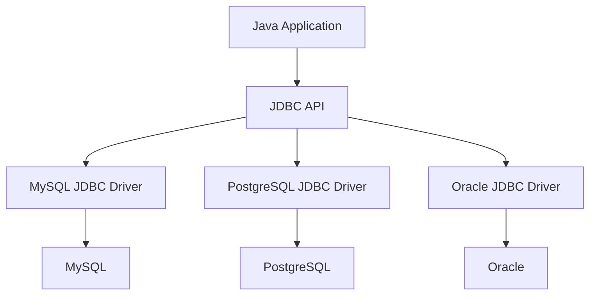
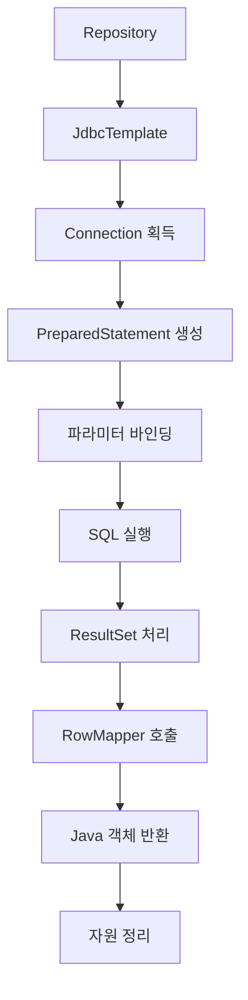
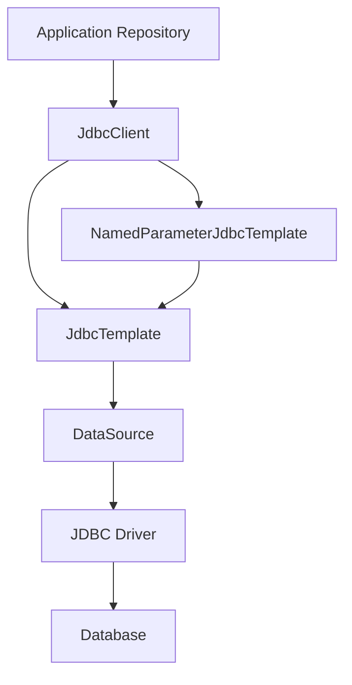
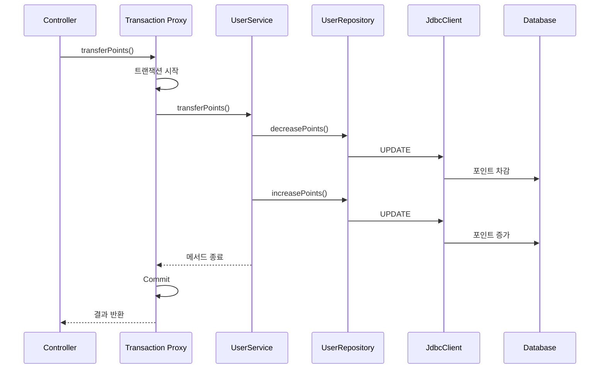
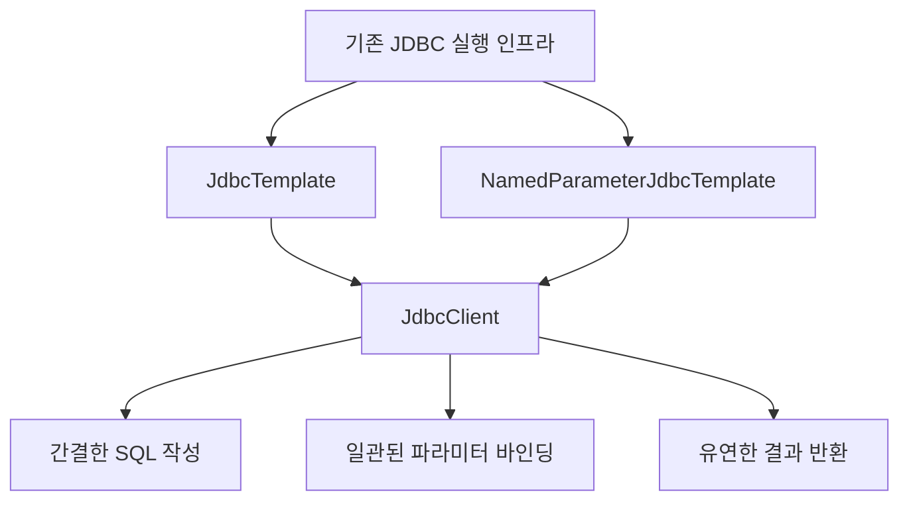
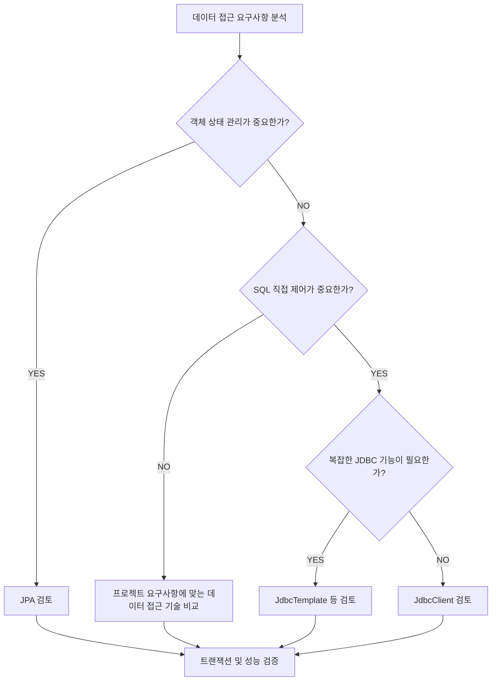

# Jdbc Template vs Jdbc Client
[https://youtu.be/K4SqrAmEGEM?si=EMCSLoCrxdQlG6A1](https://youtu.be/K4SqrAmEGEM?si=EMCSLoCrxdQlG6A1)

# Jdbc Template vs Jdbc Client
* toc
{:toc}

---

### Spring JdbcTemplate과 JdbcClient 완벽 이해: JDBC의 한계부터 템플릿 콜백 패턴과 실무 활용까지

Spring Boot에서 데이터베이스에 접근하는 방법은 다양하다.

대표적으로 다음과 같은 기술을 사용할 수 있다.

* JDBC
* JdbcTemplate
* NamedParameterJdbcTemplate
* JdbcClient
* Spring Data JDBC
* JPA와 Hibernate
* jOOQ

이 기술들은 모두 관계형 데이터베이스를 사용하는 Java 애플리케이션에서 활용할 수 있지만, 해결하려는 문제와 제공하는 추상화 수준이 다르다.

일반적인 Spring Boot 프로젝트에서는 Spring Data JPA를 자주 사용한다.

JPA를 사용하면 개발자는 엔티티를 중심으로 데이터를 다룰 수 있다.

예를 들어 다음과 같은 코드다.

```java
Member member = memberRepository.findById(memberId)
        .orElseThrow();
```

Repository가 내부적으로 어떤 SQL을 실행하는지 직접 작성하지 않아도 된다.

하지만 모든 프로젝트에서 JPA가 가장 적절한 선택인 것은 아니다.

복잡한 통계 쿼리를 직접 작성해야 할 수도 있다.

데이터베이스에 특화된 SQL 기능을 적극적으로 사용해야 할 수도 있다.

엔티티의 영속성 관리가 필요하지 않은 단순 조회 시스템일 수도 있다.

또 이미 수많은 SQL이 JdbcTemplate 기반으로 구현되어 있어 JPA로 전환하는 비용이 지나치게 클 수도 있다.

이런 상황에서는 SQL을 직접 작성하면서 데이터베이스에 접근할 수 있는 Spring JDBC가 유용하다.

그런데 Spring JDBC에는 오랫동안 사용되어 온 `JdbcTemplate` 외에도 `JdbcClient`라는 API가 존재한다.

JdbcClient는 Spring Framework 6.1부터 제공된 JDBC 접근 API다.

기존 JdbcTemplate의 장점을 유지하면서 SQL 실행 코드를 더욱 직관적으로 작성할 수 있도록 설계되었다.

그렇다면 다음과 같은 질문이 생긴다.

**JdbcTemplate은 어떤 문제를 해결하기 위해 등장했을까?**

**JdbcClient는 JdbcTemplate과 무엇이 다를까?**

**JdbcClient를 사용하면 기존 JdbcTemplate보다 성능이 좋아질까?**

**JdbcClient는 JPA를 대체하기 위한 기술일까?**

이러한 질문에 답하려면 JDBC의 기본 구조부터 이해해야 한다.

---

### JDBC란 무엇인가?

JDBC는 Java Database Connectivity의 약자다.

Java 애플리케이션에서 관계형 데이터베이스에 접근하기 위한 표준 API다.

예를 들어 다음과 같은 데이터베이스가 있다고 가정하자.

```text
MySQL

PostgreSQL

Oracle

Microsoft SQL Server

H2
```

각 데이터베이스는 고유한 통신 프로토콜과 기능을 가지고 있다.

Java 애플리케이션이 각각의 데이터베이스 통신 방식에 직접 의존한다면 데이터베이스 종류에 따라 많은 코드를 변경해야 할 수 있다.

JDBC는 이러한 문제를 줄이기 위해 공통 인터페이스를 제공한다.

대표적인 인터페이스는 다음과 같다.

| 인터페이스               | 역할                   |
| ------------------- | -------------------- |
| `Driver`            | 데이터베이스 드라이버          |
| `Connection`        | 데이터베이스 연결            |
| `Statement`         | SQL 실행               |
| `PreparedStatement` | 파라미터를 바인딩하는 SQL 실행   |
| `ResultSet`         | 조회 결과                |
| `DataSource`        | Connection을 제공하는 추상화 |

Java 애플리케이션은 이러한 인터페이스를 사용한다.

실제 데이터베이스 통신은 각 데이터베이스 벤더의 JDBC Driver가 처리한다.



즉 JDBC는 Java 애플리케이션과 데이터베이스 사이에 공통적인 프로그래밍 인터페이스를 제공한다.

하지만 JDBC 자체가 모든 반복 작업을 자동으로 처리하는 것은 아니다.

개발자가 직접 관리해야 하는 작업들이 존재한다.

이를 실제 코드로 살펴보자.

---

### JDBC를 직접 사용하면 어떤 문제가 발생할까?

회원 ID로 회원 정보를 조회하는 기능을 구현한다고 가정하자.

데이터베이스에는 다음 테이블이 존재한다.

```sql
CREATE TABLE app_users (
    id BIGINT PRIMARY KEY,
    username VARCHAR(100) NOT NULL,
    email VARCHAR(255) NOT NULL
);
```

회원 정보는 다음과 같다.

```sql
INSERT INTO app_users (id, username, email)
VALUES (1, 'user1', 'user1@example.com');
```

Java에서는 다음과 같은 DTO를 사용한다.

```java
public record User(
        Long id,
        String username,
        String email
) {
}
```

이제 JDBC를 직접 사용해 회원 정보를 조회해 보자.

```java
import java.sql.Connection;
import java.sql.PreparedStatement;
import java.sql.ResultSet;
import java.sql.SQLException;
import java.util.Optional;

import javax.sql.DataSource;

public class JdbcUserRepository {

    private final DataSource dataSource;

    public JdbcUserRepository(DataSource dataSource) {
        this.dataSource = dataSource;
    }

    public Optional<User> findById(Long id) {

        String sql = """
                SELECT id, username, email
                FROM app_users
                WHERE id = ?
                """;

        try (
                Connection connection = dataSource.getConnection();
                PreparedStatement statement =
                        connection.prepareStatement(sql)
        ) {

            statement.setLong(1, id);

            try (ResultSet resultSet = statement.executeQuery()) {

                if (!resultSet.next()) {
                    return Optional.empty();
                }

                User user = new User(
                        resultSet.getLong("id"),
                        resultSet.getString("username"),
                        resultSet.getString("email")
                );

                return Optional.of(user);
            }

        } catch (SQLException e) {
            throw new IllegalStateException(
                    "회원 조회 중 데이터베이스 오류가 발생했습니다.",
                    e
            );
        }
    }
}
```

코드를 보면 회원을 조회하는 비즈니스 요구사항은 매우 단순하다.

```sql
SELECT id, username, email
FROM app_users
WHERE id = ?;
```

하지만 이를 실행하기 위해 상당히 많은 Java 코드가 필요하다.

다음 작업들을 직접 수행하고 있기 때문이다.

1. SQL 작성
2. 데이터베이스 Connection 획득
3. PreparedStatement 생성
4. 파라미터 바인딩
5. SQL 실행
6. ResultSet 조회
7. Java 객체 생성
8. ResultSet 종료
9. PreparedStatement 종료
10. Connection 반환
11. SQLException 처리

회원 조회 기능 하나를 작성했을 뿐인데 데이터베이스 접근에 필요한 공통 작업들이 코드 대부분을 차지한다.

이것이 JDBC를 직접 사용할 때 나타나는 대표적인 문제다.

#### 반복되는 코드가 문제인 이유

회원 조회뿐 아니라 예약 조회 기능을 구현한다고 생각해 보자.

예약 Repository에서도 다음 작업이 필요하다.

```text
Connection 획득

PreparedStatement 생성

SQL 실행

ResultSet 처리

예외 처리

자원 반환
```

주문 조회에서도 동일하다.

결제 조회에서도 동일하다.

상품 조회에서도 동일하다.

실제로 변경되는 부분은 SQL과 파라미터, 결과 매핑 정도다.

나머지 작업은 거의 반복된다.

이러한 구조는 코드 중복을 증가시키고 유지보수를 어렵게 만든다.

특히 Connection이나 ResultSet을 제대로 반환하지 않으면 데이터베이스 커넥션 누수로 이어질 수 있다.

---

### JDBC 코드를 분석하면 변하는 부분과 변하지 않는 부분이 존재한다

앞선 JDBC 코드를 다시 생각해 보자.

다음과 같이 두 영역으로 나눌 수 있다.

#### 변하지 않는 부분

```text
Connection 획득

PreparedStatement 생성

SQL 실행

예외 처리

자원 반환
```

이 부분은 대부분의 JDBC 작업에서 공통적으로 수행된다.

#### 변하는 부분

```text
SQL

SQL 파라미터

조회 결과를 Java 객체로 변환하는 방식
```

예를 들어 회원을 조회할 때는 다음 SQL을 사용한다.

```sql
SELECT id, username, email
FROM app_users
WHERE id = ?;
```

예약을 조회할 때는 다른 SQL을 사용한다.

```sql
SELECT id, member_id, status
FROM reservations
WHERE id = ?;
```

조회 결과를 변환하는 방식도 다르다.

회원 조회에서는 `User` 객체를 생성한다.

예약 조회에서는 `Reservation` 객체를 생성한다.

그렇다면 공통적인 실행 과정은 하나의 구성 요소로 분리하고, 달라지는 부분만 외부에서 전달하도록 만들 수 있지 않을까?

이러한 사고방식이 JdbcTemplate의 핵심이다.

---

### JdbcTemplate이란 무엇인가?

JdbcTemplate은 Spring JDBC에서 제공하는 핵심 클래스다.

JDBC를 사용하면서 반복적으로 작성해야 하는 코드를 추상화한다.

개발자는 SQL과 파라미터, 결과 매핑 방식 등을 제공하면 된다.

Connection 획득과 자원 관리, SQL 실행, 예외 변환 등 공통 작업은 JdbcTemplate이 담당한다.

Spring 공식 문서에서도 JdbcTemplate이 JDBC 자원 생성과 해제를 처리하고, 개발자는 SQL과 결과 추출 로직에 집중하도록 돕는다고 설명한다.

앞서 작성한 회원 조회 코드를 JdbcTemplate으로 변경해 보자.

```java
import java.util.Optional;

import org.springframework.dao.EmptyResultDataAccessException;
import org.springframework.jdbc.core.JdbcTemplate;

public class JdbcTemplateUserRepository {

    private final JdbcTemplate jdbcTemplate;

    public JdbcTemplateUserRepository(
            JdbcTemplate jdbcTemplate
    ) {
        this.jdbcTemplate = jdbcTemplate;
    }

    public Optional<User> findById(Long id) {

        String sql = """
                SELECT id, username, email
                FROM app_users
                WHERE id = ?
                """;

        try {
            User user = jdbcTemplate.queryForObject(
                    sql,
                    (rs, rowNum) -> new User(
                            rs.getLong("id"),
                            rs.getString("username"),
                            rs.getString("email")
                    ),
                    id
            );

            return Optional.ofNullable(user);

        } catch (EmptyResultDataAccessException e) {
            return Optional.empty();
        }
    }
}
```

JDBC를 직접 사용했을 때보다 코드가 간결해졌다.

다음 작업이 사라졌기 때문이다.

```java
Connection connection = dataSource.getConnection();
```

```java
PreparedStatement statement =
        connection.prepareStatement(sql);
```

```java
ResultSet resultSet = statement.executeQuery();
```

또한 직접 자원을 닫는 코드도 작성하지 않았다.

이러한 공통 작업은 JdbcTemplate이 수행한다.

개발자는 다음 세 가지에 집중할 수 있다.

**어떤 SQL을 실행할 것인가?**

**어떤 파라미터를 사용할 것인가?**

**결과를 어떤 객체로 변환할 것인가?**

---

### JdbcTemplate의 내부 구조

JdbcTemplate의 핵심은 반복적인 JDBC 실행 절차를 내부에 캡슐화했다는 점이다.

개념적인 실행 구조는 다음과 같다.



이 흐름에서 JdbcTemplate은 JDBC 작업의 전체적인 실행 절차를 관리한다.

반면 개발자는 RowMapper를 통해 결과를 객체로 변환하는 방법을 정의한다.

이러한 구조는 템플릿 콜백 패턴으로 이해할 수 있다.

---

### 템플릿 콜백 패턴이란 무엇인가?

템플릿 콜백 패턴은 공통적인 작업 흐름을 템플릿에 정의하고, 달라지는 일부 동작을 콜백으로 전달하는 설계 방식이다.

템플릿은 전체 실행 과정을 제어한다.

콜백은 특정 단계에서 필요한 사용자 정의 동작을 수행한다.

JdbcTemplate에서는 다음과 같이 역할을 나눌 수 있다.

| 구성 요소                   | 역할               |
| ----------------------- | ---------------- |
| JdbcTemplate            | JDBC 실행 흐름 관리    |
| SQL                     | 실행할 데이터베이스 작업 정의 |
| PreparedStatementSetter | 파라미터 설정          |
| RowMapper               | 한 행을 Java 객체로 변환 |
| ResultSetExtractor      | ResultSet 전체를 처리 |
| RowCallbackHandler      | 각 행에 대한 작업 수행    |

예를 들어 다음 코드를 살펴보자.

```java
List<User> users = jdbcTemplate.query(
        """
        SELECT id, username, email
        FROM app_users
        """,
        (rs, rowNum) -> new User(
                rs.getLong("id"),
                rs.getString("username"),
                rs.getString("email")
        )
);
```

여기서 다음 람다가 RowMapper다.

```java
(rs, rowNum) -> new User(
        rs.getLong("id"),
        rs.getString("username"),
        rs.getString("email")
)
```

JdbcTemplate은 ResultSet에서 행을 읽고 RowMapper를 호출한다.

RowMapper는 현재 행을 Java 객체로 변환한다.

개발자가 RowMapper의 실행 시점을 직접 관리하지 않는다는 점이 중요하다.

JdbcTemplate이 필요한 시점에 콜백을 호출한다.

#### 템플릿 콜백 패턴과 템플릿 메서드 패턴은 무엇이 다를까?

두 패턴은 공통적인 실행 절차를 재사용한다는 점에서 유사하다.

하지만 변경 가능한 동작을 제공하는 방법이 다르다.

| 구분       | 템플릿 메서드 패턴  | 템플릿 콜백 패턴       |
| -------- | ----------- | --------------- |
| 변경 동작 제공 | 상속과 메서드 재정의 | 콜백 객체 전달        |
| 실행 흐름    | 부모 클래스가 제어  | 템플릿 객체가 제어      |
| 대표적인 방식  | `extends`   | 인터페이스, 람다       |
| 변경 유연성   | 클래스 계층에 영향  | 호출 시점에 동작 전달 가능 |

JdbcTemplate은 콜백 인터페이스를 통해 다양한 SQL 작업과 결과 처리 방식을 조합할 수 있다.

이것이 JdbcTemplate이 장기간 활용될 수 있었던 중요한 설계 특징 중 하나다.

---

### JdbcTemplate은 완벽한 API일까?

JdbcTemplate은 JDBC의 반복적인 코드를 크게 줄여준다.

하지만 API를 사용하다 보면 불편한 부분도 존재한다.

대표적인 것이 단건 조회 결과를 처리하는 방식이다.

예를 들어 다음 코드를 생각해 보자.

```java
User user = jdbcTemplate.queryForObject(
        sql,
        userRowMapper,
        userId
);
```

회원이 존재하면 정상적으로 반환된다.

그런데 회원이 존재하지 않는다면 어떻게 될까?

`null`을 반환할 것이라고 생각하기 쉽다.

하지만 일반적인 `queryForObject()`는 조회 결과가 0건이면 `EmptyResultDataAccessException`을 발생시킨다.

조회 결과가 2건 이상이라면 `IncorrectResultSizeDataAccessException` 계열 예외가 발생한다.

즉 조회 결과의 개수를 엄격하게 검사한다.

| 조회 결과 | `queryForObject()` 동작                  |
| ----- | -------------------------------------- |
| 0건    | EmptyResultDataAccessException         |
| 1건    | 객체 반환                                  |
| 2건 이상 | IncorrectResultSizeDataAccessException |

물론 한 행을 찾았더라도 RowMapper가 `null`을 반환하는 경우는 별도로 생각해야 한다.

핵심은 `queryForObject()`가 조회 결과가 없는 상황을 `Optional.empty()`로 표현하는 API는 아니라는 사실이다.

---

### JdbcTemplate에서 Optional을 반환하려면?

회원 조회처럼 결과가 없을 수 있는 기능에서는 `Optional`을 사용하고 싶을 수 있다.

그렇다면 어떻게 해야 할까?

가장 단순한 방법은 예외를 처리하는 것이다.

```java
public Optional<User> findById(Long id) {

    try {
        return Optional.ofNullable(
                jdbcTemplate.queryForObject(
                        """
                        SELECT id, username, email
                        FROM app_users
                        WHERE id = ?
                        """,
                        userRowMapper,
                        id
                )
        );

    } catch (EmptyResultDataAccessException e) {
        return Optional.empty();
    }
}
```

이 방식은 정상적으로 동작한다.

하지만 조회 메서드마다 같은 예외 처리 코드가 반복될 수 있다.

다른 방법은 `query()`를 이용하는 것이다.

```java
public Optional<User> findById(Long id) {

    List<User> users = jdbcTemplate.query(
            """
            SELECT id, username, email
            FROM app_users
            WHERE id = ?
            """,
            userRowMapper,
            id
    );

    return DataAccessUtils.optionalResult(users);
}
```

이 방식은 Spring의 `DataAccessUtils`를 사용한다.

결과가 없으면 `Optional.empty()`를 반환하고, 하나라면 해당 객체를 반환한다.

결과가 여러 개라면 단건 조회 계약 위반으로 예외가 발생한다.

하지만 여전히 개발자가 결과 반환 방식을 직접 구성해야 한다.

이러한 불편함은 JdbcTemplate에 Optional 반환 메서드를 추가해야 하는지에 대한 논의로 이어졌다.

---

### 왜 JdbcTemplate에 Optional 메서드를 추가하지 않았을까?

JdbcTemplate은 오랜 기간 발전하면서 매우 많은 메서드와 오버로드를 제공하게 되었다.

예를 들어 같은 조회 기능이라도 다음 요소에 따라 메서드가 달라질 수 있다.

SQL 파라미터 사용 여부.

RowMapper 사용 여부.

ResultSetExtractor 사용 여부.

파라미터 타입 지정 여부.

PreparedStatementCreator 사용 여부.

여기에 모든 경우에 대응하는 Optional 전용 메서드를 추가하면 API의 크기와 복잡성이 더욱 증가한다.

또 JdbcTemplate의 기본 책임은 JDBC 작업을 수행하는 것이다.

조회 결과를 반드시 Optional로 표현해야 하는지는 호출하는 애플리케이션의 요구사항에 따라 달라질 수 있다.

따라서 기존 API를 계속 확장하는 것만이 좋은 해결책은 아니다.

이미 활용할 수 있는 기능을 유지하면서 새로운 형태의 API를 제공하는 방법도 존재한다.

JdbcClient는 이러한 방향과 잘 맞는 API다.

다만 JdbcClient가 등장한 이유를 Optional 하나만으로 설명할 수는 없다.

**위치 기반 파라미터와 이름 기반 파라미터를 통합하고, SQL 실행과 결과 반환을 더욱 일관된 Fluent API로 제공하려는 목적**도 중요하다.

---

### NamedParameterJdbcTemplate은 무엇인가?

JdbcClient를 이해하기 전에 NamedParameterJdbcTemplate을 알아야 한다.

JdbcTemplate에서는 일반적으로 `?`를 이용해 파라미터를 바인딩한다.

```java
jdbcTemplate.query(
        """
        SELECT id, username, email
        FROM app_users
        WHERE username = ?
          AND email = ?
        """,
        userRowMapper,
        username,
        email
);
```

여기서 첫 번째 `?`에는 `username`이 바인딩된다.

두 번째 `?`에는 `email`이 바인딩된다.

SQL이 짧다면 큰 문제가 없다.

하지만 다음과 같은 조건이 많아지면 어떨까?

```sql
SELECT id, username, email
FROM app_users
WHERE username = ?
  AND status = ?
  AND created_at >= ?
  AND created_at < ?
  AND email LIKE ?;
```

파라미터의 순서를 정확하게 관리해야 한다.

순서가 잘못되면 의도하지 않은 데이터가 조회될 수 있다.

NamedParameterJdbcTemplate은 이러한 문제를 완화한다.

```java
String sql = """
        SELECT id, username, email
        FROM app_users
        WHERE username = :username
          AND email = :email
        """;

MapSqlParameterSource params =
        new MapSqlParameterSource()
                .addValue("username", username)
                .addValue("email", email);

List<User> users =
        namedParameterJdbcTemplate.query(
                sql,
                params,
                userRowMapper
        );
```

SQL 안에 파라미터 이름이 명확하게 표현된다.

```sql
WHERE username = :username
  AND email = :email
```

이는 복잡한 SQL에서 가독성을 높이고 파라미터 순서 실수를 줄이는 데 도움이 된다.

여기서 중요한 점은 **Named Parameter가 JdbcClient에서 처음 등장한 기능이 아니라는 사실**이다.

JdbcClient 이전에도 NamedParameterJdbcTemplate이 이 기능을 제공했다.

JdbcClient는 JdbcTemplate과 NamedParameterJdbcTemplate의 일반적인 조회·수정 기능을 하나의 Fluent API로 통합한다.

---

### JdbcClient란 무엇인가?

JdbcClient는 Spring Framework 6.1에서 도입된 JDBC 접근 API다.

SQL을 지정하고 파라미터를 바인딩한 뒤 결과를 처리하는 과정을 메서드 체이닝 방식으로 작성할 수 있다.

예를 들어 다음과 같다.

```java
Optional<User> user = jdbcClient.sql("""
                SELECT id, username, email
                FROM app_users
                WHERE id = :id
                """)
        .param("id", userId)
        .query(User.class)
        .optional();
```

코드를 왼쪽에서 오른쪽, 위에서 아래로 읽으면 SQL 실행 의도를 쉽게 파악할 수 있다.

```text
sql()

→ SQL 지정


param()

→ 파라미터 바인딩


query()

→ 결과 매핑 방식 지정


optional()

→ 결과 반환 방식 지정
```

조회뿐 아니라 INSERT, UPDATE, DELETE도 지원한다.

JdbcClient는 Spring Framework 6.1부터 제공되며 기존 JdbcTemplate과 NamedParameterJdbcTemplate에 실행을 위임하는 구조다.

---

### JdbcClient는 JdbcTemplate을 완전히 대체할까?

아니다.

이 부분은 정확하게 이해해야 한다.

JdbcClient는 기존 JdbcTemplate을 완전히 제거하고 새로운 JDBC 실행 엔진을 만든 기술이 아니다.

내부적으로 JdbcTemplate과 NamedParameterJdbcTemplate의 기능을 활용한다.

개념적으로 다음과 같은 구조다.



JdbcClient는 개발자가 사용하는 상위 API를 단순화한다.

실제 JDBC 실행 기능은 기존 Spring JDBC 인프라를 활용한다.

따라서 JdbcClient를 도입했다고 반드시 SQL 실행 성능이 향상되는 것은 아니다.

같은 SQL을 같은 데이터베이스에 실행한다면 병목은 여전히 다음 요소에 영향을 받는다.

* SQL 실행 계획
* 인덱스
* 데이터베이스 부하
* 네트워크 지연
* JDBC Driver
* Connection Pool
* 결과 데이터 크기

JdbcClient의 핵심적인 장점은 성능보다 **API 사용 편의성과 가독성, 일관성**에 있다.

---

### JdbcTemplate과 JdbcClient를 비교해 보자

두 기술의 차이를 정리하면 다음과 같다.

| 구분                   | JdbcTemplate                     | JdbcClient             |
| -------------------- | -------------------------------- | ---------------------- |
| 주요 역할                | JDBC 작업 추상화                      | JDBC 접근을 위한 Fluent API |
| API 스타일              | 메서드 호출 중심                        | 메서드 체이닝                |
| 위치 기반 파라미터           | 지원                               | 지원                     |
| 이름 기반 파라미터           | 별도 NamedParameterJdbcTemplate 사용 | 직접 지원                  |
| RowMapper            | 지원                               | 지원                     |
| 클래스 기반 자동 매핑         | 별도 매핑 도구 활용                      | `query(Class)` 지원      |
| Optional 단건 조회       | 직접 구성                            | `optional()` 지원        |
| 단건 필수 조회             | `queryForObject()`               | `single()`             |
| 목록 조회                | `query()`                        | `list()`               |
| Stream 조회            | 지원                               | `stream()` 지원          |
| INSERT/UPDATE/DELETE | `update()`                       | `update()`             |
| 복잡한 JDBC 작업          | 폭넓게 지원                           | 일부 기능은 하위 Template 활용  |
| JPA 영속성 컨텍스트         | 없음                               | 없음                     |

여기서 중요한 점은 JdbcClient가 JdbcTemplate보다 무조건 더 많은 기능을 제공하는 것이 아니라는 사실이다.

JdbcTemplate은 오래된 만큼 매우 다양한 JDBC 기능을 지원한다.

반면 JdbcClient는 자주 사용하는 작업을 간결하게 표현하는 데 집중한다.

---

### JdbcClient의 주요 기능

JdbcClient의 주요 사용법을 살펴보자.

#### 1. 위치 기반 파라미터

기존 JDBC와 같이 `?`를 사용할 수 있다.

```java
Optional<User> user = jdbcClient.sql("""
                SELECT id, username, email
                FROM app_users
                WHERE id = ?
                """)
        .param(userId)
        .query(User.class)
        .optional();
```

`.param()`을 호출한 순서에 따라 파라미터가 바인딩된다.

파라미터가 적은 SQL에서 간편하게 사용할 수 있다.

#### 2. 이름 기반 파라미터

SQL에 이름을 지정할 수도 있다.

```java
Optional<User> user = jdbcClient.sql("""
                SELECT id, username, email
                FROM app_users
                WHERE id = :id
                """)
        .param("id", userId)
        .query(User.class)
        .optional();
```

파라미터 이름과 값의 관계가 명확하다.

복잡한 조건을 작성할 때 특히 유용하다.

#### 3. 여러 파라미터 바인딩

다음과 같이 여러 조건을 지정할 수 있다.

```java
List<User> users = jdbcClient.sql("""
                SELECT id, username, email
                FROM app_users
                WHERE username = :username
                  AND email = :email
                """)
        .param("username", username)
        .param("email", email)
        .query(User.class)
        .list();
```

메서드 체이닝을 통해 SQL 작성과 파라미터 바인딩 과정을 자연스럽게 연결할 수 있다.

#### 4. 단건 필수 조회

조회 결과가 반드시 하나여야 한다면 `single()`을 사용할 수 있다.

```java
User user = jdbcClient.sql("""
                SELECT id, username, email
                FROM app_users
                WHERE id = :id
                """)
        .param("id", userId)
        .query(User.class)
        .single();
```

단건 조회 계약이 충족되지 않으면 예외가 발생한다.

#### 5. Optional 조회

조회 결과가 없을 수 있다면 `optional()`을 사용한다.

```java
Optional<User> user = jdbcClient.sql("""
                SELECT id, username, email
                FROM app_users
                WHERE id = :id
                """)
        .param("id", userId)
        .query(User.class)
        .optional();
```

별도의 `EmptyResultDataAccessException` 처리 없이 결과가 없는 상황을 표현할 수 있다.

#### 6. 목록 조회

여러 결과가 필요하다면 `list()`를 사용한다.

```java
List<User> users = jdbcClient.sql("""
                SELECT id, username, email
                FROM app_users
                ORDER BY id
                """)
        .query(User.class)
        .list();
```

조회 결과가 없으면 빈 목록이 반환된다.

#### 7. Stream 조회

Stream으로 결과를 처리할 수도 있다.

```java
try (Stream<User> stream = jdbcClient.sql("""
                SELECT id, username, email
                FROM app_users
                ORDER BY id
                """)
        .query(User.class)
        .stream()) {

    stream.forEach(System.out::println);
}
```

여기서 중요한 점은 Stream의 자원 관리다.

JdbcClient의 `stream()`은 JDBC 결과를 지연 처리할 수 있으며, 사용을 마친 후 닫아야 한다.

따라서 `try-with-resources` 사용을 권장한다.

특히 Stream을 반환한 뒤 다른 계층에서 늦게 소비하는 구조는 Connection이나 ResultSet의 생명주기를 복잡하게 만들 수 있다.

Spring API도 반환된 Stream을 사용 후 닫아야 한다고 명시한다.

---

### single(), optional(), list()의 차이

JdbcClient를 사용할 때 반드시 이해해야 하는 부분이다.

세 메서드는 같은 SQL을 실행하더라도 결과 개수에 대한 계약이 다르다.

| 조회 결과 | `single()` | `optional()`     | `list()`  |
| ----- | ---------- | ---------------- | --------- |
| 0건    | 예외         | Optional.empty() | 빈 목록      |
| 1건    | 객체 반환      | Optional.of()    | 요소 1개인 목록 |
| 2건 이상 | 예외         | 예외               | 전체 목록     |

단건 조회를 의미하는 `single()`과 `optional()`은 여러 결과 중 첫 번째만 반환하는 기능이 아니다.

두 메서드는 결과가 하나 이하 또는 정확히 하나라는 계약을 검사한다.

이 점은 데이터 무결성을 고려할 때 중요하다.

예를 들어 이메일은 회원마다 유일해야 한다고 가정하자.

```sql
SELECT id, username, email
FROM app_users
WHERE email = :email;
```

애플리케이션에서는 `optional()`로 조회할 수 있다.

하지만 실제 데이터베이스에 중복된 이메일이 저장되어 있다면 여러 행이 조회될 수 있다.

이 경우 `optional()`이 임의의 회원을 선택하는 것이 아니라 예외를 발생시키는 것은 합리적인 동작이다.

그리고 더 중요한 것은 데이터베이스에 UNIQUE 제약조건을 설정하는 것이다.

```sql
ALTER TABLE app_users
ADD CONSTRAINT uk_app_users_email UNIQUE (email);
```

**JdbcClient의 반환 API는 데이터베이스 무결성 제약조건을 대체하지 않는다.**

---

### JdbcClient에서 Java Record 자동 매핑하기

JdbcClient의 장점 중 하나는 클래스 기반 결과 매핑이다.

다음과 같은 Record가 있다고 가정하자.

```java
public record User(
        Long id,
        String username,
        String email
) {
}
```

SQL은 다음과 같다.

```sql
SELECT id, username, email
FROM app_users
WHERE id = :id;
```

JdbcClient에서는 다음과 같이 작성할 수 있다.

```java
User user = jdbcClient.sql("""
                SELECT id, username, email
                FROM app_users
                WHERE id = :id
                """)
        .param("id", userId)
        .query(User.class)
        .single();
```

별도의 RowMapper를 명시하지 않았다.

JdbcClient가 클래스 구조를 기반으로 결과를 매핑할 수 있기 때문이다.

Spring Framework 6.2 문서에서는 이러한 자동 매핑이 `SimplePropertyRowMapper` 등의 전략을 통해 제공된다고 설명한다.

#### 자동 매핑에서 주의할 점

자동 매핑은 SQL 결과 컬럼과 Java 객체의 속성 사이의 대응 관계가 명확해야 한다.

예를 들어 다음 Record가 있다고 가정하자.

```java
public record OrderSummary(
        Long orderId,
        String memberName
) {
}
```

SQL에는 다음 컬럼들이 존재한다.

```sql
SELECT
    o.id,
    m.name
FROM orders o
JOIN members m
    ON o.member_id = m.id;
```

이 경우 Record의 `orderId`, `memberName`과 SQL의 `id`, `name`은 이름이 다르다.

따라서 다음과 같이 별칭을 지정하면 매핑 의도가 명확해진다.

```sql
SELECT
    o.id AS order_id,
    m.name AS member_name
FROM orders o
JOIN members m
    ON o.member_id = m.id;
```

```java
List<OrderSummary> orders = jdbcClient.sql("""
                SELECT
                    o.id AS order_id,
                    m.name AS member_name
                FROM orders o
                JOIN members m
                    ON o.member_id = m.id
                """)
        .query(OrderSummary.class)
        .list();
```

이러한 방식은 조회 전용 DTO를 구성할 때 유용하다.

다만 컬럼 타입과 Java 타입이 호환되는지, NULL 값을 어떻게 처리할지 확인해야 한다.

특히 Java 기본형 `long`에는 `null`을 넣을 수 없으므로 조회 컬럼이 NULL을 반환할 가능성이 있다면 타입 설계를 신중하게 해야 한다.

---

### 자동 매핑보다 RowMapper가 적절한 경우

자동 매핑이 모든 상황에 적합한 것은 아니다.

예를 들어 데이터베이스에 다음 컬럼이 존재한다고 가정하자.

```text
payment_status

payment_amount

created_at
```

하지만 애플리케이션에서는 상태값을 Enum으로 표현하고 싶을 수 있다.

```java
public enum PaymentStatus {
    PENDING,
    COMPLETED,
    FAILED
}
```

이 경우 명시적인 RowMapper를 사용하면 변환 과정을 직접 제어할 수 있다.

```java
RowMapper<Payment> paymentRowMapper = (rs, rowNum) ->
        new Payment(
                rs.getLong("id"),
                rs.getLong("payment_amount"),
                PaymentStatus.valueOf(
                        rs.getString("payment_status")
                ),
                rs.getTimestamp("created_at").toLocalDateTime()
        );
```

JdbcClient에서도 이 RowMapper를 사용할 수 있다.

```java
List<Payment> payments = jdbcClient.sql("""
                SELECT
                    id,
                    payment_amount,
                    payment_status,
                    created_at
                FROM payments
                """)
        .query(paymentRowMapper)
        .list();
```

즉 JdbcClient는 RowMapper를 없앤 것이 아니다.

간단한 매핑은 클래스 기반으로 처리하고, 복잡한 매핑에서는 개발자가 직접 변환 방식을 정의할 수 있다.

---

### JdbcClient에서 INSERT, UPDATE, DELETE 처리하기

지금까지 조회 기능을 살펴보았다.

하지만 JDBC는 데이터 조회뿐 아니라 변경에도 사용된다.

JdbcClient에서는 SQL을 실행한 뒤 `update()`로 작업을 완료할 수 있다.

#### INSERT

```java
int affectedRows = jdbcClient.sql("""
                INSERT INTO app_users (id, username, email)
                VALUES (:id, :username, :email)
                """)
        .param("id", 2L)
        .param("username", "user2")
        .param("email", "user2@example.com")
        .update();
```

`update()`의 반환값은 영향을 받은 행의 수다.

정상적으로 1건이 삽입되었다면 일반적으로 1이 반환된다.

#### UPDATE

```java
int affectedRows = jdbcClient.sql("""
                UPDATE app_users
                SET email = :email
                WHERE id = :id
                """)
        .param("email", "changed@example.com")
        .param("id", 1L)
        .update();
```

회원 ID가 존재하지 않는다면 영향을 받은 행의 수가 0일 수 있다.

이 값은 비즈니스 로직에서 유용하게 활용할 수 있다.

#### DELETE

```java
int affectedRows = jdbcClient.sql("""
                DELETE FROM app_users
                WHERE id = :id
                """)
        .param("id", 1L)
        .update();
```

삭제 대상이 없으면 일반적으로 0이 반환된다.

여기서 중요한 점은 `update()`라는 이름이다.

JdbcClient의 `update()`는 SQL의 UPDATE 문만 실행하는 기능이 아니다.

INSERT, UPDATE, DELETE와 같이 영향을 받은 행의 수를 반환하는 변경 작업에 사용한다.

---

### Spring Boot에서 JdbcClient 프로젝트 구현하기

이제 실제 실행 가능한 프로젝트를 만들어 보자.

다음 기능을 구현하겠다.

1. 회원 등록
2. 회원 단건 조회
3. 상태별 회원 목록 조회
4. 이메일 수정
5. 회원 삭제
6. 회원 간 포인트 이동

마지막 포인트 이동 기능에서는 JdbcClient와 `@Transactional`을 함께 사용한다.

이를 통해 단순 CRUD뿐 아니라 실제 서비스의 데이터 일관성 문제도 살펴볼 수 있다.

#### 개발 환경

다음 환경을 기준으로 구성한다.

| 항목               | 버전 또는 기술                 |
| ---------------- | ------------------------ |
| Java             | Java 17                  |
| Spring Boot      | 3.5.7                    |
| Spring Framework | Spring Boot가 관리하는 6.2 계열 |
| 데이터 접근           | JdbcClient               |
| 데이터베이스           | H2                       |
| 빌드 도구            | Gradle                   |

이 예제에서는 JPA를 사용하지 않는다.

따라서 `@Entity`나 `EntityManager`, 영속성 컨텍스트 없이 SQL을 직접 실행한다.

---

### Gradle 설정

`build.gradle` 파일을 다음과 같이 구성한다.

```groovy
plugins {
    id 'java'
    id 'org.springframework.boot' version '3.5.7'
    id 'io.spring.dependency-management' version '1.1.7'
}

group = 'com.example'
version = '0.0.1-SNAPSHOT'

java {
    toolchain {
        languageVersion = JavaLanguageVersion.of(17)
    }
}

repositories {
    mavenCentral()
}

dependencies {
    implementation 'org.springframework.boot:spring-boot-starter-web'
    implementation 'org.springframework.boot:spring-boot-starter-jdbc'

    runtimeOnly 'com.h2database:h2'

    testImplementation 'org.springframework.boot:spring-boot-starter-test'
}

tasks.named('test') {
    useJUnitPlatform()
}
```

핵심 의존성은 다음과 같다.

```groovy
implementation 'org.springframework.boot:spring-boot-starter-jdbc'
```

이 Starter는 Spring JDBC 기반 애플리케이션을 구성하기 위해 사용한다.

Spring Boot는 일반적인 자동 설정 환경에서 다음 Bean들을 구성할 수 있다.

```text
DataSource

JdbcTemplate

NamedParameterJdbcTemplate

JdbcClient
```

단, JdbcClient 자동 설정은 관련 JDBC Bean이 존재하는 등의 조건을 만족해야 한다.

Spring Boot는 NamedParameterJdbcTemplate이 존재하는 환경에서 JdbcClient를 자동 구성할 수 있다.

따라서 일반적인 단일 DataSource 구성에서는 다음과 같이 생성자 주입으로 JdbcClient를 사용할 수 있다.

```java
public UserRepository(JdbcClient jdbcClient) {
    this.jdbcClient = jdbcClient;
}
```

---

### 프로젝트 구조

프로젝트 구조는 다음과 같다.

```text
src
└── main
    ├── java
    │   └── com
    │       └── example
    │           └── jdbc
    │               ├── JdbcApplication.java
    │               ├── User.java
    │               ├── UserRepository.java
    │               ├── UserService.java
    │               └── UserController.java
    └── resources
        ├── application.yml
        ├── schema.sql
        └── data.sql
```

각 파일을 순서대로 작성해 보자.

---

### application.yml

데이터베이스 연결 정보를 설정한다.

```yaml
spring:
  datasource:
    url: jdbc:h2:mem:jdbcdb;DB_CLOSE_DELAY=-1
    driver-class-name: org.h2.Driver
    username: sa
    password:

  sql:
    init:
      mode: always

  h2:
    console:
      enabled: true

logging:
  level:
    org.springframework.jdbc.core: DEBUG

server:
  port: 8080
```

여기서는 H2 인메모리 데이터베이스를 사용한다.

```yaml
url: jdbc:h2:mem:jdbcdb;DB_CLOSE_DELAY=-1
```

이 설정은 애플리케이션 실행 중 메모리 기반 데이터베이스를 유지하는 데 사용한다.

또 다음 설정을 사용했다.

```yaml
spring:
  sql:
    init:
      mode: always
```

이는 Spring Boot의 SQL 초기화 기능을 사용하도록 설정한다.

이후 `schema.sql`과 `data.sql` 파일을 통해 테이블과 초기 데이터를 구성한다.

H2 Console은 로컬 개발용으로만 사용하고 운영 환경에서는 비활성화해야 한다.

---

### schema.sql

회원 테이블을 생성한다.

```sql
CREATE TABLE app_users (
    id BIGINT GENERATED BY DEFAULT AS IDENTITY PRIMARY KEY,
    username VARCHAR(100) NOT NULL UNIQUE,
    email VARCHAR(255) NOT NULL UNIQUE,
    status VARCHAR(20) NOT NULL,
    points BIGINT NOT NULL DEFAULT 0
);
```

각 컬럼의 의미는 다음과 같다.

| 컬럼         | 의미     |
| ---------- | ------ |
| `id`       | 회원 식별자 |
| `username` | 회원 이름  |
| `email`    | 이메일    |
| `status`   | 회원 상태  |
| `points`   | 보유 포인트 |

여기서 `points`는 숫자 타입으로 저장한다.

그리고 NULL을 허용하지 않는다.

```sql
points BIGINT NOT NULL DEFAULT 0
```

포인트 이동 기능에서는 이 컬럼을 원자적으로 변경할 예정이다.

---

### data.sql

초기 회원 데이터를 등록한다.

```sql
INSERT INTO app_users (
    username,
    email,
    status,
    points
) VALUES (
    'user1',
    'user1@example.com',
    'ACTIVE',
    100
);

INSERT INTO app_users (
    username,
    email,
    status,
    points
) VALUES (
    'user2',
    'user2@example.com',
    'ACTIVE',
    50
);
```

회원 두 명이 등록된다.

초기 포인트는 각각 100과 50이다.

이제 Java 코드를 작성해 보자.

---

### JdbcApplication

Spring Boot 애플리케이션의 시작 클래스다.

```java
package com.example.jdbc;

import org.springframework.boot.SpringApplication;
import org.springframework.boot.autoconfigure.SpringBootApplication;

@SpringBootApplication
public class JdbcApplication {

    public static void main(String[] args) {
        SpringApplication.run(JdbcApplication.class, args);
    }
}
```

별도로 JdbcClient Bean을 등록하지 않는다.

앞서 추가한 JDBC Starter와 DataSource 설정을 기반으로 Spring Boot 자동 설정을 활용한다.

---

### User Record

회원 정보를 표현할 Record를 생성한다.

```java
package com.example.jdbc;

public record User(
        Long id,
        String username,
        String email,
        String status,
        long points
) {
}
```

여기서는 JPA Entity가 아니라 일반적인 Java Record를 사용한다.

따라서 다음과 같은 특징을 가진다.

* 영속성 컨텍스트에서 관리되지 않는다.
* Dirty Checking이 발생하지 않는다.
* Lazy Loading이 존재하지 않는다.
* 변경 사항을 자동으로 UPDATE하지 않는다.
* SQL 실행 결과를 담는 데이터 객체로 활용한다.

이 차이는 JdbcClient와 JPA를 비교할 때 중요하다.

---

### UserRepository 구현

이제 핵심인 JdbcClient를 사용한다.

```java
package com.example.jdbc;

import java.util.List;
import java.util.Optional;
import java.util.Objects;

import org.springframework.jdbc.core.simple.JdbcClient;
import org.springframework.jdbc.support.GeneratedKeyHolder;
import org.springframework.jdbc.support.KeyHolder;
import org.springframework.stereotype.Repository;

@Repository
public class UserRepository {

    private final JdbcClient jdbcClient;

    public UserRepository(JdbcClient jdbcClient) {
        this.jdbcClient = jdbcClient;
    }

    public Optional<User> findById(Long id) {

        return jdbcClient.sql("""
                        SELECT
                            id,
                            username,
                            email,
                            status,
                            points
                        FROM app_users
                        WHERE id = :id
                        """)
                .param("id", id)
                .query(User.class)
                .optional();
    }

    public List<User> findByStatus(String status) {

        return jdbcClient.sql("""
                        SELECT
                            id,
                            username,
                            email,
                            status,
                            points
                        FROM app_users
                        WHERE status = :status
                        ORDER BY id
                        """)
                .param("status", status)
                .query(User.class)
                .list();
    }

    public Long insert(
            String username,
            String email
    ) {

        KeyHolder keyHolder = new GeneratedKeyHolder();

        int affectedRows = jdbcClient.sql("""
                        INSERT INTO app_users (
                            username,
                            email,
                            status,
                            points
                        )
                        VALUES (
                            :username,
                            :email,
                            'ACTIVE',
                            0
                        )
                        """)
                .param("username", username)
                .param("email", email)
                .update(keyHolder, "id");

        if (affectedRows != 1) {
            throw new IllegalStateException(
                    "회원 등록에 실패했습니다."
            );
        }

        return Objects.requireNonNull(
                keyHolder.getKey()
        ).longValue();
    }

    public int updateEmail(
            Long id,
            String email
    ) {

        return jdbcClient.sql("""
                        UPDATE app_users
                        SET email = :email
                        WHERE id = :id
                        """)
                .param("email", email)
                .param("id", id)
                .update();
    }

    public int deleteById(Long id) {

        return jdbcClient.sql("""
                        DELETE FROM app_users
                        WHERE id = :id
                        """)
                .param("id", id)
                .update();
    }

    public int decreasePoints(
            Long id,
            long amount
    ) {

        return jdbcClient.sql("""
                        UPDATE app_users
                        SET points = points - :amount
                        WHERE id = :id
                          AND points >= :amount
                        """)
                .param("amount", amount)
                .param("id", id)
                .update();
    }

    public int increasePoints(
            Long id,
            long amount
    ) {

        return jdbcClient.sql("""
                        UPDATE app_users
                        SET points = points + :amount
                        WHERE id = :id
                        """)
                .param("amount", amount)
                .param("id", id)
                .update();
    }
}
```

이 Repository는 JdbcClient의 주요 기능들을 사용한다.

```java
.sql(...)
```

SQL을 지정한다.

```java
.param(...)
```

파라미터를 바인딩한다.

```java
.query(User.class)
```

조회 결과를 User Record로 매핑한다.

```java
.optional()
```

단건 조회 결과를 Optional로 반환한다.

```java
.list()
```

여러 결과를 목록으로 반환한다.

```java
.update()
```

데이터 변경 SQL을 실행한다.

또 `GeneratedKeyHolder`를 이용해 데이터베이스에서 생성한 ID를 가져온다.

실제 운영 환경에서 자동 생성 키를 사용할 때는 JDBC Driver의 지원 여부와 데이터베이스별 동작 차이를 확인해야 한다.

---

### 생성된 ID를 반환하는 방법

회원 등록 메서드에서 다음 코드를 사용했다.

```java
KeyHolder keyHolder = new GeneratedKeyHolder();
```

그리고 INSERT를 실행할 때 전달했다.

```java
.update(keyHolder, "id");
```

이렇게 하면 JDBC Driver가 지원하는 경우 데이터베이스에서 생성한 키를 가져올 수 있다.

```java
Long id = Objects.requireNonNull(
        keyHolder.getKey()
).longValue();
```

예를 들어 다음 SQL을 실행했다고 가정하자.

```sql
INSERT INTO app_users (
    username,
    email,
    status,
    points
)
VALUES (
    'user3',
    'user3@example.com',
    'ACTIVE',
    0
);
```

데이터베이스가 ID를 자동 생성했다면 해당 값을 애플리케이션에서 사용할 수 있다.

이는 회원 등록 후 생성된 ID를 응답하거나 다른 테이블의 외래키로 사용해야 하는 상황에서 유용하다.

---

### UserService 구현

이제 Service를 작성한다.

단순 조회 외에 포인트 이동 기능을 구현하겠다.

포인트 이동은 두 가지 데이터 변경이 하나의 트랜잭션으로 처리되어야 한다.

첫 번째 회원의 포인트를 차감한다.

두 번째 회원의 포인트를 증가시킨다.

두 작업은 함께 성공해야 한다.

```java
package com.example.jdbc;

import org.springframework.stereotype.Service;
import org.springframework.transaction.annotation.Transactional;

@Service
public class UserService {

    private final UserRepository userRepository;

    public UserService(UserRepository userRepository) {
        this.userRepository = userRepository;
    }

    @Transactional
    public void transferPoints(
            Long fromUserId,
            Long toUserId,
            long amount
    ) {

        if (amount <= 0) {
            throw new IllegalArgumentException(
                    "이동할 포인트는 0보다 커야 합니다."
            );
        }

        if (fromUserId.equals(toUserId)) {
            throw new IllegalArgumentException(
                    "동일 회원 간 포인트 이동은 허용하지 않습니다."
            );
        }

        int decreased = userRepository.decreasePoints(
                fromUserId,
                amount
        );

        if (decreased != 1) {
            throw new IllegalStateException(
                    "포인트 잔액이 부족하거나 회원이 존재하지 않습니다."
            );
        }

        int increased = userRepository.increasePoints(
                toUserId,
                amount
        );

        if (increased != 1) {
            throw new IllegalStateException(
                    "포인트를 받을 회원이 존재하지 않습니다."
            );
        }
    }
}
```

이 코드에서 핵심은 `@Transactional`이다.

```java
@Transactional
```

포인트 차감이 성공했지만 증가가 실패하면 어떻게 될까?

일반적인 Spring 트랜잭션 설정에서는 RuntimeException이 발생하면 트랜잭션이 롤백된다.

따라서 앞서 실행한 포인트 차감도 함께 롤백될 수 있다.

여기서 중요한 점은 **JdbcClient도 Spring의 선언적 트랜잭션 관리에 참여할 수 있다는 사실**이다.

JdbcClient가 JPA처럼 EntityManager를 사용하는 것은 아니다.

Spring JDBC의 트랜잭션 인프라를 통해 데이터베이스 Connection을 관리한다.

---

### JdbcClient와 @Transactional은 어떻게 협력할까?

Spring JDBC의 트랜잭션 처리는 일반적으로 다음 구조를 따른다.



Spring JDBC는 `DataSourceUtils`를 통해 현재 트랜잭션에 연결된 JDBC Connection을 활용할 수 있다.

따라서 JdbcTemplate과 JdbcClient가 동일한 Spring 트랜잭션에 참여할 수 있다.

Spring 공식 문서에서도 JdbcTemplate이 내부적으로 DataSourceUtils를 사용해 진행 중인 트랜잭션에 참여한다고 설명한다.

다만 JDBC 코드를 직접 작성하면서 단순히 `dataSource.getConnection()`을 호출하는 경우에는 Spring이 관리하는 트랜잭션 Connection을 사용하지 않을 수 있다.

따라서 일반적인 Spring JDBC 애플리케이션에서는 JdbcTemplate이나 JdbcClient를 사용하는 편이 트랜잭션 통합 측면에서도 유리하다.

---

### 원자적인 UPDATE가 중요한 이유

포인트 차감 SQL을 다시 살펴보자.

```sql
UPDATE app_users
SET points = points - :amount
WHERE id = :id
  AND points >= :amount;
```

이 SQL은 단순히 포인트를 차감하는 것 이상의 의미를 가진다.

**잔액 확인과 포인트 차감을 하나의 UPDATE 문으로 처리한다.**

다음과 같은 방식과 비교해 보자.

```java
User user = userRepository.findById(userId)
        .orElseThrow();

if (user.points() < amount) {
    throw new IllegalStateException("잔액 부족");
}

userRepository.updatePoints(
        userId,
        user.points() - amount
);
```

이 방식은 조회와 변경이 분리되어 있다.

동시에 여러 요청이 실행되면 문제가 발생할 수 있다.

예를 들어 현재 포인트가 100이라고 가정하자.

두 요청이 각각 80포인트를 사용하려고 한다.

```text
초기 포인트: 100

요청 A: 100 조회
요청 B: 100 조회

요청 A: 사용 가능 판단
요청 B: 사용 가능 판단
```

이후 두 요청이 각각 변경을 수행한다면 의도하지 않은 결과가 발생할 수 있다.

반면 다음 SQL을 사용하면 데이터베이스가 조건 검사와 변경을 하나의 문장으로 수행한다.

```sql
UPDATE app_users
SET points = points - 80
WHERE id = 1
  AND points >= 80;
```

먼저 실행된 요청이 포인트를 20으로 변경했다면, 이후 요청은 `points >= 80` 조건을 만족하지 못한다.

따라서 영향을 받은 행의 수가 0이 될 수 있다.

애플리케이션에서는 이를 확인한다.

```java
if (decreased != 1) {
    throw new IllegalStateException("잔액 부족");
}
```

이는 JdbcClient만의 기능은 아니다.

JDBC나 JdbcTemplate에서도 동일하게 구현할 수 있다.

핵심은 **동시성 문제가 발생할 수 있는 조건 검사와 상태 변경을 데이터베이스의 원자적 작업으로 설계했다는 점**이다.

실제 금전성 포인트 시스템에서는 이 밖에도 거래 이력, 멱등성, 중복 요청 방지, 락 순서, 잔액 불변식 검증 등을 추가로 설계해야 한다.

---

### UserController 구현

이제 HTTP API를 작성한다.

```java
package com.example.jdbc;

import java.util.List;
import java.util.Map;

import org.springframework.http.HttpStatus;
import org.springframework.http.ResponseEntity;
import org.springframework.web.bind.annotation.DeleteMapping;
import org.springframework.web.bind.annotation.GetMapping;
import org.springframework.web.bind.annotation.PathVariable;
import org.springframework.web.bind.annotation.PostMapping;
import org.springframework.web.bind.annotation.PutMapping;
import org.springframework.web.bind.annotation.RequestBody;
import org.springframework.web.bind.annotation.RequestMapping;
import org.springframework.web.bind.annotation.RequestParam;
import org.springframework.web.bind.annotation.RestController;
import org.springframework.web.server.ResponseStatusException;

@RestController
@RequestMapping("/api/users")
public class UserController {

    private final UserRepository userRepository;
    private final UserService userService;

    public UserController(
            UserRepository userRepository,
            UserService userService
    ) {
        this.userRepository = userRepository;
        this.userService = userService;
    }

    @GetMapping("/{id}")
    public User findById(@PathVariable Long id) {

        return userRepository.findById(id)
                .orElseThrow(() ->
                        new ResponseStatusException(
                                HttpStatus.NOT_FOUND,
                                "회원을 찾을 수 없습니다."
                        )
                );
    }

    @GetMapping
    public List<User> findByStatus(
            @RequestParam(defaultValue = "ACTIVE") String status
    ) {
        return userRepository.findByStatus(status);
    }

    @PostMapping
    public ResponseEntity<Map<String, Long>> create(
            @RequestBody CreateUserRequest request
    ) {

        Long id = userRepository.insert(
                request.username(),
                request.email()
        );

        return ResponseEntity
                .status(HttpStatus.CREATED)
                .body(Map.of("id", id));
    }

    @PutMapping("/{id}/email")
    public ResponseEntity<Void> updateEmail(
            @PathVariable Long id,
            @RequestBody UpdateEmailRequest request
    ) {

        int affectedRows = userRepository.updateEmail(
                id,
                request.email()
        );

        if (affectedRows == 0) {
            throw new ResponseStatusException(
                    HttpStatus.NOT_FOUND
            );
        }

        return ResponseEntity.noContent().build();
    }

    @DeleteMapping("/{id}")
    public ResponseEntity<Void> delete(
            @PathVariable Long id
    ) {

        int affectedRows = userRepository.deleteById(id);

        if (affectedRows == 0) {
            throw new ResponseStatusException(
                    HttpStatus.NOT_FOUND
            );
        }

        return ResponseEntity.noContent().build();
    }

    @PostMapping("/transfer")
    public ResponseEntity<Void> transfer(
            @RequestBody TransferRequest request
    ) {

        userService.transferPoints(
                request.fromUserId(),
                request.toUserId(),
                request.amount()
        );

        return ResponseEntity.noContent().build();
    }

    public record CreateUserRequest(
            String username,
            String email
    ) {
    }

    public record UpdateEmailRequest(
            String email
    ) {
    }

    public record TransferRequest(
            Long fromUserId,
            Long toUserId,
            long amount
    ) {
    }
}
```

예제에서는 JdbcClient의 사용에 집중하기 위해 입력값 검증과 예외 응답 구성을 단순하게 처리했다.

운영 환경에서는 Bean Validation과 공통 예외 처리, 접근 권한 검증 등을 추가해야 한다.

---

### Spring Boot 애플리케이션 실행

다음 명령으로 애플리케이션을 실행한다.

```bash
./gradlew bootRun
```

정상적으로 실행되면 H2 데이터베이스가 생성되고 초기 데이터가 삽입된다.

Spring Boot는 JDBC 관련 Bean들을 자동 구성한다.

그리고 `UserRepository`에 JdbcClient를 주입한다.

---

### 회원 단건 조회 확인

다음 요청을 실행한다.

```bash
curl http://localhost:8080/api/users/1
```

예상 응답은 다음과 같다.

```json
{
  "id": 1,
  "username": "user1",
  "email": "user1@example.com",
  "status": "ACTIVE",
  "points": 100
}
```

이 API는 다음 JdbcClient 메서드를 사용한다.

```java
.query(User.class)
.optional();
```

조회 결과가 존재하므로 `Optional<User>`에 회원 데이터가 포함된다.

---

### 상태별 목록 조회 확인

다음 요청을 실행한다.

```bash
curl "http://localhost:8080/api/users?status=ACTIVE"
```

예상 응답은 다음과 같다.

```json
[
  {
    "id": 1,
    "username": "user1",
    "email": "user1@example.com",
    "status": "ACTIVE",
    "points": 100
  },
  {
    "id": 2,
    "username": "user2",
    "email": "user2@example.com",
    "status": "ACTIVE",
    "points": 50
  }
]
```

이 API는 다음 메서드로 조회 결과를 반환한다.

```java
.query(User.class)
.list();
```

여러 행이 Java Record 목록으로 변환된다.

---

### 회원 등록 확인

다음 요청을 실행한다.

```bash
curl -X POST http://localhost:8080/api/users \
  -H "Content-Type: application/json" \
  -d '{
    "username": "user3",
    "email": "user3@example.com"
  }'
```

예상 응답은 다음과 같다.

```json
{
  "id": 3
}
```

실제 ID는 데이터베이스의 현재 상태에 따라 달라질 수 있다.

이 요청에서는 INSERT 이후 자동 생성된 ID를 반환한다.

---

### 이메일 수정 확인

다음 요청을 실행한다.

```bash
curl -X PUT http://localhost:8080/api/users/1/email \
  -H "Content-Type: application/json" \
  -d '{
    "email": "updated@example.com"
  }'
```

정상적으로 처리되면 HTTP 204 No Content가 반환된다.

다시 조회하면 변경된 이메일을 확인할 수 있다.

```bash
curl http://localhost:8080/api/users/1
```

예상 결과는 다음과 같다.

```json
{
  "id": 1,
  "username": "user1",
  "email": "updated@example.com",
  "status": "ACTIVE",
  "points": 100
}
```

---

### 포인트 이동 확인

이제 회원 1에서 회원 2로 30포인트를 이동해 보자.

초기 포인트는 다음과 같다.

| 회원    | 포인트 |
| ----- | --: |
| user1 | 100 |
| user2 |  50 |

다음 요청을 실행한다.

```bash
curl -X POST http://localhost:8080/api/users/transfer \
  -H "Content-Type: application/json" \
  -d '{
    "fromUserId": 1,
    "toUserId": 2,
    "amount": 30
  }'
```

정상적으로 처리되면 HTTP 204 No Content가 반환된다.

그다음 각 회원을 조회한다.

```bash
curl http://localhost:8080/api/users/1
```

회원 1의 포인트는 70으로 변경된다.

```json
{
  "id": 1,
  "username": "user1",
  "email": "updated@example.com",
  "status": "ACTIVE",
  "points": 70
}
```

회원 2를 조회한다.

```bash
curl http://localhost:8080/api/users/2
```

회원 2의 포인트는 80으로 변경된다.

```json
{
  "id": 2,
  "username": "user2",
  "email": "user2@example.com",
  "status": "ACTIVE",
  "points": 80
}
```

최종 결과는 다음과 같다.

| 회원    | 변경 전 | 변경 후 |
| ----- | ---: | ---: |
| user1 |  100 |   70 |
| user2 |   50 |   80 |
| 합계    |  150 |  150 |

전체 포인트 합계는 유지된다.

이 예제는 JdbcClient로도 Spring의 트랜잭션 관리와 원자적 SQL을 조합할 수 있다는 점을 보여준다.

---

### JdbcClient의 paramSource()는 언제 사용할까?

JdbcClient에서는 개별 파라미터를 하나씩 지정할 수 있다.

```java
.param("username", username)
.param("email", email)
```

하지만 파라미터가 많아지면 여러 메서드 호출이 반복될 수 있다.

이때 `paramSource()`를 사용할 수 있다.

예를 들어 다음 Record가 있다고 가정하자.

```java
public record CreateUserCommand(
        String username,
        String email
) {
}
```

다음과 같이 사용할 수 있다.

```java
CreateUserCommand command =
        new CreateUserCommand(
                "user4",
                "user4@example.com"
        );

jdbcClient.sql("""
                INSERT INTO app_users (
                    username,
                    email,
                    status,
                    points
                )
                VALUES (
                    :username,
                    :email,
                    'ACTIVE',
                    0
                )
                """)
        .paramSource(command)
        .update();
```

JdbcClient는 Record의 속성을 이용해 이름 기반 파라미터를 구성할 수 있다.

이는 파라미터가 많은 INSERT나 UPDATE에서 유용하다.

다만 실제 SQL에 사용하는 파라미터 이름과 Record의 속성 이름이 일치해야 한다.

또 DTO의 모든 필드가 반드시 SQL에 사용되어야 하는 것은 아니지만, 어떤 값이 실제로 바인딩되는지 명확하게 관리하는 것이 좋다.

---

### JdbcClient에서 IN 조건을 사용할 수 있을까?

여러 ID를 조회하는 상황을 생각해 보자.

```sql
SELECT *
FROM app_users
WHERE id IN (1, 2, 3);
```

JdbcClient에서도 이름 기반 파라미터를 활용할 수 있다.

```java
List<Long> ids = List.of(1L, 2L, 3L);

List<User> users = jdbcClient.sql("""
                SELECT
                    id,
                    username,
                    email,
                    status,
                    points
                FROM app_users
                WHERE id IN (:ids)
                ORDER BY id
                """)
        .param("ids", ids)
        .query(User.class)
        .list();
```

이름 기반 파라미터를 처리하는 Spring JDBC 인프라는 컬렉션을 SQL의 여러 파라미터로 확장할 수 있다.

개념적으로 다음과 같은 형태가 된다.

```sql
WHERE id IN (?, ?, ?)
```

여기서 주의할 점은 빈 목록이다.

```java
List<Long> ids = List.of();
```

빈 컬렉션에 대한 `IN` 조건은 데이터베이스와 SQL 생성 방식에 따라 문제가 될 수 있다.

따라서 애플리케이션에서 명시적으로 처리하는 것이 안전하다.

```java
public List<User> findByIds(List<Long> ids) {

    if (ids.isEmpty()) {
        return List.of();
    }

    return jdbcClient.sql("""
                    SELECT
                        id,
                        username,
                        email,
                        status,
                        points
                    FROM app_users
                    WHERE id IN (:ids)
                    ORDER BY id
                    """)
            .param("ids", ids)
            .query(User.class)
            .list();
}
```

이렇게 하면 불필요한 SQL 실행도 줄일 수 있다.

---

### JdbcClient를 사용하면 SQL Injection이 방지될까?

JdbcClient는 PreparedStatement 기반 파라미터 바인딩을 활용할 수 있다.

따라서 값을 SQL 문자열에 직접 연결하는 방식보다 안전하게 구현할 수 있다.

예를 들어 다음 코드는 위험하다.

```java
String sql = """
        SELECT *
        FROM app_users
        WHERE username = '
        """ + username + "'";
```

사용자 입력값이 SQL 구조에 직접 포함되기 때문이다.

반면 다음과 같이 작성하면 값이 SQL 파라미터로 바인딩된다.

```java
List<User> users = jdbcClient.sql("""
                SELECT
                    id,
                    username,
                    email,
                    status,
                    points
                FROM app_users
                WHERE username = :username
                """)
        .param("username", username)
        .query(User.class)
        .list();
```

이 방식은 일반적인 값 기반 SQL Injection 위험을 줄인다.

하지만 모든 SQL Injection 문제가 자동으로 해결되는 것은 아니다.

예를 들어 다음과 같은 동적 정렬 조건을 생각해 보자.

```java
String sql = """
        SELECT *
        FROM app_users
        ORDER BY
        """ + sortColumn;
```

컬럼 이름은 일반적인 값 파라미터처럼 바인딩할 수 없다.

따라서 사용자 입력을 그대로 SQL 식별자에 연결하면 위험하다.

이러한 경우에는 허용 가능한 컬럼을 제한해야 한다.

```java
String orderBy = switch (sortColumn) {
    case "username" -> "username";
    case "email" -> "email";
    default -> "id";
};
```

그다음 허용된 값만 SQL 구성에 사용한다.

**파라미터 바인딩은 SQL 값에 대한 안전한 처리 방법이지, SQL 구조를 동적으로 만드는 모든 상황을 자동으로 보호하는 기능은 아니다.**

---

### JdbcClient의 예외 처리 방식

JdbcClient는 Spring JDBC의 예외 변환 기능을 활용한다.

JDBC를 직접 사용할 때는 일반적으로 `SQLException`을 처리해야 한다.

```java
catch (SQLException e) {
    // 예외 처리
}
```

Spring JDBC에서는 데이터 접근 오류를 `DataAccessException` 계층으로 변환한다.

대표적인 예외는 다음과 같다.

| 예외                                       | 의미                      |
| ---------------------------------------- | ----------------------- |
| `DataAccessException`                    | Spring 데이터 접근 예외의 상위 타입 |
| `EmptyResultDataAccessException`         | 조회 결과 없음                |
| `IncorrectResultSizeDataAccessException` | 기대한 결과 개수와 다름           |
| `DuplicateKeyException`                  | 중복 키 관련 오류              |
| `DataIntegrityViolationException`        | 데이터 무결성 제약 위반           |
| `CannotGetJdbcConnectionException`       | JDBC Connection 획득 실패   |

실제 예외 종류는 데이터베이스와 JDBC Driver, Spring의 예외 변환 방식에 영향을 받는다.

예를 들어 이메일 컬럼에 UNIQUE 제약조건이 있다고 가정하자.

```sql
email VARCHAR(255) NOT NULL UNIQUE
```

동일한 이메일을 중복 등록하면 데이터베이스에서 오류가 발생한다.

Spring JDBC는 이를 적절한 데이터 접근 예외로 변환할 수 있다.

개발자는 데이터베이스 벤더의 SQL 오류 코드에 직접 의존하는 대신 Spring의 공통 예외 계층을 활용할 수 있다.

다만 모든 예외를 하나의 예외로 뭉뚱그려 처리해서는 안 된다.

특히 다음과 같은 코드는 주의해야 한다.

```java
try {
    return jdbcClient.sql(sql)
            .query(User.class)
            .optional();

} catch (DataAccessException e) {
    return Optional.empty();
}
```

이렇게 작성하면 데이터베이스 연결 실패나 SQL 문법 오류도 회원이 존재하지 않는 상황과 동일하게 처리될 수 있다.

이는 장애를 숨기는 코드가 된다.

따라서 `optional()`이 제공하는 정상적인 조회 결과 없음과 실제 데이터베이스 장애를 구분해야 한다.

---

### JdbcClient는 Batch 처리를 지원할까?

대량 데이터를 INSERT하거나 UPDATE하는 상황을 생각해 보자.

예를 들어 회원 10만 건을 저장해야 한다.

이때 다음과 같이 한 건씩 INSERT를 실행할 수 있다.

```java
for (User user : users) {
    jdbcClient.sql("""
                    INSERT INTO app_users (
                        username,
                        email,
                        status,
                        points
                    )
                    VALUES (
                        :username,
                        :email,
                        :status,
                        :points
                    )
                    """)
            .param("username", user.username())
            .param("email", user.email())
            .param("status", user.status())
            .param("points", user.points())
            .update();
}
```

하지만 데이터베이스에 여러 번 요청을 보내므로 비효율적일 수 있다.

이러한 경우에는 JDBC Batch 기능을 고려할 수 있다.

#### Spring Framework 6.1~6.2 기준

JdbcClient는 일반적인 조회와 변경 작업을 위한 간결한 API를 제공한다.

하지만 이 버전대에서 Batch 작업은 JdbcTemplate의 `batchUpdate()` 등을 사용하는 방식이 일반적이다.

예를 들어 다음과 같다.

```java
public void insertAll(List<User> users) {

    String sql = """
            INSERT INTO app_users (
                username,
                email,
                status,
                points
            )
            VALUES (?, ?, ?, ?)
            """;

    jdbcTemplate.batchUpdate(
            sql,
            users,
            500,
            (ps, user) -> {
                ps.setString(1, user.username());
                ps.setString(2, user.email());
                ps.setString(3, user.status());
                ps.setLong(4, user.points());
            }
    );
}
```

이 코드는 여러 행의 INSERT를 JDBC Batch로 처리한다.

여기서 `500`은 배치 실행 단위다.

대량 데이터 처리를 할 때 네트워크 왕복 횟수를 줄이는 데 도움이 될 수 있다.

다만 실제 성능은 JDBC Driver와 데이터베이스 설정, 배치 크기 등에 영향을 받는다.

#### Spring Framework 7.1 기준

버전에 따라 JdbcClient의 기능도 발전하고 있다.

Spring Framework 7.1에서는 JdbcClient에서 Batch 처리를 수행할 수 있는 Fluent API가 제공된다.

개념적으로 다음과 같이 작성할 수 있다.

```java
int[] affectedRows = jdbcClient.sql("""
                INSERT INTO app_users (
                    username,
                    email,
                    status,
                    points
                )
                VALUES (
                    :username,
                    :email,
                    :status,
                    :points
                )
                """)
        .batch()
        .entries(users)
        .update();
```

이 방식은 JdbcClient에 Batch용 파라미터 항목들을 전달한 뒤 한 번의 Batch 작업으로 실행하는 구조다.

중요한 것은 **JdbcClient의 기능을 사용할 때 Spring Framework 버전을 확인해야 한다는 점**이다.

Spring Framework 6.2에서 사용할 수 없는 메서드를 최신 버전의 예제만 보고 그대로 적용하면 컴파일 오류가 발생할 수 있다.

Spring 공식 문서 역시 버전에 따라 JdbcClient의 Batch 지원 범위가 달라지는 모습을 보여준다.

---

### JdbcClient와 JPA는 무엇이 다를까?

이제 중요한 비교를 살펴보자.

JdbcClient는 SQL을 직접 작성하는 방식이다.

반면 JPA는 객체와 관계형 데이터베이스 사이의 매핑을 관리하는 기술이다.

두 기술은 제공하는 추상화 수준이 다르다.

예를 들어 JPA에서는 다음과 같은 코드를 작성할 수 있다.

```java
@Transactional
public void updateEmail(Long userId, String email) {

    UserEntity user = userRepository.findById(userId)
            .orElseThrow();

    user.changeEmail(email);
}
```

적절한 JPA 환경에서는 트랜잭션 종료 시 변경 감지에 의해 UPDATE SQL이 실행될 수 있다.

반면 JdbcClient는 다음과 같이 SQL을 직접 실행한다.

```java
jdbcClient.sql("""
                UPDATE app_users
                SET email = :email
                WHERE id = :id
                """)
        .param("email", email)
        .param("id", userId)
        .update();
```

두 방식의 차이를 비교하면 다음과 같다.

| 구분             | JdbcClient               | JPA                      |
| -------------- | ------------------------ | ------------------------ |
| 주요 추상화         | SQL 실행                   | 객체와 관계형 데이터 매핑           |
| SQL 작성         | 개발자가 직접 작성               | 자동 생성 또는 직접 작성           |
| 영속성 컨텍스트       | 없음                       | 있음                       |
| Dirty Checking | 없음                       | 지원                       |
| Lazy Loading   | 없음                       | 지원                       |
| 1차 캐시          | 없음                       | 영속성 컨텍스트에서 지원            |
| Entity 연관관계 관리 | 직접 조회와 매핑                | 매핑 기능 제공                 |
| 복잡한 SQL 제어     | 직접적인 제어 용이               | JPQL, Native SQL 등 활용    |
| 트랜잭션 관리        | Spring Transaction 사용 가능 | Spring Transaction 사용 가능 |
| 주요 장점          | SQL 실행 의도와 결과가 명확함       | 객체 중심의 도메인 모델 구현 지원      |

여기서 중요한 점은 JdbcClient가 JPA보다 무조건 빠르다는 의미가 아니라는 것이다.

같은 SQL을 실행한다면 데이터베이스의 실행 비용은 비슷할 수 있다.

하지만 JPA에서는 엔티티 생성과 영속성 컨텍스트 관리 등의 비용이 추가될 수 있다.

반대로 JPA가 제공하는 캐싱과 변경 감지, 로딩 전략이 개발 생산성을 높일 수도 있다.

따라서 성능과 복잡성은 실제 사용 방식에 따라 비교해야 한다.

---

### JdbcClient가 적합한 상황

JdbcClient는 다음과 같은 상황에서 유용하다.

#### 조회 전용 API

엔티티의 상태 변경이 필요하지 않고 SQL 결과를 DTO로 반환하면 되는 경우다.

```text
SQL 실행

↓

DTO 매핑

↓

HTTP 응답
```

JPA 영속성 컨텍스트가 필요하지 않다면 JdbcClient로 간단하게 구현할 수 있다.

#### 복잡한 통계 SQL

예를 들어 다음과 같은 집계 쿼리가 있다고 가정하자.

```sql
SELECT
    status,
    COUNT(*) AS user_count,
    SUM(points) AS total_points
FROM app_users
GROUP BY status;
```

JdbcClient에서는 다음과 같이 처리할 수 있다.

```java
public record UserStatistics(
        String status,
        long userCount,
        long totalPoints
) {
}
```

```java
List<UserStatistics> statistics = jdbcClient.sql("""
                SELECT
                    status,
                    COUNT(*) AS user_count,
                    SUM(points) AS total_points
                FROM app_users
                GROUP BY status
                """)
        .query(UserStatistics.class)
        .list();
```

SQL 중심으로 데이터를 조회하고 결과를 반환하는 구조가 명확하다.

#### 데이터베이스 특화 기능

데이터베이스별 함수나 SQL 문법을 적극적으로 사용해야 할 때도 유용하다.

예를 들어 윈도 함수나 복잡한 CTE, 벤더별 집계 기능 등을 직접 활용할 수 있다.

다만 이 경우 데이터베이스 종속성이 증가할 수 있다.

따라서 다른 데이터베이스로 전환해야 하는 요구사항이 있는지도 고려해야 한다.

#### 기존 JdbcTemplate 기반 프로젝트

이미 JdbcTemplate으로 작성된 Repository가 많은 프로젝트라면 전체 데이터 접근 계층을 JPA로 교체하는 비용이 클 수 있다.

이 경우 JdbcClient는 상대적으로 작은 변경으로 SQL 작성의 가독성을 개선할 수 있는 선택지다.

---

### JdbcClient를 선택할 때 오해하면 안 되는 점

#### JdbcClient는 Reactive JDBC가 아니다

JdbcClient는 일반적인 JDBC 기반 API다.

따라서 JDBC Driver의 블로킹 I/O 모델을 사용한다.

메서드 체이닝이 가능하다고 해서 비동기·논블로킹으로 동작하는 것은 아니다.

예를 들어 다음 코드는 동기식 JDBC 호출이다.

```java
User user = jdbcClient.sql(sql)
        .query(User.class)
        .single();
```

Reactive 데이터베이스 접근이 필요하다면 R2DBC와 같은 별도 기술을 검토해야 한다.

#### JdbcClient는 ORM이 아니다

JdbcClient는 JPA처럼 엔티티의 상태를 관리하지 않는다.

다음 객체를 조회했다고 가정하자.

```java
User user = jdbcClient.sql(sql)
        .query(User.class)
        .single();
```

이 객체의 값을 변경한다고 데이터베이스에 자동으로 UPDATE가 실행되지 않는다.

변경이 필요하다면 명시적인 SQL을 실행해야 한다.

#### JdbcClient는 SQL 최적화 도구가 아니다

JdbcClient는 SQL 실행 코드를 단순하게 작성하도록 돕는다.

하지만 SQL 실행 계획을 자동으로 최적화하거나 필요한 인덱스를 생성하지 않는다.

느린 SQL을 JdbcTemplate에서 JdbcClient로 변경한다고 반드시 성능이 좋아지는 것은 아니다.

#### JdbcClient는 트랜잭션 경계를 자동으로 설계하지 않는다

여러 SQL을 하나의 작업으로 묶어야 한다면 개발자가 적절한 트랜잭션 경계를 정의해야 한다.

일반적으로 Spring의 `@Transactional`을 활용할 수 있다.

---

### 실무에서 JdbcClient를 활용하는 12가지 전략

JdbcClient는 간결한 API를 제공하지만 올바른 설계가 함께 필요하다.

실무에서 특히 중요한 전략들을 살펴보자.

#### 1. 조회 결과의 개수에 따라 반환 메서드를 선택한다

반드시 존재해야 하는 단건 조회에서는 `single()`을 고려할 수 있다.

결과가 없을 수 있다면 `optional()`을 사용하는 편이 자연스럽다.

여러 결과가 필요하다면 `list()`를 사용한다.

단순히 메서드 이름의 차이가 아니라 결과 개수에 대한 계약을 표현한다는 점이 중요하다.

#### 2. 복잡한 SQL에서는 Named Parameter를 우선 검토한다

파라미터가 많을수록 위치 기반 바인딩은 순서 오류가 발생하기 쉽다.

이름 기반 파라미터를 사용하면 SQL의 의도가 명확해진다.

특히 결제 상태나 정산 기간처럼 여러 조건이 사용되는 조회에서 유용하다.

#### 3. 조회 전용 기능에는 Record 매핑을 적극적으로 활용한다

조회 결과가 명확하고 추가적인 상태 변경이 필요하지 않다면 Java Record를 활용할 수 있다.

불필요하게 복잡한 Entity 구조를 구성하지 않아도 된다.

하지만 SQL 컬럼과 DTO 속성의 대응 관계는 명확하게 관리해야 한다.

#### 4. 복잡한 변환에는 RowMapper를 사용한다

Enum 변환이나 날짜·시간 변환, 여러 컬럼을 조합하는 매핑에서는 명시적인 RowMapper가 적합할 수 있다.

모든 상황에서 자동 매핑을 사용하는 것보다 변환 의도를 직접 드러내는 것이 유지보수에 유리할 수 있다.

#### 5. Stream 사용 시 JDBC 자원 생명주기를 고려한다

JdbcClient의 `stream()`을 사용한다면 반드시 자원을 닫는 구조를 고려해야 한다.

특히 Stream을 다른 계층으로 반환하면서 ResultSet이나 Connection의 생명주기가 모호해지는 설계는 피하는 것이 좋다.

대량 데이터 처리에서는 SQL 페이징, Fetch Size, Batch 처리 등도 함께 검토해야 한다.

#### 6. 대량 변경 작업에서는 Batch를 검토한다

수천 건 이상의 INSERT나 UPDATE를 처리할 때 매번 개별 SQL을 실행하면 네트워크 비용이 커질 수 있다.

Batch 처리를 사용하면 여러 작업을 묶어 실행할 수 있다.

다만 Spring Framework 버전에 따라 JdbcClient에서 지원하는 Batch API가 다르므로 확인해야 한다.

#### 7. 데이터 변경 결과는 영향을 받은 행의 수로 검증한다

JdbcClient의 `update()`는 영향을 받은 행의 수를 반환한다.

이를 통해 실제 변경이 이루어졌는지 확인할 수 있다.

예를 들어 조건부 UPDATE가 0을 반환했다면 대상이 없거나 조건을 만족하지 못했다는 뜻일 수 있다.

이러한 결과를 비즈니스 상태로 해석할 때는 어떤 조건 때문에 실패했는지 구분해야 하는지도 고려해야 한다.

#### 8. 동시성 제어에는 원자적인 SQL을 활용한다

재고 차감이나 포인트 사용처럼 경쟁 상태가 발생할 수 있는 기능에서는 다음과 같은 조건부 UPDATE가 유용하다.

```sql
UPDATE inventory
SET quantity = quantity - :amount
WHERE product_id = :productId
  AND quantity >= :amount;
```

이러한 방식은 조회와 변경을 분리하는 것보다 동시성 제어에 유리할 수 있다.

다만 여러 행이나 여러 시스템에 걸친 작업이라면 트랜잭션과 별도의 일관성 설계가 필요하다.

#### 9. JdbcClient를 사용해도 트랜잭션 경계는 명확히 정의한다

JdbcClient는 SQL 실행 API다.

여러 데이터 변경이 함께 성공해야 한다면 Service 계층에서 트랜잭션을 정의하는 것이 일반적으로 적절하다.

특히 외부 API 호출을 트랜잭션 내부에 포함하는 경우 Connection 점유와 장애 복구 문제까지 고려해야 한다.

#### 10. SQL Injection을 방지하기 위해 값을 바인딩한다

사용자 입력을 SQL 문자열에 직접 연결하지 않는다.

가능하면 `param()`을 활용한다.

동적인 컬럼명이나 정렬 방향처럼 파라미터 바인딩으로 처리할 수 없는 SQL 구성 요소는 허용 목록을 통해 제한해야 한다.

#### 11. Spring JDBC 예외를 비즈니스 결과와 구분한다

조회 결과가 없는 것은 정상적인 상황일 수 있다.

하지만 데이터베이스 연결 실패나 SQL 문법 오류는 장애다.

이 둘을 모두 `Optional.empty()`로 처리하면 장애가 숨겨질 수 있다.

따라서 정상적인 결과 없음과 실제 데이터 접근 오류를 명확히 구분해야 한다.

#### 12. JdbcClient를 도입하는 목적을 성능이 아니라 유지보수성에서 먼저 찾는다

JdbcClient는 JdbcTemplate을 기반으로 동작한다.

따라서 코드 변경만으로 SQL 실행 성능이 크게 달라진다고 기대해서는 안 된다.

도입의 주요 가치는 API의 일관성과 SQL 작성의 가독성, 결과 처리 편의성이다.

성능 개선이 필요하다면 실제 SQL 실행 계획과 인덱스, 커넥션 풀, Batch 크기 등을 별도로 분석해야 한다.

---

### JdbcClient가 등장한 의미를 다시 생각해 보자

JdbcClient는 단순히 더 짧은 코드를 작성하기 위한 기술이라고 생각할 수 있다.

하지만 설계 관점에서 보면 다른 의미도 존재한다.

JdbcTemplate은 오랜 기간 사용되어 온 안정적인 JDBC 추상화다.

이미 많은 시스템에서 활용되고 있다.

그런데 개발자가 더 편리한 API를 원한다고 해서 기존 JdbcTemplate의 메서드를 계속 확장하면 어떻게 될까?

메서드와 오버로드가 늘어난다.

API가 복잡해진다.

기존 기능과의 호환성을 유지해야 한다.

많은 사용자가 의존하는 클래스이므로 변경 비용도 증가한다.

반대로 기존 JdbcTemplate을 제거하고 완전히 새로운 실행 엔진을 만들면 기존 기능을 다시 구현해야 한다.

이는 불필요한 중복과 새로운 위험을 만들 수 있다.

JdbcClient는 다른 접근을 선택한다.

**기존에 검증된 JDBC 실행 인프라는 유지하면서 개발자가 사용하는 API를 개선한다.**



이러한 구조는 API 설계에서 중요한 교훈을 제공한다.

새로운 요구사항이 등장했다고 기존 시스템 전체를 재작성해야 하는 것은 아니다.

기존 시스템의 강점을 유지하면서 새로운 추상화 계층을 추가하는 방식으로 개발자 경험을 개선할 수도 있다.

또 JdbcClient는 기존 JdbcTemplate의 다양한 기능을 모두 복제하지 않는다.

복잡한 JDBC 작업에서는 기존 Template API를 직접 활용할 수 있도록 한다.

이는 추상화의 책임을 적절하게 제한한 설계라고 볼 수 있다.

---

### JdbcTemplate, JdbcClient, JPA 중 무엇을 선택해야 할까?

최종적으로 기술 선택의 기준을 정리해 보자.



각 기술의 특징을 비교하면 다음과 같다.

| 상황                           | 우선 검토할 기술                        |
| ---------------------------- | -------------------------------- |
| 단순 SQL 조회와 CRUD              | JdbcClient                       |
| SQL을 직접 제어하는 조회 전용 API       | JdbcClient                       |
| 복잡한 JDBC Callback과 세밀한 실행 제어 | JdbcTemplate                     |
| Spring 6.x 기반의 대량 Batch 처리   | JdbcTemplate                     |
| 객체 중심의 도메인 모델                | JPA                              |
| Dirty Checking과 영속성 관리 활용    | JPA                              |
| 복잡한 통계 SQL                   | JdbcClient, JdbcTemplate, jOOQ 등 |
| 데이터베이스 특화 SQL 활용             | JdbcClient, JdbcTemplate, jOOQ 등 |
| 기존 Spring JDBC 시스템 개선        | JdbcClient 도입 검토                 |

특정 기술 하나가 모든 상황에 적합한 것은 아니다.

JPA를 사용하는 프로젝트에서도 복잡한 조회를 위해 JdbcClient를 함께 사용할 수 있다.

반대로 JdbcClient 중심 프로젝트에서 일부 도메인에 JPA를 도입할 수도 있다.

다만 두 기술을 함께 사용할 때는 트랜잭션과 Connection 관리가 올바르게 통합되는지 확인해야 한다.

특히 JPA의 영속성 컨텍스트가 이미 관리하고 있는 엔티티에 대해 JdbcClient가 직접 SQL을 실행한다면 주의해야 한다.

JdbcClient가 실행한 SQL은 JPA의 1차 캐시를 자동으로 갱신하지 않는다.

따라서 같은 트랜잭션에서 JPA와 직접 JDBC 변경을 혼합하면 영속성 컨텍스트의 상태와 데이터베이스 상태가 일치하지 않을 수 있다.

이 경우 Flush와 Clear, 조회 순서 등을 신중하게 설계해야 한다.

**데이터 접근 기술을 함께 사용하는 것은 가능하지만, 각 기술의 상태 관리 방식까지 동일해지는 것은 아니다.**

---

### 정리

JDBC는 Java 애플리케이션이 관계형 데이터베이스에 접근하기 위한 표준 API다.

Connection, PreparedStatement, ResultSet과 같은 인터페이스를 제공한다.

하지만 JDBC를 직접 사용하면 Connection 획득과 반환, SQL 실행, 예외 처리, 결과 매핑 등의 코드가 반복된다.

JdbcTemplate은 이러한 반복 작업을 추상화하기 위해 등장했다.

개발자는 SQL과 파라미터, 결과 매핑 방식을 제공하고, JdbcTemplate은 JDBC 실행과 자원 관리를 담당한다.

이러한 구조는 템플릿 콜백 패턴으로 이해할 수 있다.

JdbcTemplate은 오랜 기간 발전하며 다양한 JDBC 기능을 제공하게 되었다.

하지만 단건 조회 결과를 Optional로 처리하려면 별도의 코드가 필요하고, 복잡한 API 오버로드 때문에 사용법이 직관적이지 않은 부분도 존재한다.

NamedParameterJdbcTemplate은 이름 기반 파라미터 바인딩을 제공해 이러한 불편함 중 일부를 해결했다.

JdbcClient는 Spring Framework 6.1부터 등장한 새로운 JDBC 접근 API다.

기존 JdbcTemplate과 NamedParameterJdbcTemplate의 일반적인 기능을 통합해 Fluent API로 제공한다.

대표적인 사용 구조는 다음과 같다.

```java
Optional<User> user = jdbcClient.sql("""
                SELECT id, username, email
                FROM app_users
                WHERE id = :id
                """)
        .param("id", userId)
        .query(User.class)
        .optional();
```

SQL 작성과 파라미터 바인딩, 결과 매핑, 반환 방식이 하나의 흐름으로 연결된다.

특히 `single()`, `optional()`, `list()`, `stream()` 같은 메서드를 통해 조회 결과를 의도에 맞게 처리할 수 있다.

Java Record와 클래스 기반 자동 매핑도 활용할 수 있다.

또 JdbcClient는 INSERT, UPDATE, DELETE를 지원한다.

변경 SQL을 실행할 때는 `update()`를 사용하며 영향을 받은 행의 수를 반환한다.

이 값은 조건부 UPDATE나 데이터 변경 결과를 확인하는 데 유용하다.

JdbcClient는 JPA와 달리 영속성 컨텍스트를 제공하지 않는다.

따라서 Dirty Checking이나 Lazy Loading을 사용하지 않는다.

하지만 Spring의 트랜잭션 인프라를 활용할 수 있으므로 여러 SQL을 하나의 트랜잭션으로 처리할 수 있다.

또 JdbcClient는 JdbcTemplate을 완전히 대체하는 새로운 JDBC 실행 엔진이 아니다.

기존 Spring JDBC 인프라에 실행을 위임하는 상위 API다.

따라서 JdbcClient로 변경했다고 SQL 자체의 실행 성능이 반드시 향상되는 것은 아니다.

성능은 SQL과 인덱스, 데이터베이스 구조, 커넥션 풀, 네트워크 환경 등에 영향을 받는다.

또 JdbcClient의 기능은 Spring Framework 버전에 따라 달라질 수 있다.

특히 Batch 처리처럼 버전별 지원 범위가 다른 기능은 현재 사용하는 Spring 버전의 API를 확인해야 한다.

JdbcTemplate과 JdbcClient의 차이를 최종적으로 정리하면 다음과 같다.

| 핵심 관점    | JdbcTemplate   | JdbcClient                     |
| -------- | -------------- | ------------------------------ |
| 등장 목적    | JDBC 반복 코드 제거  | JDBC 접근 API 단순화                |
| 주요 설계    | 템플릿 콜백 패턴      | Fluent API                     |
| SQL 실행   | 직접 처리          | 기존 Template 인프라에 위임            |
| 파라미터 바인딩 | 주로 위치 기반       | 위치·이름 기반 통합                    |
| 결과 반환    | 개별 조회 메서드 활용   | `single`, `optional`, `list` 등 |
| 자동 객체 매핑 | 별도 Mapper 활용   | 클래스 기반 매핑 제공                   |
| 주요 강점    | 풍부한 기능과 세밀한 제어 | 가독성과 개발 편의성                    |
| 주요 활용    | 복잡한 JDBC 작업    | 일반적인 SQL CRUD                  |

결국 JdbcClient가 등장한 의미는 단순히 메서드 체이닝을 사용할 수 있게 되었다는 사실에만 있지 않다.

오랫동안 사용된 JdbcTemplate의 기능을 유지하면서 더 직관적인 개발 방식을 제공한다는 점이 중요하다.

새로운 기능을 도입하기 위해 기존 시스템을 반드시 제거할 필요는 없다.

검증된 기반 위에 적절한 추상화를 추가하는 것도 효과적인 개선 방법이다.

그리고 백엔드 개발자가 JdbcClient를 사용할 때 가장 중요하게 생각해야 하는 것은 SQL 작성이 편리해졌다는 사실보다 다음과 같은 부분이다.

**어떤 데이터를 조회해야 하는가?**

**어떤 결과 개수를 기대하는가?**

**어떤 트랜잭션 경계가 필요한가?**

**동시성 상황에서도 데이터 일관성이 유지되는가?**

**실제 데이터베이스에서는 어떤 SQL이 실행되는가?**

이러한 문제를 먼저 설계한 뒤 JdbcClient를 활용한다면 간결하면서도 예측 가능한 데이터 접근 코드를 작성할 수 있다.

#### 한 줄 요약

**JdbcTemplate은 JDBC의 반복적인 자원 관리와 예외 처리 코드를 템플릿 콜백 패턴으로 추상화한 기술이고, JdbcClient는 Spring Framework 6.1부터 기존 JdbcTemplate과 NamedParameterJdbcTemplate의 기능을 활용해 SQL 작성·파라미터 바인딩·결과 매핑을 Fluent API로 제공하는 기술이다. JdbcClient의 핵심 가치는 SQL 실행 성능 향상보다 코드의 가독성과 유지보수성에 있으며, 실제 서비스에서는 명확한 트랜잭션 경계와 원자적 SQL, 적절한 결과 매핑 및 데이터베이스 성능 설계가 함께 필요하다.**
