# 히로의 서블릿과 서블릿 컨테이너
[https://youtu.be/5Z6uSWomliE?si=GRn7RP3zA_Md7Usy](https://youtu.be/5Z6uSWomliE?si=GRn7RP3zA_Md7Usy)

# 히로의 서블릿과 서블릿 컨테이너
* toc
{:toc}

---

### Servlet과 Servlet Container 완벽 이해: Tomcat 내부 구조부터 Spring MVC 요청과 응답 처리 과정까지

Spring Boot로 REST API를 개발하다 보면 다음과 같은 코드를 자주 작성한다.

```java
@RestController
@RequestMapping("/api")
public class HelloController {

    @GetMapping("/hello")
    public ResponseEntity<String> hello() {
        return ResponseEntity.ok("Hello World");
    }
}
```

그리고 클라이언트에서 다음 요청을 보낸다.

```http
GET /api/hello HTTP/1.1
Host: localhost:8080
```

서버는 다음과 같이 응답한다.

```http
HTTP/1.1 200 OK
Content-Type: text/plain;charset=UTF-8

Hello World
```

코드는 단순하다.

하지만 내부에서 어떤 일이 발생하는지 생각해 보면 여러 질문이 생긴다.

**서버는 어떻게 `/api/hello`라는 주소를 인식하는 것일까?**

**클라이언트가 전송한 HTTP 메시지는 어떻게 Java 객체로 변환될까?**

**개발자가 직접 생성하지 않은 `HttpServletRequest`는 어디에서 만들어질까?**

**`ResponseEntity.ok()`는 어떻게 실제 HTTP 상태 코드와 응답 본문으로 변환될까?**

**애플리케이션은 어떤 과정을 거쳐 응답 데이터를 네트워크로 전송할까?**

이러한 질문에 답하려면 Spring MVC만 이해해서는 부족하다.

Spring MVC가 동작하는 기반인 Servlet과 Servlet Container의 역할을 알아야 한다.

일반적인 Spring MVC 애플리케이션에서는 클라이언트의 HTTP 요청을 Spring이 처음부터 직접 처리하는 것이 아니다.

먼저 Tomcat과 같은 Servlet Container가 네트워크 요청을 받아 처리할 준비를 한다.

그다음 적절한 Servlet을 찾아 실행한다.

Spring MVC는 그 Servlet 중 하나인 `DispatcherServlet`을 통해 Controller를 호출한다.

따라서 전체 구조는 다음과 같이 이해할 수 있다.

```text
클라이언트
    ↓
HTTP 요청
    ↓
Tomcat
    ↓
Servlet Container
    ↓
DispatcherServlet
    ↓
Spring MVC
    ↓
Controller
    ↓
Service
    ↓
ResponseEntity
    ↓
Servlet Response
    ↓
HTTP 응답
    ↓
클라이언트
```

이번에는 이러한 요청과 응답의 흐름을 Servlet Container의 내부 구조까지 확장해서 살펴보자.

---

### Servlet이란 무엇인가?

Servlet은 서버에서 클라이언트의 요청을 처리하고 응답을 생성하기 위한 Java 기반 구성 요소다.

일반적으로 HTTP 요청을 처리하기 위해 사용한다.

Servlet을 이해할 때 중요한 점은 Servlet이 단순한 Java 클래스가 아니라 **Servlet Container가 정해진 규약에 따라 생성하고 관리하는 객체**라는 것이다.

Servlet Container는 Servlet을 생성하고, 초기화하고, 요청을 전달하고, 애플리케이션이 종료될 때 정리한다.

이때 Servlet이 따라야 하는 규약이 `Servlet` 인터페이스다.

Jakarta Servlet API에서는 다음 인터페이스를 제공한다.

```java
package jakarta.servlet;

public interface Servlet {

    void init(ServletConfig config)
            throws ServletException;

    ServletConfig getServletConfig();

    void service(
            ServletRequest request,
            ServletResponse response
    ) throws ServletException, IOException;

    String getServletInfo();

    void destroy();
}
```

핵심 메서드는 다음 세 가지다.

| 메서드         | 역할                 |
| ----------- | ------------------ |
| `init()`    | Servlet 초기화        |
| `service()` | 클라이언트 요청 처리        |
| `destroy()` | Servlet 종료 시 정리 작업 |

이 세 메서드는 Servlet의 생명주기를 구성한다.

Servlet Container는 Servlet의 생명주기를 관리하며, 일반적으로 초기화가 성공한 후 요청을 전달하고 더 이상 사용하지 않을 때 종료 메서드를 호출한다.

#### Servlet은 HTTP 전용 인터페이스일까?

`Servlet` 인터페이스 자체는 HTTP에만 종속되어 있지 않다.

메서드의 매개변수를 살펴보자.

```java
void service(
        ServletRequest request,
        ServletResponse response
);
```

여기서는 `HttpServletRequest`나 `HttpServletResponse`가 아니라 더 일반적인 인터페이스를 사용한다.

이는 Servlet API가 요청과 응답을 추상화하고 있기 때문이다.

하지만 실제 웹 애플리케이션에서는 대부분 HTTP 기반 Servlet을 사용한다.

이때 사용하는 클래스가 `HttpServlet`이다.

---

### HttpServlet은 어떤 역할을 할까?

`HttpServlet`은 HTTP 요청을 처리하기 위한 Servlet의 기본 구현을 제공하는 추상 클래스다.

일반적인 상속 구조는 다음과 같다.

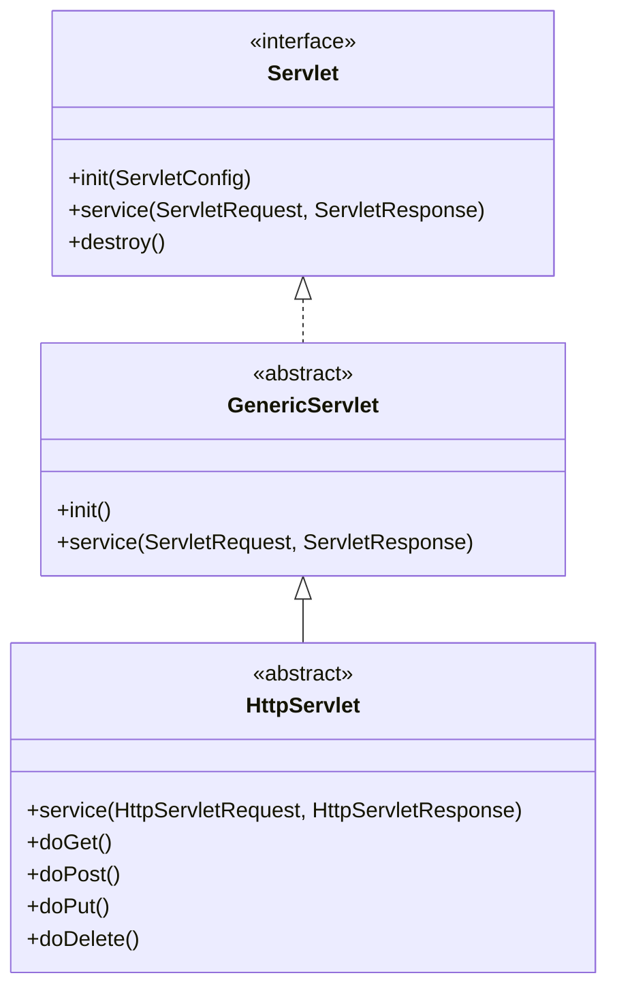

`HttpServlet`은 HTTP 메서드에 따라 요청을 적절한 메서드로 분기한다.

예를 들어 다음과 같다.

| HTTP 메서드 | HttpServlet 메서드 |
| -------- | --------------- |
| GET      | `doGet()`       |
| POST     | `doPost()`      |
| PUT      | `doPut()`       |
| DELETE   | `doDelete()`    |
| HEAD     | `doHead()`      |
| OPTIONS  | `doOptions()`   |
| TRACE    | `doTrace()`     |

개발자는 모든 HTTP 요청을 직접 분석할 필요 없이 필요한 메서드를 재정의하면 된다.

예를 들어 GET 요청을 처리하려면 다음과 같이 작성한다.

```java
public class HelloServlet extends HttpServlet {

    @Override
    protected void doGet(
            HttpServletRequest request,
            HttpServletResponse response
    ) throws IOException {

        response.setContentType("text/plain;charset=UTF-8");

        response.getWriter().write("Hello Servlet");
    }
}
```

이 코드는 HTTP GET 요청을 처리하는 Servlet이다.

중요한 것은 개발자가 `doGet()`을 직접 호출하지 않는다는 점이다.

클라이언트가 요청하면 Servlet Container가 `service()`를 호출하고, `HttpServlet`이 HTTP 메서드를 확인한 뒤 적절한 메서드로 분기한다.

개념적으로 다음과 같다.

```text
Servlet Container
        ↓
service(request, response)
        ↓
HTTP Method 확인
        ↓
GET 요청인가?
        ↓
doGet(request, response)
        ↓
HTTP 응답 처리
```

즉 `doGet()`은 Servlet Container가 관리하는 요청 처리 흐름 안에서 실행된다.

---

### Servlet Container란 무엇인가?

Servlet Container는 Servlet을 실행하고 관리하는 환경이다.

대표적인 구현체는 다음과 같다.

| Servlet Container | 특징                           |
| ----------------- | ---------------------------- |
| Apache Tomcat     | 널리 사용되는 Servlet Container    |
| Jetty             | 임베디드 서버와 Servlet 환경 지원       |
| Undertow          | 비동기 I/O 기반 서버 기능과 Servlet 지원 |

일반적인 Spring Boot 웹 애플리케이션에서는 Tomcat을 기본 내장 서버로 사용하는 구성이 널리 사용된다.

Servlet Container는 단순히 Servlet 객체를 보관하는 역할만 수행하지 않는다.

클라이언트의 요청을 처리하고 Servlet이 실행될 수 있는 환경을 제공한다.

주요 책임은 다음과 같다.

| 책임          | 설명                       |
| ----------- | ------------------------ |
| Servlet 생성  | Servlet 인스턴스 생성          |
| Servlet 초기화 | `init()` 호출              |
| 요청 매핑       | 요청을 처리할 Servlet 결정       |
| 요청 객체 제공    | `HttpServletRequest` 제공  |
| 응답 객체 제공    | `HttpServletResponse` 제공 |
| 요청 실행       | `service()` 호출           |
| Filter 관리   | Servlet 앞뒤의 처리 체인 실행     |
| 세션 관리       | HTTP Session 기능 제공       |
| 비동기 처리      | Servlet Async 처리 지원      |
| 생명주기 관리     | Servlet 종료 및 자원 정리       |

이러한 책임 덕분에 개발자는 소켓을 직접 생성하거나 HTTP 메시지를 일일이 파싱하지 않고도 웹 애플리케이션을 개발할 수 있다.

---

### 왜 Servlet Container가 필요할까?

Servlet Container가 없다면 어떤 일이 발생할까?

Java로 HTTP 서버를 직접 구현한다고 가정하자.

개발자는 서버 소켓을 생성해야 한다.

그리고 클라이언트 연결을 수락해야 한다.

요청으로 전달된 바이트를 읽어야 한다.

HTTP 요청 라인과 헤더를 파싱해야 한다.

요청 본문을 처리해야 한다.

HTTP 메서드와 URI에 따라 실행할 코드를 결정해야 한다.

응답 상태 코드와 헤더, 본문을 직접 생성해야 한다.

마지막으로 결과를 네트워크로 전송해야 한다.

이뿐만이 아니다.

여러 클라이언트가 동시에 요청하면 동시성 처리를 고려해야 한다.

연결이 갑자기 종료되거나 잘못된 HTTP 요청이 들어오는 상황도 처리해야 한다.

즉 비즈니스 로직을 구현하기 전에 네트워크 서버를 만드는 작업부터 필요하다.

Servlet Container는 이러한 공통적인 문제를 해결한다.

개발자는 다음과 같은 코드에 집중할 수 있다.

```java
@Override
protected void doGet(
        HttpServletRequest request,
        HttpServletResponse response
) throws IOException {

    response.getWriter().write("Hello");
}
```

**Servlet Container의 가장 큰 역할은 HTTP 서버 운영과 요청 처리에 필요한 공통 기능을 제공해 애플리케이션이 비즈니스 로직에 집중할 수 있도록 하는 것**이다.

---

### Servlet의 생명주기

Servlet의 생명주기는 크게 생성, 초기화, 요청 처리, 종료로 구분할 수 있다.

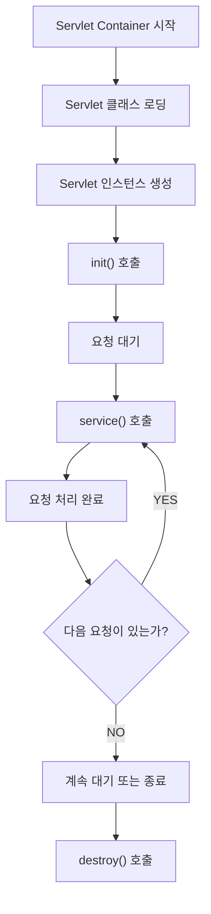

각 단계의 특징을 살펴보자.

#### 1. Servlet 인스턴스 생성

Servlet Container는 필요한 Servlet 인스턴스를 생성한다.

생성 시점은 설정에 따라 달라질 수 있다.

서버 시작 과정에서 Servlet을 생성할 수도 있다.

또는 해당 Servlet에 처음 요청이 들어왔을 때 생성할 수도 있다.

Servlet 등록 시 `loadOnStartup` 값을 설정하면 초기화 시점을 제어할 수 있다.

#### 2. init()

Servlet이 생성된 후 초기화 작업을 수행한다.

일반적으로 정상적인 Servlet 생명주기에서 `init()`은 인스턴스당 한 번 호출된다.

예를 들어 다음과 같다.

```java
@Override
public void init() throws ServletException {
    super.init();

    System.out.println("Servlet initialized");
}
```

이 메서드는 Servlet을 사용하기 위한 초기 설정을 수행하는 데 활용할 수 있다.

#### 3. service()

클라이언트의 HTTP 요청이 들어오면 Container는 Servlet의 `service()`를 호출한다.

이 단계는 요청이 들어올 때마다 반복될 수 있다.

```java
@Override
protected void doGet(
        HttpServletRequest request,
        HttpServletResponse response
) throws IOException {

    System.out.println("Request received");

    response.getWriter().write("Hello");
}
```

요청이 100번 들어왔다면 같은 Servlet 인스턴스의 요청 처리 메서드가 여러 번 실행될 수 있다.

#### 4. destroy()

Servlet Container가 해당 Servlet을 서비스에서 제거할 때 `destroy()`를 호출한다.

```java
@Override
public void destroy() {
    System.out.println("Servlet destroyed");

    super.destroy();
}
```

일반적인 정상 종료 과정에서 정리 작업을 수행할 수 있다.

다만 프로세스가 강제 종료되는 상황까지 포함해 `destroy()` 실행을 무조건 보장할 수는 없다.

#### Servlet은 요청마다 새롭게 생성될까?

그렇지 않다.

일반적인 Servlet Container는 Servlet 선언당 하나의 인스턴스를 생성하고 여러 요청에서 재사용한다.

따라서 다음 흐름을 생각할 수 있다.

```text
서버 시작
    ↓
Servlet 인스턴스 생성
    ↓
init() 1회
    ↓
요청 A → service()
요청 B → service()
요청 C → service()
    ↓
서버 종료
    ↓
destroy()
```

여기서 중요한 점은 **Servlet 인스턴스와 요청 객체의 생명주기가 다르다**는 사실이다.

Servlet 인스턴스는 여러 요청에서 공유될 수 있다.

반면 요청과 응답 상태는 각 HTTP 요청에 맞춰 관리된다.

Jakarta Servlet 명세에서도 일반적인 환경에서는 하나의 Servlet 선언에 대해 단일 인스턴스를 사용하며, 그 인스턴스가 여러 요청을 처리할 수 있도록 정의한다.

---

### Servlet과 Spring Controller는 무엇이 다를까?

Spring Boot에서 개발자는 직접 Servlet을 작성하는 대신 `@RestController`를 주로 사용한다.

```java
@RestController
public class MemberController {

    @GetMapping("/members")
    public List<MemberResponse> findMembers() {
        return List.of();
    }
}
```

이때 `MemberController` 자체가 Servlet인 것은 아니다.

일반적인 Spring MVC 환경에서는 `DispatcherServlet`이 Servlet 역할을 수행한다.

그리고 `DispatcherServlet`이 Spring MVC의 내부 구성 요소를 이용해 Controller 메서드를 호출한다.

구조는 다음과 같다.

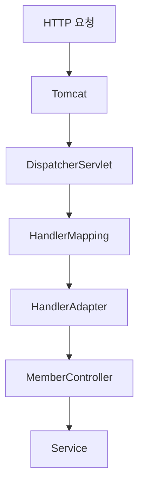

여기서 중요한 구분이 있다.

**Tomcat이 찾는 대상은 Servlet이다.**

**Spring MVC가 찾는 대상은 Controller의 Handler다.**

서로 다른 매핑 과정이다.

이 차이를 이해해야 Tomcat의 내부 요청 매핑과 Spring의 `@GetMapping`이 어떻게 연결되는지 알 수 있다.

---

### Tomcat의 내부 구조

Apache Tomcat은 Servlet Container이면서 HTTP 서버 기능도 제공한다.

Tomcat 내부 구조를 이해할 때 중요한 구성 요소는 크게 Coyote와 Catalina다.

Coyote는 네트워크 프로토콜 처리 영역이다.

Catalina는 Servlet Container 기능을 담당하는 영역이다.

개념적으로 다음과 같다.

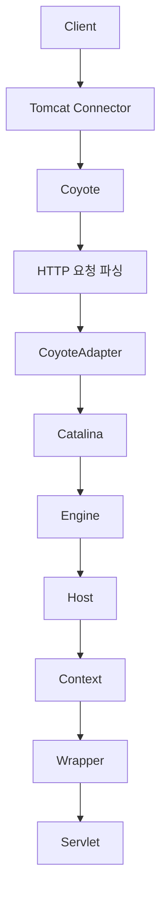

실제 Tomcat은 이보다 많은 구성 요소를 가지고 있다.

하지만 요청 처리 흐름을 이해하려면 먼저 위 구조를 이해하는 것이 중요하다.

Tomcat 공식 아키텍처 문서에서도 Connector, Engine, Host, Context를 주요 구성 요소로 구분하고 있다.

---

### Coyote란 무엇인가?

Coyote는 Tomcat에서 HTTP 등의 네트워크 프로토콜 처리를 담당하는 구성 영역이다.

클라이언트는 HTTP 요청을 네트워크를 통해 전송한다.

서버는 해당 연결로 전달된 바이트를 읽고 HTTP 메시지로 해석해야 한다.

예를 들어 클라이언트가 다음 요청을 전송했다고 가정하자.

```http
GET /api/hello?name=java HTTP/1.1
Host: localhost:8080
User-Agent: curl/8.0
Accept: */*
```

Coyote의 HTTP 처리 계층은 이 요청을 해석한다.

요청 메서드는 무엇인가?

```text
GET
```

요청 대상은 무엇인가?

```text
/api/hello?name=java
```

HTTP 버전은 무엇인가?

```text
HTTP/1.1
```

헤더에는 어떤 정보가 포함되어 있는가?

```text
Host: localhost:8080
User-Agent: curl/8.0
Accept: */*
```

이러한 정보를 Tomcat 내부에서 활용할 수 있는 형태로 관리한다.

#### Coyote의 주요 역할

| 역할             | 설명                     |
| -------------- | ---------------------- |
| 네트워크 I/O       | 클라이언트와 데이터 송수신         |
| HTTP 파싱        | 요청 라인과 헤더 분석           |
| 프로토콜 처리        | HTTP/1.1, HTTP/2 등의 처리 |
| 내부 Request 관리  | 요청 정보를 내부 객체로 표현       |
| 내부 Response 관리 | 응답 정보를 내부 객체로 표현       |
| Catalina 연결    | Servlet 처리 영역으로 요청 전달  |

Coyote는 단순히 문자열을 읽는 기능이 아니다.

네트워크 연결과 HTTP 프로토콜을 처리하는 다양한 내부 구성 요소들이 협력한다.

Tomcat의 요청 처리 과정은 Endpoint와 Protocol Processor를 거쳐 CoyoteAdapter로 이어지는 구조로 설명할 수 있다.

---

### Catalina란 무엇인가?

Catalina는 Tomcat의 Servlet Container 구현 영역이다.

Coyote가 네트워크와 HTTP 프로토콜 처리를 담당한다면 Catalina는 어떤 웹 애플리케이션과 Servlet이 요청을 처리할지 결정하고 실행하는 역할을 담당한다.

Catalina의 주요 구조를 살펴보자.

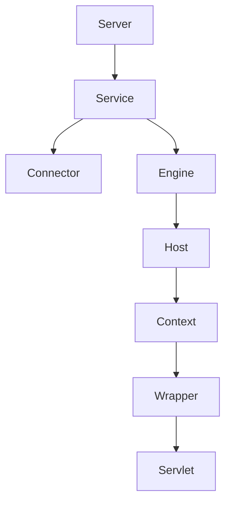

각 구성 요소의 역할은 다음과 같다.

| 구성 요소     | 역할                    |
| --------- | --------------------- |
| Server    | Tomcat 전체 서버를 표현      |
| Service   | Connector와 Engine을 연결 |
| Connector | 외부 통신을 처리             |
| Engine    | 요청 처리 엔진              |
| Host      | 가상 호스트를 표현            |
| Context   | 하나의 웹 애플리케이션을 표현      |
| Wrapper   | Servlet 정의와 실행 관리를 담당 |
| Servlet   | 실제 애플리케이션 요청 처리       |

여기서 특히 중요한 것은 Host, Context, Wrapper다.

Tomcat은 요청을 처리할 대상을 결정할 때 이러한 구조를 활용한다.

---

### Host는 무엇을 의미할까?

Host는 Tomcat에서 가상 호스트를 표현하는 구성 요소다.

하나의 서버에서 여러 호스트 이름을 처리하는 구성을 생각할 수 있다.

예를 들어 다음과 같다.

```text
api.example.com

admin.example.com
```

두 호스트 이름이 같은 Tomcat 서버를 가리킬 수 있다.

하지만 Tomcat 내부에서는 서로 다른 Host 구성을 통해 요청을 처리하도록 설정할 수 있다.

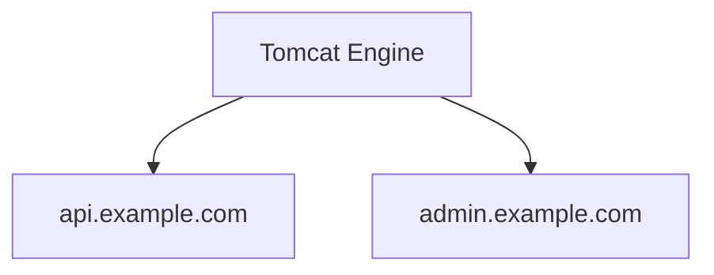

HTTP 요청의 Host 정보나 관련 연결 메타데이터가 적절한 가상 호스트를 결정하는 데 사용될 수 있다.

실제 선택 과정은 Tomcat의 Connector와 Mapper 설정에 영향을 받는다.

---

### Context는 무엇을 의미할까?

Context는 하나의 웹 애플리케이션을 의미한다.

예를 들어 하나의 Tomcat 서버에서 두 웹 애플리케이션을 운영한다고 가정하자.

```text
/app1

/app2
```

개념적으로 다음과 같이 구성할 수 있다.

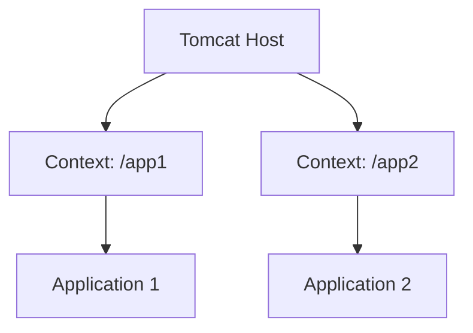

클라이언트가 다음 요청을 보냈다고 가정하자.

```http
GET /app1/users HTTP/1.1
Host: localhost:8080
```

Tomcat은 요청 경로를 기반으로 적절한 Context를 찾는다.

그다음 해당 Context에 등록된 Servlet 중 요청을 처리할 대상을 결정한다.

Spring Boot의 내장 Tomcat 환경에서는 보통 하나의 Spring Boot 애플리케이션이 하나의 주요 웹 애플리케이션 Context로 실행된다.

기본 Context Path는 빈 경로이며, 필요하다면 설정으로 변경할 수 있다.

```yaml
server:
  servlet:
    context-path: /myapp
```

이제 Controller에 다음 매핑이 있다고 가정하자.

```java
@GetMapping("/hello")
public String hello() {
    return "Hello";
}
```

클라이언트는 다음 경로로 접근하게 된다.

```text
/myapp/hello
```

여기서 `/myapp`은 Servlet Context Path이고 `/hello`는 애플리케이션 내부의 요청 경로다.

---

### Wrapper는 무엇을 의미할까?

Wrapper는 Tomcat에서 개별 Servlet을 관리하는 구성 요소다.

Context 안에는 여러 Servlet이 등록될 수 있다.

예를 들어 다음과 같은 구성을 생각해 보자.

```text
Context: /myapp

├── DispatcherServlet
├── CustomServlet
└── JspServlet
```

Tomcat은 요청을 처리할 Servlet을 결정한 뒤 해당 Servlet을 관리하는 Wrapper를 통해 실행한다.

Wrapper는 Servlet의 생성과 초기화, 호출 과정에 관여한다.

따라서 Catalina를 다음과 같은 계층으로 이해할 수 있다.

```text
Engine
    ↓
Host
    ↓
Context
    ↓
Wrapper
    ↓
Servlet
```

이 구조가 중요한 이유는 Tomcat이 모든 요청을 단순히 하나의 Servlet으로 전달하는 것이 아니기 때문이다.

요청 주소와 Servlet 등록 정보를 비교해 적절한 Servlet을 결정한다.

---

### Tomcat은 어떻게 요청을 처리할 Servlet을 찾을까?

이제 중요한 질문을 살펴보자.

클라이언트가 다음 요청을 보냈다고 가정하자.

```http
GET /admin/users HTTP/1.1
Host: localhost:8080
```

Tomcat은 어떻게 이 요청을 처리할 Servlet을 찾을까?

여기서 중요한 내부 구성 요소가 `Mapper`다.

Tomcat은 `org.apache.catalina.mapper.Mapper`를 통해 요청에 대응하는 Host, Context, Wrapper 등을 결정한다.

개념적인 처리 과정은 다음과 같다.

```text
HTTP 요청
    ↓
Host 확인
    ↓
Context 확인
    ↓
Context 버전 등 관련 매핑 정보 확인
    ↓
Servlet 매핑 규칙 적용
    ↓
Wrapper 선택
    ↓
Servlet 실행
```

실제 내부 구현에는 매핑 정보 캐싱과 경로 처리, 여러 예외 상황을 위한 로직이 포함된다.

하지만 핵심은 **클라이언트가 전송한 요청 경로가 최종적으로 실행할 Servlet을 선택하는 데 사용된다**는 점이다.

---

### Servlet 매핑에는 어떤 규칙이 있을까?

Servlet 명세에서는 요청 경로와 Servlet URL 패턴을 비교하는 규칙을 정의한다.

대표적으로 다음 네 가지 방식이 존재한다.

| 우선순위 | 매핑 방식          | 예제             |
| ---: | -------------- | -------------- |
|    1 | 정확한 경로 매칭      | `/admin/users` |
|    2 | 가장 긴 경로 접두사 매칭 | `/admin/*`     |
|    3 | 확장자 매칭         | `*.jsp`        |
|    4 | 기본 Servlet 매핑  | `/`            |

각각 살펴보자.

#### 1. 정확한 경로 매칭

다음 Servlet 매핑이 있다고 가정하자.

```text
/admin/users
```

그리고 요청이 다음과 같이 들어온다.

```http
GET /admin/users HTTP/1.1
```

요청 경로와 정확하게 일치하는 Servlet 매핑이 존재한다.

따라서 해당 Servlet이 선택된다.

#### 2. 경로 접두사 매칭

다음과 같은 Servlet 매핑이 있다고 가정하자.

```text
/admin/*
```

이 설정은 `/admin` 아래의 요청 경로를 처리하는 데 사용할 수 있다.

예를 들어 다음과 같다.

```text
/admin/users

/admin/orders

/admin/settings
```

여러 접두사 매핑이 일치한다면 가장 긴 경로에 일치하는 매핑이 우선한다.

#### 3. 확장자 매칭

확장자를 기준으로 Servlet을 선택할 수도 있다.

예를 들어 다음과 같다.

```text
*.jsp
```

요청이 다음과 같이 들어온다.

```text
/view.jsp
```

더 우선하는 정확한 경로나 접두사 매핑이 없다면 JSP 처리 Servlet이 선택될 수 있다.

#### 4. 기본 Servlet 매핑

앞선 규칙에서 더 적절한 매핑을 찾지 못했다면 기본 매핑이 사용될 수 있다.

Servlet 명세에서 `/`는 기본 Servlet 매핑을 나타내는 특별한 패턴이다.

여기서 반드시 구분해야 하는 부분이 있다.

```text
/
```

```text
/*
```

두 패턴은 동일하지 않다.

`/`는 기본 Servlet 매핑이다.

반면 `/*`는 경로 접두사 매핑이다.

일반적으로 `/*`를 사용하면 기본 매핑보다 우선하는 경로 매핑으로 동작해 다른 Servlet과 충돌을 일으킬 수 있다.

Servlet 매핑의 정확한 우선순위와 패턴은 Jakarta Servlet 명세에 정의되어 있다.

---

### Spring Boot에서는 모든 요청이 DispatcherServlet으로 전달될까?

Spring Boot의 일반적인 Spring MVC 자동 설정에서는 `DispatcherServlet`을 기본 URL 패턴 `/`에 매핑한다.

따라서 대부분의 일반적인 MVC 요청은 DispatcherServlet을 통해 처리된다.

하지만 모든 요청이 예외 없이 DispatcherServlet을 거친다고 이해해서는 안 된다.

예를 들어 다음 상황을 생각할 수 있다.

다른 Servlet이 별도로 등록되어 있다.

해당 Servlet에 더 우선하는 URL 패턴이 설정되어 있다.

Servlet Filter가 요청을 차단하고 다음 단계로 전달하지 않는다.

웹 서버나 리버스 프록시가 정적 파일을 직접 처리한다.

이러한 경우에는 DispatcherServlet이 실행되지 않을 수 있다.

또 Spring Boot에서 일반적으로 제공하는 정적 리소스는 Spring MVC의 리소스 처리 기능으로 제공될 수 있다.

따라서 정적 리소스가 무조건 Tomcat의 DefaultServlet에서 처리된다고 생각해서는 안 된다.

Spring MVC는 `ResourceHttpRequestHandler` 등을 이용해 정적 리소스를 처리할 수 있으며, 필요하다면 Container의 DefaultServlet에 처리를 위임하는 방식도 지원한다.

---

### Servlet 매핑과 @GetMapping은 무엇이 다를까?

이 부분은 Spring MVC를 이해할 때 매우 중요하다.

예를 들어 다음 코드를 생각해 보자.

```java
@RestController
@RequestMapping("/api")
public class HelloController {

    @GetMapping("/hello")
    public String hello() {
        return "Hello";
    }
}
```

클라이언트는 다음 요청을 보낸다.

```http
GET /api/hello HTTP/1.1
```

이때 Tomcat이 직접 `HelloController`를 검색하는 것은 아니다.

Tomcat은 먼저 자신의 Servlet 매핑 규칙을 적용한다.

그리고 요청을 처리할 Servlet으로 `DispatcherServlet`을 선택할 수 있다.

그다음 DispatcherServlet이 Spring MVC의 HandlerMapping을 이용해 Controller 메서드를 찾는다.

따라서 매핑 과정이 두 단계로 나누어진다.

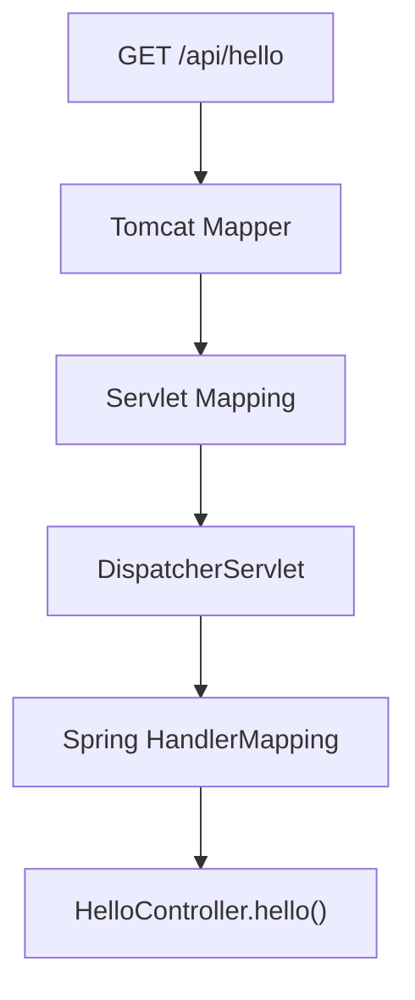

각 단계의 책임을 비교하면 다음과 같다.

| 구분       | Servlet Mapping     | Spring MVC HandlerMapping     |
| -------- | ------------------- | ----------------------------- |
| 관리 주체    | Servlet Container   | Spring MVC                    |
| 찾는 대상    | Servlet             | Handler                       |
| 대표적인 설정  | Servlet URL Pattern | `@GetMapping`, `@PostMapping` |
| 경로 매핑 예제 | `/`, `/admin/*`     | `/api/hello`                  |
| 실행 결과    | Servlet 선택          | Controller 메서드 선택             |

즉 `@GetMapping`은 Tomcat의 Servlet 등록 규칙이 아니다.

Spring MVC 내부에서 동작하는 Handler 매핑 규칙이다.

---

### Coyote와 Catalina는 어떻게 연결될까?

지금까지는 Coyote와 Catalina를 별도의 영역으로 구분했다.

하지만 실제 HTTP 요청은 두 영역을 거쳐 처리된다.

이 둘을 연결하는 중요한 구성 요소가 `CoyoteAdapter`다.

개념적인 흐름은 다음과 같다.

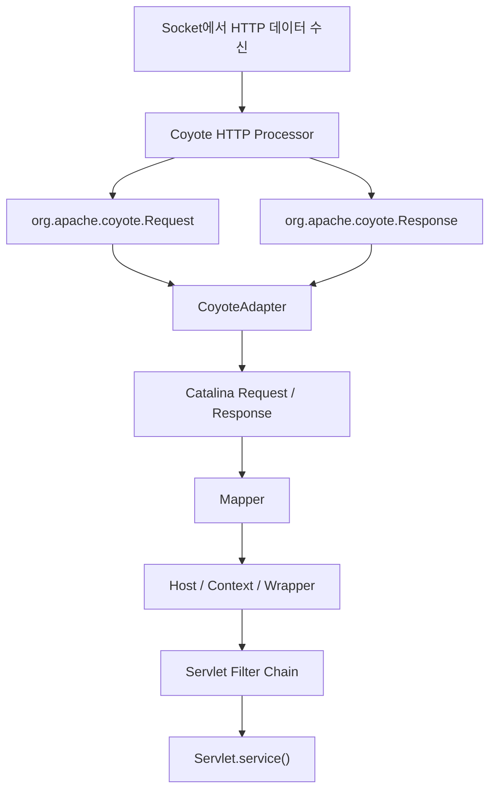

여기서 중요한 점은 Tomcat 내부에 이름이 같은 Request 클래스가 여러 개 존재한다는 사실이다.

예를 들어 다음 두 클래스는 이름은 같지만 역할이 다르다.

```java
org.apache.coyote.Request
```

```java
org.apache.catalina.connector.Request
```

이 차이를 이해하면 `HttpServletRequest`가 어디에서 만들어지는지도 설명할 수 있다.

---

### HttpServletRequest는 언제 생성될까?

Spring MVC에서 개발자는 다음과 같은 코드를 작성할 수 있다.

```java
@GetMapping("/hello")
public String hello(HttpServletRequest request) {
    return request.getMethod();
}
```

개발자가 직접 다음 코드를 작성하지는 않는다.

```java
HttpServletRequest request = new HttpServletRequest();
```

실제로 `HttpServletRequest`는 인터페이스이므로 직접 인스턴스를 생성할 수도 없다.

그렇다면 누가 구현 객체를 제공하는 것일까?

일반적인 Tomcat 환경에서는 Tomcat이 HTTP 요청을 파싱하고 Servlet API를 통해 접근할 수 있는 요청 객체를 제공한다.

이 과정에서 여러 계층의 Request가 사용된다.

---

### 첫 번째 Request: Coyote Request

Coyote는 HTTP 프로토콜을 처리하기 위한 내부 Request를 사용한다.

대표적인 클래스가 다음과 같다.

```java
org.apache.coyote.Request
```

이 객체는 저수준 HTTP 요청 정보를 효율적으로 관리하기 위한 객체다.

예를 들어 HTTP 요청 메서드와 URI, 헤더 등의 정보를 다룬다.

```text
HTTP Method

Request URI

HTTP Version

Headers

Content Length

Request Body
```

Tomcat은 이 객체를 이용해 네트워크에서 수신한 요청을 내부적으로 표현한다.

Coyote Request는 일반적인 애플리케이션 코드에서 직접 사용하는 객체가 아니다.

Tomcat 공식 API에서도 Coyote Request는 저수준 요청 표현이며, 비용이 큰 처리는 필요할 때까지 지연할 수 있도록 설계되어 있다고 설명한다.

#### Request 객체는 반드시 매번 새로 생성될까?

여기서 주의할 점이 있다.

HTTP 요청마다 독립적인 요청 상태가 필요하다는 사실과 Java Request 객체를 매번 새롭게 생성한다는 사실은 동일하지 않다.

Tomcat은 내부 객체의 생성 비용과 GC 부담을 줄이기 위해 요청 처리에 사용한 객체를 정리한 뒤 재사용할 수 있다.

따라서 요청 처리의 논리적인 생명주기와 내부 객체의 메모리 할당 방식은 구분해야 한다.

---

### 두 번째 Request: Catalina Request

Coyote가 생성하고 관리하는 저수준 요청 정보를 Servlet API에서 사용하기 위해 Catalina의 Request가 활용된다.

대표적인 클래스는 다음과 같다.

```java
org.apache.catalina.connector.Request
```

이 객체는 Coyote Request를 기반으로 Servlet에 필요한 기능을 제공한다.

예를 들어 다음과 같은 기능이다.

```text
getMethod()

getRequestURI()

getHeader()

getCookies()

getParameter()

getSession()
```

Coyote Request가 HTTP 프로토콜 처리에 가까운 객체라면 Catalina Request는 Servlet API에 가까운 객체다.

여기서 중요한 차이는 추상화 수준이다.

Coyote는 네트워크와 HTTP 메시지 처리에 집중한다.

Catalina는 Servlet 애플리케이션에서 편리하게 사용할 수 있는 고수준 기능을 제공한다.

---

### 세 번째 Request: RequestFacade

Tomcat에는 다음 클래스도 존재한다.

```java
org.apache.catalina.connector.RequestFacade
```

`RequestFacade`는 `HttpServletRequest`를 구현하는 클래스다.

내부적으로 Catalina Request를 참조하고, Servlet API를 통해 제공해야 하는 메서드 호출을 위임한다.

개념적인 구조는 다음과 같다.

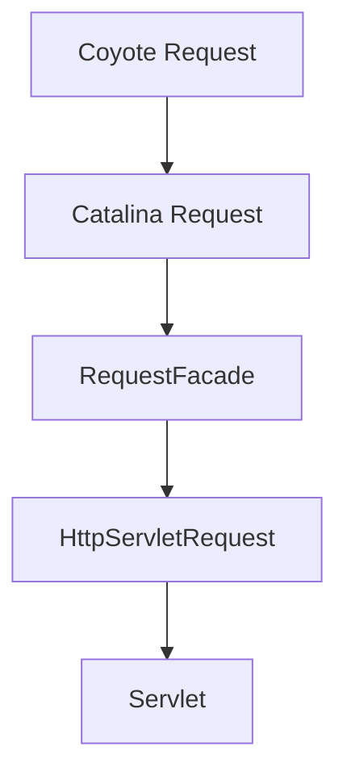

Tomcat 공식 API에서도 `RequestFacade`를 Catalina Request를 감싸 Servlet API를 제공하는 객체로 설명한다.

#### 왜 Facade가 필요할까?

Facade는 복잡한 내부 구현을 외부 사용자에게 그대로 노출하지 않고 필요한 인터페이스만 제공하기 위한 설계 방식이다.

애플리케이션 개발자는 다음과 같이 사용할 수 있다.

```java
String method = request.getMethod();

String uri = request.getRequestURI();

String token = request.getHeader("Authorization");
```

이때 개발자는 HTTP 파싱 과정이나 내부 버퍼의 구조를 알 필요가 없다.

또 Tomcat 내부 구현에 직접 접근할 필요도 없다.

Servlet API가 제공하는 계약을 통해 요청 정보를 사용할 수 있다.

여기서 추가로 알아둘 점이 있다.

실제 Controller에서 전달받는 `HttpServletRequest`의 구현 클래스가 항상 `RequestFacade`인 것은 아니다.

Servlet Filter나 Spring의 요청 처리 인프라에서 Request를 추가로 감싸는 경우도 존재하기 때문이다.

예를 들어 `HttpServletRequestWrapper`를 이용하면 기존 Request에 새로운 동작을 추가할 수 있다.

따라서 실제 객체의 클래스 이름을 확인했을 때 여러 Wrapper가 등장해도 이상한 것은 아니다.

---

### RequestFacade의 역할을 이해하기 위한 예제

다음 HTTP 요청이 있다고 가정하자.

```http
GET /api/members?id=10 HTTP/1.1
Host: localhost:8080
Cookie: SESSION=abc123
User-Agent: curl/8.0
```

Servlet에서는 다음과 같이 사용할 수 있다.

```java
@Override
protected void doGet(
        HttpServletRequest request,
        HttpServletResponse response
) throws IOException {

    String method = request.getMethod();

    String uri = request.getRequestURI();

    String memberId = request.getParameter("id");

    Cookie[] cookies = request.getCookies();

    response.setContentType("text/plain;charset=UTF-8");

    response.getWriter().write(
            "method=" + method
                    + ", uri=" + uri
                    + ", memberId=" + memberId
    );
}
```

이 코드에서는 직접 HTTP 문자열을 분석하지 않는다.

```java
request.getParameter("id");
```

이 메서드만 호출해도 쿼리 파라미터에 접근할 수 있다.

또 다음 메서드를 통해 쿠키를 사용할 수 있다.

```java
request.getCookies();
```

이는 Servlet Container가 HTTP 메시지를 해석하고 애플리케이션에 필요한 API를 제공하기 때문이다.

다만 일부 정보는 요청을 최초로 수신한 시점에 모두 객체로 변환되는 것이 아니라 실제 접근하는 시점에 파싱될 수도 있다.

Tomcat은 이러한 지연 처리 방식을 활용해 불필요한 작업을 줄일 수 있다.

---

### HttpServletRequest와 ServletRequest의 차이

두 인터페이스는 상속 관계를 가진다.

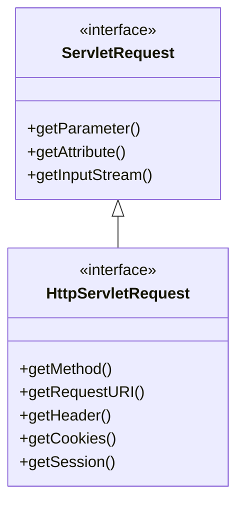

`ServletRequest`는 일반적인 요청 정보를 제공한다.

`HttpServletRequest`는 HTTP에 특화된 기능을 추가한다.

예를 들어 HTTP 메서드는 HTTP 프로토콜에 해당하는 개념이다.

```java
request.getMethod();
```

HTTP 헤더도 마찬가지다.

```java
request.getHeader("Authorization");
```

따라서 일반적인 Spring MVC 애플리케이션에서는 `HttpServletRequest`를 주로 사용한다.

---

### Spring MVC까지 요청이 전달되는 과정

이제 요청이 DispatcherServlet에 전달되었다고 가정하자.

그다음에는 어떤 일이 발생할까?

Spring MVC는 Front Controller 패턴을 사용한다.

Front Controller는 여러 요청의 공통 진입점을 하나의 구성 요소로 통합하는 패턴이다.

Spring MVC에서는 DispatcherServlet이 이 역할을 수행한다.

DispatcherServlet은 요청을 직접 처리할 Controller를 찾고, 적절한 실행 방식을 선택하고, 응답 처리에 필요한 구성 요소들과 협력한다.

Spring 공식 문서에서도 DispatcherServlet을 공통 요청 처리 알고리즘을 제공하는 중앙 Servlet으로 설명한다.

전체 흐름은 다음과 같다.

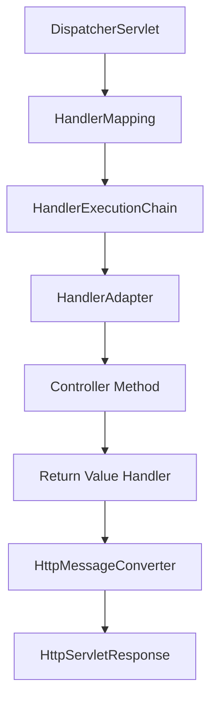

이 구조를 하나씩 살펴보자.

---

### HandlerMapping은 무엇인가?

HandlerMapping은 요청을 처리할 Handler를 찾는 역할을 한다.

예를 들어 다음 요청이 있다고 가정하자.

```http
GET /api/members/10 HTTP/1.1
```

Controller에는 다음 메서드가 존재한다.

```java
@RestController
@RequestMapping("/api/members")
public class MemberController {

    @GetMapping("/{memberId}")
    public ResponseEntity<MemberResponse> findMember(
            @PathVariable Long memberId
    ) {
        return ResponseEntity.ok(
                new MemberResponse(memberId, "member")
        );
    }
}
```

HandlerMapping은 요청 경로와 HTTP 메서드 등의 조건을 기반으로 적절한 Handler를 찾는다.

대표적으로 다음 구현체가 사용된다.

```java
RequestMappingHandlerMapping
```

이 구현체는 `@RequestMapping`, `@GetMapping` 등의 정보를 이용해 Controller 메서드를 매핑한다.

따라서 Tomcat Mapper와 HandlerMapping은 서로 다른 위치에서 동작한다.

```text
Tomcat Mapper

→ Servlet 선택
```

```text
Spring HandlerMapping

→ Controller Handler 선택
```

---

### HandlerAdapter는 무엇인가?

HandlerMapping이 적절한 Handler를 찾았다면 실제로 실행해야 한다.

여기서 HandlerAdapter가 등장한다.

HandlerAdapter는 Handler의 종류에 맞게 실행을 수행하는 역할을 한다.

일반적인 `@RestController` 메서드에서는 다음 구현체가 핵심적으로 사용된다.

```java
RequestMappingHandlerAdapter
```

이 구성 요소는 Controller 메서드를 실행하기 위한 여러 기능과 협력한다.

예를 들어 다음과 같은 작업이다.

```text
메서드 매개변수 해석

@PathVariable 처리

@RequestParam 처리

@RequestBody 변환

Controller 메서드 호출

반환값 처리
```

개발자는 다음과 같이 작성한다.

```java
@GetMapping("/{memberId}")
public MemberResponse findMember(
        @PathVariable Long memberId
) {
    return new MemberResponse(memberId, "member");
}
```

하지만 개발자가 `memberId`를 직접 파싱하는 코드는 작성하지 않는다.

Spring MVC의 Argument Resolver가 요청 정보를 메서드 매개변수에 연결할 수 있도록 처리하기 때문이다.

Spring 공식 문서에서도 `HandlerMapping`과 `HandlerAdapter`를 DispatcherServlet이 사용하는 핵심 확장 구성 요소로 설명한다.

---

### Servlet Filter는 어느 시점에 실행될까?

Servlet 요청 처리에서는 Filter도 중요한 역할을 수행한다.

Filter는 Servlet 실행 전후에 공통 작업을 수행할 수 있는 구성 요소다.

예를 들어 다음과 같은 작업에 활용할 수 있다.

요청 로깅.

인증 및 인가.

요청 정보 보정.

압축 처리.

공통 헤더 설정.

처리 시간 측정.

일반적인 실행 흐름은 다음과 같다.

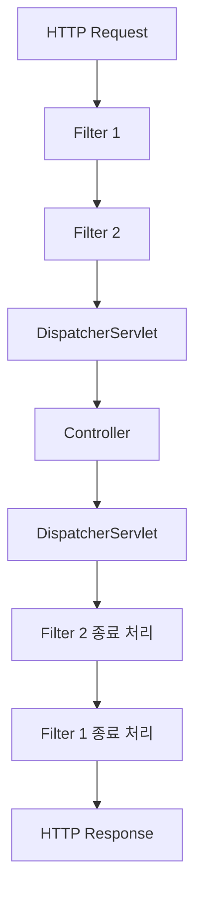

Filter는 Servlet보다 앞선 단계에서 요청을 처리할 수 있다.

또 다음 Filter나 Servlet로 요청을 전달할지 결정할 수도 있다.

---

### Filter Chain은 어떻게 동작할까?

Servlet Filter는 `doFilter()` 메서드를 통해 요청을 처리한다.

예를 들어 다음과 같은 Filter를 생각해 보자.

```java
@Component
public class LoggingFilter implements Filter {

    @Override
    public void doFilter(
            ServletRequest request,
            ServletResponse response,
            FilterChain chain
    ) throws IOException, ServletException {

        System.out.println("Before Servlet");

        chain.doFilter(request, response);

        System.out.println("After Servlet");
    }
}
```

중요한 부분은 다음 코드다.

```java
chain.doFilter(request, response);
```

이 코드는 다음 Filter 또는 최종 Servlet으로 요청 처리를 이어가도록 한다.

실행 순서는 다음과 같다.

```text
LoggingFilter 진입
    ↓
Before Servlet
    ↓
chain.doFilter()
    ↓
DispatcherServlet
    ↓
Controller
    ↓
응답 처리
    ↓
LoggingFilter 복귀
    ↓
After Servlet
```

여기서 Filter가 `chain.doFilter()`를 호출하지 않으면 다음 단계로 요청이 전달되지 않을 수 있다.

이러한 특성은 인증 실패나 접근 제한 같은 상황에서 활용된다.

단, Filter와 HandlerInterceptor는 동일한 구성 요소가 아니다.

Filter는 Servlet Container의 처리 체인에서 동작한다.

HandlerInterceptor는 Spring MVC의 Handler 실행 흐름에서 동작한다.

---

### Filter와 HandlerInterceptor의 차이

| 구분                   | Servlet Filter    | HandlerInterceptor                                 |
| -------------------- | ----------------- | -------------------------------------------------- |
| 관리 영역                | Servlet Container | Spring MVC                                         |
| 실행 범위                | Servlet 요청 처리 체인  | Spring MVC Handler 실행                              |
| 주요 인터페이스             | `Filter`          | `HandlerInterceptor`                               |
| 주요 메서드               | `doFilter()`      | `preHandle()`, `postHandle()`, `afterCompletion()` |
| Controller 실행 전 처리   | 가능                | 가능                                                 |
| 요청 자체를 차단            | 가능                | 가능                                                 |
| Spring Handler 정보 접근 | 직접적인 기본 기능 아님     | Handler 정보를 전달받음                                   |

특히 Spring Security는 Servlet 기반 웹 애플리케이션에서 Filter Chain을 적극적으로 활용한다.

보안 기능을 HandlerInterceptor만으로 구현하기보다 Spring Security와 같이 요청 처리 초기 단계에 통합되는 보안 체계를 사용하는 것이 일반적으로 적절하다.

Spring 공식 문서도 보안 처리에서는 HandlerInterceptor보다 Servlet Filter Chain과 통합된 보안 구성을 권장한다.

---

### HttpServletResponse는 언제 만들어질까?

지금까지 Request가 어떻게 생성되고 전달되는지 살펴보았다.

하지만 HTTP 요청을 처리하려면 응답 객체도 필요하다.

Servlet의 `service()` 메서드를 다시 살펴보자.

```java
void service(
        ServletRequest request,
        ServletResponse response
);
```

요청 객체뿐 아니라 응답 객체도 함께 전달된다.

Servlet Container는 요청을 처리하는 과정에서 해당 요청에 대응하는 Response를 관리한다.

Tomcat에서도 Request와 유사하게 여러 계층의 Response 객체가 존재한다.

대표적으로 다음과 같다.

```java
org.apache.coyote.Response
```

```java
org.apache.catalina.connector.Response
```

```java
org.apache.catalina.connector.ResponseFacade
```

이 객체들은 서로 다른 역할을 담당한다.

---

### Coyote Response와 Catalina Response

Coyote Response는 HTTP 프로토콜 처리에 가까운 내부 응답 객체다.

응답 상태 코드와 헤더, 응답 데이터 전송에 필요한 내부 상태를 관리한다.

Catalina Response는 Servlet API를 통해 응답을 조작할 수 있는 기능을 제공한다.

예를 들어 다음과 같다.

```java
response.setStatus(200);
```

```java
response.setHeader("X-Request-Id", "123");
```

```java
response.getWriter().write("Hello");
```

Servlet은 이러한 API를 사용해 응답을 구성한다.

그리고 Catalina와 Coyote의 내부 구성 요소들이 협력해 실제 HTTP 응답을 처리한다.

---

### ResponseFacade는 무엇인가?

`ResponseFacade`는 Servlet API 관점의 응답 기능을 제공하는 Facade다.

요청에서 RequestFacade를 사용했던 것과 비슷한 구조다.

개념적으로 다음과 같다.

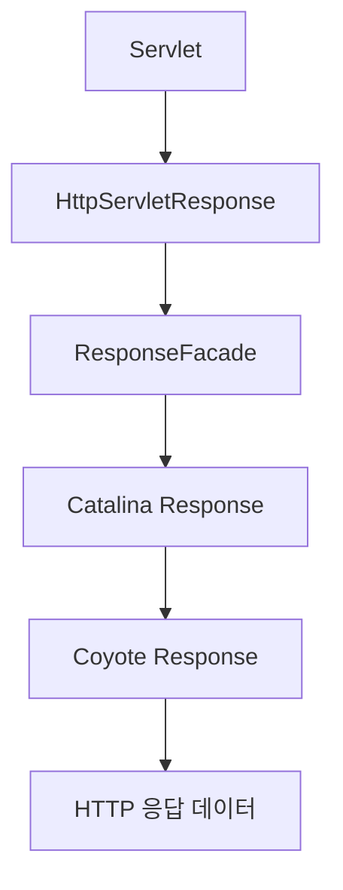

여기서 중요한 점은 Servlet이 네트워크 소켓에 직접 접근하지 않는다는 사실이다.

Servlet은 `HttpServletResponse`를 이용해 응답을 작성한다.

그리고 Servlet Container가 실제 네트워크 전송을 담당한다.

Tomcat은 이러한 역할을 위해 Catalina의 Response와 ResponseFacade, OutputBuffer, Coyote Response 등을 제공한다.

---

### ResponseEntity.ok()는 어떻게 HTTP 200 응답이 될까?

이제 Spring MVC에서 자주 사용하는 코드를 살펴보자.

```java
return ResponseEntity.ok("Hello World");
```

이 한 줄로 실제 HTTP 응답이 생성된다.

하지만 `ResponseEntity.ok()` 자체가 네트워크로 데이터를 전송하는 것은 아니다.

`ResponseEntity`는 HTTP 응답의 상태 코드와 헤더, 본문을 표현하는 Spring의 객체다.

예를 들어 다음과 같이 작성할 수 있다.

```java
return ResponseEntity
        .status(HttpStatus.CREATED)
        .header("X-Resource-Type", "member")
        .body(new MemberResponse(1L, "member"));
```

이 코드에서 개발자는 응답의 의미를 정의한다.

```text
HTTP Status

201 Created
```

```text
Header

X-Resource-Type: member
```

```text
Body

MemberResponse 객체
```

하지만 Java 객체인 `MemberResponse`를 HTTP 응답 본문으로 전달하려면 추가 작업이 필요하다.

이 작업을 Spring MVC의 반환값 처리 인프라가 수행한다.

---

### HttpEntityMethodProcessor란 무엇인가?

Spring MVC에는 Controller 메서드의 반환값을 처리하기 위한 여러 Return Value Handler가 존재한다.

그중 `ResponseEntity`를 처리하는 대표적인 구성 요소가 다음 클래스다.

```java
HttpEntityMethodProcessor
```

이 클래스는 `HttpEntity`와 `ResponseEntity` 등의 반환값을 처리한다.

주요 역할은 다음과 같다.

응답 상태 코드 적용.

응답 헤더 처리.

응답 본문 처리.

필요한 HttpMessageConverter 호출.

응답 출력 처리.

개념적인 흐름은 다음과 같다.

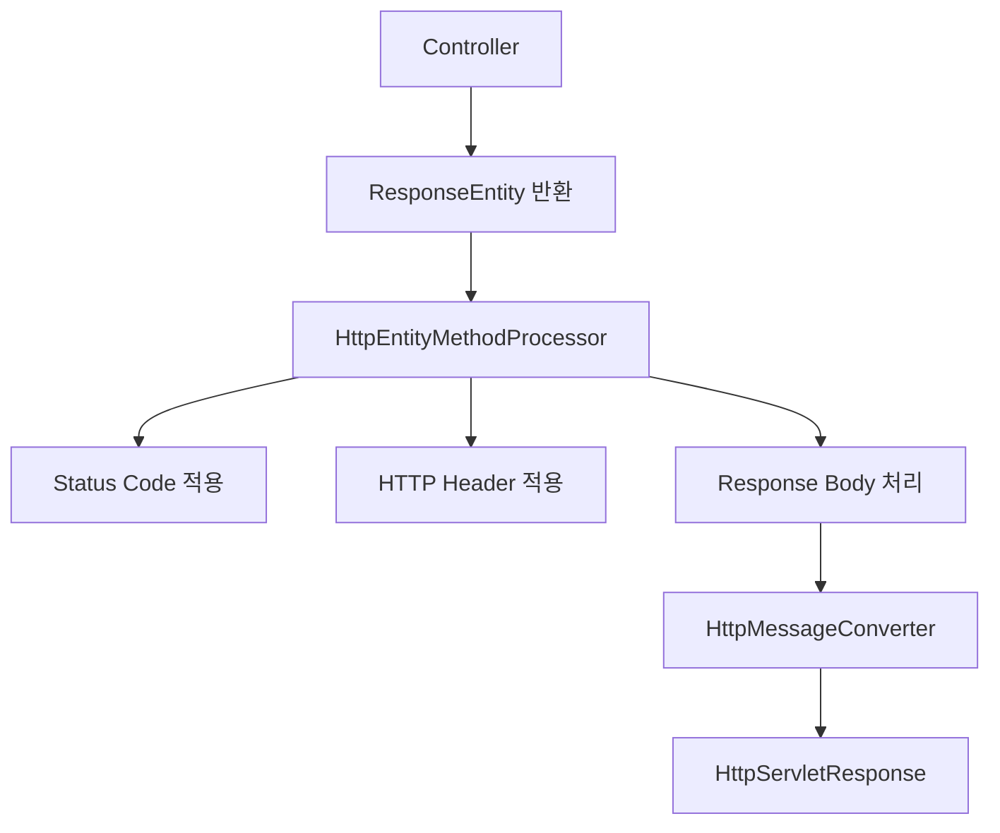

`HttpEntityMethodProcessor`는 Spring MVC의 반환값 처리 계약을 구현하며 `ResponseEntity`를 처리하도록 설계되어 있다.

---

### HttpMessageConverter는 어떤 역할을 할까?

`HttpMessageConverter`는 Java 객체와 HTTP 메시지 본문 사이의 변환을 담당하는 Spring의 추상화다.

예를 들어 Controller에서 다음 객체를 반환한다고 가정하자.

```java
public record MemberResponse(
        Long id,
        String name
) {
}
```

Controller에서는 다음과 같이 반환한다.

```java
return ResponseEntity.ok(
        new MemberResponse(1L, "member")
);
```

하지만 HTTP 응답 본문에는 Java 객체 자체를 그대로 전달할 수 없다.

네트워크로 전송할 수 있는 형태로 직렬화해야 한다.

JSON 응답이라면 다음과 같이 변환할 수 있다.

```json
{
  "id": 1,
  "name": "member"
}
```

Spring MVC에서는 Jackson을 활용하는 `MappingJackson2HttpMessageConverter` 등이 JSON 직렬화를 담당할 수 있다.

반환값의 타입과 요청의 `Accept` 헤더, 응답의 Content-Type 등 여러 조건을 바탕으로 적절한 Converter가 선택된다.

Spring은 HTTP 요청과 응답 본문을 변환하기 위한 `HttpMessageConverter` 추상화를 제공한다.

---

### @ResponseBody와 ResponseEntity는 어떻게 다를까?

다음 두 메서드를 비교해 보자.

#### @ResponseBody 방식

```java
@GetMapping("/hello")
public String hello() {
    return "Hello";
}
```

`@RestController`는 `@ResponseBody`의 의미를 포함하므로 반환값이 HTTP 응답 본문으로 처리된다.

이 경우에는 일반적으로 `RequestResponseBodyMethodProcessor`가 반환값 처리에 관여한다.

#### ResponseEntity 방식

```java
@GetMapping("/hello")
public ResponseEntity<String> hello() {
    return ResponseEntity.ok("Hello");
}
```

이 경우에는 일반적으로 `HttpEntityMethodProcessor`가 반환값 처리에 관여한다.

두 방식 모두 최종적으로 HttpMessageConverter를 이용해 응답 본문을 작성할 수 있다.

하지만 반환값을 해석하는 구성 요소에는 차이가 있다.

| 반환 형태               | 대표적인 처리 구성 요소                      |
| ------------------- | ---------------------------------- |
| `@ResponseBody` 객체  | RequestResponseBodyMethodProcessor |
| `ResponseEntity<T>` | HttpEntityMethodProcessor          |
| 일반적인 MVC View 이름    | ViewResolver 관련 처리                 |

따라서 모든 Controller 반환값이 동일한 Return Value Handler를 거친다고 생각해서는 안 된다.

---

### 응답 데이터는 언제 실제로 전송될까?

이제 가장 중요한 마지막 단계다.

Controller가 다음 객체를 반환했다.

```java
ResponseEntity.ok("Hello World");
```

Spring MVC는 상태 코드와 헤더, 본문을 Servlet Response에 적용한다.

그렇다면 데이터를 작성하는 순간 바로 네트워크로 전송될까?

반드시 그렇지는 않다.

Servlet Container는 응답을 처리할 때 버퍼를 사용할 수 있다.

예를 들어 다음과 같은 구조를 생각할 수 있다.

```text
Controller
    ↓
ResponseEntity
    ↓
HttpMessageConverter
    ↓
HttpServletResponse
    ↓
Response Buffer
    ↓
HTTP Response
```

응답 버퍼는 응답 데이터를 임시로 보관하는 역할을 한다.

이러한 구조가 중요한 이유는 HTTP 응답 상태 코드와 헤더가 실제로 전송되기 전까지 수정될 수 있기 때문이다.

---

### Response Buffer란 무엇인가?

Response Buffer는 HTTP 응답을 네트워크로 전송하기 전에 데이터를 임시로 저장하는 영역이다.

Servlet은 다음과 같이 응답을 작성할 수 있다.

```java
response.setStatus(200);

response.setContentType("text/plain;charset=UTF-8");

response.getWriter().write("Hello");
```

이때 응답 본문이 버퍼에 기록될 수 있다.

그리고 적절한 시점에 실제 출력이 이루어진다.

예를 들어 다음과 같은 경우다.

응답 버퍼가 가득 찬 경우.

명시적으로 Flush를 수행한 경우.

요청 처리가 완료되어 Container가 응답 출력을 마무리하는 경우.

스트리밍 방식으로 응답을 전송하는 경우.

실제 출력 시점은 Container와 응답 처리 방식에 영향을 받는다.

따라서 Servlet의 `write()` 호출과 실제 네트워크 전송 시점은 반드시 동일하지 않다.

---

### Response Commit이란 무엇인가?

HTTP 응답에서 Commit은 상태 코드와 헤더가 확정되어 응답 전송이 시작된 상태를 의미한다.

예를 들어 다음 HTTP 응답을 생각해 보자.

```http
HTTP/1.1 200 OK
Content-Type: text/plain;charset=UTF-8

Hello World
```

여기에는 상태 코드와 헤더, 본문이 존재한다.

상태 코드와 헤더가 아직 전송되지 않았다면 이를 변경할 수 있다.

하지만 응답이 Commit된 이후에는 이미 클라이언트에 전달되기 시작한 상태 코드와 헤더를 되돌릴 수 없다.

Servlet API에서는 다음 메서드를 제공한다.

```java
response.isCommitted();
```

이 메서드는 응답이 Commit되었는지 확인하는 데 사용한다.

또 다음 메서드가 존재한다.

```java
response.flushBuffer();
```

이 메서드는 버퍼의 내용을 강제로 출력하도록 요청한다.

Servlet 명세에 따르면 `flushBuffer()`는 응답을 Commit하며, 이후에는 이미 전송된 상태 코드와 헤더를 수정할 수 없다.

---

### flushBuffer()는 어떻게 동작할까?

다음 코드를 살펴보자.

```java
response.setStatus(200);

response.setContentType("text/plain;charset=UTF-8");

response.getWriter().write("Hello");

response.flushBuffer();
```

이때 `flushBuffer()`를 호출하면 버퍼에 기록된 응답을 출력하도록 한다.

개념적인 흐름은 다음과 같다.

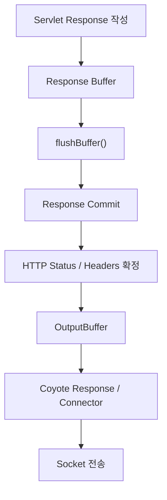

Tomcat에서는 Catalina의 OutputBuffer와 Coyote의 Response, Connector 등이 협력해 응답을 전송한다.

여기서 중요한 점은 `flushBuffer()`만이 응답을 전송하는 유일한 방법이 아니라는 것이다.

응답 버퍼가 가득 차거나 정상적인 응답 처리 종료 과정에서도 Commit과 출력이 발생할 수 있다.

따라서 다음과 같이 이해해야 한다.

**`flushBuffer()`는 응답을 즉시 Commit하도록 만드는 명시적인 방법 중 하나이며, 모든 HTTP 응답이 반드시 개발자가 호출한 `flushBuffer()`를 거쳐 전송되는 것은 아니다.**

---

### Response가 Commit된 이후 예외가 발생하면 어떻게 될까?

실무에서 중요한 문제다.

다음과 같은 Servlet 코드를 생각해 보자.

```java
@Override
protected void doGet(
        HttpServletRequest request,
        HttpServletResponse response
) throws IOException {

    response.setContentType("text/plain;charset=UTF-8");

    response.getWriter().write("Processing started");

    response.flushBuffer();

    throw new IllegalStateException("Unexpected error");
}
```

이 코드의 실행 과정을 살펴보자.

먼저 응답 본문에 문자열을 작성한다.

그다음 `flushBuffer()`를 호출한다.

이 시점에 응답이 Commit된다.

그리고 예외가 발생한다.

문제는 이미 응답 상태 코드와 헤더가 클라이언트로 전달되기 시작했을 수 있다는 점이다.

따라서 이후 발생한 예외를 처리하면서 상태 코드를 500으로 변경하려고 해도 정상적으로 변경되지 않을 수 있다.

이 문제는 다음과 같은 상황에서 중요하다.

대용량 파일 다운로드.

스트리밍 응답.

Server-Sent Events.

응답 본문 작성 중 예외 발생.

따라서 예외 처리를 설계할 때는 **응답이 아직 Commit되기 전인지 확인해야 한다.**

---

### Tomcat에서 HTTP 응답이 전송되는 전체 흐름

앞서 살펴본 내용을 연결해 보자.

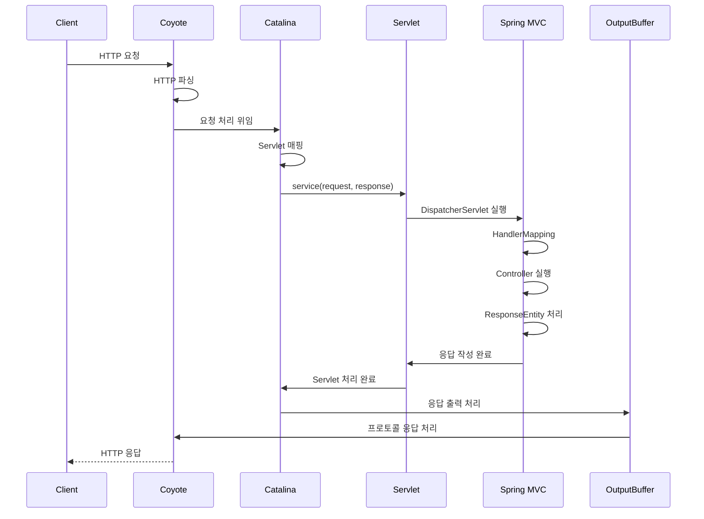

이 흐름은 실제 요청과 응답 처리의 핵심 구성 요소를 중심으로 단순화한 것이다.

구체적인 클래스 호출 순서와 Flush 시점은 Tomcat 버전, 응답 처리 방식, 비동기 여부에 따라 달라질 수 있다.

하지만 전체적인 책임은 명확하다.

Coyote는 네트워크와 HTTP 프로토콜을 담당한다.

Catalina는 Servlet 실행 환경을 담당한다.

DispatcherServlet은 Spring MVC 요청 처리를 담당한다.

Controller는 비즈니스 요청을 처리한다.

HttpMessageConverter는 응답 본문을 변환한다.

Servlet Container는 최종 HTTP 응답을 전송한다.

---

### Spring Boot에서 Servlet을 직접 등록해 보자

지금까지의 개념을 실제 코드로 확인해 보자.

이번 예제에서는 두 가지 방식으로 HTTP 요청을 처리한다.

첫 번째는 직접 작성한 Servlet을 이용하는 방식이다.

두 번째는 Spring MVC의 `@RestController`를 이용하는 방식이다.

두 방식을 비교하면 Servlet Container와 DispatcherServlet의 관계를 더 명확하게 이해할 수 있다.

#### 예제 환경

Java 17과 Spring Boot 3.5.x를 기준으로 작성한다.

Spring Boot 3.x는 Jakarta Servlet API를 사용한다.

따라서 예제에서는 다음 패키지를 사용한다.

```java
jakarta.servlet
```

과거 Spring Boot 2.x에서는 주로 다음 패키지를 사용했다.

```java
javax.servlet
```

이 차이는 Servlet 관련 코드를 이전 버전에서 새로운 버전으로 마이그레이션할 때 중요하다.

---

### Gradle 의존성 설정

`build.gradle` 파일을 다음과 같이 구성할 수 있다.

```groovy
plugins {
    id 'java'
    id 'org.springframework.boot' version '3.5.7'
    id 'io.spring.dependency-management' version '1.1.7'
}

group = 'com.example'
version = '0.0.1-SNAPSHOT'

java {
    toolchain {
        languageVersion = JavaLanguageVersion.of(17)
    }
}

repositories {
    mavenCentral()
}

dependencies {
    implementation 'org.springframework.boot:spring-boot-starter-web'

    testImplementation 'org.springframework.boot:spring-boot-starter-test'
}

tasks.named('test') {
    useJUnitPlatform()
}
```

이 예제에서는 Spring MVC와 내장 Tomcat을 사용하는 일반적인 웹 애플리케이션을 구성한다.

Spring Boot 3.5.7은 실제 배포된 안정 버전이며, Gradle Plugin으로 제공된다.

---

### 프로젝트 구조

프로젝트 구조는 다음과 같이 구성한다.

```text
src
└── main
    ├── java
    │   └── com
    │       └── example
    │           └── servlet
    │               ├── ServletApplication.java
    │               ├── RawHelloServlet.java
    │               ├── HelloController.java
    │               └── RequestLoggingFilter.java
    └── resources
        └── application.yml
```

이제 각 클래스를 작성해 보자.

---

### ServletApplication

먼저 Spring Boot 애플리케이션을 생성한다.

그리고 직접 작성한 Servlet을 등록한다.

```java
package com.example.servlet;

import org.springframework.boot.SpringApplication;
import org.springframework.boot.autoconfigure.SpringBootApplication;
import org.springframework.boot.web.servlet.ServletRegistrationBean;
import org.springframework.context.annotation.Bean;

@SpringBootApplication
public class ServletApplication {

    public static void main(String[] args) {
        SpringApplication.run(ServletApplication.class, args);
    }

    @Bean
    public ServletRegistrationBean<RawHelloServlet> rawHelloServlet() {

        ServletRegistrationBean<RawHelloServlet> registration =
                new ServletRegistrationBean<>(
                        new RawHelloServlet(),
                        "/raw/*"
                );

        registration.setName("rawHelloServlet");
        registration.setLoadOnStartup(1);

        return registration;
    }
}
```

여기서 중요한 부분은 다음 코드다.

```java
new ServletRegistrationBean<>(
        new RawHelloServlet(),
        "/raw/*"
);
```

이는 Servlet을 생성하고 URL 패턴과 함께 등록하기 위한 설정이다.

다음 요청들은 해당 Servlet의 매핑 범위에 속할 수 있다.

```text
/raw

/raw/hello

/raw/test
```

또 다음 코드를 살펴보자.

```java
registration.setLoadOnStartup(1);
```

이 설정은 Servlet Container 시작 과정에서 해당 Servlet을 초기화하도록 지정한다.

따라서 일반적인 정상 시작 과정에서 첫 번째 요청을 기다리지 않고 Servlet 초기화가 수행될 수 있다.

---

### RawHelloServlet

직접 Servlet을 작성한다.

```java
package com.example.servlet;

import java.io.IOException;

import jakarta.servlet.ServletException;
import jakarta.servlet.http.HttpServlet;
import jakarta.servlet.http.HttpServletRequest;
import jakarta.servlet.http.HttpServletResponse;

public class RawHelloServlet extends HttpServlet {

    @Override
    public void init() throws ServletException {
        super.init();

        System.out.println("[Servlet] init()");
    }

    @Override
    protected void doGet(
            HttpServletRequest request,
            HttpServletResponse response
    ) throws IOException {

        System.out.println("[Servlet] doGet()");

        System.out.println(
                "[Servlet] method = " + request.getMethod()
        );

        System.out.println(
                "[Servlet] uri = " + request.getRequestURI()
        );

        response.setStatus(HttpServletResponse.SC_OK);

        response.setContentType("text/plain;charset=UTF-8");

        response.getWriter().write("Hello Raw Servlet");
    }

    @Override
    public void destroy() {
        System.out.println("[Servlet] destroy()");

        super.destroy();
    }
}
```

이 코드는 Spring MVC Controller가 아니다.

직접 작성한 Servlet이다.

Tomcat은 URL 패턴을 기준으로 이 Servlet을 선택하고 `service()`를 호출한다.

이후 `HttpServlet`이 GET 요청을 `doGet()`으로 전달한다.

---

### Spring MVC Controller

이번에는 일반적인 Spring MVC Controller를 작성한다.

```java
package com.example.servlet;

import jakarta.servlet.http.HttpServletRequest;

import org.springframework.http.ResponseEntity;
import org.springframework.web.bind.annotation.GetMapping;
import org.springframework.web.bind.annotation.RequestMapping;
import org.springframework.web.bind.annotation.RequestParam;
import org.springframework.web.bind.annotation.RestController;

@RestController
@RequestMapping("/api")
public class HelloController {

    @GetMapping("/hello")
    public ResponseEntity<HelloResponse> hello(
            @RequestParam(defaultValue = "Spring") String name,
            HttpServletRequest request
    ) {

        System.out.println("[Controller] hello()");

        HelloResponse body = new HelloResponse(
                "Hello " + name,
                request.getMethod()
        );

        return ResponseEntity.ok()
                .header("X-Handler", "Spring-MVC")
                .body(body);
    }

    public record HelloResponse(
            String message,
            String method
    ) {
    }
}
```

이 Controller는 `RawHelloServlet`과 다른 방식으로 실행된다.

Tomcat이 직접 `HelloController`를 선택하는 것이 아니다.

먼저 DispatcherServlet이 선택된다.

그다음 Spring MVC의 HandlerMapping이 `HelloController.hello()`를 찾아 실행한다.

---

### RequestLoggingFilter

요청이 Servlet에 도달하기 전후의 처리 과정을 확인하기 위해 Filter도 작성해 보자.

```java
package com.example.servlet;

import java.io.IOException;

import jakarta.servlet.FilterChain;
import jakarta.servlet.ServletException;
import jakarta.servlet.http.HttpServletRequest;
import jakarta.servlet.http.HttpServletResponse;

import org.springframework.stereotype.Component;
import org.springframework.web.filter.OncePerRequestFilter;

@Component
public class RequestLoggingFilter extends OncePerRequestFilter {

    @Override
    protected void doFilterInternal(
            HttpServletRequest request,
            HttpServletResponse response,
            FilterChain filterChain
    ) throws ServletException, IOException {

        System.out.println(
                "[Filter] before: " + request.getRequestURI()
        );

        try {
            filterChain.doFilter(request, response);
        } finally {
            System.out.println(
                    "[Filter] after: " + request.getRequestURI()
            );
        }
    }
}
```

여기서는 `OncePerRequestFilter`를 사용했다.

이 클래스는 Spring이 제공하는 Filter 기반 클래스다.

일반적인 요청 처리에서 중복 실행을 방지하기 위한 기능을 제공하며, 비동기 및 오류 디스패치에 대한 동작도 조정할 수 있다.

`OncePerRequestFilter`가 모든 비동기·오류 처리 단계에서 물리적인 HTTP 요청당 절대 한 번만 실행된다는 의미는 아니므로, 해당 디스패치 처리 방식도 함께 이해할 필요가 있다.

---

### application.yml

다음과 같이 서버 설정을 작성한다.

```yaml
server:
  port: 8080

logging:
  level:
    org.springframework.web.servlet: DEBUG
```

여기서는 서버 포트를 8080으로 지정한다.

Spring MVC 관련 DEBUG 로그도 활성화한다.

---

### 예제 실행 방법

Gradle을 이용해 애플리케이션을 실행한다.

```bash
./gradlew bootRun
```

정상적으로 실행되면 Tomcat이 시작되고 Spring Boot 애플리케이션이 구동된다.

앞서 Servlet에 다음 설정을 적용했다.

```java
registration.setLoadOnStartup(1);
```

따라서 정상적인 시작 과정에서 다음 로그를 확인할 수 있다.

```text
[Servlet] init()
```

이 로그는 `RawHelloServlet`이 초기화되었다는 의미다.

---

### 직접 작성한 Servlet 호출하기

다음 명령을 실행한다.

```bash
curl -i http://localhost:8080/raw/hello
```

`-i` 옵션은 HTTP 응답 헤더와 본문을 함께 출력한다.

예상 응답은 다음과 같다.

```http
HTTP/1.1 200 OK
Content-Type: text/plain;charset=UTF-8

Hello Raw Servlet
```

실제 응답에는 서버와 실행 환경에 따라 추가 헤더가 포함될 수 있다.

서버 로그에서는 다음과 같은 순서를 확인할 수 있다.

```text
[Filter] before: /raw/hello

[Servlet] doGet()

[Servlet] method = GET

[Servlet] uri = /raw/hello

[Filter] after: /raw/hello
```

이 흐름은 다음과 같이 해석할 수 있다.

먼저 Filter가 실행된다.

다음으로 Servlet의 `doGet()`이 실행된다.

Servlet이 응답 본문을 작성한다.

이후 Filter의 후처리 코드가 실행된다.

요청 처리가 완료되면 Container가 HTTP 응답 전송을 마무리한다.

---

### Spring MVC Controller 호출하기

이번에는 다음 요청을 실행한다.

```bash
curl -i "http://localhost:8080/api/hello?name=Java"
```

예상 응답은 다음과 같다.

```http
HTTP/1.1 200 OK
X-Handler: Spring-MVC
Content-Type: application/json

{
  "message": "Hello Java",
  "method": "GET"
}
```

실제 JSON 본문은 줄바꿈 없이 출력될 수 있다.

서버 로그에서는 다음과 같은 흐름을 확인할 수 있다.

```text
[Filter] before: /api/hello

[Controller] hello()

[Filter] after: /api/hello
```

여기서는 직접 작성한 `RawHelloServlet`이 실행되지 않는다.

대신 DispatcherServlet이 요청을 처리하고 Spring MVC의 HandlerMapping을 이용해 Controller를 실행한다.

두 요청의 차이를 비교하면 다음과 같다.

| 구분       | `/raw/hello`              | `/api/hello`              |
| -------- | ------------------------- | ------------------------- |
| Servlet  | RawHelloServlet           | DispatcherServlet         |
| 요청 매핑    | Servlet URL Pattern       | Spring MVC HandlerMapping |
| 실제 처리 코드 | `doGet()`                 | `HelloController.hello()` |
| 반환 방식    | HttpServletResponse 직접 작성 | ResponseEntity 반환         |
| 응답 본문 변환 | 직접 작성                     | HttpMessageConverter      |
| 공통 기반    | Tomcat Servlet Container  | Tomcat Servlet Container  |

두 방식 모두 최종적으로는 Servlet Container를 통해 HTTP 응답을 전송한다.

이것이 핵심이다.

---

### Servlet은 여러 요청을 동시에 처리할 수 있을까?

Servlet은 일반적으로 여러 요청에서 하나의 인스턴스를 공유한다.

그렇다면 동시에 여러 요청이 들어오면 어떻게 될까?

다음 코드를 생각해 보자.

```java
public class CounterServlet extends HttpServlet {

    private int count = 0;

    @Override
    protected void doGet(
            HttpServletRequest request,
            HttpServletResponse response
    ) throws IOException {

        count++;

        response.getWriter().write(
                "count=" + count
        );
    }
}
```

겉으로 보기에는 문제가 없어 보인다.

하지만 여러 요청이 동시에 `doGet()`을 실행하면 `count++`에서 경쟁 상태가 발생할 수 있다.

`count++`는 하나의 원자적인 연산이 아니기 때문이다.

개념적으로 다음 단계로 구성된다.

```text
현재 count 읽기
    ↓
1 증가
    ↓
결과 저장
```

두 요청이 동시에 실행되면 서로 같은 값을 읽고 증가시켜 일부 증가 연산이 누락될 수 있다.

예를 들어 다음 상황을 생각해 보자.

```text
초기 count = 10

Thread A: count 읽기 → 10
Thread B: count 읽기 → 10

Thread A: 11 저장
Thread B: 11 저장
```

두 번 증가했지만 결과는 11이다.

이것이 경쟁 상태다.

#### 해결 방법

단순한 카운터라면 `AtomicInteger`를 사용할 수 있다.

```java
public class CounterServlet extends HttpServlet {

    private final AtomicInteger count = new AtomicInteger();

    @Override
    protected void doGet(
            HttpServletRequest request,
            HttpServletResponse response
    ) throws IOException {

        int current = count.incrementAndGet();

        response.getWriter().write(
                "count=" + current
        );
    }
}
```

이렇게 하면 증가 연산을 원자적으로 수행할 수 있다.

다만 실제 비즈니스 데이터의 동시성 문제는 AtomicInteger만으로 해결되지 않을 수 있다.

데이터베이스 트랜잭션이나 락, 분산 시스템의 일관성 요구사항까지 고려해야 한다.

#### Servlet을 Stateless하게 설계해야 하는 이유

Servlet 인스턴스는 여러 요청에서 공유될 수 있다.

따라서 요청마다 달라지는 사용자 정보를 인스턴스 필드에 저장하는 방식은 위험하다.

예를 들어 다음 코드는 피해야 한다.

```java
public class UserServlet extends HttpServlet {

    private String currentUser;

    @Override
    protected void doGet(
            HttpServletRequest request,
            HttpServletResponse response
    ) throws IOException {

        currentUser = request.getParameter("user");

        response.getWriter().write(currentUser);
    }
}
```

서로 다른 사용자의 요청이 동시에 처리되면 인스턴스 필드의 값이 덮어써질 수 있다.

일반적으로 요청에만 필요한 정보는 지역 변수나 요청 범위의 적절한 객체를 이용해 관리해야 한다.

이 원칙은 Spring의 Singleton Bean을 설계할 때도 중요하다.

---

### Servlet과 Spring Bean의 생명주기는 같을까?

Servlet과 Spring Bean은 모두 애플리케이션에서 생성되고 관리되는 객체다.

하지만 관리 주체와 생명주기 계약이 다르다.

Servlet은 Servlet Container가 관리한다.

Spring Bean은 Spring Container가 관리한다.

일반적인 Spring Boot 애플리케이션에서는 두 Container가 함께 동작한다.

다음 구조를 생각해 보자.

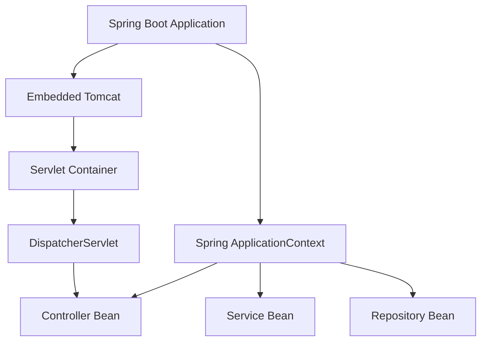

DispatcherServlet은 Servlet Container에 등록되어 실행된다.

Spring MVC의 Controller와 Service는 Spring Container가 관리하는 Bean이다.

물론 Spring Boot의 자동 설정을 통해 두 시스템의 등록과 초기화가 연결될 수 있다.

하지만 Servlet Container와 Spring Container의 책임은 구분해야 한다.

| 구분       | Servlet Container      | Spring Container   |
| -------- | ---------------------- | ------------------ |
| 대표적인 구현  | Tomcat                 | ApplicationContext |
| 주요 관리 대상 | Servlet, Filter 등      | Spring Bean        |
| 주요 책임    | HTTP 요청 처리와 Servlet 실행 | 객체 생성, DI, 생명주기 관리 |
| 초기화 계약   | Servlet `init()` 등     | Bean 초기화 콜백 등      |
| 종료 계약    | Servlet `destroy()` 등  | Bean 소멸 콜백 등       |

이 차이를 이해하면 Spring Boot 내부에서 Tomcat과 ApplicationContext가 어떻게 협력하는지 이해하기 쉬워진다.

---

### Servlet Container와 Spring MVC의 책임을 구분해야 하는 이유

실무에서는 HTTP 요청이 실패했을 때 어느 단계에서 문제가 발생했는지 파악해야 한다.

예를 들어 다음 요청을 보냈다고 하자.

```http
GET /api/members/10 HTTP/1.1
```

그런데 응답이 오지 않는다.

이때 다음과 같은 원인을 생각할 수 있다.

Tomcat이 요청을 수신하지 못했다.

Servlet Filter에서 요청이 차단되었다.

DispatcherServlet에 적절한 요청 매핑이 존재하지 않는다.

Controller 메서드에서 예외가 발생했다.

응답을 JSON으로 변환하는 과정에서 오류가 발생했다.

응답이 Commit된 뒤 네트워크 전송 중 문제가 발생했다.

각각 다른 계층의 문제다.

따라서 요청 처리 구조를 알고 있다면 오류를 더욱 정확하게 분석할 수 있다.

---

### 실무에서 반드시 알아야 할 12가지 핵심 전략

#### 1. Servlet 매핑과 Controller 매핑을 구분한다

Tomcat의 Servlet Mapping은 어떤 Servlet이 요청을 처리할지 결정한다.

Spring MVC의 HandlerMapping은 어떤 Controller 메서드가 요청을 처리할지 결정한다.

따라서 요청 경로와 관련된 문제가 발생하면 어느 매핑 단계에서 문제가 생겼는지 구분해야 한다.

#### 2. Request 객체의 구현 클래스가 항상 동일하다고 생각하지 않는다

실제 요청 처리 과정에서는 RequestFacade 외에도 여러 Wrapper가 사용될 수 있다.

예를 들어 보안이나 캐싱, 요청 정보 보정 기능이 Request를 감쌀 수 있다.

따라서 애플리케이션 코드는 특정 Tomcat 구현 클래스에 의존하기보다 Servlet API의 인터페이스를 중심으로 작성하는 것이 좋다.

#### 3. 요청 본문은 여러 번 읽을 수 있다고 가정하지 않는다

HTTP 요청 본문은 일반적으로 InputStream을 통해 읽는다.

```java
request.getInputStream();
```

하지만 요청 본문을 한 번 소비한 뒤 다른 구성 요소가 다시 읽으려고 하면 문제가 발생할 수 있다.

예를 들어 Filter에서 요청 본문을 먼저 읽어버리면 Controller의 `@RequestBody` 처리에 영향을 줄 수 있다.

요청 본문을 로깅해야 한다면 적절한 Wrapper를 사용해야 한다.

또 Spring의 `ContentCachingRequestWrapper`는 읽힌 데이터를 캐시에 보관하는 방식이므로 단순히 감싸기만 했다고 요청 본문을 무제한 다시 읽을 수 있는 것은 아니다.

#### 4. Response가 Commit된 이후에는 헤더를 변경할 수 없다

HTTP 응답의 상태 코드와 헤더는 Commit 이후 변경할 수 없다.

따라서 Filter나 Interceptor에서 응답 헤더를 추가하려면 적절한 시점에 수행해야 한다.

특히 Spring MVC의 응답 본문이 HandlerAdapter 내부에서 이미 작성된 이후에는 후처리 단계에서 헤더를 변경하기 어려울 수 있다.

이런 경우 `ResponseBodyAdvice` 등을 검토할 수 있다.

#### 5. 모든 요청이 반드시 Controller까지 도달한다고 생각하지 않는다

Servlet Filter에서 요청이 차단될 수 있다.

Servlet 매핑 과정에서 다른 Servlet이 선택될 수도 있다.

또 Spring Security에서 접근을 거부할 수도 있다.

따라서 Controller에 로그가 남지 않았다는 이유만으로 Tomcat이 요청을 받지 못했다고 판단해서는 안 된다.

#### 6. DispatcherServlet의 역할을 과도하게 단순화하지 않는다

DispatcherServlet은 단순히 Controller를 호출하는 클래스가 아니다.

HandlerMapping과 HandlerAdapter, HandlerExceptionResolver, ViewResolver 등 여러 구성 요소를 조정한다.

따라서 Spring MVC의 내부 동작을 이해할 때는 DispatcherServlet이 직접 모든 작업을 수행한다고 생각하기보다 각 책임을 다른 구성 요소에 위임한다고 이해하는 것이 정확하다.

#### 7. ResponseEntity는 HTTP 응답 자체가 아니다

`ResponseEntity`는 HTTP 응답 정보를 표현하는 Spring 객체다.

실제 응답 전송은 HttpMessageConverter와 Servlet Response, Tomcat의 출력 처리 계층을 거쳐 수행된다.

따라서 ResponseEntity를 생성한 시점과 응답이 실제 네트워크로 전송된 시점은 다를 수 있다.

#### 8. Servlet의 공유 상태를 최소화한다

Servlet 인스턴스는 여러 요청에서 공유될 수 있다.

따라서 요청마다 변경되는 사용자 데이터나 인증 정보 등을 인스턴스 필드에 저장해서는 안 된다.

상태를 공유해야 한다면 동시성 제어가 필요하다.

하지만 가능하다면 요청 처리 코드를 Stateless하게 설계하는 편이 안전하다.

#### 9. Filter의 실행 순서를 명확하게 관리한다

여러 Filter가 존재하면 실행 순서가 중요해질 수 있다.

예를 들어 인증 정보를 설정하는 Filter보다 인증 정보가 필요하다고 가정하는 Filter가 먼저 실행되면 문제가 발생할 수 있다.

Spring Boot에서는 `FilterRegistrationBean`이나 Spring Security의 SecurityFilterChain 구성 등을 통해 실행 순서를 관리할 수 있다.

다만 Filter가 모두 동일한 순서 관리 체계를 따르는 것은 아니므로 등록 방식에 맞게 확인해야 한다.

#### 10. 서블릿 요청 처리 스레드와 비동기 실행 흐름을 구분한다

일반적인 Spring MVC 요청은 Servlet Container의 요청 처리 스레드에서 실행된다.

하지만 비동기 요청 처리에서는 실행 스레드와 요청 처리의 생명주기가 달라질 수 있다.

따라서 ThreadLocal을 사용하는 로깅 컨텍스트나 사용자 정보, 트랜잭션 자원 등의 전파 여부를 확인해야 한다.

또 Virtual Threads를 사용하는 환경에서는 요청 처리에 사용하는 스레드의 특성이 달라질 수 있다.

#### 11. Tomcat 내부 객체는 재사용될 수 있다는 사실을 이해한다

HTTP 요청마다 새로운 논리적 요청이 존재하더라도 내부 Request와 Response 객체가 항상 새롭게 할당되는 것은 아니다.

Tomcat은 성능 최적화를 위해 일부 내부 객체를 정리하고 재사용할 수 있다.

따라서 요청 처리 이후에도 내부 Request 객체에 대한 참조를 보관하거나 별도 스레드에서 무분별하게 사용하는 방식은 피해야 한다.

#### 12. 장애 분석은 요청과 응답의 전체 경로를 기준으로 수행한다

요청이 실패하면 Controller 코드만 확인하지 않는다.

네트워크 연결부터 Tomcat Connector, Servlet Mapping, Filter Chain, DispatcherServlet, Controller, MessageConverter, Response Commit까지 단계적으로 확인한다.

어떤 계층에서 실패했는지 먼저 파악하면 원인을 더 빠르게 좁힐 수 있다.

---

### Servlet 요청과 응답의 전체 구조

지금까지 살펴본 내용을 하나의 구조로 정리하면 다음과 같다.

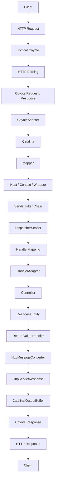

이 구조는 Spring MVC 요청을 처리하는 대표적인 흐름을 보여준다.

실제로는 예외 처리와 비동기 처리, Filter와 HandlerInterceptor, 응답 Buffer 관리 등 다양한 요소가 추가될 수 있다.

하지만 중요한 책임은 크게 달라지지 않는다.

**Coyote는 HTTP 네트워크 처리를 담당한다.**

**Catalina는 Servlet의 선택과 실행을 담당한다.**

**DispatcherServlet은 Spring MVC 요청 처리를 조정한다.**

**Controller는 애플리케이션의 요청을 처리한다.**

**HttpMessageConverter는 반환 객체를 HTTP 응답 본문으로 변환한다.**

**Tomcat은 응답 데이터를 클라이언트로 전송한다.**

이러한 책임의 분리가 Servlet 기반 웹 애플리케이션의 핵심 구조다.

---

### 정리

Servlet은 웹 클라이언트의 요청을 처리하고 응답을 생성하기 위한 Java 기반 구성 요소다.

Servlet은 `Servlet` 인터페이스를 기반으로 동작하며, `init()`, `service()`, `destroy()`라는 생명주기 메서드를 제공한다.

`HttpServlet`은 HTTP 요청을 처리하기 위한 기본 구현을 제공한다.

개발자는 `doGet()`, `doPost()` 등의 메서드를 재정의해 HTTP 요청을 처리할 수 있다.

Servlet Container는 Servlet의 생성과 초기화, 요청 전달, 종료 등을 관리한다.

일반적인 Spring Boot 웹 애플리케이션에서는 Tomcat이 Servlet Container 역할을 수행한다.

Tomcat의 내부 구조를 이해할 때 중요한 구성 요소는 Coyote와 Catalina다.

Coyote는 네트워크 연결과 HTTP 프로토콜 처리를 담당한다.

Catalina는 Servlet 실행 환경을 제공한다.

Tomcat은 요청을 처리할 Servlet을 결정하기 위해 Host와 Context, Wrapper 등의 정보를 활용한다.

그리고 Mapper를 통해 요청 경로에 대응하는 Servlet을 결정할 수 있다.

Servlet 매핑에는 정확한 경로 매칭, 경로 접두사 매칭, 확장자 매칭, 기본 매핑 등의 규칙이 존재한다.

Spring MVC의 DispatcherServlet 역시 Servlet이다.

일반적인 Spring Boot 애플리케이션에서는 DispatcherServlet이 기본 URL 패턴 `/`에 등록되어 웹 요청을 처리한다.

하지만 Tomcat이 Controller를 직접 찾아 실행하는 것은 아니다.

Tomcat은 먼저 DispatcherServlet을 선택한다.

그다음 DispatcherServlet이 HandlerMapping과 HandlerAdapter를 이용해 Controller 메서드를 실행한다.

이 과정에서 `HttpServletRequest`와 `HttpServletResponse`가 사용된다.

Tomcat 내부에는 Coyote Request와 Catalina Request, RequestFacade처럼 서로 다른 역할을 담당하는 요청 객체가 존재한다.

Coyote Request는 저수준 HTTP 정보를 처리한다.

Catalina Request는 Servlet API에 필요한 기능을 제공한다.

RequestFacade는 애플리케이션이 `HttpServletRequest` 인터페이스를 통해 요청 정보를 사용할 수 있도록 돕는다.

응답 과정도 비슷하다.

Servlet은 `HttpServletResponse`를 사용해 상태 코드와 헤더, 본문을 작성한다.

Spring MVC에서는 Controller가 `ResponseEntity`를 반환할 수 있다.

이때 `HttpEntityMethodProcessor` 같은 반환값 처리 구성 요소가 응답 정보를 해석하고, `HttpMessageConverter`가 응답 본문을 적절한 형식으로 변환한다.

이후 Servlet Container가 응답을 실제 네트워크로 전송한다.

이때 Response Buffer와 Commit 개념이 중요하다.

응답이 Commit되기 전에는 상태 코드와 헤더를 변경할 수 있다.

하지만 Commit된 이후에는 이미 전송된 응답 정보를 되돌릴 수 없다.

또 `flushBuffer()`는 응답을 강제로 출력하고 Commit하도록 하는 메서드지만 모든 정상 응답이 반드시 이 메서드의 명시적인 호출을 거쳐 전송되는 것은 아니다.

주요 개념을 정리하면 다음과 같다.

| 개념                        | 핵심 역할                        |
| ------------------------- | ---------------------------- |
| Servlet                   | 요청 처리와 응답 생성                 |
| Servlet Container         | Servlet의 실행과 생명주기 관리         |
| HttpServlet               | HTTP 요청 처리 기능 제공             |
| Coyote                    | 네트워크와 HTTP 프로토콜 처리           |
| Catalina                  | Servlet 실행 환경                |
| CoyoteAdapter             | Coyote와 Catalina 연결          |
| Mapper                    | 요청에 대응하는 Servlet 매핑          |
| Context                   | 웹 애플리케이션                     |
| Wrapper                   | 개별 Servlet 관리                |
| RequestFacade             | Servlet API 관점의 요청 객체 제공     |
| ResponseFacade            | Servlet API 관점의 응답 객체 제공     |
| Filter Chain              | Servlet 실행 전후의 공통 처리         |
| DispatcherServlet         | Spring MVC의 Front Controller |
| HandlerMapping            | 요청을 처리할 Handler 검색           |
| HandlerAdapter            | Handler 실행                   |
| HttpEntityMethodProcessor | ResponseEntity 반환값 처리        |
| HttpMessageConverter      | 요청 및 응답 본문 변환                |
| OutputBuffer              | 응답 데이터 출력 처리                 |
| Response Commit           | 응답 상태 코드와 헤더 확정              |

결국 Spring MVC의 요청 처리 과정을 이해한다는 것은 단순히 Controller가 어떻게 실행되는지 아는 것만을 의미하지 않는다.

클라이언트가 전송한 데이터가 어떤 계층을 통해 전달되는지, 각 계층이 어떤 책임을 가지고 있는지, 최종 응답이 어떤 과정으로 전송되는지 설명할 수 있어야 한다.

이 구조를 이해하면 Spring Boot에서 요청이 Controller에 도달하지 않는 문제나 Filter 실행 순서 문제, HTTP 응답 직렬화 오류, 응답 Commit 이후 발생하는 예외 등을 더 정확하게 분석할 수 있다.

또 Tomcat 내부 코드나 Spring MVC의 DispatcherServlet 구현을 살펴볼 때도 각 구성 요소가 어떤 역할을 수행하는지 쉽게 파악할 수 있다.

**Servlet과 Servlet Container는 Spring MVC를 실행하기 위한 단순한 부가 기능이 아니라, HTTP 요청과 응답을 실제 Java 애플리케이션의 실행 흐름으로 연결하는 핵심 기반이다.**

#### 한 줄 요약

**Servlet은 HTTP 요청을 처리하는 Java 구성 요소이고, Servlet Container는 Servlet의 생성·초기화·요청 처리·종료를 관리한다. Tomcat에서는 Coyote가 네트워크와 HTTP 프로토콜을 처리하고 Catalina가 Servlet을 선택하고 실행하며, Spring MVC의 DispatcherServlet은 HandlerMapping과 HandlerAdapter를 통해 Controller를 호출한다. 이후 ResponseEntity와 HttpMessageConverter가 응답을 구성하고 Tomcat의 출력 처리 계층이 최종 HTTP 응답을 클라이언트로 전송한다.**

