# 부기, 우가의 Gradle
[https://youtu.be/CEThRTpWErM?si=5pkJWO-p2ps3eiin](https://youtu.be/CEThRTpWErM?si=5pkJWO-p2ps3eiin)

# 부기, 우가의 Gradle
* toc
{:toc}

---

### Gradle 완벽 이해: 빌드 과정부터 증분 컴파일, Build Cache, 의존성 관리와 멀티 모듈 설계까지

Java와 Spring Boot를 사용해 애플리케이션을 개발하다 보면 다음 명령어를 자주 사용한다.

```bash
./gradlew build
```

이 명령어를 실행하면 Java 소스 코드가 컴파일되고, 테스트가 실행되며, JAR 파일과 같은 빌드 결과물이 생성된다.

하지만 이 명령어가 내부적으로 어떤 과정을 수행하는지 생각해 보면 여러 질문이 생긴다.

**Gradle은 어떻게 Java 소스 코드를 컴파일할까?**

**소스 코드 하나만 수정했는데 전체 프로젝트를 다시 빌드하지 않아도 되는 이유는 무엇일까?**

**`UP-TO-DATE`와 `FROM-CACHE`는 무엇이 다를까?**

**`build.gradle`에 의존성을 한 줄 추가하면 어떤 일이 발생할까?**

**`implementation`과 `api`는 모두 라이브러리를 추가하는 설정인데 무엇이 다를까?**

**멀티 모듈 프로젝트에서는 의존성이 어떻게 전달될까?**

일반적인 Spring Boot 프로젝트의 `build.gradle`을 살펴보자.

```groovy
plugins {
    id 'java'
    id 'org.springframework.boot' version '3.5.7'
    id 'io.spring.dependency-management' version '1.1.7'
}

group = 'com.example'
version = '0.0.1-SNAPSHOT'

repositories {
    mavenCentral()
}

dependencies {
    implementation 'org.springframework.boot:spring-boot-starter-web'
    implementation 'org.springframework.boot:spring-boot-starter-jdbc'

    runtimeOnly 'com.mysql:mysql-connector-j'

    testImplementation 'org.springframework.boot:spring-boot-starter-test'
}
```

개발자는 이러한 설정을 통해 프로젝트에서 필요한 라이브러리를 선언한다.

그리고 다음 명령어만 실행하면 된다.

```bash
./gradlew build
```

Gradle은 설정을 분석하고 필요한 의존성을 확인한 뒤, 컴파일과 테스트 등의 작업을 수행한다.

이처럼 Gradle은 단순히 Java 파일을 컴파일하는 도구가 아니다.

**애플리케이션을 빌드하기 위한 전체 작업을 정의하고, 각 작업 사이의 의존성을 관리하며, 필요한 작업을 효율적으로 실행하는 빌드 자동화 도구**다.

Gradle을 제대로 이해하려면 먼저 빌드가 무엇인지 알아야 한다.

---

### 빌드(Build)란 무엇인가?

빌드는 개발자가 작성한 소스 코드를 실행하거나 배포할 수 있는 결과물로 만드는 일련의 과정이다.

Java 애플리케이션을 기준으로 생각해 보자.

개발자는 `.java` 파일을 작성한다.

하지만 JVM은 일반적인 Java 소스 코드를 그대로 실행하지 않는다.

Java 컴파일러를 사용해 바이트코드로 변환해야 한다.

이후 필요한 리소스와 클래스 파일을 패키징해 실행 가능한 형태로 만들 수 있다.

일반적인 빌드 흐름은 다음과 같다.

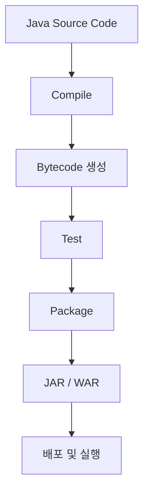

각 단계의 역할을 살펴보자.

| 단계                | 역할                       |
| ----------------- | ------------------------ |
| Source Code       | 개발자가 작성한 Java 코드         |
| Compile           | Java 소스 코드를 바이트코드로 변환    |
| Test              | 작성한 코드의 동작 검증            |
| Process Resources | 설정 파일 등 리소스 처리           |
| Package           | 클래스와 리소스를 JAR 또는 WAR로 묶기 |
| Deploy            | 생성된 결과물을 실행 환경에 배포       |

빌드와 배포는 엄밀하게는 다른 개념이다.

빌드는 배포 가능한 결과물을 만드는 과정이다.

배포는 만들어진 결과물을 실제 실행 환경에 적용하는 과정이다.

예를 들어 다음 두 명령어는 서로 다른 목적을 가진다.

```bash
./gradlew build
```

```bash
java -jar app.jar
```

첫 번째는 빌드 작업을 수행한다.

두 번째는 이미 생성된 JAR 파일을 실행한다.

따라서 빌드 과정과 애플리케이션 실행 과정을 구분해야 한다.

---

### 빌드 도구가 없다면 어떻게 될까?

Gradle의 필요성을 이해하기 위해 Java 소스 코드를 직접 컴파일하고 패키징해 보자.

다음과 같은 파일을 작성한다.

`Hello.java`

```java
public class Hello {

    public static void main(String[] args) {
        System.out.println("Hello Gradle");
    }
}
```

이 코드를 실행하려면 먼저 컴파일해야 한다.

#### 1. Java 소스 코드 컴파일

다음 명령어를 실행한다.

```bash
javac Hello.java
```

`javac`는 Java 컴파일러다.

Java 소스 코드를 JVM에서 실행할 수 있는 바이트코드로 변환한다.

정상적으로 컴파일되면 다음 파일이 생성된다.

```text
Hello.class
```

디렉터리 구조는 다음과 같다.

```text
project/
├── Hello.java
└── Hello.class
```

#### 2. 클래스 파일 실행

컴파일한 클래스를 실행한다.

```bash
java Hello
```

예상 결과는 다음과 같다.

```text
Hello Gradle
```

이렇게 하면 단순한 Java 프로그램을 실행할 수 있다.

하지만 애플리케이션을 배포할 때마다 클래스 파일을 하나씩 관리하기는 어렵다.

따라서 JAR로 패키징해 보자.

#### 3. JAR 파일 생성

다음 명령어를 실행한다.

```bash
jar --create --file hello.jar --main-class Hello Hello.class
```

각 옵션의 의미는 다음과 같다.

| 옵션                   | 의미              |
| -------------------- | --------------- |
| `--create`           | 새로운 JAR 생성      |
| `--file hello.jar`   | 결과 파일 이름 지정     |
| `--main-class Hello` | 실행할 Main 클래스 지정 |
| `Hello.class`        | JAR에 포함할 클래스    |

정상적으로 실행하면 다음 파일이 생성된다.

```text
hello.jar
```

#### 4. JAR 파일 실행

이제 다음 명령어로 실행할 수 있다.

```bash
java -jar hello.jar
```

예상 결과는 다음과 같다.

```text
Hello Gradle
```

여기까지는 크게 복잡하지 않다.

하지만 실제 Spring Boot 프로젝트라면 어떨까?

수백 개의 Java 클래스가 존재할 수 있다.

여러 외부 라이브러리가 필요할 수 있다.

테스트 코드도 함께 관리해야 한다.

환경별 설정 파일이 존재할 수 있다.

빌드 전에 코드를 생성하거나 다른 작업을 수행해야 할 수도 있다.

또 프로젝트가 여러 모듈로 나뉘어 있다면 각 모듈의 빌드 순서까지 고려해야 한다.

이러한 모든 과정을 명령어로 직접 관리하면 상당한 작업이 필요하다.

---

### 빌드 도구(Build Tool)란 무엇인가?

빌드 도구는 소스 코드를 실행 가능한 결과물로 만드는 과정을 자동화하는 도구다.

대표적인 Java 빌드 도구는 다음과 같다.

| 빌드 도구  | 주요 특징                       |
| ------ | --------------------------- |
| Ant    | 작업 중심의 빌드 자동화               |
| Maven  | 정해진 생명주기와 XML 기반 설정         |
| Gradle | Task 그래프와 유연한 DSL 기반 빌드 자동화 |

Gradle은 빌드 작업을 Task라는 단위로 관리한다.

예를 들어 Java 프로젝트에서는 다음과 같은 Task를 사용할 수 있다.

```text
compileJava
processResources
classes
compileTestJava
test
jar
assemble
check
build
```

이러한 Task는 서로 독립적으로 존재하는 것이 아니라 의존관계를 가질 수 있다.

예를 들어 `build`를 실행할 때 테스트와 패키징에 필요한 Task가 함께 실행된다.

Gradle은 각 Task의 의존관계를 분석해 적절한 실행 순서를 결정한다.

이 과정이 Gradle을 이해하는 핵심이다.

---

### Gradle이란 무엇인가?

Gradle은 JVM 기반 프로젝트를 비롯한 다양한 프로젝트에서 사용하는 빌드 자동화 도구다.

Java, Kotlin, Android 등 여러 환경에서 활용할 수 있다.

Gradle의 주요 특징은 다음과 같다.

* Task 기반 빌드 자동화
* Task 간 의존관계 관리
* 증분 빌드
* 증분 컴파일
* Build Cache
* 의존성 관리
* 멀티 프로젝트 빌드
* 플러그인 확장
* 병렬 실행
* Configuration Cache

Gradle은 단순히 명령어를 순서대로 실행하는 스크립트 도구가 아니다.

프로젝트의 빌드 설정을 분석하고 필요한 Task를 결정한 다음 실행한다.

이를 이해하려면 Gradle의 실행 단계를 알아야 한다.

---

### Gradle의 빌드 생명주기

Gradle은 일반적으로 다음 세 가지 단계로 빌드를 처리한다.

1. Initialization
2. Configuration
3. Execution

각 단계는 서로 다른 책임을 가진다.

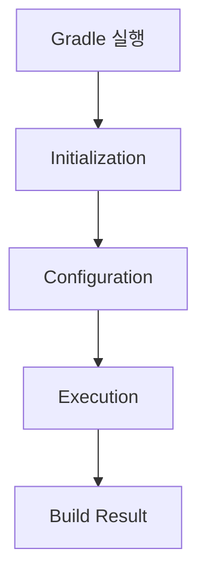

#### Initialization

Initialization 단계에서는 빌드에 참여할 프로젝트를 결정한다.

멀티 모듈 프로젝트라면 어떤 모듈들이 포함되는지 확인한다.

주로 다음 파일이 사용된다.

```text
settings.gradle
```

예를 들어 다음과 같다.

```groovy
rootProject.name = 'my-application'

include 'api'
include 'domain'
include 'infrastructure'
```

이 설정은 하나의 Gradle 빌드에 세 개의 하위 프로젝트를 포함한다.

#### Configuration

Configuration 단계에서는 프로젝트의 빌드 설정을 평가하고 Task를 구성한다.

대표적으로 다음 파일이 사용된다.

```text
build.gradle
```

예를 들어 다음과 같은 설정을 분석한다.

```groovy
plugins {
    id 'java'
}

repositories {
    mavenCentral()
}

dependencies {
    implementation 'org.slf4j:slf4j-api:2.0.16'
}
```

Gradle은 이러한 설정을 바탕으로 프로젝트의 빌드 모델을 구성한다.

#### Execution

Execution 단계에서는 실제로 필요한 Task들을 실행한다.

예를 들어 다음 명령어를 실행했다고 가정하자.

```bash
./gradlew build
```

Gradle은 `build` 작업에 필요한 Task를 결정한 뒤 실행한다.

이때 모든 Task가 실제 작업을 수행하는 것은 아니다.

이미 최신 상태이거나 캐시에서 결과를 복원할 수 있다면 해당 작업을 생략할 수 있다.

이러한 최적화가 Gradle의 중요한 특징이다.

---

### Gradle의 Task란 무엇인가?

Task는 Gradle이 실행하는 작업 단위다.

예를 들어 다음과 같은 작업이 Task가 될 수 있다.

Java 소스 코드 컴파일.

테스트 실행.

JAR 생성.

파일 복사.

코드 생성.

정적 분석.

Gradle에서는 직접 Task를 정의할 수도 있다.

```groovy
tasks.register('helloGradle') {
    doLast {
        println 'Hello Gradle'
    }
}
```

다음 명령어로 실행한다.

```bash
./gradlew helloGradle
```

예상 결과는 다음과 같다.

```text
> Task :helloGradle
Hello Gradle

BUILD SUCCESSFUL
```

여기서 `doLast`는 Task가 실행될 때 수행할 동작을 등록한다.

반면 다음과 같이 작성하면 주의해야 한다.

```groovy
tasks.register('helloGradle') {
    println 'Configuring helloGradle'
}
```

이 출력은 Task의 실행 동작이 아니라 구성 과정에서 발생할 수 있다.

즉 Gradle에서는 **Task를 구성하는 코드와 Task가 실제로 수행하는 코드를 구분해야 한다.**

이 차이는 빌드 성능을 최적화할 때 중요하다.

---

### Task는 어떻게 연결될까?

Gradle에서는 Task 사이에 의존관계를 정의할 수 있다.

예를 들어 다음과 같다.

```groovy
tasks.register('prepare') {
    doLast {
        println 'Prepare'
    }
}

tasks.register('packageApplication') {
    dependsOn 'prepare'

    doLast {
        println 'Package'
    }
}
```

이제 다음 명령어를 실행한다.

```bash
./gradlew packageApplication
```

실행 결과는 다음과 유사하다.

```text
> Task :prepare
Prepare

> Task :packageApplication
Package
```

`packageApplication`이 `prepare`에 의존하기 때문이다.

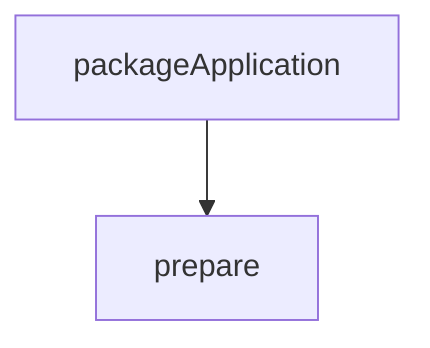

실제 실행 순서에서는 의존 Task인 `prepare`가 먼저 완료되어야 한다.

Gradle은 이러한 의존관계를 바탕으로 Task 실행 그래프를 구성한다.

따라서 `build`는 단순한 명령어 하나가 아니라 여러 Task를 연결한 실행 진입점이라고 이해할 수 있다.

---

### Gradle의 빌드 성능 최적화

Gradle이 제공하는 중요한 기능 중 하나는 불필요한 작업을 줄이는 것이다.

일반적으로 개발자는 같은 프로젝트를 여러 번 빌드한다.

그런데 매번 모든 소스 코드를 다시 컴파일할 필요는 없다.

변경되지 않은 Task를 다시 실행할 필요도 없다.

또 이전에 이미 계산한 결과물을 다시 생성할 필요가 없는 경우도 있다.

Gradle은 이러한 상황에 대응하기 위해 여러 최적화 기능을 제공한다.

대표적으로 다음과 같다.

| 기능                      | 목적                      |
| ----------------------- | ----------------------- |
| Up-to-date Check        | 변경되지 않은 Task 실행 생략      |
| Incremental Compilation | 변경 영향을 받는 소스만 재컴파일      |
| Build Cache             | 이전 Task 결과물 재사용         |
| Configuration Cache     | 이전 Configuration 결과 재사용 |
| Parallel Execution      | 독립적인 작업의 병렬 실행          |

이 기능들은 모두 빌드 시간을 줄이는 데 기여할 수 있지만 동작 방식은 서로 다르다.

---

### Incremental Build란 무엇인가?

Incremental Build는 이전 빌드 이후 변경된 입력을 고려해 필요한 작업만 다시 수행하는 방식이다.

예를 들어 다음과 같은 프로젝트가 있다고 가정하자.

```text
src/main/java/
├── MemberService.java
├── OrderService.java
└── PaymentService.java
```

처음 빌드할 때는 Java 소스 코드를 컴파일해야 한다.

```bash
./gradlew build
```

그런데 아무 파일도 수정하지 않고 다시 빌드를 실행한다면 어떨까?

```bash
./gradlew build
```

Gradle은 입력과 출력의 상태를 확인해 일부 Task를 최신 상태로 판단할 수 있다.

이때 다음과 같은 메시지가 나타날 수 있다.

```text
> Task :compileJava UP-TO-DATE
```

이는 해당 Task의 입력과 출력이 이전 실행 결과와 비교했을 때 다시 실행할 필요가 없는 상태라는 의미다.

이것이 Gradle의 Up-to-date Check다.

---

### Incremental Build와 Incremental Compilation은 무엇이 다를까?

두 개념은 관련되어 있지만 동일하지 않다.

#### Incremental Build

Task 수준에서 변경 여부를 판단하고 불필요한 작업을 줄이는 개념이다.

예를 들어 `compileJava`의 입력이 변경되지 않았다면 Task 자체를 실행하지 않을 수 있다.

#### Incremental Compilation

컴파일 Task를 다시 실행해야 하더라도 변경 영향을 받은 소스만 재컴파일하는 최적화다.

예를 들어 다음 파일이 있다고 가정하자.

```text
MemberService.java
OrderService.java
PaymentService.java
```

이 중 `OrderService.java`의 구현만 변경했다.

Gradle의 Java 증분 컴파일이 가능한 조건이라면 변경된 소스와 영향을 받는 소스들을 중심으로 컴파일할 수 있다.

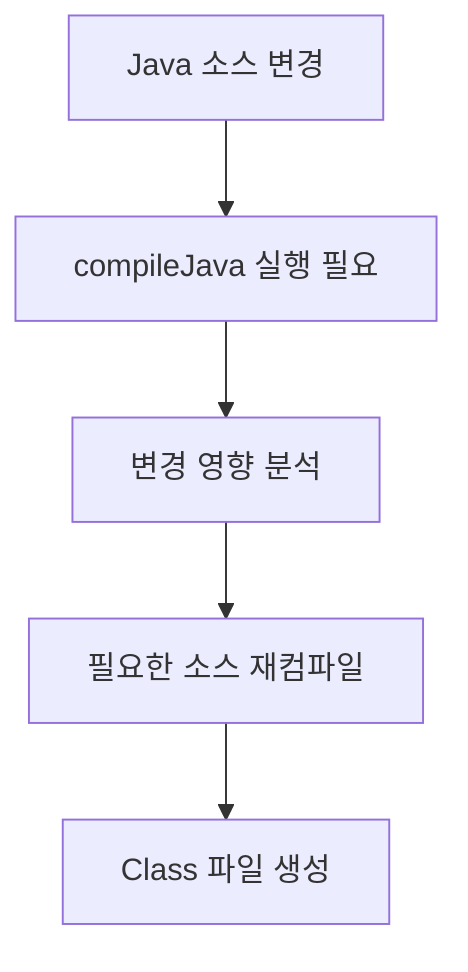

따라서 다음 두 상황은 다르다.

```text
compileJava UP-TO-DATE
```

이는 컴파일 Task 자체를 다시 실행하지 않은 경우다.

반면 다음 상황은 다음과 같다.

```text
compileJava 실행
```

실행되었더라도 내부에서는 증분 컴파일을 통해 일부 소스만 다시 컴파일했을 수 있다.

Gradle의 Java 컴파일 최적화에는 이러한 Task 수준의 변경 감지와 소스 수준의 증분 컴파일이 함께 사용된다.

---

### Java 파일 하나를 수정하면 반드시 하나만 컴파일할까?

반드시 그렇지는 않다.

증분 컴파일은 단순히 수정된 파일만 컴파일하는 기능이 아니다.

**수정된 파일과 그 변경으로 영향을 받을 수 있는 파일들을 판단해 재컴파일 범위를 결정하는 기능**이다.

예를 들어 다음 코드를 생각해 보자.

`Member.java`

```java
public class Member {

    public String getName() {
        return "member";
    }
}
```

`MemberService.java`

```java
public class MemberService {

    private final Member member = new Member();

    public String getMemberName() {
        return member.getName();
    }
}
```

이제 `Member`의 내부 구현만 변경한다면 어떨까?

공개 API에 영향을 주지 않는 변경은 다른 클래스의 재컴파일을 줄이는 데 유리할 수 있다.

하지만 공개 메서드 시그니처가 변경된다면 이야기가 달라진다.

```java
public String getName(String prefix) {
    return prefix + "member";
}
```

이 경우 기존 메서드를 사용하는 코드도 영향을 받을 수 있다.

따라서 관련 클래스들의 재컴파일이 필요할 수 있다.

이러한 판단은 변경된 소스의 ABI(Application Binary Interface), 컴파일러의 분석 결과, Annotation Processor 등의 영향을 받는다.

따라서 증분 컴파일을 다음과 같이 이해하면 안 된다.

```text
변경된 Java 파일 = 반드시 그 파일 하나만 컴파일
```

정확하게는 다음과 같다.

**변경된 코드의 영향을 분석해 안전하게 재컴파일 범위를 줄이는 기술**이다.

---

### Maven과 Gradle의 증분 빌드는 어떻게 다를까?

Maven과 Gradle을 비교할 때 흔히 Gradle이 변경된 파일만 컴파일하고 Maven은 전체 모듈을 재컴파일한다고 설명하기도 한다.

하지만 이를 모든 환경에서 성립하는 절대적인 차이로 이해해서는 안 된다.

Maven 역시 Compiler Plugin 등을 통해 증분 컴파일과 변경 감지를 지원한다.

또 Gradle에서도 증분 컴파일을 적용할 수 없는 상황에서는 더 넓은 범위를 다시 컴파일할 수 있다.

실제 결과는 다음 조건에 영향을 받는다.

* Gradle 및 Maven 버전
* Java 컴파일러 설정
* 빌드 플러그인
* Annotation Processor
* 소스 간 의존관계
* 컴파일 옵션
* 이전 빌드 상태

따라서 두 도구의 성능을 비교하려면 동일한 조건에서 빌드 시간을 측정해야 한다.

특히 변경된 파일 수만으로 모든 빌드 성능 차이를 설명할 수는 없다.

Gradle의 장점은 Task 수준의 변경 감지, 소스 수준의 증분 컴파일, Build Cache 등 여러 최적화 기능을 조합할 수 있다는 점에 있다.

---

### Gradle의 Up-to-date Check는 어떻게 동작할까?

Gradle은 Task가 사용하는 입력과 출력 정보를 추적할 수 있다.

대표적인 입력은 다음과 같다.

```text
Java Source Code
```

```text
Compile Classpath
```

```text
Compiler Options
```

그리고 출력은 다음과 같을 수 있다.

```text
.class 파일
```

Gradle은 Task의 입력과 출력 상태를 바탕으로 다시 실행할 필요가 있는지 판단한다.

예를 들어 다음과 같은 흐름이다.

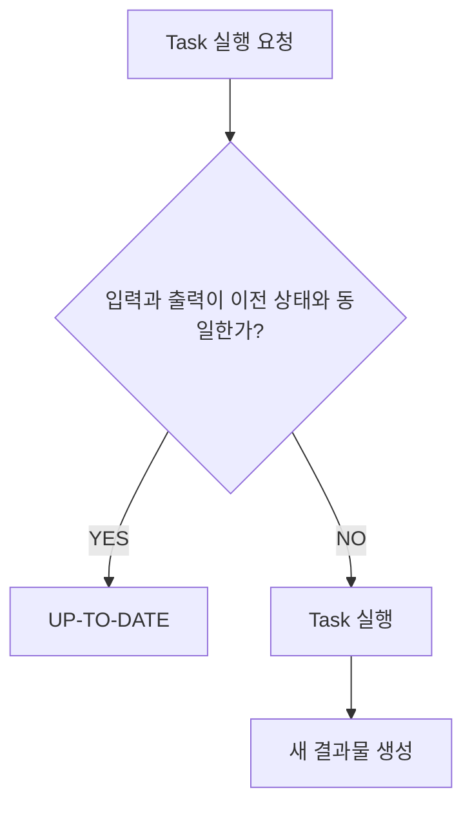

이러한 최적화 덕분에 아무 변경이 없는 프로젝트에서는 빌드 시간이 크게 줄어들 수 있다.

다만 Task가 자신의 입력과 출력을 정확하게 선언하지 않았다면 변경 감지가 제대로 이루어지지 않을 수 있다.

특히 직접 작성한 Custom Task에서는 이 점을 주의해야 한다.

---

### Build Cache란 무엇인가?

Build Cache는 이전 빌드에서 생성한 Task 결과물을 저장하고, 동일한 입력 조건에서 다시 사용할 수 있도록 하는 기능이다.

예를 들어 Java 소스 코드를 컴파일하면 `.class` 파일들이 생성된다.

이 작업은 일정한 비용이 발생한다.

그런데 이전에 동일한 조건으로 컴파일한 결과가 이미 존재한다면 다시 컴파일할 필요가 없을 수 있다.

Gradle은 캐시 가능한 Task의 입력을 바탕으로 Cache Key를 계산하고, 이전 결과물을 조회할 수 있다.

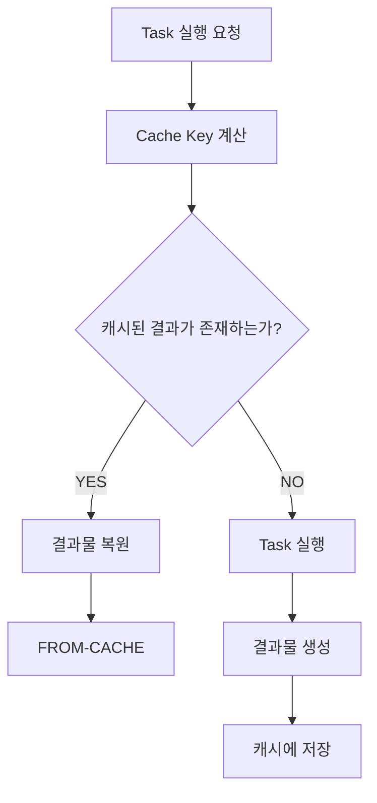

Build Cache는 로컬뿐 아니라 원격 저장소를 통해서도 활용할 수 있다.

따라서 동일한 개발자 컴퓨터에서만 유용한 기능은 아니다.

CI 환경에서 생성한 결과물을 다른 빌드 환경에서 재사용하는 구조도 가능하다.

Gradle 공식 문서에서는 Build Cache를 이전 빌드의 Task 결과물을 재사용해 불필요한 작업을 줄이는 기능으로 설명한다.

---

### UP-TO-DATE와 FROM-CACHE는 무엇이 다를까?

두 메시지는 비슷해 보이지만 의미가 다르다.

#### UP-TO-DATE

현재 작업 공간에 필요한 결과물이 이미 존재하며 입력과 출력이 변경되지 않은 상태다.

따라서 Task를 다시 실행하지 않는다.

#### FROM-CACHE

현재 작업 공간에서 Task를 다시 실행할 필요가 있지만, 동일한 입력 조건으로 생성한 결과물이 Build Cache에 존재한다.

따라서 실제 작업을 수행하는 대신 캐시에서 결과물을 복원한다.

| 구분         | UP-TO-DATE         | FROM-CACHE           |
| ---------- | ------------------ | -------------------- |
| 주요 기준      | 현재 작업 공간의 입력·출력 상태 | 이전에 저장된 Task 결과      |
| 결과물 위치     | 현재 작업 공간           | 로컬 또는 원격 Build Cache |
| Task 실제 실행 | 생략                 | 생략                   |
| 결과물 복원     | 일반적으로 불필요          | 필요                   |
| 대표적인 상황    | 변경 없이 재빌드          | Clean 후 동일 입력으로 재빌드  |

예를 들어 다음 명령어를 실행했다고 가정하자.

```bash
./gradlew compileJava
```

컴파일이 완료된다.

다시 실행한다.

```bash
./gradlew compileJava
```

변경 사항이 없다면 다음 메시지가 나타날 수 있다.

```text
> Task :compileJava UP-TO-DATE
```

반면 이전에 캐시에 저장한 결과가 존재하는 상황에서 다음 명령어를 실행했다고 가정하자.

```bash
./gradlew clean compileJava --build-cache
```

현재 프로젝트의 빌드 결과물은 삭제되었지만 Build Cache에 동일한 결과가 존재한다면 다음처럼 나타날 수 있다.

```text
> Task :compileJava FROM-CACHE
```

단, 실제 결과는 Task의 캐시 지원 여부와 입력 상태, Gradle 설정에 따라 달라질 수 있다.

---

### Gradle의 Task 실행 결과 메시지

Gradle을 사용하다 보면 다양한 Task 상태 메시지를 확인할 수 있다.

대표적인 결과를 정리하면 다음과 같다.

| 결과           | 의미                    |
| ------------ | --------------------- |
| `UP-TO-DATE` | 입력과 출력이 변경되지 않아 실행 생략 |
| `FROM-CACHE` | 캐시에서 결과물 복원           |
| `NO-SOURCE`  | 처리할 소스가 없음            |
| `SKIPPED`    | 조건 등에 따라 Task 실행 생략   |
| `EXECUTED`   | Task의 작업이 실제 실행됨      |

예를 들어 다음과 같은 출력이 나타날 수 있다.

```text
> Task :compileJava UP-TO-DATE
> Task :processResources NO-SOURCE
> Task :classes UP-TO-DATE
> Task :compileTestJava FROM-CACHE
> Task :test UP-TO-DATE
> Task :jar
```

이 출력은 모든 Task가 동일한 방식으로 처리되지 않았다는 사실을 보여준다.

각 Task의 입력과 출력, 캐시 지원 여부에 따라 실행 결과가 달라진다.

---

### Build Cache 활성화 방법

Gradle의 Build Cache는 명령어 옵션이나 설정 파일을 통해 활성화할 수 있다.

#### 명령어로 활성화하기

다음 명령어를 실행한다.

```bash
./gradlew build --build-cache
```

`--build-cache` 옵션은 해당 빌드에서 Build Cache를 사용하도록 설정한다.

#### gradle.properties에서 활성화하기

프로젝트의 `gradle.properties`에 다음 설정을 추가할 수 있다.

```properties
org.gradle.caching=true
```

이후에는 다음 명령어만 실행해도 Build Cache를 사용할 수 있다.

```bash
./gradlew build
```

단, Build Cache를 활성화했다고 모든 Task가 캐시되는 것은 아니다.

캐시 가능한 Task여야 하고, 캐시 사용 조건도 충족해야 한다.

Gradle 공식 문서에서는 `--build-cache` 옵션과 `org.gradle.caching=true` 설정을 지원한다.

---

### Build Cache의 실제 동작을 확인해 보자

간단한 Java 프로젝트를 만들어 Build Cache의 동작을 확인할 수 있다.

프로젝트 구조는 다음과 같다.

```text
gradle-example/
├── settings.gradle
├── build.gradle
├── gradle.properties
└── src/
    ├── main/
    │   └── java/
    │       └── com/
    │           └── example/
    │               └── gradle/
    │                   ├── App.java
    │                   └── GreetingService.java
    └── test/
        └── java/
            └── com/
                └── example/
                    └── gradle/
                        └── GreetingServiceTest.java
```

`settings.gradle`은 다음과 같이 작성한다.

```groovy
rootProject.name = 'gradle-example'
```

`build.gradle`은 다음과 같다.

```groovy
plugins {
    id 'application'
}

group = 'com.example'
version = '1.0.0'

repositories {
    mavenCentral()
}

java {
    toolchain {
        languageVersion = JavaLanguageVersion.of(17)
    }
}

application {
    mainClass = 'com.example.gradle.App'
}

dependencies {
    implementation 'org.slf4j:slf4j-api:2.0.16'

    runtimeOnly 'org.slf4j:slf4j-simple:2.0.16'

    compileOnly 'org.jetbrains:annotations:24.1.0'

    testImplementation 'org.junit.jupiter:junit-jupiter:5.11.4'
    testRuntimeOnly 'org.junit.platform:junit-platform-launcher:1.11.4'
}

tasks.named('test') {
    useJUnitPlatform()
}
```

이제 Java 코드를 작성한다.

`GreetingService.java`

```java
package com.example.gradle;

import org.jetbrains.annotations.NotNull;

public class GreetingService {

    public String greet(@NotNull String name) {
        return "Hello, " + name;
    }
}
```

`App.java`

```java
package com.example.gradle;

import org.slf4j.Logger;
import org.slf4j.LoggerFactory;

public class App {

    private static final Logger log =
            LoggerFactory.getLogger(App.class);

    public static void main(String[] args) {

        GreetingService service = new GreetingService();

        log.info(service.greet("Gradle"));
    }
}
```

테스트 코드도 작성한다.

`GreetingServiceTest.java`

```java
package com.example.gradle;

import org.junit.jupiter.api.Test;

import static org.junit.jupiter.api.Assertions.assertEquals;

class GreetingServiceTest {

    @Test
    void greeting() {

        GreetingService service = new GreetingService();

        String result = service.greet("Java");

        assertEquals("Hello, Java", result);
    }
}
```

이 프로젝트는 Java 컴파일과 테스트, JAR 생성에 필요한 기본적인 구조를 갖춘다.

---

### 첫 번째 빌드 실행

다음 명령어를 실행한다.

```bash
./gradlew build --build-cache --info
```

각 옵션의 의미는 다음과 같다.

| 옵션              | 의미              |
| --------------- | --------------- |
| `build`         | 빌드 Task 실행      |
| `--build-cache` | Build Cache 활성화 |
| `--info`        | 상세 실행 로그 출력     |

첫 번째 실행에서는 이전 결과물이 없으므로 필요한 Task가 실행될 수 있다.

예를 들어 다음과 같은 작업들이 수행된다.

```text
compileJava
processResources
classes
compileTestJava
test
jar
assemble
check
build
```

이때 캐시 가능한 Task의 결과는 이후 재사용할 수 있도록 저장될 수 있다.

---

### 두 번째 빌드 실행

아무 파일도 수정하지 않고 다시 실행한다.

```bash
./gradlew build --build-cache
```

이 경우 여러 Task에서 다음과 같은 결과를 확인할 수 있다.

```text
> Task :compileJava UP-TO-DATE
> Task :compileTestJava UP-TO-DATE
> Task :test UP-TO-DATE
```

이는 현재 프로젝트의 입력과 출력이 변경되지 않아 작업을 다시 실행할 필요가 없다는 의미다.

---

### Clean 이후 다시 빌드하면 어떻게 될까?

다음 명령어를 실행한다.

```bash
./gradlew clean
```

`clean`은 일반적으로 프로젝트의 `build` 디렉터리를 삭제한다.

따라서 앞서 생성한 클래스 파일과 JAR 등의 로컬 결과물이 제거된다.

하지만 Gradle User Home의 Build Cache까지 반드시 삭제하는 것은 아니다.

이제 다시 실행한다.

```bash
./gradlew compileJava --build-cache --info
```

이전에 저장된 캐시가 있고 입력 조건이 동일하다면 다음 결과가 나타날 수 있다.

```text
> Task :compileJava FROM-CACHE
```

즉 실제 컴파일을 다시 수행하지 않고 캐시에서 클래스 파일을 복원한 것이다.

이것이 Build Cache가 Up-to-date Check보다 넓은 범위에서 결과물을 재사용할 수 있는 이유다.

---

### Build Cache는 어디에 저장될까?

Gradle의 로컬 Build Cache는 기본적으로 Gradle User Home 아래에 저장된다.

일반적인 macOS와 Linux 환경에서는 다음 경로를 확인할 수 있다.

```text
~/.gradle/caches/
```

Build Cache 관련 디렉터리는 Gradle 버전과 설정에 따라 달라질 수 있다.

일부 환경에서는 다음과 같은 디렉터리를 확인할 수 있다.

```text
~/.gradle/caches/build-cache-1/
```

하지만 내부 디렉터리 이름이나 저장 파일 형식은 Gradle의 구현 세부사항이다.

따라서 애플리케이션 코드나 운영 스크립트가 이러한 파일 구조에 직접 의존해서는 안 된다.

또 Build Cache의 Cache Key는 단순히 Java 파일 이름 하나를 기준으로 만들어지는 것이 아니다.

Task의 입력과 구현, 관련 설정 등을 고려해 계산된다.

일반적으로 다음 요소들이 영향을 줄 수 있다.

* 소스 코드
* 컴파일 옵션
* 컴파일 Classpath
* 관련 플러그인과 Task 구현
* 입력 속성
* Task의 출력 정의

이처럼 Build Cache는 소스 파일 캐시라기보다 **Task 결과물 캐시**라고 이해하는 것이 정확하다.

---

### Incremental Build와 Build Cache는 어떻게 함께 동작할까?

두 기능을 조합하면 빌드 과정에서 불필요한 작업을 더욱 줄일 수 있다.

다음 상황을 생각해 보자.

처음에는 소스 코드가 A 상태다.

```text
Source A
```

첫 번째 빌드를 수행한다.

```text
Source A
    ↓
Compile
    ↓
Output A
    ↓
Build Cache 저장
```

이제 소스 코드를 B 상태로 변경한다.

```text
Source B
```

두 번째 빌드에서는 변경된 부분에 대해 증분 컴파일이 수행될 수 있다.

```text
Source B
    ↓
Incremental Compilation
    ↓
Output B
    ↓
Build Cache 저장
```

이후 소스 코드를 다시 A 상태로 되돌린다.

```text
Source A
```

이때 입력 조건이 이전 A 상태와 동일하고 캐시가 유효하다면 기존 결과물을 재사용할 수 있다.

```text
Source A
    ↓
Build Cache 조회
    ↓
Output A 복원
```

즉 두 기능은 서로 다른 문제를 해결한다.

증분 컴파일은 변경된 코드의 영향을 분석해 필요한 컴파일 범위를 줄인다.

Build Cache는 이전에 계산한 결과물을 다시 활용한다.

이 두 기능은 상호 보완적이다.

---

### Build Cache와 Dependency Cache는 무엇이 다를까?

Gradle에는 Build Cache 외에도 Dependency Cache가 존재한다.

이 둘을 혼동하기 쉽다.

하지만 저장하는 대상이 다르다.

#### Dependency Cache

외부 라이브러리와 의존성 메타데이터 등을 저장한다.

예를 들어 다음 라이브러리를 추가했다고 가정하자.

```groovy
implementation 'org.slf4j:slf4j-api:2.0.16'
```

Gradle은 필요한 의존성을 저장소에서 가져와 로컬에 캐시할 수 있다.

대표적인 위치는 다음과 같다.

```text
~/.gradle/caches/modules-2/
```

#### Build Cache

컴파일이나 테스트 등 캐시 가능한 Task의 결과물을 저장한다.

예를 들어 다음과 같은 결과다.

```text
compileJava의 출력 파일
```

두 캐시를 비교하면 다음과 같다.

| 구분       | Dependency Cache | Build Cache            |
| -------- | ---------------- | ---------------------- |
| 저장 대상    | 외부 의존성 및 메타데이터   | Task 실행 결과물            |
| 대표적인 데이터 | JAR, POM, 메타데이터  | 컴파일 결과, 테스트 결과 등       |
| 주요 목적    | 중복 다운로드 방지       | 중복 작업 실행 방지            |
| 재사용 기준   | 의존성 식별과 메타데이터    | Task 입력과 Cache Key     |
| 대표적인 위치  | `modules-2`      | Gradle Build Cache 저장소 |

Gradle 공식 문서에서도 Dependency Cache와 Build Cache를 별개의 기능으로 구분한다.

---

### build.gradle은 무엇인가?

`build.gradle`은 Gradle 프로젝트의 빌드 설정을 작성하는 파일이다.

일반적으로 Groovy DSL을 사용한다.

Kotlin DSL을 사용한다면 다음 파일을 작성한다.

```text
build.gradle.kts
```

예를 들어 다음 설정을 생각해 보자.

```groovy
plugins {
    id 'java'
}

group = 'com.example'
version = '1.0.0'

repositories {
    mavenCentral()
}

dependencies {
    implementation 'org.slf4j:slf4j-api:2.0.16'
}
```

각 블록의 역할은 다음과 같다.

| 블록             | 역할                 |
| -------------- | ------------------ |
| `plugins`      | Gradle 플러그인 적용     |
| `group`        | 프로젝트 그룹 식별자        |
| `version`      | 프로젝트 버전            |
| `repositories` | 의존성을 가져올 저장소       |
| `dependencies` | 프로젝트에서 사용할 의존성     |
| `tasks`        | Task 설정과 사용자 정의 작업 |

이 파일은 단순한 라이브러리 목록이 아니다.

프로젝트의 빌드 동작을 정의하는 중요한 설정 파일이다.

---

### Plugin은 무엇인가?

Gradle Plugin은 빌드에 새로운 기능을 추가하는 구성 요소다.

예를 들어 다음 설정을 보자.

```groovy
plugins {
    id 'java'
}
```

`java` 플러그인을 적용하면 Java 프로젝트를 빌드하기 위한 여러 기능이 추가된다.

대표적으로 다음 Task를 사용할 수 있다.

```text
compileJava
compileTestJava
test
jar
build
```

다음 설정도 가능하다.

```groovy
plugins {
    id 'application'
}
```

`application` 플러그인은 Java 애플리케이션을 실행하거나 배포하기 위한 기능을 제공한다.

대표적으로 다음 Task를 사용할 수 있다.

```text
run
```

따라서 Gradle의 기능은 플러그인에 의해 확장될 수 있다.

여기서 중요한 점이 있다.

**Gradle의 모든 프로젝트에서 모든 Configuration과 Task를 기본적으로 사용할 수 있는 것은 아니다.**

어떤 플러그인을 적용했는지에 따라 사용 가능한 기능이 달라진다.

이 차이는 `api`와 `compileOnlyApi`를 이해할 때 특히 중요하다.

---

### Dependency란 무엇인가?

Dependency는 프로젝트가 다른 코드나 구성 요소에 의존하는 관계를 의미한다.

예를 들어 Spring Boot 애플리케이션이 Jackson을 사용한다고 가정하자.

애플리케이션은 Jackson이 제공하는 기능에 의존한다.


이를 Gradle에서 선언하면 다음과 같은 형태가 된다.

```groovy
dependencies {
    implementation 'com.fasterxml.jackson.core:jackson-databind:2.18.2'
}
```

이 설정은 해당 외부 모듈을 프로젝트의 `implementation` 의존성으로 추가한다는 의미다.

다만 의존성은 반드시 외부 라이브러리만 의미하는 것은 아니다.

멀티 모듈 프로젝트에서는 다른 내부 프로젝트에도 의존할 수 있다.

예를 들어 다음과 같다.

```groovy
dependencies {
    implementation project(':domain')
}
```

이 설정은 현재 프로젝트가 `domain`이라는 다른 Gradle 프로젝트에 의존한다는 의미다.

따라서 Gradle의 Dependency는 외부 라이브러리와 내부 프로젝트 등을 포함하는 더 넓은 개념이다.

---

### 의존성 선언의 구성 요소

다음 설정을 살펴보자.

```groovy
implementation 'org.slf4j:slf4j-api:2.0.16'
```

이 설정은 다음 요소로 나눌 수 있다.

```text
implementation

org.slf4j

slf4j-api

2.0.16
```

각 요소의 의미는 다음과 같다.

| 구성 요소         | 예제               | 의미             |
| ------------- | ---------------- | -------------- |
| Configuration | `implementation` | 의존성 사용 및 노출 범위 |
| Group         | `org.slf4j`      | 모듈 그룹 식별자      |
| Name          | `slf4j-api`      | 모듈 이름          |
| Version       | `2.0.16`         | 모듈 버전          |

일반적으로 다음 형태를 사용한다.

```text
configuration 'group:name:version'
```

여기서 `group:name:version`은 외부 모듈을 식별하는 좌표로 이해할 수 있다.

Gradle은 선언된 의존성을 해석하고, 지정된 저장소에서 필요한 모듈을 찾아 프로젝트의 적절한 Classpath에 포함한다.

단, 버전은 항상 문자열에 직접 작성해야 하는 것은 아니다.

BOM이나 Platform, Version Catalog 등을 이용해 버전을 별도로 관리할 수도 있다.

---

### Repository는 무엇인가?

Gradle은 의존성을 다운로드하기 위해 저장소를 사용한다.

예를 들어 다음과 같다.

```groovy
repositories {
    mavenCentral()
}
```

이 설정은 Maven Central Repository를 의존성 저장소로 사용한다는 의미다.

Gradle은 의존성을 해결할 때 설정된 저장소를 이용한다.

대표적인 저장소 유형은 다음과 같다.

| 저장소                  | 용도                   |
| -------------------- | -------------------- |
| Maven Central        | 공개 Java 라이브러리        |
| 사내 Maven Repository  | 내부 공통 라이브러리          |
| Gradle Plugin Portal | Gradle 플러그인          |
| 로컬 Maven Repository  | 로컬 개발 환경의 Maven 아티팩트 |

여기서 중요한 점은 의존성을 한 줄 추가했다고 즉시 모든 라이브러리가 다운로드된다고 단정할 수 없다는 사실이다.

Gradle은 필요한 Configuration을 해결하는 시점에 저장소를 조회할 수 있다.

또 이미 Dependency Cache에 존재한다면 다시 다운로드하지 않을 수 있다.

따라서 의존성 선언과 실제 의존성 해결 시점을 구분하는 것이 좋다.

---

### Transitive Dependency란 무엇인가?

Transitive Dependency는 전이 의존성이다.

프로젝트가 직접 의존하는 라이브러리가 다시 의존하는 다른 라이브러리를 의미한다.

예를 들어 다음과 같은 구조를 생각해 보자.

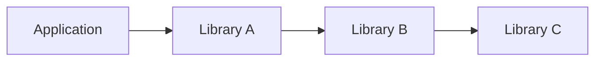

Application은 Library A를 직접 사용한다.

하지만 Library A는 Library B를 필요로 한다.

Library B는 다시 Library C를 필요로 한다.

따라서 Application 관점에서는 Library B와 Library C가 전이 의존성이다.

이러한 관계 덕분에 개발자는 필요한 모든 하위 라이브러리를 직접 하나씩 선언하지 않아도 된다.

Gradle은 의존성 메타데이터를 통해 필요한 전이 의존성을 해결할 수 있다.

다만 전이 의존성의 실제 노출 범위와 선택 여부는 Configuration, Variant, 메타데이터 등에 영향을 받는다.

---

### Spring Boot Starter와 전이 의존성

Spring Boot Starter는 전이 의존성을 이해하기 좋은 사례다.

예를 들어 다음 의존성을 추가했다고 가정하자.

```groovy
dependencies {
    implementation 'org.springframework.boot:spring-boot-starter-web'
}
```

개발자는 하나의 Starter를 선언했다.

하지만 실제 애플리케이션에는 여러 라이브러리가 필요하다.

일반적인 Spring Boot 3.x 환경에서 웹 Starter는 Spring MVC와 내장 Servlet Container 등에 필요한 의존성을 함께 제공한다.

개념적으로 다음과 같다.

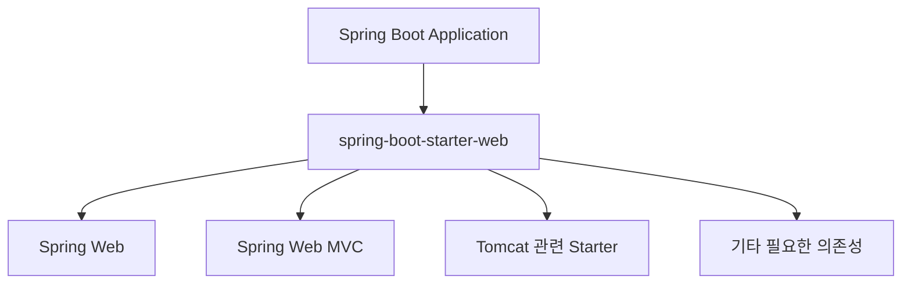

정확한 의존성 구성은 Spring Boot 버전에 따라 달라질 수 있다.

중요한 점은 Starter가 웹 기능에 필요한 여러 의존성을 편리하게 추가하도록 도와준다는 것이다.

단, Starter가 항상 완전히 코드가 없는 의존성 선언 전용 모듈인 것은 아니다.

Starter의 구현과 구성은 프로젝트와 버전에 따라 확인해야 한다.

---

### 전이 의존성이 편리하기만 할까?

전이 의존성은 편리하지만 복잡한 문제를 만들 수도 있다.

예를 들어 다음과 같은 구조를 생각해 보자.

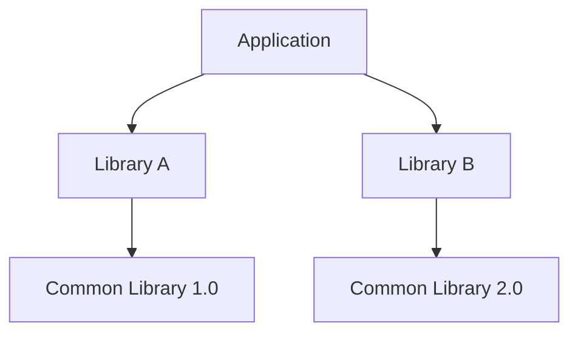

Application은 두 라이브러리를 직접 사용한다.

그런데 두 라이브러리가 같은 공통 라이브러리의 서로 다른 버전을 요구한다.

이 경우 의존성 버전 충돌이 발생할 수 있다.

Gradle은 의존성 해결 규칙에 따라 실제 사용할 버전을 선택한다.

여기서 중요한 점은 선언한 모든 버전이 그대로 Classpath에 추가되는 것은 아니라는 사실이다.

Gradle은 동일한 모듈의 여러 버전 요구사항을 분석해 선택된 버전으로 의존성 그래프를 구성할 수 있다.

하지만 이렇게 선택된 버전이 모든 라이브러리와 호환된다고 보장할 수는 없다.

특히 다음과 같은 오류가 발생할 수 있다.

```text
NoSuchMethodError
```

```text
NoClassDefFoundError
```

```text
ClassNotFoundException
```

이러한 오류가 발생하면 실제 Runtime Classpath에 어떤 라이브러리와 버전이 포함되어 있는지 확인해야 한다.

---

### Dependency Configuration이란 무엇인가?

Dependency Configuration은 Gradle에서 의존성을 어떤 목적으로 사용하고 어떤 범위에 노출할지 관리하는 구성이다.

예를 들어 다음과 같은 설정을 생각해 보자.

```groovy
dependencies {
    implementation 'org.slf4j:slf4j-api:2.0.16'

    runtimeOnly 'org.slf4j:slf4j-simple:2.0.16'

    compileOnly 'org.jetbrains:annotations:24.1.0'
}
```

세 의존성은 서로 다른 Configuration에 선언되어 있다.

그 이유는 각 라이브러리의 사용 목적이 다르기 때문이다.

`slf4j-api`는 Java 코드를 컴파일할 때 필요하다.

또 애플리케이션 실행 시에도 필요하다.

`slf4j-simple`은 로그 구현체로 실행 시점에 필요하다.

반면 JetBrains의 Annotation은 예제에서 컴파일 시점에만 필요할 수 있다.

즉 라이브러리의 역할에 따라 적절한 Configuration을 선택해야 한다.

---

### Compile Classpath와 Runtime Classpath

Dependency Configuration을 이해하려면 Classpath 개념을 알아야 한다.

Classpath는 Java 컴파일러나 JVM이 필요한 클래스를 찾는 경로다.

대표적으로 두 가지를 구분할 수 있다.

#### Compile Classpath

Java 소스 코드를 컴파일할 때 필요한 클래스들이 포함된다.

예를 들어 다음 코드가 있다고 가정하자.

```java
import org.slf4j.Logger;
import org.slf4j.LoggerFactory;
```

이 코드를 컴파일하려면 SLF4J API 클래스가 필요하다.

따라서 해당 라이브러리가 Compile Classpath에 존재해야 한다.

#### Runtime Classpath

Java 프로그램을 실행할 때 필요한 클래스들이 포함된다.

컴파일에는 필요하지 않지만 실행 시점에 필요한 라이브러리도 존재할 수 있다.

예를 들어 로깅 구현체나 JDBC Driver가 대표적이다.

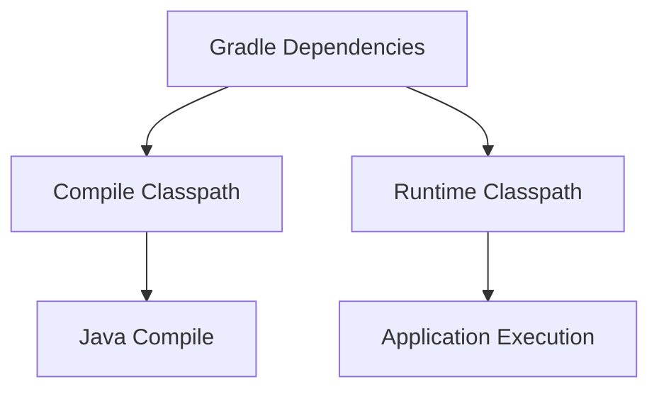

중요한 점은 두 Classpath가 항상 동일하지 않다는 것이다.

이 차이를 Gradle Configuration으로 표현한다.

---

### implementation이란?

`implementation`은 현재 모듈에서 컴파일과 실행에 필요한 의존성을 선언할 때 사용한다.

예를 들어 다음과 같다.

```groovy
dependencies {
    implementation 'org.slf4j:slf4j-api:2.0.16'
}
```

이 라이브러리는 현재 모듈의 Compile Classpath와 Runtime Classpath에 포함된다.

따라서 다음 코드를 작성할 수 있다.

```java
import org.slf4j.Logger;
import org.slf4j.LoggerFactory;

public class LoggingService {

    private static final Logger log =
            LoggerFactory.getLogger(LoggingService.class);

    public void execute() {
        log.info("Service executed");
    }
}
```

컴파일 시점에는 `Logger` 인터페이스가 필요하다.

실행 시점에도 해당 API 클래스가 필요하다.

따라서 `implementation`이 적절하다.

다만 `implementation`은 멀티 모듈 프로젝트에서 중요한 의미를 하나 더 가진다.

**해당 라이브러리를 사용하는 모듈의 내부 구현 의존성을 소비자의 Compile Classpath에 불필요하게 노출하지 않는다는 점**이다.

이 차이는 `api`와 비교해야 정확하게 이해할 수 있다.

---

### compileOnly란?

`compileOnly`는 컴파일 시점에만 필요한 의존성을 선언할 때 사용한다.

예를 들어 다음과 같다.

```groovy
dependencies {
    compileOnly 'org.jetbrains:annotations:24.1.0'
}
```

다음 Java 코드를 생각해 보자.

```java
import org.jetbrains.annotations.NotNull;

public class MemberService {

    public String getName(@NotNull String name) {
        return name;
    }
}
```

`@NotNull` 클래스를 컴파일 시점에 참조하므로 해당 라이브러리가 필요하다.

하지만 이 예제의 일반적인 실행 흐름에서 Annotation 라이브러리 자체를 사용할 필요는 없다.

따라서 `compileOnly`를 선택할 수 있다.

#### compileOnly 라이브러리는 실행 시점에 존재할까?

일반적으로 `compileOnly`에 선언한 의존성은 Runtime Classpath에 포함되지 않는다.

따라서 다음과 같은 구조가 된다.

```text
Compile Classpath

→ 포함
```

```text
Runtime Classpath

→ 포함되지 않음
```

여기서 주의해야 한다.

컴파일 시점에 존재하는 클래스를 실행 시점에도 직접 사용한다면 문제가 발생할 수 있다.

예를 들어 실행 중에 해당 라이브러리의 클래스를 로딩해야 하는데 Runtime Classpath에 없다면 클래스 로딩 오류가 발생할 수 있다.

따라서 `compileOnly`는 런타임에서 필요하지 않거나 별도의 방식으로 제공되는 의존성에 사용해야 한다.

---

### runtimeOnly란?

`runtimeOnly`는 실행 시점에만 필요한 의존성을 선언한다.

예를 들어 다음과 같다.

```groovy
dependencies {
    implementation 'org.slf4j:slf4j-api:2.0.16'

    runtimeOnly 'org.slf4j:slf4j-simple:2.0.16'
}
```

여기서 `slf4j-api`는 컴파일과 실행에 필요하다.

반면 `slf4j-simple`은 실행 시점의 로깅 구현체다.

애플리케이션 코드는 일반적으로 SLF4J API에만 의존한다.

```java
private static final Logger log =
        LoggerFactory.getLogger(App.class);
```

실제 로깅 구현은 실행 환경에서 선택할 수 있다.

이 구조는 인터페이스와 구현체를 분리하는 설계와 연결된다.

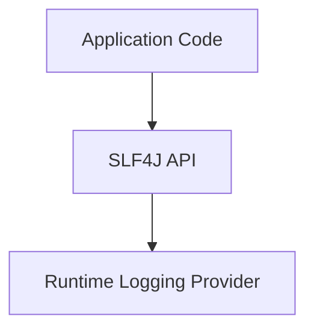

따라서 구현체가 컴파일에 직접 필요하지 않다면 `runtimeOnly`로 선언할 수 있다.

---

### runtimeOnly를 컴파일 시점에 사용하면 어떻게 될까?

예를 들어 다음과 같이 선언했다고 가정하자.

```groovy
dependencies {
    runtimeOnly 'org.slf4j:slf4j-simple:2.0.16'
}
```

그런데 애플리케이션에서 해당 라이브러리의 구현 클래스를 직접 import한다면 문제가 발생할 수 있다.

컴파일러는 Runtime Classpath가 아니라 Compile Classpath를 기준으로 필요한 클래스를 찾기 때문이다.

따라서 다음과 같은 상황이 발생할 수 있다.

```text
package ... does not exist
```

또는

```text
cannot find symbol
```

이것은 컴파일 오류다.

반대로 실행 시점에는 해당 라이브러리가 존재할 수 있다.

따라서 `runtimeOnly`는 Reflection이나 서비스 제공자 로딩 등 컴파일 시점에 구현 타입을 직접 참조할 필요가 없는 경우에 적합할 수 있다.

---

### JDBC Driver를 runtimeOnly로 선언하는 이유

Spring Boot 프로젝트에서는 다음 설정을 자주 사용한다.

```groovy
dependencies {
    implementation 'org.springframework.boot:spring-boot-starter-jdbc'

    runtimeOnly 'com.mysql:mysql-connector-j'
}
```

왜 MySQL JDBC Driver를 `runtimeOnly`로 선언할까?

일반적인 애플리케이션 코드는 JDBC 표준 API나 Spring JDBC 추상화에 의존하기 때문이다.

예를 들어 다음과 같다.

```java
private final JdbcTemplate jdbcTemplate;
```

애플리케이션 코드는 MySQL Driver의 구체적인 구현 클래스를 직접 사용할 필요가 없다.

하지만 실제 MySQL에 연결하려면 실행 시점에 JDBC Driver가 필요하다.

따라서 `runtimeOnly`가 적합하다.

물론 애플리케이션에서 MySQL Driver의 특정 구현 클래스를 직접 참조해야 하는 특수한 경우라면 의존성 설정을 다르게 구성해야 할 수 있다.

---

### implementation, compileOnly, runtimeOnly 비교

세 Configuration의 차이를 정리하면 다음과 같다.

| Configuration    | 현재 모듈 컴파일 | 현재 모듈 실행 | 대표적인 용도             |
| ---------------- | --------- | -------- | ------------------- |
| `implementation` | 포함        | 포함       | 일반 라이브러리            |
| `compileOnly`    | 포함        | 미포함      | 컴파일 전용 Annotation   |
| `runtimeOnly`    | 미포함       | 포함       | JDBC Driver, 로깅 구현체 |

이 표는 현재 모듈 기준이다.

멀티 모듈 프로젝트에서는 의존성을 다른 모듈에 어떻게 노출하는지도 고려해야 한다.

그때 중요한 Configuration이 `api`다.

---

### api란 무엇인가?

`api`는 라이브러리 모듈이 외부에 공개하는 API에 필요한 의존성을 선언할 때 사용한다.

중요한 전제조건이 있다.

**일반적인 Java 프로젝트에서 `api` Configuration을 사용하려면 `java-library` 플러그인을 적용해야 한다.**

예를 들어 다음과 같다.

```groovy
plugins {
    id 'java-library'
}
```

이 플러그인을 적용하면 `api`와 `compileOnlyApi` 같은 Configuration을 사용할 수 있다.

`api`는 현재 모듈의 컴파일과 실행뿐 아니라 해당 모듈을 사용하는 다른 모듈의 컴파일에도 필요한 의존성을 노출한다.

따라서 단순히 컴파일과 런타임 모두에 포함된다는 점만으로 `implementation`과 구분할 수 없다.

**차이는 소비자 모듈의 Compile Classpath에 의존성이 노출되는지에 있다.**

Gradle의 Java Library Plugin은 이를 API와 구현 의존성 분리라고 설명한다.

---

### api와 implementation의 차이

멀티 모듈 프로젝트를 생각해 보자.

다음 세 모듈이 존재한다.

```text
app
core
shared
```

`app`은 `core`에 의존한다.

`core`는 `shared`에 의존한다.

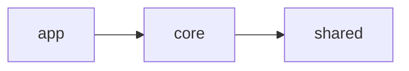

이제 `core`에서 다음과 같이 선언했다고 가정하자.

```groovy
dependencies {
    api project(':shared')
}
```

이 경우 `shared`는 `core`의 API 의존성으로 노출된다.

따라서 `app`이 `core`를 의존하면 `shared`의 타입도 Compile Classpath에서 사용할 수 있다.

반면 다음처럼 선언하면 어떨까?

```groovy
dependencies {
    implementation project(':shared')
}
```

이 경우 `shared`는 `core`의 내부 구현 의존성으로 취급된다.

`core`를 사용하는 `app`의 Compile Classpath에 불필요하게 노출되지 않는다.

다만 일반적인 Java Library Plugin의 의존성 구성에서는 실행에 필요한 구현 의존성이 소비자의 Runtime Classpath에 포함될 수 있다.

따라서 `implementation`이 전이 의존성을 완전히 차단한다는 의미는 아니다.

정확하게는 **소비자의 컴파일 의존성과 런타임 의존성을 구분한다**는 의미다.

---

### api와 implementation을 실제 코드로 비교해 보자

다음 프로젝트 구조를 생각해 보자.

```text
multi-module/
├── settings.gradle
├── app/
│   ├── build.gradle
│   └── src/main/java/
├── core/
│   ├── build.gradle
│   └── src/main/java/
└── shared/
    ├── build.gradle
    └── src/main/java/
```

`settings.gradle`

```groovy
rootProject.name = 'multi-module'

include 'app'
include 'core'
include 'shared'
```

먼저 `shared` 모듈에 공통 타입을 만든다.

`shared/build.gradle`

```groovy
plugins {
    id 'java-library'
}
```

`SharedResult.java`

```java
package com.example.shared;

public record SharedResult(
        String message
) {
}
```

이제 `core` 모듈에서 해당 타입을 사용한다.

`core/build.gradle`

```groovy
plugins {
    id 'java-library'
}

dependencies {
    api project(':shared')
}
```

`CoreService.java`

```java
package com.example.core;

import com.example.shared.SharedResult;

public class CoreService {

    public SharedResult execute() {
        return new SharedResult("success");
    }
}
```

여기서 중요한 부분은 다음 메서드다.

```java
public SharedResult execute()
```

`SharedResult`는 `CoreService`의 공개 메서드 반환 타입이다.

즉 `core`를 사용하는 다른 모듈도 이 타입을 알아야 한다.

따라서 `shared`는 `core`의 공개 API에 포함되는 의존성이다.

이러한 상황에서 `api`가 적절하다.

---

### app 모듈에서는 어떻게 사용할까?

`app/build.gradle`

```groovy
plugins {
    id 'application'
}

dependencies {
    implementation project(':core')
}

application {
    mainClass = 'com.example.app.App'
}
```

`App.java`

```java
package com.example.app;

import com.example.core.CoreService;
import com.example.shared.SharedResult;

public class App {

    public static void main(String[] args) {

        CoreService service = new CoreService();

        SharedResult result = service.execute();

        System.out.println(result.message());
    }
}
```

`app`은 `core`만 직접 의존한다.

```groovy
implementation project(':core')
```

하지만 `core`가 `shared`를 `api`로 노출했기 때문에 `app`은 `SharedResult` 타입을 컴파일 시점에 사용할 수 있다.

이제 다음 명령어로 실행할 수 있다.

```bash
./gradlew :app:run
```

정상적으로 실행되면 다음 문자열이 출력된다.

```text
success
```

이것이 `api`가 필요한 대표적인 상황이다.

---

### implementation으로 변경하면 어떻게 될까?

이제 `core/build.gradle`을 다음과 같이 변경한다고 가정하자.

```groovy
plugins {
    id 'java-library'
}

dependencies {
    implementation project(':shared')
}
```

`core` 자체는 `SharedResult`를 사용할 수 있다.

하지만 `app`의 Compile Classpath에서는 `shared`의 타입을 직접 참조할 수 없을 수 있다.

따라서 다음 코드가 컴파일 오류를 발생시킬 수 있다.

```java
import com.example.shared.SharedResult;
```

`app`이 `shared`를 직접 사용하려면 별도의 의존성을 선언해야 한다.

```groovy
dependencies {
    implementation project(':core')
    implementation project(':shared')
}
```

또는 `core`의 공개 API에 실제로 필요한 의존성이라면 `api`로 선언하는 편이 적절하다.

여기서 중요한 설계 원칙은 다음과 같다.

**공개 API에 필요한 의존성은 `api`, 내부 구현에만 필요한 의존성은 `implementation`을 우선 고려한다.**

---

### 왜 api보다 implementation을 우선 사용하는 것이 좋을까?

모든 라이브러리를 `api`로 선언하면 편리해 보일 수 있다.

하지만 멀티 모듈 프로젝트에서는 문제가 발생할 수 있다.

예를 들어 다음과 같은 구조를 생각해 보자.

```text
app
  ↓
core
  ↓
database-library
```

`core`의 내부 구현에서만 사용하는 데이터베이스 라이브러리를 `api`로 노출한다면 `app`의 Compile Classpath에도 해당 라이브러리가 포함될 수 있다.

이렇게 되면 불필요한 의존성이 외부로 노출된다.

그 결과 다음 문제가 발생할 수 있다.

* 소비자 모듈의 Compile Classpath 증가
* 모듈 간 결합도 증가
* 구현 라이브러리 변경 시 영향 범위 확대
* 불필요한 재컴파일
* 공개 API와 내부 구현의 경계 약화

반면 `implementation`을 사용하면 내부 구현 의존성을 소비자의 Compile Classpath에서 숨길 수 있다.

이는 빌드 성능뿐 아니라 모듈 설계에도 긍정적인 영향을 준다.

Gradle 공식 문서에서도 가능한 경우 `implementation`을 우선 사용하도록 권장한다.

---

### compileOnlyApi란 무엇인가?

`compileOnlyApi`는 `java-library` 플러그인에서 제공하는 Configuration이다.

이 이름에는 두 가지 개념이 포함되어 있다.

첫 번째는 `compileOnly`다.

현재 모듈의 컴파일에 필요하지만 런타임에는 필요하지 않다는 의미다.

두 번째는 `api`다.

현재 모듈을 사용하는 다른 모듈의 컴파일에도 필요한 의존성이라는 의미다.

즉 `compileOnlyApi`는 다음과 같이 정리할 수 있다.

**현재 모듈과 소비자 모듈의 컴파일에는 필요하지만 런타임 의존성으로는 노출하지 않는 설정**이다.

예를 들어 다음과 같다.

```groovy
plugins {
    id 'java-library'
}

dependencies {
    compileOnlyApi 'org.jetbrains:annotations:24.1.0'
}
```

공개 API에 사용하는 Annotation 타입을 컴파일 시점에 소비자도 알아야 하지만 런타임에서는 별도로 필요하지 않은 경우에 고려할 수 있다.

다만 해당 Annotation의 런타임 사용 여부와 실제 보존 정책에 따라 적절한 Configuration은 달라질 수 있다.

---

### api와 compileOnlyApi의 차이

| 구분        | api              | compileOnlyApi    |
| --------- | ---------------- | ----------------- |
| 현재 모듈 컴파일 | 포함               | 포함                |
| 현재 모듈 런타임 | 포함               | 미포함               |
| 소비자 컴파일   | 포함               | 포함                |
| 소비자 런타임   | 포함               | 미포함               |
| 대표적인 용도   | 공개 API의 필수 라이브러리 | 컴파일 전용 공개 API 의존성 |

여기서 주의해야 할 점이 있다.

`compileOnlyApi`는 소비자 모듈이 런타임에서도 해당 라이브러리를 사용할 수 있도록 하는 설정이 아니다.

따라서 `api`와 `compileOnlyApi`를 단순히 전이 의존성을 노출하는 동일한 기능으로 이해하면 안 된다.

**어느 Classpath에 의존성을 노출하는지가 핵심적인 차이**다.

---

### Dependency Configuration 전체 비교

지금까지 살펴본 주요 Configuration을 정리하면 다음과 같다.

| Configuration    | 현재 모듈 컴파일 | 현재 모듈 실행 | 소비자 컴파일 | 소비자 실행 |
| ---------------- | --------- | -------- | ------- | ------ |
| `implementation` | O         | O        | X       | O      |
| `api`            | O         | O        | O       | O      |
| `compileOnly`    | O         | X        | X       | X      |
| `compileOnlyApi` | O         | X        | O       | X      |
| `runtimeOnly`    | X         | O        | X       | O      |

이 표는 일반적인 Java Library Plugin의 의존성 모델을 기준으로 한다.

실제 의존성 해결 결과는 Variant, Component Metadata, Plugin 설정 등에 영향을 받을 수 있다.

또 소비자 모듈이 해당 라이브러리를 별도로 직접 선언했다면 Classpath에 포함될 수 있다.

따라서 이 표는 각 Configuration이 제공하는 기본적인 의존성 노출 규칙으로 이해하면 된다.

---

### testImplementation이란?

`testImplementation`은 테스트 코드의 컴파일과 실행에 필요한 의존성을 선언한다.

예를 들어 JUnit을 사용한다고 가정하자.

```groovy
dependencies {
    testImplementation 'org.junit.jupiter:junit-jupiter:5.11.4'
}
```

테스트 코드에서는 다음과 같이 사용할 수 있다.

```java
import org.junit.jupiter.api.Test;

import static org.junit.jupiter.api.Assertions.assertEquals;

class CalculatorTest {

    @Test
    void add() {
        assertEquals(3, 1 + 2);
    }
}
```

이 라이브러리는 테스트 코드에서 필요하다.

하지만 일반적인 애플리케이션 실행에는 필요하지 않다.

따라서 `implementation` 대신 `testImplementation`을 사용한다.

이러한 분리는 테스트 전용 라이브러리가 운영용 Runtime Classpath에 불필요하게 포함되는 일을 줄이는 데 도움이 된다.

---

### testCompileOnly와 testRuntimeOnly는 무엇인가?

테스트에서도 컴파일과 실행에 필요한 의존성을 구분할 수 있다.

#### testCompileOnly

테스트 컴파일 시점에만 필요한 의존성을 선언한다.

```groovy
dependencies {
    testCompileOnly 'org.jetbrains:annotations:24.1.0'
}
```

#### testRuntimeOnly

테스트 실행 시점에만 필요한 의존성을 선언한다.

```groovy
dependencies {
    testRuntimeOnly 'org.junit.platform:junit-platform-launcher:1.11.4'
}
```

예를 들어 JUnit Platform Launcher는 테스트 실행 환경에서 필요할 수 있다.

따라서 테스트 실행 전용 의존성으로 설정할 수 있다.

주요 테스트 Configuration을 정리하면 다음과 같다.

| Configuration        | 테스트 컴파일 | 테스트 실행 |
| -------------------- | ------- | ------ |
| `testImplementation` | O       | O      |
| `testCompileOnly`    | O       | X      |
| `testRuntimeOnly`    | X       | O      |

일반적인 애플리케이션 실행용 Classpath와 테스트용 Classpath는 구분해서 관리해야 한다.

---

### annotationProcessor란 무엇인가?

Java 프로젝트에서는 Annotation Processor를 사용하는 경우가 있다.

대표적인 사례로 Lombok이 있다.

Annotation Processor는 컴파일 과정에서 Annotation을 분석하고 코드를 생성하거나 검증하는 데 사용된다.

예를 들어 다음과 같이 선언할 수 있다.

```groovy
dependencies {
    compileOnly 'org.projectlombok:lombok:1.18.36'

    annotationProcessor 'org.projectlombok:lombok:1.18.36'
}
```

여기서 두 Configuration의 역할이 다르다.

`compileOnly`는 소스 코드에서 Lombok Annotation 타입을 참조하기 위해 사용한다.

`annotationProcessor`는 컴파일 과정에서 Annotation Processor를 실행하기 위해 사용한다.

즉 다음 두 개념은 서로 다르다.

```text
Annotation 클래스 참조
```

```text
Annotation Processor 실행
```

이 차이를 이해하지 못하면 Lombok이 컴파일되지 않거나 생성되어야 할 메서드가 만들어지지 않는 문제가 발생할 수 있다.

---

### Gradle에서 의존성 그래프를 확인하는 방법

전이 의존성이나 버전 충돌이 발생했다면 `build.gradle` 파일만 확인해서는 충분하지 않을 수 있다.

실제로 어떤 라이브러리가 선택되었는지 확인해야 한다.

Gradle은 이를 위한 명령어를 제공한다.

#### dependencies

다음 명령어를 실행한다.

```bash
./gradlew dependencies
```

이 명령어는 프로젝트의 의존성 구성을 확인하는 데 사용한다.

특정 Classpath만 확인하려면 다음과 같이 실행한다.

```bash
./gradlew dependencies --configuration runtimeClasspath
```

이 명령어는 Runtime Classpath에 포함되는 의존성 그래프를 보여준다.

예를 들어 다음과 같은 형태를 확인할 수 있다.

```text
runtimeClasspath
+--- org.slf4j:slf4j-api:2.0.16
\--- org.slf4j:slf4j-simple:2.0.16
     \--- org.slf4j:slf4j-api:2.0.16
```

실제 출력은 프로젝트 설정과 의존성 해결 결과에 따라 달라질 수 있다.

이 결과를 통해 직접 선언한 의존성과 전이 의존성을 확인할 수 있다.

---

### dependencyInsight란 무엇인가?

`dependencyInsight`는 특정 의존성이 왜 추가되었고 어떤 버전이 선택되었는지 확인하는 데 유용하다.

예를 들어 SLF4J의 의존성 관계를 확인하려면 다음 명령어를 사용할 수 있다.

```bash
./gradlew dependencyInsight \
  --dependency slf4j-api \
  --configuration runtimeClasspath
```

각 옵션의 의미는 다음과 같다.

| 옵션                  | 의미               |
| ------------------- | ---------------- |
| `dependencyInsight` | 특정 의존성의 선택 과정 분석 |
| `--dependency`      | 분석할 의존성          |
| `--configuration`   | 확인할 Classpath    |

이 명령어는 다음과 같은 상황에서 유용하다.

어떤 라이브러리가 특정 버전을 요구하는지 확인하고 싶다.

예상과 다른 버전이 선택되었다.

전이 의존성이 여러 경로로 추가되었다.

런타임 클래스 충돌이 발생했다.

Gradle 공식 문서에서도 `dependencies`와 `dependencyInsight`를 의존성 그래프와 버전 선택 원인을 분석하는 주요 도구로 설명한다.

---

### 의존성 충돌을 해결하는 방법

의존성 충돌이 발생했다고 해서 무조건 가장 높은 버전을 강제로 지정하는 것이 좋은 해결책은 아니다.

먼저 다음 사항을 확인해야 한다.

어떤 라이브러리가 해당 의존성을 추가했는가?

실제로 선택된 버전은 무엇인가?

어떤 버전과 호환되어야 하는가?

현재 사용 중인 Spring Boot가 관리하는 버전은 무엇인가?

예를 들어 Spring Boot 프로젝트에서는 여러 라이브러리의 호환성을 고려한 버전 관리 기능을 제공한다.

따라서 Spring Boot가 관리하는 라이브러리라면 버전을 직접 지정하지 않는 것이 적절할 수 있다.

다음과 같은 방식이다.

```groovy
dependencies {
    implementation 'org.springframework.boot:spring-boot-starter-jdbc'

    runtimeOnly 'com.mysql:mysql-connector-j'
}
```

여기서는 MySQL JDBC Driver의 버전을 직접 작성하지 않았다.

Spring Boot의 의존성 관리 설정을 통해 적절한 버전이 선택될 수 있다.

반대로 필요하지 않은 버전을 무분별하게 강제하면 호환성 문제가 발생할 수 있다.

따라서 의존성 충돌 해결은 단순한 숫자 비교가 아니라 호환성 검증이 함께 필요한 작업이다.

---

### Gradle 멀티 모듈 설계에서 중요한 점

멀티 모듈 프로젝트에서는 의존성 방향이 매우 중요하다.

예를 들어 다음과 같은 시스템을 생각해 보자.

```text
api
domain
infrastructure
```

각 모듈의 책임을 구분할 수 있다.

| 모듈             | 책임                |
| -------------- | ----------------- |
| api            | HTTP 요청과 응답       |
| domain         | 핵심 비즈니스 규칙        |
| infrastructure | 데이터베이스와 외부 시스템 연동 |

이제 다음과 같은 의존성 구조를 설계할 수 있다.

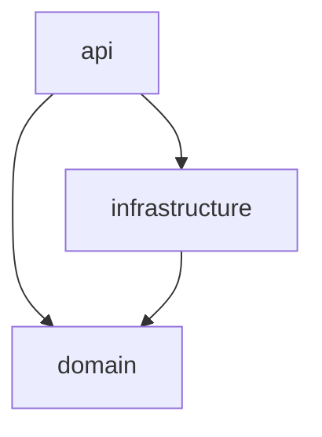

이 구조에서는 Domain이 Infrastructure에 직접 의존하지 않도록 설계할 수 있다.

예를 들어 Domain에서는 Repository 인터페이스를 정의한다.

Infrastructure에서는 해당 인터페이스를 구현한다.

이러한 구조는 객체지향 설계와 의존성 역전 원칙을 적용하는 데 도움이 될 수 있다.

Gradle에서는 다음과 같이 모듈 의존성을 설정할 수 있다.

`api/build.gradle`

```groovy
dependencies {
    implementation project(':domain')
    implementation project(':infrastructure')
}
```

`infrastructure/build.gradle`

```groovy
dependencies {
    implementation project(':domain')
}
```

이처럼 Gradle의 의존성 설정은 단순히 라이브러리를 추가하는 작업이 아니다.

**애플리케이션의 모듈 경계를 코드로 표현하는 수단**이기도 하다.

---

### api와 implementation은 아키텍처에 어떤 영향을 줄까?

멀티 모듈 프로젝트에서 모든 의존성을 `api`로 선언한다고 가정하자.

그러면 각 모듈의 내부 구현에 필요한 라이브러리들이 소비자 모듈의 Compile Classpath에 노출될 수 있다.

이는 모듈 경계를 약화시킬 수 있다.

반면 `implementation`을 적절하게 사용하면 내부 구현 의존성을 숨길 수 있다.

예를 들어 `domain` 모듈이 외부에 공개하는 인터페이스에는 특정 데이터베이스 구현체가 필요하지 않다고 가정하자.

그렇다면 데이터베이스 관련 의존성을 Domain의 공개 API에 노출할 이유가 없다.

이러한 경우 `implementation`을 활용하면 모듈 사이의 결합을 줄이는 데 도움이 된다.

다만 `api`와 `implementation`만으로 좋은 아키텍처가 자동으로 만들어지는 것은 아니다.

모듈의 책임과 의존성 방향을 먼저 설계한 뒤 적절한 Configuration을 선택해야 한다.

---

### Gradle Wrapper란 무엇인가?

Gradle 프로젝트에서 다음 명령어를 사용하는 이유도 알아야 한다.

```bash
./gradlew build
```

왜 다음과 같이 실행하지 않을까?

```bash
gradle build
```

차이는 Gradle Wrapper에 있다.

Gradle Wrapper는 프로젝트에서 지정한 Gradle 버전을 사용하도록 도와주는 실행 도구다.

프로젝트에 다음 파일들이 존재할 수 있다.

```text
gradlew
gradlew.bat
gradle/wrapper/gradle-wrapper.jar
gradle/wrapper/gradle-wrapper.properties
```

각 파일의 역할은 다음과 같다.

| 파일                          | 역할                     |
| --------------------------- | ---------------------- |
| `gradlew`                   | macOS 및 Linux용 실행 스크립트 |
| `gradlew.bat`               | Windows용 실행 스크립트       |
| `gradle-wrapper.jar`        | Wrapper 실행 코드          |
| `gradle-wrapper.properties` | Gradle 배포판 설정          |

Gradle Wrapper를 사용하면 개발자마다 별도의 Gradle 버전을 직접 맞출 필요를 줄일 수 있다.

CI 환경에서도 프로젝트에서 지정한 Gradle 버전을 사용할 수 있다.

따라서 일반적으로는 시스템에 설치된 Gradle을 직접 사용하는 것보다 Wrapper를 사용하는 편이 권장된다.

---

### Gradle Wrapper 버전 확인

다음 명령어를 실행한다.

```bash
./gradlew --version
```

이 명령어는 현재 Wrapper가 사용하는 Gradle 버전과 Java 환경 등의 정보를 출력한다.

Gradle 버전은 `gradle-wrapper.properties`에서도 확인할 수 있다.

예를 들어 다음과 같은 설정이다.

```properties
distributionUrl=https\://services.gradle.org/distributions/gradle-8.14.3-bin.zip
```

이 값은 해당 Gradle 배포판을 사용하도록 지정한 예시다.

실제로 프로젝트에서 사용하는 버전은 Java 및 Spring Boot와의 호환성을 확인한 뒤 선택해야 한다.

---

### Gradle Daemon은 무엇인가?

Gradle Daemon은 빌드를 실행하기 위한 장기 실행 JVM 프로세스다.

Gradle을 사용할 때 매번 완전히 새로운 JVM 환경을 준비하는 비용을 줄이는 데 도움이 될 수 있다.

예를 들어 개발자는 짧은 시간 동안 여러 번 빌드를 실행한다.

```bash
./gradlew compileJava
```

```bash
./gradlew test
```

```bash
./gradlew build
```

이때 Gradle Daemon을 재사용하면 JVM 시작 및 빌드 환경 준비에 필요한 일부 비용을 줄일 수 있다.

Daemon의 상태는 다음 명령어로 확인할 수 있다.

```bash
./gradlew --status
```

필요하다면 다음 명령어로 Daemon을 중지할 수 있다.

```bash
./gradlew --stop
```

하지만 빌드 성능 문제를 해결하기 위해 무조건 Daemon을 중지하는 것은 적절하지 않다.

Daemon은 빌드 성능 개선을 위한 중요한 구성 요소이기 때문이다.

---

### Configuration Cache란 무엇인가?

앞서 Gradle의 빌드 생명주기를 살펴보았다.

```text
Initialization
    ↓
Configuration
    ↓
Execution
```

이때 Configuration 단계에서도 시간이 소요된다.

특히 모듈이 많고 플러그인이 복잡한 프로젝트에서는 Configuration 비용이 증가할 수 있다.

Configuration Cache는 이전에 구성한 Task 실행 관련 상태를 재사용해 반복적인 설정 작업을 줄이는 기능이다.

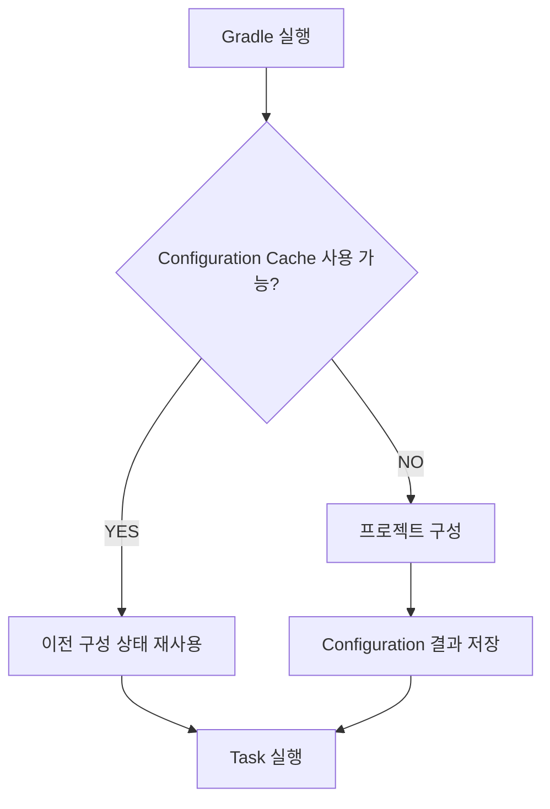

이 기능은 Build Cache와 목적이 다르다.

Build Cache는 Task 결과물을 재사용한다.

Configuration Cache는 Task를 실행하기 위한 구성 상태를 재사용한다.

예를 들어 `gradle.properties`에 다음과 같이 설정할 수 있다.

```properties
org.gradle.configuration-cache=true
```

다만 모든 플러그인과 Custom Task가 Configuration Cache와 호환되는 것은 아닐 수 있다.

따라서 활성화하기 전에 프로젝트에서 사용하는 플러그인과 Task의 호환성을 확인해야 한다.

---

### Build Cache와 Configuration Cache 비교

| 구분      | Build Cache      | Configuration Cache |
| ------- | ---------------- | ------------------- |
| 주요 목적   | Task 실행 비용 감소    | 프로젝트 구성 비용 감소       |
| 저장 대상   | Task 결과물         | Task 실행 구성 상태       |
| 적용 영역   | Execution        | Configuration       |
| 대표적인 효과 | 컴파일 결과 재사용       | 반복적인 설정 작업 감소       |
| 주의사항    | 입력·출력 정의와 캐시 가능성 | 플러그인 및 Task 호환성     |

두 기능을 함께 사용하면 빌드의 서로 다른 구간을 최적화할 수 있다.

하지만 어떤 기능이 실제로 효과가 있는지는 프로젝트의 병목 구간에 따라 달라진다.

---

### Gradle 병렬 빌드란 무엇인가?

멀티 모듈 프로젝트에서는 서로 독립적인 Task들이 존재할 수 있다.

예를 들어 다음과 같은 구조를 생각해 보자.

```text
api
batch
admin
```

세 모듈이 서로 독립적으로 컴파일할 수 있다면 일부 작업을 병렬로 실행할 수 있다.

다음 설정을 사용할 수 있다.

```properties
org.gradle.parallel=true
```

또는 명령어 옵션으로 지정할 수 있다.

```bash
./gradlew build --parallel
```

하지만 병렬 빌드를 활성화한다고 모든 Task가 동시에 실행되는 것은 아니다.

Task의 의존관계와 실행 환경, 플러그인 지원 범위 등에 영향을 받는다.

또 시스템의 CPU와 메모리 자원이 부족한 경우 병렬 실행이 오히려 비효율적일 수 있다.

따라서 빌드 시간을 측정하면서 설정을 조정해야 한다.

---

### CI/CD 환경에서 Gradle Build Cache 활용하기

Gradle의 캐시 기능은 로컬 개발 환경뿐 아니라 CI/CD에서도 유용하다.

일반적인 CI 환경을 생각해 보자.

```text
Developer
    ↓
Git Push
    ↓
CI Server
    ↓
Gradle Build
    ↓
Test
    ↓
JAR 생성
```

매번 새로운 CI 실행 환경이 만들어진다면 이전 빌드의 결과물이 남아 있지 않을 수 있다.

이때 로컬 Build Cache만으로는 충분하지 않을 수 있다.

이러한 상황에서 원격 Build Cache를 사용할 수 있다.

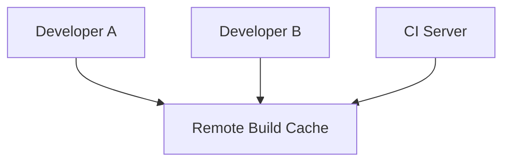

예를 들어 CI에서 생성한 캐시 가능한 Task의 결과물을 원격 캐시에 저장한다.

다른 개발자나 CI 실행 환경은 동일한 입력 조건이라면 해당 결과물을 재사용할 수 있다.

하지만 원격 Build Cache는 조직의 보안과 신뢰성, 네트워크 비용 등을 함께 고려해야 한다.

특히 신뢰할 수 없는 환경에서 생성한 캐시를 운영 빌드에 그대로 사용하는 것은 위험할 수 있다.

따라서 원격 캐시의 쓰기 권한과 접근 제어를 적절하게 설정해야 한다.

---

### 의존성 버전은 어떻게 안정적으로 관리할까?

외부 라이브러리는 시간이 지나면서 새로운 버전이 출시된다.

예를 들어 다음과 같이 선언할 수 있다.

```groovy
implementation 'com.example:library:1.+'
```

이는 특정 범위에 해당하는 버전을 동적으로 선택하는 방식이다.

하지만 운영 시스템에서는 동적 버전 사용에 주의해야 한다.

같은 소스 코드를 빌드하더라도 시점에 따라 다른 의존성 버전이 선택될 가능성이 있기 때문이다.

이러한 문제는 빌드 재현성을 떨어뜨릴 수 있다.

따라서 중요한 프로젝트에서는 다음 전략을 고려할 수 있다.

* 명시적인 의존성 버전 관리
* BOM 또는 Platform 활용
* Version Catalog 사용
* Dependency Locking
* 의존성 검증
* 정기적인 라이브러리 업데이트

특히 Dependency Locking은 의존성 해결 결과를 고정해 예상하지 못한 버전 변경을 방지하는 데 활용할 수 있다.

Gradle 공식 문서에서도 Dependency Locking을 빌드의 재현성과 의존성 안정성을 확보하기 위한 기능으로 설명한다.

---

### Gradle을 사용할 때 자주 발생하는 문제

#### 1. 컴파일은 성공하는데 실행 시 ClassNotFoundException이 발생한다

먼저 의존성 Configuration을 확인해야 한다.

컴파일에 필요한 라이브러리를 `compileOnly`로 선언했지만 실행 시점에도 해당 클래스가 필요한 상황일 수 있다.

실제 Runtime Classpath를 확인하는 것이 중요하다.

```bash
./gradlew dependencies --configuration runtimeClasspath
```

#### 2. 의존성을 추가했는데 클래스를 찾지 못한다

다음 항목을 확인해야 한다.

* 올바른 Group과 Name을 사용했는가?
* 해당 의존성이 실제 Compile Classpath에 존재하는가?
* `runtimeOnly`로 잘못 선언하지 않았는가?
* 멀티 모듈에서 의존성 노출 범위가 적절한가?

#### 3. 라이브러리 버전 충돌이 발생한다

`dependencyInsight`로 어떤 버전이 선택되었는지 확인한다.

```bash
./gradlew dependencyInsight \
  --dependency jackson-databind \
  --configuration runtimeClasspath
```

여기서 확인한 정보를 바탕으로 실제 호환성을 검증해야 한다.

#### 4. 빌드가 계속 전체 실행된다

먼저 다음 사항을 확인한다.

* 입력 파일이 매번 변경되는가?
* 생성된 파일의 타임스탬프 등이 영향을 주는가?
* Custom Task의 입력과 출력이 올바르게 선언되어 있는가?
* Annotation Processor가 증분 컴파일에 영향을 주는가?
* 캐시가 비활성화되어 있는가?

Gradle의 최적화 기능은 입력과 출력의 변경을 정확하게 판단할 수 있어야 효과적으로 동작한다.

#### 5. Build Cache를 활성화했는데 성능이 개선되지 않는다

다음과 같은 상황일 수 있다.

Task가 캐시를 지원하지 않는다.

캐시된 결과가 없다.

입력이 매번 변경된다.

이미 `UP-TO-DATE` 상태라 캐시에서 복원할 필요가 없다.

캐시 복원 비용이 실제 Task 실행 비용과 비슷하다.

따라서 단순히 Build Cache를 활성화했다는 사실만으로 빌드 성능이 개선된다고 보장할 수 없다.

---

### 실무에서 Gradle을 활용하는 12가지 전략

#### 1. Gradle Wrapper를 사용한다

개발 환경과 CI 환경에서 동일한 Gradle 버전을 사용하도록 관리한다.

이는 환경 차이로 발생하는 빌드 오류를 줄이는 데 도움이 된다.

#### 2. 불필요한 의존성을 추가하지 않는다

외부 라이브러리를 추가하면 전이 의존성도 함께 증가할 수 있다.

따라서 실제로 필요한 라이브러리인지 먼저 검토해야 한다.

#### 3. api보다 implementation을 우선 고려한다

공개 API에서 사용하지 않는 의존성을 소비자 모듈의 Compile Classpath에 노출할 필요는 없다.

이를 통해 모듈 간 결합도를 줄일 수 있다.

#### 4. compileOnly와 runtimeOnly를 목적에 맞게 사용한다

컴파일에만 필요한 라이브러리와 실행 시점에만 필요한 라이브러리를 구분한다.

이렇게 하면 불필요한 Classpath 구성을 줄이고 의존성의 역할을 명확하게 표현할 수 있다.

#### 5. 멀티 모듈의 의존성 방향을 먼저 설계한다

Gradle 설정을 작성하기 전에 각 모듈의 책임과 의존성 방향을 정의하는 것이 좋다.

모듈 구조는 프로젝트의 아키텍처를 반영해야 한다.

#### 6. 증분 컴파일의 영향을 이해한다

소스 코드 하나를 변경했다고 항상 그 파일 하나만 재컴파일되는 것은 아니다.

공개 API 변경이나 Annotation Processor 등에 따라 재컴파일 범위가 달라질 수 있다.

#### 7. Build Cache와 Up-to-date Check를 구분한다

`UP-TO-DATE`는 현재 작업 공간의 상태를 활용하는 것이다.

`FROM-CACHE`는 이전에 저장된 결과물을 복원하는 것이다.

이 차이를 이해하면 빌드 로그를 더 정확하게 분석할 수 있다.

#### 8. Dependency Cache와 Build Cache를 혼동하지 않는다

Dependency Cache는 외부 라이브러리와 메타데이터를 저장한다.

Build Cache는 Task 결과물을 저장한다.

두 기능은 서로 다른 문제를 해결한다.

#### 9. 의존성 충돌은 실제 해결 결과를 기준으로 분석한다

`build.gradle`에서 선언한 버전만 확인하지 않는다.

`dependencies`와 `dependencyInsight`를 통해 실제 선택된 버전을 확인한다.

#### 10. CI 환경에서는 캐시와 보안을 함께 고려한다

원격 Build Cache를 활용하면 빌드 시간을 줄일 수 있다.

하지만 캐시를 생성하고 사용하는 환경의 신뢰성도 중요하다.

따라서 접근 권한과 캐시 관리 정책을 함께 설계해야 한다.

#### 11. 빌드 성능은 실제 측정을 통해 개선한다

무조건 병렬 실행이나 캐시 기능을 모두 활성화하는 것은 적절하지 않을 수 있다.

Configuration과 Execution 중 어느 단계가 오래 걸리는지 확인해야 한다.

또 특정 Task가 전체 빌드 시간에 얼마나 영향을 주는지도 분석해야 한다.

#### 12. Gradle 설정을 아키텍처의 일부로 관리한다

의존성 설정은 단순한 빌드 편의 기능이 아니다.

어떤 모듈이 어떤 라이브러리에 의존할 수 있는지를 정의한다.

따라서 `api`, `implementation` 등의 설정은 코드 설계와 함께 관리해야 한다.

---

### Gradle의 전체 구조

지금까지 살펴본 내용을 하나의 구조로 정리하면 다음과 같다.

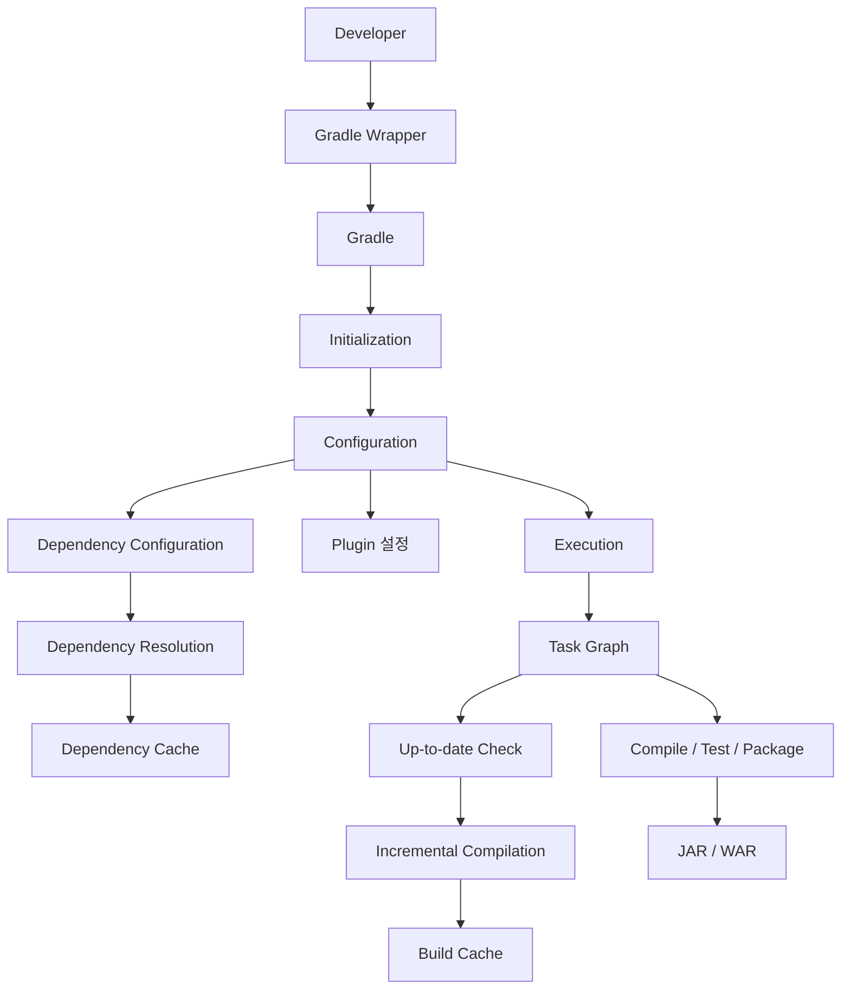

이 구조를 이해하면 Gradle이 수행하는 주요 작업을 연결해서 생각할 수 있다.

Gradle Wrapper는 지정된 Gradle 버전을 실행하도록 돕는다.

Initialization 단계에서는 빌드에 참여할 프로젝트를 결정한다.

Configuration 단계에서는 프로젝트의 빌드 모델과 Task를 구성한다.

Execution 단계에서는 필요한 Task를 실행한다.

의존성 관리 기능은 필요한 라이브러리와 Classpath를 구성한다.

Up-to-date Check와 증분 컴파일, Build Cache는 불필요한 작업을 줄인다.

최종적으로 컴파일과 테스트, 패키징을 거쳐 실행 또는 배포 가능한 결과물을 생성한다.

실제 Gradle 내부에서는 이러한 기능들이 더 복잡하게 상호작용하지만, 각 기능의 책임을 구분하면 빌드 과정에서 발생하는 문제를 더 쉽게 이해할 수 있다.

---

### 정리

Gradle은 Java와 Spring Boot 프로젝트에서 사용하는 대표적인 빌드 자동화 도구다.

빌드는 개발자가 작성한 소스 코드를 컴파일하고 테스트와 패키징 등을 거쳐 실행하거나 배포할 수 있는 결과물로 만드는 과정이다.

빌드 도구가 없다면 개발자는 컴파일 명령과 라이브러리 관리, 테스트 실행, JAR 생성 등을 직접 수행해야 한다.

Gradle은 이러한 작업을 자동화한다.

Gradle은 Task를 기반으로 빌드를 수행한다.

각 Task는 다른 Task에 의존할 수 있으며, Gradle은 이러한 관계를 분석해 실행 순서를 결정한다.

빌드 생명주기는 일반적으로 Initialization, Configuration, Execution 단계로 구분된다.

Initialization에서는 빌드에 참여할 프로젝트를 결정한다.

Configuration에서는 프로젝트의 빌드 설정과 Task를 구성한다.

Execution에서는 실제로 필요한 Task를 실행한다.

Gradle은 빌드 성능을 개선하기 위해 다양한 최적화 기능도 제공한다.

Up-to-date Check는 변경되지 않은 Task를 다시 실행하지 않도록 한다.

Incremental Compilation은 변경 영향을 받은 소스를 중심으로 재컴파일한다.

Build Cache는 이전에 생성한 Task 결과물을 재사용한다.

Configuration Cache는 반복적인 프로젝트 구성 작업을 줄인다.

이러한 기능들은 서로 다른 영역에서 빌드 비용을 줄이는 역할을 한다.

또 Gradle은 의존성 관리 기능을 제공한다.

`build.gradle`의 `dependencies` 블록에서 외부 라이브러리나 내부 프로젝트에 대한 의존성을 선언할 수 있다.

의존성은 일반적으로 Configuration과 Group, Name, Version으로 표현한다.

Gradle은 이러한 선언을 기반으로 필요한 의존성을 해결한다.

이때 직접 선언한 의존성뿐 아니라 전이 의존성도 함께 포함될 수 있다.

따라서 라이브러리 하나를 추가하더라도 여러 의존성이 함께 추가될 수 있다.

Dependency Configuration은 의존성을 어떤 Classpath에 포함하고 다른 모듈에 어떻게 노출할지 결정한다.

주요 Configuration을 정리하면 다음과 같다.

| Configuration         | 주요 목적                        |
| --------------------- | ---------------------------- |
| `implementation`      | 현재 모듈의 컴파일 및 실행 의존성          |
| `compileOnly`         | 현재 모듈의 컴파일 전용 의존성            |
| `runtimeOnly`         | 현재 모듈의 실행 전용 의존성             |
| `api`                 | 소비자 모듈에도 컴파일 의존성으로 공개        |
| `compileOnlyApi`      | 소비자 모듈에 컴파일 전용으로 공개          |
| `testImplementation`  | 테스트 컴파일 및 실행 의존성             |
| `testCompileOnly`     | 테스트 컴파일 전용 의존성               |
| `testRuntimeOnly`     | 테스트 실행 전용 의존성                |
| `annotationProcessor` | 컴파일 과정의 Annotation Processor |

특히 멀티 모듈 프로젝트에서는 `implementation`과 `api`의 차이를 이해해야 한다.

`implementation`은 내부 구현 의존성을 소비자의 Compile Classpath에 불필요하게 노출하지 않는다.

반면 `api`는 공개 API에 필요한 의존성을 소비자 모듈의 컴파일에도 사용할 수 있도록 노출한다.

따라서 가능한 경우 `implementation`을 우선 고려하고, 공개 API에서 실제로 필요한 의존성에 `api`를 사용하는 것이 적절하다.

이는 빌드 성능뿐 아니라 모듈 간 결합도를 관리하는 데도 도움이 된다.

또 의존성 충돌이 발생했다면 `dependencies`와 `dependencyInsight`를 통해 실제 의존성 해결 결과를 확인해야 한다.

Gradle Wrapper를 사용하면 개발 환경과 CI 환경에서 동일한 Gradle 버전을 사용하도록 관리할 수 있다.

Build Cache와 Configuration Cache, 병렬 실행 등을 적절하게 활용하면 빌드 성능을 개선할 수도 있다.

하지만 모든 최적화 기능을 활성화하는 것이 반드시 가장 좋은 방법은 아니다.

실제 프로젝트의 빌드 시간을 측정하고 병목 구간을 확인한 뒤 적절한 설정을 적용해야 한다.

결국 Gradle을 이해한다는 것은 단순히 `build.gradle`에 라이브러리를 추가하는 방법을 아는 것이 아니다.

**빌드가 어떤 단계로 수행되는지, Task가 어떻게 연결되는지, 의존성이 어떤 Classpath에 포함되는지, 변경된 코드가 어떻게 재컴파일되는지, 이전 결과물을 어떻게 재사용하는지 설명할 수 있어야 한다.**

이러한 구조를 이해하면 빌드 속도가 느려지는 문제나 의존성 충돌, 컴파일 및 런타임 클래스 오류, 멀티 모듈 의존성 문제를 더 체계적으로 분석할 수 있다.

#### 한 줄 요약

**Gradle은 Task 기반으로 컴파일·테스트·패키징을 자동화하는 빌드 도구다. Up-to-date Check와 증분 컴파일은 불필요한 작업을 줄이고, Build Cache는 이전 Task 결과물을 재사용한다. 또한 `implementation`, `api`, `compileOnly`, `runtimeOnly` 등의 Dependency Configuration을 통해 라이브러리의 컴파일·실행 범위와 멀티 모듈 간 노출 관계를 제어할 수 있으며, 이러한 기능을 이해하는 것이 안정적이고 효율적인 Java·Spring Boot 빌드 환경을 설계하는 핵심이다.**
