# 사나, 수양의 웹세계 문지기 HTTP와 HTTPS 부수기!
[https://youtu.be/QAMX_ykkEeE?si=Lzhedyy5Dex7OsbI](https://youtu.be/QAMX_ykkEeE?si=Lzhedyy5Dex7OsbI)
# 사나, 수양의 웹세계 문지기 HTTP와 HTTPS 부수기!
* toc
{:toc}

---

### HTTP와 HTTPS 완벽 이해: 요청·응답부터 멱등성, TLS Handshake, 암호화와 Spring Boot 실무까지

웹 애플리케이션을 개발하다 보면 HTTP와 HTTPS를 매일 사용한다.

Spring Boot로 REST API를 구현하거나, 브라우저에서 웹사이트에 접속하거나, 외부 결제 API를 호출하는 과정에서도 HTTP와 HTTPS가 사용된다.

예를 들어 사용자가 로그인한다고 생각해 보자.

사용자는 브라우저에 아이디와 비밀번호를 입력한다.

그리고 로그인 버튼을 누른다.

브라우저는 서버에 로그인 요청을 전송한다.

서버는 사용자 정보를 확인한 뒤 로그인 성공 또는 실패 결과를 반환한다.

개발자는 보통 이러한 기능을 다음과 같이 구현한다.

```java
@RestController
@RequestMapping("/api/auth")
public class AuthController {

    @PostMapping("/login")
    public ResponseEntity<LoginResponse> login(
            @RequestBody LoginRequest request
    ) {
        // 사용자 인증
        // 세션 또는 토큰 발급

        return ResponseEntity.ok(
                new LoginResponse("SUCCESS")
        );
    }
}
```

그런데 이 코드가 실제로 동작하는 과정을 생각해 보면 여러 질문이 생긴다.

**브라우저는 서버에 어떤 형식으로 요청을 보내는 것일까?**

**서버는 요청을 어떻게 구분하고 응답하는 것일까?**

**HTTP는 상태를 저장하지 않는다는데 로그인 상태는 어떻게 유지될까?**

**결제 API 요청 중 네트워크가 끊어지면 다시 요청해도 될까?**

**HTTPS는 HTTP와 무엇이 다르며, 비밀번호는 어떻게 보호할까?**

**TLS는 어떤 방식으로 암호화 키를 만들고 서버의 신원을 검증할까?**

이러한 질문은 단순히 네트워크 지식에만 해당하지 않는다.

실제로 백엔드 개발자가 API를 설계하고 운영 장애를 분석할 때 반드시 이해해야 하는 내용이다.

특히 결제나 구독처럼 데이터의 일관성이 중요한 시스템에서는 HTTP 메서드와 멱등성을 잘못 이해하면 중복 결제가 발생할 수 있다.

또 HTTPS가 제공하는 보호 범위를 잘못 이해하면 암호화되지 않은 내부 통신이나 잘못된 인증서 검증으로 보안 문제가 발생할 수 있다.

따라서 HTTP와 HTTPS는 단순한 통신 규약이 아니라 **안정적인 백엔드 시스템을 설계하기 위한 기본 기술**이라고 할 수 있다.

---

### HTTP란 무엇인가?

HTTP는 Hypertext Transfer Protocol의 약자다.

웹에서 클라이언트와 서버가 데이터를 주고받기 위해 사용하는 애플리케이션 계층 프로토콜이다.

처음에는 HTML과 같은 하이퍼텍스트 문서를 전달하기 위한 목적으로 발전했지만, 현재는 다양한 데이터 형식을 전송하는 데 사용된다.

대표적으로 다음과 같은 데이터를 전달할 수 있다.

* HTML
* JSON
* XML
* 이미지와 동영상
* 바이너리 파일
* 기타 애플리케이션 데이터

HTTP는 어떤 요청을 보내고 어떤 응답을 받을 것인지에 대한 공통 규칙을 정의한다.

이러한 규칙 덕분에 서로 다른 환경에서 개발된 애플리케이션도 동일한 방식으로 통신할 수 있다.

예를 들어 Java로 개발된 Spring Boot 서버와 JavaScript로 실행되는 브라우저가 있다고 생각해 보자.

두 애플리케이션은 서로 다른 언어와 실행 환경을 사용한다.

하지만 HTTP라는 공통 규약을 사용하기 때문에 요청과 응답을 주고받을 수 있다.

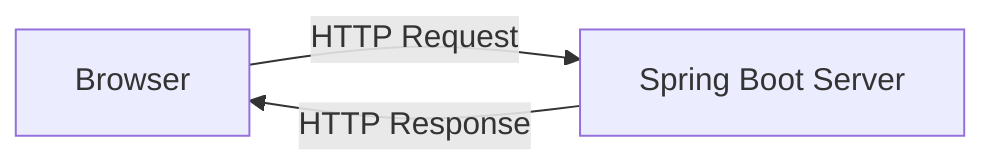

이러한 구조를 클라이언트-서버 구조라고 부른다.

---

### 클라이언트와 서버란 무엇인가?

클라이언트는 서비스를 요청하는 주체다.

서버는 요청을 받아 처리하고 응답을 제공하는 주체다.

예를 들어 브라우저에서 다음 주소에 접근했다고 가정하자.

```text
https://api.example.com/members/1
```

브라우저는 해당 주소로 요청을 전송한다.

서버는 회원 정보를 조회한 뒤 응답한다.

```json
{
  "id": 1,
  "name": "홍길동"
}
```

이때 브라우저는 클라이언트이고 Spring Boot 애플리케이션은 서버다.

하지만 클라이언트가 반드시 브라우저일 필요는 없다.

Spring Boot 서버가 다른 서버에 HTTP 요청을 전송할 수도 있다.

예를 들어 구독 결제 시스템에서는 다음과 같은 구조가 가능하다.

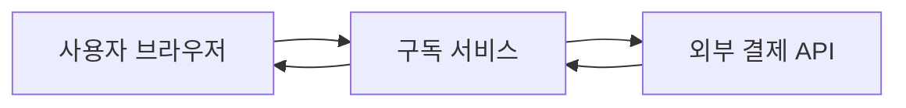

브라우저와 통신할 때 구독 서비스는 서버다.

하지만 외부 결제 API를 호출할 때는 구독 서비스가 클라이언트가 된다.

즉 클라이언트와 서버는 프로그램의 종류가 아니라 **통신 과정에서 수행하는 역할**에 따라 구분된다.

---

### HTTP는 왜 필요한가?

HTTP의 가장 중요한 목적 중 하나는 서로 다른 시스템이 공통된 방식으로 통신할 수 있도록 하는 것이다.

예를 들어 회원 정보를 조회하는 기능이 있다고 가정하자.

서버 내부에서는 다음과 같은 메서드를 사용할 수 있다.

```java
Member findById(Long id);
```

하지만 외부 시스템은 이 Java 메서드를 직접 호출할 수 없다.

다른 프로세스에서 실행되고 있을 수 있고 Java가 아닌 언어를 사용할 수도 있기 때문이다.

따라서 외부에서 해당 기능을 사용할 수 있도록 통신 규약이 필요하다.

HTTP에서는 다음과 같은 요청을 정의할 수 있다.

```http
GET /api/members/1 HTTP/1.1
Host: api.example.com
Accept: application/json
```

서버는 요청을 처리한 뒤 다음과 같이 응답할 수 있다.

```http
HTTP/1.1 200 OK
Content-Type: application/json

{
  "id": 1,
  "name": "홍길동"
}
```

HTTP는 요청과 응답을 표현하는 공통된 형식을 제공한다.

HTTP의 의미와 동작은 RFC 9110에서 정의하고 있으며, 이 규약은 HTTP 버전 전반에 공통으로 적용되는 의미 체계를 설명한다.

---

### HTTP의 주요 특징

HTTP를 이해할 때 중요한 특징은 다음과 같다.

| 특징           | 의미                                            |
| ------------ | --------------------------------------------- |
| 클라이언트-서버 구조  | 요청하는 주체와 응답하는 주체를 구분                          |
| Stateless    | 각 요청을 독립적으로 처리할 수 있는 프로토콜                     |
| 요청·응답 모델     | 요청 메시지와 응답 메시지를 사용                            |
| URI 기반 자원 식별 | 요청 대상 자원을 URI로 식별                             |
| 확장 가능한 헤더    | 인증, 캐시, 콘텐츠 형식 등의 정보 전달                       |
| 다양한 전송 방식    | HTTP/1.1, HTTP/2, HTTP/3 등에서 서로 다른 전송 메커니즘 사용 |

여기서 특히 중요한 개념은 Stateless다.

---

### Stateless란 무엇인가?

Stateless는 무상태성을 의미한다.

HTTP에서는 개별 요청이 이전 요청의 상태에 반드시 의존하지 않도록 처리할 수 있다.

예를 들어 사용자가 상품을 조회한다고 가정하자.

```http
GET /api/products/100 HTTP/1.1
Host: api.example.com
```

서버는 상품 ID가 100인 데이터를 조회한 뒤 반환한다.

그다음 사용자는 다른 상품을 조회한다.

```http
GET /api/products/200 HTTP/1.1
Host: api.example.com
```

두 요청은 각각 필요한 정보를 포함하고 있다.

서버는 첫 번째 요청을 처리한 기록이 없어도 두 번째 요청을 처리할 수 있다.

이러한 구조가 무상태성의 기본적인 의미다.

#### Stateful과 Stateless의 차이

Stateful한 통신을 생각해 보자.

```text
Client: 커피 두 잔 주문할게요.

Server: 확인했습니다.

Client: 카드로 결제할게요.

Server: 커피 두 잔에 대한 카드 결제를 진행합니다.
```

서버가 이전 주문 정보를 기억한다는 전제가 존재한다.

반면 Stateless한 방식에서는 다음과 같이 요청할 수 있다.

```text
Client: 주문번호 100번을 생성해 주세요.

Server: 주문번호 100번이 생성되었습니다.

Client: 주문번호 100번을 카드로 결제해 주세요.

Server: 주문번호 100번의 결제를 진행합니다.
```

두 번째 요청에는 처리할 주문을 식별하는 정보가 포함되어 있다.

서버가 이전 요청을 처리했던 동일한 프로세스일 필요는 없다.

다른 서버 인스턴스가 요청을 받아도 주문번호를 이용해 필요한 상태를 조회할 수 있다.

이러한 설계는 서버 확장에 유리하다.

---

### Stateless가 서버 확장에 유리한 이유

서버가 하나인 상황을 생각해 보자.

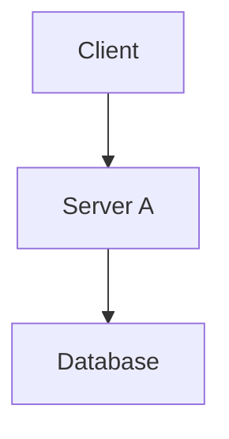

사용자가 증가해 서버를 세 대로 확장했다고 가정하자.

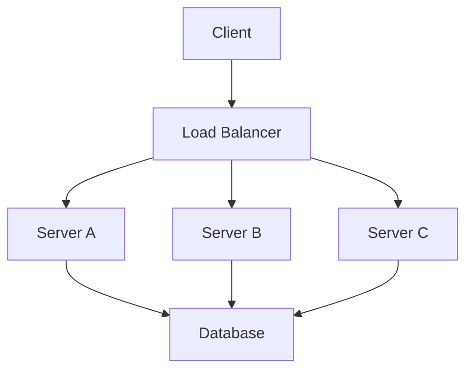

각 서버가 이전 요청의 상태를 자신의 메모리에만 저장한다면 문제가 발생할 수 있다.

예를 들어 첫 번째 요청은 Server A가 처리했다.

하지만 두 번째 요청은 Server B가 처리할 수 있다.

Server B가 이전 요청에 필요한 정보를 알지 못한다면 정상적으로 처리하기 어려울 수 있다.

반면 요청에 필요한 식별자가 있고 상태를 공통 저장소에서 조회할 수 있다면 어느 서버가 요청을 처리하더라도 동일한 비즈니스 로직을 실행할 수 있다.

이러한 구조는 수평 확장에 도움이 된다.

하지만 한 가지 오해하면 안 되는 부분이 있다.

**HTTP가 Stateless라고 해서 서버가 데이터를 저장하면 안 된다는 의미는 아니다.**

실제 서비스는 회원 정보, 주문 상태, 결제 내역 등을 데이터베이스에 저장한다.

Stateless는 HTTP 프로토콜의 요청 처리 특성이지, 애플리케이션이 상태를 저장할 수 없다는 제약이 아니다.

---

### HTTP는 Stateless인데 로그인 상태는 어떻게 유지할까?

웹사이트에서는 로그인 상태를 유지해야 한다.

예를 들어 다음과 같은 상황이다.

```text
1. 사용자가 로그인한다.
2. 마이페이지에 접근한다.
3. 상품을 장바구니에 담는다.
4. 주문을 생성한다.
```

이 과정에서 사용자를 매번 새롭게 인증해야 한다면 불편할 것이다.

HTTP 자체는 요청 간 사용자 로그인 상태를 자동으로 기억하지 않는다.

따라서 애플리케이션은 별도의 메커니즘을 사용한다.

대표적으로 쿠키와 세션이 있다.

#### 세션 기반 인증

사용자가 로그인에 성공하면 서버는 세션을 생성한다.

그리고 세션을 식별하는 ID를 클라이언트에 전달할 수 있다.

```http
HTTP/1.1 200 OK
Set-Cookie: SESSION=abc123; HttpOnly; Secure; SameSite=Lax
```

브라우저는 이후 요청에서 해당 쿠키를 전송한다.

```http
GET /api/mypage HTTP/1.1
Host: api.example.com
Cookie: SESSION=abc123
```

서버는 세션 ID를 이용해 사용자 인증 상태를 조회한다.

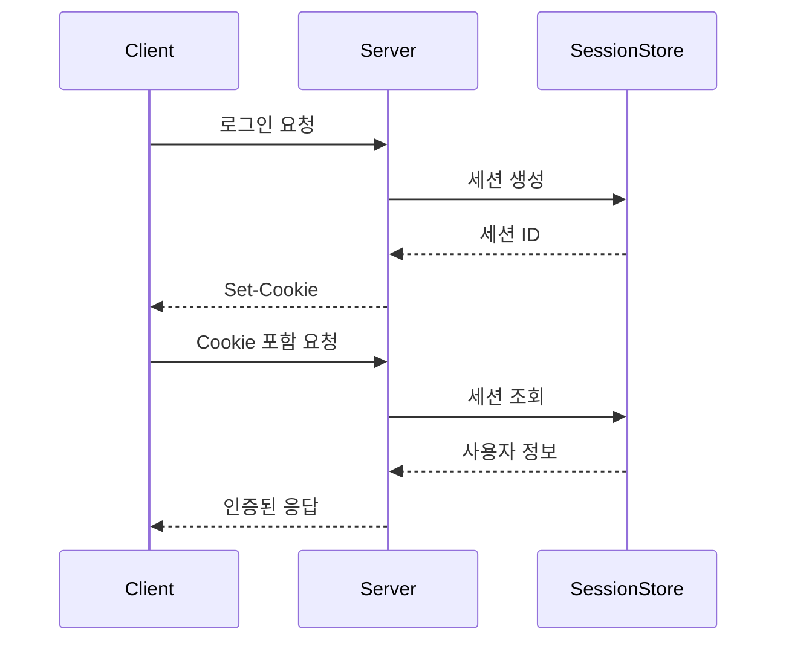

이 구조에서는 HTTP 요청 자체는 여전히 독립적이다.

다만 쿠키를 통해 세션을 식별하고 애플리케이션 계층에서 로그인 상태를 복원한다.

JWT를 사용하는 방식도 가능하지만 JWT가 곧바로 완전한 무상태 시스템을 보장하는 것은 아니다.

토큰 폐기, 갱신, 사용자 권한 변경 등을 처리하기 위해 서버 측 상태가 필요할 수도 있기 때문이다.

---

### HTTP는 비연결성 프로토콜일까?

HTTP를 설명할 때 자주 등장하는 개념이 비연결성이다.

초기의 HTTP에서는 요청을 처리한 뒤 연결을 종료하는 방식이 일반적이었다.

예를 들어 다음과 같다.

```text
TCP 연결 생성

↓

HTTP 요청

↓

HTTP 응답

↓

TCP 연결 종료
```

하지만 요청할 때마다 새로운 TCP 연결을 생성하면 비용이 발생한다.

TCP 연결을 설정하려면 Handshake가 필요하다.

HTTPS에서는 TLS Handshake도 수행해야 할 수 있다.

따라서 반복적으로 연결을 생성하고 종료하는 방식은 비효율적일 수 있다.

이러한 문제를 해결하기 위해 연결 재사용이 발전했다.

#### HTTP/1.1의 지속 연결

HTTP/1.1에서는 지속 연결이 기본적으로 사용된다.

하나의 TCP 연결을 통해 여러 HTTP 요청과 응답을 처리할 수 있다.

```text
TCP 연결 생성

↓

HTTP 요청 1
HTTP 응답 1

↓

HTTP 요청 2
HTTP 응답 2

↓

HTTP 요청 3
HTTP 응답 3

↓

TCP 연결 종료
```

이 방식을 Keep-Alive 또는 Persistent Connection이라고 부른다.

따라서 HTTP가 항상 요청 하나마다 연결을 종료한다고 이해하면 정확하지 않다.

**HTTP의 Stateless 특성과 TCP 연결을 재사용하는 것은 서로 다른 문제다.**

---

### HTTP/1.1, HTTP/2, HTTP/3의 차이

HTTP는 시간이 지나면서 성능과 통신 방식이 발전했다.

하지만 HTTP의 의미 체계가 매 버전마다 완전히 달라지는 것은 아니다.

GET, POST, PUT 등의 메서드와 상태 코드 같은 핵심 의미는 공통으로 유지된다.

차이는 주로 메시지를 전송하는 방식에 있다.

| 구분       | HTTP/1.1   | HTTP/2             | HTTP/3           |
| -------- | ---------- | ------------------ | ---------------- |
| 주요 전송 방식 | 일반적으로 TCP  | 일반적으로 TLS over TCP | QUIC over UDP    |
| 메시지 표현   | 텍스트 기반     | 바이너리 프레임           | QUIC 스트림 위의 프레임  |
| 다중화      | 제한적        | 지원                 | 지원               |
| 헤더 압축    | 기본 제공하지 않음 | HPACK              | QPACK            |
| 연결 재사용   | 지원         | 지원                 | 지원               |
| TLS      | 선택적으로 결합   | 브라우저에서는 일반적으로 사용   | QUIC에 TLS 1.3 통합 |

HTTP/2는 하나의 연결에서 여러 요청과 응답을 다중화할 수 있다.

HTTP/3는 QUIC을 사용해 HTTP 의미 체계를 전달한다.

QUIC은 UDP 위에서 동작하며 TLS 1.3을 통합하고 있다.

따라서 HTTP/3를 단순히 HTTP/2에 UDP만 추가한 기술로 이해해서는 안 된다.

QUIC 자체가 연결 관리, 스트림 다중화, 암호화, 손실 복구 등을 제공하기 때문이다.

---

### URI란 무엇인가?

URI는 Uniform Resource Identifier의 약자다.

리소스를 식별하기 위한 식별자다.

예를 들어 다음 주소를 생각해 보자.

```text
https://api.example.com:443/members/100?status=ACTIVE
```

이를 구성 요소로 나누면 다음과 같다.

| 구성 요소  | 값                 | 의미         |
| ------ | ----------------- | ---------- |
| Scheme | `https`           | 사용할 통신 방식  |
| Host   | `api.example.com` | 대상 호스트     |
| Port   | `443`             | 연결할 포트     |
| Path   | `/members/100`    | 리소스 경로     |
| Query  | `status=ACTIVE`   | 추가 요청 매개변수 |

여기서 URI와 URL은 관련이 있지만 동일한 의미는 아니다.

URL은 리소스의 위치와 접근 방법을 표현하는 URI의 한 형태다.

일반적인 웹 주소는 URL이자 URI로 볼 수 있다.

REST API에서는 URI를 통해 리소스를 식별하는 방식이 자주 사용된다.

예를 들어 다음과 같다.

```http
GET /api/members/100 HTTP/1.1
```

이는 회원 100번을 조회하기 위한 요청이다.

```http
GET /api/members/100/orders HTTP/1.1
```

이는 회원 100번과 관련된 주문 목록을 조회하기 위한 요청으로 설계할 수 있다.

다만 `/members/*` 같은 와일드카드 경로 패턴은 일반적으로 서버 프레임워크의 라우팅 기능에 해당한다.

URI 자체가 와일드카드 매칭 규칙을 정의한다고 이해해서는 안 된다.

---

### HTTP 메시지는 어떻게 구성될까?

HTTP 통신은 요청 메시지와 응답 메시지를 통해 이루어진다.

HTTP/1.1에서는 메시지를 크게 다음 부분으로 나눌 수 있다.

1. Start-Line
2. Header
3. 빈 줄
4. Body

예를 들어 다음과 같다.

```http
POST /api/members HTTP/1.1
Host: api.example.com
Content-Type: application/json
Accept: application/json

{
  "name": "홍길동",
  "age": 30
}
```

각 부분의 역할을 살펴보자.

---

### HTTP Request의 구조

요청 메시지의 첫 번째 줄은 Request-Line이라고 부른다.

```http
POST /api/members HTTP/1.1
```

다음 요소로 구성된다.

```text
HTTP Method

Request Target

HTTP Version
```

예를 들어 다음과 같다.

```text
POST

/api/members

HTTP/1.1
```

각 요소는 다음 의미를 가진다.

| 요소             | 역할           |
| -------------- | ------------ |
| Method         | 요청하려는 작업의 의미 |
| Request Target | 요청 대상        |
| HTTP Version   | HTTP 메시지 버전  |

그다음 Header가 존재한다.

```http
Host: api.example.com
Content-Type: application/json
Accept: application/json
```

Header는 요청에 대한 추가 정보를 제공한다.

마지막으로 Body가 존재할 수 있다.

```json
{
  "name": "홍길동",
  "age": 30
}
```

Body는 실제로 전송할 데이터를 담는다.

다만 모든 HTTP 요청에 Body가 필요한 것은 아니다.

예를 들어 일반적인 GET 요청은 Body 없이 처리할 수 있다.

또한 이러한 텍스트 기반 Start-Line 표현은 HTTP/1.1의 메시지 형식이다.

HTTP/2와 HTTP/3에서는 요청과 응답을 바이너리 프레임 구조로 표현한다.

따라서 모든 HTTP 버전에서 실제 네트워크 패킷에 위와 같은 텍스트가 그대로 전송되는 것은 아니다.

---

### HTTP Response의 구조

서버의 응답 역시 HTTP/1.1 기준으로 다음과 같은 형태를 가진다.

```http
HTTP/1.1 200 OK
Content-Type: application/json
Cache-Control: no-store

{
  "id": 100,
  "name": "홍길동"
}
```

첫 번째 줄을 Status-Line이라고 부른다.

```http
HTTP/1.1 200 OK
```

다음 정보로 구성된다.

| 요소       | 의미       |
| -------- | -------- |
| HTTP/1.1 | HTTP 버전  |
| 200      | 상태 코드    |
| OK       | 상태 설명 문구 |

상태 코드는 요청 처리 결과를 표현한다.

Header는 응답에 대한 추가 정보를 제공한다.

Body에는 클라이언트에 전달할 데이터가 포함될 수 있다.

여기서 `200 OK`는 요청이 성공적으로 처리되었다는 의미다.

하지만 모든 성공 응답에 반드시 Body가 포함되는 것은 아니다.

예를 들어 `204 No Content`는 응답 본문 없이 성공 결과를 전달한다.

---

### 주요 HTTP Header

HTTP Header는 단순한 부가 정보가 아니다.

실제 API 설계와 보안, 캐시, 인증, 콘텐츠 협상에 중요한 역할을 한다.

| Header                      | 역할                    |
| --------------------------- | --------------------- |
| `Content-Type`              | 메시지 본문의 데이터 형식        |
| `Accept`                    | 클라이언트가 수용할 수 있는 응답 형식 |
| `Authorization`             | 인증 정보 전달              |
| `Cookie`                    | 쿠키 전달                 |
| `Set-Cookie`                | 쿠키 설정                 |
| `Cache-Control`             | 캐시 정책 제어              |
| `Location`                  | 리다이렉션 또는 생성된 리소스 위치   |
| `ETag`                      | 리소스 표현의 버전 식별         |
| `If-Match`                  | 조건부 변경 요청             |
| `Retry-After`               | 재시도 대기 시간 안내          |
| `Strict-Transport-Security` | HTTPS 사용 정책 전달        |

예를 들어 다음 요청을 생각해 보자.

```http
GET /api/members/100 HTTP/1.1
Authorization: Bearer example-token
Accept: application/json
```

`Authorization`은 인증 정보를 전달한다.

`Accept`는 JSON 응답을 받을 수 있다는 의미다.

반면 다음 요청에서는 다음과 같은 Header를 사용할 수 있다.

```http
POST /api/members HTTP/1.1
Content-Type: application/json
```

`Content-Type`은 요청 본문의 형식을 나타낸다.

즉 `Accept`와 `Content-Type`은 서로 다른 목적을 가진다.

---

### HTTP Method란 무엇인가?

HTTP Method는 요청이 대상 리소스에 대해 어떤 작업을 수행하려는지 나타낸다.

대표적인 메서드는 다음과 같다.

| Method  | 주요 의미                     |
| ------- | ------------------------- |
| GET     | 리소스 표현 조회                 |
| HEAD    | GET과 유사하지만 응답 본문은 전달하지 않음 |
| POST    | 대상 리소스의 규칙에 따라 데이터 처리     |
| PUT     | 대상 리소스의 상태 생성 또는 대체       |
| PATCH   | 리소스에 부분 변경 적용             |
| DELETE  | 대상 리소스 삭제                 |
| OPTIONS | 통신 가능 옵션 조회               |

일반적인 REST API에서는 GET, POST, PUT, PATCH, DELETE를 자주 사용한다.

이때 단순히 CRUD와 일대일로 대응시키는 것만으로는 충분하지 않다.

HTTP Method에는 안전성(Safety)과 멱등성(Idempotency)이라는 중요한 의미가 포함되기 때문이다.

---

### HTTP의 멱등성이란 무엇인가?

멱등성(Idempotency)은 동일한 작업을 여러 번 수행하더라도 서버에 의도한 효과가 한 번 수행했을 때와 동일한 성질이다.

예를 들어 다음 DELETE 요청을 생각해 보자.

```http
DELETE /api/coupons/100 HTTP/1.1
```

첫 번째 요청으로 쿠폰 100번이 삭제되었다고 가정하자.

이후 동일한 요청을 다시 전송한다.

```http
DELETE /api/coupons/100 HTTP/1.1
```

이미 쿠폰이 삭제되어 있으므로 삭제할 쿠폰이 존재하지 않는다.

그러나 쿠폰 100번이 삭제된 상태라는 결과는 유지된다.

따라서 DELETE는 멱등한 의미를 가진다.

여기서 중요한 점은 **멱등성이 동일한 HTTP 응답을 보장한다는 의미는 아니라는 사실**이다.

첫 번째 DELETE 요청에서는 `204 No Content`를 반환할 수 있다.

두 번째 요청에서는 이미 리소스가 없다는 의미로 `404 Not Found`를 반환할 수도 있다.

두 요청의 상태 코드는 다르지만 대상 리소스에 대한 의도한 효과는 동일하다.

RFC 9110 역시 멱등성을 동일한 요청의 반복이 서버에 미치는 의도한 효과를 기준으로 정의한다.

---

### Safe Method와 Idempotent Method는 무엇이 다를까?

HTTP에서는 안전성과 멱등성을 구분한다.

#### Safe Method

클라이언트가 서버의 상태 변경을 요청하지 않는 메서드다.

대표적으로 GET과 HEAD가 있다.

예를 들어 다음 요청은 회원 정보를 조회한다.

```http
GET /api/members/100 HTTP/1.1
```

서버는 일반적으로 이 요청을 처리하면서 회원 데이터를 변경하지 않는다.

다만 접근 로그를 저장하거나 통계를 기록하는 등의 부수적인 작업은 발생할 수 있다.

이러한 부수 효과가 존재한다고 해서 곧바로 GET이 안전하지 않은 메서드가 되는 것은 아니다.

핵심은 클라이언트가 요청한 작업의 의미다.

#### Idempotent Method

동일한 요청을 여러 번 수행해도 의도한 효과가 동일한 메서드다.

PUT과 DELETE가 대표적이다.

예를 들어 다음 PUT 요청을 생각해 보자.

```http
PUT /api/members/100 HTTP/1.1
Content-Type: application/json

{
  "name": "홍길동"
}
```

동일한 요청을 반복하더라도 회원 이름은 최종적으로 `홍길동`이 된다.

따라서 멱등한 작업으로 설계할 수 있다.

두 개념을 비교하면 다음과 같다.

| Method  | Safe | Idempotent    |
| ------- | ---- | ------------- |
| GET     | O    | O             |
| HEAD    | O    | O             |
| OPTIONS | O    | O             |
| POST    | X    | 기본적으로 보장하지 않음 |
| PUT     | X    | O             |
| PATCH   | X    | 구현 방식에 따라 다름  |
| DELETE  | X    | O             |

안전한 메서드는 멱등한 성질도 가진다.

하지만 멱등한 메서드라고 모두 안전한 것은 아니다.

예를 들어 DELETE는 리소스를 삭제하므로 안전한 메서드는 아니지만 멱등하다.

---

### GET은 왜 멱등할까?

GET은 리소스를 조회하는 메서드다.

```http
GET /api/products/100 HTTP/1.1
```

동일한 요청을 여러 번 수행해도 클라이언트가 의도한 작업은 조회다.

따라서 멱등하다.

하지만 다음과 같은 오해는 주의해야 한다.

**GET 요청의 응답 데이터가 항상 동일해야 한다는 의미는 아니다.**

예를 들어 상품 가격이 변경되었다고 생각해 보자.

첫 번째 요청에서는 다음 데이터를 반환한다.

```json
{
  "price": 10000
}
```

이후 운영자가 상품 가격을 수정했다.

두 번째 요청에서는 다음 결과가 반환된다.

```json
{
  "price": 12000
}
```

응답 데이터가 달라졌지만 GET의 멱등성에 위배되는 것은 아니다.

GET 요청 자체가 상품 가격을 변경하지 않았기 때문이다.

즉 멱등성은 응답 데이터의 동일성보다 서버에 대한 의도한 효과를 기준으로 판단해야 한다.

---

### POST는 왜 일반적으로 멱등하지 않을까?

POST는 서버가 정의한 규칙에 따라 데이터를 처리하도록 요청하는 메서드다.

대표적인 예가 리소스 생성이다.

```http
POST /api/orders HTTP/1.1
Content-Type: application/json

{
  "productId": 100,
  "quantity": 1
}
```

이 요청을 한 번 실행하면 주문이 생성될 수 있다.

그런데 동일한 요청을 다시 실행하면 어떻게 될까?

```text
첫 번째 요청

→ 주문 1001 생성


두 번째 요청

→ 주문 1002 생성
```

동일한 요청을 반복했지만 새로운 주문이 두 개 생성되었다.

따라서 일반적인 주문 생성 POST는 멱등하지 않다.

하지만 POST를 사용하는 모든 API가 반드시 비멱등하게 구현되어야 한다는 의미는 아니다.

애플리케이션에서 중복 요청을 식별하고 동일한 처리를 반복하지 않도록 구현할 수 있다.

대표적인 방법이 Idempotency Key다.

이 부분은 결제 API에서 특히 중요하다.

---

### PUT은 왜 멱등할까?

PUT은 대상 리소스의 상태를 전달한 표현으로 생성하거나 대체하도록 요청하는 메서드다.

예를 들어 다음과 같다.

```http
PUT /api/members/100 HTTP/1.1
Content-Type: application/json

{
  "name": "홍길동",
  "age": 30
}
```

이 요청을 여러 번 전송하더라도 대상 리소스의 상태는 동일하게 설정된다.

```text
첫 번째 요청

name = 홍길동
age = 30


두 번째 요청

name = 홍길동
age = 30
```

따라서 PUT은 멱등한 의미를 가진다.

또 PUT은 대상 리소스가 존재하지 않을 경우 새로 생성하는 데도 사용할 수 있다.

다만 새로운 리소스를 생성했을 때는 일반적으로 `201 Created`가 적절하다.

이미 존재하는 리소스를 대체한 경우에는 `200 OK`나 `204 No Content` 등을 사용할 수 있다.

여기서 중요한 것은 클라이언트가 변경하려는 대상 URI를 알고 있다는 점이다.

---

### PATCH는 왜 멱등성을 보장하지 않을 수도 있을까?

PATCH는 리소스에 부분 변경을 적용하는 메서드다.

하지만 부분 변경을 어떻게 정의했는지에 따라 멱등성이 달라진다.

#### 멱등한 PATCH

다음 요청을 생각해 보자.

```http
PATCH /api/members/100 HTTP/1.1
Content-Type: application/json

{
  "age": 30
}
```

서버가 이 요청을 회원의 나이를 30으로 설정하는 작업으로 처리한다고 가정하자.

동일한 요청을 반복하더라도 최종 나이는 30이다.

따라서 멱등하게 구현할 수 있다.

#### 멱등하지 않은 PATCH

다음과 같은 요청을 생각해 보자.

```http
PATCH /api/members/100/age HTTP/1.1
Content-Type: application/json

{
  "increment": 1
}
```

이 요청이 회원의 나이를 1 증가시키는 기능이라고 가정하자.

첫 번째 요청에서는 나이가 30에서 31이 된다.

두 번째 요청에서는 31에서 32가 된다.

동일한 요청을 반복할 때마다 상태가 달라진다.

따라서 멱등하지 않다.

이처럼 PATCH는 메서드 이름만으로 멱등성을 판단할 수 없다.

실제 수정 연산의 의미를 확인해야 한다.

RFC 5789에서도 PATCH는 기본적으로 멱등성이 보장되는 메서드가 아니지만, 멱등하게 설계할 수 있다고 설명한다.

---

### HTTP 멱등성이 실제로 중요한 이유

HTTP의 멱등성은 단순히 이론적인 특징이 아니다.

네트워크 장애와 재시도 처리에 직접적인 영향을 준다.

예를 들어 사용자가 10,000원을 결제한다고 가정하자.

```text
Client

↓

POST /payments

↓

Payment Server

↓

결제 성공
```

그런데 결제 서버가 요청을 정상적으로 처리한 직후 네트워크 연결이 끊어졌다.

클라이언트는 응답을 받지 못했다.

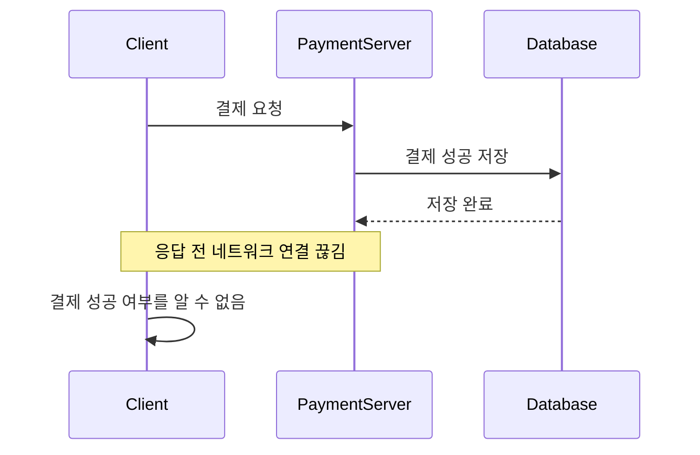

이 상황에서 클라이언트는 결제가 실패했다고 판단할 수 없다.

실제로는 결제가 성공했을 수도 있기 때문이다.

그런데 단순히 다시 요청하면 어떻게 될까?

```text
첫 번째 요청

→ 10,000원 결제 성공


두 번째 요청

→ 10,000원 추가 결제 성공
```

중복 결제가 발생할 수 있다.

따라서 결제 API에서는 HTTP 메서드의 의미를 이해하는 것뿐 아니라 실제 비즈니스 작업에 멱등성을 부여해야 한다.

---

### Idempotency Key란 무엇인가?

Idempotency Key는 동일한 비즈니스 요청을 식별하기 위한 고유한 키다.

예를 들어 다음과 같은 결제 요청을 생각해 보자.

```http
POST /api/payments HTTP/1.1
Host: api.example.com
Content-Type: application/json
Idempotency-Key: payment-request-100

{
  "orderId": 100,
  "amount": 10000
}
```

클라이언트는 결제 요청을 전송할 때 고유한 키를 함께 전달한다.

서버는 해당 키를 저장한다.

동일한 키로 요청이 다시 들어오면 새로운 결제를 생성하지 않고 이전 처리 결과를 확인한다.

개념적으로 다음과 같다.

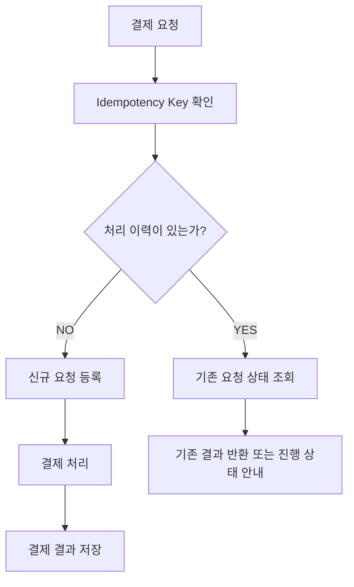

이때 단순히 메모리의 `Set`에 키를 저장하는 것만으로는 충분하지 않을 수 있다.

서버가 여러 대라면 서로 다른 인스턴스에서 같은 요청을 처리할 수 있기 때문이다.

또 서버가 재시작되면 메모리의 처리 기록이 사라질 수 있다.

따라서 일반적으로 데이터베이스의 UNIQUE 제약조건 등을 이용해 중복을 방지하는 방법을 고려할 수 있다.

예를 들어 다음과 같은 테이블을 정의할 수 있다.

```sql
CREATE TABLE payment_requests (
    id BIGINT PRIMARY KEY AUTO_INCREMENT,
    idempotency_key VARCHAR(100) NOT NULL,
    order_id BIGINT NOT NULL,
    request_hash VARCHAR(64) NOT NULL,
    status VARCHAR(30) NOT NULL,
    payment_id BIGINT,
    created_at TIMESTAMP NOT NULL DEFAULT CURRENT_TIMESTAMP,

    CONSTRAINT uk_payment_idempotency
        UNIQUE (idempotency_key)
);
```

이 테이블에서 중요한 부분은 다음 제약조건이다.

```sql
UNIQUE (idempotency_key)
```

동일한 요청 키가 중복 저장되지 않도록 제한한다.

또 요청 본문의 해시를 저장하면 같은 키로 서로 다른 결제 금액을 요청하는 상황을 구분할 수 있다.

다만 UNIQUE 제약조건만으로 결제 시스템의 멱등성이 완성되는 것은 아니다.

실제 결제 시스템에서는 다음 사항도 고려해야 한다.

첫 번째 요청이 아직 처리 중이라면 어떻게 응답할 것인가?

외부 결제사 호출은 성공했지만 내부 데이터베이스 저장에 실패하면 어떻게 복구할 것인가?

결제사에도 동일한 Idempotency Key를 전달할 수 있는가?

처리 결과를 얼마나 오래 보관할 것인가?

동일한 키에 다른 요청 본문이 들어오면 어떻게 처리할 것인가?

이러한 문제들을 함께 설계해야 중복 결제를 안정적으로 방지할 수 있다.

---

### HTTP 상태 코드란 무엇인가?

HTTP 상태 코드는 서버가 요청을 어떻게 처리했는지 나타내는 세 자리 숫자다.

첫 번째 숫자를 기준으로 크게 다섯 종류로 나눈다.

| 범위  | 종류            | 의미                      |
| --- | ------------- | ----------------------- |
| 1xx | Informational | 정보 제공 및 처리 진행           |
| 2xx | Successful    | 요청 성공                   |
| 3xx | Redirection   | 추가적인 이동 또는 처리 필요        |
| 4xx | Client Error  | 요청을 처리할 수 없는 클라이언트 측 조건 |
| 5xx | Server Error  | 서버가 요청 처리에 실패           |

여기서 4xx와 5xx를 구분하는 것이 중요하다.

4xx는 요청이 잘못되었거나 현재 요청을 허용할 수 없는 상황을 나타낸다.

5xx는 서버가 정상적인 요청을 처리하지 못하는 상황을 나타낸다.

실무에서는 상태 코드 선택이 클라이언트의 재시도 정책과 사용자 경험에 영향을 준다.

---

### 주요 2xx 상태 코드

#### 200 OK

요청이 성공적으로 처리되었다는 의미다.

대표적으로 조회 API에서 사용한다.

```http
GET /api/members/100 HTTP/1.1
```

응답은 다음과 같다.

```http
HTTP/1.1 200 OK
Content-Type: application/json

{
  "id": 100,
  "name": "홍길동"
}
```

#### 201 Created

새로운 리소스가 생성되었을 때 사용한다.

```http
HTTP/1.1 201 Created
Location: /api/members/100
```

`Location` 헤더를 통해 생성된 리소스의 위치를 안내할 수 있다.

#### 204 No Content

요청을 성공적으로 처리했지만 응답 본문이 필요하지 않을 때 사용한다.

예를 들어 삭제 API에서 활용할 수 있다.

```http
HTTP/1.1 204 No Content
```

204 응답에는 메시지 본문을 포함하지 않는다.

---

### 주요 3xx 상태 코드

3xx 상태 코드는 리다이렉션과 관련이 있다.

대표적인 코드는 다음과 같다.

| 상태 코드 | 의미                 | 주요 특징                  |
| ----- | ------------------ | ---------------------- |
| 301   | Moved Permanently  | 영구 이동                  |
| 302   | Found              | 임시 이동                  |
| 303   | See Other          | 다른 URI를 GET으로 조회하도록 유도 |
| 307   | Temporary Redirect | 임시 이동, 메서드 유지          |
| 308   | Permanent Redirect | 영구 이동, 메서드 유지          |

여기서 특히 중요한 것은 302와 307의 차이다.

예를 들어 다음 POST 요청을 생각해 보자.

```http
POST /api/orders HTTP/1.1
```

서버가 302를 반환하면 일부 클라이언트는 리다이렉션 과정에서 GET으로 변경할 수 있다.

반면 307은 원래 HTTP 메서드를 유지해야 한다.

따라서 POST 요청을 동일한 메서드로 다른 주소에 다시 전송해야 하는 상황에서는 307이나 308의 의미를 검토해야 한다.

실무에서는 단순히 영구 이동인지 임시 이동인지만 볼 것이 아니라 **리다이렉션 과정에서 HTTP 메서드가 유지되어야 하는지**도 고려해야 한다.

---

### 주요 4xx 상태 코드

대표적인 클라이언트 오류 코드는 다음과 같다.

| 상태 코드 | 의미                     | 대표적인 상황            |
| ----- | ---------------------- | ------------------ |
| 400   | Bad Request            | 잘못된 요청             |
| 401   | Unauthorized           | 유효한 인증 정보 부족       |
| 403   | Forbidden              | 요청 수행 거부           |
| 404   | Not Found              | 리소스를 찾을 수 없음       |
| 405   | Method Not Allowed     | 허용하지 않는 HTTP 메서드   |
| 409   | Conflict               | 현재 리소스 상태와 충돌      |
| 412   | Precondition Failed    | 조건부 요청의 전제조건 실패    |
| 415   | Unsupported Media Type | 지원하지 않는 요청 본문 형식   |
| 422   | Unprocessable Content  | 요청은 이해했지만 내용 처리 불가 |
| 429   | Too Many Requests      | 요청량 제한 초과          |

이 중 인증과 인가에서 자주 혼동하는 상태 코드가 401과 403이다.

---

### 401과 403은 무엇이 다를까?

401 Unauthorized는 이름 때문에 권한이 없다는 의미로 오해하기 쉽다.

하지만 HTTP에서 401은 유효한 인증 정보가 부족한 상황과 관련된다.

예를 들어 인증이 필요한 API에 토큰 없이 접근했다고 가정하자.

```http
GET /api/mypage HTTP/1.1
```

서버는 인증이 필요하다는 의미로 401을 반환할 수 있다.

HTTP 인증 체계를 사용하는 401 응답에는 적용 가능한 `WWW-Authenticate` 헤더가 요구된다.

반면 403 Forbidden은 서버가 요청을 이해했지만 수행을 거부하는 상황이다.

예를 들어 일반 사용자가 관리자 API에 접근하는 경우가 대표적이다.

```http
GET /api/admin/users HTTP/1.1
Authorization: Bearer user-token
```

서버는 해당 사용자가 작업을 수행할 권한이 없다고 판단해 403을 반환할 수 있다.

하지만 403이 반드시 로그인한 사용자에게만 발생하는 것은 아니다.

IP 제한이나 정책 차단 등 인증과 무관한 이유로도 403이 사용될 수 있다.

정리하면 다음과 같다.

| 구분              | 401             | 403           |
| --------------- | --------------- | ------------- |
| 핵심 의미           | 유효한 인증 정보 부족    | 요청 수행 거부      |
| 대표적인 상황         | 미인증 요청          | 권한 부족         |
| 해결 가능성          | 인증 정보를 제공하거나 갱신 | 권한이나 정책 변경 필요 |
| 반드시 로그인 여부로 구분? | 아님              | 아님            |

이 차이는 Spring Security의 예외 처리에서도 중요하다.

---

### 주요 5xx 상태 코드

서버 오류를 나타내는 주요 코드는 다음과 같다.

| 상태 코드 | 의미                    | 대표적인 상황                 |
| ----- | --------------------- | ----------------------- |
| 500   | Internal Server Error | 서버 내부 처리 오류             |
| 502   | Bad Gateway           | 게이트웨이가 잘못된 업스트림 응답 수신   |
| 503   | Service Unavailable   | 일시적으로 서비스를 제공할 수 없음     |
| 504   | Gateway Timeout       | 게이트웨이의 업스트림 응답 대기 시간 초과 |

여기서 500과 502, 503, 504는 서로 다르다.

예를 들어 Spring Boot 서비스 내부에서 처리되지 않은 예외가 발생하면 500이 반환될 수 있다.

반면 Nginx가 Spring Boot 서버에 요청했지만 업스트림에서 유효한 응답을 받지 못했다면 502가 발생할 수 있다.

업스트림 응답을 기다리다가 정해진 시간을 초과했다면 504가 발생할 수 있다.

이처럼 상태 코드는 장애가 발생한 위치를 추정하는 데 도움을 준다.

하지만 상태 코드만으로 실제 원인을 확정할 수는 없다.

반드시 애플리케이션 로그와 프록시 로그, 네트워크 지표를 함께 확인해야 한다.

---

### Spring Boot에서 HTTP 상태 코드 반환하기

Spring Boot에서는 `ResponseEntity`를 이용해 상태 코드와 헤더, 본문을 제어할 수 있다.

예를 들어 다음과 같다.

```java
@RestController
@RequestMapping("/api/members")
public class MemberController {

    @GetMapping("/{id}")
    public ResponseEntity<MemberResponse> find(
            @PathVariable Long id
    ) {
        MemberResponse response =
                new MemberResponse(id, "홍길동");

        return ResponseEntity.ok(response);
    }

    @PostMapping
    public ResponseEntity<MemberResponse> create(
            @RequestBody CreateMemberRequest request
    ) {
        MemberResponse response =
                new MemberResponse(100L, request.name());

        URI location = URI.create("/api/members/100");

        return ResponseEntity
                .created(location)
                .body(response);
    }

    @DeleteMapping("/{id}")
    public ResponseEntity<Void> delete(
            @PathVariable Long id
    ) {
        // 실제 회원 삭제 처리

        return ResponseEntity.noContent().build();
    }

    public record MemberResponse(
            Long id,
            String name
    ) {
    }

    public record CreateMemberRequest(
            String name
    ) {
    }
}
```

각 메서드에서는 다음 상태 코드를 반환한다.

```text
GET

→ 200 OK


POST

→ 201 Created


DELETE

→ 204 No Content
```

이처럼 HTTP 상태 코드는 API가 수행한 작업을 클라이언트에 전달하는 중요한 계약이다.

---

### API 오류 응답은 어떻게 설계해야 할까?

HTTP 상태 코드만으로 모든 오류 정보를 표현하기는 어렵다.

예를 들어 다음과 같은 상황을 생각해 보자.

```http
HTTP/1.1 409 Conflict
```

클라이언트는 요청이 충돌했다는 사실은 알 수 있다.

하지만 어떤 비즈니스 규칙을 위반했는지는 알기 어렵다.

따라서 오류 응답에는 적절한 추가 정보를 제공할 수 있다.

예를 들어 다음과 같다.

```json
{
  "type": "https://example.com/problems/order-conflict",
  "title": "Order conflict",
  "status": 409,
  "detail": "이미 처리 완료된 주문입니다."
}
```

이러한 오류 표현과 관련된 표준이 Problem Details다.

RFC 9457에서는 HTTP API의 오류를 구조화된 형식으로 표현하는 방법을 정의한다.

대표적인 미디어 타입은 다음과 같다.

```http
Content-Type: application/problem+json
```

Spring Framework에서는 `ProblemDetail`을 이용해 이러한 오류 응답을 구성할 수 있다.

예를 들어 다음과 같다.

```java
@RestControllerAdvice
public class GlobalExceptionHandler {

    @ExceptionHandler(OrderConflictException.class)
    public ResponseEntity<ProblemDetail> handle(
            OrderConflictException exception
    ) {
        ProblemDetail problem = ProblemDetail.forStatus(
                HttpStatus.CONFLICT
        );

        problem.setTitle("Order conflict");
        problem.setDetail(exception.getMessage());

        return ResponseEntity
                .status(HttpStatus.CONFLICT)
                .body(problem);
    }
}
```

단, 실제 운영 API에서는 내부 SQL 오류나 Stack Trace, 민감한 사용자 정보를 오류 응답에 그대로 노출하지 않아야 한다.

클라이언트에 필요한 정보와 서버 내부 디버깅 정보를 구분하는 것이 중요하다.

---

### HTTPS란 무엇인가?

지금까지 HTTP의 구조와 특징을 살펴보았다.

그렇다면 HTTPS는 무엇이 다를까?

HTTPS는 HTTP 통신을 TLS를 통해 보호하는 방식이다.

일반적인 HTTP/1.1 또는 HTTP/2 환경에서는 다음과 같은 구조를 가진다.

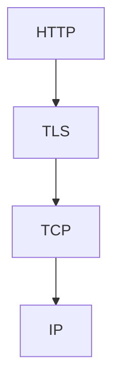

여기서 TLS는 Transport Layer Security의 약자다.

TLS는 통신 데이터를 암호화하고 무결성을 보호하며 통신 상대를 인증하는 기능을 제공한다.

과거에는 SSL(Secure Sockets Layer)이라는 기술이 사용되었다.

하지만 SSL은 오래된 프로토콜이며 현대적인 HTTPS 환경에서는 TLS를 사용한다.

따라서 HTTPS를 단순히 HTTP에 SSL을 추가한 기술로 정의하는 것보다 **HTTP 통신을 TLS로 보호하는 방식**이라고 이해하는 것이 정확하다.

또 HTTP/3는 QUIC에 TLS 1.3이 통합된 구조이므로 HTTP와 TLS, TCP를 항상 동일한 계층으로 조합한다고 볼 수도 없다.

---

### HTTP와 HTTPS의 차이

HTTP와 HTTPS의 주요 차이는 통신 보호 여부다.

| 구분        | HTTP          | HTTPS           |
| --------- | ------------- | --------------- |
| 데이터 암호화   | 기본 제공하지 않음    | TLS를 통해 제공      |
| 데이터 무결성   | TLS 수준의 보호 없음 | TLS를 통해 제공      |
| 서버 인증     | TLS 인증서 검증 없음 | 일반적으로 인증서 검증    |
| 기본 포트     | 80            | 443             |
| 통신 방식     | 평문 HTTP 등     | TLS로 보호되는 HTTP  |
| 도청 위험     | 높음            | 올바르게 구성하면 크게 감소 |
| 중간자 공격 방어 | 제한적           | 인증서 검증과 암호화로 방어 |

예를 들어 로그인 요청을 생각해 보자.

```http
POST /api/login HTTP/1.1
Content-Type: application/json

{
  "username": "user1",
  "password": "password123"
}
```

HTTP로 전송하면 네트워크 경로에서 트래픽에 접근할 수 있는 공격자가 요청 내용을 읽을 위험이 있다.

반면 HTTPS에서는 HTTP 메시지가 TLS에 의해 보호된다.

따라서 적절하게 설정된 HTTPS 연결에서는 네트워크 중간에서 요청 본문을 평문으로 읽기 어렵다.

하지만 HTTPS를 사용한다고 모든 보안 문제가 자동으로 해결되는 것은 아니다.

이를 이해하기 위해 HTTPS가 제공하는 세 가지 주요 보안 속성을 살펴보자.

---

### HTTPS의 세 가지 주요 보안 속성

HTTPS가 사용하는 TLS는 일반적으로 다음 세 가지 보안 속성을 제공한다.

| 속성              | 의미       |
| --------------- | -------- |
| Confidentiality | 데이터 기밀성  |
| Integrity       | 데이터 무결성  |
| Authentication  | 통신 상대 인증 |

이 세 가지는 서로 다른 문제를 해결한다.

기밀성은 제삼자가 내용을 읽지 못하도록 하는 것이다.

무결성은 전송 중 데이터가 변조되는 것을 탐지하는 것이다.

인증은 통신하고 있는 상대가 의도한 대상인지 확인하는 것이다.

TLS 1.3 명세에서도 이러한 속성을 보안 채널의 핵심 목표로 설명한다.

---

### 데이터 기밀성이란 무엇인가?

데이터 기밀성은 권한이 없는 제삼자가 통신 내용을 읽지 못하도록 보호하는 성질이다.

예를 들어 다음과 같은 결제 요청이 있다고 생각해 보자.

```json
{
  "orderId": 100,
  "cardToken": "example-token",
  "amount": 10000
}
```

이 데이터가 평문으로 전송된다면 공격자가 네트워크 트래픽을 관찰해 내용을 확인할 위험이 있다.

HTTPS에서는 실제 애플리케이션 데이터를 암호화해 전송한다.


이때 실제 애플리케이션 데이터의 암호화에는 일반적으로 대칭키 암호화가 사용된다.

대표적으로 AES-GCM 같은 알고리즘을 사용할 수 있다.

그렇다면 대칭키는 무엇일까?

---

### 대칭키 암호화란 무엇인가?

대칭키 암호화는 암호화와 복호화에 동일한 비밀키 또는 이에 대응하는 공통 비밀값을 사용하는 방식이다.

예를 들어 다음과 같다.

```text
평문

↓

대칭키를 이용한 암호화

↓

암호문

↓

동일한 비밀키를 이용한 복호화

↓

평문
```

개념적으로 다음과 같이 표현할 수 있다.

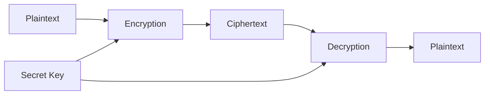

대칭키 암호화의 장점은 일반적으로 대량의 데이터를 효율적으로 처리할 수 있다는 것이다.

하지만 중요한 문제가 하나 있다.

**통신하는 양쪽이 어떻게 안전하게 공통 비밀값을 확보할 것인가?**

암호화 키를 평문으로 전송한다면 공격자가 해당 키를 가로챌 수 있다.

그러면 이후 암호화된 데이터도 보호하기 어려워진다.

이러한 문제를 해결하기 위해 TLS는 키 교환 메커니즘을 사용한다.

이를 이해하기 위해 비대칭키 암호화를 먼저 살펴보자.

---

### 비대칭키 암호화란 무엇인가?

비대칭키 암호화는 서로 다른 두 개의 키를 사용하는 암호화 방식이다.

일반적으로 공개키와 개인키로 구성된다.

공개키는 외부에 공개할 수 있다.

개인키는 소유자가 안전하게 보관해야 한다.

공개키 암호화에서는 공개키로 데이터를 암호화하고 해당 개인키로 복호화하는 방식이 가능하다.

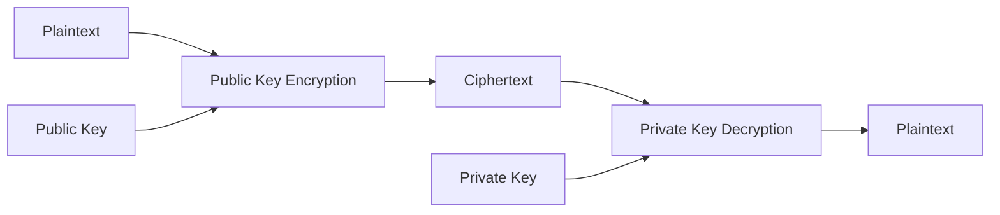

하지만 비대칭키 암호화와 전자서명은 구분해야 한다.

흔히 개인키로 암호화한 데이터를 공개키로 복호화하는 것이 전자서명이라고 설명하기도 한다.

그러나 현대적인 전자서명 알고리즘의 동작을 이렇게 단순화하는 것은 정확하지 않다.

전자서명은 개인키를 이용해 서명을 생성하고 공개키를 이용해 서명을 검증하는 별도의 암호학적 연산이다.

이 차이는 HTTPS의 TLS Handshake를 이해할 때 중요하다.

---

### HTTPS는 대칭키와 비대칭키를 어떻게 사용할까?

HTTPS는 일반적으로 다음 두 가지 역할을 구분한다.

첫 번째는 통신에 사용할 비밀값을 안전하게 확보하고 상대를 인증하는 것이다.

두 번째는 실제 애플리케이션 데이터를 효율적으로 암호화하는 것이다.

현대적인 TLS 1.3에서는 일반적으로 ECDHE를 이용해 공유 비밀값을 계산한다.

그리고 인증서에 연결된 개인키를 이용한 전자서명 등을 통해 서버를 인증한다.

최종적으로 공유 비밀값에서 실제 데이터 암호화에 사용할 키를 유도한다.

따라서 TLS 1.3을 다음과 같이 설명하면 정확하지 않다.

```text
클라이언트가 대칭키를 생성한다.

↓

서버의 공개키로 대칭키를 암호화한다.

↓

서버가 개인키로 대칭키를 복호화한다.
```

이 방식은 과거의 일부 RSA 기반 키 전송 방식과 관련이 있지만 TLS 1.3의 일반적인 Handshake를 설명하지는 못한다.

TLS 1.3에서는 일반적으로 **공유 비밀값을 직접 전송하지 않고 양쪽이 키 교환 과정에서 계산한다.**

이제 이 과정을 자세히 살펴보자.

---

### TLS Handshake란 무엇인가?

TLS Handshake는 클라이언트와 서버가 안전한 통신을 시작하기 위해 필요한 정보를 교환하는 과정이다.

이 과정에서 다음 작업을 수행한다.

* TLS 버전 및 암호화 알고리즘 협상
* 키 교환
* 서버 인증
* 통신에 사용할 비밀키 유도
* Handshake 무결성 확인

일반적인 TLS 1.3 전체 Handshake를 단순화하면 다음과 같다.

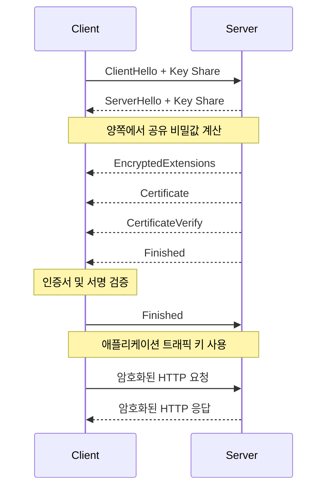

실제 TLS 1.3 Handshake에는 인증 방식과 재연결 여부 등에 따라 여러 변형이 존재한다.

위 구조는 일반적인 인증서 기반 전체 Handshake의 핵심 흐름을 표현한 것이다.

TLS 1.3의 키 교환과 인증 과정은 RFC 8446에 정의되어 있다.

---

### TLS Handshake 1단계: ClientHello

클라이언트는 서버에 ClientHello를 전송한다.

ClientHello에는 다음과 같은 정보가 포함될 수 있다.

```text
지원하는 TLS 버전

지원하는 암호화 알고리즘

Client Random

Key Share

지원하는 확장 기능

ALPN 정보
```

여기서 Key Share는 키 교환을 위한 공개 정보다.

클라이언트는 자신의 임시 개인키에 대응하는 공개 정보를 전달할 수 있다.

또 ALPN을 통해 HTTP/1.1 또는 HTTP/2 같은 애플리케이션 프로토콜을 협상할 수 있다.

---

### TLS Handshake 2단계: ServerHello

서버는 ClientHello를 확인한 뒤 ServerHello를 반환한다.

이 과정에서 사용할 TLS 버전과 암호화 관련 매개변수를 결정한다.

또 서버의 Key Share를 전달한다.

```text
ServerHello

선택한 TLS 버전

선택한 암호화 알고리즘

Server Random

Server Key Share
```

이제 클라이언트와 서버는 서로의 공개 키 교환 정보를 확보했다.

이를 이용해 공유 비밀값을 계산할 수 있다.

---

### ECDHE는 무엇인가?

ECDHE는 Elliptic Curve Diffie-Hellman Ephemeral의 약자다.

타원곡선 기반의 임시 Diffie-Hellman 키 교환 방식이다.

핵심 목적은 **공유 비밀값 자체를 네트워크에 전송하지 않고 양쪽이 동일한 비밀값을 계산하도록 하는 것**이다.

개념적으로 다음과 같다.

클라이언트는 임시 개인키와 공개키를 생성한다.

서버도 임시 개인키와 공개키를 생성한다.

서로 공개키를 교환한다.

클라이언트는 자신의 개인키와 서버의 공개키를 사용해 공유 비밀값을 계산한다.

서버는 자신의 개인키와 클라이언트의 공개키를 사용해 공유 비밀값을 계산한다.

정상적인 키 교환에서는 양쪽이 동일한 비밀값을 확보할 수 있다.

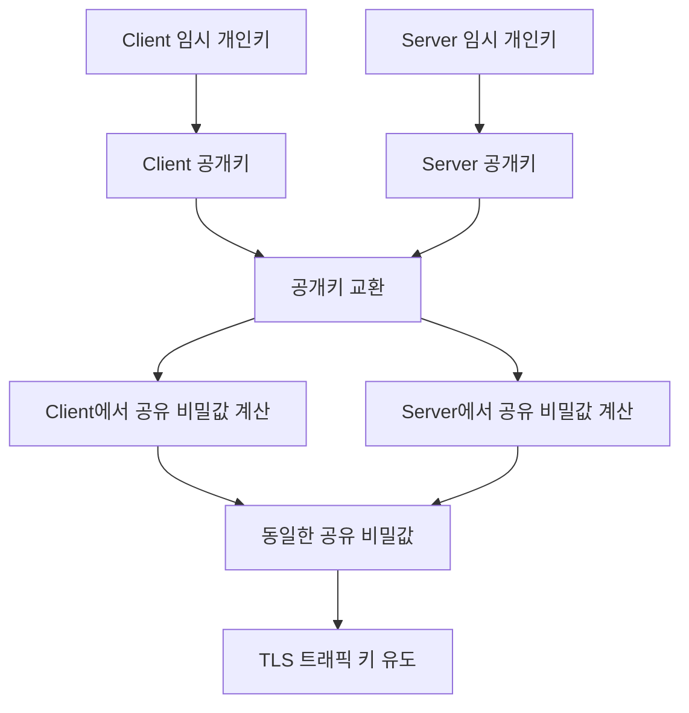

위 그림은 개념적인 구조다.

실제 계산에는 타원곡선 기반의 수학적 연산이 사용된다.

여기서 중요한 특징은 공격자가 네트워크에 전달되는 공개 정보만으로 공유 비밀값을 계산하기 어렵도록 설계되어 있다는 것이다.

또 ECDHE는 임시 키를 사용하므로 Forward Secrecy를 제공하는 데 중요한 역할을 한다.

---

### Forward Secrecy란 무엇인가?

Forward Secrecy는 나중에 서버의 장기 개인키가 유출되더라도 과거의 통신 기록이 그대로 복호화되지 않도록 보호하는 성질이다.

예를 들어 공격자가 오늘 HTTPS 통신을 수집했다고 가정하자.

공격자는 암호화된 트래픽을 저장한다.

그리고 몇 달 후 서버의 인증서 개인키를 탈취했다.

과거의 RSA 키 전송 방식에서는 장기 개인키가 유출되면 저장된 과거 통신을 복호화할 위험이 있었다.

반면 ECDHE 기반 키 교환에서는 각 연결의 임시 키 교환 결과를 이용해 비밀값을 생성한다.

따라서 장기 인증서 개인키만 탈취했다고 과거 세션의 비밀값을 바로 계산할 수 있는 것은 아니다.

이것이 Forward Secrecy의 중요한 의미다.

단, 이미 세션 키 자체가 유출되었거나 단말이 침해된 상황까지 보호하는 것은 아니다.

---

### TLS Handshake 3단계: 서버 인증

공유 비밀값을 계산했다고 해서 통신 상대가 올바른 서버라는 사실이 자동으로 보장되는 것은 아니다.

공격자가 중간에서 별도의 키 교환을 수행하려고 시도할 수도 있기 때문이다.

따라서 서버의 신원을 확인하는 과정이 필요하다.

여기서 TLS 인증서가 사용된다.

서버는 인증서를 전달하고, 해당 인증서와 연결된 개인키를 보유하고 있음을 전자서명 등의 방식으로 증명한다.

클라이언트는 인증서와 서명을 검증한다.

이 과정이 서버 인증이다.

---

### TLS 인증서란 무엇인가?

TLS 인증서는 공개키와 인증 대상 정보를 연결하는 전자 문서다.

일반적으로 X.509 인증서가 사용된다.

인증서에는 다음과 같은 정보가 포함될 수 있다.

| 정보                       | 의미              |
| ------------------------ | --------------- |
| Subject                  | 인증 대상에 관한 정보    |
| Subject Alternative Name | 인증서가 적용되는 도메인 등 |
| Public Key               | 서버의 공개키         |
| Issuer                   | 인증서 발급자         |
| Validity                 | 유효 기간           |
| Signature                | 발급자의 전자서명       |

여기서 중요한 것은 인증서의 유효성 검증이다.

클라이언트는 단순히 인증서가 존재한다는 사실만 확인하지 않는다.

일반적으로 다음 사항을 검증한다.

인증서의 서명이 유효한가?

신뢰할 수 있는 인증 기관으로 이어지는 인증서 체인이 존재하는가?

인증서의 유효 기간이 지나지 않았는가?

접속한 호스트 이름이 인증서의 대상과 일치하는가?

인증서의 사용 목적이 적절한가?

인증서 폐기 상태 등을 확인해야 하는 환경인가?

이러한 검증이 성공하면 클라이언트는 의도한 서버와 안전한 통신을 수행할 수 있는 기반을 확보한다.

---

### CA는 무엇인가?

CA는 Certificate Authority의 약자다.

인증 기관을 의미한다.

브라우저와 운영체제에는 일반적으로 신뢰할 수 있는 루트 인증 기관 목록이 존재한다.

서버 인증서는 중간 인증 기관을 거쳐 신뢰할 수 있는 루트 인증 기관에 연결될 수 있다.

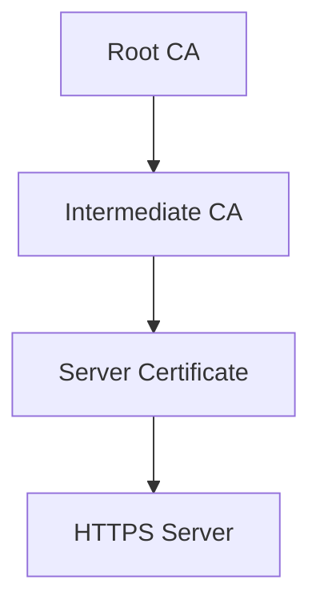

클라이언트는 인증서 체인을 검증하고 신뢰할 수 있는 루트 인증 기관에 연결되는지 확인한다.

하지만 인증서가 유효하다고 해서 해당 웹사이트의 모든 비즈니스 활동이 안전하다는 의미는 아니다.

예를 들어 공격자가 자신이 소유한 도메인에 대해 정상적인 TLS 인증서를 발급받을 수도 있다.

따라서 HTTPS는 기본적으로 **접속한 도메인과 통신 상대를 암호학적으로 인증하는 기능**을 제공하는 것이지, 웹사이트의 사업적 신뢰성까지 보증하는 기술은 아니다.

---

### 데이터 무결성이란 무엇인가?

데이터 무결성은 통신 중 데이터가 변조되었는지 확인할 수 있는 성질이다.

예를 들어 사용자가 다음 결제 요청을 전송했다고 가정하자.

```json
{
  "orderId": 100,
  "amount": 10000
}
```

공격자가 중간에서 금액을 변경하려고 한다.

```json
{
  "orderId": 100,
  "amount": 100000
}
```

HTTPS가 올바르게 설정되어 있다면 공격자가 TLS로 보호되는 데이터를 임의로 변경하고 정상적인 메시지처럼 통과시키기는 어렵다.

TLS는 암호화와 인증 메커니즘을 이용해 전송 중 변조를 탐지한다.

다만 여기서 중요한 기술적 차이가 있다.

과거의 일부 TLS 구성에서는 암호화와 메시지 인증 코드를 별도로 조합했다.

하지만 현대적인 TLS 1.3에서는 일반적으로 AEAD를 사용한다.

---

### AEAD란 무엇인가?

AEAD는 Authenticated Encryption with Associated Data의 약자다.

암호화와 무결성 검증을 함께 제공하는 방식이다.

대표적인 알고리즘으로 AES-GCM과 ChaCha20-Poly1305가 있다.

개념적으로 다음과 같은 정보를 사용한다.

```text
Plaintext

Secret Key

Nonce

Additional Authenticated Data
```

암호화 결과는 다음과 같이 표현할 수 있다.

```text
Ciphertext

Authentication Tag
```

수신자는 해당 메시지의 인증 정보를 확인한다.

검증에 실패하면 메시지를 정상적인 데이터로 받아들이지 않는다.

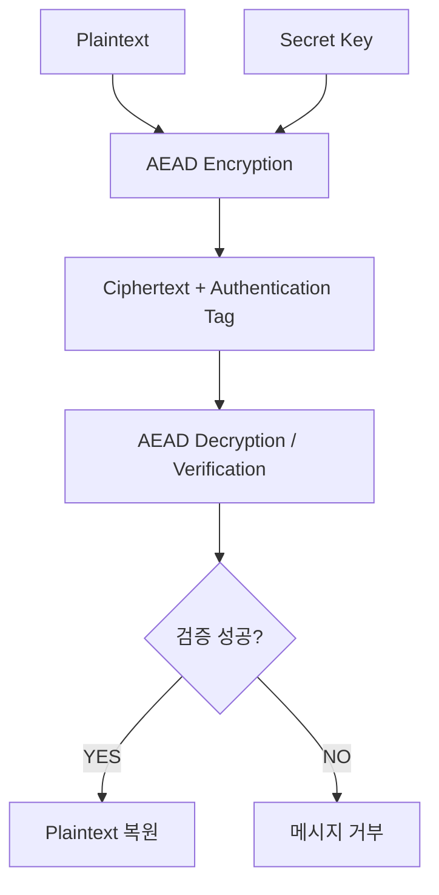

따라서 TLS 1.3의 무결성 검증을 단순히 메시지를 다시 암호화하고 MAC 값 두 개를 비교하는 방식으로 설명하는 것은 정확하지 않다.

TLS 1.3에서는 AEAD를 통해 암호화된 레코드의 기밀성과 무결성을 함께 보호한다.

---

### HTTPS가 보호하는 데이터는 어디까지일까?

HTTPS를 사용하면 모든 네트워크 정보가 완전히 숨겨진다고 생각하기 쉽다.

하지만 그렇지는 않다.

HTTPS가 보호하는 정보와 보호하지 못하는 정보는 구분해야 한다.

예를 들어 다음 URL로 요청한다고 가정하자.

```text
https://api.example.com/payments?orderId=100
```

일반적인 TLS 보호 구간에서는 다음 정보가 암호화된다.

```text
HTTP Method

Path

Query String

HTTP Headers

Request Body

Response Body
```

따라서 네트워크 중간에서 HTTP 메시지 내용을 단순히 평문으로 확인하기 어렵다.

하지만 다음 정보들은 환경에 따라 노출될 수 있다.

| 정보                 | HTTPS 보호 여부           |
| ------------------ | --------------------- |
| HTTP Request Body  | 암호화                   |
| HTTP Response Body | 암호화                   |
| URL Path           | 일반적으로 암호화             |
| Query String       | 일반적으로 암호화             |
| Cookie 헤더          | TLS 구간에서 암호화          |
| HTTP Header        | 일반적으로 암호화             |
| 목적지 IP 주소          | 네트워크 전달에 필요하므로 관찰 가능  |
| 연결 시점과 트래픽 크기      | 일부 메타데이터 관찰 가능        |
| DNS 조회 정보          | DNS 사용 방식에 따라 노출 가능   |
| TLS SNI            | ECH 사용 여부 등에 따라 노출 가능 |

여기서 중요한 점은 URL Path와 Query String이 TLS로 암호화된다고 해서 민감 정보를 Query String에 넣어도 안전하다는 의미는 아니라는 것이다.

Query String은 브라우저 기록과 서버 로그, 모니터링 시스템 등에 남을 수 있다.

따라서 비밀번호나 접근 토큰 같은 민감 정보는 URL에 포함하지 않는 것이 좋다.

또 DNS와 SNI를 통한 호스트 정보 노출은 HTTPS에서 별도로 고려해야 하는 영역이다.

ECH와 암호화 DNS 등을 사용하면 일부 메타데이터의 노출을 줄일 수 있지만, 모든 네트워크 메타데이터가 숨겨지는 것은 아니다.

---

### HTTPS는 종단 간 모든 구간을 암호화할까?

반드시 그렇지는 않다.

실제 운영 환경에서는 다음과 같은 구조가 자주 사용된다.

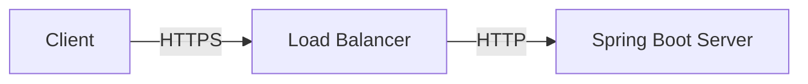

클라이언트와 Load Balancer 사이에는 HTTPS가 적용되어 있다.

하지만 Load Balancer가 TLS를 종료한 뒤 내부 Spring Boot 서버로 HTTP 요청을 전달할 수 있다.

이 방식을 TLS Termination이라고 부른다.

즉 HTTPS가 적용된 웹사이트라고 해서 브라우저부터 최종 애플리케이션까지 모든 네트워크 구간이 동일한 TLS 연결로 보호되는 것은 아니다.

이러한 구조에서는 Load Balancer와 Spring Boot 서버 사이의 내부 네트워크도 신뢰할 수 있는지 검토해야 한다.

필요하다면 내부 구간에도 TLS를 적용할 수 있다.

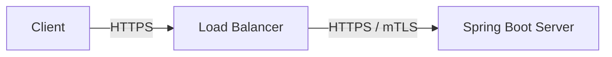

이러한 방식은 내부 트래픽을 추가로 보호해야 하는 환경에서 고려할 수 있다.

다만 내부 TLS 적용 여부는 네트워크 경계와 운영 요구사항, 인증서 관리 비용 등을 함께 검토해야 한다.

---

### HTTPS가 막지 못하는 공격도 존재한다

HTTPS는 중요한 보안 기술이지만 모든 공격을 방어하지는 않는다.

대표적으로 다음과 같은 문제가 존재할 수 있다.

**SQL Injection**

공격자가 HTTPS를 통해 악의적인 SQL 입력을 전달할 수 있다.

HTTPS는 해당 요청을 암호화하지만 SQL Injection 자체를 방지하지는 않는다.

**XSS**

웹 애플리케이션에 XSS 취약점이 존재하면 HTTPS를 사용하더라도 악의적인 스크립트가 실행될 수 있다.

**CSRF**

쿠키 기반 인증에서는 별도의 CSRF 대응이 필요할 수 있다.

HTTPS만으로 CSRF가 자동으로 방지되는 것은 아니다.

**인증 및 인가 오류**

다른 사용자의 주문을 조회할 수 있는 API 취약점은 HTTPS와 별개의 문제다.

**서버 침해**

공격자가 서버 자체를 장악했다면 TLS가 복호화한 데이터를 서버 내부에서 탈취할 수 있다.

따라서 HTTPS는 안전한 서비스의 필수적인 구성 요소지만 충분조건은 아니다.

---

### Spring Boot에서 HTTPS 설정하기

이제 실제 Spring Boot 애플리케이션에서 HTTPS를 설정해 보자.

예제 환경은 다음과 같다.

| 항목          | 환경               |
| ----------- | ---------------- |
| Java        | 17 이상            |
| Spring Boot | 3.5.x            |
| 웹 서버        | Embedded Tomcat  |
| 인증서 형식      | PKCS12           |
| HTTPS 포트    | 8443             |
| 인증서         | 로컬 개발용 자체 서명 인증서 |

운영 환경에서는 신뢰할 수 있는 CA에서 발급한 인증서를 사용하는 것이 일반적이다.

하지만 로컬 개발 환경에서는 자체 서명 인증서를 사용해 TLS 연결을 확인할 수 있다.

---

### 1. PKCS12 인증서 생성

Java의 `keytool` 명령어를 이용해 로컬 개발용 인증서를 생성한다.

```bash
keytool -genkeypair \
  -alias local-dev \
  -keyalg RSA \
  -keysize 3072 \
  -storetype PKCS12 \
  -keystore local-dev.p12 \
  -validity 365 \
  -storepass changeit \
  -dname "CN=localhost, OU=Dev, O=Example, L=Seoul, ST=Seoul, C=KR" \
  -ext "SAN=dns:localhost,ip:127.0.0.1"
```

주요 옵션은 다음과 같다.

| 옵션                  | 의미                  |
| ------------------- | ------------------- |
| `-genkeypair`       | 키 쌍 생성              |
| `-alias`            | 키 항목의 이름            |
| `-keyalg RSA`       | 키 알고리즘              |
| `-keysize 3072`     | RSA 키 크기            |
| `-storetype PKCS12` | 키 저장소 형식            |
| `-keystore`         | 결과 파일               |
| `-validity 365`     | 인증서 유효 기간           |
| `-storepass`        | 키 저장소 비밀번호          |
| `-dname`            | 인증서 주체 정보           |
| `-ext SAN=...`      | 인증서가 적용될 호스트 이름과 IP |

정상적으로 실행하면 다음 파일이 생성된다.

```text
local-dev.p12
```

이 파일에는 개인키와 인증서가 포함된다.

따라서 개인키가 포함된 파일을 Git 저장소에 업로드해서는 안 된다.

또 `changeit`은 로컬 예제를 위한 비밀번호일 뿐이며 운영 환경에서 사용해서는 안 된다.

---

### 2. application.yml 설정

생성한 파일을 프로젝트 실행 디렉터리에 배치한다.

그리고 `application.yml`을 다음과 같이 작성한다.

```yaml
server:
  port: 8443

  ssl:
    enabled: true
    key-store: file:./local-dev.p12
    key-store-password: ${SSL_KEYSTORE_PASSWORD}
    key-store-type: PKCS12
    key-alias: local-dev
```

이 설정은 Spring Boot의 내장 웹 서버에서 TLS를 사용하도록 한다.

```yaml
server:
  port: 8443
```

HTTPS 요청을 받을 포트다.

```yaml
ssl:
  enabled: true
```

TLS를 활성화한다.

```yaml
key-store: file:./local-dev.p12
```

인증서와 개인키가 포함된 키 저장소의 위치를 지정한다.

```yaml
key-store-password: ${SSL_KEYSTORE_PASSWORD}
```

비밀번호를 환경 변수에서 읽는다.

로컬 실행 전 다음과 같이 환경 변수를 설정할 수 있다.

```bash
export SSL_KEYSTORE_PASSWORD=changeit
```

그다음 애플리케이션을 실행한다.

```bash
./gradlew bootRun
```

---

### 3. HTTPS API 구현

간단한 Controller를 작성한다.

```java
@RestController
@RequestMapping("/api")
public class HelloController {

    @GetMapping("/hello")
    public ResponseEntity<String> hello() {

        return ResponseEntity.ok(
                "HTTPS Connection Success"
        );
    }
}
```

이제 다음 URL로 접근할 수 있다.

```text
https://localhost:8443/api/hello
```

하지만 자체 서명 인증서는 일반적인 브라우저의 신뢰 저장소에 등록되어 있지 않다.

따라서 인증서 신뢰 오류가 발생할 수 있다.

이것은 HTTPS가 작동하지 않는다는 의미가 아니라 클라이언트가 해당 인증서를 신뢰하지 않는다는 의미다.

---

### 4. 인증서 검증하며 HTTPS 요청하기

먼저 인증서를 PEM 형식으로 내보낸다.

```bash
keytool -exportcert \
  -rfc \
  -alias local-dev \
  -keystore local-dev.p12 \
  -storepass changeit \
  -file local-dev.crt
```

이 명령어는 `local-dev.p12`에 있는 인증서를 `local-dev.crt`로 내보낸다.

개인키를 내보내는 것은 아니다.

이제 다음 명령어로 요청할 수 있다.

```bash
curl --cacert local-dev.crt \
  -v \
  https://localhost:8443/api/hello
```

각 옵션은 다음과 같다.

| 옵션         | 의미                |
| ---------- | ----------------- |
| `--cacert` | 신뢰할 인증서 파일 지정     |
| `-v`       | 연결 및 TLS 협상 정보 출력 |
| HTTPS URL  | TLS 연결을 사용하는 요청   |

인증서가 올바르게 검증되면 다음 응답을 확인할 수 있다.

```text
HTTPS Connection Success
```

여기서 중요한 점은 인증서 검증을 비활성화하지 않았다는 것이다.

간단한 테스트를 위해 `curl -k`를 사용하는 경우가 있지만, 이 옵션은 인증서 검증을 건너뛴다.

따라서 실제 운영 환경에서는 사용하지 않아야 한다.

---

### SSL Bundle이란 무엇인가?

Spring Boot에서는 TLS 관련 설정을 SSL Bundle이라는 단위로 관리할 수도 있다.

Spring Boot 3.5에서는 PEM이나 JKS 기반의 인증서와 키 정보를 Bundle로 구성할 수 있다.

예를 들어 다음과 같다.

```yaml
spring:
  ssl:
    bundle:
      jks:
        webserver:
          key:
            alias: local-dev
          keystore:
            location: file:./local-dev.p12
            password: ${SSL_KEYSTORE_PASSWORD}
            type: PKCS12

server:
  port: 8443
  ssl:
    bundle: webserver
```

이 방식은 TLS 인증서와 관련 설정을 재사용 가능한 구성으로 관리할 수 있도록 한다.

Spring Boot 공식 문서에서는 SSL Bundle을 내장 웹 서버뿐 아니라 다른 SSL 사용 구성 요소에도 적용할 수 있는 기능으로 설명한다.

---

### HTTP 요청을 HTTPS로 리다이렉션해야 할까?

운영 서비스에서는 사용자가 HTTP 주소로 접근할 수 있다.

예를 들어 다음과 같다.

```text
http://example.com
```

이 요청을 HTTPS로 리다이렉션할 수 있다.

```http
HTTP/1.1 301 Moved Permanently
Location: https://example.com
```

이를 통해 클라이언트가 보안 연결을 사용하도록 유도할 수 있다.

Spring Security에서도 HTTPS로 리다이렉션하는 기능을 제공한다.

예를 들어 현재 Spring Security 환경에서는 다음과 같은 설정을 사용할 수 있다.

```java
@Configuration
@EnableWebSecurity
public class SecurityConfig {

    @Bean
    SecurityFilterChain securityFilterChain(
            HttpSecurity http
    ) throws Exception {

        http.redirectToHttps(Customizer.withDefaults());

        return http.build();
    }
}
```

위 코드는 HTTPS 리다이렉션 동작을 보여주는 핵심 설정 예제다.

실제 서비스에서는 인증과 인가, CSRF, 세션 정책 등의 기존 보안 설정을 함께 구성해야 한다.

또 TLS를 Load Balancer에서 종료하는 환경이라면 프록시가 전달한 원래 요청의 프로토콜 정보가 올바르게 반영되어야 한다.

그렇지 않으면 이미 HTTPS로 접근한 요청을 다시 HTTPS로 리다이렉션하는 문제가 발생할 수 있다.

Spring Security는 HTTPS 리다이렉션과 HSTS 등의 기능을 제공한다.

---

### HSTS란 무엇인가?

HSTS는 HTTP Strict Transport Security의 약자다.

브라우저에 특정 사이트를 HTTPS로만 접근해야 한다는 정책을 전달하는 기술이다.

대표적인 응답 헤더는 다음과 같다.

```http
Strict-Transport-Security: max-age=31536000
```

이 설정은 브라우저가 해당 호스트에 대해 일정 기간 HTTPS 연결을 사용하도록 기억하게 한다.

다음과 같이 하위 도메인까지 적용할 수도 있다.

```http
Strict-Transport-Security: max-age=31536000; includeSubDomains
```

다만 `includeSubDomains`를 사용하면 해당 도메인의 하위 도메인에도 HTTPS가 요구된다.

따라서 HTTP만 제공하는 하위 서비스가 존재하는 경우 접근 문제가 발생할 수 있다.

HSTS를 적용하기 전에는 전체 도메인 구성을 확인해야 한다.

또 HSTS는 일반적으로 유효한 HTTPS 응답을 통해 정책을 학습한다.

최초 방문 시 HTTP 연결이 발생하는 위험을 줄이기 위해 HSTS Preload를 고려할 수도 있다.

하지만 Preload는 장기간 HTTPS 운영을 전제로 하므로 신중하게 적용해야 한다.

---

### HTTPS와 Reverse Proxy 환경에서 발생하는 문제

실무에서는 Spring Boot가 직접 외부 HTTPS 요청을 받지 않는 경우가 많다.

예를 들어 다음과 같은 구조다.

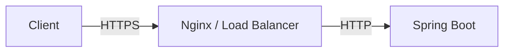

클라이언트는 HTTPS로 접근한다.

하지만 Spring Boot 입장에서는 Nginx에서 전달한 HTTP 요청을 받는다.

이 경우 Spring Boot가 요청을 HTTP로 인식할 수 있다.

그러면 다음과 같은 문제가 발생할 수 있다.

HTTPS 리다이렉션 반복.

잘못된 절대 URL 생성.

잘못된 Redirect Location 생성.

Secure Cookie 처리와 관련된 문제.

이러한 상황에서는 프록시가 원래 요청 정보를 전달하도록 설정할 수 있다.

대표적인 헤더는 다음과 같다.

```http
X-Forwarded-Proto: https
X-Forwarded-Host: api.example.com
```

Spring Boot에서는 환경에 따라 다음 설정을 사용할 수 있다.

```yaml
server:
  forward-headers-strategy: native
```

또는 다음과 같이 설정할 수 있다.

```yaml
server:
  forward-headers-strategy: framework
```

`native`는 내장 서버의 관련 기능을 활용한다.

`framework`는 Spring Framework의 Forwarded Header 처리 기능을 활용한다.

여기서 가장 중요한 주의사항은 보안이다.

클라이언트가 임의로 보낸 `X-Forwarded-*` 헤더를 신뢰해서는 안 된다.

신뢰할 수 있는 프록시가 외부에서 전달된 값을 제거하거나 정규화하고, 애플리케이션이 신뢰할 수 있는 경로에서 전달된 정보만 사용하도록 구성해야 한다.

Spring Boot 공식 문서에서도 프록시 환경에서 원래 요청의 Scheme과 Host, Port 등을 올바르게 처리하기 위한 설정을 제공한다.

---

### HTTP와 HTTPS를 실무에서 활용하는 12가지 전략

HTTP와 HTTPS의 개념을 이해했다면 실제 서비스 설계에 적용해야 한다.

특히 백엔드 시스템에서는 다음과 같은 전략을 고려할 수 있다.

#### 1. HTTP Method의 의미에 맞게 API를 설계한다

GET은 조회 목적에 사용한다.

POST는 새로운 처리나 리소스 생성에 사용할 수 있다.

PUT은 대상 리소스를 대체하거나 생성하는 데 사용한다.

PATCH는 부분 변경에 사용한다.

DELETE는 리소스 삭제에 사용한다.

이러한 의미를 일관되게 유지하면 클라이언트와 프록시가 API 동작을 예측하기 쉬워진다.

#### 2. 결제 API에는 애플리케이션 수준의 멱등성을 구현한다

POST는 기본적으로 멱등하지 않다.

따라서 결제와 구독 생성, 포인트 지급처럼 중복 실행이 문제가 되는 작업에는 별도의 멱등성 처리가 필요하다.

Idempotency Key와 데이터베이스 UNIQUE 제약조건, 외부 결제 시스템의 중복 방지 기능 등을 함께 검토해야 한다.

#### 3. 네트워크 오류와 비즈니스 실패를 구분한다

요청 중 Timeout이 발생했다고 실제 비즈니스 처리가 실패했다고 단정해서는 안 된다.

서버에서 결제가 성공했지만 응답만 전달되지 않았을 수 있다.

따라서 결제 상태 조회와 재시도 정책, 멱등성 설계를 함께 구성해야 한다.

#### 4. HTTP 상태 코드를 일관되게 사용한다

데이터가 존재하지 않는 상황과 서버 장애는 구분해야 한다.

인증 실패와 인가 실패도 구분하는 것이 좋다.

상태 코드를 정확하게 사용하면 클라이언트의 오류 처리와 운영 모니터링에 도움이 된다.

#### 5. 재시도 정책은 HTTP Method와 비즈니스 의미를 함께 고려한다

GET이나 PUT, DELETE는 HTTP 의미상 멱등하다.

하지만 실제 API 구현이 해당 의미를 지키는지 확인해야 한다.

반대로 POST도 별도의 멱등성 메커니즘을 구현했다면 안전하게 재시도할 수 있는 경우가 있다.

따라서 단순히 Method만 보고 모든 재시도를 결정해서는 안 된다.

#### 6. 타임아웃을 적절하게 설정한다

외부 API 호출에서는 연결 타임아웃과 응답 대기 타임아웃을 고려해야 한다.

무한정 응답을 기다리는 구조는 서버의 스레드와 Connection 등의 자원을 오래 점유할 수 있다.

따라서 외부 결제나 배송 API처럼 장애가 발생할 수 있는 시스템에서는 타임아웃과 재시도, 장애 격리를 함께 설계해야 한다.

#### 7. HTTPS 인증서 검증을 비활성화하지 않는다

로컬 개발 과정에서 인증서 오류가 발생할 수 있다.

하지만 이를 해결하기 위해 운영 코드에서 인증서 검증을 끄는 것은 위험하다.

올바른 인증서를 사용하고 신뢰 저장소를 적절하게 설정해야 한다.

#### 8. TLS 종료 지점을 명확하게 관리한다

HTTPS가 어느 지점에서 복호화되는지 확인해야 한다.

Load Balancer에서 TLS를 종료한다면 그 이후 내부 통신의 보호 수준도 검토해야 한다.

민감한 데이터를 처리하는 시스템에서는 내부 구간에 TLS나 mTLS를 적용하는 방식을 고려할 수 있다.

#### 9. Secure Cookie와 세션 보안을 적용한다

쿠키 기반 인증을 사용한다면 다음 속성을 검토해야 한다.

```http
Set-Cookie: SESSION=abc123; HttpOnly; Secure; SameSite=Lax
```

`HttpOnly`는 JavaScript에서 쿠키에 접근하는 것을 제한한다.

`Secure`는 쿠키가 보안 연결을 통해 전송되도록 제한한다.

`SameSite`는 교차 사이트 요청에서 쿠키 전송 범위를 제어한다.

다만 이러한 속성만으로 모든 세션 공격을 방지할 수 있는 것은 아니다.

CSRF와 XSS 등에 대한 별도 대응도 필요하다.

#### 10. URL에 민감한 정보를 포함하지 않는다

HTTPS에서는 URL의 Path와 Query String도 일반적으로 암호화된다.

하지만 브라우저 기록이나 로그 등에 남을 수 있다.

따라서 비밀번호와 접근 토큰, 민감한 개인정보를 Query String으로 전달하는 방식은 피하는 것이 좋다.

#### 11. API 캐시 정책을 명확하게 설정한다

HTTP는 캐시 기능을 지원한다.

예를 들어 상품 목록처럼 자주 조회되는 데이터에는 적절한 캐시 정책을 적용할 수 있다.

반면 개인정보나 결제 정보처럼 민감한 데이터에는 저장을 제한하는 정책을 고려해야 한다.

대표적으로 다음과 같은 Header를 사용할 수 있다.

```http
Cache-Control: no-store
```

다만 캐시 정책은 데이터의 특성과 브라우저·프록시·CDN 환경에 따라 설계해야 한다.

#### 12. HTTP 버전과 TLS 설정을 실제 운영 환경에서 확인한다

개발자는 HTTP/2를 지원한다고 생각하지만 실제 Load Balancer에서 HTTP/1.1로 통신하고 있을 수 있다.

반대로 클라이언트와 CDN 사이에서는 HTTP/3가 사용되지만 CDN과 원본 서버 사이에서는 HTTP/1.1이 사용될 수도 있다.

따라서 시스템 전체가 동일한 HTTP 버전으로 통신한다고 가정해서는 안 된다.

각 구간에서 실제로 어떤 프로토콜과 TLS 버전이 협상되는지 확인해야 한다.

---

### HTTP와 HTTPS의 전체 통신 과정

지금까지 살펴본 내용을 하나의 흐름으로 연결해 보자.

사용자가 다음 주소에 접속했다고 가정하자.

```text
https://api.example.com/members/100
```

일반적인 HTTPS over TCP 환경에서 통신은 다음과 같이 진행될 수 있다.

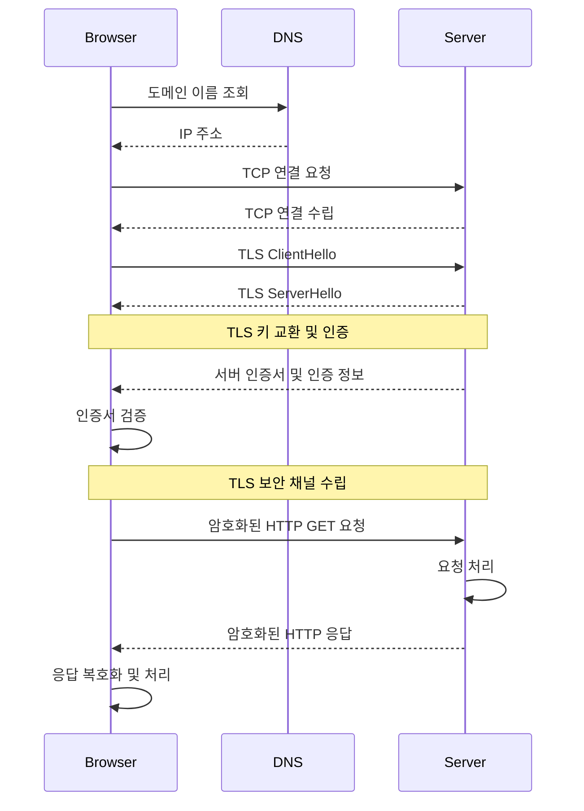

이 과정을 단계별로 살펴보자.

#### 1단계: DNS 조회

브라우저는 도메인 이름에 대응하는 IP 주소를 확인한다.

다만 DNS 결과가 캐시에 저장되어 있거나 다른 이름 해석 경로를 사용할 수도 있다.

#### 2단계: 연결 수립

일반적인 HTTP/1.1 또는 HTTP/2 over TCP 환경에서는 TCP 연결을 수립한다.

TCP 연결이 완료되면 TLS Handshake를 수행할 수 있다.

#### 3단계: TLS Handshake

클라이언트와 서버는 TLS 버전과 암호화 알고리즘 등을 협상한다.

키 교환을 통해 공유 비밀값을 계산한다.

서버는 인증서를 제공한다.

클라이언트는 인증서를 검증한다.

#### 4단계: HTTP 요청 전송

TLS 보안 채널이 수립되면 HTTP 요청을 전송한다.

이때 HTTP 메시지는 TLS로 보호된다.

#### 5단계: 서버 처리

Spring Boot 서버는 HTTP 요청을 처리한다.

Controller와 Service, Repository 등을 통해 필요한 비즈니스 로직을 실행한다.

#### 6단계: HTTP 응답 반환

서버는 HTTP 상태 코드와 Header, Body를 구성한다.

응답은 TLS로 보호되어 클라이언트에 전달된다.

#### 7단계: 클라이언트 처리

클라이언트는 TLS 보호를 해제하고 HTTP 응답을 처리한다.

브라우저라면 HTML을 렌더링하거나 JavaScript에서 JSON 응답을 활용할 수 있다.

이러한 구조를 이해하면 네트워크 장애가 발생했을 때 어느 구간에서 문제가 생겼는지 더 체계적으로 분석할 수 있다.

단, HTTP/3에서는 TCP 대신 QUIC을 사용하므로 연결 수립 과정이 달라진다.

---

### HTTP와 HTTPS는 어떻게 구분해서 이해해야 할까?

두 기술은 서로 경쟁하는 프로토콜이 아니다.

HTTPS는 HTTP의 의미 체계를 유지하면서 안전한 통신을 제공한다.

예를 들어 다음 요청은 HTTP에서도 사용할 수 있다.

```http
GET /api/members/100 HTTP/1.1
```

HTTPS에서도 동일한 의미의 요청을 사용할 수 있다.

GET의 의미가 달라지는 것은 아니다.

상태 코드 200의 의미가 달라지는 것도 아니다.

차이는 HTTP 메시지를 네트워크로 전달하는 과정에 TLS 보호가 적용된다는 점이다.

따라서 HTTP와 HTTPS를 다음과 같이 구분할 수 있다.

```text
HTTP

→ 무엇을 요청하고 어떻게 응답할 것인가?


HTTPS

→ HTTP 통신을 어떻게 안전하게 보호할 것인가?
```

이 차이를 이해하면 두 기술의 책임을 명확하게 구분할 수 있다.

---

### 정리

HTTP는 클라이언트와 서버가 요청과 응답을 주고받기 위한 애플리케이션 계층 프로토콜이다.

HTTP는 메서드와 URI, 상태 코드, Header, Body 등을 통해 요청과 응답의 의미를 표현한다.

HTTP의 중요한 특징 중 하나는 Stateless다.

이는 개별 요청을 독립적으로 처리할 수 있다는 의미다.

하지만 서버가 데이터를 저장할 수 없다는 뜻은 아니다.

실제 애플리케이션에서는 데이터베이스와 세션 저장소 등을 사용해 필요한 상태를 유지한다.

HTTP의 연결 관리 역시 버전에 따라 달라진다.

초기의 HTTP에서는 요청과 응답마다 연결을 종료하는 방식이 사용되었지만 HTTP/1.1에서는 지속 연결을 기본으로 사용한다.

HTTP/2에서는 다중화와 바이너리 프레이밍을 지원한다.

HTTP/3에서는 QUIC을 사용해 HTTP 의미 체계를 전달한다.

HTTP Method를 이해할 때는 안전성과 멱등성을 구분해야 한다.

GET은 안전하고 멱등한 메서드다.

PUT과 DELETE는 안전하지 않지만 멱등한 메서드다.

POST는 기본적으로 멱등성을 보장하지 않는다.

PATCH는 실제 수정 방식에 따라 멱등하게 구현할 수도 있고 그렇지 않을 수도 있다.

특히 멱등성은 동일한 요청을 반복했을 때 응답 데이터나 상태 코드가 반드시 같아야 한다는 의미가 아니다.

서버에 미치는 의도한 효과가 동일해야 한다는 의미다.

이 개념은 결제 시스템에서 특히 중요하다.

결제 서버가 요청을 성공적으로 처리했지만 응답이 전달되지 않았을 수 있기 때문이다.

따라서 결제와 구독 생성, 포인트 지급 등의 API에서는 Idempotency Key와 데이터베이스 제약조건, 외부 시스템의 중복 방지 기능 등을 함께 활용해야 한다.

HTTP 상태 코드 역시 중요한 개념이다.

2xx는 성공을 의미한다.

3xx는 추가적인 이동이나 처리를 의미한다.

4xx는 요청을 처리할 수 없는 클라이언트 측 조건을 나타낸다.

5xx는 서버의 처리 실패를 나타낸다.

이러한 상태 코드는 클라이언트의 오류 처리와 재시도 정책, 운영 장애 분석에 영향을 준다.

HTTPS는 HTTP 통신을 TLS로 보호하는 방식이다.

TLS는 일반적으로 세 가지 보안 속성을 제공한다.

첫 번째는 데이터 기밀성이다.

두 번째는 데이터 무결성이다.

세 번째는 통신 상대 인증이다.

기밀성은 제삼자가 통신 내용을 읽지 못하도록 보호한다.

무결성은 전송 중 메시지가 변조되었는지 탐지한다.

인증은 의도한 서버와 통신하고 있는지 확인한다.

TLS 1.3에서는 일반적으로 ECDHE를 이용해 공유 비밀값을 계산하고, 인증서를 이용해 서버를 인증한다.

실제 애플리케이션 데이터는 유도된 트래픽 키와 AEAD 알고리즘을 통해 보호한다.

따라서 HTTPS를 단순히 공개키로 대칭키를 암호화해서 전달하는 방식으로 이해해서는 안 된다.

현대적인 TLS 1.3의 키 교환과 데이터 보호 방식은 더 정교하다.

또 HTTPS가 모든 정보를 숨기는 것은 아니다.

목적지 IP 주소와 일부 연결 메타데이터는 관찰될 수 있다.

DNS나 SNI를 통한 정보 노출 가능성도 존재한다.

그리고 HTTPS는 SQL Injection이나 XSS, 잘못된 인증·인가 설계를 자동으로 방지하지 않는다.

실제 운영 환경에서는 TLS 종료 지점도 중요하다.

Load Balancer에서 HTTPS를 종료하고 내부 Spring Boot 서버에는 HTTP로 전달할 수도 있다.

따라서 어느 구간까지 통신이 암호화되는지 명확하게 확인해야 한다.

Spring Boot에서는 KeyStore나 SSL Bundle을 사용해 HTTPS를 설정할 수 있다.

또 Spring Security를 통해 HTTPS 리다이렉션과 HSTS 등을 구성할 수 있다.

다만 운영 환경에서는 신뢰할 수 있는 인증서를 사용하고 인증서 검증을 비활성화하지 않아야 한다.

마지막으로 핵심 개념을 비교하면 다음과 같다.

| 개념                      | 핵심 의미                  |
| ----------------------- | ---------------------- |
| HTTP                    | 요청과 응답의 의미 및 통신 규칙     |
| HTTPS                   | TLS로 보호되는 HTTP 통신      |
| Stateless               | 요청을 독립적으로 처리할 수 있는 특성  |
| URI                     | 리소스 식별                 |
| HTTP Method             | 요청 작업의 의미              |
| Safe Method             | 상태 변경을 요청하지 않는 메서드     |
| Idempotency             | 동일한 요청의 반복이 의도한 효과를 유지 |
| Status Code             | 요청 처리 결과               |
| TLS                     | 통신 보안 프로토콜             |
| Handshake               | 보안 채널 수립 과정            |
| Symmetric Encryption    | 공통 비밀키를 이용한 암호화        |
| Asymmetric Cryptography | 공개키와 개인키를 활용하는 암호학적 방식 |
| ECDHE                   | 임시 키 기반 공유 비밀값 계산      |
| TLS Certificate         | 서버의 공개키와 인증 대상 정보 연결   |
| CA                      | 인증서 발급 및 신뢰 체계         |
| AEAD                    | 암호화와 무결성 보호            |
| HSTS                    | HTTPS 사용 정책            |
| TLS Termination         | TLS 연결 종료 지점           |
| Idempotency Key         | 중복 비즈니스 요청 식별          |

결국 HTTP와 HTTPS를 이해한다는 것은 단순히 HTTP는 80번 포트를 사용하고 HTTPS는 443번 포트를 사용한다는 사실을 아는 것이 아니다.

HTTP의 요청과 응답이 어떻게 구성되고, 각 메서드가 어떤 의미를 가지며, 네트워크 장애 상황에서 어떤 동작을 보장해야 하는지 이해해야 한다.

또 HTTPS가 어떤 암호학적 메커니즘으로 데이터를 보호하고, 인증서를 통해 서버를 검증하며, 실제 인프라의 어느 구간에서 보안이 적용되는지 설명할 수 있어야 한다.

**HTTP는 안정적인 API를 설계하기 위한 통신 규칙이고, HTTPS는 그 통신을 안전하게 보호하기 위한 보안 메커니즘이다. 두 기술의 역할을 정확하게 이해해야 신뢰할 수 있는 백엔드 시스템을 설계할 수 있다.**

#### 한 줄 요약

**HTTP는 클라이언트와 서버 사이의 요청·응답 형식과 메서드, URI, 상태 코드 등의 의미를 정의하는 프로토콜이다. HTTPS는 이러한 HTTP 통신을 TLS로 보호하며, TLS 1.3에서는 ECDHE 기반 키 교환과 인증서 검증, AEAD 암호화를 통해 기밀성·무결성·서버 인증을 제공한다. 실무에서는 HTTP 메서드의 멱등성, 결제 요청의 중복 방지, 적절한 상태 코드, 인증서 검증, TLS 종료 지점과 내부 통신 보안까지 함께 고려해야 한다.**
