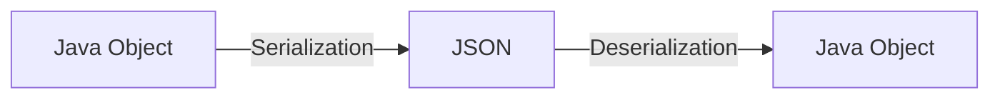
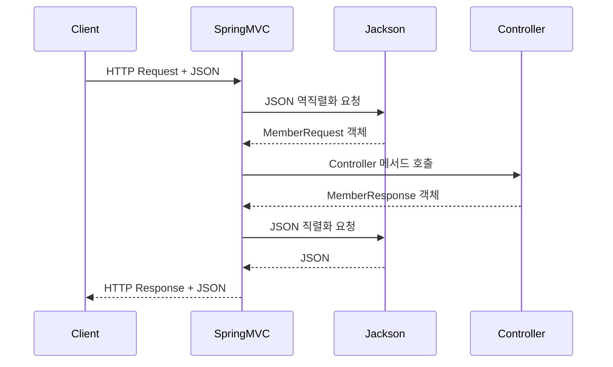
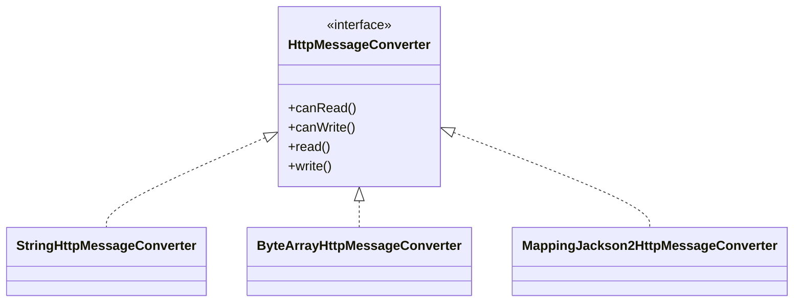
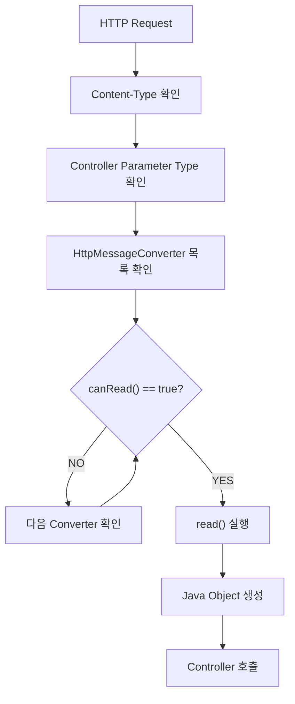
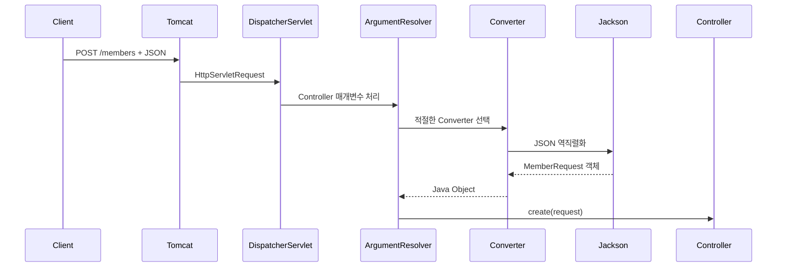
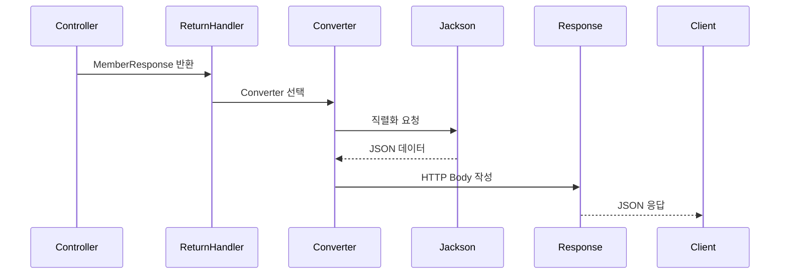
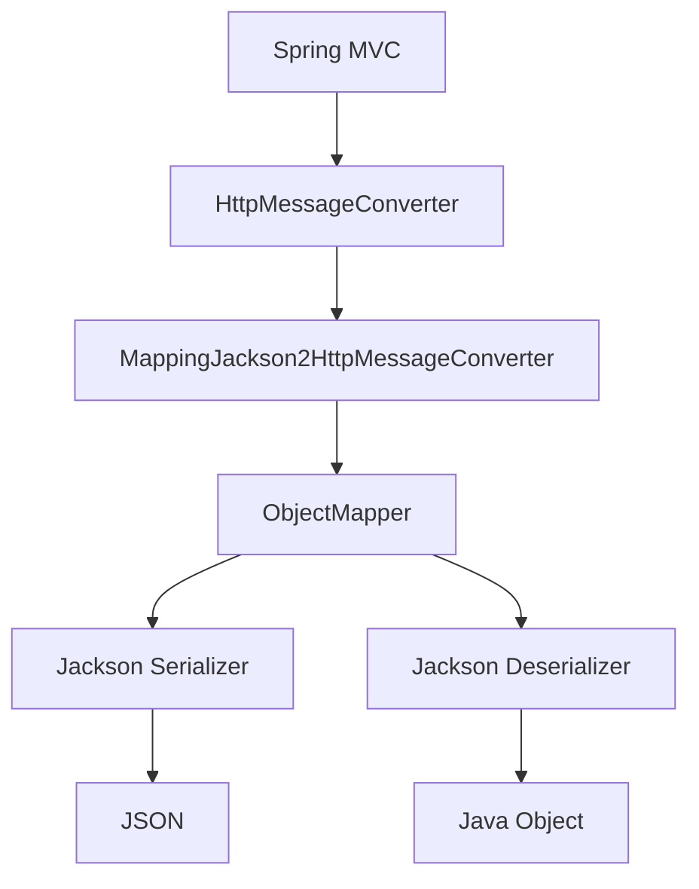
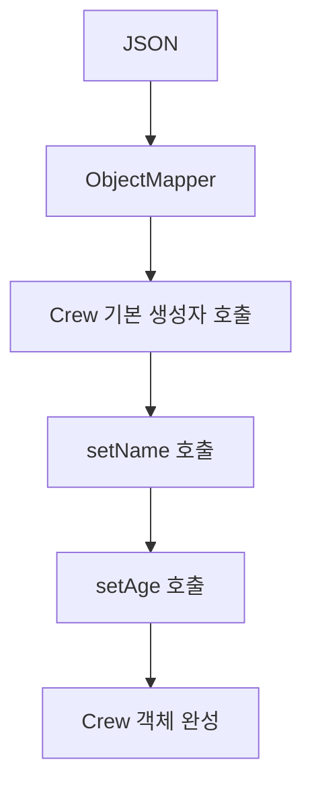
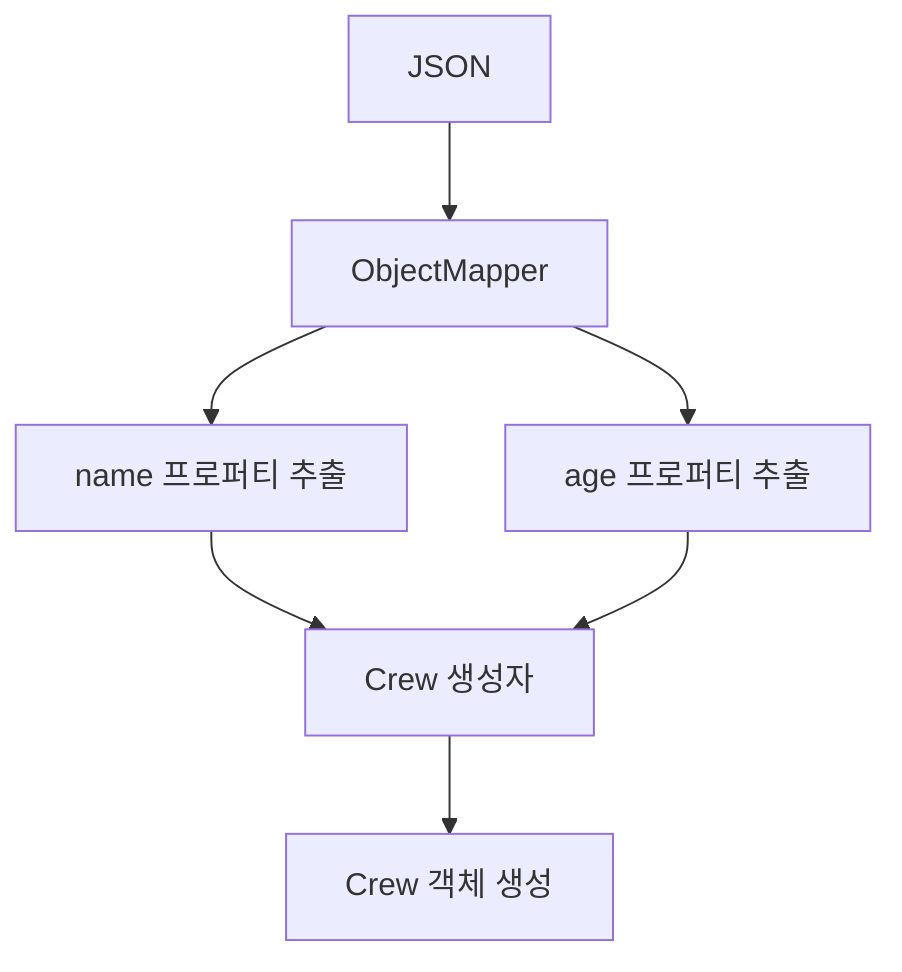
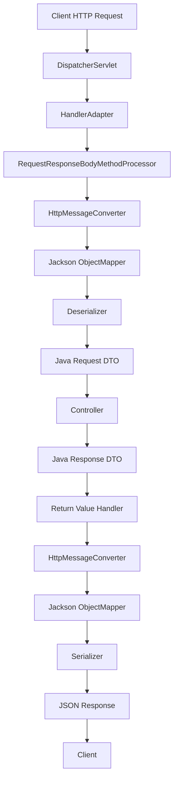

# 슬링키의 직렬화, 역직렬화 in Spring
[https://youtu.be/8gyAr3lXGSw?si=Regeh1fJr946fcpM](https://youtu.be/8gyAr3lXGSw?si=Regeh1fJr946fcpM)
# 슬링키의 직렬화, 역직렬화 in Spring
* toc
{:toc}

---

### Spring 직렬화와 역직렬화 완벽 이해: HttpMessageConverter, Jackson ObjectMapper와 JSON 변환 원리

Spring Boot에서 REST API를 개발할 때 가장 자주 사용하는 데이터 형식 중 하나는 JSON이다.

예를 들어 회원을 등록하는 API를 생각해 보자.

클라이언트는 다음과 같은 HTTP 요청을 보낸다.

```http
POST /api/members HTTP/1.1
Content-Type: application/json

{
  "name": "홍길동",
  "age": 30
}
```

Spring Boot에서는 다음과 같이 Controller를 작성할 수 있다.

```java
@RestController
@RequestMapping("/api/members")
public class MemberController {

    @PostMapping
    public MemberResponse create(
            @RequestBody MemberRequest request
    ) {

        return new MemberResponse(
                1L,
                request.name(),
                request.age()
        );
    }
}
```

요청과 응답에 사용하는 객체는 다음과 같다.

```java
public record MemberRequest(
        String name,
        int age
) {
}
```

```java
public record MemberResponse(
        Long id,
        String name,
        int age
) {
}
```

이제 클라이언트가 요청을 전송하면 Spring Boot는 JSON을 Java 객체로 변환한다.

Controller는 변환된 `MemberRequest` 객체를 전달받는다.

그리고 Controller가 반환한 `MemberResponse` 객체는 다시 JSON으로 변환된다.

최종 응답은 다음과 같다.

```http
HTTP/1.1 200 OK
Content-Type: application/json

{
  "id": 1,
  "name": "홍길동",
  "age": 30
}
```

여기서 생각해 볼 질문이 있다.

**Spring은 어떻게 JSON 문자열을 Java 객체로 변환하는 것일까?**

**Java 객체의 필드가 `private`인데도 JSON으로 변환할 수 있는 이유는 무엇일까?**

**Getter만 추가했는데 JSON 응답에 새로운 필드가 생기는 이유는 무엇일까?**

**기본 생성자가 없는데도 `record`는 정상적으로 역직렬화되는 이유는 무엇일까?**

**`@JsonIgnore`, `@JsonCreator`, `@JsonProperty`는 각각 어떤 역할을 할까?**

**Jackson은 객체의 필드를 직접 읽는 것일까, 아니면 Getter를 호출하는 것일까?**

이러한 질문에 답하려면 단순히 JSON 형식을 이해하는 것에서 나아가 Spring MVC와 Jackson의 내부 동작을 알아야 한다.

특히 다음 세 가지 구성 요소의 역할을 구분하는 것이 중요하다.

* `HttpMessageConverter`
* `ObjectMapper`
* Jackson의 프로퍼티 탐색 및 객체 생성 기능

이번에는 각각의 역할을 이해하고, 실제 요청과 응답이 처리되는 전체 과정을 연결해 보자.

---

### 직렬화와 역직렬화란 무엇인가?

직렬화(Serialization)는 프로그램 내부의 데이터나 객체를 저장하거나 전송할 수 있는 표현으로 변환하는 과정이다.

반대로 역직렬화(Deserialization)는 직렬화된 데이터를 프로그램에서 사용할 수 있는 객체나 데이터 구조로 복원하는 과정이다.

예를 들어 다음 Java 객체가 있다고 가정하자.

```java
public record Member(
        Long id,
        String name,
        int age
) {
}
```

객체를 생성한다.

```java
Member member = new Member(
        1L,
        "홍길동",
        30
);
```

이 객체를 JSON으로 변환하면 다음과 같이 표현할 수 있다.

```json
{
  "id": 1,
  "name": "홍길동",
  "age": 30
}
```

이것이 JSON 직렬화다.

반대로 위 JSON을 읽어 다음 객체를 생성하는 과정이 역직렬화다.

```java
Member member = new Member(
        1L,
        "홍길동",
        30
);
```

전체 과정은 다음과 같다.



이때 직렬화와 역직렬화는 반드시 JSON에만 적용되는 개념이 아니다.

다양한 데이터 표현에 사용할 수 있다.

| 형식                        | 특징               |
| ------------------------- | ---------------- |
| JSON                      | 텍스트 기반 데이터 교환 형식 |
| XML                       | 태그 기반 구조화 데이터    |
| Protocol Buffers          | 스키마 기반 바이너리 직렬화  |
| Avro                      | 스키마 기반 데이터 직렬화   |
| Java Object Serialization | Java 객체 직렬화 메커니즘 |

각 형식은 데이터의 크기, 가독성, 타입 표현 방식, 호환성 등에서 차이가 있다.

일반적인 REST API에서는 JSON을 자주 사용하지만, 시스템 요구사항에 따라 다른 형식을 선택할 수도 있다.

---

### 왜 직렬화와 역직렬화가 필요할까?

Java 객체는 JVM의 메모리 안에서 관리된다.

예를 들어 다음 코드를 생각해 보자.

```java
Member member = new Member(
        1L,
        "홍길동",
        30
);
```

`member` 변수는 Java 객체를 참조한다.

하지만 다른 서버에 이 참조값을 그대로 전달한다고 해서 상대 서버가 동일한 객체에 접근할 수 있는 것은 아니다.

서로 다른 프로세스는 독립적인 메모리 공간을 사용하기 때문이다.

따라서 네트워크를 통해 정보를 전달하려면 서로 이해할 수 있는 데이터 표현이 필요하다.

예를 들어 다음과 같은 JSON을 사용할 수 있다.

```json
{
  "id": 1,
  "name": "홍길동",
  "age": 30
}
```

이 JSON은 Java뿐 아니라 JavaScript, Python, Go 등 다양한 언어에서 해석할 수 있다.

즉 직렬화의 중요한 목적은 **프로그램 내부의 데이터 구조를 외부 시스템과 교환할 수 있는 형식으로 표현하는 것**이다.

여기서 주의할 점이 있다.

직렬화는 Java 객체가 사용하던 실제 메모리 주소나 내부 객체 구조를 그대로 외부에 전달하는 과정이 아니다.

JSON 직렬화에서는 객체의 프로퍼티를 JSON 데이터 모델에 맞게 표현한다.

역직렬화 역시 원래 객체의 메모리 주소를 복원하는 것이 아니라 JSON에 포함된 데이터를 바탕으로 새로운 Java 객체를 구성하는 과정이다.

---

### Spring MVC에서 직렬화와 역직렬화는 언제 발생할까?

Spring MVC에서 JSON 변환이 발생하는 대표적인 상황은 두 가지다.

첫 번째는 클라이언트가 JSON 요청을 전송하는 상황이다.

두 번째는 서버가 Java 객체를 JSON 응답으로 반환하는 상황이다.

#### HTTP 요청: 역직렬화

클라이언트가 다음 JSON을 전송한다고 가정하자.

```json
{
  "name": "홍길동",
  "age": 30
}
```

Controller에서는 다음과 같이 받는다.

```java
@PostMapping("/members")
public void create(
        @RequestBody MemberRequest request
) {
    // ...
}
```

이때 Spring MVC는 요청 본문을 읽고 JSON을 `MemberRequest` 객체로 변환한다.

이것이 역직렬화다.

#### HTTP 응답: 직렬화

Controller가 다음 객체를 반환한다고 가정하자.

```java
@GetMapping("/members/{id}")
public MemberResponse findMember(
        @PathVariable Long id
) {

    return new MemberResponse(
            id,
            "홍길동",
            30
    );
}
```

Spring MVC는 반환된 객체를 JSON으로 변환한다.

```json
{
  "id": 1,
  "name": "홍길동",
  "age": 30
}
```

이것이 직렬화다.

전체 과정은 다음과 같다.



여기서 중요한 점은 Controller가 JSON을 직접 파싱하지 않는다는 사실이다.

Controller에 요청 객체가 전달되기 전에 역직렬화가 수행된다.

반대로 Controller가 객체를 반환한 이후에 직렬화가 수행된다.

이러한 역할을 연결하는 Spring MVC의 핵심 구성 요소가 `HttpMessageConverter`다.

---

### HttpMessageConverter란 무엇인가?

`HttpMessageConverter`는 HTTP 요청과 응답의 본문을 읽고 쓰는 역할을 추상화한 Spring 인터페이스다.

HTTP 메시지 본문을 Java 객체로 변환하거나 Java 객체를 HTTP 메시지 본문으로 작성할 수 있도록 한다.

Spring Framework에서는 다음 인터페이스를 제공한다.

```java
public interface HttpMessageConverter<T> {

    boolean canRead(
            Class<?> clazz,
            MediaType mediaType
    );

    boolean canWrite(
            Class<?> clazz,
            MediaType mediaType
    );

    List<MediaType> getSupportedMediaTypes();

    T read(
            Class<? extends T> clazz,
            HttpInputMessage inputMessage
    ) throws IOException, HttpMessageNotReadableException;

    void write(
            T t,
            MediaType contentType,
            HttpOutputMessage outputMessage
    ) throws IOException, HttpMessageNotWritableException;
}
```

핵심 메서드는 다음과 같다.

| 메서드                        | 역할                         |
| -------------------------- | -------------------------- |
| `canRead()`                | 해당 타입과 미디어 타입을 읽을 수 있는지 판단 |
| `canWrite()`               | 해당 타입과 미디어 타입을 쓸 수 있는지 판단  |
| `read()`                   | HTTP 메시지 본문을 Java 객체로 변환   |
| `write()`                  | Java 객체를 HTTP 메시지 본문으로 변환  |
| `getSupportedMediaTypes()` | 지원하는 미디어 타입 목록 제공          |

여기서 중요한 점은 `HttpMessageConverter` 자체가 JSON 전용 인터페이스가 아니라는 사실이다.

HTTP 메시지 본문에는 JSON뿐 아니라 문자열, 바이너리 데이터, XML 등 다양한 형태의 데이터가 포함될 수 있다.

Spring은 각각의 데이터 형식을 처리하기 위한 구현체를 제공한다.

---

### HttpMessageConverter는 왜 인터페이스로 설계되었을까?

서버가 처리해야 하는 데이터 형식은 다양하다.

예를 들어 다음 API들을 생각해 보자.

```http
GET /api/members
Accept: application/json
```

```http
GET /api/report
Accept: text/plain
```

```http
GET /api/files/1
Accept: application/octet-stream
```

모든 응답이 JSON은 아니다.

회원 조회는 JSON으로 반환할 수 있다.

간단한 메시지는 문자열로 반환할 수 있다.

파일 다운로드는 바이트 배열이나 스트리밍 방식으로 처리할 수 있다.

만약 Spring MVC가 JSON만 처리하도록 설계되어 있다면 다른 형식의 데이터를 처리할 때마다 Spring MVC 자체를 수정해야 한다.

하지만 `HttpMessageConverter` 인터페이스를 사용하면 이러한 문제를 줄일 수 있다.



각 Converter는 자신이 처리할 수 있는 데이터 형식을 담당한다.

Spring MVC는 실제 구현체가 어떤 방식으로 데이터를 변환하는지 모두 알 필요가 없다.

공통 인터페이스를 통해 변환 가능 여부를 확인하고 변환 작업을 위임하면 된다.

이는 객체지향 설계에서 사용하는 추상화와 다형성의 대표적인 활용 사례다.

---

### Spring에서 제공하는 주요 HttpMessageConverter

Spring MVC에서는 다양한 HttpMessageConverter 구현체를 사용할 수 있다.

Spring Framework 6.2와 Jackson 2를 기준으로 대표적인 구현체는 다음과 같다.

| Converter                                | 주요 역할                   |
| ---------------------------------------- | ----------------------- |
| `ByteArrayHttpMessageConverter`          | `byte[]` 읽기 및 쓰기        |
| `StringHttpMessageConverter`             | 문자열 읽기 및 쓰기             |
| `ResourceHttpMessageConverter`           | Resource 응답 처리          |
| `FormHttpMessageConverter`               | Form 데이터 처리             |
| `MappingJackson2HttpMessageConverter`    | Jackson 2를 사용한 JSON 처리  |
| `MappingJackson2XmlHttpMessageConverter` | Jackson XML을 사용한 XML 처리 |

여기서 `MappingJackson2HttpMessageConverter`가 JSON 직렬화와 역직렬화를 담당하는 대표적인 구현체다.

다만 모든 구현체가 무조건 등록되는 것은 아니다.

사용하는 Spring 버전과 의존성, 웹 설정에 따라 등록되는 Converter가 달라질 수 있다.

또 Spring Framework 7에서는 Jackson 3을 위한 새로운 Converter가 도입되었다.

이 차이는 뒤에서 자세히 살펴보겠다.

---

### HttpMessageConverter는 어떻게 선택될까?

Spring MVC에는 여러 Converter가 등록될 수 있다.

그렇다면 어떤 Converter를 사용할지 결정해야 한다.

예를 들어 다음 요청이 있다고 가정하자.

```http
POST /api/members HTTP/1.1
Content-Type: application/json

{
  "name": "홍길동",
  "age": 30
}
```

Spring MVC는 요청을 처리하는 과정에서 다음 정보를 확인한다.

* 요청 본문의 타입
* Controller 매개변수의 Java 타입
* HTTP `Content-Type`
* 등록된 HttpMessageConverter 목록

그리고 해당 요청을 읽을 수 있는 Converter를 찾는다.

개념적으로 다음과 같은 흐름이다.



여기서 중요한 것은 단순히 JSON이라는 문자열을 보고 Jackson을 선택하는 것이 아니라는 점이다.

변환 대상 Java 타입과 미디어 타입, Converter의 지원 범위를 함께 고려한다.

또 Spring MVC의 실제 구현에서는 제네릭 타입과 추가적인 변환 정보를 다루기 위한 확장 인터페이스도 사용한다.

대표적으로 `GenericHttpMessageConverter`, `SmartHttpMessageConverter` 등이 있다.

따라서 실제 내부 동작을 이해할 때는 기본 인터페이스뿐 아니라 구현체의 확장 기능도 고려해야 한다.

---

### @RequestBody는 내부적으로 어떻게 동작할까?

이제 다음 코드를 자세히 살펴보자.

```java
@PostMapping("/members")
public void create(
        @RequestBody MemberRequest request
) {
    // ...
}
```

개발자가 직접 `MemberRequest` 객체를 생성하지 않았다.

그런데 Controller가 호출되는 시점에는 이미 객체가 존재한다.

이 과정을 수행하는 대표적인 Spring MVC 구성 요소가 다음 클래스다.

```java
RequestResponseBodyMethodProcessor
```

이 클래스는 두 가지 역할을 수행한다.

첫 번째는 `@RequestBody` 매개변수를 처리하는 것이다.

두 번째는 `@ResponseBody`가 적용된 반환값을 처리하는 것이다.

Spring Framework의 공식 API에서도 이 클래스가 `HttpMessageConverter`를 통해 요청 본문을 읽고 응답 본문을 작성한다고 설명한다.

#### @RequestBody 처리 과정



이 흐름에서 Controller는 변환 작업을 직접 수행하지 않는다.

Spring MVC가 요청 본문을 읽고 Controller의 매개변수 타입에 맞는 객체를 생성한다.

따라서 다음과 같은 코드가 가능하다.

```java
@PostMapping("/members")
public void create(
        @RequestBody MemberRequest request
) {

    System.out.println(request.name());
}
```

요청에 포함된 JSON의 `name` 값이 Java 객체의 `name` 프로퍼티에 매핑되기 때문이다.

---

### @ResponseBody는 내부적으로 어떻게 동작할까?

이번에는 응답을 살펴보자.

```java
@GetMapping("/members/{id}")
@ResponseBody
public MemberResponse find(
        @PathVariable Long id
) {

    return new MemberResponse(
            id,
            "홍길동",
            30
    );
}
```

이 코드에서 Controller는 Java 객체를 반환한다.

하지만 클라이언트는 Java 객체 자체를 받을 수 없다.

HTTP 메시지 본문으로 변환해야 한다.

Spring MVC는 반환값 처리 과정에서 적절한 HttpMessageConverter를 선택한다.

그리고 Converter의 `write()` 기능을 사용해 응답 본문을 작성한다.



여기서 `@RestController`를 사용하면 별도의 `@ResponseBody`를 작성하지 않아도 된다.

`@RestController`가 `@Controller`와 `@ResponseBody`의 의미를 함께 제공하기 때문이다.

---

### @RequestBody와 @ResponseBody의 차이

두 어노테이션은 이름이 비슷하지만 방향이 다르다.

| 구분       | @RequestBody         | @ResponseBody        |
| -------- | -------------------- | -------------------- |
| 주요 역할    | HTTP 요청 본문 읽기        | HTTP 응답 본문 쓰기        |
| 변환 방향    | JSON → Java 객체       | Java 객체 → JSON       |
| 실행 시점    | Controller 호출 전      | Controller 반환 후      |
| 주요 작업    | 역직렬화                 | 직렬화                  |
| 관련 구성 요소 | Argument Resolver    | Return Value Handler |
| 공통 기반    | HttpMessageConverter | HttpMessageConverter |

중요한 점은 다음과 같다.

**`@RequestBody`와 `@ResponseBody`가 직접 JSON을 변환하는 것은 아니다.**

두 어노테이션은 Spring MVC에 요청 본문 또는 응답 본문을 처리해야 한다는 정보를 제공한다.

실제 변환은 HttpMessageConverter와 Jackson 같은 구현체가 담당한다.

---

### Jackson이란 무엇인가?

Jackson은 Java 객체와 JSON 등의 데이터 형식 사이의 변환을 지원하는 라이브러리다.

JSON 처리에서는 주로 다음 기능을 사용한다.

* Java 객체를 JSON으로 직렬화
* JSON을 Java 객체로 역직렬화
* JSON 필드 이름 변경
* 특정 프로퍼티 제외
* 생성자 기반 객체 생성
* 날짜와 시간 형식 변환
* 사용자 정의 직렬화 및 역직렬화
* 컬렉션과 제네릭 타입 변환

Jackson은 단순히 객체의 필드를 문자열로 연결하는 라이브러리가 아니다.

Java 클래스의 구조와 프로퍼티 정보를 분석하고, 적절한 변환 전략을 사용해 JSON을 처리한다.

Jackson 2를 사용하는 환경에서 가장 중요한 클래스 중 하나는 `ObjectMapper`다.

---

### ObjectMapper란 무엇인가?

`ObjectMapper`는 Jackson에서 객체와 JSON 사이의 변환을 수행하는 핵심 클래스다.

Spring Boot 3.x의 기본적인 Jackson 2 환경에서는 다음 클래스를 사용한다.

```java
com.fasterxml.jackson.databind.ObjectMapper
```

대표적인 메서드는 다음과 같다.

```java
writeValueAsString()
```

Java 객체를 JSON 문자열로 변환한다.

```java
readValue()
```

JSON 데이터를 Java 객체로 변환한다.

예제를 살펴보자.

```java
import com.fasterxml.jackson.databind.ObjectMapper;

public class JacksonExample {

    public static void main(String[] args) throws Exception {

        ObjectMapper objectMapper = new ObjectMapper();

        Member member = new Member(
                1L,
                "홍길동",
                30
        );

        String json = objectMapper.writeValueAsString(member);

        System.out.println(json);
    }
}
```

결과는 다음과 같다.

```json
{"id":1,"name":"홍길동","age":30}
```

이번에는 역직렬화를 수행해 보자.

```java
String json = """
        {
          "id": 1,
          "name": "홍길동",
          "age": 30
        }
        """;

Member member = objectMapper.readValue(
        json,
        Member.class
);

System.out.println(member.name());
```

출력 결과는 다음과 같다.

```text
홍길동
```

이처럼 ObjectMapper는 Java 객체와 JSON 사이의 변환을 수행한다.

---

### HttpMessageConverter와 ObjectMapper의 관계

여기서 두 구성 요소를 혼동하면 안 된다.

`HttpMessageConverter`는 HTTP 메시지 본문을 처리하기 위한 Spring의 추상화다.

`ObjectMapper`는 객체와 JSON 사이의 변환을 수행하는 Jackson의 구성 요소다.

Spring Framework 6.2와 Jackson 2 환경에서는 다음과 같은 관계를 가진다.



각 구성 요소의 책임은 다음과 같다.

| 구성 요소                               | 책임                     |
| ----------------------------------- | ---------------------- |
| Spring MVC                          | HTTP 요청과 응답 처리         |
| HttpMessageConverter                | HTTP 본문 변환 추상화         |
| MappingJackson2HttpMessageConverter | JSON 변환과 Spring MVC 연결 |
| ObjectMapper                        | JSON과 Java 객체 사이의 변환   |
| Serializer                          | Java 객체 → JSON         |
| Deserializer                        | JSON → Java 객체         |

즉 `ObjectMapper`가 HTTP 요청을 직접 받는 것은 아니다.

Spring MVC와 HttpMessageConverter를 통해 변환 요청을 전달받는다.

---

### Spring Boot 3과 4에서 Jackson은 무엇이 다를까?

이 부분은 버전별로 구분해서 이해해야 한다.

Spring Boot 3.x에서는 Jackson 2가 기본 JSON 처리 라이브러리로 사용되었다.

하지만 Spring Boot 4.x에서는 Jackson 3이 기본 JSON 라이브러리로 변경되었다.

이에 따라 일부 클래스 이름과 패키지, 자동 설정 방식도 달라졌다.

| 구분             | Spring Boot 3.x                       | Spring Boot 4.x                   |
| -------------- | ------------------------------------- | --------------------------------- |
| 기본 Jackson     | Jackson 2                             | Jackson 3                         |
| 주요 Mapper      | `ObjectMapper`                        | `JsonMapper`                      |
| 대표 패키지         | `com.fasterxml.jackson.databind`      | `tools.jackson.databind.json`     |
| JSON Converter | `MappingJackson2HttpMessageConverter` | `JacksonJsonHttpMessageConverter` |
| 주요 커스터마이징      | Jackson 2 Builder                     | Jackson 3 JsonMapper Builder      |
| Jackson 2 지원   | 기본 사용                                 | 마이그레이션용 호환 지원                     |

Jackson 3에서는 주요 Databind API의 패키지가 `tools.jackson` 계열로 변경되었다.

다만 `@JsonProperty`, `@JsonIgnore` 같은 Jackson Annotation은 여전히 `com.fasterxml.jackson.annotation` 패키지를 사용한다.

Spring Boot 4에서는 Jackson 3을 기본으로 사용하고 Jackson 2 지원은 향후 제거를 위한 단계적 지원으로 제공한다.

이 차이는 다음과 같은 코드를 작성할 때 중요하다.

```java
import com.fasterxml.jackson.databind.ObjectMapper;
```

위 코드는 Jackson 2 환경을 기준으로 한다.

Spring Boot 4의 기본 Jackson 3 환경에서는 다음과 같은 타입을 사용한다.

```java
import tools.jackson.databind.json.JsonMapper;
```

따라서 실제 프로젝트에서 Jackson을 직접 사용한다면 Spring Boot와 Jackson의 버전을 먼저 확인해야 한다.

이하의 구체적인 ObjectMapper 예제는 **Spring Boot 3.5.x와 Jackson 2를 기준**으로 설명한다.

다만 프로퍼티 탐색과 어노테이션의 핵심 개념은 Jackson 3을 이해하는 데도 참고할 수 있다.

---

### Jackson은 Java 객체를 어떻게 분석할까?

이제 Jackson의 내부 동작을 살펴보자.

다음 클래스가 있다고 가정하자.

```java
public class Crew {

    private String name;

    public Crew(String name) {
        this.name = name;
    }

    public String getName() {
        return name;
    }
}
```

Jackson은 이 객체를 JSON으로 변환할 때 어떤 정보를 사용할까?

일반적인 Jackson 2 설정에서는 Java 클래스에 정의된 프로퍼티를 탐색한다.

이 과정에서 다음 요소를 고려할 수 있다.

* 필드
* Getter
* Setter
* 생성자
* Jackson 어노테이션
* 프로퍼티 가시성 설정
* 등록된 모듈과 사용자 정의 변환기

여기서 중요한 개념이 프로퍼티(Property)다.

---

### Jackson에서 Property란 무엇인가?

Property는 Jackson이 JSON 데이터와 Java 객체 사이의 대응 관계를 표현하기 위해 사용하는 논리적인 속성이다.

예를 들어 다음 클래스가 있다고 가정하자.

```java
public class Crew {

    private String name;

    public String getName() {
        return name;
    }
}
```

Java 클래스에는 `name` 필드가 존재한다.

그리고 `getName()` 메서드가 존재한다.

Jackson은 이러한 정보를 통해 `name`이라는 논리적인 프로퍼티를 인식할 수 있다.

직렬화 결과는 다음과 같다.

```json
{
  "name": "홍길동"
}
```

여기서 중요한 점은 JSON의 `name`이 반드시 Java 필드 이름만을 기준으로 결정되는 것은 아니라는 것이다.

Getter나 Jackson 어노테이션에 의해 프로퍼티 이름이 결정될 수 있다.

이러한 특성 때문에 Jackson을 이해할 때는 단순히 필드만 보는 것이 아니라 **Jackson이 어떤 프로퍼티를 인식하는지** 확인해야 한다.

---

### Jackson 직렬화는 어떻게 동작할까?

먼저 직렬화를 살펴보자.

다음 클래스가 있다고 가정하자.

```java
public class Crew {

    private final String name;

    public Crew(String name) {
        this.name = name;
    }

    public String getName() {
        return name;
    }
}
```

객체를 생성한다.

```java
Crew crew = new Crew("홍길동");
```

그리고 직렬화한다.

```java
ObjectMapper objectMapper = new ObjectMapper();

String json = objectMapper.writeValueAsString(crew);
```

결과는 다음과 같다.

```json
{
  "name": "홍길동"
}
```

여기서 `name`은 `private` 필드다.

그런데도 직렬화가 정상적으로 수행된다.

이유는 Jackson이 `getName()`이라는 공개 Getter를 통해 프로퍼티를 발견할 수 있기 때문이다.

```java
public String getName() {
    return name;
}
```

일반적인 설정에서 Jackson은 JavaBean 스타일의 Getter를 직렬화 대상 프로퍼티로 인식한다.

따라서 필드가 `private`이더라도 공개 Getter가 존재하면 직렬화할 수 있다.

---

### Getter가 없으면 직렬화할 수 없을까?

다음 클래스를 살펴보자.

```java
public class Crew {

    private String name;

    public Crew(String name) {
        this.name = name;
    }
}
```

공개 Getter가 없다.

필드도 `private`이다.

일반적인 Jackson 2 기본 설정에서는 이 클래스의 `name` 프로퍼티가 자동으로 발견되지 않을 수 있다.

따라서 직렬화할 프로퍼티를 찾지 못하면 `InvalidDefinitionException`이 발생할 수 있다.

대표적으로 다음과 같은 오류 메시지를 확인할 수 있다.

```text
No serializer found for class ...
```

하지만 여기서 다음과 같이 결론 내리면 안 된다.

**Jackson 직렬화에는 반드시 Getter가 필요하다.**

이는 정확하지 않다.

Jackson은 공개 필드를 이용하거나 `@JsonProperty`를 사용하거나 가시성 설정을 변경하는 방식으로도 직렬화할 수 있다.

즉 Getter는 대표적인 프로퍼티 탐색 방법 중 하나다.

필수적인 유일한 방법은 아니다.

---

### Jackson이 Getter를 기준으로 직렬화하는 원리

다음 코드를 살펴보자.

```java
public class Crew {

    private final String name;

    public Crew(String name) {
        this.name = name;
    }

    public String getNickName() {
        return name;
    }
}
```

필드 이름은 `name`이다.

그런데 Getter 이름은 다음과 같다.

```java
getNickName()
```

이 객체를 직렬화하면 어떻게 될까?

일반적인 Jackson 2 기본 설정에서는 다음과 같은 결과가 나올 수 있다.

```json
{
  "nickName": "홍길동"
}
```

Jackson이 `getNickName()`을 `nickName`이라는 프로퍼티로 인식하기 때문이다.

이는 Jackson이 JSON 프로퍼티를 결정할 때 Getter를 활용한다는 사실을 보여준다.

다만 프로퍼티 이름을 결정하는 규칙을 단순히 `get`을 제거하고 첫 글자를 소문자로 바꾸는 것이라고만 이해하면 정확하지 않다.

Jackson은 JavaBean 프로퍼티 이름 규칙과 Naming Strategy, 관련 설정을 고려한다.

특히 `getURL()`처럼 대문자가 연속되는 이름에서는 설정에 따라 프로퍼티 이름이 달라질 수 있다.

따라서 중요한 API에서는 JSON 필드 이름을 명시적으로 지정하는 것도 좋은 방법이다.

---

### Getter만 추가해도 JSON 응답이 변경될 수 있다

이 부분은 실무에서 매우 중요하다.

다음 클래스를 생각해 보자.

```java
public class Crew {

    private final String name;

    public Crew(String name) {
        this.name = name;
    }

    public String getName() {
        return name;
    }
}
```

직렬화 결과는 다음과 같다.

```json
{
  "name": "홍길동"
}
```

이제 내부 기능을 구현하기 위해 메서드를 하나 추가한다.

```java
public int getNameLength() {
    return name.length();
}
```

전체 코드는 다음과 같다.

```java
public class Crew {

    private final String name;

    public Crew(String name) {
        this.name = name;
    }

    public String getName() {
        return name;
    }

    public int getNameLength() {
        return name.length();
    }
}
```

개발자는 단순히 이름의 길이를 반환하는 메서드를 추가했을 뿐이다.

그런데 Jackson은 `getNameLength()` 역시 Getter로 인식할 수 있다.

직렬화 결과는 다음과 같아질 수 있다.

```json
{
  "name": "홍길동",
  "nameLength": 3
}
```

원래 API에 존재하지 않았던 `nameLength` 필드가 추가된 것이다.

여기서 중요한 문제가 발생한다.

**Java 클래스의 공개 Getter를 추가하는 행위가 외부 API의 JSON 응답 구조를 변경할 수 있다.**

즉 Java 객체의 메서드 설계와 HTTP API의 응답 계약이 연결될 수 있다.

이러한 문제를 해결하기 위한 방법 중 하나가 `@JsonIgnore`다.

---

### @JsonIgnore란 무엇인가?

`@JsonIgnore`는 Jackson이 특정 프로퍼티를 JSON 처리 대상에서 제외하도록 지정하는 어노테이션이다.

예를 들어 다음과 같다.

```java
import com.fasterxml.jackson.annotation.JsonIgnore;

public class Crew {

    private final String name;

    public Crew(String name) {
        this.name = name;
    }

    public String getName() {
        return name;
    }

    @JsonIgnore
    public int getNameLength() {
        return name.length();
    }
}
```

이제 `getNameLength()`를 호출해 이름 길이를 계산하는 기능은 유지할 수 있다.

하지만 Jackson은 해당 프로퍼티를 직렬화 대상에서 제외할 수 있다.

직렬화 결과는 다음과 같다.

```json
{
  "name": "홍길동"
}
```

`@JsonIgnore`는 Getter뿐 아니라 필드 등에도 적용할 수 있다.

다만 한 프로퍼티의 필드와 Getter, Setter가 연결되어 있을 때는 Jackson이 이들을 하나의 논리적 프로퍼티로 병합해 처리할 수 있다.

따라서 `@JsonIgnore`를 어떤 멤버에 지정했는지와 다른 어노테이션이 존재하는지에 따라 결과가 달라질 수 있다.

일반적으로 `@JsonIgnore`는 해당 논리적 프로퍼티를 직렬화와 역직렬화 양쪽에서 제외하는 데 사용한다.

단, 읽기와 쓰기를 다르게 제어하는 설정도 가능하다.

---

### @JsonProperty란 무엇인가?

`@JsonProperty`는 Java 객체의 프로퍼티와 외부 JSON 필드 사이의 이름을 명시적으로 지정할 수 있는 어노테이션이다.

예를 들어 다음 클래스를 생각해 보자.

```java
public class Crew {

    private final String name;

    public Crew(String name) {
        this.name = name;
    }

    @JsonProperty("crew_name")
    public String getName() {
        return name;
    }
}
```

이 객체를 직렬화하면 다음과 같이 표현할 수 있다.

```json
{
  "crew_name": "홍길동"
}
```

Java의 프로퍼티 이름은 `name`이다.

하지만 JSON의 필드 이름은 `crew_name`으로 지정했다.

이처럼 `@JsonProperty`를 사용하면 Java 내부의 이름과 외부 API의 필드 이름을 분리할 수 있다.

다음과 같은 상황에서 유용하다.

* 외부 API의 필드 이름 규칙이 다른 경우
* 기존 JSON 응답 형식을 유지해야 하는 경우
* Java 필드 이름을 변경하더라도 외부 계약을 유지해야 하는 경우
* 생성자 매개변수와 JSON 필드 이름을 명시적으로 연결해야 하는 경우

Jackson의 공식 어노테이션 설명에서도 `@JsonProperty`는 외부 데이터 형식에서 사용할 프로퍼티 이름을 지정하는 기능으로 정의한다.

---

### @JsonProperty는 필드에도 사용할 수 있다

Getter가 없는 경우를 생각해 보자.

```java
public class Crew {

    @JsonProperty("crew_name")
    private String name;

    public Crew(String name) {
        this.name = name;
    }
}
```

일반적인 Jackson 2 환경에서는 `@JsonProperty`를 통해 해당 필드를 명시적으로 JSON 프로퍼티에 포함시킬 수 있다.

따라서 다음과 같이 직렬화할 수 있다.

```json
{
  "crew_name": "홍길동"
}
```

즉 Jackson은 Getter만을 사용하는 라이브러리가 아니다.

필드에 직접 어노테이션을 지정하는 방식으로도 JSON 프로퍼티를 구성할 수 있다.

다만 실제 직렬화 방식은 해당 클래스의 다른 Getter, Setter, 생성자, 가시성 설정과 함께 결정된다.

---

### Jackson 역직렬화는 어떻게 동작할까?

이번에는 반대 방향을 살펴보자.

다음 JSON이 있다고 가정하자.

```json
{
  "name": "홍길동",
  "age": 30
}
```

Jackson은 이 데이터를 바탕으로 Java 객체를 만들어야 한다.

문제는 Java 객체를 생성하는 방법이 하나가 아니라는 점이다.

예를 들어 다음과 같은 방식이 존재한다.

1. 기본 생성자를 호출한 뒤 프로퍼티 설정
2. Setter를 이용한 값 주입
3. 필드에 직접 값 설정
4. 특정 생성자를 호출해 객체 생성
5. 정적 팩터리 메서드 호출
6. Record의 Canonical Constructor 사용
7. 사용자 정의 Deserializer 활용

따라서 Jackson 역직렬화를 이해하려면 객체 생성 방법과 프로퍼티 설정 방법을 구분해야 한다.

---

### 기본 생성자를 사용하는 역직렬화

다음 클래스를 살펴보자.

```java
public class Crew {

    private String name;

    private int age;

    public Crew() {
    }

    public void setName(String name) {
        this.name = name;
    }

    public void setAge(int age) {
        this.age = age;
    }

    public String getName() {
        return name;
    }

    public int getAge() {
        return age;
    }
}
```

이 클래스에는 기본 생성자가 존재한다.

```java
public Crew() {
}
```

그리고 Setter가 존재한다.

```java
public void setName(String name) {
    this.name = name;
}
```

```java
public void setAge(int age) {
    this.age = age;
}
```

JSON을 역직렬화해 보자.

```java
String json = """
        {
          "name": "홍길동",
          "age": 30
        }
        """;

Crew crew = objectMapper.readValue(
        json,
        Crew.class
);
```

일반적인 역직렬화 흐름은 다음과 같다.



Jackson은 먼저 객체를 생성한다.

그다음 JSON의 각 프로퍼티에 대응하는 Setter를 호출해 값을 설정할 수 있다.

이것이 기본 생성자와 Setter를 사용하는 대표적인 역직렬화 방식이다.

---

### Setter가 없어도 역직렬화할 수 있을까?

가능한 경우가 있다.

예를 들어 다음 클래스를 생각해 보자.

```java
public class Crew {

    private String name;

    private int age;

    public Crew() {
    }

    public String getName() {
        return name;
    }

    public int getAge() {
        return age;
    }
}
```

기본 생성자는 있지만 Setter가 없다.

이때 Jackson 2의 기본적인 설정에서는 공개 Getter를 통해 프로퍼티를 인식하고, 같은 이름의 비공개 필드를 변경 가능한 대상으로 추론하는 기능이 동작할 수 있다.

이와 관련된 설정이 다음 기능이다.

```java
MapperFeature.INFER_PROPERTY_MUTATORS
```

이 기능은 Jackson이 접근 가능한 Getter 등을 통해 발견한 프로퍼티와 연결된 비공개 필드를 변경 대상으로 추론할 수 있도록 한다.

다만 다음과 같은 조건에 영향을 받는다.

* Jackson 버전
* 필드 가시성
* Getter 존재 여부
* 접근 제어 관련 설정
* 해당 필드의 변경 가능 여부
* 적용된 Jackson 어노테이션

따라서 **기본 생성자만 있으면 모든 private 필드가 자동으로 역직렬화된다는 설명은 정확하지 않다.**

보다 정확한 표현은 다음과 같다.

**Jackson은 설정과 프로퍼티 탐색 결과에 따라 Setter 없이도 필드에 값을 설정할 수 있다.**

Jackson의 `INFER_PROPERTY_MUTATORS` 기능 역시 이러한 동작을 설명하고 있다.

---

### Reflection은 어떤 역할을 할까?

Jackson이 비공개 필드나 생성자에 접근하는 과정을 이해하려면 Reflection을 알아야 한다.

Reflection은 실행 중에 클래스의 구조와 메서드, 필드, 생성자 등의 정보를 확인하고 사용할 수 있도록 하는 Java 기능이다.

예를 들어 다음 클래스를 생각해 보자.

```java
public class Crew {

    private String name;

    public Crew() {
    }
}
```

Reflection을 사용하면 클래스에 선언된 필드를 조회할 수 있다.

```java
Field field = Crew.class.getDeclaredField("name");
```

다음과 같이 접근 제어를 변경할 수 있는 환경이라면 비공개 필드에도 값을 설정할 수 있다.

```java
field.setAccessible(true);
```

그리고 객체에 값을 설정할 수 있다.

```java
Crew crew = new Crew();

field.set(crew, "홍길동");
```

이후 해당 필드를 읽으면 설정된 값을 확인할 수 있다.

```java
String name = (String) field.get(crew);
```

다만 이 코드는 Reflection의 개념을 설명하기 위한 예제다.

실제 Java 모듈 시스템에서는 패키지 공개 여부와 접근 제어 설정에 따라 `setAccessible(true)`가 실패할 수 있다.

또 Jackson이 모든 직렬화와 역직렬화 작업을 단순한 `Field.set()` 호출만으로 처리하는 것도 아니다.

Jackson은 클래스와 프로퍼티를 분석하고 적절한 직렬화기와 역직렬화기를 구성해 재사용할 수 있다.

따라서 Reflection은 Jackson이 활용할 수 있는 핵심 메커니즘 중 하나지만 전체 동작을 모두 설명하는 것은 아니다.

---

### 기본 생성자가 반드시 필요할까?

그렇지 않다.

Jackson 역직렬화에서 기본 생성자는 객체를 생성하는 대표적인 방법이다.

하지만 유일한 방법은 아니다.

예를 들어 다음 클래스는 기본 생성자가 없다.

```java
public class Crew {

    private final String name;

    private final int age;

    public Crew(String name, int age) {
        this.name = name;
        this.age = age;
    }

    public String getName() {
        return name;
    }

    public int getAge() {
        return age;
    }
}
```

이 클래스는 생성자를 통해 필드를 초기화한다.

객체가 생성된 이후에는 필드를 변경할 수 없다.

이러한 불변 객체를 역직렬화하려면 Jackson에 어떤 생성자를 사용해야 하는지 알려줄 수 있다.

이때 사용하는 대표적인 어노테이션이 `@JsonCreator`다.

---

### @JsonCreator란 무엇인가?

`@JsonCreator`는 Jackson이 역직렬화 과정에서 사용할 생성자나 팩터리 메서드를 지정하기 위한 어노테이션이다.

다음 예제를 살펴보자.

```java
import com.fasterxml.jackson.annotation.JsonCreator;
import com.fasterxml.jackson.annotation.JsonProperty;

public class Crew {

    private final String name;

    private final int age;

    @JsonCreator(mode = JsonCreator.Mode.PROPERTIES)
    public Crew(
            @JsonProperty("name") String name,
            @JsonProperty("age") int age
    ) {

        this.name = name;
        this.age = age;
    }

    public String getName() {
        return name;
    }

    public int getAge() {
        return age;
    }
}
```

여기서는 기본 생성자가 없다.

Setter도 없다.

하지만 다음 생성자를 사용하도록 지정했다.

```java
@JsonCreator(mode = JsonCreator.Mode.PROPERTIES)
public Crew(
        @JsonProperty("name") String name,
        @JsonProperty("age") int age
)
```

JSON을 역직렬화하면 Jackson은 각 JSON 프로퍼티를 생성자 매개변수에 연결할 수 있다.

```json
{
  "name": "홍길동",
  "age": 30
}
```

개념적인 실행 과정은 다음과 같다.



이 방식은 불변 객체를 역직렬화할 때 유용하다.

Setter를 외부에 공개하지 않아도 생성자를 통해 객체를 구성할 수 있기 때문이다.

---

### @JsonCreator와 @JsonProperty를 함께 사용하는 이유

`@JsonCreator`는 어떤 생성자를 사용할지 지정한다.

`@JsonProperty`는 JSON 프로퍼티와 생성자 매개변수를 연결한다.

두 어노테이션의 역할은 다르다.

| 어노테이션                          | 역할                          |
| ------------------------------ | --------------------------- |
| `@JsonCreator`                 | 역직렬화에 사용할 생성자 또는 팩터리 메서드 지정 |
| `@JsonProperty`                | JSON 프로퍼티 이름 지정             |
| `@JsonCreator.Mode.PROPERTIES` | JSON 객체의 프로퍼티를 생성자 매개변수에 연결 |
| `@JsonCreator.Mode.DELEGATING` | 입력값 전체를 하나의 매개변수에 전달        |

여기서 중요한 점은 생성자 매개변수가 여러 개라고 해서 모든 환경에서 반드시 `@JsonProperty`가 필요한 것은 아니라는 사실이다.

Jackson 버전과 컴파일러의 매개변수 이름 보존 설정, 관련 모듈, Record 사용 여부 등에 따라 생성자 매개변수의 이름을 다른 방법으로 알아낼 수도 있다.

하지만 일반적인 Java 클래스에서 명시적인 생성자 기반 매핑을 사용하려면 `@JsonProperty`를 함께 지정하는 것이 동작 의도를 분명하게 표현하는 방법이다.

---

### @JsonCreator의 PROPERTIES와 DELEGATING 차이

`@JsonCreator`에는 객체 생성 방식을 지정하는 Mode가 존재한다.

특히 생성자 매개변수가 하나인 경우에는 이 차이가 중요하다.

#### PROPERTIES

JSON 객체의 특정 프로퍼티를 생성자 매개변수에 전달한다.

```java
public class UserId {

    private final Long value;

    @JsonCreator(mode = JsonCreator.Mode.PROPERTIES)
    public UserId(
            @JsonProperty("value") Long value
    ) {
        this.value = value;
    }

    public Long getValue() {
        return value;
    }
}
```

예상 입력은 다음과 같다.

```json
{
  "value": 100
}
```

#### DELEGATING

JSON 입력값 전체를 하나의 매개변수로 전달한다.

```java
public class UserId {

    private final Long value;

    @JsonCreator(mode = JsonCreator.Mode.DELEGATING)
    public UserId(Long value) {
        this.value = value;
    }

    public Long getValue() {
        return value;
    }
}
```

이 경우에는 다음과 같은 입력을 사용할 수 있다.

```json
100
```

두 방식은 서로 다르다.

| 구분       | PROPERTIES      | DELEGATING  |
| -------- | --------------- | ----------- |
| 입력 형태    | JSON 객체의 프로퍼티   | JSON 입력값 전체 |
| 예제       | `{"value":100}` | `100`       |
| 대표적인 용도  | 일반 DTO 생성       | 단일 값 래퍼 객체  |
| 생성자 매개변수 | 여러 개 가능         | 하나의 위임 대상   |

특히 매개변수가 하나인 생성자에서는 해석이 모호해질 수 있으므로 Mode를 명시하는 것이 도움이 된다.

Jackson의 `@JsonCreator` 문서에서도 단일 매개변수 생성자에서 PROPERTIES와 DELEGATING을 구분하도록 설명한다.

---

### Java Record는 어떻게 역직렬화될까?

Java Record는 데이터를 표현하기 위한 간결한 문법을 제공한다.

예를 들어 다음과 같다.

```java
public record MemberRequest(
        String name,
        int age
) {
}
```

Record는 일반적인 형태의 기본 생성자를 제공하지 않는다.

대신 Record Component에 대응하는 Canonical Constructor를 가진다.

다음과 같은 객체를 생성할 수 있다.

```java
MemberRequest request = new MemberRequest(
        "홍길동",
        30
);
```

Jackson은 Record의 구조를 인식할 수 있는 버전에서 Record Component와 Canonical Constructor를 이용해 역직렬화한다.

```json
{
  "name": "홍길동",
  "age": 30
}
```

따라서 다음과 같이 처리할 수 있다.

```java
MemberRequest request = objectMapper.readValue(
        json,
        MemberRequest.class
);
```

이때 Getter나 Setter를 직접 작성할 필요가 없다.

Record가 데이터 컴포넌트와 접근자를 명확하게 제공하기 때문이다.

#### 일반 클래스와 Record 비교

| 구분      | 일반적인 JavaBean 클래스 | Record                |
| ------- | ----------------- | --------------------- |
| 데이터 저장  | 필드                | Record Component      |
| 생성 방식   | 기본 생성자와 Setter 등  | Canonical Constructor |
| Getter  | 일반적으로 `getName()` | `name()`              |
| Setter  | 작성 가능             | 기본 제공되지 않음            |
| 불변성     | 설계에 따라 다름         | 컴포넌트 필드는 final        |
| JSON 매핑 | 가시성과 생성 방식 고려     | Record 구조 기반 매핑 가능    |

여기서 Record는 내부적으로 참조하는 객체까지 모두 불변으로 만드는 것은 아니라는 점도 알아두어야 한다.

예를 들어 Record Component가 변경 가능한 `List`라면 그 리스트의 내용은 변경될 수 있다.

따라서 Record를 사용한다고 모든 객체 그래프의 불변성이 자동으로 보장되는 것은 아니다.

---

### Jackson 어노테이션을 더 자세히 살펴보자

Jackson은 다양한 어노테이션을 제공한다.

이를 통해 JSON 변환의 세부 동작을 제어할 수 있다.

대표적인 어노테이션은 다음과 같다.

| 어노테이션                   | 주요 역할                   |
| ----------------------- | ----------------------- |
| `@JsonIgnore`           | 프로퍼티 제외                 |
| `@JsonProperty`         | JSON 프로퍼티 이름 및 접근 방식 지정 |
| `@JsonCreator`          | 객체 생성 방식 지정             |
| `@JsonInclude`          | 특정 값의 직렬화 포함 여부 설정      |
| `@JsonFormat`           | 값의 출력 및 입력 형식 설정        |
| `@JsonAlias`            | 역직렬화 시 별칭 허용            |
| `@JsonIgnoreProperties` | 여러 프로퍼티 무시              |
| `@JsonNaming`           | 프로퍼티 이름 변환 전략 지정        |
| `@JsonSerialize`        | 사용자 정의 Serializer 지정    |
| `@JsonDeserialize`      | 사용자 정의 Deserializer 지정  |

모든 어노테이션을 무조건 사용할 필요는 없다.

하지만 API 계약을 명확하게 관리하기 위해 자주 사용하는 어노테이션은 이해하는 것이 좋다.

---

### @JsonInclude로 null 필드를 제외하기

다음 Record를 생각해 보자.

```java
public record MemberResponse(
        Long id,
        String name,
        String nickname
) {
}
```

객체를 생성한다.

```java
MemberResponse response = new MemberResponse(
        1L,
        "홍길동",
        null
);
```

일반적인 Jackson 설정에서는 다음과 같이 직렬화될 수 있다.

```json
{
  "id": 1,
  "name": "홍길동",
  "nickname": null
}
```

하지만 `nickname`이 null일 때 응답에서 제외하고 싶을 수 있다.

이때 `@JsonInclude`를 사용할 수 있다.

```java
@JsonInclude(JsonInclude.Include.NON_NULL)
public record MemberResponse(
        Long id,
        String name,
        String nickname
) {
}
```

결과는 다음과 같다.

```json
{
  "id": 1,
  "name": "홍길동"
}
```

여기서 주의할 점은 `NON_NULL`과 `NON_EMPTY`가 동일하지 않다는 사실이다.

| 설정            | 의미                  |
| ------------- | ------------------- |
| `ALWAYS`      | 일반적으로 모든 프로퍼티 포함    |
| `NON_NULL`    | null 값 제외           |
| `NON_EMPTY`   | null과 일부 비어 있는 값 제외 |
| `NON_DEFAULT` | 기본값과 비교해 포함 여부 결정   |

정확한 빈 값 판정은 타입과 Jackson 버전, 사용자 정의 Serializer의 영향을 받을 수 있다.

따라서 운영 API에서는 직렬화 옵션을 변경할 때 실제 JSON 응답을 테스트해야 한다.

---

### @JsonAlias로 여러 JSON 필드 이름 허용하기

외부 API와 연동하다 보면 같은 정보를 서로 다른 이름으로 전달하는 경우가 있다.

예를 들어 기존 API에서는 다음과 같은 형식을 사용했다고 가정하자.

```json
{
  "user_name": "홍길동"
}
```

새로운 API에서는 다음과 같이 사용한다.

```json
{
  "name": "홍길동"
}
```

두 형식을 모두 허용해야 한다면 `@JsonAlias`를 사용할 수 있다.

```java
public record MemberRequest(
        @JsonAlias("user_name")
        String name
) {
}
```

이 경우 다음 입력을 모두 처리할 수 있다.

```json
{
  "name": "홍길동"
}
```

```json
{
  "user_name": "홍길동"
}
```

다만 `@JsonAlias`는 주로 역직렬화 시 사용할 대체 이름을 지정하는 기능이다.

직렬화 시에는 일반적으로 기본 프로퍼티 이름이 사용된다.

따라서 `@JsonProperty`와 `@JsonAlias`는 역할이 다르다.

| 구분      | @JsonProperty      | @JsonAlias    |
| ------- | ------------------ | ------------- |
| 주요 목적   | 대표 JSON 프로퍼티 이름 지정 | 입력 시 대체 이름 허용 |
| 직렬화 영향  | 있음                 | 일반적으로 없음      |
| 역직렬화 영향 | 있음                 | 있음            |
| 대표적인 용도 | API 필드 이름 고정       | 이전 버전과의 호환성   |

이 기능은 API 변경 과정에서 하위 호환성을 유지해야 할 때 유용하다.

---

### @JsonProperty의 READ_ONLY와 WRITE_ONLY

Jackson에서는 프로퍼티를 읽기 전용이나 쓰기 전용으로 설정할 수 있다.

여기서 읽기와 쓰기는 Jackson의 입장에서 해석해야 한다.

**READ_ONLY는 직렬화에 사용하고 역직렬화에서는 사용하지 않는다는 의미다.**

**WRITE_ONLY는 역직렬화에 사용하고 직렬화에서는 사용하지 않는다는 의미다.**

예를 들어 다음과 같다.

```java
public class MemberDto {

    @JsonProperty(access = JsonProperty.Access.READ_ONLY)
    private Long id;

    @JsonProperty(access = JsonProperty.Access.WRITE_ONLY)
    private String password;

    public Long getId() {
        return id;
    }

    public String getPassword() {
        return password;
    }

    public void setId(Long id) {
        this.id = id;
    }

    public void setPassword(String password) {
        this.password = password;
    }
}
```

이 설정을 적용하면 일반적인 Jackson 매핑에서 `id`는 직렬화에 포함될 수 있지만 역직렬화 대상으로는 사용되지 않는다.

반대로 `password`는 역직렬화에 사용할 수 있지만 직렬화 결과에는 포함되지 않는다.

다만 운영 시스템에서는 비밀번호나 토큰 같은 민감 정보를 단순히 어노테이션에만 의존해 보호해서는 안 된다.

요청과 응답 DTO를 분리하고, 민감 정보를 로그에 기록하지 않으며, 필요한 데이터만 명시적으로 응답하는 방식이 더 안전하다.

---

### @JsonFormat으로 날짜와 시간 형식 지정하기

실제 API에서는 날짜와 시간 정보를 자주 사용한다.

예를 들어 다음 Record를 생각해 보자.

```java
public record OrderResponse(
        Long orderId,
        LocalDateTime createdAt
) {
}
```

JSON으로 직렬화할 때 특정 형식을 사용하고 싶을 수 있다.

```java
public record OrderResponse(

        Long orderId,

        @JsonFormat(pattern = "yyyy-MM-dd HH:mm:ss")
        LocalDateTime createdAt

) {
}
```

예상 결과는 다음과 같다.

```json
{
  "orderId": 100,
  "createdAt": "2026-10-30 10:30:00"
}
```

이처럼 `@JsonFormat`을 이용해 날짜와 시간의 직렬화 형식을 지정할 수 있다.

하지만 실무에서는 날짜 형식만큼 중요한 문제가 있다.

바로 타임존이다.

`LocalDateTime`은 타임존이나 UTC 오프셋 정보를 포함하지 않는다.

따라서 글로벌 서비스에서 특정 시점을 표현하려면 `Instant`나 `OffsetDateTime` 같은 타입을 고려하는 것이 좋다.

예를 들어 다음과 같다.

```java
public record OrderResponse(
        Long orderId,
        Instant createdAt
) {
}
```

이 경우 UTC 기반 시점을 표현할 수 있다.

다만 실제 JSON 출력 형식은 Jackson 설정과 Java Time 모듈 등에 영향을 받는다.

**날짜를 문자열로 표현하는 방식과 날짜가 의미하는 실제 시점은 구분해서 설계해야 한다.**

---

### Content-Type과 Accept는 무엇이 다를까?

Spring MVC의 HttpMessageConverter를 이해하려면 HTTP 헤더도 알아야 한다.

특히 다음 두 헤더가 중요하다.

```http
Content-Type: application/json
```

```http
Accept: application/json
```

둘은 서로 다른 의미를 가진다.

#### Content-Type

현재 HTTP 메시지에 포함된 본문의 데이터 형식을 나타낸다.

예를 들어 클라이언트가 다음 요청을 보낸다고 가정하자.

```http
POST /api/members HTTP/1.1
Content-Type: application/json

{
  "name": "홍길동"
}
```

`Content-Type: application/json`은 요청 본문이 JSON 형식임을 의미한다.

Spring MVC는 이 정보를 바탕으로 요청 본문을 읽을 수 있는 Converter를 선택한다.

#### Accept

클라이언트가 응답으로 받을 수 있는 미디어 타입을 나타낸다.

```http
GET /api/members/1 HTTP/1.1
Accept: application/json
```

이 요청은 클라이언트가 JSON 응답을 받을 수 있다는 의미다.

Spring MVC는 응답의 미디어 타입을 결정하는 과정에서 Accept 헤더와 Controller 매핑, Converter의 지원 범위 등을 고려한다.

정리하면 다음과 같다.

| 구분       | Content-Type       | Accept             |
| -------- | ------------------ | ------------------ |
| 의미       | 현재 메시지 본문의 형식      | 수신 가능한 응답 형식       |
| 요청에서의 역할 | 요청 역직렬화            | 응답 형식 협상           |
| 대표적인 값   | `application/json` | `application/json` |
| 관련 과정    | `canRead()`        | `canWrite()`       |

---

### consumes와 produces의 차이

Spring MVC에서는 Controller의 요청 매핑 조건으로 미디어 타입을 지정할 수 있다.

예를 들어 다음과 같다.

```java
@PostMapping(
        value = "/members",
        consumes = MediaType.APPLICATION_JSON_VALUE,
        produces = MediaType.APPLICATION_JSON_VALUE
)
public MemberResponse create(
        @RequestBody MemberRequest request
) {

    return new MemberResponse(
            1L,
            request.name(),
            request.age()
    );
}
```

여기서 `consumes`는 요청 본문으로 허용할 미디어 타입을 지정한다.

```java
consumes = MediaType.APPLICATION_JSON_VALUE
```

`produces`는 응답으로 생성할 미디어 타입을 지정한다.

```java
produces = MediaType.APPLICATION_JSON_VALUE
```

이 설정은 API의 요청 및 응답 계약을 명확하게 표현하는 데 도움이 된다.

다만 `consumes`와 `produces`는 단순히 Converter를 직접 선택하는 옵션이 아니다.

Spring MVC의 요청 매핑 및 콘텐츠 협상 과정에도 영향을 준다.

---

### 직렬화와 역직렬화 오류는 어떤 HTTP 상태 코드로 나타날까?

JSON 변환 과정에서 문제가 발생하면 Controller가 정상적으로 실행되지 않거나 응답 생성이 실패할 수 있다.

대표적인 오류 상황을 살펴보자.

#### 잘못된 JSON 요청

예를 들어 다음과 같은 요청을 보냈다고 가정하자.

```json
{
  "name": "홍길동",
  "age":
}
```

JSON 문법이 올바르지 않다.

Spring MVC는 요청 본문을 정상적으로 역직렬화할 수 없다.

이때 일반적으로 `HttpMessageNotReadableException` 계열의 오류가 발생하고 HTTP 400 Bad Request로 처리될 수 있다.

#### 지원하지 않는 Content-Type

Controller가 JSON 요청을 기대하고 있는데 클라이언트가 다음과 같이 전송한다고 생각해 보자.

```http
POST /api/members HTTP/1.1
Content-Type: application/xml
```

해당 요청을 처리할 적절한 매핑이나 Converter가 없다면 HTTP 415 Unsupported Media Type이 반환될 수 있다.

#### 지원하지 않는 Accept

클라이언트가 다음과 같이 요청한다.

```http
GET /api/members/1 HTTP/1.1
Accept: application/xml
```

하지만 서버가 XML 응답을 생성할 수 없고 다른 미디어 타입으로도 협상할 수 없다면 HTTP 406 Not Acceptable이 반환될 수 있다.

#### 직렬화 실패

Controller가 Java 객체를 반환했지만 Jackson이 이를 JSON으로 변환할 수 없다면 응답 작성 과정에서 오류가 발생한다.

이때 `HttpMessageNotWritableException` 등의 예외가 발생할 수 있다.

일반적인 서버 오류 처리에서는 500 계열 응답으로 이어질 수 있다.

하지만 응답이 이미 Commit된 상태라면 오류 응답을 정상적으로 변경하지 못할 수도 있다.

이처럼 JSON 변환 오류는 HTTP 요청 및 응답 처리와 직접 연결되어 있다.

---

### Spring Boot에서 JSON 직렬화·역직렬화 구현하기

이제 실제 Spring Boot 프로젝트에서 JSON 변환을 확인해 보자.

다음 기능을 구현하겠다.

1. JSON 요청을 Record로 역직렬화
2. 생성자 기반 역직렬화
3. Getter를 이용한 직렬화
4. `@JsonIgnore` 적용
5. `@JsonProperty` 적용
6. `@JsonInclude` 적용
7. ObjectMapper 직접 사용
8. Spring MVC 통합 테스트

예제 환경은 다음과 같다.

| 항목               | 환경         |
| ---------------- | ---------- |
| Java             | 17         |
| Spring Boot      | 3.5.x      |
| Spring Framework | 6.2 계열     |
| Jackson          | 2.x        |
| 빌드 도구            | Gradle     |
| 웹 환경             | Spring MVC |

Spring Boot 4에서는 Jackson 3을 기본으로 사용하므로 관련 패키지와 Mapper 타입을 변경해야 한다.

---

### Gradle 설정

`build.gradle`을 다음과 같이 작성한다.

```groovy
plugins {
    id 'java'
    id 'org.springframework.boot' version '3.5.7'
    id 'io.spring.dependency-management' version '1.1.7'
}

group = 'com.example'
version = '0.0.1-SNAPSHOT'

java {
    toolchain {
        languageVersion = JavaLanguageVersion.of(17)
    }
}

repositories {
    mavenCentral()
}

dependencies {
    implementation 'org.springframework.boot:spring-boot-starter-web'

    implementation 'org.springframework.boot:spring-boot-starter-validation'

    testImplementation 'org.springframework.boot:spring-boot-starter-test'
}

tasks.named('test') {
    useJUnitPlatform()
}
```

핵심 의존성은 다음과 같다.

```groovy
implementation 'org.springframework.boot:spring-boot-starter-web'
```

Spring Boot 3.5.x의 일반적인 웹 Starter는 Spring MVC와 Jackson 관련 기능을 함께 구성할 수 있도록 필요한 의존성을 제공한다.

Bean Validation을 적용하기 위해 다음 의존성도 추가했다.

```groovy
implementation 'org.springframework.boot:spring-boot-starter-validation'
```

---

### 프로젝트 구조

프로젝트는 다음과 같이 구성한다.

```text
src
├── main
│   ├── java
│   │   └── com
│   │       └── example
│   │           └── json
│   │               ├── JsonApplication.java
│   │               ├── MemberRequest.java
│   │               ├── MemberResponse.java
│   │               ├── MemberController.java
│   │               └── LegacyMemberRequest.java
│   └── resources
│       └── application.yml
└── test
    └── java
        └── com
            └── example
                └── json
                    ├── JacksonTest.java
                    └── MemberControllerTest.java
```

이제 각 클래스를 작성해 보자.

---

### Spring Boot Application

먼저 애플리케이션 시작 클래스를 작성한다.

```java
package com.example.json;

import org.springframework.boot.SpringApplication;
import org.springframework.boot.autoconfigure.SpringBootApplication;

@SpringBootApplication
public class JsonApplication {

    public static void main(String[] args) {
        SpringApplication.run(JsonApplication.class, args);
    }
}
```

일반적인 Spring Boot 3.5.x 자동 설정에서는 Jackson ObjectMapper가 Bean으로 등록될 수 있다.

따라서 필요한 곳에서 생성자 주입으로 사용할 수 있다.

직접 다음과 같이 생성할 수도 있지만,

```java
ObjectMapper objectMapper = new ObjectMapper();
```

Spring Boot가 구성한 ObjectMapper를 사용하면 애플리케이션에 적용된 Jackson 설정과 등록된 모듈을 함께 활용할 수 있다.

예를 들어 Java Time 타입을 처리하기 위한 모듈이나 공통 직렬화 설정이 적용될 수 있다.

---

### MemberRequest 구현

요청 객체는 Record로 작성한다.

```java
package com.example.json;

import jakarta.validation.constraints.Min;
import jakarta.validation.constraints.NotBlank;

public record MemberRequest(

        @NotBlank
        String name,

        @Min(1)
        int age

) {
}
```

여기서는 `@NotBlank`와 `@Min`을 사용했다.

이러한 어노테이션은 Jackson의 JSON 역직렬화 규칙과는 다른 역할을 한다.

Jackson은 JSON을 Java 객체로 변환한다.

Bean Validation은 변환된 객체가 지정된 제약조건을 만족하는지 검사한다.

두 과정은 구분해야 한다.

---

### MemberResponse 구현

이번에는 응답 객체를 작성한다.

```java
package com.example.json;

import com.fasterxml.jackson.annotation.JsonIgnore;
import com.fasterxml.jackson.annotation.JsonInclude;
import com.fasterxml.jackson.annotation.JsonProperty;

@JsonInclude(JsonInclude.Include.NON_NULL)
public class MemberResponse {

    private final Long id;

    private final String name;

    private final int age;

    private final String nickname;

    public MemberResponse(
            Long id,
            String name,
            int age,
            String nickname
    ) {

        this.id = id;
        this.name = name;
        this.age = age;
        this.nickname = nickname;
    }

    public Long getId() {
        return id;
    }

    @JsonProperty("member_name")
    public String getName() {
        return name;
    }

    public int getAge() {
        return age;
    }

    public String getNickname() {
        return nickname;
    }

    @JsonIgnore
    public int getNameLength() {
        return name.length();
    }
}
```

여기서는 여러 Jackson 기능을 함께 사용했다.

#### @JsonProperty

```java
@JsonProperty("member_name")
public String getName() {
    return name;
}
```

`name`이라는 Java 프로퍼티를 JSON에서는 `member_name`으로 표현한다.

#### @JsonIgnore

```java
@JsonIgnore
public int getNameLength() {
    return name.length();
}
```

`getNameLength()`는 Java 코드에서 사용할 수 있지만 JSON 응답에는 포함하지 않는다.

#### @JsonInclude

```java
@JsonInclude(JsonInclude.Include.NON_NULL)
```

null 값인 프로퍼티를 JSON 결과에서 제외한다.

따라서 다음 객체를 생성하면,

```java
MemberResponse response = new MemberResponse(
        1L,
        "홍길동",
        30,
        null
);
```

다음과 같이 직렬화할 수 있다.

```json
{
  "id": 1,
  "member_name": "홍길동",
  "age": 30
}
```

`nickname`은 null이므로 제외된다.

`nameLength`는 `@JsonIgnore`로 제외된다.

`name`은 `member_name`이라는 이름으로 출력된다.

이 예제를 통해 Jackson 어노테이션이 JSON 응답 구조를 어떻게 제어하는지 확인할 수 있다.

---

### LegacyMemberRequest 구현

이번에는 기본 생성자가 없는 일반 클래스를 만들어 보자.

```java
package com.example.json;

import com.fasterxml.jackson.annotation.JsonCreator;
import com.fasterxml.jackson.annotation.JsonProperty;

public class LegacyMemberRequest {

    private final String name;

    private final int age;

    @JsonCreator(mode = JsonCreator.Mode.PROPERTIES)
    public LegacyMemberRequest(

            @JsonProperty("name") String name,

            @JsonProperty("age") int age

    ) {

        this.name = name;
        this.age = age;
    }

    public String getName() {
        return name;
    }

    public int getAge() {
        return age;
    }
}
```

이 클래스에는 다음 요소가 없다.

* 기본 생성자
* Setter

하지만 `@JsonCreator`와 `@JsonProperty`를 이용해 생성자 기반 역직렬화를 수행할 수 있다.

이 방식은 불변 객체를 유지하면서 JSON 요청을 처리할 때 활용할 수 있다.

---

### MemberController 구현

이제 Controller를 작성한다.

```java
package com.example.json;

import jakarta.validation.Valid;

import org.springframework.http.HttpStatus;
import org.springframework.http.MediaType;
import org.springframework.http.ResponseEntity;
import org.springframework.web.bind.annotation.GetMapping;
import org.springframework.web.bind.annotation.PathVariable;
import org.springframework.web.bind.annotation.PostMapping;
import org.springframework.web.bind.annotation.RequestBody;
import org.springframework.web.bind.annotation.RequestMapping;
import org.springframework.web.bind.annotation.RestController;

@RestController
@RequestMapping("/api/members")
public class MemberController {

    @PostMapping(
            consumes = MediaType.APPLICATION_JSON_VALUE,
            produces = MediaType.APPLICATION_JSON_VALUE
    )
    public ResponseEntity<MemberResponse> create(
            @Valid @RequestBody MemberRequest request
    ) {

        MemberResponse response = new MemberResponse(
                1L,
                request.name(),
                request.age(),
                null
        );

        return ResponseEntity
                .status(HttpStatus.CREATED)
                .body(response);
    }

    @PostMapping(
            value = "/legacy",
            consumes = MediaType.APPLICATION_JSON_VALUE
    )
    public ResponseEntity<String> createLegacy(
            @RequestBody LegacyMemberRequest request
    ) {

        return ResponseEntity.ok(
                request.getName()
                        + ":"
                        + request.getAge()
        );
    }

    @GetMapping("/{id}")
    public MemberResponse find(
            @PathVariable Long id
    ) {

        return new MemberResponse(
                id,
                "홍길동",
                30,
                null
        );
    }
}
```

이 Controller에서는 세 가지 기능을 확인할 수 있다.

첫 번째는 Record 기반 JSON 역직렬화다.

두 번째는 `@JsonCreator`를 이용한 생성자 기반 역직렬화다.

세 번째는 Getter와 Jackson 어노테이션을 이용한 JSON 직렬화다.

---

### JSON 요청 실행하기

애플리케이션을 실행한다.

```bash
./gradlew bootRun
```

정상적으로 실행되면 다음 요청을 전송한다.

```bash
curl -i -X POST http://localhost:8080/api/members \
  -H "Content-Type: application/json" \
  -H "Accept: application/json" \
  -d '{
    "name": "홍길동",
    "age": 30
  }'
```

각 옵션의 의미는 다음과 같다.

| 옵션        | 의미           |
| --------- | ------------ |
| `-i`      | 응답 헤더 포함     |
| `-X POST` | HTTP POST 요청 |
| `-H`      | 요청 헤더 지정     |
| `-d`      | 요청 본문 전달     |

예상 응답은 다음과 같다.

```http
HTTP/1.1 201 Created
Content-Type: application/json

{
  "id": 1,
  "member_name": "홍길동",
  "age": 30
}
```

실제 JSON 응답은 공백이나 줄바꿈 없이 출력될 수 있다.

여기서 중요한 변환을 정리해 보자.

#### 요청 처리

```text
HTTP JSON
    ↓
HttpMessageConverter
    ↓
Jackson ObjectMapper
    ↓
MemberRequest
    ↓
Controller
```

#### 응답 처리

```text
MemberResponse
    ↓
Jackson ObjectMapper
    ↓
HttpMessageConverter
    ↓
HTTP JSON
```

이 과정에서 개발자는 JSON 파싱이나 문자열 생성을 직접 구현하지 않았다.

Spring MVC와 Jackson이 각자의 역할을 수행했기 때문이다.

---

### 생성자 기반 역직렬화 확인하기

이번에는 다음 요청을 실행한다.

```bash
curl -i -X POST http://localhost:8080/api/members/legacy \
  -H "Content-Type: application/json" \
  -d '{
    "name": "김철수",
    "age": 25
  }'
```

응답 본문은 다음과 같다.

```text
김철수:25
```

`LegacyMemberRequest`에는 기본 생성자와 Setter가 없다.

하지만 Jackson은 `@JsonCreator`가 지정된 생성자를 사용해 객체를 생성할 수 있다.

이로써 역직렬화에서 기본 생성자가 반드시 필요한 것은 아니라는 사실을 확인할 수 있다.

---

### Jackson 직렬화와 역직렬화 테스트 작성하기

직렬화와 역직렬화는 API 계약과 직접 연결된다.

따라서 테스트를 작성하는 것이 좋다.

특히 다음 상황을 검증할 필요가 있다.

* JSON 프로퍼티 이름
* 제외되는 필드
* null 처리
* 생성자 기반 역직렬화
* 잘못된 요청 데이터

먼저 ObjectMapper를 직접 사용하는 테스트를 작성해 보자.

```java
package com.example.json;

import com.fasterxml.jackson.databind.JsonNode;
import com.fasterxml.jackson.databind.ObjectMapper;

import org.junit.jupiter.api.Test;

import static org.assertj.core.api.Assertions.assertThat;

class JacksonTest {

    private final ObjectMapper objectMapper =
            new ObjectMapper();

    @Test
    void 객체를_JSON으로_직렬화한다() throws Exception {

        MemberResponse response = new MemberResponse(
                1L,
                "홍길동",
                30,
                null
        );

        String json = objectMapper.writeValueAsString(response);

        JsonNode jsonNode = objectMapper.readTree(json);

        assertThat(jsonNode.get("id").asLong())
                .isEqualTo(1L);

        assertThat(jsonNode.get("member_name").asText())
                .isEqualTo("홍길동");

        assertThat(jsonNode.has("nickname"))
                .isFalse();

        assertThat(jsonNode.has("nameLength"))
                .isFalse();
    }

    @Test
    void 생성자를_이용해_역직렬화한다() throws Exception {

        String json = """
                {
                  "name": "김철수",
                  "age": 25
                }
                """;

        LegacyMemberRequest request =
                objectMapper.readValue(
                        json,
                        LegacyMemberRequest.class
                );

        assertThat(request.getName())
                .isEqualTo("김철수");

        assertThat(request.getAge())
                .isEqualTo(25);
    }
}
```

여기서는 JSON 문자열 전체를 단순 비교하지 않는다.

JSON 프로퍼티를 읽어 각 값이 올바르게 직렬화되었는지 확인한다.

이 방식은 JSON 필드 순서나 공백 차이로 인해 테스트가 불필요하게 실패하는 상황을 줄이는 데 도움이 된다.

---

### MockMvc로 실제 HTTP JSON 변환 검증하기

ObjectMapper 테스트만으로는 Spring MVC의 전체 동작을 확인할 수 없다.

`@RequestBody`와 `@ResponseBody`, HttpMessageConverter가 실제로 동작하는지도 확인해야 한다.

이때 MockMvc를 사용할 수 있다.

```java
package com.example.json;

import org.junit.jupiter.api.Test;

import org.springframework.beans.factory.annotation.Autowired;
import org.springframework.boot.test.autoconfigure.web.servlet.WebMvcTest;
import org.springframework.http.MediaType;
import org.springframework.test.web.servlet.MockMvc;

import static org.springframework.test.web.servlet.request.MockMvcRequestBuilders.post;
import static org.springframework.test.web.servlet.result.MockMvcResultMatchers.jsonPath;
import static org.springframework.test.web.servlet.result.MockMvcResultMatchers.status;

@WebMvcTest(MemberController.class)
class MemberControllerTest {

    @Autowired
    private MockMvc mockMvc;

    @Test
    void JSON_요청을_역직렬화하고_응답을_직렬화한다()
            throws Exception {

        String requestBody = """
                {
                  "name": "홍길동",
                  "age": 30
                }
                """;

        mockMvc.perform(
                        post("/api/members")
                                .contentType(MediaType.APPLICATION_JSON)
                                .accept(MediaType.APPLICATION_JSON)
                                .content(requestBody)
                )
                .andExpect(status().isCreated())
                .andExpect(jsonPath("$.id").value(1))
                .andExpect(jsonPath("$.member_name").value("홍길동"))
                .andExpect(jsonPath("$.age").value(30))
                .andExpect(jsonPath("$.nickname").doesNotExist())
                .andExpect(jsonPath("$.nameLength").doesNotExist());
    }

    @Test
    void 잘못된_요청은_400을_반환한다()
            throws Exception {

        String requestBody = """
                {
                  "name": "",
                  "age": 0
                }
                """;

        mockMvc.perform(
                        post("/api/members")
                                .contentType(MediaType.APPLICATION_JSON)
                                .content(requestBody)
                )
                .andExpect(status().isBadRequest());
    }
}
```

이 테스트는 다음 기능을 함께 확인한다.

1. JSON 요청 본문 읽기
2. MemberRequest 객체 생성
3. Bean Validation 수행
4. Controller 실행
5. MemberResponse 반환
6. Jackson 직렬화
7. JSON 응답 생성

Spring MVC에서는 `@Valid @RequestBody`와 같은 구성을 이용해 역직렬화 이후 Bean Validation을 수행할 수 있으며, 일반적인 검증 실패는 HTTP 400 응답으로 처리된다.

---

### Jackson의 ObjectMapper를 직접 설정해도 될까?

가능하다.

하지만 실무에서는 주의해야 한다.

예를 들어 다음 코드가 있다고 생각해 보자.

```java
ObjectMapper objectMapper = new ObjectMapper();
```

이는 새로운 ObjectMapper를 생성한다.

그런데 Spring Boot에서는 이미 공통 설정이 적용된 ObjectMapper가 사용되고 있을 수 있다.

따라서 개발자가 직접 생성한 ObjectMapper와 Spring MVC가 사용하는 ObjectMapper의 설정이 다를 수 있다.

예를 들어 다음과 같은 차이가 발생할 수 있다.

* 날짜 및 시간 직렬화
* null 처리
* 알 수 없는 프로퍼티 처리
* 사용자 정의 Serializer
* 등록된 Jackson Module
* Naming Strategy

이러한 차이가 발생하면 다음과 같은 문제가 생길 수 있다.

Controller 응답은 정상적으로 직렬화되지만, Service에서 직접 생성한 ObjectMapper에서는 오류가 발생한다.

또는 같은 객체가 서로 다른 JSON 형식으로 변환될 수 있다.

따라서 Spring Boot 3.x에서는 가능하면 Spring이 관리하는 ObjectMapper를 주입받아 사용하는 것이 좋다.

```java
@Component
public class JsonService {

    private final ObjectMapper objectMapper;

    public JsonService(ObjectMapper objectMapper) {
        this.objectMapper = objectMapper;
    }

    public String serialize(Object value)
            throws JsonProcessingException {

        return objectMapper.writeValueAsString(value);
    }
}
```

다만 Spring Boot 4.x의 기본 Jackson 3 환경에서는 앞서 설명한 것처럼 `JsonMapper` 중심으로 구성해야 한다.

---

### ObjectMapper는 매번 새로 생성하는 것이 좋을까?

일반적인 애플리케이션에서는 매 요청마다 새로운 ObjectMapper를 만드는 방식을 권장하지 않는다.

ObjectMapper는 타입 분석과 Serializer, Deserializer 구성에 필요한 내부 정보를 관리하고 재사용할 수 있다.

따라서 매번 새로운 ObjectMapper를 생성하면 이러한 재사용의 이점을 충분히 활용하지 못할 수 있다.

또 설정 일관성을 유지하기 어려워질 수 있다.

일반적으로 ObjectMapper는 **사용하기 전에 설정을 완료하고 여러 요청에서 재사용**하는 방식이 적절하다.

다만 여러 스레드에서 공유하는 ObjectMapper의 설정을 실행 도중 계속 변경하는 방식은 주의해야 한다.

설정을 초기화 단계에서 완료한 뒤 사용해야 한다.

특정 작업에서 다른 설정이 필요하다면 Jackson의 `ObjectReader`나 `ObjectWriter`와 같은 기능을 활용하는 방법도 고려할 수 있다.

---

### HttpMessageConverter를 직접 추가할 수 있을까?

가능하다.

Spring MVC에서는 Converter 목록을 확장하거나 변경할 수 있다.

대표적으로 다음 인터페이스를 사용한다.

```java
WebMvcConfigurer
```

예를 들어 다음과 같이 작성할 수 있다.

```java
@Configuration
public class WebConfig implements WebMvcConfigurer {

    @Override
    public void extendMessageConverters(
            List<HttpMessageConverter<?>> converters
    ) {

        // 기존 Converter 목록 확인 및 확장
    }
}
```

여기서 주의해야 할 부분이 있다.

`configureMessageConverters()`와 `extendMessageConverters()`는 동일한 목적이 아니다.

`configureMessageConverters()`는 기본 Converter 구성을 직접 대체하는 방식으로 사용할 수 있다.

반면 `extendMessageConverters()`는 이미 구성된 Converter 목록을 확장하거나 수정하는 데 활용할 수 있다.

따라서 단순한 확장을 목적으로 하는 경우에는 기존 Converter를 불필요하게 제거하지 않도록 주의해야 한다.

특히 Spring Boot 4에서는 Converter 커스터마이징 방식이 일부 변경되었으므로 해당 버전에 맞는 설정을 확인해야 한다.

---

### Jackson 직렬화 과정에서 발생할 수 있는 실무 문제

Jackson을 편리하게 사용할 수 있다는 사실과 실제 운영 환경에서 안전하게 사용할 수 있다는 사실은 다르다.

특히 다음과 같은 문제들을 고려해야 한다.

---

### 1. 의도하지 않은 Getter가 JSON에 노출되는 문제

앞서 살펴본 것처럼 공개 Getter를 추가하면 새로운 JSON 프로퍼티가 생성될 수 있다.

예를 들어 다음과 같다.

```java
public String getInternalStatus() {
    return internalStatus;
}
```

이 메서드가 내부 로직에서만 사용할 목적으로 추가되었다고 가정하자.

하지만 Jackson이 이를 프로퍼티로 인식하면 외부 JSON 응답에도 포함될 수 있다.

이는 API 응답 구조가 의도치 않게 변경되는 문제로 이어질 수 있다.

따라서 외부 API 응답에는 전용 DTO를 사용하는 것이 좋다.

---

### 2. JPA Entity를 직접 반환하는 문제

다음과 같은 Controller를 생각해 보자.

```java
@GetMapping("/members/{id}")
public MemberEntity find(
        @PathVariable Long id
) {

    return memberRepository.findById(id)
            .orElseThrow();
}
```

JPA Entity를 그대로 반환한다.

이 방식은 간단해 보이지만 문제가 발생할 수 있다.

Entity에 새로운 필드가 추가되면 JSON 응답에도 영향을 줄 수 있다.

연관관계가 존재한다면 Jackson이 해당 프로퍼티에 접근할 수 있다.

이 과정에서 지연 로딩이 발생할 수도 있다.

특히 OSIV가 활성화되어 있다면 Controller의 반환값을 직렬화하는 시점에 추가 SQL이 실행될 가능성이 있다.

반대로 영속성 컨텍스트가 종료된 이후 초기화되지 않은 지연 로딩 프로퍼티에 접근하면 `LazyInitializationException`이 발생할 수 있다.

따라서 Entity를 그대로 반환하는 대신 응답 DTO로 변환하는 방식을 고려하는 것이 좋다.

```java
public record MemberResponse(
        Long id,
        String name
) {
}
```

```java
@GetMapping("/members/{id}")
public MemberResponse find(
        @PathVariable Long id
) {

    MemberEntity member = memberRepository.findById(id)
            .orElseThrow();

    return new MemberResponse(
            member.getId(),
            member.getName()
    );
}
```

이 방식은 외부에 공개할 데이터를 명확하게 제한할 수 있다.

---

### 3. 양방향 연관관계로 인한 무한 재귀

다음과 같은 구조를 생각해 보자.

```java
public class Member {

    private List<Order> orders;

    public List<Order> getOrders() {
        return orders;
    }
}
```

```java
public class Order {

    private Member member;

    public Member getMember() {
        return member;
    }
}
```

Member는 Order 목록을 참조한다.

Order는 다시 Member를 참조한다.

Jackson이 두 객체의 관계를 계속 따라가면 다음과 같은 구조가 반복될 수 있다.

```text
Member
    ↓
Orders
    ↓
Order
    ↓
Member
    ↓
Orders
    ↓
...
```

이러한 구조는 직렬화 과정에서 무한 재귀나 과도한 객체 탐색으로 이어질 수 있다.

Jackson은 `@JsonManagedReference`, `@JsonBackReference`, `@JsonIdentityInfo` 등의 기능을 제공한다.

하지만 REST API에서는 단순히 어노테이션으로 순환 참조를 막는 것보다 **응답 DTO에서 필요한 정보만 표현하는 방식**이 더 적절할 수 있다.

예를 들어 다음과 같다.

```java
public record OrderResponse(
        Long orderId,
        Long memberId,
        String status
) {
}
```

이제 JSON 응답에서 전체 Member 객체를 다시 포함할 필요가 없다.

---

### 4. 직렬화 과정에서 N+1 쿼리가 발생하는 문제

Jackson의 직렬화 과정은 Getter 접근과 연결될 수 있다.

예를 들어 다음 코드를 생각해 보자.

```java
public List<Order> getOrders() {
    return orders;
}
```

`orders`가 JPA의 지연 로딩 컬렉션이라고 가정하자.

Jackson이 이 Getter를 호출하거나 반환된 프록시를 순회하면서 연관 데이터에 접근하면 추가 SQL이 실행될 수 있다.

회원 100명을 조회하는 API에서 각 회원의 주문 목록을 직렬화한다면 어떻게 될까?

회원 목록 조회 SQL이 한 번 실행된다.

그리고 회원마다 주문 목록을 조회하는 SQL이 추가로 실행될 수 있다.

결과적으로 많은 SQL이 발생할 수 있다.

따라서 JSON 직렬화 성능 문제를 분석할 때는 Jackson 자체의 처리 시간뿐 아니라 **직렬화 과정에서 발생하는 데이터베이스 접근**도 확인해야 한다.

이러한 문제를 줄이기 위해 응답 DTO를 사용하고, 필요한 데이터를 Service 계층에서 명시적으로 조회하는 방법을 고려할 수 있다.

---

### 5. Getter에 부작용이 있는 문제

다음 코드를 생각해 보자.

```java
public String getStatus() {

    externalApiClient.notifyStatus();

    return status;
}
```

이 메서드는 단순히 상태값을 반환하지 않는다.

외부 API를 호출하는 부작용도 가지고 있다.

그런데 Jackson이 이 메서드를 Getter로 인식해 직렬화 과정에서 호출한다면 문제가 발생할 수 있다.

응답 JSON을 생성하는 과정에서 외부 API 호출이 수행되는 것이다.

이는 예상하지 못한 성능 저하나 장애를 만들 수 있다.

따라서 Getter는 가능한 한 부작용 없이 값을 반환하도록 설계하는 것이 좋다.

특히 외부 호출이나 데이터 변경, 복잡한 연산을 Getter에 포함하지 않는 편이 안전하다.

---

### 6. 민감한 정보가 응답에 포함되는 문제

다음 Entity가 있다고 가정하자.

```java
public class Member {

    private Long id;

    private String email;

    private String passwordHash;

    public String getPasswordHash() {
        return passwordHash;
    }
}
```

이 객체를 그대로 JSON으로 반환하면 `passwordHash`가 응답에 포함될 위험이 있다.

이는 심각한 보안 문제가 될 수 있다.

`@JsonIgnore`를 이용해 제외할 수도 있다.

```java
@JsonIgnore
public String getPasswordHash() {
    return passwordHash;
}
```

하지만 보다 안전한 방법은 외부에 필요한 필드만 가진 응답 DTO를 구성하는 것이다.

```java
public record MemberResponse(
        Long id,
        String email
) {
}
```

중요한 것은 Jackson 설정으로 민감 정보를 숨기는 것에서 끝나지 않는다는 점이다.

API 응답 구조 자체에서 민감 정보가 존재하지 않도록 설계하는 편이 좋다.

---

### 7. JSON 필드 이름 변경으로 하위 호환성이 깨지는 문제

기존 응답이 다음과 같다고 가정하자.

```json
{
  "member_name": "홍길동"
}
```

그런데 Java 코드를 리팩터링하면서 Getter 이름을 변경했다.

```java
public String getName() {
    return name;
}
```

외부 JSON 프로퍼티 이름도 함께 변경될 수 있다.

이 경우 기존 클라이언트가 `member_name`을 기대하고 있다면 문제가 발생할 수 있다.

이러한 상황에서는 `@JsonProperty`를 사용해 외부 필드 이름을 고정할 수 있다.

```java
@JsonProperty("member_name")
public String getName() {
    return name;
}
```

Java 내부 구현과 외부 API 계약을 분리하는 방법이다.

---

### 8. 알 수 없는 JSON 프로퍼티 처리

클라이언트가 다음 JSON을 보냈다고 가정하자.

```json
{
  "name": "홍길동",
  "age": 30,
  "unknownField": "value"
}
```

하지만 Java DTO에는 `unknownField`가 없다.

이때 어떻게 처리될까?

정답은 Jackson 설정에 따라 달라진다.

알 수 없는 프로퍼티를 무시하도록 설정된 환경에서는 요청이 정상적으로 처리될 수 있다.

반면 알 수 없는 프로퍼티를 오류로 처리하도록 설정된 환경에서는 역직렬화 실패가 발생할 수 있다.

특정 클래스에서 알 수 없는 프로퍼티를 무시하도록 지정하려면 다음과 같이 작성할 수 있다.

```java
@JsonIgnoreProperties(ignoreUnknown = true)
public record MemberRequest(
        String name,
        int age
) {
}
```

다만 모든 요청 DTO에서 알 수 없는 필드를 무조건 무시하는 것이 좋은 것은 아니다.

예를 들어 클라이언트가 필드 이름을 잘못 작성했는데 서버가 조용히 무시하면 문제를 발견하기 어려울 수 있다.

따라서 외부 시스템과의 호환성이 중요한 API인지, 엄격한 입력 검증이 필요한 API인지에 따라 정책을 결정해야 한다.

---

### 9. null과 필드 누락을 구분해야 하는 문제

다음 두 JSON을 비교해 보자.

첫 번째는 `age`가 존재하지 않는다.

```json
{
  "name": "홍길동"
}
```

두 번째는 `age`가 null이다.

```json
{
  "name": "홍길동",
  "age": null
}
```

두 입력은 의미적으로 다를 수 있다.

첫 번째는 해당 값이 전달되지 않았다는 의미다.

두 번째는 명시적으로 null이 전달되었다는 의미다.

하지만 단순한 Java DTO로 역직렬화하면 두 상황이 동일하게 표현될 수 있다.

예를 들어 다음 DTO를 생각해 보자.

```java
public record MemberRequest(
        String name,
        Integer age
) {
}
```

일반적인 Jackson 설정에서는 두 입력 모두 `age`가 null로 표현될 수 있다.

이 차이는 PATCH API에서 중요하다.

필드가 없으면 기존 값을 유지하고, 명시적인 null이면 기존 값을 제거해야 하는 요구사항이 존재할 수 있기 때문이다.

따라서 부분 수정 API에서는 단순 DTO 역직렬화만으로 충분한지 검토해야 한다.

필드 존재 여부를 별도로 추적하거나 JSON Merge Patch 등의 명시적인 변경 표현을 활용하는 방식도 고려할 수 있다.

---

### 10. JSON 역직렬화와 Bean Validation을 혼동하는 문제

다음 요청 DTO를 생각해 보자.

```java
public record MemberRequest(

        @NotBlank
        String name,

        @Min(1)
        int age

) {
}
```

여기서 `@NotBlank`와 `@Min`은 Bean Validation을 위한 어노테이션이다.

Jackson의 JSON 매핑을 직접 정의하는 어노테이션이 아니다.

다음과 같이 역직렬화할 수 있다.

```java
MemberRequest request = objectMapper.readValue(
        json,
        MemberRequest.class
);
```

하지만 이 코드만으로 일반적인 Bean Validation 검증이 자동으로 실행되는 것은 아니다.

Spring MVC에서는 다음과 같이 `@Valid`를 함께 사용할 수 있다.

```java
@PostMapping("/members")
public void create(
        @Valid @RequestBody MemberRequest request
) {
    // ...
}
```

이때 요청 본문을 Java 객체로 변환하는 과정과 변환된 객체를 검증하는 과정은 별개다.

따라서 API 요청 검증을 설계할 때 두 단계의 책임을 구분해야 한다.

---

### 11. Jackson 직렬화에 소요되는 시간과 메모리

직렬화와 역직렬화는 비용이 없는 작업이 아니다.

객체의 프로퍼티를 분석하고 JSON 데이터를 생성하거나 읽는 데 CPU와 메모리가 사용된다.

특히 다음 상황에서는 비용이 커질 수 있다.

* 매우 큰 JSON 응답
* 깊게 중첩된 객체 구조
* 대량의 컬렉션
* 복잡한 사용자 정의 Serializer
* 불필요한 연관 객체 직렬화
* 매 요청마다 ObjectMapper 생성

따라서 대량의 데이터를 반환하는 API에서는 JSON 변환 비용도 성능 분석 대상에 포함해야 한다.

예를 들어 10만 건의 데이터를 한 번에 JSON으로 반환하는 API라면 데이터베이스 조회 시간뿐 아니라 직렬화 시간과 네트워크 전송 시간도 중요하다.

이러한 경우 페이징이나 스트리밍, 응답 데이터 축소 등을 고려할 수 있다.

---

### 12. JSON 응답 구조를 테스트로 보호한다

JSON 직렬화는 외부 API 계약과 직접 연결된다.

따라서 DTO에 Getter를 추가하거나 어노테이션을 수정할 때 API 응답이 변경될 수 있다.

이를 방지하려면 주요 JSON 응답에 대한 테스트를 작성하는 것이 좋다.

예를 들어 다음 사항을 확인할 수 있다.

* 필수 필드가 존재하는가?
* JSON 필드 이름이 유지되는가?
* 민감 정보가 포함되지 않는가?
* null 처리 정책이 유지되는가?
* 날짜 및 시간 형식이 유지되는가?
* 숫자 타입이 예상한 형태로 표현되는가?
* API 버전 변경 시 하위 호환성이 유지되는가?

특히 외부 고객이나 다른 서비스가 사용하는 API라면 JSON 구조 변경을 단순한 내부 리팩터링으로 취급해서는 안 된다.

---

### Jackson 직렬화와 역직렬화의 전체 동작 구조

지금까지 살펴본 내용을 하나의 구조로 연결해 보자.



이 구조를 단계별로 정리하면 다음과 같다.

#### 요청 단계

1. 클라이언트가 JSON 요청을 전송한다.
2. Tomcat이 HTTP 요청을 수신한다.
3. DispatcherServlet이 Controller를 찾는다.
4. Spring MVC가 `@RequestBody` 매개변수를 처리한다.
5. 적절한 HttpMessageConverter를 선택한다.
6. Jackson이 JSON을 Java 객체로 역직렬화한다.
7. 필요한 경우 Bean Validation을 수행한다.
8. Controller가 실행된다.

#### 응답 단계

1. Controller가 Java 객체를 반환한다.
2. Spring MVC가 반환값 처리기를 선택한다.
3. 적절한 HttpMessageConverter를 선택한다.
4. Jackson이 객체의 프로퍼티를 분석한다.
5. Jackson이 JSON을 생성한다.
6. HTTP 응답 본문에 JSON을 작성한다.
7. Servlet Container가 응답을 클라이언트에 전송한다.

이 과정에서 Spring MVC와 Jackson은 서로 다른 책임을 수행한다.

Spring MVC는 HTTP 요청과 응답의 전체 흐름을 관리한다.

Jackson은 Java 객체와 JSON 사이의 변환을 담당한다.

HttpMessageConverter는 두 기술을 연결한다.

---

### 직렬화와 역직렬화를 이해하기 위한 핵심 비교

| 구분            | 직렬화                                            | 역직렬화                                          |
| ------------- | ---------------------------------------------- | --------------------------------------------- |
| 방향            | Java 객체 → JSON                                 | JSON → Java 객체                                |
| Spring MVC 활용 | `@ResponseBody`                                | `@RequestBody`                                |
| 핵심 동작         | 객체 프로퍼티 읽기                                     | 객체 생성 및 값 설정                                  |
| Jackson 메서드   | `writeValueAsString()`                         | `readValue()`                                 |
| 주요 고려 요소      | Getter, 필드, Serializer                         | 생성자, Setter, 필드, Deserializer                 |
| 대표 어노테이션      | `@JsonProperty`, `@JsonIgnore`, `@JsonInclude` | `@JsonCreator`, `@JsonProperty`, `@JsonAlias` |
| 주요 오류         | 직렬화 불가, 순환 참조                                  | JSON 문법 오류, 객체 생성 실패                          |
| 실무 문제         | 민감 정보 노출, N+1                                  | 잘못된 입력 처리, 타입 불일치                             |

이 표에서 가장 중요한 부분은 객체의 프로퍼티를 읽는 과정과 객체를 생성하는 과정이 서로 다르다는 사실이다.

직렬화는 객체가 이미 존재한다는 전제에서 시작한다.

반면 역직렬화는 객체를 어떻게 생성하고 값을 설정할지 결정해야 한다.

따라서 직렬화와 역직렬화의 조건이 완전히 동일할 수는 없다.

---

### 정리

직렬화는 Java 객체를 저장하거나 전송할 수 있는 데이터 표현으로 변환하는 과정이다.

역직렬화는 직렬화된 데이터를 Java 객체로 복원하는 과정이다.

Spring MVC에서는 이러한 작업을 처리하기 위해 `HttpMessageConverter`를 사용한다.

`HttpMessageConverter`는 HTTP 요청과 응답의 본문을 읽고 쓰는 역할을 추상화한 인터페이스다.

요청을 읽을 수 있는지 확인하는 `canRead()`와 응답을 쓸 수 있는지 확인하는 `canWrite()`를 제공한다.

또 실제 변환을 수행하는 `read()`와 `write()` 기능을 제공한다.

Spring Framework 6.2와 Jackson 2 환경에서는 `MappingJackson2HttpMessageConverter`가 JSON 변환을 담당하는 대표적인 구현체다.

이 Converter는 Jackson의 ObjectMapper를 사용해 Java 객체와 JSON 사이의 변환을 수행한다.

Spring Boot 3.x에서는 Jackson 2가 기본적으로 사용되었다.

반면 Spring Boot 4.x에서는 Jackson 3이 기본으로 변경되면서 `JsonMapper`와 `JacksonJsonHttpMessageConverter` 등이 사용된다.

따라서 Jackson을 직접 다루는 코드를 작성할 때는 Spring Boot 버전과 Jackson 버전을 확인해야 한다.

Spring MVC에서 `@RequestBody`는 HTTP 요청 본문을 Java 객체로 변환할 때 사용한다.

반대로 `@ResponseBody`는 Controller가 반환한 Java 객체를 HTTP 응답 본문으로 작성할 때 사용한다.

두 어노테이션이 직접 JSON 변환을 수행하는 것은 아니다.

Spring MVC의 요청 및 응답 처리 인프라가 HttpMessageConverter를 이용해 변환을 수행한다.

Jackson의 내부 동작을 이해할 때 중요한 개념은 프로퍼티다.

Jackson은 필드와 Getter, Setter, 생성자, 어노테이션 등을 분석해 Java 객체의 프로퍼티를 발견한다.

일반적인 Jackson 2 기본 설정에서는 공개 Getter가 직렬화 대상 프로퍼티로 인식될 수 있다.

따라서 `getName()` 메서드가 존재하면 `name`이라는 JSON 프로퍼티가 생성될 수 있다.

이러한 특성 때문에 내부 구현을 위한 Getter를 추가하는 행위가 외부 API 응답 구조를 변경할 수도 있다.

반면 역직렬화에서는 Java 객체를 생성하는 방법이 중요하다.

기본 생성자와 Setter를 사용하는 방식이 대표적이다.

하지만 Jackson은 설정에 따라 비공개 필드를 직접 변경하거나 생성자 기반 객체 생성 방식을 사용할 수도 있다.

따라서 모든 역직렬화에 기본 생성자와 Setter가 반드시 필요한 것은 아니다.

`@JsonCreator`는 Jackson이 역직렬화에 사용할 생성자나 팩터리 메서드를 지정한다.

`@JsonProperty`는 JSON 프로퍼티의 이름을 지정하거나 생성자 매개변수와 JSON 필드를 연결한다.

특히 `@JsonCreator.Mode.PROPERTIES`와 `DELEGATING`은 JSON 입력을 생성자에 전달하는 방식이 다르다.

Java Record는 Record Component와 Canonical Constructor를 제공하므로 Jackson이 지원하는 버전에서는 별도의 기본 생성자나 Setter 없이도 역직렬화할 수 있다.

또 Jackson은 다양한 어노테이션을 제공한다.

| 어노테이션                   | 핵심 역할                     |
| ----------------------- | ------------------------- |
| `@JsonIgnore`           | 프로퍼티 제외                   |
| `@JsonProperty`         | JSON 필드 이름과 접근 방식 지정      |
| `@JsonCreator`          | 역직렬화에 사용할 생성자 지정          |
| `@JsonInclude`          | 특정 값의 직렬화 포함 여부 제어        |
| `@JsonFormat`           | 날짜와 시간 등의 형식 지정           |
| `@JsonAlias`            | 입력 시 여러 프로퍼티 이름 허용        |
| `@JsonIgnoreProperties` | 특정 프로퍼티 또는 알 수 없는 프로퍼티 무시 |

실무에서는 이러한 기능을 단순히 외우는 것보다 실제 API 설계와 연결해 이해하는 것이 중요하다.

특히 JPA Entity를 그대로 JSON으로 반환하는 경우에는 주의해야 한다.

Jackson이 Getter나 연관 객체에 접근하면서 추가 SQL이 실행될 수 있다.

또 지연 로딩 문제나 양방향 연관관계로 인한 순환 참조가 발생할 수 있다.

민감한 정보가 응답에 포함되는 문제도 고려해야 한다.

따라서 외부 API에는 필요한 데이터만 가진 응답 DTO를 사용하는 것이 좋다.

또 JSON 필드 이름과 null 처리, 날짜 형식, 역직렬화 조건 등은 외부 API 계약의 일부다.

이러한 구조가 변경되면 클라이언트에 영향을 줄 수 있으므로 테스트를 통해 보호하는 것이 중요하다.

마지막으로 직렬화와 역직렬화는 단순한 문자열 변환이 아니다.

객체 생성 방식, 프로퍼티 탐색, Reflection, 어노테이션, HTTP 미디어 타입, Spring MVC의 요청 처리 구조가 함께 동작하는 과정이다.

**Spring MVC의 HttpMessageConverter와 Jackson ObjectMapper의 역할을 정확하게 이해하면 JSON 변환 오류뿐 아니라 예상하지 못한 응답 필드 노출, JPA 지연 로딩, API 호환성 문제, 직렬화 성능 문제까지 체계적으로 분석할 수 있다.**

#### 한 줄 요약

**Spring MVC는 `HttpMessageConverter`를 통해 HTTP 본문과 Java 객체 사이의 변환을 처리하고, Jackson은 `ObjectMapper` 또는 버전에 따른 `JsonMapper`를 사용해 실제 JSON 직렬화·역직렬화를 수행한다. Jackson은 필드뿐 아니라 Getter, Setter, 생성자, 어노테이션 등을 분석해 프로퍼티를 구성하므로, 안전한 REST API를 설계하려면 객체 생성 방식과 직렬화 대상, API 응답 계약을 명확하게 관리해야 한다.**
