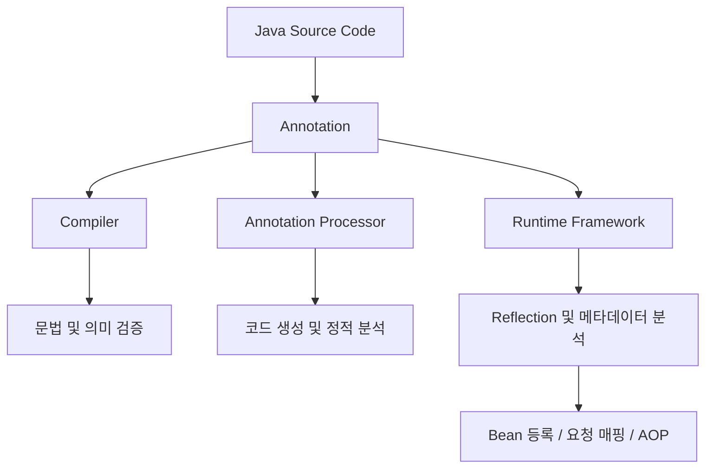
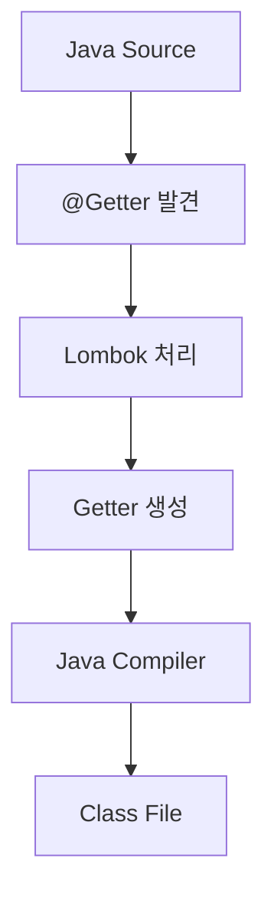
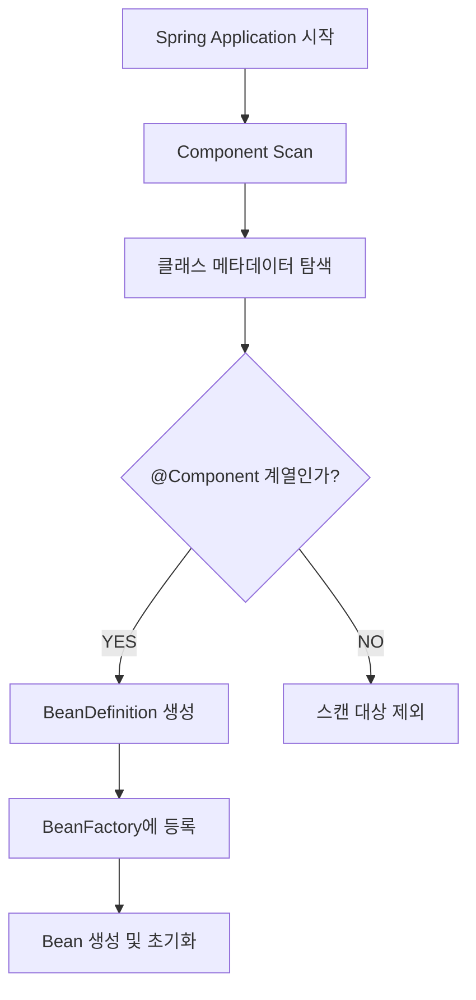
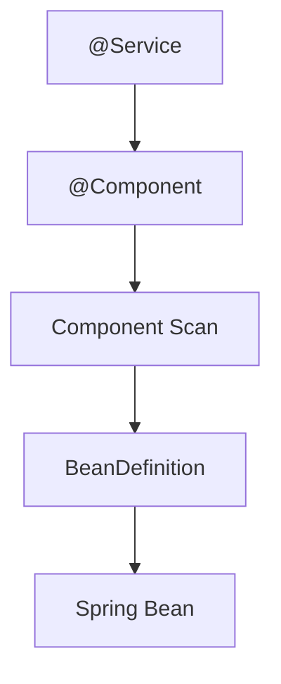
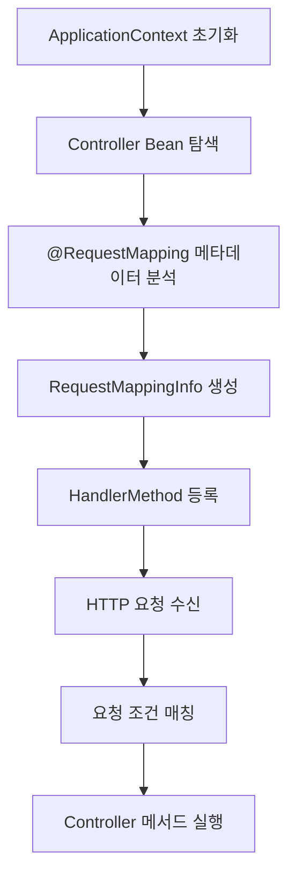
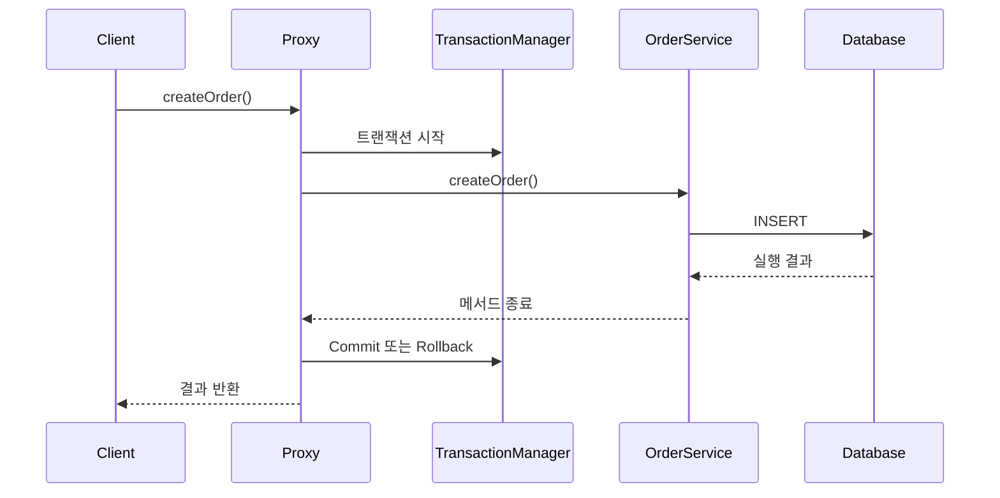
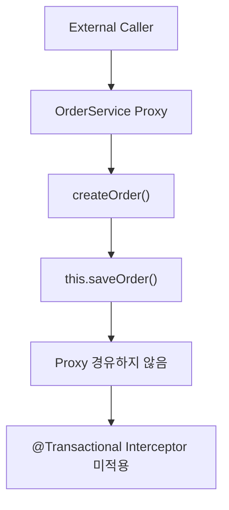
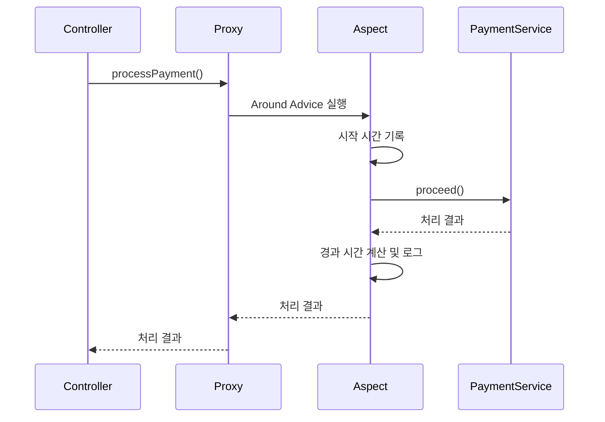
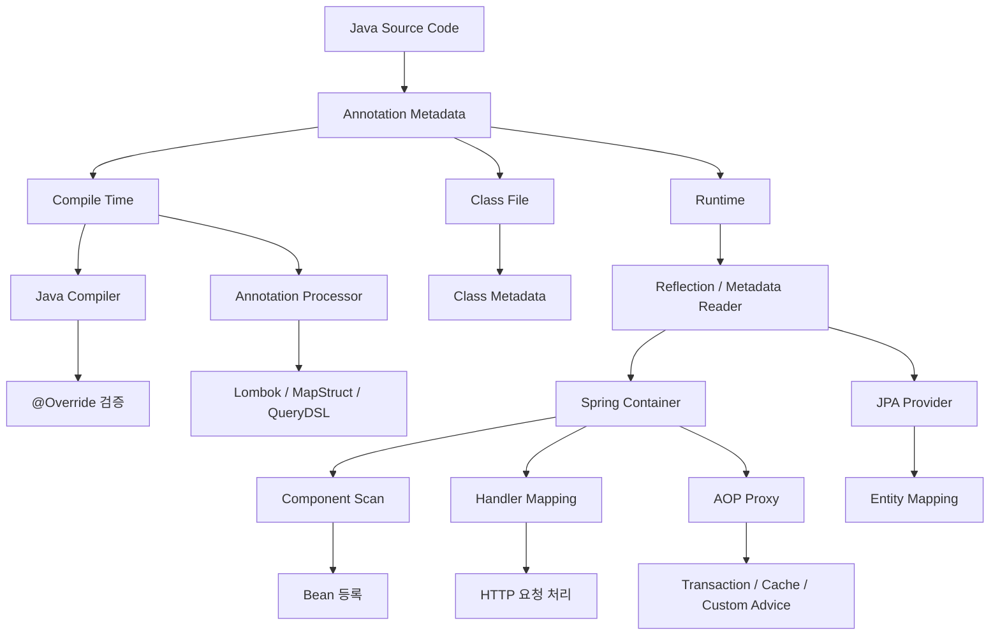

# 듀이의 Annotation, 알고 사용하시나요?
[https://youtu.be/NdTgIXLm-Nk?si=zP_RTCmK5Xnfu_j5](https://youtu.be/NdTgIXLm-Nk?si=zP_RTCmK5Xnfu_j5)
# 듀이의 Annotation, 알고 사용하시나요?
* toc
{:toc}

---

### Java Annotation 완벽 이해: 메타 어노테이션, Annotation Processor, Reflection부터 Spring 내부 동작 원리까지

Java와 Spring Boot를 사용하다 보면 다양한 어노테이션을 접하게 된다.

예를 들어 다음과 같은 Controller를 생각해 보자.

```java
@RestController
@RequestMapping("/api/members")
public class MemberController {

    @GetMapping("/{id}")
    public MemberResponse findMember(
            @PathVariable Long id
    ) {
        return new MemberResponse(id, "홍길동");
    }
}
```

이 코드는 Spring Boot에서 흔히 작성하는 REST API다.

하지만 자세히 살펴보면 궁금한 점이 생긴다.

**`@RestController`만 붙였는데 Spring은 어떻게 이 클래스를 Controller로 인식할까?**

**`@GetMapping`을 선언했을 뿐인데 HTTP GET 요청이 해당 메서드에 연결되는 이유는 무엇일까?**

**`@PathVariable`은 어떻게 URL에 포함된 값을 Java 메서드의 매개변수로 전달할까?**

**`@Transactional`은 어노테이션 하나로 어떻게 트랜잭션을 시작하고 종료할까?**

**Lombok의 `@Getter`는 실제로 존재하지 않는 Getter 메서드를 어떻게 생성할까?**

어노테이션은 Java와 Spring에서 매우 자주 사용하지만, 내부 동작을 이해하지 못하면 일종의 마법처럼 느껴질 수 있다.

예를 들어 다음 코드를 생각해 보자.

```java
@Transactional
public void createOrder() {
    orderRepository.save(new Order());
}
```

`@Transactional`을 붙이면 트랜잭션이 적용된다는 사실은 알고 있다.

그런데 다음과 같은 상황에서는 어떨까?

```java
@Service
public class OrderService {

    public void create() {
        save();
    }

    @Transactional
    public void save() {
        orderRepository.save(new Order());
    }
}
```

일반적인 Spring의 프록시 기반 트랜잭션 관리에서는 `create()`에서 `save()`를 직접 호출해도 `@Transactional`에 의한 새 트랜잭션이 적용되지 않을 수 있다.

어노테이션은 동일하게 존재하는데 왜 동작이 달라지는 것일까?

이러한 현상을 이해하려면 먼저 한 가지 사실을 알아야 한다.

**어노테이션 자체가 특정 기능을 실행하는 것은 아니다. 어노테이션을 해석하는 컴파일러, 라이브러리 또는 프레임워크가 실제 동작을 수행한다.**

이 원리를 중심으로 Java Annotation의 구조와 Spring에서의 활용 방법을 살펴보자.

---

### Annotation이란 무엇인가?

Annotation은 Java 프로그램의 클래스, 메서드, 필드, 매개변수 등에 추가적인 정보를 부여하는 메타데이터다.

메타데이터(Metadata)는 다른 데이터에 관한 정보를 의미한다.

예를 들어 다음 코드를 살펴보자.

```java
@Override
public String toString() {
    return "Member";
}
```

여기서 `@Override`는 해당 메서드가 상위 타입의 메서드를 재정의한다는 의도를 나타낸다.

Java 컴파일러는 이 정보를 확인할 수 있다.

만약 실제로 재정의하는 메서드가 아니라면 컴파일 오류를 발생시킨다.

다음 예제도 살펴보자.

```java
@Deprecated
public void oldMethod() {
    // 기존 기능
}
```

`@Deprecated`는 해당 메서드의 사용을 권장하지 않는다는 정보를 제공한다.

컴파일러나 개발 도구는 이 정보를 활용해 경고를 표시할 수 있다.

Spring에서는 다음과 같이 사용한다.

```java
@Service
public class PaymentService {
}
```

`@Service`는 해당 클래스가 애플리케이션의 서비스 계층 구성 요소임을 나타낸다.

Spring은 이를 활용해 클래스를 Bean으로 등록할 수 있다.

세 가지 어노테이션은 모두 추가 정보를 제공한다.

하지만 정보를 사용하는 대상과 시점이 다르다.

| 어노테이션            | 정보를 사용하는 주체                       | 주요 목적           |
| ---------------- | --------------------------------- | --------------- |
| `@Override`      | Java 컴파일러                         | 메서드 재정의 검증      |
| `@Deprecated`    | 컴파일러 및 개발 도구                      | 사용 중단 정보 제공     |
| `@Getter`        | Lombok                            | Getter 코드 생성    |
| `@Service`       | Spring Container                  | Bean 등록 및 역할 구분 |
| `@GetMapping`    | Spring MVC                        | HTTP 요청과 메서드 연결 |
| `@Transactional` | Spring Transaction Infrastructure | 트랜잭션 처리         |
| `@Entity`        | JPA 구현체                           | 영속성 객체 매핑       |

즉 어노테이션은 특정 기능에 대한 정보를 전달하는 수단이다.

실제로 어떤 동작이 수행되는지는 해당 어노테이션을 해석하는 프로그램에 따라 달라진다.

---

### Annotation은 왜 등장했을까?

Java에서 어노테이션은 Java 5부터 공식적으로 도입되었다.

당시 Java 애플리케이션에서는 다양한 메타데이터를 코드와 별도의 설정 파일에 작성하는 경우가 많았다.

특히 초기 엔터프라이즈 애플리케이션에서는 XML을 활용한 설정이 널리 사용되었다.

예를 들어 객체를 Bean으로 등록하기 위해 다음과 같은 설정을 작성할 수 있었다.

```xml
<beans>
    <bean
        id="memberService"
        class="com.example.MemberService"
    />
</beans>
```

이 방식에서는 Java 클래스와 XML 설정을 함께 관리해야 한다.

Java 클래스의 패키지 이름이 변경되면 XML 설정도 수정해야 할 수 있다.

설정이 여러 파일로 분산되면 관리가 복잡해질 수도 있다.

어노테이션을 사용하면 다음과 같이 클래스 자체에 메타데이터를 표현할 수 있다.

```java
@Service
public class MemberService {
}
```

Spring은 해당 메타데이터를 읽고 Bean 등록 대상으로 인식할 수 있다.

이는 코드와 관련된 설정을 가까운 위치에 표현할 수 있다는 장점이 있다.

다만 어노테이션이 단순히 XML을 대체하기 위해서만 등장한 것은 아니다.

어노테이션은 Java 언어 차원에서 컴파일러 검증, 코드 생성, 문서화, 런타임 프레임워크 처리 등 다양한 목적에 활용할 수 있도록 도입되었다.

또 어노테이션을 사용한다고 XML이나 별도 설정 파일이 반드시 사라지는 것도 아니다.

환경에 따라 설정 파일과 어노테이션을 함께 사용할 수 있다.

중요한 변화는 **프로그램의 동작을 설명하는 메타데이터를 Java 언어 차원에서 표준화된 방식으로 표현할 수 있게 되었다는 점**이다.

---

### Annotation과 일반 주석은 무엇이 다를까?

Annotation을 한국어로 번역하면 주석이라는 표현을 사용하기도 한다.

하지만 Java의 일반 주석과 Annotation은 동작 방식이 완전히 다르다.

일반 주석을 살펴보자.

```java
// 이 메서드는 회원을 조회한다.
public Member findMember(Long id) {
    return memberRepository.findById(id)
            .orElseThrow();
}
```

일반 주석은 주로 개발자가 코드를 이해하기 위한 설명이다.

컴파일러는 일반적으로 주석 내용을 프로그램의 실행 의미로 사용하지 않는다.

반면 다음과 같은 어노테이션은 다르다.

```java
@Transactional
public Member findMember(Long id) {
    return memberRepository.findById(id)
            .orElseThrow();
}
```

Spring은 `@Transactional`을 읽고 해당 메서드의 트랜잭션 처리 방식을 구성할 수 있다.

두 방식의 차이는 다음과 같다.

| 구분       | 일반 주석          | Annotation         |
| -------- | -------------- | ------------------ |
| 작성 방식    | `//`, `/* */`  | `@AnnotationName`  |
| 주요 목적    | 코드 설명          | 구조화된 메타데이터 제공      |
| 컴파일러 활용  | 일반적으로 없음       | 가능                 |
| 코드 생성    | 직접적인 기능 없음     | Processor 등을 통해 가능 |
| 런타임 조회   | 일반적으로 불가능      | RUNTIME 설정 시 가능    |
| 프레임워크 활용 | 직접적인 처리 대상이 아님 | Spring 등이 해석 가능    |

어노테이션은 Java 언어가 인식하는 정식 문법이다.

따라서 일반 주석과 동일하게 취급하면 안 된다.

---

### Annotation의 핵심 구조

어노테이션은 `@interface` 키워드를 사용해 정의한다.

예를 들어 다음과 같다.

```java
public @interface AnnotationExample {

    String value();
}
```

일반적인 인터페이스는 다음과 같이 정의한다.

```java
public interface Example {

    void execute();
}
```

두 선언은 비슷해 보이지만 목적이 다르다.

일반 인터페이스는 클래스가 구현해야 할 메서드 계약을 정의한다.

반면 Annotation Interface는 어노테이션이 가질 수 있는 요소와 해당 요소의 타입을 정의한다.

예를 들어 다음과 같이 사용할 수 있다.

```java
@AnnotationExample("회원 조회")
public void findMember() {
}
```

이때 `"회원 조회"`라는 값은 어노테이션의 `value` 요소에 전달된다.

다음 코드와 같은 의미다.

```java
@AnnotationExample(value = "회원 조회")
public void findMember() {
}
```

`value`라는 이름은 특별한 의미를 가진다.

어노테이션에 다른 요소를 함께 지정하지 않고 `value`만 설정하는 경우 요소 이름을 생략할 수 있기 때문이다.

---

### Annotation은 인터페이스인가?

Java 언어에서 어노테이션 타입은 특별한 종류의 인터페이스다.

선언할 때 `@interface`를 사용하는 이유도 여기에 있다.

하지만 일반 인터페이스와 완전히 동일하지는 않다.

예를 들어 다음과 같은 선언은 가능하다.

```java
public @interface RetryPolicy {

    int maxAttempts() default 3;

    long delayMillis() default 1000;
}
```

반면 어노테이션 내부에 일반적인 비즈니스 로직을 작성할 수는 없다.

```java
public @interface RetryPolicy {

    // 일반 클래스처럼 실행 로직을 정의하는 용도가 아니다.
}
```

어노테이션은 실행 로직이 아니라 구조화된 값을 제공하는 데 목적이 있다.

또 어노테이션의 요소로 사용할 수 있는 타입에도 제약이 있다.

대표적으로 다음과 같은 타입을 사용할 수 있다.

| 타입             | 사용 가능 여부 |
| -------------- | -------- |
| 기본형            | 가능       |
| String         | 가능       |
| Class          | 가능       |
| Enum           | 가능       |
| Annotation     | 가능       |
| 위 타입들의 1차원 배열  | 가능       |
| List           | 불가능      |
| Map            | 불가능      |
| 임의의 일반 객체      | 불가능      |
| null을 기본값으로 지정 | 불가능      |

예를 들어 다음은 정상적인 어노테이션 선언이다.

```java
public @interface ApiInfo {

    String name();

    int version() default 1;

    Class<?> responseType() default Void.class;

    String[] tags() default {};
}
```

사용할 때는 다음과 같이 작성한다.

```java
@ApiInfo(
        name = "회원 조회 API",
        version = 2,
        responseType = MemberResponse.class,
        tags = {"member", "read"}
)
public void findMember() {
}
```

이렇게 어노테이션은 고정된 구조의 메타데이터를 표현한다.

---

### Meta Annotation이란 무엇인가?

Meta Annotation은 다른 어노테이션에 적용하는 어노테이션이다.

예를 들어 다음 코드를 살펴보자.

```java
@Target(ElementType.METHOD)
@Retention(RetentionPolicy.RUNTIME)
@Documented
public @interface AnnotationExample {

    String value() default "기본 어노테이션";
}
```

여기서 `@Target`, `@Retention`, `@Documented`가 Meta Annotation이다.

각각의 역할은 다음과 같다.

| Meta Annotation | 역할                       |
| --------------- | ------------------------ |
| `@Target`       | 적용 가능한 위치 지정             |
| `@Retention`    | 어노테이션 유지 범위 지정           |
| `@Documented`   | Javadoc 포함 여부 지정         |
| `@Inherited`    | 클래스 상속 관계에서의 어노테이션 조회 지원 |
| `@Repeatable`   | 동일한 어노테이션 반복 사용 지원       |

Meta Annotation은 어노테이션 자체의 사용 규칙과 해석 방식을 정의한다.

이제 각각의 기능을 살펴보자.

---

### @Target이란 무엇인가?

`@Target`은 어노테이션을 사용할 수 있는 위치를 제한한다.

예를 들어 다음과 같다.

```java
@Target(ElementType.METHOD)
public @interface TrackExecutionTime {
}
```

이 어노테이션은 메서드에 사용할 수 있다.

```java
@TrackExecutionTime
public void execute() {
}
```

반면 클래스에 사용하면 컴파일 오류가 발생한다.

```java
@TrackExecutionTime
public class Example {
}
```

`ElementType.METHOD`만 허용했기 때문이다.

여러 위치를 허용하려면 다음과 같이 작성한다.

```java
@Target({
        ElementType.TYPE,
        ElementType.METHOD
})
public @interface CustomAnnotation {
}
```

이제 클래스와 메서드 모두에 적용할 수 있다.

#### ElementType의 종류

| ElementType        | 적용 위치                                |
| ------------------ | ------------------------------------ |
| `TYPE`             | 클래스, 인터페이스, Enum, Record, 어노테이션 선언 등 |
| `FIELD`            | 필드                                   |
| `METHOD`           | 메서드                                  |
| `PARAMETER`        | 메서드 및 생성자 매개변수                       |
| `CONSTRUCTOR`      | 생성자                                  |
| `LOCAL_VARIABLE`   | 지역 변수                                |
| `ANNOTATION_TYPE`  | 어노테이션 선언                             |
| `PACKAGE`          | 패키지                                  |
| `TYPE_PARAMETER`   | 제네릭 타입 매개변수                          |
| `TYPE_USE`         | 타입이 사용되는 위치                          |
| `MODULE`           | 모듈 선언                                |
| `RECORD_COMPONENT` | Record Component                     |

특히 `TYPE`과 `TYPE_USE`의 차이를 이해하는 것이 좋다.

`TYPE`은 클래스와 인터페이스 같은 타입 선언에 적용한다.

반면 `TYPE_USE`는 타입이 사용되는 위치에 적용한다.

예를 들어 다음과 같다.

```java
@Target(ElementType.TYPE_USE)
@Retention(RetentionPolicy.RUNTIME)
public @interface NonNullType {
}
```

이제 다음처럼 타입 사용 위치에 어노테이션을 붙일 수 있다.

```java
List<@NonNullType String> names;
```

이러한 기능은 정적 분석이나 타입 검사 도구에서 활용할 수 있다.

다만 어노테이션을 선언했다고 Java 컴파일러가 자동으로 null을 차단하는 것은 아니다.

실제 검사는 해당 어노테이션을 이해하는 도구가 수행해야 한다.

Oracle의 Java API 문서에서도 `@Target`이 어노테이션을 사용할 수 있는 문법적 위치를 제한한다고 명시하고 있다.

---

### @Retention이란 무엇인가?

`@Retention`은 어노테이션이 어느 단계까지 유지되는지 정의한다.

Java에서는 세 가지 유지 정책을 제공한다.

```java
RetentionPolicy.SOURCE
```

```java
RetentionPolicy.CLASS
```

```java
RetentionPolicy.RUNTIME
```

각각의 의미를 정확하게 이해해야 한다.

#### SOURCE

SOURCE는 어노테이션을 소스 코드 수준에서 유지하는 정책이다.

예를 들어 다음과 같다.

```java
@Retention(RetentionPolicy.SOURCE)
@Target(ElementType.METHOD)
public @interface CompileTimeOnly {
}
```

이 어노테이션은 컴파일러나 컴파일 시점의 도구가 활용할 수 있다.

하지만 일반적으로 생성된 `.class` 파일에는 해당 어노테이션 정보가 기록되지 않는다.

대표적인 사례가 `@Override`나 Lombok의 `@Getter`다.

여기서 중요한 점이 있다.

**SOURCE 어노테이션은 컴파일 전에 사라지는 것이 아니다.**

컴파일 과정에서 컴파일러나 Annotation Processor가 사용할 수 있다.

다만 컴파일된 클래스 파일에는 유지되지 않는다는 의미다.

#### CLASS

CLASS는 어노테이션 정보를 클래스 파일까지 유지하는 정책이다.

예를 들어 다음과 같다.

```java
@Retention(RetentionPolicy.CLASS)
@Target(ElementType.TYPE)
public @interface ClassMetadata {
}
```

컴파일된 `.class` 파일에 어노테이션 정보가 포함된다.

하지만 일반적인 Java Reflection API를 통해 런타임에 조회할 수 있는 것은 아니다.

클래스 파일 분석 도구나 바이트코드 처리 도구는 이러한 메타데이터를 활용할 수 있다.

#### RUNTIME

RUNTIME은 어노테이션 정보를 런타임까지 유지하는 정책이다.

```java
@Retention(RetentionPolicy.RUNTIME)
@Target(ElementType.METHOD)
public @interface RuntimeMetadata {
}
```

이렇게 선언한 어노테이션은 Reflection을 통해 조회할 수 있다.

Spring의 많은 런타임 어노테이션도 이러한 방식으로 정의된다.

#### RetentionPolicy 비교

| 정책      | 소스 코드 | 클래스 파일 | Reflection 조회 |
| ------- | ----- | ------ | ------------- |
| SOURCE  | O     | X      | X             |
| CLASS   | O     | O      | X             |
| RUNTIME | O     | O      | O             |

별도의 `@Retention`을 지정하지 않았다면 기본값은 `CLASS`다.

이는 Java 언어 명세에 정의된 동작이다.

---

### RetentionPolicy는 왜 중요할까?

Custom Annotation을 만들 때 유지 정책을 잘못 설정하면 의도한 기능이 동작하지 않을 수 있다.

예를 들어 다음과 같이 정의했다고 가정하자.

```java
@Target(ElementType.METHOD)
@Retention(RetentionPolicy.SOURCE)
public @interface Audit {
}
```

이제 Reflection으로 조회한다.

```java
Method method = AuditService.class
        .getDeclaredMethod("execute");

Audit audit = method.getAnnotation(Audit.class);
```

결과는 일반적으로 `null`이다.

SOURCE 어노테이션은 런타임에 유지되지 않기 때문이다.

반대로 다음과 같이 변경하면 런타임 조회가 가능해진다.

```java
@Target(ElementType.METHOD)
@Retention(RetentionPolicy.RUNTIME)
public @interface Audit {
}
```

하지만 여기서도 중요한 점이 있다.

`RUNTIME`으로 설정했다고 해당 어노테이션의 기능이 자동으로 실행되는 것은 아니다.

Reflection으로 조회할 수 있게 되었을 뿐이다.

실제 동작을 수행하려면 별도의 처리 코드가 필요하다.

---

### @Documented란 무엇인가?

`@Documented`는 어노테이션을 사용하는 요소의 Javadoc에 해당 어노테이션 정보를 포함하도록 지정한다.

예를 들어 다음과 같다.

```java
@Target(ElementType.METHOD)
@Retention(RetentionPolicy.RUNTIME)
@Documented
public @interface PublicApi {
}
```

이제 다음처럼 사용할 수 있다.

```java
@PublicApi
public void execute() {
}
```

Javadoc을 생성하면 해당 메서드에 `@PublicApi`가 적용되었다는 정보가 문서에 포함될 수 있다.

다만 `@Documented`는 런타임 동작을 변경하는 기능이 아니다.

컴파일러의 어노테이션 처리 방식을 변경하는 기능도 아니다.

문서 생성 과정에서 메타데이터를 어떻게 표현할지 지정하는 역할이다.

---

### @Inherited란 무엇인가?

`@Inherited`는 클래스 상속 관계에서 어노테이션을 조회하는 방식을 정의한다.

예를 들어 다음과 같다.

```java
@Target(ElementType.TYPE)
@Retention(RetentionPolicy.RUNTIME)
@Inherited
public @interface BusinessService {
}
```

부모 클래스에 어노테이션을 적용한다.

```java
@BusinessService
public class ParentService {
}
```

자식 클래스를 작성한다.

```java
public class ChildService extends ParentService {
}
```

이제 다음 코드를 실행한다.

```java
BusinessService annotation =
        ChildService.class.getAnnotation(
                BusinessService.class
        );

System.out.println(annotation != null);
```

예상 결과는 다음과 같다.

```text
true
```

`@Inherited`가 적용되어 있기 때문이다.

하지만 다음 사항을 알아야 한다.

**@Inherited는 모든 상속 관계에서 동일하게 동작하는 기능이 아니다.**

일반적으로 클래스 선언에 적용된 어노테이션의 상속 조회에 사용된다.

인터페이스의 어노테이션을 구현 클래스에 자동으로 상속시키는 기능은 아니다.

메서드 어노테이션의 상속을 일반적으로 보장하는 기능도 아니다.

또 `getDeclaredAnnotation()`은 직접 선언된 어노테이션만 확인하기 때문에 부모 클래스의 어노테이션을 동일한 방식으로 찾지 않는다.

이 차이는 Spring의 어노테이션 탐색 기능을 이해할 때 중요하다.

---

### @Repeatable이란 무엇인가?

`@Repeatable`은 동일한 어노테이션을 하나의 대상에 여러 번 선언할 수 있도록 하는 기능이다.

예를 들어 하나의 메서드에 여러 태그를 지정하고 싶다고 가정하자.

다음과 같이 정의할 수 있다.

```java
import java.lang.annotation.ElementType;
import java.lang.annotation.Repeatable;
import java.lang.annotation.Retention;
import java.lang.annotation.RetentionPolicy;
import java.lang.annotation.Target;

@Target(ElementType.METHOD)
@Retention(RetentionPolicy.RUNTIME)
@Repeatable(Tags.class)
public @interface Tag {

    String value();
}
```

반복된 어노테이션을 담을 컨테이너 어노테이션도 정의한다.

```java
@Target(ElementType.METHOD)
@Retention(RetentionPolicy.RUNTIME)
public @interface Tags {

    Tag[] value();
}
```

이제 다음처럼 사용할 수 있다.

```java
@Tag("payment")
@Tag("subscription")
public void processPayment() {
}
```

Reflection에서는 다음 메서드를 이용해 반복된 어노테이션을 조회할 수 있다.

```java
Tag[] tags = method.getAnnotationsByType(Tag.class);
```

이 기능은 하나의 대상에 여러 정책이나 분류 정보를 지정해야 하는 경우 활용할 수 있다.

---

### Annotation은 언제 동작할까?

어노테이션이 처리되는 시점은 크게 세 가지 관점으로 구분할 수 있다.

첫 번째는 컴파일러가 직접 해석하는 경우다.

두 번째는 Annotation Processor가 처리하는 경우다.

세 번째는 런타임에 프레임워크가 해석하는 경우다.



이 세 가지는 모두 어노테이션을 활용하지만 내부 처리 방식이 다르다.

---

### 컴파일러가 직접 처리하는 Annotation

대표적인 사례가 `@Override`다.

다음 코드를 생각해 보자.

```java
public class Parent {

    public void execute() {
    }
}
```

자식 클래스에서 메서드를 재정의한다.

```java
public class Child extends Parent {

    @Override
    public void execute() {
        System.out.println("Child execute");
    }
}
```

이 코드는 정상적으로 컴파일된다.

하지만 다음과 같이 메서드 이름을 잘못 작성하면 어떨까?

```java
public class Child extends Parent {

    @Override
    public void excute() {
        System.out.println("Child execute");
    }
}
```

컴파일러는 해당 메서드가 실제로 상위 타입의 메서드를 재정의하지 않는다는 사실을 확인한다.

따라서 컴파일 오류를 발생시킨다.

대표적인 오류 메시지는 다음과 같다.

```text
method does not override or implement
a method from a supertype
```

이는 `@Override`를 처리하는 로직이 Java 컴파일러에 포함되어 있기 때문이다.

별도의 Spring 기능이나 Reflection이 필요한 것이 아니다.

---

### Annotation Processor란 무엇인가?

Annotation Processor는 컴파일 과정에서 어노테이션을 분석하고 필요한 작업을 수행할 수 있도록 하는 Java의 확장 메커니즘이다.

Java에서는 `javax.annotation.processing` 패키지를 통해 관련 API를 제공한다.

대표적인 추상 클래스가 다음과 같다.

```java
AbstractProcessor
```

Annotation Processor를 이용하면 컴파일 과정에서 특정 어노테이션을 찾아 새로운 소스 파일이나 리소스 등을 생성할 수 있다.

대표적인 활용 사례는 다음과 같다.

| 기술               | 활용 목적                    |
| ---------------- | ------------------------ |
| MapStruct        | 객체 매핑 코드 생성              |
| QueryDSL APT     | Q 타입 생성                  |
| Dagger           | 의존성 주입 관련 코드 생성          |
| Lombok           | Getter, Setter, 생성자 등 생성 |
| 사용자 정의 Processor | 프로젝트 전용 코드 생성 및 검증       |

다만 Lombok은 일반적인 Annotation Processor와 차이가 있다.

이 부분은 별도로 이해할 필요가 있다.

---

### Lombok의 @Getter는 어떻게 동작할까?

다음 코드를 생각해 보자.

```java
import lombok.Getter;

@Getter
public class Member {

    private Long id;

    private String name;
}
```

개발자는 Getter 메서드를 직접 작성하지 않았다.

그런데 다음 코드를 사용할 수 있다.

```java
Member member = new Member();

String name = member.getName();
```

어떻게 가능한 것일까?

Lombok은 컴파일 과정에 참여해 필요한 메서드를 생성한다.

개념적인 흐름은 다음과 같다.



이때 Lombok의 `@Getter`는 일반적으로 다음 유지 정책을 사용한다.

```java
@Retention(RetentionPolicy.SOURCE)
```

Getter 생성을 컴파일 시점에 처리하기 때문에 런타임까지 해당 어노테이션을 유지할 필요가 없는 것이다.

하지만 Lombok을 단순히 표준 Annotation Processing API로 새로운 Java 파일을 생성하는 라이브러리라고 이해하면 정확하지 않다.

Lombok은 컴파일러 내부 구조에 접근해 AST를 수정하는 방식 등을 사용한다.

따라서 일반적인 표준 Annotation Processor보다 컴파일러 구현에 깊게 결합된 특성이 있다.

Lombok의 공식 구현 설명에서도 `javac`의 Annotation Processor로 진입한 뒤 컴파일러 내부 구조를 활용하는 과정을 설명한다.

---

### Lombok을 Gradle에서 설정하는 이유

Gradle 프로젝트에서는 일반적으로 다음과 같이 Lombok을 설정한다.

```groovy
dependencies {

    compileOnly 'org.projectlombok:lombok:1.18.36'

    annotationProcessor 'org.projectlombok:lombok:1.18.36'

    testCompileOnly 'org.projectlombok:lombok:1.18.36'

    testAnnotationProcessor 'org.projectlombok:lombok:1.18.36'
}
```

각 설정의 의미는 다음과 같다.

| Configuration             | 역할                        |
| ------------------------- | ------------------------- |
| `compileOnly`             | 컴파일 시 Lombok 어노테이션 타입 참조  |
| `annotationProcessor`     | 컴파일 시 Lombok Processor 실행 |
| `testCompileOnly`         | 테스트 코드에서 Lombok 어노테이션 사용  |
| `testAnnotationProcessor` | 테스트 컴파일 시 Lombok 처리       |

여기서 중요한 점은 `compileOnly`와 `annotationProcessor`의 역할이 다르다는 것이다.

`compileOnly`는 어노테이션 클래스를 컴파일할 때 사용할 수 있도록 한다.

반면 `annotationProcessor`는 컴파일 과정에서 실제 처리기를 실행할 수 있도록 한다.

따라서 Lombok의 코드를 생성하는 동작까지 이해하려면 두 설정을 구분해야 한다.

또 Java 및 Lombok 버전의 호환성도 확인해야 한다.

---

### Annotation Processor는 직접 만들 수 있을까?

가능하다.

예를 들어 다음과 같은 어노테이션을 정의한다고 가정하자.

```java
@Target(ElementType.TYPE)
@Retention(RetentionPolicy.SOURCE)
public @interface GenerateGreeting {
}
```

그리고 다음 클래스에 적용한다.

```java
@GenerateGreeting
public class Member {
}
```

이 정보를 읽고 새로운 클래스를 생성하는 Processor를 만들 수 있다.

예를 들어 다음과 같은 결과를 생성하고 싶다고 가정하자.

```java
public class MemberGenerated {

    public static String greeting() {
        return "Hello Member";
    }
}
```

이 경우 Processor의 핵심 로직은 다음과 같은 형태가 될 수 있다.

```java
@SupportedAnnotationTypes("com.example.GenerateGreeting")
@SupportedSourceVersion(SourceVersion.RELEASE_17)
public class GreetingProcessor extends AbstractProcessor {

    @Override
    public boolean process(
            Set<? extends TypeElement> annotations,
            RoundEnvironment roundEnv
    ) {

        for (Element element :
                roundEnv.getElementsAnnotatedWith(
                        GenerateGreeting.class
                )) {

            // 어노테이션이 적용된 타입 분석
            // 새 Java 소스 파일 생성
        }

        return true;
    }
}
```

이 예제의 핵심은 `process()` 메서드다.

컴파일 과정에서 Processor가 호출되면 특정 어노테이션이 적용된 요소를 찾아 처리한다.

실제 소스 파일을 생성하려면 `Filer`를 사용해 Java 파일을 작성하는 로직이 추가로 필요하다.

이러한 방식은 반복적인 Mapper 구현이나 정형화된 코드 생성을 자동화하는 데 활용할 수 있다.

다만 무조건 Annotation Processor를 직접 구현할 필요는 없다.

이미 MapStruct나 QueryDSL처럼 검증된 도구가 있다면 기존 도구를 활용하는 편이 유지보수 측면에서 유리할 수 있다.

---

### Reflection이란 무엇인가?

Reflection은 Java 프로그램이 실행 중에 클래스와 메서드, 필드, 생성자 등의 정보를 조회하거나 사용할 수 있도록 하는 기능이다.

예를 들어 다음 클래스가 있다고 가정하자.

```java
public class MemberService {

    public void createMember() {
        System.out.println("Create Member");
    }
}
```

Reflection을 이용하면 클래스의 메서드를 조회할 수 있다.

```java
Class<MemberService> clazz = MemberService.class;

Method[] methods = clazz.getDeclaredMethods();
```

특정 메서드를 조회할 수도 있다.

```java
Method method = clazz.getDeclaredMethod(
        "createMember"
);
```

그리고 객체를 생성한 뒤 메서드를 호출할 수 있다.

```java
MemberService memberService = new MemberService();

method.invoke(memberService);
```

출력 결과는 다음과 같다.

```text
Create Member
```

Reflection의 중요한 특징은 프로그램 실행 중에 타입의 구조를 분석하고 필요한 작업을 수행할 수 있다는 것이다.

Spring과 Hibernate, Jackson 같은 프레임워크에서도 Reflection 및 관련 메타데이터 처리 기술을 활용한다.

---

### Reflection을 통해 Annotation을 조회하는 방법

다음 어노테이션을 정의한다고 가정하자.

```java
@Target(ElementType.METHOD)
@Retention(RetentionPolicy.RUNTIME)
public @interface Audit {

    String value();
}
```

메서드에 적용한다.

```java
public class PaymentService {

    @Audit("결제 처리")
    public void processPayment() {
        System.out.println("Payment processed");
    }
}
```

이제 Reflection으로 조회할 수 있다.

```java
Method method = PaymentService.class.getDeclaredMethod(
        "processPayment"
);

Audit audit = method.getAnnotation(Audit.class);

System.out.println(audit.value());
```

출력 결과는 다음과 같다.

```text
결제 처리
```

여기서 중요한 메서드는 다음과 같다.

```java
getAnnotation()
```

이 메서드는 지정한 어노테이션을 조회한다.

하지만 `@Retention(RUNTIME)`이 적용되어 있어야 일반적인 런타임 Reflection 조회가 가능하다.

또 어노테이션이 존재하지 않으면 `null`이 반환될 수 있다.

따라서 실제 코드에서는 null 여부를 확인해야 한다.

---

### getAnnotation과 getDeclaredAnnotation의 차이

Reflection에는 이름이 비슷한 메서드들이 존재한다.

대표적으로 다음과 같다.

```java
getAnnotation()
```

```java
getDeclaredAnnotation()
```

두 메서드는 조회 범위가 다르다.

`getAnnotation()`은 해당 요소에 존재하는 어노테이션을 조회하며, 클래스 어노테이션의 경우 `@Inherited` 규칙에 따른 상속 조회가 적용될 수 있다.

반면 `getDeclaredAnnotation()`은 해당 요소에 직접 선언된 어노테이션을 조회한다.

따라서 부모 클래스에서 상속된 어노테이션까지 확인해야 하는 상황인지 구분해야 한다.

또 Spring은 Java Reflection보다 확장된 어노테이션 탐색 기능을 제공한다.

이는 뒤에서 다룰 Meta Annotation과도 관련이 있다.

---

### Custom Annotation 직접 만들기

지금까지 살펴본 개념을 바탕으로 Custom Annotation을 만들어 보자.

이번 예제에서는 어노테이션을 메서드에 적용하고, Reflection을 이용해 어노테이션 값을 읽은 뒤 해당 메서드를 실행한다.

메서드가 정상적으로 실행되면 성공 메시지를 출력한다.

예외가 발생하면 실패 메시지를 출력한다.

또 어노테이션 값을 생략했을 때 기본값이 적용되는지도 확인한다.

#### 프로젝트 구조

```text
annotation-example/
└── AnnotationDemo.java
```

이번에는 별도의 라이브러리 없이 Java 표준 API만 사용한다.

---

### 1. Custom Annotation 정의

다음 어노테이션을 정의한다.

```java
@Target(ElementType.METHOD)
@Retention(RetentionPolicy.RUNTIME)
@Documented
@interface AnnotationExample {

    String value() default "기본 어노테이션";
}
```

각 구성 요소의 의미는 다음과 같다.

```java
@Target(ElementType.METHOD)
```

메서드에만 적용할 수 있도록 제한한다.

```java
@Retention(RetentionPolicy.RUNTIME)
```

런타임에 Reflection으로 조회할 수 있도록 설정한다.

```java
@Documented
```

Javadoc 생성 시 어노테이션 정보를 포함하도록 한다.

```java
String value() default "기본 어노테이션";
```

문자열 값을 전달받는 요소를 정의한다.

값을 생략하면 `"기본 어노테이션"`을 사용한다.

---

### 2. Annotation을 적용할 클래스 작성

이제 다음과 같은 클래스를 작성한다.

```java
class ExampleService {

    @AnnotationExample("성공 어노테이션")
    public void success() {
        System.out.println("실행 성공");
    }

    @AnnotationExample("실패 어노테이션")
    public void failure() {
        throw new IllegalStateException("작업 오류");
    }

    @AnnotationExample
    public void defaultValue() {
        System.out.println("기본 실행");
    }
}
```

세 메서드에는 서로 다른 설정이 존재한다.

`success()`는 정상적으로 실행된다.

`failure()`는 예외를 발생시킨다.

`defaultValue()`는 어노테이션의 기본값을 사용한다.

이제 Reflection으로 이 메서드들을 실행해 보자.

---

### 3. Reflection 실행 코드 작성

다음은 전체 실행 코드다.

파일 이름은 `AnnotationDemo.java`로 작성한다.

```java
import java.lang.annotation.Documented;
import java.lang.annotation.ElementType;
import java.lang.annotation.Retention;
import java.lang.annotation.RetentionPolicy;
import java.lang.annotation.Target;
import java.lang.reflect.InvocationTargetException;
import java.lang.reflect.Method;
import java.util.Arrays;
import java.util.Comparator;

@Target(ElementType.METHOD)
@Retention(RetentionPolicy.RUNTIME)
@Documented
@interface AnnotationExample {

    String value() default "기본 어노테이션";
}

class ExampleService {

    @AnnotationExample("성공 어노테이션")
    public void success() {
        System.out.println("실행 성공");
    }

    @AnnotationExample("실패 어노테이션")
    public void failure() {
        throw new IllegalStateException("작업 오류");
    }

    @AnnotationExample
    public void defaultValue() {
        System.out.println("기본 실행");
    }
}

public class AnnotationDemo {

    public static void main(String[] args)
            throws ReflectiveOperationException {

        ExampleService service = new ExampleService();

        Method[] methods =
                ExampleService.class.getDeclaredMethods();

        Arrays.sort(
                methods,
                Comparator.comparing(Method::getName)
        );

        for (Method method : methods) {

            AnnotationExample annotation =
                    method.getAnnotation(
                            AnnotationExample.class
                    );

            if (annotation == null) {
                continue;
            }

            try {

                method.invoke(service);

                System.out.println(
                        annotation.value() + " -> 성공"
                );

            } catch (InvocationTargetException exception) {

                Throwable cause = exception.getCause();

                System.out.println(
                        annotation.value()
                                + " -> 실패: "
                                + cause.getMessage()
                );
            }
        }
    }
}
```

이 코드를 단계별로 이해해 보자.

---

### 4. Reflection으로 메서드 조회

먼저 다음 코드를 실행한다.

```java
Method[] methods =
        ExampleService.class.getDeclaredMethods();
```

`ExampleService`에 선언된 메서드 정보를 가져온다.

이때 반환되는 메서드의 순서는 보장되지 않는다.

따라서 실행 결과를 일정하게 만들기 위해 정렬한다.

```java
Arrays.sort(
        methods,
        Comparator.comparing(Method::getName)
);
```

이제 메서드 이름 기준으로 정렬된다.

---

### 5. Annotation 조회

다음 코드를 살펴보자.

```java
AnnotationExample annotation =
        method.getAnnotation(
                AnnotationExample.class
        );
```

각 메서드에 `@AnnotationExample`이 존재하는지 확인한다.

어노테이션이 존재하면 해당 객체를 반환한다.

존재하지 않으면 `null`을 반환한다.

```java
if (annotation == null) {
    continue;
}
```

어노테이션이 없는 메서드는 실행 대상에서 제외한다.

---

### 6. 메서드 실행

다음 코드는 Reflection을 통해 메서드를 실행한다.

```java
method.invoke(service);
```

여기서 `service`는 실제 메서드를 실행할 객체다.

즉 Reflection을 통해 `ExampleService`의 메서드를 호출한다.

이때 정상적으로 실행되면 다음 코드를 수행한다.

```java
System.out.println(
        annotation.value() + " -> 성공"
);
```

---

### 7. 예외 처리

Reflection을 통해 실행한 메서드에서 예외가 발생하면 일반적으로 `InvocationTargetException`으로 감싸져 전달된다.

따라서 다음과 같이 처리한다.

```java
catch (InvocationTargetException exception) {

    Throwable cause = exception.getCause();

    System.out.println(
            annotation.value()
                    + " -> 실패: "
                    + cause.getMessage()
    );
}
```

`getCause()`를 통해 실제 메서드에서 발생한 예외를 확인할 수 있다.

이러한 구조는 Reflection을 이용해 메서드를 동적으로 호출하는 프레임워크에서도 중요하다.

---

### 8. 실행 방법

다음 명령어로 컴파일한다.

```bash
javac AnnotationDemo.java
```

정상적으로 컴파일되면 다음과 같은 클래스 파일들이 생성된다.

```text
AnnotationExample.class
ExampleService.class
AnnotationDemo.class
```

이제 실행한다.

```bash
java AnnotationDemo
```

예상 결과는 다음과 같다.

```text
기본 실행
기본 어노테이션 -> 성공
실패 어노테이션 -> 실패: 작업 오류
실행 성공
성공 어노테이션 -> 성공
```

이 예제에서 확인할 수 있는 중요한 사실이 있다.

**Custom Annotation을 선언했을 때는 아무런 기능도 자동으로 실행되지 않았다.**

Reflection으로 어노테이션을 읽고, 해당 메서드를 호출하는 로직을 직접 작성했기 때문에 동작한 것이다.

즉 어노테이션은 메타데이터를 제공하고, 실제 기능은 어노테이션을 처리하는 코드가 구현한다.

---

### Spring에서는 Annotation을 어떻게 활용할까?

Java 표준 Reflection을 이용해 어노테이션을 직접 조회하는 방법을 살펴보았다.

그렇다면 Spring에서는 어떤 방식으로 어노테이션을 활용할까?

대표적으로 다음과 같은 기능을 제공한다.

| 영역      | 대표 어노테이션                     | 주요 역할      |
| ------- | ---------------------------- | ---------- |
| Bean 관리 | `@Component`, `@Service`     | Bean 등록    |
| 의존성 주입  | `@Autowired`, `@Qualifier`   | 의존성 연결     |
| MVC     | `@Controller`, `@GetMapping` | HTTP 요청 처리 |
| 트랜잭션    | `@Transactional`             | 트랜잭션 경계 설정 |
| 캐시      | `@Cacheable`                 | 캐시 처리      |
| 비동기     | `@Async`                     | 비동기 실행     |
| 스케줄링    | `@Scheduled`                 | 주기적 작업 실행  |
| 예외 처리   | `@ExceptionHandler`          | 예외별 응답 처리  |
| JPA     | `@Entity`, `@Id`             | 엔티티 매핑     |

여기서 가장 중요한 점은 **Spring의 모든 어노테이션이 동일한 방식으로 처리되는 것은 아니라는 사실**이다.

예를 들어 `@Service`는 Bean 등록 과정과 관련된다.

`@GetMapping`은 HTTP 요청 매핑 과정과 관련된다.

`@Transactional`은 트랜잭션 AOP 인프라와 관련된다.

`@Entity`는 JPA 구현체의 메타데이터 처리와 관련된다.

따라서 어노테이션이 어떤 단계에서 어떤 컴포넌트에 의해 처리되는지 구분해야 한다.

---

### @Component는 어떻게 Bean을 등록할까?

다음 코드를 생각해 보자.

```java
@Component
public class MemberRepository {
}
```

Spring Boot 애플리케이션이 시작되면 Spring은 설정된 컴포넌트 스캔 범위에서 Bean 등록 대상을 찾는다.

이 과정에서 `@Component`와 관련된 메타데이터를 활용한다.

개념적인 흐름은 다음과 같다.



여기서 한 가지 중요한 사실이 있다.

Spring은 컴포넌트 스캔 과정에서 모든 클래스를 반드시 로딩한 뒤 Reflection으로 조회하는 방식만 사용하는 것은 아니다.

Spring은 ASM 기반 클래스 메타데이터 분석 등을 통해 클래스 로딩을 최소화하면서 어노테이션 정보를 확인할 수 있다.

따라서 Spring의 어노테이션 처리 과정을 단순히 Reflection 한 가지 기술만으로 설명하면 충분하지 않다.

실제 Spring은 클래스 메타데이터 탐색, BeanDefinition 등록, Reflection, 프록시 생성 등 여러 메커니즘을 조합한다.

---

### @Service는 @Component와 무엇이 다를까?

다음 코드를 살펴보자.

```java
@Service
public class PaymentService {
}
```

`@Service`는 내부적으로 `@Component`를 메타 어노테이션으로 사용한다.

개념적으로 다음과 같은 구조다.

```java
@Target(ElementType.TYPE)
@Retention(RetentionPolicy.RUNTIME)
@Documented
@Component
public @interface Service {
}
```

따라서 Spring은 `@Service`가 붙은 클래스도 Bean 등록 대상으로 인식할 수 있다.



`@Repository`, `@Controller`도 유사한 구조를 가진다.

하지만 모두 완전히 동일한 의미는 아니다.

`@Service`는 서비스 계층의 역할을 표현한다.

`@Repository`는 데이터 접근 계층의 역할을 표현하며 예외 변환 같은 추가적인 Spring 기능과 연결될 수 있다.

`@Controller`는 웹 요청 처리 컴포넌트라는 의미를 표현한다.

따라서 단순히 Bean 등록이 가능하다는 이유로 모든 클래스에 `@Component`만 사용하는 것은 권장되지 않는다.

클래스의 책임에 적합한 어노테이션을 선택하는 편이 좋다.

Spring의 컴포넌트 스캔 문서에서도 `@Service`가 `@Component`를 메타 어노테이션으로 사용한다는 점을 설명한다.

---

### @RestController는 어떻게 동작할까?

Spring MVC에서는 다음 어노테이션을 자주 사용한다.

```java
@RestController
```

`@RestController`는 다음 두 어노테이션의 의미를 결합한 어노테이션이다.

```java
@Controller
```

```java
@ResponseBody
```

개념적으로 다음과 같다.

```java
@Target(ElementType.TYPE)
@Retention(RetentionPolicy.RUNTIME)
@Documented
@Controller
@ResponseBody
public @interface RestController {
}
```

`@Controller`는 해당 클래스가 웹 요청을 처리하는 컴포넌트임을 나타낸다.

`@ResponseBody`는 반환값을 HTTP 응답 본문으로 작성하도록 하는 의미를 제공한다.

따라서 다음과 같이 작성할 수 있다.

```java
@RestController
public class MemberController {

    @GetMapping("/members")
    public MemberResponse find() {
        return new MemberResponse(1L, "홍길동");
    }
}
```

별도의 `@ResponseBody`를 선언하지 않아도 객체를 HTTP 응답 본문으로 반환할 수 있다.

이처럼 여러 어노테이션의 의미를 결합한 어노테이션을 Composed Annotation이라고 부른다.

---

### @RequestMapping은 어떻게 요청을 연결할까?

다음 코드를 살펴보자.

```java
@RestController
@RequestMapping("/api/members")
public class MemberController {

    @GetMapping("/{id}")
    public MemberResponse find(
            @PathVariable Long id
    ) {
        return new MemberResponse(id, "홍길동");
    }
}
```

요청이 들어온다.

```http
GET /api/members/100 HTTP/1.1
```

Spring MVC는 요청을 처리할 Controller 메서드를 찾아야 한다.

여기서 중요한 구성 요소가 다음 클래스다.

```java
RequestMappingHandlerMapping
```

Spring MVC는 일반적으로 애플리케이션 초기화 과정에서 Controller의 매핑 정보를 탐색하고 등록한다.

`@RequestMapping`이나 `@GetMapping` 등의 정보를 분석해 URL과 HTTP 메서드에 대응하는 HandlerMethod를 구성한다.

개념적인 흐름은 다음과 같다.



여기서 주목해야 할 점이 있다.

**Spring MVC가 매 HTTP 요청마다 처음부터 모든 Controller 클래스를 Reflection으로 탐색하는 것은 아니다.**

일반적인 요청 매핑은 애플리케이션 초기화 단계에서 등록된다.

실제 요청 시점에는 등록된 매핑 정보를 기반으로 적절한 메서드를 찾는다.

Spring의 `RequestMappingHandlerMapping`은 초기화 단계에서 Handler Method를 탐색하는 기능을 제공한다.

---

### @GetMapping은 어떻게 만들어졌을까?

`@GetMapping`은 사실 `@RequestMapping`을 활용한 Composed Annotation이다.

개념적으로 다음과 같은 구조를 가진다.

```java
@Target(ElementType.METHOD)
@Retention(RetentionPolicy.RUNTIME)
@Documented
@RequestMapping(method = RequestMethod.GET)
public @interface GetMapping {
}
```

실제 Spring의 `@GetMapping`에는 `path`, `value`, `produces`, `consumes` 등의 속성을 연결하기 위한 추가 선언이 존재한다.

중요한 부분은 다음과 같다.

```java
@RequestMapping(method = RequestMethod.GET)
```

이 설정은 해당 어노테이션이 HTTP GET 요청에 대한 매핑 의미를 갖도록 한다.

따라서 다음 코드는,

```java
@GetMapping("/members")
public List<MemberResponse> findMembers() {
    return List.of();
}
```

다음 코드와 유사한 의미로 사용할 수 있다.

```java
@RequestMapping(
        value = "/members",
        method = RequestMethod.GET
)
public List<MemberResponse> findMembers() {
    return List.of();
}
```

이러한 구조 덕분에 Spring은 개발자가 자주 사용하는 HTTP 메서드별 매핑을 간결하게 표현할 수 있도록 한다.

---

### Spring의 Meta Annotation은 Java Reflection과 무엇이 다를까?

Java Reflection은 어노테이션을 조회하는 기본적인 기능을 제공한다.

하지만 Spring은 Meta Annotation을 더 유연하게 탐색할 수 있도록 확장된 기능을 제공한다.

예를 들어 다음 구조를 생각해 보자.

```java
@Target(ElementType.TYPE)
@Retention(RetentionPolicy.RUNTIME)
@Service
public @interface PaymentComponent {
}
```

그리고 다음 클래스에 적용한다.

```java
@PaymentComponent
public class PaymentService {
}
```

이 클래스에 `@Service`가 직접 선언된 것은 아니다.

`@PaymentComponent`에 `@Service`가 선언되어 있다.

즉 메타 어노테이션 관계가 존재한다.

Java의 기본 Reflection API는 이러한 계층을 Spring과 동일하게 자동으로 해석하지 않는다.

반면 Spring은 `AnnotatedElementUtils`나 `MergedAnnotations` 같은 기능을 통해 복합 어노테이션과 메타 어노테이션을 탐색할 수 있다.

예를 들어 다음과 같이 사용할 수 있다.

```java
boolean present =
        AnnotatedElementUtils.hasAnnotation(
                PaymentService.class,
                Service.class
        );

System.out.println(present);
```

Spring의 어노테이션 탐색 규칙에 따라 메타 어노테이션 관계를 확인할 수 있다.

이러한 기능은 단순한 Reflection보다 풍부한 어노테이션 모델을 제공한다.

---

### @AliasFor란 무엇인가?

Spring의 Composed Annotation에서는 다른 어노테이션의 속성을 재정의하거나 연결하고 싶을 수 있다.

예를 들어 다음과 같은 코드를 생각해 보자.

```java
@GetMapping("/members")
```

여기서 `"/members"`는 `value` 속성에 해당한다.

하지만 다음과 같이 작성할 수도 있다.

```java
@GetMapping(path = "/members")
```

Spring에서는 이러한 속성 간 관계를 표현하기 위해 `@AliasFor`를 활용한다.

`@AliasFor`는 어노테이션 속성 사이의 별칭 관계 또는 메타 어노테이션의 속성 재정의를 명시적으로 표현하는 기능이다.

Custom Annotation에서도 활용할 수 있다.

예를 들어 다음과 같은 어노테이션을 만들 수 있다.

```java
@Target(ElementType.METHOD)
@Retention(RetentionPolicy.RUNTIME)
@Documented
@RequestMapping(method = RequestMethod.GET)
public @interface PublicGet {

    @AliasFor(
            annotation = RequestMapping.class,
            attribute = "path"
    )
    String[] path() default {};
}
```

이제 Controller에서 사용할 수 있다.

```java
@RestController
public class PublicController {

    @PublicGet(path = "/public/hello")
    public String hello() {
        return "Hello";
    }
}
```

Spring은 Composed Annotation의 메타데이터를 해석해 GET 요청을 매핑할 수 있다.

이처럼 `@AliasFor`는 단순한 문법 편의 기능이 아니다.

**Composed Annotation을 구성할 때 상위 어노테이션의 속성을 명시적으로 연결하기 위한 기능**이다.

다만 어노테이션 속성 이름과 타입, 기본값이 잘못 정의되면 설정 충돌이 발생할 수 있으므로 주의해야 한다.

Spring의 어노테이션 프로그래밍 모델에서도 `@AliasFor`를 통한 속성 별칭과 메타 어노테이션 재정의 기능을 설명한다.

---

### @Transactional은 어떻게 동작할까?

Spring에서 어노테이션을 이해할 때 가장 중요한 사례 중 하나가 `@Transactional`이다.

다음 코드를 살펴보자.

```java
@Service
public class OrderService {

    @Transactional
    public void createOrder() {

        orderRepository.save(new Order());
    }
}
```

`@Transactional`을 선언했다고 해당 메서드의 바이트코드에 트랜잭션 시작과 종료 코드가 자동으로 삽입되는 것은 아니다.

일반적인 Spring의 프록시 기반 트랜잭션 처리에서는 프록시 객체와 트랜잭션 인터셉터를 활용한다.

개념적인 흐름은 다음과 같다.



이때 `@Transactional`은 트랜잭션 처리에 필요한 설정 정보를 제공한다.

실제 트랜잭션 시작과 종료는 Spring의 트랜잭션 인프라가 수행한다.

따라서 어노테이션을 선언하는 것과 프록시를 통한 메서드 호출이 이루어지는 것은 서로 다른 문제다.

---

### @Transactional이 Self Invocation에서 동작하지 않는 이유

다음 코드를 생각해 보자.

```java
@Service
public class OrderService {

    public void createOrder() {
        saveOrder();
    }

    @Transactional
    public void saveOrder() {
        orderRepository.save(new Order());
    }
}
```

`createOrder()`는 같은 클래스 내부의 `saveOrder()`를 호출한다.

하지만 이 호출은 일반적으로 프록시를 거치지 않는다.

```text
OrderService.createOrder()

↓

this.saveOrder()
```

따라서 `saveOrder()`에 선언된 `@Transactional`의 프록시 기반 처리가 적용되지 않을 수 있다.

이를 Self Invocation 문제라고 부른다.



이 문제를 이해하면 어노테이션이 존재한다는 사실만으로 동작이 보장되지 않는 이유를 알 수 있다.

중요한 것은 실제 호출 경로다.

Spring 공식 문서에서도 기본 프록시 모드에서는 프록시를 통과하는 외부 호출에 트랜잭션 처리가 적용되며, Self Invocation은 해당 프록시를 거치지 않는다고 설명한다.

---

### Custom Annotation으로 Spring 기능 만들기

이번에는 Spring에서 실제로 동작하는 Custom Annotation을 만들어 보자.

앞서 작성한 Reflection 예제는 어노테이션을 직접 조회한 뒤 메서드를 실행했다.

하지만 Spring에서는 AOP를 이용해 공통 기능을 분리할 수 있다.

예를 들어 특정 Service 메서드의 실행 시간을 측정하고 싶다고 가정하자.

다음과 같이 직접 작성할 수 있다.

```java
public void processPayment() {

    long start = System.nanoTime();

    try {

        // 결제 처리

    } finally {

        long elapsed = System.nanoTime() - start;

        System.out.println(elapsed);
    }
}
```

그런데 여러 메서드에서 같은 코드를 반복한다면 비효율적이다.

따라서 다음과 같은 어노테이션을 만들 수 있다.

```java
@TrackExecutionTime
public void processPayment() {
    // 결제 처리
}
```

이 어노테이션을 적용한 메서드의 실행 시간을 자동으로 기록하도록 구현해 보자.

---

### Spring AOP를 이용한 실행 시간 측정

다음 환경을 기준으로 설명한다.

| 항목          | 환경              |
| ----------- | --------------- |
| Java        | 17              |
| Spring Boot | 3.5.x           |
| Spring AOP  | 사용              |
| Gradle      | Groovy DSL      |
| 실행 방식       | Embedded Tomcat |

전체 구조는 다음과 같다.

```text
src/main/java/com/example/annotation/
├── AnnotationApplication.java
├── TrackExecutionTime.java
├── ExecutionTimeAspect.java
├── PaymentService.java
└── PaymentController.java
```

---

### 1. Gradle 설정

`build.gradle`을 다음과 같이 작성한다.

```groovy
plugins {
    id 'java'
    id 'org.springframework.boot' version '3.5.7'
    id 'io.spring.dependency-management' version '1.1.7'
}

group = 'com.example'
version = '0.0.1-SNAPSHOT'

java {
    toolchain {
        languageVersion = JavaLanguageVersion.of(17)
    }
}

repositories {
    mavenCentral()
}

dependencies {
    implementation 'org.springframework.boot:spring-boot-starter-web'

    implementation 'org.springframework.boot:spring-boot-starter-aop'

    testImplementation 'org.springframework.boot:spring-boot-starter-test'
}

tasks.named('test') {
    useJUnitPlatform()
}
```

여기서 중요한 의존성은 다음과 같다.

```groovy
implementation 'org.springframework.boot:spring-boot-starter-aop'
```

Spring AOP 기능을 사용하기 위한 의존성이다.

이 예제에서는 메서드 실행 전후에 공통 로직을 적용하기 위해 AOP를 사용한다.

---

### 2. Custom Annotation 정의

다음 어노테이션을 작성한다.

`TrackExecutionTime.java`

```java
package com.example.annotation;

import java.lang.annotation.Documented;
import java.lang.annotation.ElementType;
import java.lang.annotation.Retention;
import java.lang.annotation.RetentionPolicy;
import java.lang.annotation.Target;

@Target(ElementType.METHOD)
@Retention(RetentionPolicy.RUNTIME)
@Documented
public @interface TrackExecutionTime {

    String value() default "";
}
```

이 어노테이션은 메서드에 사용할 수 있다.

또 런타임까지 유지된다.

하지만 아직 실행 시간을 측정하는 기능은 없다.

단지 메타데이터를 제공할 뿐이다.

실제 동작을 구현하려면 어노테이션을 해석하는 코드가 필요하다.

---

### 3. Aspect 구현

다음 클래스를 작성한다.

`ExecutionTimeAspect.java`

```java
package com.example.annotation;

import org.aspectj.lang.ProceedingJoinPoint;
import org.aspectj.lang.annotation.Around;
import org.aspectj.lang.annotation.Aspect;

import org.slf4j.Logger;
import org.slf4j.LoggerFactory;

import org.springframework.stereotype.Component;

@Aspect
@Component
public class ExecutionTimeAspect {

    private static final Logger log =
            LoggerFactory.getLogger(
                    ExecutionTimeAspect.class
            );

    @Around("@annotation(trackExecutionTime)")
    public Object measure(
            ProceedingJoinPoint joinPoint,
            TrackExecutionTime trackExecutionTime
    ) throws Throwable {

        long start = System.nanoTime();

        try {

            return joinPoint.proceed();

        } finally {

            long elapsedNanos =
                    System.nanoTime() - start;

            double elapsedMillis =
                    elapsedNanos / 1_000_000.0;

            String methodName =
                    joinPoint.getSignature().toShortString();

            log.info(
                    "method={}, label={}, elapsedMs={}",
                    methodName,
                    trackExecutionTime.value(),
                    elapsedMillis
            );
        }
    }
}
```

이 코드의 핵심은 다음과 같다.

```java
@Around("@annotation(trackExecutionTime)")
```

이 Pointcut은 `@TrackExecutionTime`이 적용된 메서드를 대상으로 한다.

그리고 다음 코드를 실행한다.

```java
joinPoint.proceed();
```

이는 실제 대상 메서드의 실행을 진행한다.

메서드 실행이 완료되거나 예외가 발생한 후에는 `finally` 블록을 통해 실행 시간을 계산한다.

```java
long elapsedNanos =
        System.nanoTime() - start;
```

실행 시간 측정에 `System.nanoTime()`을 사용한 이유는 경과 시간 측정에 적합하기 때문이다.

현재 시각을 표현하는 `System.currentTimeMillis()`와는 용도가 다르다.

---

### 4. Service 구현

`PaymentService.java`

```java
package com.example.annotation;

import org.springframework.stereotype.Service;

@Service
public class PaymentService {

    @TrackExecutionTime("결제 처리")
    public String processPayment(String orderId) {

        return "Payment completed: " + orderId;
    }
}
```

여기서는 `@TrackExecutionTime`만 선언했다.

Service 내부에서는 실행 시간을 측정하는 코드를 작성하지 않았다.

실제 실행 시간 측정은 Aspect가 담당한다.

이는 공통 관심사를 비즈니스 로직에서 분리하는 방식이다.

---

### 5. Controller 구현

`PaymentController.java`

```java
package com.example.annotation;

import org.springframework.web.bind.annotation.PathVariable;
import org.springframework.web.bind.annotation.PostMapping;
import org.springframework.web.bind.annotation.RequestMapping;
import org.springframework.web.bind.annotation.RestController;

@RestController
@RequestMapping("/api/payments")
public class PaymentController {

    private final PaymentService paymentService;

    public PaymentController(
            PaymentService paymentService
    ) {
        this.paymentService = paymentService;
    }

    @PostMapping("/{orderId}")
    public String process(
            @PathVariable String orderId
    ) {
        return paymentService.processPayment(orderId);
    }
}
```

Controller에서는 PaymentService를 호출한다.

Spring은 AOP가 적용된 Service Bean에 대한 프록시를 통해 호출을 처리할 수 있다.

따라서 대상 메서드가 실행될 때 Aspect의 로직도 수행된다.

---

### 6. Spring Boot 실행 클래스

`AnnotationApplication.java`

```java
package com.example.annotation;

import org.springframework.boot.SpringApplication;
import org.springframework.boot.autoconfigure.SpringBootApplication;

@SpringBootApplication
public class AnnotationApplication {

    public static void main(String[] args) {

        SpringApplication.run(
                AnnotationApplication.class,
                args
        );
    }
}
```

이제 애플리케이션을 실행한다.

```bash
./gradlew bootRun
```

정상적으로 실행되면 다음 요청을 전송한다.

```bash
curl -X POST \
  http://localhost:8080/api/payments/order-100
```

예상 응답은 다음과 같다.

```text
Payment completed: order-100
```

서버 로그에서는 다음과 같은 메시지를 확인할 수 있다.

```text
method=PaymentService.processPayment(..),
label=결제 처리,
elapsedMs=1.25
```

실행 시간은 환경에 따라 달라진다.

중요한 점은 `PaymentService`에 실행 시간 측정 코드를 직접 작성하지 않았다는 것이다.

`@TrackExecutionTime`이라는 메타데이터를 제공하고, Aspect가 해당 어노테이션을 해석해 실행 시간 측정 기능을 수행했다.

---

### Spring AOP에서 Custom Annotation이 동작하는 구조

전체 흐름은 다음과 같다.



이 구조를 통해 다음 사실을 확인할 수 있다.

첫 번째로 어노테이션은 기능을 직접 실행하지 않는다.

두 번째로 Spring AOP가 어노테이션을 처리하는 역할을 수행한다.

세 번째로 대상 메서드 호출이 프록시를 거쳐야 한다.

네 번째로 공통 기능을 비즈니스 로직과 분리할 수 있다.

다만 Spring AOP는 프록시 기반이라는 제약이 있다.

따라서 Self Invocation이나 프록시로 가로챌 수 없는 메서드 호출에서는 예상한 Advice가 적용되지 않을 수 있다.

이러한 제약을 이해하고 사용해야 한다.

---

### Annotation과 AOP는 항상 함께 사용할까?

그렇지는 않다.

Spring에서 사용하는 모든 어노테이션이 AOP를 통해 동작하는 것은 아니다.

예를 들어 다음 어노테이션들은 서로 다른 인프라에서 처리된다.

| 어노테이션               | 주요 처리 방식                 |
| ------------------- | ------------------------ |
| `@Component`        | Component Scan 및 Bean 등록 |
| `@Autowired`        | 의존성 주입 처리                |
| `@GetMapping`       | Handler Mapping 등록       |
| `@RequestBody`      | Argument Resolver 처리     |
| `@ExceptionHandler` | 예외 처리 메서드 탐색 및 실행        |
| `@Transactional`    | 트랜잭션 프록시 또는 AspectJ      |
| `@Cacheable`        | 캐시 인터셉터                  |
| `@Entity`           | JPA 구현체의 매핑 메타데이터 처리     |
| Lombok `@Getter`    | 컴파일러 처리                  |

따라서 어노테이션의 동작을 분석할 때는 가장 먼저 다음 질문을 해야 한다.

**어떤 컴포넌트가 이 어노테이션을 해석하는가?**

이 질문에 답할 수 있다면 내부 동작을 이해하기 쉬워진다.

---

### Annotation을 실무에서 활용하는 12가지 전략

Annotation은 편리하지만 잘못 사용하면 프로그램의 동작을 이해하기 어렵게 만들 수도 있다.

따라서 목적에 맞는 설계와 사용 기준이 필요하다.

#### 1. Annotation의 처리 주체를 확인한다

어노테이션을 사용하기 전에 컴파일러가 처리하는지, Annotation Processor가 처리하는지, 런타임 프레임워크가 처리하는지 확인한다.

예를 들어 Lombok의 `@Getter`와 Spring의 `@Transactional`은 내부 동작이 전혀 다르다.

이 차이를 이해하면 오류가 발생했을 때 어느 영역을 확인해야 하는지 판단하기 쉽다.

#### 2. RetentionPolicy를 목적에 맞게 선택한다

컴파일 시점에만 필요한 어노테이션이라면 SOURCE를 고려할 수 있다.

런타임 Reflection이나 Spring의 어노테이션 탐색 기능으로 조회해야 한다면 RUNTIME이 필요할 수 있다.

무조건 RUNTIME을 사용하는 것은 적절하지 않다.

#### 3. Target을 필요한 범위로 제한한다

Custom Annotation을 모든 위치에 사용할 수 있도록 만드는 것보다 실제 사용 목적에 맞게 제한하는 편이 좋다.

예를 들어 메서드 실행 시간을 측정하는 어노테이션은 다음과 같이 정의할 수 있다.

```java
@Target(ElementType.METHOD)
```

이를 통해 잘못된 사용을 컴파일 시점에 차단할 수 있다.

#### 4. Annotation만으로 기능이 동작한다고 가정하지 않는다

Custom Annotation을 선언하는 것과 이를 해석하는 처리 로직을 구현하는 것은 다른 작업이다.

예를 들어 다음 코드만으로는 실행 시간 측정이 발생하지 않는다.

```java
@TrackExecutionTime
public void execute() {
}
```

실제 동작을 담당하는 Aspect나 Interceptor 등이 필요하다.

#### 5. Spring Bean 등록과 Annotation 탐색을 구분한다

Custom Annotation이 존재한다고 Spring Bean으로 자동 등록되는 것은 아니다.

Bean 등록 대상이라면 `@Component` 계열의 메타 어노테이션을 사용하거나 별도의 Bean 등록 로직을 구현해야 한다.

#### 6. AOP Proxy의 호출 경로를 이해한다

`@Transactional`, `@Cacheable`, Custom AOP Annotation 등을 사용하는 경우 프록시 경유 여부가 중요하다.

특히 Self Invocation을 주의해야 한다.

어노테이션이 존재하는데도 기능이 동작하지 않는다면 실제 호출 경로를 확인해야 한다.

#### 7. Custom Annotation을 과도하게 만들지 않는다

반복되는 코드를 줄일 수 있다는 이유만으로 모든 기능을 어노테이션으로 추상화하는 것은 적절하지 않다.

사용자가 어노테이션의 의미를 이해하려면 처리 로직을 찾아야 하기 때문이다.

복잡한 비즈니스 규칙이라면 명시적인 메서드 호출이 더 이해하기 쉬울 수도 있다.

#### 8. Annotation 이름에 역할을 명확하게 표현한다

예를 들어 다음과 같은 이름은 목적이 모호하다.

```java
@Custom
```

반면 다음과 같은 이름은 역할을 이해하기 쉽다.

```java
@TrackExecutionTime
```

```java
@RequirePermission
```

```java
@BusinessAudit
```

어노테이션을 선언한 위치만 보고 어떤 정책이 적용되는지 예측할 수 있도록 만드는 것이 좋다.

#### 9. Annotation에 지나치게 많은 설정을 넣지 않는다

다음과 같은 어노테이션을 생각해 보자.

```java
@BusinessOperation(
        retry = true,
        cache = true,
        logging = true,
        transaction = true,
        async = true
)
```

여러 기능을 하나의 어노테이션에 결합하면 설정은 간단해 보일 수 있다.

하지만 각 기능의 실행 순서와 예외 처리, 상호작용을 이해하기 어려워질 수 있다.

따라서 서로 다른 책임을 가진 기능은 적절하게 분리하는 편이 좋다.

#### 10. Annotation 처리 과정에서 발생하는 비용을 고려한다

Reflection이나 어노테이션 탐색은 비용이 없는 작업이 아니다.

특히 모든 요청에서 반복적으로 Reflection을 수행한다면 불필요한 비용이 발생할 수 있다.

Spring이 요청 매핑 정보를 초기화 과정에서 등록하는 것처럼 반복적인 분석 결과를 재사용하는 구조를 고려할 수 있다.

다만 Reflection 자체가 언제나 심각한 성능 문제를 발생시키는 것은 아니다.

실제 성능 개선 여부는 측정 결과를 기준으로 판단해야 한다.

#### 11. Annotation 기반 기능을 테스트한다

Custom Annotation을 구현했다면 단순히 어노테이션이 존재하는지 확인하는 것만으로는 충분하지 않다.

실제 처리 로직이 동작하는지 검증해야 한다.

예를 들어 AOP를 사용하는 경우 Spring Container에서 생성한 Bean을 통해 메서드를 호출해야 한다.

직접 `new`로 생성한 객체는 Spring AOP 프록시를 거치지 않을 수 있기 때문이다.

#### 12. Annotation은 선언적 설계의 수단으로 활용한다

어노테이션의 장점은 개발자가 무엇을 수행해야 하는지보다 어떤 정책을 적용하려는지 선언적으로 표현할 수 있다는 점이다.

예를 들어 다음 코드를 살펴보자.

```java
@Transactional
public void processPayment() {
}
```

이 메서드에는 트랜잭션 경계가 적용되어야 한다는 의도가 드러난다.

하지만 실제 트랜잭션 처리 구현은 별도의 인프라에 맡긴다.

이러한 구조는 비즈니스 로직과 공통 관심사를 분리하는 데 도움이 된다.

---

### Annotation 사용 시 자주 발생하는 문제

실무에서 어노테이션과 관련된 문제는 단순한 문법 오류보다 내부 동작을 잘못 이해하는 데서 발생하는 경우가 많다.

대표적인 문제를 정리하면 다음과 같다.

| 문제                      | 가능한 원인                   | 확인할 사항                 |
| ----------------------- | ------------------------ | ---------------------- |
| Custom Annotation 조회 실패 | Retention이 RUNTIME이 아님   | `@Retention`           |
| Bean 등록 실패              | Component Scan 대상이 아님    | 스캔 범위와 메타 어노테이션        |
| `@Transactional` 미적용    | Self Invocation          | 프록시 호출 경로              |
| Lombok 메서드 생성 실패        | Processor 설정 문제          | Gradle 및 Java 버전       |
| Custom AOP 미적용          | Aspect 등록 또는 Pointcut 문제 | Bean 등록, AOP 설정        |
| 요청 매핑 실패                | Mapping 조건 불일치           | HTTP Method, Path      |
| Meta Annotation 탐색 실패   | 탐색 API 차이                | Reflection과 Spring API |
| Annotation 값 충돌         | 잘못된 Alias 설정             | `@AliasFor`            |
| 클래스 상속 시 조회 실패          | `@Inherited`의 범위 오해      | 클래스 상속 규칙              |
| 컴파일 이후 어노테이션 누락         | SOURCE 또는 CLASS 정책       | RetentionPolicy        |

이러한 문제를 분석할 때는 어노테이션 자체만 보는 것이 아니라 처리 시점과 처리 컴포넌트를 함께 확인해야 한다.

---

### Annotation의 전체 동작 구조

지금까지 살펴본 내용을 전체 구조로 정리해 보자.



이 구조를 이해하면 어노테이션이 어떤 방식으로 사용되는지 구분할 수 있다.

컴파일러는 일부 어노테이션을 직접 해석한다.

Annotation Processor는 컴파일 과정에서 메타데이터를 분석하고 코드를 생성하거나 검증할 수 있다.

런타임 프레임워크는 Reflection과 클래스 메타데이터를 이용해 필요한 설정을 구성한다.

Spring Container는 어노테이션 정보를 Bean 등록과 의존성 주입에 활용한다.

Spring MVC는 HTTP 요청 매핑에 활용한다.

Spring AOP는 트랜잭션이나 캐시, 공통 기능을 적용하는 데 활용한다.

JPA 구현체는 Entity 매핑에 활용한다.

즉 하나의 Java Annotation 문법이 다양한 인프라에서 서로 다른 목적으로 사용된다.

---

### 정리

Annotation은 Java 프로그램의 클래스와 메서드, 필드, 매개변수 등에 추가 정보를 제공하는 메타데이터다.

일반적인 주석과 달리 Java 언어가 인식하는 정식 문법이며, 컴파일러나 도구, 프레임워크에서 해석할 수 있다.

어노테이션 자체가 특정 기능을 실행하는 것은 아니다.

실제 동작은 어노테이션을 해석하는 컴파일러나 Annotation Processor, 런타임 프레임워크가 수행한다.

Java에서 어노테이션은 `@interface`를 사용해 선언한다.

어노테이션은 특별한 종류의 인터페이스이며, 고정된 타입의 요소와 기본값을 정의할 수 있다.

Meta Annotation은 어노테이션의 사용 규칙을 정의한다.

`@Target`은 적용할 수 있는 위치를 제한한다.

`@Retention`은 어노테이션의 유지 범위를 지정한다.

`@Documented`는 Javadoc에 어노테이션 정보를 포함하도록 한다.

`@Inherited`는 클래스 상속 관계에서 어노테이션 조회를 지원한다.

`@Repeatable`은 동일한 어노테이션을 반복해서 선언할 수 있도록 한다.

특히 `@Retention`은 SOURCE, CLASS, RUNTIME으로 구분된다.

SOURCE는 컴파일 과정에서 사용할 수 있지만 일반적으로 클래스 파일에는 유지되지 않는다.

CLASS는 클래스 파일에 유지되지만 일반적인 Reflection 조회 대상은 아니다.

RUNTIME은 실행 중에 Reflection으로 조회할 수 있다.

이러한 차이는 Custom Annotation을 만들 때 중요하다.

또 어노테이션이 처리되는 시점에 따라 실제 동작 방식이 달라진다.

`@Override`는 컴파일러가 직접 검증한다.

Lombok의 `@Getter`는 컴파일 과정에서 필요한 코드를 생성한다.

Spring의 `@Service`는 Bean 등록에 활용된다.

`@GetMapping`은 HTTP 요청을 Controller 메서드에 연결하는 데 사용된다.

`@Transactional`은 Spring의 트랜잭션 인프라와 프록시를 통해 동작할 수 있다.

즉 동일한 어노테이션 문법을 사용하지만 처리 주체와 목적이 서로 다르다.

Spring에서는 Meta Annotation을 활용한 Composed Annotation도 중요하다.

`@Service`는 `@Component`를 메타 어노테이션으로 사용한다.

`@RestController`는 `@Controller`와 `@ResponseBody`의 의미를 결합한다.

`@GetMapping`은 `@RequestMapping`의 GET 요청 매핑을 편리하게 표현한다.

또 Spring은 `@AliasFor`를 통해 어노테이션 속성 사이의 관계를 정의할 수 있도록 한다.

Reflection은 런타임에 클래스와 메서드, 필드, 생성자 등의 정보를 분석할 수 있는 Java 기능이다.

Custom Annotation에 `RUNTIME` 유지 정책을 적용하면 Reflection으로 해당 어노테이션을 조회할 수 있다.

하지만 어노테이션을 조회할 수 있다는 사실과 실제 기능이 실행된다는 사실은 다르다.

Custom Annotation이 동작하려면 이를 해석하는 처리 로직이 필요하다.

Spring AOP를 활용하면 Custom Annotation을 기반으로 공통 기능을 구현할 수 있다.

예를 들어 `@TrackExecutionTime`을 선언하고 Aspect에서 메서드 실행 시간을 측정할 수 있다.

이를 통해 비즈니스 로직과 실행 시간 측정이라는 공통 관심사를 분리할 수 있다.

다만 Spring AOP는 일반적으로 프록시 기반으로 동작한다.

따라서 Self Invocation과 같은 호출 경로에서는 Advice가 적용되지 않을 수 있다.

이러한 제약을 이해해야 어노테이션이 의도한 대로 동작하는지 판단할 수 있다.

핵심 개념을 정리하면 다음과 같다.

| 개념                   | 핵심 역할                   |
| -------------------- | ----------------------- |
| Annotation           | 프로그램 요소에 메타데이터 제공       |
| `@interface`         | 어노테이션 타입 선언             |
| `@Target`            | 적용 위치 제한                |
| `@Retention`         | 유지 범위 지정                |
| `@Documented`        | 문서화 정보 제공               |
| `@Inherited`         | 클래스 상속 관계에서 조회 지원       |
| `@Repeatable`        | 반복 어노테이션 지원             |
| Annotation Processor | 컴파일 시점의 어노테이션 처리        |
| Reflection           | 런타임의 클래스 및 어노테이션 조회     |
| Meta Annotation      | 다른 어노테이션에 적용하는 어노테이션    |
| Composed Annotation  | 여러 어노테이션의 의미 결합         |
| `@AliasFor`          | 어노테이션 속성 간 관계 지정        |
| Component Scan       | Bean 등록 대상 탐색           |
| Handler Mapping      | HTTP 요청과 메서드 연결         |
| Spring AOP           | 공통 관심사 분리 및 메서드 실행 가로채기 |
| Custom Annotation    | 프로젝트 전용 메타데이터 정의        |

결국 Annotation을 제대로 이해한다는 것은 어노테이션의 이름과 사용 방법을 외우는 것이 아니다.

어노테이션이 어떤 정보를 제공하는지, 그 정보를 누가 읽는지, 언제 처리되는지, 어떤 코드가 실제 동작을 수행하는지 설명할 수 있어야 한다.

이러한 원리를 이해하면 Spring Boot에서 사용하는 다양한 어노테이션이 더 이상 특별한 마법처럼 느껴지지 않는다.

**Annotation은 선언적인 메타데이터를 제공하는 수단이며, 실제 동작은 해당 메타데이터를 해석하는 컴파일러와 프레임워크, 라이브러리가 수행한다.**

#### 한 줄 요약

**Java Annotation은 클래스와 메서드 등에 추가 정보를 제공하는 메타데이터이며, `@Target`과 `@Retention` 같은 Meta Annotation으로 사용 범위와 유지 시점을 정의한다. `@Override`는 컴파일러가 처리하고, Lombok은 컴파일 과정에서 코드를 생성하며, Spring은 Reflection과 메타데이터 분석, Bean 등록 및 AOP 프록시 등을 통해 어노테이션을 활용한다. 따라서 Annotation을 올바르게 사용하려면 선언 방식뿐 아니라 실제 처리 주체와 동작 시점, 프록시 등의 제약조건까지 이해해야 한다.**
