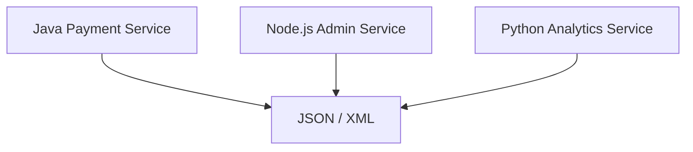
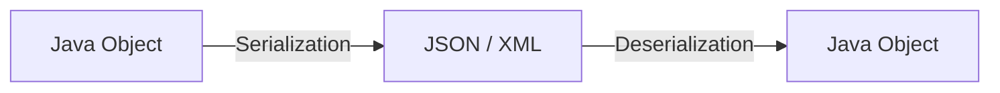
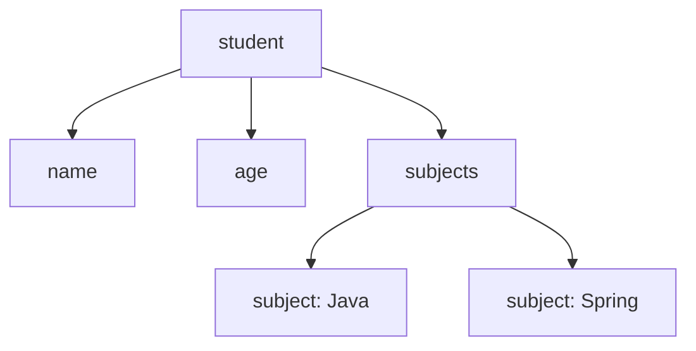
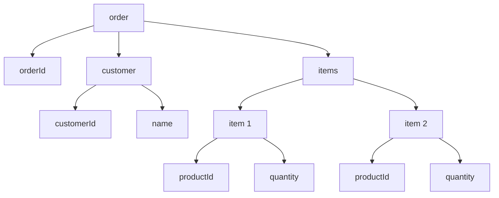
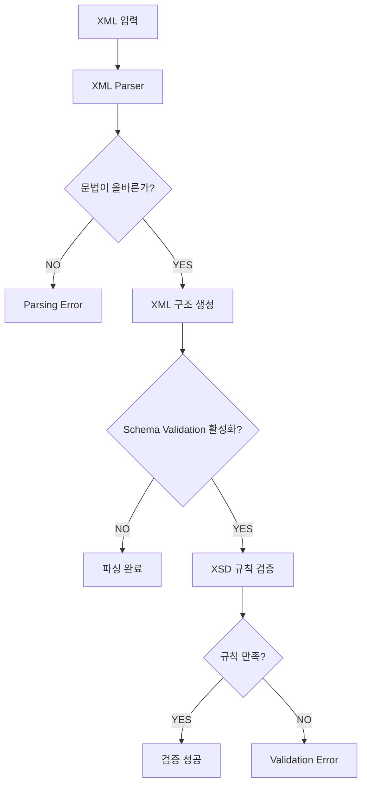
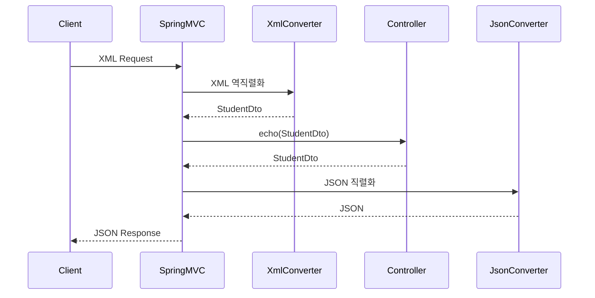
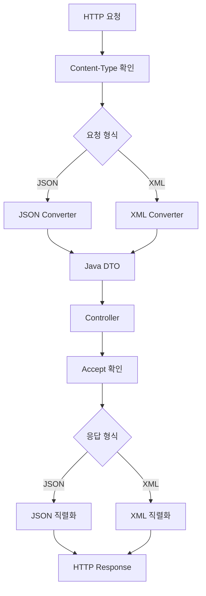
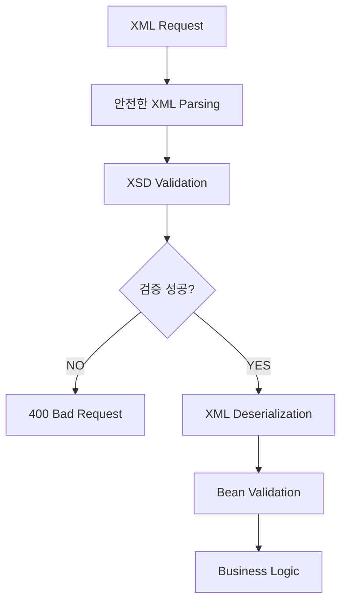
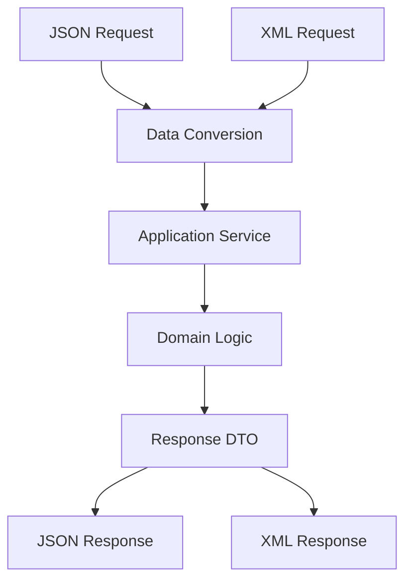

# 드라고의 XML과 JSON
[https://youtu.be/Wk2qrnCzIhs?si=8ymTdvxbEfMAgMXo](https://youtu.be/Wk2qrnCzIhs?si=8ymTdvxbEfMAgMXo)

# 드라고의 XML과 JSON
* toc
{:toc}

---

### XML과 JSON 완벽 이해: 데이터 포맷, 직렬화, 스키마 검증, 성능 비교와 Spring Boot 실무 활용

백엔드 애플리케이션을 개발하다 보면 서로 다른 시스템 사이에서 데이터를 주고받는 일이 빈번하게 발생한다.

예를 들어 Spring Boot로 회원 조회 API를 구현했다고 가정하자.

```java
@GetMapping("/members/{id}")
public MemberResponse findMember(
        @PathVariable Long id
) {
    return new MemberResponse(
            id,
            "홍길동",
            18
    );
}
```

`MemberResponse`는 다음과 같은 Java 객체다.

```java
public record MemberResponse(
        Long id,
        String name,
        int age
) {
}
```

서버 내부에서는 이 객체를 문제없이 사용할 수 있다.

하지만 클라이언트가 JavaScript나 Python으로 개발되어 있다면 어떨까?

클라이언트가 Java의 `MemberResponse` 객체를 그대로 받아 사용할 수 있을까?

그렇지 않다.

Java 객체는 JVM의 메모리 안에서 관리되는 데이터 구조이기 때문이다.

따라서 서로 다른 시스템에서 데이터를 주고받으려면 공통으로 이해할 수 있는 표현 방식이 필요하다.

대표적인 방법이 JSON이다.

```json
{
  "id": 1,
  "name": "홍길동",
  "age": 18
}
```

하지만 같은 데이터를 XML로 표현할 수도 있다.

```xml
<member>
    <id>1</id>
    <name>홍길동</name>
    <age>18</age>
</member>
```

두 형식 모두 동일한 회원 정보를 표현하고 있다.

그런데 표현 방식에는 상당한 차이가 있다.

JSON은 중괄호와 Key-Value 구조를 사용한다.

반면 XML은 태그를 사용해 데이터를 표현한다.

여기서 여러 질문이 생긴다.

**XML과 JSON은 왜 서로 다른 방식으로 데이터를 표현할까?**

**XML은 어떤 특징 때문에 금융 시스템과 문서 처리에서 사용될까?**

**JSON은 왜 웹과 모바일 API에서 널리 사용될까?**

**XML은 스키마 검증이 가능하다는데 JSON은 불가능할까?**

**JSON이 XML보다 항상 크기가 작고 처리 속도도 빠를까?**

**Spring Boot에서는 JSON과 XML을 어떻게 직렬화하고 역직렬화할까?**

이러한 질문에 답하기 위해서는 먼저 데이터 포맷의 역할부터 이해해야 한다.

---

### 데이터 포맷이란 무엇인가?

데이터 포맷(Data Format)은 데이터를 일정한 구조와 규칙에 따라 표현하는 형식이다.

단순히 데이터를 저장하는 방법만 정의하는 것이 아니다.

데이터의 구조와 타입, 관계 등을 해석할 수 있도록 공통된 표현 규칙을 제공한다.

예를 들어 다음 Java 코드를 생각해 보자.

```java
int age = 18;
```

이 코드에는 정수 18이 저장되어 있다.

하지만 다른 시스템에 단순히 다음 값만 전달한다면 어떨까?

```text
18
```

상대방은 이 값이 무엇을 의미하는지 알기 어렵다.

나이인지, 점수인지, 상품 수량인지 구분할 수 없기 때문이다.

따라서 의미를 함께 표현할 수 있는 구조가 필요하다.

JSON에서는 다음과 같이 표현한다.

```json
{
  "age": 18
}
```

XML에서는 다음과 같이 표현한다.

```xml
<age>18</age>
```

두 형식 모두 값과 의미를 연결하고 있다.

이러한 규칙 덕분에 데이터를 주고받는 시스템은 해당 값이 어떤 역할을 하는지 이해할 수 있다.

다만 데이터 포맷만으로 모든 의미가 결정되는 것은 아니다.

예를 들어 `age`가 만 나이인지, 특정 시점을 기준으로 계산한 나이인지는 별도의 API 계약이나 스키마에서 정의해야 할 수 있다.

즉 데이터 포맷은 데이터 교환의 기반을 제공하지만, 비즈니스 의미 전체를 자동으로 정의하지는 않는다.

---

### 데이터 포맷은 왜 필요한가?

데이터 포맷이 필요한 이유는 크게 세 가지로 구분할 수 있다.

#### 1. 데이터의 의미를 표현하기 위해서

다음 값을 생각해 보자.

```text
10000
```

이 값만으로는 무엇을 의미하는지 알 수 없다.

하지만 다음과 같이 표현하면 의미가 명확해진다.

```json
{
  "price": 10000,
  "currency": "KRW"
}
```

이 데이터는 가격이 10,000원이라는 의미를 전달한다.

#### 2. 데이터의 구조를 표현하기 위해서

회원이 여러 주문을 가지고 있다고 가정하자.

```java
public record Member(
        Long id,
        String name,
        List<Order> orders
) {
}
```

단순한 문자열만으로는 회원과 주문의 관계를 표현하기 어렵다.

하지만 JSON에서는 다음과 같이 표현할 수 있다.

```json
{
  "id": 1,
  "name": "홍길동",
  "orders": [
    {
      "orderId": 100,
      "amount": 10000
    },
    {
      "orderId": 101,
      "amount": 20000
    }
  ]
}
```

이 구조를 통해 회원 한 명이 여러 주문을 가지고 있다는 사실을 표현할 수 있다.

XML에서도 계층 구조를 이용해 동일한 정보를 표현할 수 있다.

#### 3. 서로 다른 시스템 사이의 데이터 교환을 위해서

예를 들어 다음과 같은 시스템이 있다고 가정하자.

* Java 기반 결제 서비스
* Node.js 기반 관리자 서비스
* Python 기반 데이터 분석 서비스

세 시스템은 서로 다른 언어와 실행 환경을 사용한다.

하지만 JSON이나 XML처럼 공통으로 이해할 수 있는 데이터 포맷을 사용하면 데이터를 교환할 수 있다.



이러한 특징 때문에 데이터 포맷은 네트워크 통신뿐 아니라 파일 저장과 시스템 간 연동에서도 중요한 역할을 한다.

---

### 직렬화와 역직렬화란 무엇인가?

데이터 포맷을 이해하려면 직렬화와 역직렬화도 알아야 한다.

직렬화(Serialization)는 프로그램 내부의 객체나 데이터를 저장하거나 전송할 수 있는 표현으로 변환하는 과정이다.

역직렬화(Deserialization)는 직렬화된 데이터를 프로그램에서 사용할 수 있는 객체나 데이터 구조로 복원하는 과정이다.

예를 들어 다음 Java 객체가 있다고 가정하자.

```java
MemberResponse member = new MemberResponse(
        1L,
        "홍길동",
        18
);
```

이 객체를 JSON으로 직렬화하면 다음과 같다.

```json
{
  "id": 1,
  "name": "홍길동",
  "age": 18
}
```

반대로 JSON을 역직렬화하면 다음과 같은 Java 객체를 생성할 수 있다.

```java
MemberResponse member = new MemberResponse(
        1L,
        "홍길동",
        18
);
```

전체 과정은 다음과 같다.



여기서 중요한 점이 있다.

**직렬화는 Java 객체의 메모리 주소를 그대로 전송하는 과정이 아니다.**

서로 다른 JVM이나 프로세스는 독립적인 메모리 공간을 사용한다.

따라서 한 프로세스에서 사용하는 객체 참조값을 다른 프로세스에 그대로 전달한다고 해서 동일한 객체에 접근할 수 있는 것은 아니다.

직렬화는 객체에 포함된 필요한 데이터를 정해진 형식으로 표현하는 과정이다.

역직렬화 역시 원래 객체의 메모리 주소를 복원하는 것이 아니라 전달받은 데이터를 바탕으로 새로운 객체를 구성하는 과정이다.

---

### XML이란 무엇인가?

XML은 Extensible Markup Language의 약자다.

확장 가능한 마크업 언어라는 의미다.

XML은 데이터를 구조화된 문서 형태로 표현하기 위한 표준이다.

1998년 W3C 권고안으로 발표되었으며, SGML의 복잡성을 줄이면서 구조화된 문서를 폭넓게 활용할 수 있도록 설계되었다.

XML의 중요한 특징은 개발자가 목적에 맞는 태그를 정의할 수 있다는 것이다.

예를 들어 다음과 같다.

```xml
<student>
    <name>홍길동</name>
    <age>18</age>
    <subject>Java</subject>
</student>
```

여기서 `<student>`, `<name>`, `<age>`, `<subject>`는 데이터를 표현하기 위해 정의한 요소 이름이다.

XML은 HTML과 유사하게 태그를 사용하지만, 두 기술의 목적은 다르다.

HTML은 웹 문서의 구조와 의미를 표현하는 데 사용된다.

XML은 다양한 종류의 구조화된 데이터를 표현하도록 설계되었다.

따라서 HTML처럼 미리 정해진 요소 집합만 사용해야 하는 것은 아니다.

업무의 요구사항에 맞게 새로운 요소를 정의할 수 있다.

---

### XML의 기본 구조

다음 XML을 살펴보자.

```xml
<?xml version="1.0" encoding="UTF-8"?>

<student>
    <name>홍길동</name>
    <age>18</age>
    <subjects>
        <subject>Java</subject>
        <subject>Spring</subject>
    </subjects>
</student>
```

이 XML은 크게 다음 요소로 구성된다.

| 구성 요소           | 설명                  |
| --------------- | ------------------- |
| XML Declaration | XML 버전과 문자 인코딩 등 선언 |
| Root Element    | 문서의 최상위 요소          |
| Child Element   | 다른 요소 내부에 포함된 요소    |
| Attribute       | 요소에 추가 정보를 부여하는 속성  |
| Text Content    | 요소 내부의 텍스트 값        |

XML은 기본적으로 하나의 최상위 문서 요소를 가진다.

위 예제에서는 `<student>`가 최상위 요소다.

그 아래에는 `<name>`, `<age>`, `<subjects>`가 존재한다.

`<subjects>` 내부에는 여러 개의 `<subject>`가 포함되어 있다.

이를 트리 구조로 표현하면 다음과 같다.



이처럼 XML은 요소를 중첩해 계층적인 데이터 구조를 표현할 수 있다.

---

### XML 선언은 반드시 필요할까?

XML 문서에서 다음과 같은 선언을 자주 볼 수 있다.

```xml
<?xml version="1.0" encoding="UTF-8"?>
```

이 선언에는 XML 버전과 인코딩 정보가 포함된다.

하지만 **모든 XML 문서에서 XML 선언이 반드시 필요한 것은 아니다.**

다음 XML도 정상적인 XML 문서가 될 수 있다.

```xml
<student>
    <name>홍길동</name>
</student>
```

W3C XML 명세에서는 XML 선언으로 시작하는 것을 권장하지만, 선언이 없는 문서도 올바른 XML 문서가 될 수 있다고 설명한다.

다만 실제 시스템에서는 인코딩과 XML 버전을 명확히 표현하기 위해 선언을 포함하는 경우가 많다.

또 XML의 인코딩 처리는 문서 선언과 전송 계층의 정보, 바이트 패턴 등을 고려한다.

따라서 선언이 없다고 무조건 UTF-8로 처리된다고 가정해서는 안 된다.

---

### XML은 어떻게 계층 구조를 표현할까?

XML의 중요한 특징은 중첩을 이용해 복잡한 구조를 표현할 수 있다는 것이다.

예를 들어 주문 정보를 생각해 보자.

하나의 주문에는 주문번호와 주문자 정보, 여러 주문 상품이 존재할 수 있다.

이를 XML로 표현하면 다음과 같다.

```xml
<?xml version="1.0" encoding="UTF-8"?>

<order>
    <orderId>100</orderId>

    <customer>
        <customerId>1</customerId>
        <name>홍길동</name>
    </customer>

    <items>
        <item>
            <productId>10</productId>
            <quantity>2</quantity>
        </item>

        <item>
            <productId>20</productId>
            <quantity>1</quantity>
        </item>
    </items>
</order>
```

이 XML은 다음과 같은 계층 구조를 표현한다.



XML의 구조는 문서의 내용을 표현하면서 동시에 데이터 사이의 관계를 나타낸다.

이러한 특징 때문에 복잡한 비즈니스 문서나 산업 표준 메시지를 표현할 때 활용할 수 있다.

---

### XML Element와 Attribute의 차이

XML에서는 정보를 표현하는 방법이 하나만 있는 것은 아니다.

요소(Element)를 사용할 수도 있고 속성(Attribute)을 사용할 수도 있다.

예를 들어 다음과 같다.

```xml
<member id="100" status="ACTIVE">
    <name>홍길동</name>
    <age>18</age>
</member>
```

이 예제에서 다음 정보는 Attribute다.

```xml
id="100"
status="ACTIVE"
```

반면 다음은 Element다.

```xml
<name>홍길동</name>
<age>18</age>
```

두 방식은 모두 정보를 표현할 수 있지만 구조적인 차이가 있다.

| 구분         | Element        | Attribute              |
| ---------- | -------------- | ---------------------- |
| 표현 방식      | 시작·종료 태그       | 시작 태그 내부의 이름·값         |
| 중첩 구조      | 가능             | 불가능                    |
| 반복 표현      | 동일 이름 요소 반복 가능 | 동일 요소에 같은 이름의 속성 중복 불가 |
| 텍스트 표현     | 가능             | 가능                     |
| 복잡한 구조     | 적합             | 제한적                    |
| 주로 사용하는 용도 | 주요 데이터 및 하위 구조 | 식별자, 분류 등 부가 정보        |

예를 들어 회원의 이름이나 주문 상품 목록처럼 복잡한 데이터를 표현할 때는 Element가 적절할 수 있다.

반면 식별자나 버전처럼 간단한 메타데이터는 Attribute로 표현할 수 있다.

하지만 어떤 데이터를 반드시 Element나 Attribute로 표현해야 한다는 절대적인 규칙이 존재하는 것은 아니다.

시스템 간 데이터 계약에 따라 일관되게 설계하는 것이 중요하다.

---

### XML은 문서 중심 데이터에 왜 강할까?

XML은 단순한 데이터 객체뿐 아니라 구조화된 문서의 내용을 표현하는 데도 적합하다.

다음 예제를 살펴보자.

```xml
<article>
    <title>Java와 Spring</title>

    <paragraph>
        Java는 <emphasis>객체지향 언어</emphasis>이며,
        Spring은 Java 생태계에서 사용되는 프레임워크다.
    </paragraph>
</article>
```

`paragraph` 요소 내부에는 일반 텍스트와 `emphasis` 요소가 함께 존재한다.

이러한 구조를 Mixed Content라고 부른다.

XML은 텍스트와 하위 요소가 섞인 구조를 자연스럽게 표현할 수 있다.

반면 JSON은 객체와 배열, 문자열을 중심으로 데이터를 표현한다.

따라서 동일한 문서를 JSON으로 표현하려면 다음과 같이 별도의 구조를 설계해야 할 수 있다.

```json
{
  "title": "Java와 Spring",
  "paragraph": [
    {
      "type": "text",
      "value": "Java는 "
    },
    {
      "type": "emphasis",
      "value": "객체지향 언어"
    },
    {
      "type": "text",
      "value": "이며, Spring은 Java 생태계에서 사용되는 프레임워크다."
    }
  ]
}
```

두 형식 모두 해당 내용을 표현할 수 있다.

하지만 문장 사이에 서식이나 구조적 의미가 섞이는 문서에서는 XML의 표현 방식이 자연스러운 경우가 있다.

이러한 이유로 XML은 문서 처리 시스템에서 오랫동안 사용되어 왔다.

---

### XML은 엄격한 문법을 가진다

XML은 정해진 문법 규칙을 따라야 한다.

예를 들어 다음 XML은 올바르지 않다.

```xml
<student>
    <name>홍길동</age>
</student>
```

`<name>`으로 시작했지만 `</age>`로 종료했기 때문이다.

또 다음 XML도 문제가 있다.

```xml
<student>
    <name>홍길동</name>
```

최상위 요소인 `<student>`가 닫히지 않았다.

XML에서는 시작 태그와 종료 태그가 올바르게 대응해야 한다.

또 요소의 중첩 관계가 올바르게 구성되어야 한다.

이러한 기본적인 문법 규칙을 만족하는 XML 문서를 **Well-Formed XML**이라고 부른다.

---

### Well-Formed와 Valid XML은 무엇이 다를까?

XML을 이해할 때 매우 중요한 차이가 있다.

바로 Well-Formed와 Valid의 차이다.

#### Well-Formed XML

XML 문법 규칙을 만족하는 문서다.

예를 들어 다음 XML은 문법적으로 올바르다.

```xml
<student>
    <name>홍길동</name>
    <age>잘 모르겠습니다</age>
</student>
```

하지만 나이를 나타내는 `age`에 문자열이 들어 있다.

비즈니스 관점에서는 잘못된 데이터일 수 있다.

그럼에도 XML 문법 자체에는 문제가 없다.

따라서 Well-Formed XML이다.

#### Valid XML

정의된 문서 구조와 제약조건을 만족하는 XML을 의미한다.

예를 들어 `age`는 반드시 정수여야 한다는 규칙을 정의했다고 가정하자.

이 규칙에 따라 검증하면 다음 값은 허용되지 않을 수 있다.

```xml
<age>잘 모르겠습니다</age>
```

이처럼 **XML 문법이 올바른 것과 비즈니스 데이터의 구조 및 제약조건을 만족하는 것은 서로 다른 문제**다.

이를 구분하기 위해 XML에서는 DTD나 XSD 같은 스키마 기술을 사용할 수 있다.

---

### XML Schema란 무엇인가?

XML Schema는 XML 문서가 어떤 구조와 데이터 타입을 가져야 하는지 정의하는 규칙이다.

대표적인 XML Schema 언어가 XSD다.

XSD는 XML Schema Definition을 의미한다.

이를 이용해 다음과 같은 규칙을 정의할 수 있다.

* 어떤 요소가 존재해야 하는가?
* 요소의 순서는 어떻게 되는가?
* 특정 요소가 몇 번 반복될 수 있는가?
* 값이 문자열인지 정수인지
* 숫자의 허용 범위
* 문자열 길이 제한
* 필수 요소 여부
* 하위 요소 구조
* 네임스페이스와 타입 정의

예를 들어 학생 데이터에 대해 다음 규칙을 정의한다고 가정하자.

| 필드      | 타입  | 제약조건         |
| ------- | --- | ------------ |
| name    | 문자열 | 필수, 최소 1자    |
| age     | 정수  | 0 이상, 130 이하 |
| subject | 문자열 | 0개 이상 반복 가능  |

이러한 규칙을 XSD로 표현할 수 있다.

---

### XSD 예제

다음과 같은 XML 데이터가 있다고 가정하자.

```xml
<?xml version="1.0" encoding="UTF-8"?>

<student>
    <name>홍길동</name>
    <age>18</age>

    <subjects>
        <subject>Java</subject>
        <subject>Spring</subject>
    </subjects>
</student>
```

이를 검증할 XSD를 작성해 보자.

`student.xsd`

```xml
<?xml version="1.0" encoding="UTF-8"?>

<xs:schema
    xmlns:xs="http://www.w3.org/2001/XMLSchema">

    <xs:element name="student">
        <xs:complexType>
            <xs:sequence>

                <xs:element name="name">
                    <xs:simpleType>
                        <xs:restriction base="xs:string">
                            <xs:minLength value="1"/>
                        </xs:restriction>
                    </xs:simpleType>
                </xs:element>

                <xs:element name="age">
                    <xs:simpleType>
                        <xs:restriction base="xs:int">
                            <xs:minInclusive value="0"/>
                            <xs:maxInclusive value="130"/>
                        </xs:restriction>
                    </xs:simpleType>
                </xs:element>

                <xs:element name="subjects">
                    <xs:complexType>
                        <xs:sequence>

                            <xs:element
                                name="subject"
                                type="xs:string"
                                minOccurs="0"
                                maxOccurs="unbounded"
                            />

                        </xs:sequence>
                    </xs:complexType>
                </xs:element>

            </xs:sequence>
        </xs:complexType>
    </xs:element>

</xs:schema>
```

이 XSD는 학생 데이터의 구조를 정의한다.

#### xs:element

```xml
<xs:element name="name">
```

XML에 `name`이라는 요소가 존재해야 한다는 의미다.

#### xs:string

```xml
<xs:restriction base="xs:string">
```

해당 요소가 문자열 타입을 사용한다는 의미다.

#### xs:minLength

```xml
<xs:minLength value="1"/>
```

문자열의 최소 길이를 정의한다.

#### xs:minInclusive와 xs:maxInclusive

```xml
<xs:minInclusive value="0"/>
<xs:maxInclusive value="130"/>
```

나이의 허용 범위를 정의한다.

#### minOccurs와 maxOccurs

```xml
<xs:element
    name="subject"
    type="xs:string"
    minOccurs="0"
    maxOccurs="unbounded"
/>
```

`subject` 요소가 0개 이상 반복될 수 있다는 의미다.

이처럼 XSD를 사용하면 XML 데이터의 구조와 제약조건을 명시적으로 정의할 수 있다.

---

### XSD를 선언하면 자동으로 검증될까?

여기서 반드시 구분해야 할 부분이 있다.

**XML에 XSD 위치를 지정했다고 모든 XML Parser가 자동으로 스키마 검증을 수행하는 것은 아니다.**

예를 들어 다음과 같이 선언할 수 있다.

```xml
<student
    xmlns:xsi="http://www.w3.org/2001/XMLSchema-instance"
    xsi:noNamespaceSchemaLocation="student.xsd">

    <name>홍길동</name>
    <age>18</age>

    <subjects>
        <subject>Java</subject>
    </subjects>
</student>
```

이 선언은 XML 문서와 관련된 스키마 위치에 대한 정보를 제공한다.

하지만 실제 검증이 수행되려면 XML 처리기가 스키마 검증을 수행하도록 구성되어 있어야 한다.

단순히 XML을 파싱하는 작업과 XSD를 기준으로 검증하는 작업은 다르다.



따라서 XML을 사용한다고 데이터의 정확성이 자동으로 보장되는 것은 아니다.

적절한 스키마를 정의하고, 해당 스키마를 이용해 실제 검증해야 한다.

또 XSD 검증에 성공하더라도 모든 비즈니스 규칙이 충족되었다고 단정할 수는 없다.

예를 들어 실제 회원이 존재하는지, 주문 금액과 상품 가격이 일치하는지 등의 검증은 별도의 비즈니스 로직에서 수행해야 한다.

---

### XML Namespace란 무엇인가?

XML은 여러 시스템이나 표준에서 정의한 요소를 하나의 문서에서 함께 사용할 수 있다.

이때 이름 충돌이 발생할 수 있다.

예를 들어 다음과 같은 상황을 생각해 보자.

```xml
<name>홍길동</name>
```

이 `name`은 회원 이름일 수 있다.

하지만 다음과 같은 의미도 가능하다.

```xml
<name>서울지점</name>
```

하나는 회원 이름이고 다른 하나는 지점 이름이다.

XML은 이러한 이름 충돌 문제를 해결하기 위해 Namespace를 제공한다.

예를 들어 다음과 같다.

```xml
<document
    xmlns:member="https://example.com/member"
    xmlns:branch="https://example.com/branch">

    <member:name>홍길동</member:name>

    <branch:name>서울지점</branch:name>

</document>
```

여기서는 같은 `name`이라는 요소 이름을 사용하지만 서로 다른 Namespace에 속한다.

따라서 두 요소를 구분할 수 있다.

```text
member:name

→ 회원 이름
```

```text
branch:name

→ 지점 이름
```

여기서 Namespace URI는 일반적으로 이름을 식별하기 위한 값이다.

반드시 해당 주소로 HTTP 요청을 보내야 한다는 의미는 아니다.

이러한 구조는 여러 조직이나 표준에서 정의한 XML 요소를 하나의 문서 안에서 조합해야 하는 경우 유용하다.

---

### XML의 주요 장점

지금까지 살펴본 XML의 장점을 정리하면 다음과 같다.

#### 1. 복잡한 계층 구조 표현

XML은 요소를 중첩해 복잡한 데이터 구조를 표현할 수 있다.

#### 2. 문서 중심 데이터 표현

텍스트와 구조화된 요소가 혼합된 문서를 자연스럽게 표현할 수 있다.

#### 3. XSD 기반 스키마 검증

문서의 구조와 데이터 타입, 제약조건을 정의하고 검증할 수 있다.

#### 4. Namespace 지원

서로 다른 시스템과 표준에서 사용하는 요소 이름을 구분할 수 있다.

#### 5. 확장 가능한 구조

필요한 요소와 속성을 정의해 새로운 데이터 구조를 표현할 수 있다.

#### 6. 다양한 문서 처리 기술

XPath, XSLT, XQuery 등 XML을 검색하거나 변환하기 위한 기술을 활용할 수 있다.

이러한 특징은 복잡한 문서 교환이나 표준화된 메시지 처리에서 강점이 될 수 있다.

---

### XML의 단점은 무엇인가?

XML은 강력한 표현력을 제공하지만 단점도 존재한다.

대표적인 문제는 표현의 장황함이다.

예를 들어 다음 XML을 살펴보자.

```xml
<student>
    <name>홍길동</name>
    <age>18</age>
    <subject>Java</subject>
</student>
```

각 요소는 시작 태그와 종료 태그를 포함한다.

```xml
<name>홍길동</name>
```

JSON에서는 다음과 같이 표현할 수 있다.

```json
"name": "홍길동"
```

따라서 비슷한 객체 데이터를 표현할 때 XML은 추가적인 태그가 필요할 수 있다.

이는 데이터 크기를 증가시키는 요인이 될 수 있다.

또 XML은 다음과 같은 개념을 함께 고려해야 한다.

* Element
* Attribute
* Namespace
* DTD
* XSD
* Entity
* XPath
* XML Parser 설정

이러한 기능은 장점이기도 하지만 단순한 REST API를 개발하는 환경에서는 불필요한 복잡성으로 작용할 수 있다.

다만 **XML이 항상 JSON보다 크고 느리다는 의미는 아니다.**

실제 크기와 성능은 데이터 구조, 파서 구현, 압축 여부, 스키마 처리 방식 등에 따라 달라진다.

이 부분은 JSON을 살펴본 뒤 비교하겠다.

---

### XML은 어디에서 활용할까?

XML은 웹 API 이외에도 다양한 영역에서 사용된다.

대표적인 사례는 다음과 같다.

| 영역      | 대표적인 활용           |
| ------- | ----------------- |
| 문서 처리   | Office Open XML   |
| 데이터 교환  | 산업별 XML 메시지       |
| 웹 서비스   | SOAP              |
| 콘텐츠 배포  | RSS               |
| 위치 정보   | GPX               |
| 금융 메시지  | ISO 20022 XML 메시지 |
| 설정 및 빌드 | Maven POM         |
| 데이터 변환  | XSLT 기반 변환        |

예를 들어 Maven의 `pom.xml`은 XML을 사용한다.

```xml
<project>
    <modelVersion>4.0.0</modelVersion>

    <groupId>com.example</groupId>
    <artifactId>demo</artifactId>
    <version>1.0.0</version>
</project>
```

이처럼 XML은 단순한 네트워크 응답 형식에만 사용되는 기술이 아니다.

복잡한 구조와 표준화된 문서 모델이 필요한 영역에서 활용할 수 있다.

---

### JSON이란 무엇인가?

JSON은 JavaScript Object Notation의 약자다.

JavaScript의 객체 표현 문법에서 영향을 받은 경량 데이터 교환 형식이다.

JSON은 XML보다 간결한 방식으로 구조화된 데이터를 표현할 수 있다는 특징이 있다.

JavaScript 생태계와 웹 애플리케이션의 성장 과정에서 널리 사용되었으며, 현재는 특정 언어에 종속되지 않는 표준 데이터 형식으로 자리 잡았다.

JSON의 문법과 데이터 모델은 RFC 8259에 정의되어 있다.

예를 들어 다음과 같다.

```json
{
  "name": "홍길동",
  "age": 18,
  "subjects": [
    "Java",
    "Spring"
  ]
}
```

XML과 비교하면 시작 태그와 종료 태그를 반복해서 작성할 필요가 없다.

대신 Key-Value 구조와 객체, 배열을 사용한다.

이러한 특징 때문에 JavaScript와 JSON을 함께 사용하는 환경에서 편리하게 데이터를 처리할 수 있다.

하지만 JSON은 JavaScript 전용 형식이 아니다.

Java, Python, Go, Kotlin 등 다양한 언어에서 사용할 수 있다.

---

### JSON의 기본 구조

JSON은 다음 여섯 가지 값의 종류를 표현할 수 있다.

| 타입      | 설명            | 예제               |
| ------- | ------------- | ---------------- |
| Object  | 이름과 값의 집합     | `{"name":"홍길동"}` |
| Array   | 값의 순서 있는 목록   | `[1,2,3]`        |
| String  | 문자열           | `"Java"`         |
| Number  | 숫자            | `100`, `10.5`    |
| Boolean | 참 또는 거짓       | `true`, `false`  |
| Null    | 값이 없음을 나타내는 값 | `null`           |

이러한 타입을 조합하면 복잡한 데이터 구조를 표현할 수 있다.

예를 들어 다음과 같다.

```json
{
  "id": 100,
  "name": "홍길동",
  "active": true,
  "score": 95.5,
  "nickname": null,
  "skills": [
    "Java",
    "Spring Boot",
    "Redis"
  ],
  "address": {
    "city": "Seoul",
    "country": "KR"
  }
}
```

이 JSON에는 여러 타입이 함께 사용되었다.

```text
id       → Number
name     → String
active   → Boolean
score    → Number
nickname → Null
skills   → Array
address  → Object
```

이처럼 JSON은 별도의 스키마를 정의하지 않아도 기본적인 데이터 타입을 표현할 수 있다.

---

### JSON의 Object란 무엇인가?

Object는 중괄호를 사용해 표현한다.

```json
{
  "name": "홍길동",
  "age": 18
}
```

Object 내부에서는 Key와 Value를 사용한다.

```text
Key : Value
```

JSON의 Key는 문자열이어야 한다.

따라서 다음과 같이 작성해야 한다.

```json
{
  "name": "홍길동"
}
```

다음과 같은 표현은 올바른 JSON이 아니다.

```javascript
{
  name: "홍길동"
}
```

JavaScript의 객체 리터럴에서는 가능한 문법이지만 JSON에서는 Key를 큰따옴표로 감싸야 한다.

JSON은 JavaScript 객체 리터럴과 유사해 보이지만 동일한 문법은 아니다.

---

### JSON의 Array란 무엇인가?

Array는 대괄호를 사용해 표현한다.

```json
[
  "Java",
  "Spring",
  "Redis"
]
```

여러 객체를 포함할 수도 있다.

```json
{
  "orders": [
    {
      "orderId": 100,
      "amount": 10000
    },
    {
      "orderId": 101,
      "amount": 20000
    }
  ]
}
```

배열은 반복되는 데이터 목록을 표현할 때 편리하다.

XML에서는 같은 이름의 요소를 반복하거나 별도의 컨테이너 요소를 이용해 목록을 표현하는 경우가 많다.

```xml
<orders>
    <order>
        <orderId>100</orderId>
        <amount>10000</amount>
    </order>

    <order>
        <orderId>101</orderId>
        <amount>20000</amount>
    </order>
</orders>
```

JSON에서는 배열을 이용해 반복 데이터의 구조를 간결하게 나타낼 수 있다.

하지만 XML도 반복 요소를 통해 목록을 표현할 수 있으므로 JSON만 배열을 표현할 수 있다고 이해해서는 안 된다.

---

### JSON의 주요 특징

JSON의 장점은 다음과 같이 정리할 수 있다.

#### 1. 간결한 구조

XML의 시작 태그와 종료 태그 대신 중괄호와 대괄호를 사용한다.

따라서 일반적인 객체형 데이터를 비교적 간결하게 표현할 수 있다.

#### 2. 기본 타입 제공

문자열, 숫자, Boolean, Null 등 기본적인 데이터 타입을 제공한다.

#### 3. 다양한 언어에서 사용 가능

JavaScript뿐 아니라 Java, Python, Go 등의 언어에서 처리할 수 있다.

#### 4. 웹 API와의 높은 친화성

HTTP 요청과 응답에서 JSON을 사용하기 위한 도구와 라이브러리가 널리 제공된다.

#### 5. 객체 및 배열 중심의 구조

애플리케이션 내부의 DTO나 데이터 객체를 표현하기 편리하다.

다만 JSON이 단순하다는 것은 모든 복잡한 문서 모델링에 적합하다는 의미는 아니다.

표현하려는 데이터의 성질에 따라 XML이 더 적합할 수도 있다.

---

### JSON은 UTF-8을 사용해야 할까?

JSON은 UTF-8과 밀접하게 연결되어 있다.

RFC 8259에서는 폐쇄적인 시스템 내부가 아닌 시스템 간 교환에 사용하는 JSON 텍스트를 UTF-8로 인코딩해야 한다고 규정한다.

일반적인 웹 API에서는 다음과 같이 사용한다.

```http
Content-Type: application/json
```

그리고 JSON 본문을 UTF-8로 인코딩해 전송한다.

JSON은 XML처럼 별도의 XML 선언이 필요하지 않다.

예를 들어 다음 데이터 자체가 유효한 JSON 문서다.

```json
{
  "name": "홍길동"
}
```

다만 JSON에는 XML과 다른 제한도 있다.

예를 들어 표준 JSON에서는 주석을 허용하지 않는다.

다음은 올바르지 않은 JSON이다.

```javascript
{
  // 회원 이름
  "name": "홍길동"
}
```

마지막 요소 뒤에 쉼표를 추가하는 것도 표준 JSON에서는 허용되지 않는다.

```javascript
{
  "name": "홍길동",
}
```

JavaScript 객체 리터럴이나 일부 설정 도구의 확장 문법을 JSON 표준 문법과 혼동하지 않아야 한다.

---

### JSON은 데이터 타입을 어디까지 표현할 수 있을까?

JSON은 문자열과 숫자, Boolean 등 기본 타입을 제공한다.

하지만 Java의 모든 타입을 직접 표현할 수 있는 것은 아니다.

예를 들어 다음 Java 객체를 생각해 보자.

```java
public record Payment(
        Long id,
        BigDecimal amount,
        LocalDateTime createdAt
) {
}
```

JSON에는 `BigDecimal`이나 `LocalDateTime`이라는 별도의 기본 타입이 존재하지 않는다.

일반적인 Jackson 설정에서는 다음과 같은 형태로 표현할 수 있다.

```json
{
  "id": 100,
  "amount": 10000.50,
  "createdAt": "2026-11-03T10:30:00"
}
```

여기서 `amount`는 JSON Number다.

`createdAt`은 JSON String이다.

따라서 JSON을 사용하는 시스템에서는 다음 사항을 별도로 정의해야 할 수 있다.

* 숫자의 정밀도
* 날짜 및 시간 형식
* 타임존
* 화폐 단위
* 식별자 표현 방식
* null과 필드 누락의 차이

이것이 JSON이 기본 타입을 제공한다고 해서 데이터의 모든 의미를 자동으로 보장하지는 않는 이유다.

---

### JSON 숫자를 다룰 때 주의할 점

JSON은 숫자를 표현할 수 있지만 Java의 `int`, `long`, `BigDecimal` 같은 타입을 직접 정의하지 않는다.

예를 들어 다음 JSON을 생각해 보자.

```json
{
  "transactionId": 9007199254740993
}
```

이 값은 Java의 `long`으로 표현할 수 있다.

하지만 JavaScript에서는 일반적인 `Number` 타입의 안전한 정수 표현 범위를 벗어난다.

JavaScript의 `Number`는 IEEE 754 배정밀도 부동소수점 형식을 사용하기 때문이다.

따라서 다음과 같은 문제가 발생할 수 있다.

```javascript
const value = JSON.parse(
  '{"transactionId":9007199254740993}'
);

console.log(value.transactionId);
```

실행 결과는 원래 입력한 숫자와 다를 수 있다.

이 문제는 결제 시스템의 거래 식별자나 대용량 데이터의 ID를 처리할 때 중요하다.

따라서 여러 언어가 사용하는 API에서는 큰 정수 식별자를 문자열로 전달하는 방식을 고려할 수 있다.

```json
{
  "transactionId": "9007199254740993"
}
```

또 금액은 단순한 부동소수점 연산으로 처리하지 않도록 주의해야 한다.

예를 들어 Java에서는 `BigDecimal`을 활용해 정확한 십진수 연산을 수행할 수 있다.

JSON의 Number는 표현 형식이며, 실제 정밀도는 각 언어의 JSON Parser와 숫자 타입에 따라 달라질 수 있다.

---

### XML과 JSON을 동일한 데이터로 비교해 보자

이제 동일한 학생 정보를 XML과 JSON으로 표현해 보자.

#### XML

```xml
<?xml version="1.0" encoding="UTF-8"?>

<student>
    <id>1</id>
    <name>홍길동</name>
    <age>18</age>
    <active>true</active>

    <subjects>
        <subject>Java</subject>
        <subject>Spring</subject>
        <subject>Redis</subject>
    </subjects>
</student>
```

#### JSON

```json
{
  "id": 1,
  "name": "홍길동",
  "age": 18,
  "active": true,
  "subjects": [
    "Java",
    "Spring",
    "Redis"
  ]
}
```

두 표현의 차이를 정리하면 다음과 같다.

| 비교 항목         | XML                   | JSON                            |
| ------------- | --------------------- | ------------------------------- |
| 기본 구조         | 태그 기반                 | 객체와 배열 기반                       |
| 계층 구조         | 요소 중첩                 | 객체 및 배열 중첩                      |
| 데이터 타입        | 텍스트 중심, 스키마로 타입 정의 가능 | Number, String, Boolean 등 기본 타입 |
| 반복 데이터        | 반복 요소                 | 배열                              |
| 속성            | Attribute 지원          | 별도의 Attribute 개념 없음             |
| Namespace     | 기본적으로 지원              | 별도 표준 Namespace 구조 없음           |
| 주석            | 지원                    | 표준 JSON에서는 미지원                  |
| 스키마 검증        | XSD 등                 | JSON Schema 등                   |
| 문서형 데이터       | Mixed Content 표현에 적합  | 별도의 데이터 모델링 필요                  |
| 일반적인 REST API | 사용 가능                 | 널리 사용                           |

여기서 핵심은 두 형식 모두 계층 구조를 표현할 수 있다는 점이다.

차이는 데이터를 표현하는 문법과 제공하는 부가 기능에 있다.

---

### XML과 JSON의 데이터 타입 차이

다음 XML을 생각해 보자.

```xml
<age>18</age>
```

XML Parser가 이 값을 읽으면 기본적으로 텍스트 데이터를 얻는다.

이 값이 정수인지 문자열인지는 XML 문서만으로 항상 결정되는 것이 아니다.

XSD를 사용하면 다음과 같이 타입을 정의할 수 있다.

```xml
<xs:element name="age" type="xs:int"/>
```

이제 스키마 검증을 통해 해당 값이 정수 타입 규칙을 만족하는지 확인할 수 있다.

반면 JSON에서는 다음과 같이 표현한다.

```json
{
  "age": 18
}
```

이 값은 JSON Number다.

다음과 같이 작성하면 문자열이 된다.

```json
{
  "age": "18"
}
```

따라서 JSON은 기본적인 데이터 타입 구분이 명확하다.

하지만 앞서 살펴본 것처럼 JSON Number만으로 정수 범위나 십진수 정밀도가 자동으로 보장되는 것은 아니다.

또 날짜나 시간, UUID 등의 타입은 별도의 표현 규칙이 필요하다.

즉 두 형식 모두 실제 업무에서 정확한 데이터 계약을 만들려면 스키마나 API 명세가 중요하다.

---

### XML은 스키마 검증이 가능하지만 JSON은 불가능할까?

그렇지 않다.

JSON 역시 JSON Schema를 이용해 데이터의 구조와 제약조건을 정의할 수 있다.

JSON Schema는 JSON 데이터에 적용할 수 있는 구조와 검증 규칙을 정의하는 표준화된 기술이다.

예를 들어 다음 JSON이 있다고 가정하자.

```json
{
  "name": "홍길동",
  "age": 18,
  "subjects": [
    "Java",
    "Spring"
  ]
}
```

이 데이터를 검증할 JSON Schema를 작성할 수 있다.

---

### JSON Schema 예제

다음은 JSON Schema Draft 2020-12를 기준으로 작성한 예제다.

```json
{
  "$schema": "https://json-schema.org/draft/2020-12/schema",

  "type": "object",

  "properties": {
    "name": {
      "type": "string",
      "minLength": 1
    },

    "age": {
      "type": "integer",
      "minimum": 0,
      "maximum": 130
    },

    "subjects": {
      "type": "array",
      "items": {
        "type": "string"
      }
    }
  },

  "required": [
    "name",
    "age",
    "subjects"
  ],

  "additionalProperties": false
}
```

이 스키마에서는 다음 규칙을 정의한다.

| 키워드                    | 역할                    |
| ---------------------- | --------------------- |
| `$schema`              | 사용할 JSON Schema 규격 지정 |
| `type`                 | 데이터 타입                |
| `properties`           | 객체의 프로퍼티 정의           |
| `minLength`            | 문자열 최소 길이             |
| `minimum`              | 숫자 최소값                |
| `maximum`              | 숫자 최대값                |
| `items`                | 배열 요소의 스키마            |
| `required`             | 필수 프로퍼티               |
| `additionalProperties` | 정의되지 않은 프로퍼티 허용 여부    |

예를 들어 다음 JSON은 스키마를 만족할 수 있다.

```json
{
  "name": "홍길동",
  "age": 18,
  "subjects": [
    "Java"
  ]
}
```

하지만 다음 JSON은 검증에 실패할 수 있다.

```json
{
  "name": "",
  "age": 200,
  "subjects": [
    "Java"
  ]
}
```

`name`은 최소 길이 조건을 만족하지 않는다.

또 `age`는 최대값 130을 초과한다.

JSON Schema는 이러한 제약조건을 검증할 수 있다.

JSON Schema 공식 규격은 Core와 Validation을 구분해 정의하고 있다.

---

### XSD와 JSON Schema 비교

두 기술은 모두 데이터 구조를 정의하고 검증할 수 있도록 한다.

하지만 적용 대상과 표현 방식이 다르다.

| 구분        | XSD                | JSON Schema          |
| --------- | ------------------ | -------------------- |
| 검증 대상     | XML                | JSON                 |
| 작성 형식     | XML                | JSON                 |
| 기본 구조     | Element, Attribute | Object, Array, Value |
| 타입 검증     | 지원                 | 지원                   |
| 필수값 검증    | 지원                 | 지원                   |
| 값의 범위 검증  | 지원                 | 지원                   |
| 반복 구조 검증  | 지원                 | 지원                   |
| Namespace | 지원                 | XML과 같은 방식은 사용하지 않음  |
| 주요 활용     | XML 기반 시스템 연동      | JSON API 및 데이터 검증    |

따라서 XML만 엄격한 검증을 지원하고 JSON은 검증 기능이 없다고 이해하면 정확하지 않다.

두 형식 모두 별도의 스키마 기술을 사용할 수 있다.

차이는 각 스키마 언어가 표현할 수 있는 구조와 생태계, 검증 기능에 있다.

또 두 기술 모두 **스키마를 작성했다고 자동으로 검증되는 것은 아니다.**

실제 검증을 수행하는 라이브러리나 처리 과정이 필요하다.

---

### XML과 JSON 중 어떤 형식이 더 빠를까?

JSON은 XML보다 가볍고 빠르다고 설명하는 경우가 많다.

일반적인 객체형 데이터를 표현할 때 JSON이 더 간결한 경우가 많은 것은 사실이다.

하지만 다음과 같은 결론을 모든 상황에 적용해서는 안 된다.

```text
JSON은 항상 XML보다 빠르다.
```

성능은 여러 요소에 영향을 받는다.

대표적으로 다음과 같다.

* 데이터 크기
* 중첩 구조의 깊이
* 반복 요소의 개수
* 사용하는 Parser
* 직렬화 및 역직렬화 방식
* 스키마 검증 여부
* 압축 여부
* 네트워크 환경
* 서버의 CPU와 메모리
* 문자열 인코딩

예를 들어 XML은 시작 태그와 종료 태그를 반복하기 때문에 원본 텍스트 크기가 더 커질 수 있다.

하지만 HTTP 압축이 적용되면 반복되는 태그 문자열이 효율적으로 압축될 수 있다.

또 JSON도 깊은 객체 구조를 가지거나 많은 배열을 포함하면 파싱 비용이 증가할 수 있다.

따라서 실제 서비스에서는 원본 크기뿐 아니라 압축 이후의 크기와 CPU 처리 시간, 메모리 사용량 등을 함께 측정해야 한다.

---

### 성능 비교는 어떻게 해야 할까?

예를 들어 다음 두 형식을 비교한다고 가정하자.

XML:

```xml
<student>
    <name>홍길동</name>
    <age>18</age>
</student>
```

JSON:

```json
{
  "name": "홍길동",
  "age": 18
}
```

단순히 파일 크기를 비교하는 것만으로는 충분하지 않다.

다음 항목을 구분해서 측정하는 것이 좋다.

| 측정 항목                 | 의미                   |
| --------------------- | -------------------- |
| 원본 Payload 크기         | 압축 전 데이터 크기          |
| 압축 후 Payload 크기       | Gzip 등 적용 후 크기       |
| Serialization Time    | 객체를 데이터 형식으로 변환하는 시간 |
| Deserialization Time  | 데이터를 객체로 복원하는 시간     |
| CPU 사용량               | 변환 작업의 연산 비용         |
| 메모리 사용량               | Parser 및 객체 생성 비용    |
| Network Transfer Time | 실제 데이터 전송 시간         |

특히 JSON과 XML을 비교할 때는 동일한 데이터 구조와 같은 실행 환경을 사용해야 한다.

또 JVM을 사용하는 경우 JIT 컴파일과 워밍업의 영향도 고려해야 한다.

따라서 신뢰할 수 있는 성능 비교가 필요하다면 JMH 등의 벤치마크 도구를 활용할 수 있다.

결론적으로 JSON은 일반적인 REST API에서 효율적인 선택인 경우가 많지만, 모든 환경에서 XML보다 무조건 빠르다고 단정할 수는 없다.

---

### XML과 JSON의 보안 차이

데이터 포맷을 선택할 때 성능만큼 중요한 요소가 보안이다.

XML과 JSON은 모두 외부 입력을 처리할 때 보안 문제가 발생할 수 있다.

특히 XML에서는 XXE 공격을 주의해야 한다.

---

### XXE란 무엇인가?

XXE는 XML External Entity의 약자다.

XML Parser가 외부 엔티티를 처리하도록 설정되어 있을 때 발생할 수 있는 보안 문제다.

공격자는 악의적인 XML을 전달해 서버가 의도하지 않은 외부 리소스에 접근하도록 유도할 수 있다.

이러한 취약점은 다음과 같은 문제로 이어질 수 있다.

* 서버 내부 파일 노출
* 내부 네트워크 접근
* SSRF
* 과도한 리소스 사용
* 서비스 장애

따라서 신뢰할 수 없는 XML을 파싱할 때는 외부 엔티티와 DTD 처리 정책을 명확하게 설정해야 한다.

OWASP에서는 가능하다면 DTD 자체를 비활성화하고, 외부 엔티티 및 외부 리소스 접근을 차단하도록 권장한다.

---

### Java에서 XML을 안전하게 파싱하는 방법

Java에서는 JAXP를 이용해 XML을 파싱할 수 있다.

대표적인 클래스가 `DocumentBuilderFactory`다.

하지만 외부 입력을 처리한다면 보안 설정을 함께 적용해야 한다.

다음은 Java 17 이상 환경을 기준으로 한 예제다.

```java
import java.io.StringReader;

import javax.xml.XMLConstants;
import javax.xml.parsers.DocumentBuilder;
import javax.xml.parsers.DocumentBuilderFactory;

import org.w3c.dom.Document;
import org.xml.sax.InputSource;

public class SecureXmlParser {

    public static Document parse(String xml) throws Exception {

        DocumentBuilderFactory factory =
                DocumentBuilderFactory.newDefaultInstance();

        factory.setNamespaceAware(true);

        factory.setFeature(
                XMLConstants.FEATURE_SECURE_PROCESSING,
                true
        );

        factory.setFeature(
                "http://apache.org/xml/features/disallow-doctype-decl",
                true
        );

        factory.setXIncludeAware(false);

        factory.setAttribute(
                XMLConstants.ACCESS_EXTERNAL_DTD,
                ""
        );

        factory.setAttribute(
                XMLConstants.ACCESS_EXTERNAL_SCHEMA,
                ""
        );

        DocumentBuilder builder =
                factory.newDocumentBuilder();

        return builder.parse(
                new InputSource(new StringReader(xml))
        );
    }
}
```

이 코드에서는 여러 보안 설정을 적용했다.

#### FEATURE_SECURE_PROCESSING

```java
factory.setFeature(
        XMLConstants.FEATURE_SECURE_PROCESSING,
        true
);
```

XML 처리기의 보안 관련 처리 제한을 활성화한다.

다만 이 설정만으로 모든 외부 리소스 접근이 차단된다고 가정해서는 안 된다.

#### DOCTYPE 차단

```java
factory.setFeature(
        "http://apache.org/xml/features/disallow-doctype-decl",
        true
);
```

DOCTYPE 선언을 허용하지 않도록 설정한다.

#### 외부 리소스 접근 제한

```java
factory.setAttribute(
        XMLConstants.ACCESS_EXTERNAL_DTD,
        ""
);
```

외부 DTD 접근을 제한한다.

이러한 설정은 사용하는 XML Parser 구현체와 Java 버전에 따라 지원 여부가 달라질 수 있다.

따라서 필요한 보안 설정이 적용되지 않는다면 조용히 무시하고 파싱을 계속하는 방식은 피해야 한다.

특히 외부 시스템이 전달하는 XML을 처리하는 경우에는 보안 설정과 입력 크기 제한, 처리 시간 제한 등을 함께 고려해야 한다.

---

### JSON은 보안 문제가 없을까?

JSON은 XML의 DTD나 외부 엔티티와 같은 기능을 표준 데이터 모델에 포함하지 않는다.

따라서 일반적인 JSON Parser에서는 XML과 동일한 XXE 문제가 발생하지 않는다.

하지만 JSON을 사용한다고 안전한 것은 아니다.

대표적으로 다음 문제가 발생할 수 있다.

* 과도하게 큰 JSON 요청
* 깊게 중첩된 객체
* 예상하지 못한 타입 역직렬화
* 잘못된 입력 검증
* 민감한 필드 노출
* 안전하지 않은 다형성 역직렬화
* 대량의 객체 생성에 따른 메모리 사용 증가

예를 들어 다음과 같은 JSON을 생각해 보자.

```json
{
  "userId": 100,
  "role": "ADMIN"
}
```

클라이언트가 전달한 `role`을 그대로 신뢰해 권한을 부여한다면 심각한 보안 문제가 발생할 수 있다.

이는 JSON 형식 자체의 문제가 아니라 애플리케이션의 입력 검증과 권한 처리 문제다.

따라서 XML과 JSON 모두 외부 입력을 신뢰하지 않는다는 원칙을 적용해야 한다.

---

### Spring Boot에서는 XML과 JSON을 어떻게 처리할까?

이제 Java와 Spring Boot에서 XML과 JSON을 실제로 사용하는 방법을 살펴보자.

Spring MVC에서는 HTTP 요청과 응답의 본문을 처리하기 위해 `HttpMessageConverter`를 사용한다.

대표적으로 다음 구현체가 있다.

| Converter                                | 역할      |
| ---------------------------------------- | ------- |
| `MappingJackson2HttpMessageConverter`    | JSON 처리 |
| `MappingJackson2XmlHttpMessageConverter` | XML 처리  |
| `StringHttpMessageConverter`             | 문자열 처리  |

Spring Framework 6.2에서는 Jackson의 `ObjectMapper`와 `XmlMapper`를 이용하는 JSON 및 XML Converter를 제공한다.

예를 들어 다음 요청이 들어왔다고 가정하자.

```http
GET /api/students/1 HTTP/1.1
Accept: application/json
```

클라이언트는 JSON 응답을 요청하고 있다.

Spring MVC는 해당 요청을 처리할 수 있는 JSON Converter를 선택할 수 있다.

반면 다음 요청은 어떨까?

```http
GET /api/students/1 HTTP/1.1
Accept: application/xml
```

이 경우 XML Converter가 등록되어 있다면 XML 응답을 생성할 수 있다.

이러한 과정을 HTTP Content Negotiation이라고 부른다.

---

### Spring Boot에서 JSON과 XML을 모두 지원하기

실제 예제를 통해 확인해 보자.

다음 환경을 기준으로 구성한다.

| 항목          | 환경          |
| ----------- | ----------- |
| Java        | 17          |
| Spring Boot | 3.5.x       |
| Spring MVC  | 사용          |
| Jackson     | 2.x         |
| XML Mapper  | Jackson XML |
| Gradle      | Groovy DSL  |

하나의 Controller에서 요청 헤더에 따라 JSON과 XML을 반환하도록 구현하겠다.

---

### Gradle 설정

`build.gradle`을 다음과 같이 작성한다.

```groovy
plugins {
    id 'java'
    id 'org.springframework.boot' version '3.5.7'
    id 'io.spring.dependency-management' version '1.1.7'
}

group = 'com.example'
version = '0.0.1-SNAPSHOT'

java {
    toolchain {
        languageVersion = JavaLanguageVersion.of(17)
    }
}

repositories {
    mavenCentral()
}

dependencies {

    implementation 'org.springframework.boot:spring-boot-starter-web'

    implementation 'com.fasterxml.jackson.dataformat:jackson-dataformat-xml'

    testImplementation 'org.springframework.boot:spring-boot-starter-test'
}

tasks.named('test') {
    useJUnitPlatform()
}
```

여기서 중요한 의존성은 다음과 같다.

```groovy
implementation 'com.fasterxml.jackson.dataformat:jackson-dataformat-xml'
```

이 라이브러리는 Jackson에서 XML 직렬화와 역직렬화를 지원한다.

Spring Boot 3.5.x 환경에서 해당 라이브러리를 추가하면 Spring MVC가 XML을 처리하는 MessageConverter를 구성하는 데 활용할 수 있다.

버전은 Spring Boot의 의존성 관리 기능을 이용하도록 직접 지정하지 않았다.

---

### 프로젝트 구조

다음과 같이 구성한다.

```text
src/
├── main/
│   └── java/
│       └── com/example/dataformat/
│           ├── DataFormatApplication.java
│           ├── StudentDto.java
│           └── StudentController.java
└── test/
    └── java/
        └── com/example/dataformat/
            └── StudentControllerTest.java
```

---

### StudentDto 구현

다음 DTO를 작성한다.

```java
package com.example.dataformat;

import java.util.List;

import com.fasterxml.jackson.dataformat.xml.annotation.JacksonXmlElementWrapper;
import com.fasterxml.jackson.dataformat.xml.annotation.JacksonXmlProperty;
import com.fasterxml.jackson.dataformat.xml.annotation.JacksonXmlRootElement;

@JacksonXmlRootElement(localName = "student")
public record StudentDto(

        Long id,

        String name,

        int age,

        @JacksonXmlElementWrapper(localName = "subjects")
        @JacksonXmlProperty(localName = "subject")
        List<String> subjects

) {
}
```

이 DTO에서는 XML을 위한 Jackson 어노테이션을 사용했다.

#### @JacksonXmlRootElement

```java
@JacksonXmlRootElement(localName = "student")
```

XML의 최상위 요소 이름을 지정한다.

따라서 XML로 직렬화할 때 다음과 같은 루트 요소를 사용할 수 있다.

```xml
<student>
</student>
```

#### @JacksonXmlElementWrapper

```java
@JacksonXmlElementWrapper(localName = "subjects")
```

리스트를 감싸는 요소 이름을 지정한다.

#### @JacksonXmlProperty

```java
@JacksonXmlProperty(localName = "subject")
```

리스트의 개별 항목을 표현하는 XML 요소 이름을 지정한다.

따라서 다음과 같은 XML 구조를 생성할 수 있다.

```xml
<subjects>
    <subject>Java</subject>
    <subject>Spring</subject>
</subjects>
```

이처럼 Jackson XML 어노테이션을 사용하면 Java 객체와 XML 구조 사이의 매핑을 세부적으로 제어할 수 있다.

---

### StudentController 구현

이제 Controller를 작성한다.

```java
package com.example.dataformat;

import java.util.List;

import org.springframework.http.MediaType;
import org.springframework.http.ResponseEntity;

import org.springframework.web.bind.annotation.GetMapping;
import org.springframework.web.bind.annotation.PathVariable;
import org.springframework.web.bind.annotation.PostMapping;
import org.springframework.web.bind.annotation.RequestBody;
import org.springframework.web.bind.annotation.RequestMapping;
import org.springframework.web.bind.annotation.RestController;

@RestController
@RequestMapping("/api/students")
public class StudentController {

    @GetMapping(
            value = "/{id}",
            produces = {
                    MediaType.APPLICATION_JSON_VALUE,
                    MediaType.APPLICATION_XML_VALUE
            }
    )
    public StudentDto find(
            @PathVariable Long id
    ) {

        return new StudentDto(
                id,
                "홍길동",
                18,
                List.of("Java", "Spring")
        );
    }

    @PostMapping(
            value = "/echo",
            consumes = {
                    MediaType.APPLICATION_JSON_VALUE,
                    MediaType.APPLICATION_XML_VALUE
            },
            produces = {
                    MediaType.APPLICATION_JSON_VALUE,
                    MediaType.APPLICATION_XML_VALUE
            }
    )
    public ResponseEntity<StudentDto> echo(
            @RequestBody StudentDto request
    ) {

        return ResponseEntity.ok(request);
    }
}
```

이 Controller에서는 동일한 Java DTO를 사용해 JSON과 XML을 모두 처리한다.

조회 API에서는 `produces`를 이용해 응답 가능한 데이터 형식을 지정했다.

등록 API 예제에서는 `consumes`를 이용해 요청 가능한 데이터 형식을 지정했다.

다만 실제 업무에서는 단순한 Echo API 대신 별도의 Service 계층에서 데이터를 검증하고 저장하는 로직을 구현해야 한다.

---

### Spring Boot Application

애플리케이션 시작 클래스를 작성한다.

```java
package com.example.dataformat;

import org.springframework.boot.SpringApplication;
import org.springframework.boot.autoconfigure.SpringBootApplication;

@SpringBootApplication
public class DataFormatApplication {

    public static void main(String[] args) {

        SpringApplication.run(
                DataFormatApplication.class,
                args
        );
    }
}
```

이제 애플리케이션을 실행한다.

```bash
./gradlew bootRun
```

정상적으로 실행되면 JSON과 XML 요청을 테스트할 수 있다.

---

### JSON 응답 확인하기

다음 명령어를 실행한다.

```bash
curl -i \
  -H "Accept: application/json" \
  http://localhost:8080/api/students/1
```

`Accept: application/json`은 JSON 응답을 받을 수 있다는 의미다.

예상 응답 본문은 다음과 같다.

```json
{
  "id": 1,
  "name": "홍길동",
  "age": 18,
  "subjects": [
    "Java",
    "Spring"
  ]
}
```

실제 응답에서는 JSON의 공백과 줄바꿈이 생략될 수 있다.

Spring MVC는 등록된 JSON MessageConverter를 이용해 Java 객체를 JSON으로 직렬화한다.

---

### XML 응답 확인하기

이번에는 동일한 API에 XML 응답을 요청한다.

```bash
curl -i \
  -H "Accept: application/xml" \
  http://localhost:8080/api/students/1
```

예상 응답 본문은 다음과 같다.

```xml
<student>
    <id>1</id>
    <name>홍길동</name>
    <age>18</age>
    <subjects>
        <subject>Java</subject>
        <subject>Spring</subject>
    </subjects>
</student>
```

실제 XML에서는 공백과 줄바꿈, 선언 포함 여부가 달라질 수 있다.

중요한 점은 다음과 같다.

**Controller는 동일한 Java 객체를 반환했지만 HTTP Accept 헤더에 따라 서로 다른 데이터 포맷으로 변환할 수 있다.**

이것이 Spring MVC의 Content Negotiation 기능이다.

---

### XML 요청을 Java 객체로 역직렬화하기

이번에는 XML을 요청 본문으로 전달해 보자.

```bash
curl -i -X POST \
  http://localhost:8080/api/students/echo \
  -H "Content-Type: application/xml" \
  -H "Accept: application/json" \
  -d '
    <student>
        <id>7</id>
        <name>김철수</name>
        <age>20</age>
        <subjects>
            <subject>Java</subject>
            <subject>Network</subject>
        </subjects>
    </student>
  '
```

여기서 요청 헤더는 다음과 같다.

```http
Content-Type: application/xml
```

요청 본문이 XML이라는 의미다.

반면 다음 헤더는 JSON 응답을 요청한다.

```http
Accept: application/json
```

따라서 Spring MVC는 XML을 Java 객체로 역직렬화한 뒤 JSON으로 다시 직렬화할 수 있다.

예상 응답은 다음과 같다.

```json
{
  "id": 7,
  "name": "김철수",
  "age": 20,
  "subjects": [
    "Java",
    "Network"
  ]
}
```

전체 동작은 다음과 같다.



이처럼 요청 형식과 응답 형식은 반드시 동일할 필요가 없다.

물론 실제 서비스에서는 어떤 형식을 지원할 것인지 API 계약으로 명확하게 정의해야 한다.

---

### HttpMessageConverter는 어떻게 선택될까?

Spring MVC는 HTTP 메시지 본문을 읽거나 쓸 때 등록된 HttpMessageConverter를 활용한다.

요청 본문을 읽을 때는 주로 다음 정보를 고려한다.

* Java 매개변수 타입
* HTTP Content-Type
* Converter의 읽기 지원 여부

응답을 작성할 때는 다음 정보를 고려한다.

* Controller의 반환 타입
* HTTP Accept
* produces 조건
* Converter의 쓰기 지원 여부

개념적으로 다음과 같다.



여기서 중요한 점은 Controller가 XML 또는 JSON 변환 코드를 직접 작성할 필요가 없다는 것이다.

Spring MVC의 변환 추상화가 이러한 작업을 담당한다.

---

### XML 스키마 검증은 Spring Boot에서 자동으로 수행될까?

Spring MVC에서 XML을 DTO로 역직렬화할 수 있다고 해서 XSD 검증까지 자동으로 수행되는 것은 아니다.

예를 들어 다음 XML이 있다고 가정하자.

```xml
<student>
    <id>1</id>
    <name>홍길동</name>
    <age>200</age>
    <subjects/>
</student>
```

앞서 작성한 XSD에서는 나이의 최대값을 130으로 제한했다.

하지만 Controller가 단순히 Jackson XML을 사용해 DTO로 변환하는 경우, 해당 XSD를 자동으로 검증한다고 보장할 수 없다.

따라서 XML 스키마 검증이 필요한 시스템에서는 별도의 검증 과정을 구성해야 한다.

예를 들어 다음과 같은 흐름을 사용할 수 있다.



또한 Bean Validation과 XSD Validation은 역할이 다르다.

XSD는 XML 문서의 구조와 타입 제약조건을 검증한다.

Bean Validation은 Java 객체에 적용한 제약조건을 검증한다.

두 기능은 상호 보완적으로 사용할 수 있지만 동일한 검증 체계는 아니다.

---

### XML과 JSON은 실무에서 어떻게 선택해야 할까?

데이터 포맷을 선택할 때 가장 중요한 것은 어떤 형식이 더 우수한지 판단하는 것이 아니다.

실제 시스템에서 어떤 데이터를 다루고 어떤 요구사항을 충족해야 하는지 확인하는 것이다.

예를 들어 다음 상황을 생각해 보자.

#### 일반적인 REST API

모바일 애플리케이션에서 회원 정보를 조회하는 경우다.

```json
{
  "id": 100,
  "name": "홍길동"
}
```

데이터 구조가 비교적 단순하고 다양한 클라이언트와 연동해야 한다면 JSON이 적합할 수 있다.

#### SOAP 기반 외부 시스템 연동

외부 기업에서 XML 기반 SOAP 메시지를 요구한다고 가정하자.

```xml
<soap:Envelope
    xmlns:soap="http://www.w3.org/2003/05/soap-envelope">

    <soap:Body>
        <GetMemberRequest>
            <memberId>100</memberId>
        </GetMemberRequest>
    </soap:Body>

</soap:Envelope>
```

이 경우 XML 기반 메시지를 사용해야 한다.

단순히 JSON이 더 가볍다는 이유로 임의로 변경할 수 있는 문제가 아니다.

외부 시스템과 합의한 통신 규약을 따라야 하기 때문이다.

#### 금융 메시지 처리

금융 시스템에서 ISO 20022 XML 메시지를 처리한다고 가정하자.

이 경우 표준에서 정의한 XML 구조와 스키마를 따라야 할 수 있다.

따라서 데이터 형식의 선택은 성능뿐 아니라 산업 표준과 시스템 간 호환성에 영향을 받는다.

---

### 실무에서 활용할 수 있는 12가지 설계 전략

#### 1. 데이터 포맷보다 데이터 계약을 먼저 정의한다

JSON과 XML 중 무엇을 사용할지 결정하기 전에 어떤 정보를 주고받는지 정의해야 한다.

필수값과 선택값, 타입, 값의 범위, 날짜 형식 등을 먼저 결정하는 것이 좋다.

#### 2. 일반적인 REST API에서는 JSON을 우선 고려한다

JSON은 객체와 배열을 간결하게 표현할 수 있고 웹과 모바일 환경에서 폭넓게 지원된다.

따라서 특별한 요구사항이 없다면 JSON이 실용적인 선택일 수 있다.

#### 3. 산업 표준이 XML을 요구한다면 XML을 사용한다

외부 시스템의 메시지 형식이 이미 XML로 정해져 있다면 해당 계약을 따라야 한다.

특히 금융 메시지와 문서 교환 시스템에서는 호환성이 중요하다.

#### 4. XML의 문법 검증과 스키마 검증을 구분한다

XML을 정상적으로 파싱했다는 사실만으로 값과 구조가 올바르다고 판단해서는 안 된다.

XSD 검증이 필요한 경우 명시적인 검증 과정을 구현해야 한다.

#### 5. JSON에서도 스키마 검증을 고려한다

JSON Schema나 Bean Validation 등을 활용해 입력 데이터를 검증할 수 있다.

JSON을 사용한다고 구조적인 검증을 생략해야 하는 것은 아니다.

#### 6. 외부 XML 입력에는 XXE 방어를 적용한다

신뢰할 수 없는 XML을 파싱할 때는 DTD와 외부 엔티티 처리 설정을 확인해야 한다.

또 입력 크기 제한과 처리 자원 제한도 함께 고려하는 것이 좋다.

#### 7. API DTO와 내부 도메인 객체를 분리한다

JPA Entity를 그대로 JSON이나 XML로 직렬화하면 의도하지 않은 필드가 노출될 수 있다.

따라서 외부에 제공할 정보를 명확하게 정의한 DTO를 사용하는 것이 좋다.

#### 8. 날짜와 금액의 표현 규칙을 명확하게 정의한다

JSON과 XML 모두 날짜나 금액의 비즈니스 의미를 자동으로 보장하지 않는다.

특히 글로벌 서비스에서는 타임존과 통화 단위, 숫자의 정밀도를 명확하게 지정해야 한다.

#### 9. 성능 비교는 실제 데이터로 수행한다

JSON이 항상 XML보다 빠르다고 가정하지 않는다.

실제 Payload 크기와 압축률, 직렬화 시간, 역직렬화 시간 등을 측정해야 한다.

#### 10. HTTP Content-Type과 Accept를 정확하게 사용한다

`Content-Type`은 메시지 본문의 형식을 나타낸다.

`Accept`는 클라이언트가 수용할 수 있는 응답 형식을 나타낸다.

두 헤더를 올바르게 사용해야 콘텐츠 협상 과정에서 예상하지 못한 오류를 줄일 수 있다.

#### 11. 중복 필드와 스키마 변경 정책을 정의한다

JSON 객체에 동일한 Key가 반복되면 Parser에 따라 처리 결과가 달라질 수 있다.

XML 역시 스키마와 Namespace를 변경하면 기존 클라이언트에 영향을 줄 수 있다.

따라서 데이터 계약의 호환성 정책을 명확하게 정의해야 한다.

#### 12. 메시지 포맷과 비즈니스 로직의 책임을 분리한다

JSON과 XML은 데이터를 표현하는 방식이다.

비즈니스 규칙 자체가 특정 포맷에 강하게 결합될 필요는 없다.

예를 들어 JSON과 XML을 모두 지원하는 API라면 요청을 공통 DTO나 Command로 변환한 뒤 동일한 Service 로직을 사용할 수 있다.



이러한 구조는 외부 데이터 표현과 내부 비즈니스 로직을 분리하는 데 도움이 된다.

---

### XML과 JSON의 전체 구조 비교

지금까지 살펴본 내용을 전체적으로 정리하면 다음과 같다.

| 구분            | XML                        | JSON                     |
| ------------- | -------------------------- | ------------------------ |
| 표준화 배경        | 구조화된 문서와 데이터 교환            | 간결한 데이터 교환               |
| 기본 표현         | 태그                         | 객체·배열·값                  |
| 데이터 모델        | Element, Attribute, Text 등 | Object, Array, Primitive |
| 계층 구조         | 지원                         | 지원                       |
| 반복 데이터        | 반복 Element                 | Array                    |
| 데이터 타입        | 기본적으로 텍스트 중심, Schema 활용    | 기본적인 JSON 타입 제공          |
| Schema        | XSD 등                      | JSON Schema              |
| Namespace     | 지원                         | XML과 같은 Namespace 체계 없음  |
| Mixed Content | 자연스럽게 표현 가능                | 별도 모델링 필요                |
| 주석            | 지원                         | 표준 JSON에서는 미지원           |
| 기본적인 가독성      | 구조가 명시적이지만 장황할 수 있음        | 객체 데이터에서 간결한 경우가 많음      |
| 데이터 크기        | 태그로 인해 증가할 수 있음            | 상대적으로 작을 수 있음            |
| 성능            | 구현 및 환경에 따라 다름             | 구현 및 환경에 따라 다름           |
| Java 처리       | JAXP, JAXB, Jackson XML 등  | Jackson, Gson 등          |
| Spring MVC    | XML MessageConverter       | JSON MessageConverter    |
| 주요 활용         | 산업 표준, 문서 처리, SOAP         | REST API, 웹·모바일          |
| 주요 보안 고려사항    | XXE, 외부 엔티티, 자원 고갈         | 역직렬화 설정, 자원 고갈, 입력 검증    |

이 표에서 중요한 점은 XML과 JSON이 완전히 다른 목적만을 가진다는 것이 아니다.

두 형식 모두 데이터 교환에 사용할 수 있다.

하지만 표현 모델과 생태계에서 차이가 존재한다.

따라서 단순히 JSON이 XML보다 최신 기술이므로 모든 상황에서 우수하다고 판단해서는 안 된다.

---

### 정리

데이터 포맷은 데이터를 일정한 구조와 규칙에 따라 표현하는 형식이다.

서로 다른 프로세스나 시스템은 객체의 메모리 참조값을 그대로 공유할 수 없다.

따라서 데이터를 저장하거나 전송하려면 공통으로 이해할 수 있는 형식이 필요하다.

대표적인 데이터 포맷이 XML과 JSON이다.

XML은 Extensible Markup Language의 약자로, 태그를 이용해 구조화된 데이터를 표현한다.

XML은 요소를 중첩해 계층 구조를 표현할 수 있다.

또 Element와 Attribute를 구분하며, Namespace를 이용해 서로 다른 표준의 요소를 함께 사용할 수 있다.

특히 XML은 구조화된 문서와 Mixed Content를 표현하는 데 유용하다.

또 XSD를 이용하면 문서의 구조와 데이터 타입, 제약조건을 정의할 수 있다.

하지만 XML 문법을 만족하는 Well-Formed 문서와 스키마의 규칙까지 만족하는 Valid 문서는 구분해야 한다.

XML을 파싱했다고 XSD 검증이 자동으로 수행되는 것은 아니다.

적절한 스키마와 검증 처리가 필요하다.

JSON은 JavaScript Object Notation의 약자로, 객체와 배열, 문자열, 숫자, Boolean, Null 등을 이용해 데이터를 표현한다.

JSON은 XML보다 비교적 간결하게 객체형 데이터를 표현할 수 있다.

또 다양한 프로그래밍 언어에서 사용할 수 있고 REST API와 웹·모바일 환경에서 널리 사용된다.

하지만 JSON 역시 모든 데이터 타입을 직접 제공하는 것은 아니다.

예를 들어 날짜와 시간, UUID, 정확한 십진수 타입은 별도의 표현 규칙이 필요하다.

또 JSON Number는 각 언어와 Parser의 숫자 처리 방식에 따라 정밀도 문제가 발생할 수 있다.

따라서 금액이나 거래 식별자를 처리할 때는 숫자 타입과 표현 방식을 신중하게 설계해야 한다.

XML과 JSON은 모두 데이터 검증을 위한 스키마 기술을 사용할 수 있다.

XML에서는 XSD가 대표적이다.

JSON에서는 JSON Schema를 사용할 수 있다.

따라서 XML만 엄격한 검증이 가능하고 JSON은 검증할 수 없다는 설명은 정확하지 않다.

두 형식 모두 스키마를 정의하고 실제 검증을 수행하는 과정이 필요하다.

성능 역시 단순히 데이터 포맷만으로 결정되지 않는다.

JSON은 일반적인 객체형 데이터에서 XML보다 간결한 경우가 많다.

하지만 실제 직렬화·역직렬화 성능과 네트워크 전송 비용은 데이터 구조와 Parser, 압축 설정, 시스템 환경 등에 따라 달라진다.

또 XML을 처리할 때는 XXE와 같은 보안 문제를 고려해야 한다.

신뢰할 수 없는 XML 입력을 처리할 때는 외부 엔티티와 DTD 처리 정책을 명확하게 설정해야 한다.

JSON 역시 안전하지 않은 역직렬화 설정이나 과도한 입력 데이터로 인해 문제가 발생할 수 있다.

따라서 두 형식 모두 외부 입력을 신뢰하지 않는다는 원칙이 중요하다.

Spring Boot에서는 HttpMessageConverter를 통해 XML과 JSON을 처리할 수 있다.

JSON은 일반적으로 Jackson ObjectMapper를 이용한다.

XML은 Jackson XmlMapper 등을 활용할 수 있다.

또 HTTP의 Content-Type과 Accept 헤더를 통해 요청과 응답의 데이터 형식을 구분할 수 있다.

이러한 구조를 이용하면 하나의 Controller와 DTO에서 JSON과 XML을 모두 지원할 수도 있다.

다만 실제 서비스에서는 어떤 데이터 포맷을 사용할지 명확한 API 계약으로 정의해야 한다.

마지막으로 핵심적인 차이를 정리하면 다음과 같다.

| 상황                     | 우선 고려할 데이터 포맷                  |
| ---------------------- | ------------------------------ |
| 일반적인 REST API          | JSON                           |
| 웹·모바일 애플리케이션 연동        | JSON                           |
| 단순한 객체 데이터 교환          | JSON                           |
| XML 기반 외부 시스템 연동       | XML                            |
| SOAP 기반 메시지 처리         | XML                            |
| 복잡한 구조화 문서             | XML                            |
| XML Namespace가 필요한 메시지 | XML                            |
| XSD 기반 기존 산업 표준        | XML                            |
| JSON Schema 기반 API 검증  | JSON                           |
| 여러 포맷을 지원해야 하는 시스템     | Content Negotiation 및 변환 계층 설계 |

결국 XML과 JSON을 이해한다는 것은 단순히 XML은 태그를 사용하고 JSON은 중괄호를 사용한다는 차이를 아는 것이 아니다.

각 형식이 데이터를 어떻게 표현하는지, 어떤 타입과 구조를 지원하는지, 스키마 검증이 어떻게 이루어지는지, 처리 비용과 보안 문제가 무엇인지 설명할 수 있어야 한다.

그리고 실제 시스템의 요구사항에 따라 적절한 포맷을 선택해야 한다.

**데이터 포맷의 우수성은 문법의 간결함만으로 결정되지 않는다. 데이터의 성질과 외부 시스템의 계약, 검증 요구사항, 성능, 보안, 운영 환경까지 고려해 적절한 형식을 선택하는 것이 중요하다.**

#### 한 줄 요약

**XML은 태그와 계층 구조, Namespace, XSD 등을 활용해 복잡한 문서와 표준화된 데이터를 표현하는 데 강점이 있고, JSON은 객체와 배열 중심의 간결한 문법으로 REST API와 웹·모바일 데이터 교환에 적합하다. 두 형식 모두 스키마 검증이 가능하며, 실제 선택에서는 데이터 구조와 외부 시스템 호환성, 직렬화 비용, 보안 요구사항을 함께 고려해야 한다.**
