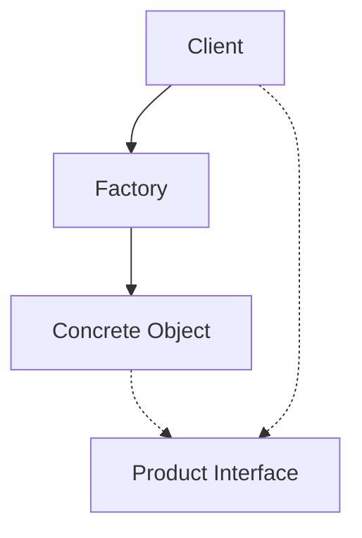
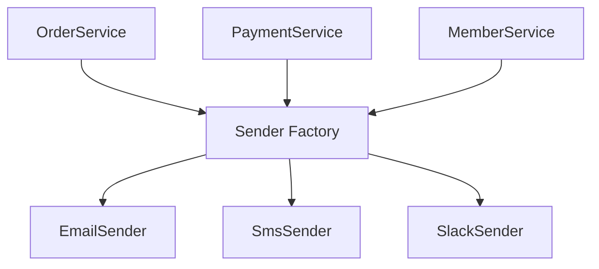
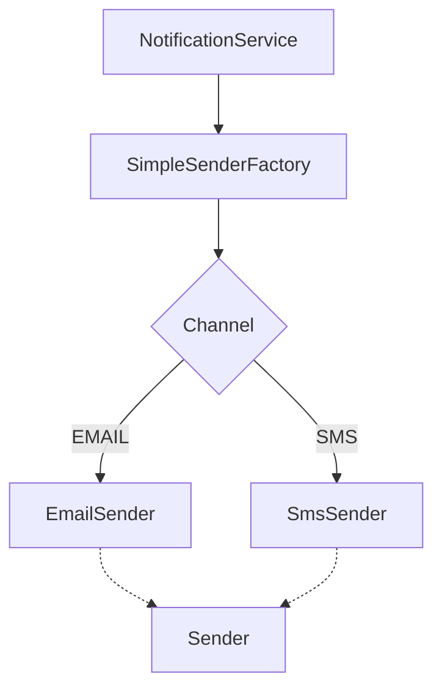
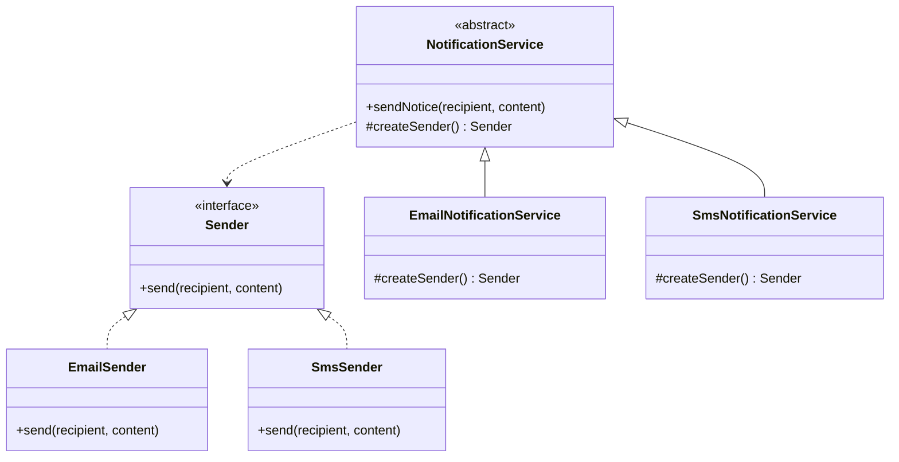
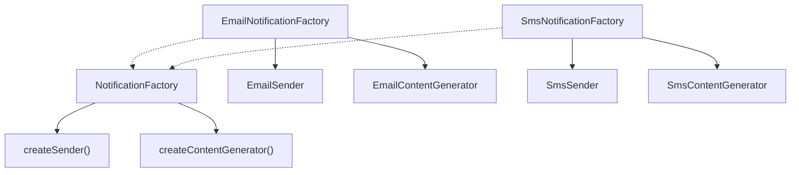
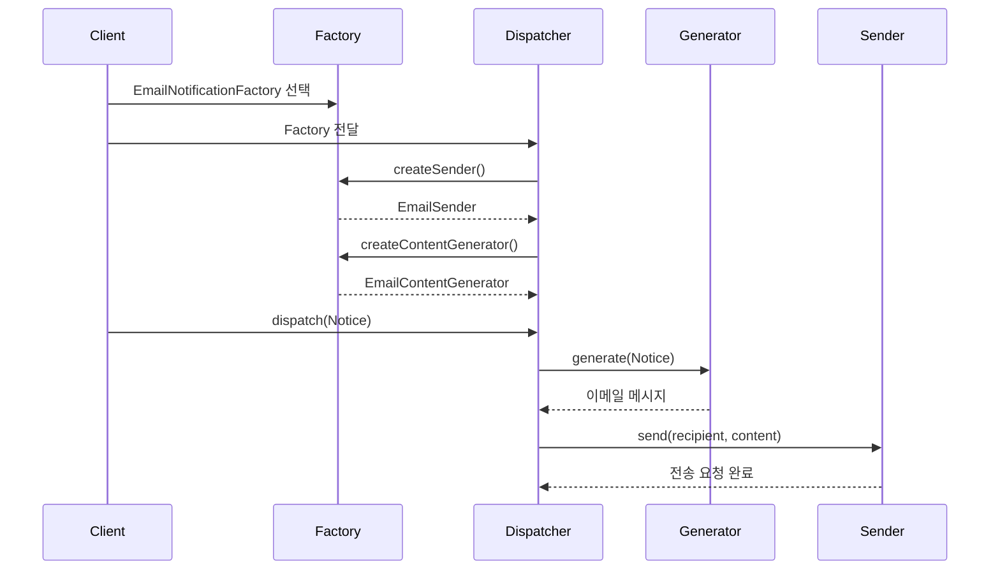
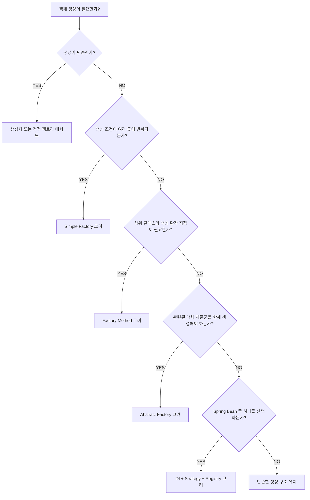

# 에드의 팩토리 패턴
[https://youtu.be/bxlNOb5PDS8?si=80uE7EhXG65ggeWA](https://youtu.be/bxlNOb5PDS8?si=80uE7EhXG65ggeWA)

# 에드의 팩토리 패턴
* toc
{:toc}

---

### Java 팩토리 패턴 완벽 이해: 정적 팩토리 메서드, Simple Factory, Factory Method, Abstract Factory와 Spring 실무 활용

Java로 애플리케이션을 개발하다 보면 객체를 생성하는 코드를 자주 작성한다.

가장 일반적인 방법은 `new` 키워드를 사용하는 것이다.

```java
EmailSender sender = new EmailSender();
```

이 코드는 단순하다.

`EmailSender`라는 객체를 생성한다는 의도가 명확하다.

하지만 시스템이 복잡해지면 객체 생성이 더 이상 단순한 작업이 아닐 수 있다.

예를 들어 사용자에게 알림을 전송하는 시스템을 생각해 보자.

처음에는 이메일만 지원한다.

```java
EmailSender sender = new EmailSender();

sender.send(
        "user@example.com",
        "주문이 완료되었습니다."
);
```

그런데 새로운 요구사항이 추가된다.

이제 SMS도 지원해야 한다.

```java
if (channel == Channel.EMAIL) {

    EmailSender sender = new EmailSender();

    sender.send(
            recipient,
            message
    );

} else if (channel == Channel.SMS) {

    SmsSender sender = new SmsSender();

    sender.send(
            recipient,
            message
    );
}
```

여기까지는 큰 문제가 없어 보인다.

하지만 시간이 지나면서 알림 채널이 계속 증가한다.

Slack, 카카오톡, 푸시 알림 등의 채널이 추가된다.

이제 다음과 같은 문제가 발생할 수 있다.

**새로운 알림 채널이 추가될 때마다 객체를 생성하는 모든 코드를 수정해야 할까?**

**알림을 전송하는 비즈니스 로직이 구체적인 구현 클래스를 직접 알아야 할까?**

**이메일 Sender와 이메일 메시지 생성기를 항상 올바른 조합으로 생성하려면 어떻게 해야 할까?**

**Spring이 이미 객체를 생성하고 의존성을 주입하는데, 별도의 Factory가 필요할까?**

이러한 질문은 객체 생성의 책임을 어떻게 설계할 것인지와 관련된다.

여기서 등장하는 것이 팩토리 패턴이다.

다만 팩토리라는 이름이 붙었다고 해서 모두 동일한 디자인 패턴인 것은 아니다.

Java에서 자주 혼동하는 개념은 다음 네 가지다.

| 구분 | 핵심 목적 | GoF 디자인 패턴 |
|---|---|---|
| 정적 팩토리 메서드 | 이름 있는 메서드로 객체 반환 | 별도의 GoF 패턴 아님 |
| Simple Factory | 객체 생성 로직을 한곳에 모음 | GoF 23개 패턴에는 포함되지 않음 |
| Factory Method | 하위 클래스가 생성할 객체를 결정 | 포함 |
| Abstract Factory | 관련된 객체들을 제품군 단위로 생성 | 포함 |

이 네 가지 개념은 모두 객체 생성과 관련되어 있다.

하지만 해결하려는 문제와 구조적 복잡성이 다르다.

중요한 것은 객체를 생성할 수 있다는 사실이 아니라, **객체 생성에 대한 결정이 어디에 존재하고 어떤 변화로부터 기존 코드를 보호하는가**이다.

---

### 팩토리 패턴이란 무엇인가?

팩토리(Factory)는 객체를 생성하거나 제공하는 역할을 가진 구성 요소를 의미한다.

일반적인 객체 생성은 다음과 같다.

```java
Sender sender = new EmailSender();
```

객체를 사용하는 코드가 구체적인 구현 클래스를 직접 알고 있다.

반면 Factory를 사용하면 다음과 같이 표현할 수 있다.

```java
Sender sender = senderFactory.create();
```

이제 객체를 사용하는 코드는 어떤 구현 클래스가 생성되는지 직접 알 필요가 없을 수 있다.

객체 생성에 대한 결정을 Factory에 위임했기 때문이다.

이를 구조로 표현하면 다음과 같다.



이 구조에서 각 구성 요소의 역할은 다음과 같다.

| 구성 요소 | 역할 |
|---|---|
| Client | 생성된 객체를 사용하는 코드 |
| Factory | 객체 생성 및 선택 책임 |
| Product | Factory가 제공하는 객체 |
| Product Interface | 클라이언트와 구현체 사이의 공통 계약 |

Factory를 사용하면 객체 생성 과정과 실제 비즈니스 로직을 분리할 수 있다.

하지만 Factory가 항상 필요한 것은 아니다.

객체 생성이 단순하고 변경 가능성이 낮다면 직접 생성하는 코드가 더 이해하기 쉬울 수도 있다.

따라서 팩토리 패턴을 이해할 때는 **어떤 문제를 해결하기 위해 생성 책임을 분리하는가**를 먼저 살펴봐야 한다.

---

### 왜 팩토리 패턴을 사용할까?

객체를 생성하는 코드가 여러 곳에 분산되어 있다고 가정하자.

예를 들어 회원가입 서비스에서 이메일을 전송한다.

```java
Sender sender = new EmailSender();
```

결제 서비스에서도 이메일을 전송한다.

```java
Sender sender = new EmailSender();
```

배송 서비스에서도 이메일을 전송한다.

```java
Sender sender = new EmailSender();
```

현재는 세 서비스 모두 이메일을 사용한다.

하지만 이후 사용자 설정에 따라 이메일이나 SMS를 선택해야 한다는 요구사항이 추가되었다.

이제 세 서비스의 객체 생성 코드를 모두 수정해야 할 수 있다.

```java
if (channel == Channel.EMAIL) {
    return new EmailSender();
}

if (channel == Channel.SMS) {
    return new SmsSender();
}
```

또 새로운 알림 채널이 추가되면 조건문이 반복해서 증가한다.

이러한 구조에서는 다음 두 가지 책임이 혼합되어 있다.

첫 번째는 알림을 전송하는 비즈니스 책임이다.

두 번째는 어떤 알림 전송 객체를 생성할지 결정하는 책임이다.

이 둘을 분리하면 객체 생성 방식이 변경되더라도 비즈니스 로직에 미치는 영향을 줄일 수 있다.



이 구조에서는 객체 생성에 대한 결정이 한곳에 모인다.

하지만 여기서 한 가지 질문이 남는다.

**생성 로직을 한곳에 모으는 것만으로 확장성이 충분히 확보될까?**

그렇지는 않다.

이 질문에 답하기 위해 먼저 정적 팩토리 메서드부터 살펴보자.

---

### 정적 팩토리 메서드란 무엇인가?

정적 팩토리 메서드(Static Factory Method)는 생성자를 직접 호출하는 대신 `static` 메서드를 통해 객체를 반환하는 방식이다.

예를 들어 다음과 같다.

```java
User user = User.create("홍길동");
```

내부에서는 객체를 생성할 수 있다.

```java
public static User create(String name) {
    return new User(name);
}
```

이 방식은 Java에서 자주 사용된다.

하지만 정적 팩토리 메서드 자체는 GoF의 Factory Method Pattern과 동일한 개념이 아니다.

두 개념 모두 이름에 Factory Method가 포함되지만 목적과 설계 구조가 다르다.

정적 팩토리 메서드는 **객체를 반환하는 이름 있는 정적 메서드**에 가깝다.

반면 Factory Method Pattern은 상속과 다형성을 활용해 생성할 객체를 결정하는 디자인 패턴이다.

---

### 생성자를 사용하는 방식의 한계

다음과 같은 클래스가 있다고 가정하자.

```java
public class User {

    private final String name;

    private final String email;

    public User(String name) {
        this.name = name;
        this.email = null;
    }
}
```

이제 이름뿐 아니라 이메일만으로도 객체를 생성하고 싶다.

다음 생성자를 추가하면 될까?

```java
public User(String email) {
    this.name = null;
    this.email = email;
}
```

컴파일 오류가 발생한다.

왜 그럴까?

Java는 메서드나 생성자의 이름과 매개변수 타입, 순서 등을 이용해 시그니처를 구분한다.

그런데 두 생성자는 모두 다음 형태다.

```java
User(String)
```

매개변수의 이름이 `name`인지 `email`인지는 오버로딩을 구분하는 기준이 아니다.

따라서 두 생성자를 동시에 선언할 수 없다.

또 생성자 이름은 클래스 이름으로 고정되므로 객체 생성 목적을 이름으로 표현하기 어렵다.

이러한 문제를 해결하는 방법 중 하나가 정적 팩토리 메서드다.

---

### 정적 팩토리 메서드로 생성 목적 표현하기

다음은 회원 검색 조건을 표현하는 클래스다.

이름으로 검색하는 경우와 이메일로 검색하는 경우를 구분한다.

```java
import java.util.Objects;

public final class UserLookupKey {

    public enum Type {
        NAME,
        EMAIL
    }

    private final Type type;

    private final String value;

    private UserLookupKey(
            Type type,
            String value
    ) {

        this.type = Objects.requireNonNull(type);

        if (value == null || value.isBlank()) {
            throw new IllegalArgumentException(
                    "검색 값은 비어 있을 수 없습니다."
            );
        }

        this.value = value;
    }

    public static UserLookupKey byName(
            String name
    ) {

        return new UserLookupKey(
                Type.NAME,
                name
        );
    }

    public static UserLookupKey byEmail(
            String email
    ) {

        return new UserLookupKey(
                Type.EMAIL,
                email
        );
    }

    public Type getType() {
        return type;
    }

    public String getValue() {
        return value;
    }
}
```

사용하는 코드는 다음과 같다.

```java
UserLookupKey nameKey =
        UserLookupKey.byName("홍길동");
```

```java
UserLookupKey emailKey =
        UserLookupKey.byEmail(
                "user@example.com"
        );
```

두 메서드는 모두 `String`을 매개변수로 받는다.

하지만 메서드 이름이 다르기 때문에 시그니처가 충돌하지 않는다.

또 객체 생성 목적이 명확해진다.

```java
byName()
```

이름으로 검색한다는 의미다.

```java
byEmail()
```

이메일로 검색한다는 의미다.

즉 정적 팩토리 메서드는 생성자보다 의도를 명확하게 표현할 수 있다.

---

### 정적 팩토리 메서드의 주요 장점

정적 팩토리 메서드는 단순히 생성자 이름 문제만 해결하는 것이 아니다.

다른 장점도 존재한다.

#### 1. 메서드에 의미 있는 이름을 부여할 수 있다

```java
UserLookupKey.byEmail("user@example.com");
```

이 코드는 어떤 기준으로 객체를 만드는지 쉽게 이해할 수 있다.

#### 2. 항상 새로운 객체를 생성할 필요가 없다

정적 팩토리 메서드는 기존 객체를 반환할 수도 있다.

대표적인 예로 다음 메서드가 있다.

```java
Boolean.valueOf(true);
```

객체를 반환하는 과정에서 기존 인스턴스를 재사용할 수 있다.

따라서 모든 호출에서 반드시 `new`가 수행되는 것은 아니다.

#### 3. 반환 타입의 하위 구현체를 선택할 수 있다

메서드의 반환 타입을 인터페이스로 선언할 수 있다.

```java
public static Sender createSender() {
    return new EmailSender();
}
```

호출자는 `Sender` 인터페이스를 통해 결과를 사용할 수 있다.

#### 4. 객체 생성 규칙을 한곳에서 검증할 수 있다

정적 팩토리 메서드 안에서 유효성 검증을 수행할 수 있다.

```java
public static UserLookupKey byEmail(String email) {

    if (email == null || email.isBlank()) {
        throw new IllegalArgumentException(
                "이메일은 필수입니다."
        );
    }

    return new UserLookupKey(
            Type.EMAIL,
            email
    );
}
```

이렇게 하면 객체 생성에 필요한 규칙을 한곳에서 관리할 수 있다.

---

### 정적 팩토리 메서드의 단점

정적 팩토리 메서드에도 단점이 존재한다.

대표적인 문제는 생성 방법을 발견하기 어려울 수 있다는 점이다.

생성자는 클래스 이름과 함께 명확하게 노출된다.

반면 정적 팩토리 메서드는 개발자가 어떤 이름을 사용했는지 알아야 한다.

또 모든 객체 생성을 정적 메서드로 감싸면 메서드 이름과 생성 경로가 과도하게 늘어날 수 있다.

객체마다 반드시 정적 팩토리 메서드를 만들어야 하는 것은 아니다.

생성자가 단순하고 의미가 명확하다면 다음 코드도 충분히 좋은 설계다.

```java
Money money = new Money(10000, "KRW");
```

핵심은 객체 생성의 의도를 명확하게 표현하는 것이다.

---

### 정적 팩토리 메서드와 Factory Method Pattern은 왜 다를까?

두 개념은 이름이 비슷하기 때문에 자주 혼동된다.

하지만 구조를 비교하면 차이가 분명하다.

| 비교 항목 | 정적 팩토리 메서드 | Factory Method Pattern |
|---|---|---|
| 핵심 목적 | 객체 생성 API 개선 | 생성할 구체 객체의 결정을 확장 가능하게 분리 |
| 주요 수단 | static 메서드 | 상속과 다형성 |
| 생성 결정 | 정적 메서드 내부 | 주로 하위 클래스 |
| 메서드 재정의 | 불가능 | 가능 |
| GoF 패턴 | 아님 | 맞음 |

정적 팩토리 메서드가 반드시 Factory Method Pattern을 구현하는 것은 아니다.

반대로 Factory Method Pattern을 구현하기 위해 `static` 메서드가 필요한 것도 아니다.

이 차이를 이해하면 두 개념을 구분하기 쉬워진다.

---

### Simple Factory란 무엇인가?

Simple Factory는 객체 생성에 대한 결정을 하나의 메서드나 클래스로 모으는 방식이다.

예를 들어 여러 알림 채널을 지원하는 시스템이 있다고 가정하자.

```java
public interface Sender {

    void send(
            String recipient,
            String content
    );
}
```

이메일 구현체를 작성한다.

```java
public class EmailSender implements Sender {

    @Override
    public void send(
            String recipient,
            String content
    ) {

        System.out.println(
                "EMAIL -> " + recipient
                        + " : " + content
        );
    }
}
```

SMS 구현체도 작성한다.

```java
public class SmsSender implements Sender {

    @Override
    public void send(
            String recipient,
            String content
    ) {

        System.out.println(
                "SMS -> " + recipient
                        + " : " + content
        );
    }
}
```

두 구현체는 동일한 `Sender` 인터페이스를 구현한다.

따라서 클라이언트는 구체적인 구현 클래스가 아니라 `Sender`라는 공통 타입으로 객체를 사용할 수 있다.

---

### Factory를 사용하지 않는 경우

먼저 단순한 방식으로 구현해 보자.

```java
public class NotificationService {

    public void send(
            Channel channel,
            String recipient,
            String content
    ) {

        Sender sender;

        if (channel == Channel.EMAIL) {

            sender = new EmailSender();

        } else if (channel == Channel.SMS) {

            sender = new SmsSender();

        } else {

            throw new IllegalArgumentException(
                    "지원하지 않는 채널입니다."
            );
        }

        sender.send(recipient, content);
    }
}
```

현재는 정상적으로 동작한다.

하지만 동일한 생성 로직이 여러 서비스에 반복되면 문제가 발생할 수 있다.

예를 들어 결제 완료 알림과 배송 알림, 회원가입 알림에서 각각 동일한 조건문을 작성할 수 있다.

새로운 알림 채널이 추가되면 모든 조건문을 수정해야 한다.

객체 생성에 대한 책임이 여러 곳에 분산되어 있기 때문이다.

---

### Simple Factory 적용하기

먼저 알림 채널을 정의한다.

```java
public enum Channel {

    EMAIL,

    SMS
}
```

그리고 생성 책임을 Factory 클래스로 이동한다.

```java
public final class SimpleSenderFactory {

    private SimpleSenderFactory() {
    }

    public static Sender create(
            Channel channel
    ) {

        return switch (channel) {

            case EMAIL -> new EmailSender();

            case SMS -> new SmsSender();
        };
    }
}
```

이제 클라이언트는 직접 분기하지 않아도 된다.

```java
Sender sender =
        SimpleSenderFactory.create(
                Channel.EMAIL
        );

sender.send(
        "user@example.com",
        "주문이 완료되었습니다."
);
```

알림 서비스도 간단해진다.

```java
public class NotificationService {

    public void send(
            Channel channel,
            String recipient,
            String content
    ) {

        Sender sender =
                SimpleSenderFactory.create(channel);

        sender.send(recipient, content);
    }
}
```

이제 객체 생성에 대한 결정은 `SimpleSenderFactory`에서 수행한다.

---

### Simple Factory의 동작 구조



이 구조의 장점은 명확하다.

객체 생성 로직이 한곳에 모인다.

클라이언트에서는 조건문이 사라진다.

동일한 생성 규칙을 여러 곳에서 반복하지 않아도 된다.

하지만 아직 문제가 남아 있다.

---

### Simple Factory의 한계

새로운 Slack 알림 채널이 추가되었다고 가정하자.

먼저 다음 구현체를 추가한다.

```java
public class SlackSender implements Sender {

    @Override
    public void send(
            String recipient,
            String content
    ) {

        System.out.println(
                "SLACK -> " + recipient
                        + " : " + content
        );
    }
}
```

그리고 Channel에 Slack을 추가한다.

```java
public enum Channel {

    EMAIL,

    SMS,

    SLACK
}
```

이제 Factory도 수정해야 한다.

```java
public static Sender create(Channel channel) {

    return switch (channel) {

        case EMAIL -> new EmailSender();

        case SMS -> new SmsSender();

        case SLACK -> new SlackSender();
    };
}
```

객체 생성 로직의 중복은 제거했다.

하지만 새로운 구현체가 추가되면 Factory 내부 코드를 수정해야 한다.

즉 변화가 한곳에 집중되었지만, 기존 Factory가 확장에 대해 완전히 닫힌 것은 아니다.

여기서 OCP를 이해할 필요가 있다.

---

### OCP란 무엇인가?

OCP는 Open-Closed Principle의 약자다.

개방-폐쇄 원칙이라고 부른다.

SOLID 원칙 중 하나다.

핵심 의미는 다음과 같다.

**소프트웨어 구성 요소는 확장에는 열려 있어야 하고, 기존 동작의 수정에는 닫혀 있어야 한다.**

예를 들어 새로운 알림 채널이 추가되는 상황을 생각해 보자.

기존 코드를 수정하는 방식은 다음과 같다.

```java
if (channel == EMAIL) {

    // 이메일

} else if (channel == SMS) {

    // SMS

} else if (channel == SLACK) {

    // Slack
}
```

새로운 채널이 추가될 때마다 조건문이 증가한다.

반면 다형성을 이용하면 새로운 구현체를 추가하는 방식으로 기능을 확장할 수 있다.

```java
public interface Sender {

    void send(String recipient, String content);
}
```

이 인터페이스를 구현하는 새로운 클래스를 작성한다.

```java
public class SlackSender implements Sender {

    @Override
    public void send(
            String recipient,
            String content
    ) {
        // Slack 전송
    }
}
```

기존 `Sender` 인터페이스나 이미 구현된 Sender를 수정하지 않고 새로운 채널을 추가할 수 있다.

다만 여기서 중요한 점이 있다.

**OCP는 기능을 확장할 때 프로젝트의 어떤 코드도 수정해서는 안 된다는 의미가 아니다.**

새로운 기능을 시스템에 연결하려면 설정이나 구성 코드가 변경될 수 있다.

핵심은 변경 가능성이 높은 요구사항 때문에 안정적인 핵심 로직을 반복해서 수정하지 않도록 설계하는 것이다.

또 Simple Factory가 항상 OCP를 위반하는 잘못된 설계라고 볼 수는 없다.

지원하는 타입이 거의 변경되지 않는다면 Simple Factory만으로도 충분히 좋은 설계일 수 있다.

---

### Simple Factory는 디자인 패턴이 아닐까?

Simple Factory는 일반적으로 GoF의 23개 디자인 패턴에는 포함되지 않는다.

하지만 넓은 의미에서는 객체 생성에 대한 설계 관용구나 패턴으로 분류하기도 한다.

따라서 Simple Factory를 무조건 패턴이 아니라고 단정하기보다는 **GoF의 정식 Factory Method 및 Abstract Factory와 구분되는 단순한 생성 기법**으로 이해하는 것이 정확하다.

또 Simple Factory가 반드시 정적 메서드만으로 구현되어야 하는 것도 아니다.

예를 들어 다음처럼 일반 인스턴스 메서드로 구현할 수도 있다.

```java
public class SenderFactory {

    public Sender create(Channel channel) {

        return switch (channel) {

            case EMAIL -> new EmailSender();

            case SMS -> new SmsSender();

            case SLACK -> new SlackSender();
        };
    }
}
```

중요한 것은 `static` 여부가 아니다.

여러 종류의 객체를 생성하는 결정을 하나의 위치에 모았다는 점이다.

---

### Factory Method Pattern이란 무엇인가?

Factory Method Pattern은 객체 생성을 위한 메서드를 상위 타입에 정의하고, 구체적으로 어떤 객체를 반환할지는 하위 클래스가 결정하도록 하는 생성 패턴이다.

GoF의 생성 패턴 중 하나다.

이 패턴의 핵심은 다음과 같다.

**객체를 사용하는 공통 로직은 상위 클래스에 두고, 어떤 객체를 사용할지는 하위 클래스가 결정한다.**

Factory Method Pattern에서는 일반적으로 다음 구성 요소가 등장한다.

| 구성 요소 | 역할 |
|---|---|
| Product | 생성 대상의 공통 인터페이스 |
| Concrete Product | 실제 생성되는 구현 객체 |
| Creator | Factory Method와 공통 로직을 정의 |
| Concrete Creator | Factory Method를 구현해 구체 객체 결정 |

이 구조에서는 객체 생성과 공통 비즈니스 로직을 결합하되, 구체적인 구현체에 대한 의존을 줄일 수 있다.

Factory Method Pattern은 하위 클래스가 생성할 제품을 결정하도록 한다는 점에서 Simple Factory와 다르다.

---

### Factory Method Pattern의 구조

알림 시스템을 이용해 살펴보자.

기존에는 채널마다 Sender를 생성하는 로직이 존재했다.

이제 알림 전송의 공통 흐름을 상위 클래스에 정의한다.

그리고 Sender를 생성하는 부분만 하위 클래스가 구현하도록 만든다.



이 구조에서 `NotificationService`는 Creator에 해당한다.

`EmailNotificationService`와 `SmsNotificationService`는 Concrete Creator다.

`Sender`는 Product 인터페이스다.

`EmailSender`와 `SmsSender`는 Concrete Product다.

이제 실제 코드를 살펴보자.

---

### Factory Method Pattern 구현하기

먼저 공통 알림 서비스 클래스를 작성한다.

```java
public abstract class NotificationService {

    public final void sendNotice(
            String recipient,
            String content
    ) {

        validate(recipient, content);

        Sender sender = createSender();

        sender.send(recipient, content);

        recordResult(recipient);
    }

    protected abstract Sender createSender();

    private void validate(
            String recipient,
            String content
    ) {

        if (recipient == null || recipient.isBlank()) {
            throw new IllegalArgumentException(
                    "수신자는 필수입니다."
            );
        }

        if (content == null || content.isBlank()) {
            throw new IllegalArgumentException(
                    "내용은 필수입니다."
            );
        }
    }

    private void recordResult(String recipient) {

        System.out.println(
                "전송 요청 완료: " + recipient
        );
    }
}
```

여기서 중요한 메서드는 다음과 같다.

```java
protected abstract Sender createSender();
```

상위 클래스는 어떤 Sender가 생성되는지 직접 결정하지 않는다.

단지 Sender를 제공하는 메서드가 존재해야 한다는 계약만 정의한다.

실제 Sender 생성은 하위 클래스가 담당한다.

또 알림 전송의 공통 흐름은 다음 메서드에 정의되어 있다.

```java
public final void sendNotice(
        String recipient,
        String content
)
```

이 메서드는 다음 순서로 동작한다.

```text
입력값 검증

↓

Sender 생성

↓

알림 전송

↓

전송 요청 결과 기록
```

상위 클래스는 이 공통 흐름을 재사용한다.

---

### EmailNotificationService 구현

이메일 알림 서비스를 작성한다.

```java
public class EmailNotificationService
        extends NotificationService {

    @Override
    protected Sender createSender() {

        return new EmailSender();
    }
}
```

이 클래스는 이메일 Sender를 생성하는 책임을 가진다.

반면 공통적인 검증과 전송 흐름은 상위 클래스에 구현되어 있다.

따라서 하위 클래스에서는 객체 생성 방법만 결정하면 된다.

---

### SmsNotificationService 구현

SMS 알림 서비스도 작성한다.

```java
public class SmsNotificationService
        extends NotificationService {

    @Override
    protected Sender createSender() {

        return new SmsSender();
    }
}
```

이제 클라이언트는 다음과 같이 사용할 수 있다.

```java
NotificationService service =
        new EmailNotificationService();

service.sendNotice(
        "user@example.com",
        "주문이 완료되었습니다."
);
```

SMS를 사용하려면 다음과 같이 변경한다.

```java
NotificationService service =
        new SmsNotificationService();

service.sendNotice(
        "01012345678",
        "주문이 완료되었습니다."
);
```

중요한 점은 `sendNotice()`의 공통 로직이 변경되지 않았다는 것이다.

생성할 Sender만 하위 클래스에서 결정한다.

---

### 새로운 Slack 채널이 추가된다면?

Slack 알림을 지원해야 한다고 가정하자.

먼저 SlackSender를 구현한다.

```java
public class SlackSender implements Sender {

    @Override
    public void send(
            String recipient,
            String content
    ) {

        System.out.println(
                "SLACK -> " + recipient
                        + " : " + content
        );
    }
}
```

그리고 새로운 Creator를 추가한다.

```java
public class SlackNotificationService
        extends NotificationService {

    @Override
    protected Sender createSender() {

        return new SlackSender();
    }
}
```

기존 `NotificationService`를 수정할 필요가 없다.

기존 EmailNotificationService나 SmsNotificationService도 수정하지 않는다.

새로운 클래스를 추가하는 방식으로 기능을 확장했다.

이것이 Factory Method Pattern이 OCP를 지원하는 대표적인 방식이다.

---

### Factory Method Pattern의 중요한 특징

Factory Method Pattern을 이해할 때는 몇 가지 사실을 정확히 구분해야 한다.

#### Factory Method는 반드시 abstract일 필요가 없다

다음처럼 상위 클래스에서 기본 구현을 제공할 수도 있다.

```java
protected Sender createSender() {

    return new EmailSender();
}
```

하위 클래스가 필요할 때 재정의하는 구조도 가능하다.

따라서 Factory Method Pattern이 반드시 추상 클래스와 추상 메서드만으로 구현되어야 하는 것은 아니다.

#### 항상 새로운 객체를 생성할 필요는 없다

다음과 같이 기존 객체를 반환할 수도 있다.

```java
private final Sender sender = new EmailSender();

protected Sender createSender() {

    return sender;
}
```

Factory Method의 핵심은 항상 `new`를 호출하는 것이 아니다.

어떤 Product를 제공할지 결정하는 책임을 분리하는 것이다.

#### 객체 생성이 Creator의 유일한 책임은 아니다

Factory Method Pattern에서 Creator는 객체를 생성하는 기능만 가진 클래스가 아닐 수 있다.

앞서 작성한 NotificationService는 알림 전송의 공통 흐름도 관리한다.

Factory Method는 그 공통 로직에서 사용할 구체적인 Product를 결정하는 확장 지점이다.

이 점이 단순한 Factory 유틸리티 클래스와 중요한 차이다.

---

### Factory Method와 Template Method의 관계

앞서 작성한 다음 메서드를 다시 살펴보자.

```java
public final void sendNotice(
        String recipient,
        String content
) {

    validate(recipient, content);

    Sender sender = createSender();

    sender.send(recipient, content);

    recordResult(recipient);
}
```

이 메서드는 전체 알고리즘의 실행 순서를 정의한다.

그런데 다음 부분은 하위 클래스에 위임한다.

```java
Sender sender = createSender();
```

이러한 구조는 Template Method Pattern과도 관련이 있다.

Template Method는 상위 클래스가 알고리즘의 공통 흐름을 정의하고 일부 단계를 하위 클래스가 구현하도록 한다.

Factory Method 역시 이러한 확장 지점으로 활용될 수 있다.

두 패턴은 서로 배타적인 관계가 아니다.

하나의 설계 안에서 함께 사용할 수 있다.

다만 Factory Method의 관심사는 객체 생성이다.

Template Method의 관심사는 알고리즘의 공통 흐름과 변경 가능한 단계의 분리다.

---

### Factory Method Pattern의 장점

가장 큰 장점은 구체적인 구현 객체에 대한 의존을 줄일 수 있다는 것이다.

상위 클래스는 `Sender` 인터페이스만 알고 있다.

```java
Sender sender = createSender();
```

따라서 EmailSender가 생성되는지 SmsSender가 생성되는지 몰라도 알림을 전송할 수 있다.

또 새로운 구현체를 추가할 때 기존 공통 로직을 수정할 필요가 없다.

이는 확장성과 유지보수성에 도움이 된다.

하지만 단점도 존재한다.

---

### Factory Method Pattern의 단점

가장 대표적인 단점은 클래스 수가 증가한다는 점이다.

알림 채널이 세 개라면 다음과 같은 구조가 필요할 수 있다.

```text
NotificationService
├── EmailNotificationService
├── SmsNotificationService
└── SlackNotificationService
```

각 채널마다 Creator와 Product가 필요해질 수 있다.

또 상속을 사용하기 때문에 상위 클래스와 하위 클래스 사이의 결합 관계가 생긴다.

특히 실제 애플리케이션에서 이미 Spring DI를 사용하고 있다면 채널마다 Creator 클래스를 만드는 것이 불필요할 수 있다.

예를 들어 다음 코드만으로도 의존성을 분리할 수 있다.

```java
public class NotificationService {

    private final Sender sender;

    public NotificationService(Sender sender) {
        this.sender = sender;
    }

    public void send(
            String recipient,
            String content
    ) {
        sender.send(recipient, content);
    }
}
```

이 방식에서는 상속 없이 조합을 사용한다.

따라서 Factory Method Pattern이 항상 최선의 선택은 아니다.

---

### Abstract Factory Pattern이란 무엇인가?

지금까지는 알림을 전송하기 위해 Sender 객체 하나만 필요했다.

하지만 요구사항이 추가되었다고 가정하자.

이메일을 전송할 때는 제목과 본문을 포함해야 한다.

SMS를 전송할 때는 모바일 메시지 형식에 맞게 내용을 구성해야 한다.

이제 알림 시스템에는 두 종류의 객체가 필요하다.

첫 번째는 실제 알림을 전송하는 Sender다.

두 번째는 메시지 내용을 생성하는 ContentGenerator다.

```text
Email

→ EmailSender
→ EmailContentGenerator
```

```text
SMS

→ SmsSender
→ SmsContentGenerator
```

그런데 두 객체를 각각 독립적으로 선택하면 어떻게 될까?

```java
Sender sender = new EmailSender();

ContentGenerator generator =
        new SmsContentGenerator();
```

이메일 전송 객체에 SMS 메시지 생성기가 연결되었다.

이러한 조합은 의도하지 않은 결과를 만들 수 있다.

이 문제를 해결하기 위해 관련된 객체들을 하나의 제품군으로 묶어 생성하도록 할 수 있다.

이때 사용하는 패턴이 Abstract Factory Pattern이다.

---

### Abstract Factory Pattern의 핵심

Abstract Factory Pattern은 서로 관련되거나 함께 사용되어야 하는 객체들의 제품군을 생성하기 위한 인터페이스를 제공하는 패턴이다.

구체적인 구현 클래스를 직접 지정하지 않고 제품군을 생성할 수 있도록 한다.

예를 들어 다음과 같은 구조다.



EmailNotificationFactory는 이메일과 관련된 객체들을 제공한다.

SmsNotificationFactory는 SMS와 관련된 객체들을 제공한다.

클라이언트는 어떤 제품군을 사용할지만 결정하면 된다.

그 안에서 생성되는 Sender와 ContentGenerator는 동일한 채널에 맞게 구성된다.

Abstract Factory Pattern의 핵심은 여러 개의 객체를 생성한다는 사실 자체가 아니라, **호환되어야 하는 객체들을 일관된 제품군으로 생성한다는 점**이다.

---

### Abstract Factory Pattern의 구성 요소

Abstract Factory에서는 다음 구성 요소가 등장한다.

| 구성 요소 | 역할 |
|---|---|
| Abstract Factory | 제품군을 생성하는 공통 인터페이스 |
| Concrete Factory | 특정 제품군을 생성하는 구현체 |
| Abstract Product | 각 제품 종류의 공통 인터페이스 |
| Concrete Product | 실제 제품 구현체 |
| Client | Factory를 통해 제품을 사용하는 코드 |

알림 시스템에 대입하면 다음과 같다.

| 역할 | 알림 시스템 |
|---|---|
| Abstract Factory | NotificationFactory |
| Concrete Factory | EmailNotificationFactory, SmsNotificationFactory |
| Abstract Product A | Sender |
| Abstract Product B | ContentGenerator |
| Concrete Product A | EmailSender, SmsSender |
| Concrete Product B | EmailContentGenerator, SmsContentGenerator |
| Client | NotificationDispatcher |

이제 실제 코드로 구현해 보자.

---

### Abstract Factory Pattern 전체 구현

다음 예제는 Java 17 이상에서 실행할 수 있도록 하나의 파일로 구성했다.

파일 이름은 `NotificationFactoryDemo.java`다.

```java
public class NotificationFactoryDemo {

    public static void main(String[] args) {

        Notice emailNotice = new Notice(
                "user@example.com",
                "주문 완료",
                "주문이 정상적으로 접수되었습니다."
        );

        NotificationFactory emailFactory =
                new EmailNotificationFactory();

        NotificationDispatcher emailDispatcher =
                new NotificationDispatcher(emailFactory);

        emailDispatcher.dispatch(emailNotice);


        Notice smsNotice = new Notice(
                "01012345678",
                "주문 완료",
                "주문이 정상적으로 접수되었습니다."
        );

        NotificationFactory smsFactory =
                new SmsNotificationFactory();

        NotificationDispatcher smsDispatcher =
                new NotificationDispatcher(smsFactory);

        smsDispatcher.dispatch(smsNotice);
    }


    // 알림 요청 데이터
    record Notice(
            String recipient,
            String title,
            String body
    ) {
    }


    // 첫 번째 제품군: 알림 전송
    interface Sender {

        void send(
                String recipient,
                String content
        );
    }


    // 두 번째 제품군: 알림 내용 생성
    interface ContentGenerator {

        String generate(Notice notice);
    }


    // 추상 팩토리
    interface NotificationFactory {

        Sender createSender();

        ContentGenerator createContentGenerator();
    }


    // 이메일 Sender
    static final class EmailSender implements Sender {

        @Override
        public void send(
                String recipient,
                String content
        ) {

            System.out.println(
                    "[EMAIL] " + recipient
            );

            System.out.println(content);
        }
    }


    // SMS Sender
    static final class SmsSender implements Sender {

        @Override
        public void send(
                String recipient,
                String content
        ) {

            System.out.println(
                    "[SMS] " + recipient
            );

            System.out.println(content);
        }
    }


    // 이메일 내용 생성
    static final class EmailContentGenerator
            implements ContentGenerator {

        @Override
        public String generate(Notice notice) {

            return "제목: " + notice.title()
                    + "\n본문: " + notice.body();
        }
    }


    // SMS 내용 생성
    static final class SmsContentGenerator
            implements ContentGenerator {

        @Override
        public String generate(Notice notice) {

            return "[알림] " + notice.body();
        }
    }


    // 이메일 제품군 생성
    static final class EmailNotificationFactory
            implements NotificationFactory {

        @Override
        public Sender createSender() {

            return new EmailSender();
        }

        @Override
        public ContentGenerator createContentGenerator() {

            return new EmailContentGenerator();
        }
    }


    // SMS 제품군 생성
    static final class SmsNotificationFactory
            implements NotificationFactory {

        @Override
        public Sender createSender() {

            return new SmsSender();
        }

        @Override
        public ContentGenerator createContentGenerator() {

            return new SmsContentGenerator();
        }
    }


    // 팩토리를 사용하는 클라이언트
    static final class NotificationDispatcher {

        private final Sender sender;

        private final ContentGenerator generator;

        public NotificationDispatcher(
                NotificationFactory factory
        ) {

            this.sender = factory.createSender();

            this.generator =
                    factory.createContentGenerator();
        }

        public void dispatch(Notice notice) {

            String content = generator.generate(notice);

            sender.send(
                    notice.recipient(),
                    content
            );
        }
    }
}
```

이 예제에서 중요한 부분을 하나씩 살펴보자.

---

### 1. Abstract Product 정의

먼저 두 종류의 제품 인터페이스를 정의한다.

첫 번째는 Sender다.

```java
interface Sender {

    void send(
            String recipient,
            String content
    );
}
```

두 번째는 ContentGenerator다.

```java
interface ContentGenerator {

    String generate(Notice notice);
}
```

Sender는 알림 전송이라는 책임을 가진다.

ContentGenerator는 전송할 메시지를 생성하는 책임을 가진다.

두 객체는 서로 다른 역할을 수행하지만 알림 채널에 따라 함께 사용되어야 한다.

따라서 제품군을 구성하기 적합하다.

---

### 2. Abstract Factory 정의

다음 인터페이스를 살펴보자.

```java
interface NotificationFactory {

    Sender createSender();

    ContentGenerator createContentGenerator();
}
```

이 인터페이스는 두 종류의 제품을 제공한다.

중요한 점은 구체적인 구현 클래스를 반환하지 않는다는 것이다.

다음 메서드의 반환 타입은 Sender다.

```java
Sender createSender();
```

다음 메서드의 반환 타입은 ContentGenerator다.

```java
ContentGenerator createContentGenerator();
```

따라서 클라이언트는 구체적인 클래스에 직접 의존하지 않아도 된다.

---

### 3. Concrete Factory 구현

이메일 Factory를 살펴보자.

```java
static final class EmailNotificationFactory
        implements NotificationFactory {

    @Override
    public Sender createSender() {

        return new EmailSender();
    }

    @Override
    public ContentGenerator createContentGenerator() {

        return new EmailContentGenerator();
    }
}
```

EmailNotificationFactory는 이메일 제품군을 생성한다.

Sender를 요청하면 EmailSender를 제공한다.

ContentGenerator를 요청하면 EmailContentGenerator를 제공한다.

SMS Factory도 동일한 구조다.

```java
static final class SmsNotificationFactory
        implements NotificationFactory {

    @Override
    public Sender createSender() {

        return new SmsSender();
    }

    @Override
    public ContentGenerator createContentGenerator() {

        return new SmsContentGenerator();
    }
}
```

따라서 클라이언트가 동일한 Factory에서 두 객체를 생성하면 서로 호환되는 제품군을 사용할 수 있다.

물론 이 패턴이 시스템 전체에서 잘못된 객체 조합을 물리적으로 불가능하게 만드는 것은 아니다.

다른 경로에서 객체를 직접 생성하거나 잘못 구성하면 호환성이 깨질 수 있다.

중요한 것은 클라이언트가 제품군을 선택하는 표준 경로를 제공해 잘못된 조합의 가능성을 줄이는 것이다.

---

### 4. Client 구현

다음 클래스가 실제 알림 전송을 수행한다.

```java
static final class NotificationDispatcher {

    private final Sender sender;

    private final ContentGenerator generator;

    public NotificationDispatcher(
            NotificationFactory factory
    ) {

        this.sender = factory.createSender();

        this.generator =
                factory.createContentGenerator();
    }

    public void dispatch(Notice notice) {

        String content = generator.generate(notice);

        sender.send(
                notice.recipient(),
                content
        );
    }
}
```

여기서 주목해야 할 부분은 생성자다.

```java
public NotificationDispatcher(
        NotificationFactory factory
)
```

클라이언트는 구체적인 Factory가 아니라 NotificationFactory 인터페이스에 의존한다.

따라서 이메일 Factory를 전달해도 동작한다.

```java
new NotificationDispatcher(
        new EmailNotificationFactory()
);
```

SMS Factory를 전달해도 동작한다.

```java
new NotificationDispatcher(
        new SmsNotificationFactory()
);
```

이처럼 클라이언트 코드는 제품군의 구체적인 구현을 몰라도 동일한 방식으로 동작한다.

---

### Abstract Factory Pattern의 실행 결과

앞서 작성한 전체 코드를 컴파일한다.

```bash
javac NotificationFactoryDemo.java
```

`javac`은 Java 소스 코드를 클래스 파일로 컴파일한다.

이후 다음 명령어로 실행한다.

```bash
java NotificationFactoryDemo
```

예상 결과는 다음과 같다.

```text
[EMAIL] user@example.com
제목: 주문 완료
본문: 주문이 정상적으로 접수되었습니다.

[SMS] 01012345678
[알림] 주문이 정상적으로 접수되었습니다.
```

이 결과에서 이메일과 SMS는 서로 다른 메시지 형식을 사용한다.

하지만 실제 전송을 실행하는 NotificationDispatcher는 동일하다.

또 예제에서는 콘솔 출력을 통해 전송 동작을 표현했지만, 실제 서비스에서는 외부 이메일·SMS 제공자의 API 호출 등이 필요하다.

SMS는 문자 수와 인코딩, 통신사 및 제공업체 정책에 따라 메시지 분할 기준이 달라질 수 있다.

따라서 운영 환경에서는 단순히 Java 문자열 길이가 90을 초과하는지만 확인하는 방식으로 실제 SMS 길이 제한을 판단해서는 안 된다.

---

### Abstract Factory Pattern의 전체 실행 흐름



이 구조의 가장 중요한 특징은 제품군의 일관성이다.

EmailNotificationFactory를 사용하면 이메일과 관련된 객체들을 제공한다.

SmsNotificationFactory를 사용하면 SMS와 관련된 객체들을 제공한다.

따라서 서로 다른 채널의 구성 요소가 잘못 조합되는 문제를 줄일 수 있다.

---

### Abstract Factory Pattern의 장점

첫 번째 장점은 관련된 객체를 일관되게 생성할 수 있다는 것이다.

이메일 전송에 필요한 Sender와 ContentGenerator를 하나의 제품군으로 관리할 수 있다.

두 번째 장점은 구체적인 구현 클래스에 대한 의존을 줄일 수 있다는 것이다.

클라이언트는 NotificationFactory와 Sender, ContentGenerator 인터페이스만 알면 된다.

세 번째 장점은 새로운 제품군을 추가하기 쉽다는 것이다.

예를 들어 Slack 제품군이 필요하다면 다음 클래스를 추가할 수 있다.

```text
SlackSender

SlackContentGenerator

SlackNotificationFactory
```

기존 NotificationDispatcher의 핵심 로직을 수정하지 않아도 된다.

---

### Abstract Factory Pattern의 단점

Abstract Factory는 새로운 제품군을 추가하는 데 유리하다.

하지만 새로운 제품 종류를 추가하는 것은 상대적으로 어렵다.

예를 들어 기존 Factory는 다음 두 객체를 생성한다.

```java
Sender createSender();

ContentGenerator createContentGenerator();
```

그런데 새로운 요구사항이 추가되었다고 가정하자.

이제 각 알림 채널마다 별도의 전송 결과 검증기가 필요하다.

```java
DeliveryValidator createDeliveryValidator();
```

이 메서드를 Abstract Factory에 추가하면 기존의 모든 Concrete Factory에도 해당 메서드를 구현해야 할 수 있다.

```text
NotificationFactory 변경

↓

EmailNotificationFactory 변경

↓

SmsNotificationFactory 변경

↓

SlackNotificationFactory 변경
```

즉 새로운 제품군을 추가할 때는 유리하지만 제품군을 구성하는 제품의 종류 자체가 자주 변경된다면 유지보수 비용이 증가할 수 있다.

이것이 Abstract Factory Pattern의 중요한 설계상 트레이드오프다.

---

### Factory Method와 Abstract Factory의 차이

두 패턴은 모두 생성 패턴이지만 해결하려는 문제의 중심이 다르다.

Factory Method Pattern은 주로 **어떤 구체 객체를 생성할 것인가**에 초점을 맞춘다.

Abstract Factory Pattern은 **어떤 관련 객체들의 제품군을 사용할 것인가**에 초점을 맞춘다.

| 비교 항목 | Factory Method | Abstract Factory |
|---|---|---|
| 핵심 목적 | 구체적인 Product 생성 결정 위임 | 관련된 Product Family 생성 |
| 주요 구조 | 상속과 메서드 재정의 | Factory 인터페이스와 구체 Factory |
| 생성 대상 | 일반적으로 하나의 제품 계층 | 여러 종류의 관련 제품 |
| 확장 방식 | 새로운 Creator 하위 클래스 | 새로운 Concrete Factory |
| 강점 | 단일 제품 계층의 확장 | 제품군의 일관성 |
| 단점 | Creator 클래스 증가 | 새로운 제품 종류 추가 시 변경 범위 증가 |
| 주요 활용 | 객체 생성의 확장 지점 | 호환되어야 하는 객체 집합 |

이 차이는 패턴의 목적을 구분하는 데 도움이 된다.

다만 Abstract Factory 내부에서도 Factory Method를 사용할 수 있다.

즉 두 패턴은 완전히 배타적인 구조가 아니다.

하나의 시스템에서 함께 적용될 수도 있다.

---

### 네 가지 팩토리 개념을 비교해 보자

지금까지 살펴본 네 가지 개념을 정리해 보자.

| 구분 | 정적 팩토리 메서드 | Simple Factory | Factory Method | Abstract Factory |
|---|---|---|---|---|
| 객체 생성 방식 | static 메서드 | 공통 생성 메서드 | 하위 클래스의 Factory Method | 구체 Factory의 여러 생성 메서드 |
| 주요 목적 | 생성 의도 표현 | 생성 분기 집중 | 생성할 객체의 결정 위임 | 제품군 생성 |
| 상속 필수 여부 | 필요 없음 | 필요 없음 | 일반적으로 사용 | 필수 아님 |
| 인터페이스 사용 | 선택적 | 선택적 | 주로 사용 | 주로 사용 |
| 확장 방식 | 새 메서드 추가 등 | Factory 수정 가능 | 하위 클래스 추가 | 구체 Factory 추가 |
| 구조적 복잡성 | 낮음 | 낮음 | 중간 | 상대적으로 높음 |
| GoF 패턴 | 아님 | 아님 | 맞음 | 맞음 |

이 표에서 한 가지 중요한 사실을 발견할 수 있다.

팩토리라는 이름이 붙었다고 모두 같은 복잡성을 가진 것은 아니다.

따라서 단순한 문제에 Abstract Factory를 적용할 필요는 없다.

반대로 서로 호환되어야 하는 여러 객체가 존재하는데 생성 로직을 모두 조건문으로 처리하면 복잡성이 증가할 수 있다.

결국 문제의 성질에 맞는 생성 방식을 선택해야 한다.

---

### Factory Method와 Strategy Pattern은 무엇이 다를까?

백엔드 개발에서는 Factory와 Strategy Pattern도 자주 함께 등장한다.

둘은 비슷해 보이지만 관심사가 다르다.

Strategy Pattern은 알고리즘이나 동작을 교체할 수 있도록 설계하는 패턴이다.

예를 들어 다음 인터페이스를 생각해 보자.

```java
public interface Sender {

    void send(
            String recipient,
            String content
    );
}
```

EmailSender와 SmsSender는 서로 다른 전송 전략을 구현한다.

```java
Sender sender = new EmailSender();
```

또는 다음과 같이 선택할 수 있다.

```java
Sender sender = new SmsSender();
```

이러한 구조는 Strategy Pattern과 관련이 있다.

반면 Factory의 관심사는 다음과 같다.

```java
Sender sender = factory.createSender();
```

어떤 Sender 객체를 제공할지 결정하는 것이다.

따라서 다음과 같이 구분할 수 있다.

```text
Strategy Pattern

→ 어떤 동작을 수행할 것인가?
```

```text
Factory Pattern

→ 어떤 객체를 생성하거나 제공할 것인가?
```

실무에서는 두 패턴을 함께 사용할 수 있다.

Factory가 적절한 Strategy 구현체를 선택하고, Service는 선택된 Strategy를 실행하는 방식이다.

---

### Spring에서는 Factory Pattern을 어떻게 활용할까?

지금까지는 Java 코드에서 직접 객체를 생성하는 방식을 살펴보았다.

하지만 Spring Boot 애플리케이션에서는 상황이 조금 다르다.

Spring은 IoC Container를 통해 Bean을 생성하고 관리한다.

또 필요한 의존성을 주입할 수 있다.

따라서 다음과 같은 코드를 직접 작성하지 않아도 된다.

```java
Sender sender = new EmailSender();
```

대신 Spring이 관리하는 객체를 주입받을 수 있다.

```java
@Service
public class NotificationService {

    private final Sender sender;

    public NotificationService(Sender sender) {
        this.sender = sender;
    }
}
```

이러한 구조에서는 객체 생성 책임이 Spring Container로 이동한다.

Spring은 생성자나 Factory Method, 설정 클래스 등을 이용해 Bean을 구성할 수 있다.

즉 Spring을 사용한다면 직접 Factory 클래스를 작성하기 전에 **이미 Container가 제공하는 객체 생성 및 의존성 주입 기능으로 문제를 해결할 수 있는지** 검토할 필요가 있다.

---

### Spring DI로 알림 채널 선택하기

실제 Spring Boot 프로젝트에서는 이메일, SMS, Slack Sender를 Bean으로 등록할 수 있다.

먼저 공통 인터페이스를 정의한다.

```java
public interface ChannelSender {

    String channel();

    void send(
            String recipient,
            String content
    );
}
```

이메일 구현체를 작성한다.

```java
@Component
public class EmailChannelSender
        implements ChannelSender {

    @Override
    public String channel() {
        return "EMAIL";
    }

    @Override
    public void send(
            String recipient,
            String content
    ) {

        System.out.println(
                "EMAIL: " + content
        );
    }
}
```

SMS 구현체도 작성한다.

```java
@Component
public class SmsChannelSender
        implements ChannelSender {

    @Override
    public String channel() {
        return "SMS";
    }

    @Override
    public void send(
            String recipient,
            String content
    ) {

        System.out.println(
                "SMS: " + content
        );
    }
}
```

이제 Spring은 두 구현체를 Bean으로 관리할 수 있다.

그렇다면 요청마다 알림 채널을 선택하려면 어떻게 해야 할까?

다음과 같이 Registry를 구성할 수 있다.

---

### Spring Bean Registry를 이용한 알림 시스템

```java
import java.util.HashMap;
import java.util.List;
import java.util.Map;

import org.springframework.stereotype.Service;

@Service
public class NotificationRouter {

    private final Map<String, ChannelSender> senders;

    public NotificationRouter(
            List<ChannelSender> candidates
    ) {

        Map<String, ChannelSender> mapping =
                new HashMap<>();

        for (ChannelSender candidate : candidates) {

            ChannelSender previous =
                    mapping.putIfAbsent(
                            candidate.channel(),
                            candidate
                    );

            if (previous != null) {
                throw new IllegalStateException(
                        "중복된 알림 채널: "
                                + candidate.channel()
                );
            }
        }

        this.senders = Map.copyOf(mapping);
    }

    public void send(
            String channel,
            String recipient,
            String content
    ) {

        ChannelSender sender = senders.get(channel);

        if (sender == null) {
            throw new IllegalArgumentException(
                    "지원하지 않는 알림 채널: "
                            + channel
            );
        }

        sender.send(recipient, content);
    }
}
```

이 구조에서 Spring은 `List<ChannelSender>`를 주입한다.

해당 타입에 맞는 Bean들이 목록으로 전달된다.

NotificationRouter는 각 Sender의 채널 값을 기준으로 Map을 구성한다.

그리고 요청받은 채널에 맞는 구현체를 선택한다.

Spring은 타입이 일치하는 Bean들을 컬렉션이나 Map으로 주입하는 기능을 제공한다.

---

### Spring Registry 방식의 장점

이제 새로운 Slack 구현체가 추가된다고 가정하자.

```java
@Component
public class SlackChannelSender
        implements ChannelSender {

    @Override
    public String channel() {
        return "SLACK";
    }

    @Override
    public void send(
            String recipient,
            String content
    ) {

        System.out.println(
                "SLACK: " + content
        );
    }
}
```

Spring이 이 클래스를 Bean으로 등록한다면 NotificationRouter는 새로운 구현체를 주입받을 수 있다.

기존 Router의 조건문을 수정할 필요가 없다.

또 새로운 채널을 등록하기 위해 기존 Factory의 switch 문을 변경할 필요도 없다.

이 구조에서는 구현체의 추가가 곧 기능 확장으로 이어질 수 있다.

다만 이것을 GoF의 Factory Method Pattern이라고 부르는 것은 정확하지 않다.

이 구조는 **Strategy Pattern과 Registry, Spring DI를 조합한 방식**에 가깝다.

알림 객체의 생성은 Spring Container가 담당한다.

NotificationRouter는 이미 생성된 Bean 중 적절한 구현체를 선택한다.

이 차이를 구분하는 것이 중요하다.

---

### Spring Registry와 Factory는 어떻게 다를까?

다음 두 코드를 비교해 보자.

Factory 방식에서는 객체를 제공한다.

```java
Sender sender = factory.createSender();
```

생성 정책에 따라 새로운 객체를 반환할 수도 있다.

반면 Spring Registry에서는 기존 Bean을 조회한다.

```java
ChannelSender sender = senders.get(channel);
```

일반적인 Singleton Bean을 사용하는 경우 요청마다 새로운 Sender를 생성하지 않는다.

이미 Spring이 생성한 객체를 재사용한다.

따라서 두 방식은 객체의 생명주기에서도 차이가 발생할 수 있다.

| 구분 | 직접 구현한 Factory | Spring Registry |
|---|---|---|
| 객체 생성 | Factory가 담당 가능 | 주로 Spring Container가 담당 |
| 객체 선택 | 생성 메서드 | Registry 조회 |
| 객체 재사용 | 구현에 따라 다름 | Singleton Bean이면 재사용 |
| 확장 방식 | Factory 구현 변경 또는 추가 | Strategy Bean 추가 |
| 주요 관심사 | 객체 생성 및 구성 | 실행 전략 선택 |
| 대표적인 활용 | 복잡한 생성 정책 | 여러 Spring Bean 중 선택 |

이러한 차이를 이해하면 Spring 애플리케이션에서 불필요한 Factory 클래스를 만드는 일을 줄일 수 있다.

---

### 객체를 매번 생성해야 하는 경우에는 어떨까?

모든 객체를 Singleton Bean으로 관리하는 것이 적절한 것은 아니다.

예를 들어 요청마다 별도의 상태를 가진 객체가 필요하다고 가정하자.

```java
public class NotificationSession {

    private final String requestId;

    private final String recipient;

    public NotificationSession(
            String requestId,
            String recipient
    ) {

        this.requestId = requestId;
        this.recipient = recipient;
    }
}
```

이 객체는 요청마다 값이 달라진다.

이러한 경우에는 생성 시점에 필요한 정보를 전달하는 Factory를 사용하는 편이 적절할 수 있다.

```java
@Component
public class NotificationSessionFactory {

    public NotificationSession create(
            String requestId,
            String recipient
    ) {

        return new NotificationSession(
                requestId,
                recipient
        );
    }
}
```

이처럼 애플리케이션 전체에서 재사용하는 Strategy Bean과 요청마다 생성해야 하는 상태 객체는 구분해야 한다.

**Spring이 객체를 관리한다고 해서 모든 객체 생성을 Spring Bean으로 처리해야 하는 것은 아니다.**

실제 객체의 생명주기와 상태, 생성 비용을 고려해야 한다.

---

### Spring의 BeanFactory는 Abstract Factory일까?

Spring에는 다음과 같은 인터페이스가 존재한다.

```java
BeanFactory
```

이름에 Factory가 포함되어 있다.

Spring의 BeanFactory는 Bean을 생성하고 조회하는 데 필요한 컨테이너 기능을 제공한다.

하지만 이름에 Factory가 포함되어 있다고 해서 BeanFactory 전체를 GoF의 Abstract Factory Pattern과 동일한 구조로 단정해서는 안 된다.

Spring BeanFactory는 의존성 주입과 Bean 생명주기 관리, Scope 처리 등 더 넓은 책임을 가진 프레임워크 구성 요소다.

또 `@Bean` 메서드 역시 객체를 반환하는 Factory Method 역할을 수행할 수 있지만, 그것이 곧바로 GoF Factory Method Pattern의 상속 기반 구조를 의미하는 것은 아니다.

따라서 디자인 패턴을 분석할 때는 클래스 이름이 아니라 **실제 객체 관계와 생성 책임의 분배 방식**을 기준으로 판단해야 한다.

---

### 팩토리 패턴은 안티패턴일까?

Factory를 사용하면 객체 생성에 대한 책임을 분리할 수 있다.

하지만 모든 생성 코드를 Factory로 감싸는 것은 좋은 설계가 아닐 수 있다.

예를 들어 다음 코드를 생각해 보자.

```java
public class UserFactory {

    public User create(
            String name,
            String email
    ) {

        return new User(name, email);
    }
}
```

이 Factory가 수행하는 역할은 단순히 생성자를 대신 호출하는 것이다.

별도의 생성 규칙이나 확장 가능성이 존재하지 않는다면 다음 코드가 더 이해하기 쉬울 수 있다.

```java
User user = new User(
        "홍길동",
        "user@example.com"
);
```

Factory를 사용한다고 해서 자동으로 확장성과 유지보수성이 높아지는 것은 아니다.

오히려 불필요한 추상화 계층이 추가될 수 있다.

---

### 불필요한 Factory가 만드는 문제

가령 다음과 같은 구조가 있다고 가정하자.

```text
OrderService
    ↓
OrderFactory
    ↓
OrderFactoryImpl
    ↓
OrderBuilder
    ↓
Order
```

최종적으로 생성되는 객체가 단순한 Order라면 여러 계층이 불필요할 수 있다.

이러한 구조는 다음과 같은 문제를 발생시킨다.

첫째, 실제 객체 생성 코드를 찾기 어려워진다.

둘째, 클래스 수가 증가한다.

셋째, 객체 간 관계를 이해하는 비용이 높아진다.

넷째, 테스트를 위한 구성 요소가 증가할 수 있다.

다섯째, 간단한 기능을 변경할 때 여러 계층을 함께 수정해야 할 수 있다.

따라서 추상화가 실제로 어떤 변경을 흡수하는지 설명할 수 있어야 한다.

단지 디자인 패턴을 적용했다는 이유만으로 좋은 설계라고 판단해서는 안 된다.

---

### 팩토리 패턴을 적용할지 판단하는 기준

다음 질문을 기준으로 판단할 수 있다.

| 질문 | 고려할 설계 |
|---|---|
| 생성자만으로 객체 생성 의도가 불명확한가? | 정적 팩토리 메서드 |
| 여러 곳에 동일한 생성 조건문이 반복되는가? | Simple Factory |
| 상위 클래스의 공통 로직에서 생성 객체를 변경해야 하는가? | Factory Method |
| 서로 호환되어야 하는 여러 객체를 함께 생성해야 하는가? | Abstract Factory |
| 이미 등록된 여러 Spring Bean 중 하나를 선택해야 하는가? | Strategy + Registry |
| 객체 생성 과정이 여러 단계로 복잡한가? | Builder |
| 요청마다 상태가 다른 객체를 생성해야 하는가? | Factory 또는 명시적 생성 |
| 단순한 값 객체 하나를 생성하는가? | 생성자 또는 정적 팩토리 메서드 |

이처럼 문제에 따라 적절한 해결 방법이 달라진다.

---

### 실무에서 활용할 수 있는 12가지 설계 전략

팩토리 패턴은 알림 시스템뿐 아니라 결제, 구독, 배송, 데이터 수집, 외부 API 연동 등 다양한 백엔드 영역에서 활용할 수 있다.

다만 실제 시스템에서는 단순히 클래스를 분리하는 것보다 **변화의 방향과 생성 책임, 실행 책임을 구분하는 것**이 중요하다.

#### 1. 결제수단별 PG Client를 분리한다

결제 시스템에서는 카드 결제, 계좌이체, 간편결제, 해외 결제 등 다양한 결제수단을 지원할 수 있다.

각 결제수단은 서로 다른 외부 API를 사용할 수도 있다.

```text
PaymentService

↓

PaymentClient

├── CardPaymentClient
├── PaypalPaymentClient
└── StripePaymentClient
```

이러한 구조에서는 공통 인터페이스를 정의하고 결제수단에 맞는 구현체를 선택할 수 있다.

다만 매 결제 요청마다 HTTP Client를 새로 생성할 필요는 없다.

일반적인 외부 API Client는 Connection Pool이나 설정 정보를 재사용하는 것이 유리할 수 있다.

따라서 실제 구현에서는 Spring Bean으로 등록한 Client를 Registry로 선택하는 방식이 더 적절할 수 있다.

즉 이 경우 핵심은 객체 생성보다 **결제수단별 실행 전략의 선택**이다.

#### 2. 결제 Provider마다 다른 요청 객체를 생성한다

PayPal과 Stripe는 결제 요청 형식과 인증 방식, 응답 모델이 다를 수 있다.

```text
PayPal

→ PayPalRequestMapper
→ PayPalClient
→ PayPalResponseMapper
```

```text
Stripe

→ StripeRequestMapper
→ StripeClient
→ StripeResponseMapper
```

이처럼 Provider별로 함께 사용해야 하는 구성 요소가 여러 개 존재한다면 Abstract Factory를 고려할 수 있다.

Provider별 요청 변환기와 Client, 응답 변환기를 하나의 제품군으로 구성하는 것이다.

다만 단순히 요청과 응답 DTO가 다르다는 이유만으로 Abstract Factory가 반드시 필요한 것은 아니다.

구성 요소의 일관성을 유지하는 것이 실제 요구사항인지 판단해야 한다.

#### 3. 국가별 서비스 정책을 제품군으로 구성한다

글로벌 서비스에서는 국가별로 통화, 결제수단, 세금 계산, 사용자 인증 정책 등이 달라질 수 있다.

```text
Korea

→ KR PaymentPolicy
→ KR TaxPolicy
→ KR CurrencyFormatter
```

```text
Japan

→ JP PaymentPolicy
→ JP TaxPolicy
→ JP CurrencyFormatter
```

이러한 정책들이 국가별로 호환되어야 한다면 Abstract Factory를 적용할 수 있다.

예를 들어 JapanFactory가 일본 결제 정책과 세금 계산 정책을 함께 제공하도록 구성할 수 있다.

하지만 국가별로 변경되는 정책이 하나뿐이라면 Strategy Pattern만으로 충분할 수 있다.

제품군의 필요성이 있는지 먼저 확인해야 한다.

#### 4. 외부 API별 인증 객체를 분리한다

외부 API를 호출할 때 인증 방식이 다를 수 있다.

어떤 API는 API Key를 사용한다.

어떤 API는 OAuth 2.0 Access Token을 사용한다.

다른 API는 HMAC 서명을 요구할 수 있다.

이러한 경우 인증 헤더 생성 책임을 분리할 수 있다.

```java
public interface AuthenticationHeaderFactory {

    Map<String, String> createHeaders();
}
```

각 외부 API에 맞는 구현체를 제공하면 Client 코드에서 인증 방식에 따른 조건문을 줄일 수 있다.

다만 토큰 갱신이나 비밀키 보관 같은 보안 책임은 별도로 설계해야 한다.

#### 5. 알림 채널과 메시지 형식을 함께 관리한다

이메일과 SMS는 단순히 전송 수단만 다른 것이 아니다.

메시지의 제목과 본문 형식, 길이 제한, 템플릿 처리 방식도 달라질 수 있다.

따라서 Sender와 ContentGenerator를 함께 관리하는 구조가 유용할 수 있다.

이 경우 Abstract Factory는 서로 호환되는 객체들을 제공하는 역할을 한다.

하지만 국가별 메시지 길이 제한이나 통신사 정책을 Factory에 모두 넣는 것은 바람직하지 않을 수 있다.

Factory는 구성 요소를 생성하는 역할에 집중하고, 실제 정책은 별도의 구성 요소에 위임하는 편이 좋다.

#### 6. 환경별 구현체를 선택한다

개발 환경에서는 실제 결제 요청을 보내지 않고 테스트용 Client를 사용하고 싶을 수 있다.

```text
Development

→ FakePaymentClient
```

```text
Production

→ RealPaymentClient
```

이 경우 Factory나 Spring Profile, 조건부 Bean 등록 등을 사용할 수 있다.

Spring을 사용한다면 별도의 Factory를 만들기보다 환경별 Bean 설정으로 해결할 수 있는지 먼저 검토하는 것이 좋다.

특히 테스트 환경에서 외부 API 호출을 차단해야 하는 경우 명시적인 Fake 구현체를 주입하면 테스트의 안정성을 높일 수 있다.

#### 7. 실패 대응 전략과 전송 전략을 분리한다

알림 전송 과정에서 실패가 발생하면 재시도가 필요할 수 있다.

그런데 Sender 구현체 내부에 모든 재시도 로직을 포함하면 Provider별 구현이 복잡해질 수 있다.

따라서 다음과 같이 역할을 분리할 수 있다.

```text
NotificationService

↓

RetryPolicy

↓

ChannelSender

↓

External API
```

Factory가 필요한 경우에는 호환되는 RetryPolicy와 Sender를 함께 구성하도록 할 수도 있다.

다만 동일한 정책을 모든 Sender에 적용할 수 있다면 별도의 제품군을 만들지 않고 공통 데코레이터나 재시도 인프라를 사용하는 편이 단순할 수 있다.

#### 8. 객체의 생명주기를 기준으로 Factory를 선택한다

객체 생성은 단순히 `new`를 호출하는 작업이 아니다.

생성된 객체를 얼마나 오래 사용하는지도 중요하다.

예를 들어 HTTP Client나 Thread-Safe한 Serializer는 재사용하는 편이 유리할 수 있다.

반면 요청마다 다른 상태를 가진 Command 객체나 작업 Context는 새로 생성해야 할 수 있다.

따라서 Factory를 설계할 때는 다음 질문이 중요하다.

객체를 매번 새로 만들어야 하는가?

캐싱해도 되는가?

여러 스레드에서 공유해도 되는가?

내부에 변경 가능한 상태가 존재하는가?

생성 비용이 높은가?

이러한 사항을 검토하지 않고 Factory 내부에서 무조건 `new`를 호출하면 성능과 자원 관리 측면에서 문제가 발생할 수 있다.

#### 9. 테스트에서는 Factory보다 실제 동작을 검증한다

Factory가 특정 구현체를 반환하는지만 검증하는 테스트는 충분하지 않을 수 있다.

예를 들어 다음 테스트를 생각해 보자.

```java
@Test
void 이메일_팩토리는_이메일_Sender를_생성한다() {

    NotificationFactory factory =
            new EmailNotificationFactory();

    Sender sender = factory.createSender();

    assertInstanceOf(
            EmailSender.class,
            sender
    );
}
```

이 테스트는 생성 결과의 타입을 검증한다.

하지만 실제 메시지가 올바른 형식으로 생성되는지는 확인하지 않는다.

따라서 다음 사항도 함께 검증하는 것이 좋다.

이메일 제목이 포함되는가?

SMS에는 불필요한 제목 형식이 포함되지 않는가?

잘못된 수신자가 전달되었을 때 적절히 처리하는가?

외부 API 실패 시 어떤 결과가 반환되는가?

즉 Factory의 구조뿐 아니라 제품군이 제공하는 실제 비즈니스 동작도 검증해야 한다.

#### 10. 새로운 제품 종류와 새로운 제품군을 구분한다

Abstract Factory를 사용한다면 무엇이 자주 변경되는지 확인해야 한다.

새로운 알림 채널이 자주 추가되는 시스템이라면 새로운 Concrete Factory를 추가하는 방식이 유리할 수 있다.

반면 모든 채널에 새로운 구성 요소가 자주 추가된다면 Abstract Factory 인터페이스 자체를 반복해서 수정해야 할 수 있다.

따라서 변화의 방향을 분석해야 한다.

```text
변화 A

새로운 채널 추가
```

```text
변화 B

모든 채널에 새로운 제품 종류 추가
```

어떤 변화가 더 자주 발생하는지에 따라 적절한 설계가 달라진다.

이것은 Factory Method와 Abstract Factory를 선택할 때 중요한 판단 기준이다.

#### 11. Factory가 비즈니스 로직까지 담당하지 않도록 한다

Factory가 객체 생성뿐 아니라 실제 결제 처리와 알림 전송, 재시도, 로그 저장까지 모두 담당한다면 책임이 과도하게 증가할 수 있다.

예를 들어 다음 구조는 검토가 필요하다.

```text
PaymentFactory

→ 결제수단 선택
→ 요청 검증
→ 결제 실행
→ 트랜잭션 처리
→ 재시도
→ 결제 결과 저장
```

이 경우 Factory가 사실상 Application Service의 역할까지 수행한다.

따라서 Factory는 객체 생성 및 구성에 집중하도록 설계하고, 비즈니스 흐름은 별도의 Service가 담당하도록 분리하는 것이 좋다.

다만 Factory Method Pattern의 Creator처럼 공통 비즈니스 로직을 가진 객체가 Factory Method를 포함하는 설계도 가능하다.

핵심은 패턴의 이름이 아니라 각 클래스가 가진 책임이 명확한지 판단하는 것이다.

#### 12. Factory가 없어도 되는 구조인지 먼저 검토한다

가장 중요한 전략은 Factory를 도입하지 않아도 되는 상황을 구분하는 것이다.

다음과 같은 경우에는 생성자나 정적 팩토리 메서드가 더 적절할 수 있다.

객체 생성 과정이 단순하다.

구현체가 하나뿐이다.

생성 정책이 자주 변경되지 않는다.

생성 로직이 여러 곳에 반복되지 않는다.

Spring DI만으로 충분히 의존성을 분리할 수 있다.

반대로 다음과 같은 경우에는 Factory를 고려할 가치가 높다.

구체적인 생성 대상이 실행 환경에 따라 달라진다.

객체 생성 조건이 복잡하다.

호환되어야 하는 객체들이 함께 생성되어야 한다.

새로운 구현체가 지속적으로 추가된다.

객체 생성과 생명주기 관리가 중요한 요구사항이다.

이처럼 Factory 도입 여부는 패턴 자체의 유용성보다 해결해야 할 문제를 기준으로 판단해야 한다.

---

### 팩토리 패턴 선택을 위한 의사결정 구조

지금까지 살펴본 내용을 바탕으로 Factory 적용 여부를 판단하는 흐름을 구성할 수 있다.



이 구조는 모든 상황에 적용되는 절대적인 규칙은 아니다.

실제 설계에서는 다음과 같은 요소도 함께 고려해야 한다.

객체의 생명주기.

변화가 발생하는 위치.

생성 로직의 복잡성.

테스트 용이성.

추상화 비용.

프로젝트의 규모.

팀의 설계 방식.

따라서 패턴을 선택하는 과정에서는 여러 후보를 비교한 뒤 가장 적은 복잡성으로 요구사항을 만족하는 구조를 선택해야 한다.

---

### 팩토리 패턴을 이해하기 위한 핵심 질문

Factory Pattern을 제대로 이해했다면 다음 질문에 답할 수 있어야 한다.

#### 객체 생성 책임은 어디에 존재하는가?

객체를 사용하는 코드가 직접 생성하는가?

Factory가 생성하는가?

하위 클래스가 생성할 객체를 결정하는가?

Spring Container가 객체를 생성하는가?

이 질문에 따라 설계 구조가 달라진다.

#### 구현체가 추가되면 어떤 코드를 수정해야 하는가?

Simple Factory에서는 생성 조건문을 수정해야 할 수 있다.

Factory Method에서는 새로운 Creator를 추가할 수 있다.

Abstract Factory에서는 새로운 제품군을 추가할 수 있다.

Spring Registry에서는 새로운 Strategy Bean을 추가하는 방식으로 확장할 수 있다.

따라서 확장 시 변경되는 위치를 확인하는 것이 중요하다.

#### 객체 하나를 생성하는가, 제품군을 생성하는가?

Sender 하나만 선택하면 되는 상황이라면 Abstract Factory까지 필요하지 않을 수 있다.

반면 Sender와 ContentGenerator처럼 함께 사용해야 하는 객체들이 존재한다면 제품군 생성 방식을 고려할 수 있다.

#### 생성한 객체를 재사용할 수 있는가?

Factory Method나 Abstract Factory라고 해서 항상 새로운 객체를 생성해야 하는 것은 아니다.

상태가 없고 안전하게 공유할 수 있는 객체라면 재사용할 수 있다.

반면 요청마다 상태를 가져야 하는 객체는 별도로 생성해야 할 수 있다.

#### Factory가 실제로 어떤 문제를 해결하는가?

객체 생성을 한곳에 모으는가?

구체적인 구현 클래스에 대한 의존을 줄이는가?

새로운 구현체를 추가할 수 있도록 하는가?

호환되는 제품군을 보장하는가?

이 질문에 명확하게 답할 수 없다면 Factory 자체가 불필요할 수 있다.

---

### 정리

Java에서 객체를 생성하는 가장 기본적인 방법은 생성자를 호출하는 것이다.

하지만 객체 생성 목적을 명확하게 표현하거나 생성 조건을 관리하고, 구체적인 구현 클래스에 대한 의존을 줄여야 하는 상황에서는 다른 방법을 고려할 수 있다.

대표적인 개념이 정적 팩토리 메서드와 Simple Factory, Factory Method Pattern, Abstract Factory Pattern이다.

정적 팩토리 메서드는 생성자를 직접 호출하지 않고 `static` 메서드를 통해 객체를 반환하는 방식이다.

메서드에 의미 있는 이름을 부여할 수 있고, 객체를 재사용하거나 반환 타입의 구현체를 선택할 수 있다는 장점이 있다.

하지만 정적 팩토리 메서드 자체가 GoF의 Factory Method Pattern인 것은 아니다.

Simple Factory는 객체 생성에 대한 조건과 결정을 하나의 메서드나 클래스로 모으는 방식이다.

이를 통해 클라이언트에 반복되는 생성 코드를 줄일 수 있다.

하지만 새로운 구현체가 추가될 때 Factory 내부의 조건문을 수정해야 할 수 있다.

Simple Factory는 GoF의 23개 디자인 패턴에 포함되지 않지만 넓은 의미에서는 객체 생성에 대한 설계 관용구로 활용된다.

Factory Method Pattern은 상위 클래스가 객체를 생성하기 위한 메서드를 정의하고, 하위 클래스가 구체적인 생성 대상을 결정하도록 하는 패턴이다.

이 패턴은 상속과 다형성을 활용한다.

상위 클래스에서는 공통 비즈니스 로직을 구현하고, 객체 생성 부분을 확장 지점으로 분리할 수 있다.

따라서 새로운 구현체가 추가될 때 기존 공통 로직을 수정하지 않고 새로운 하위 클래스를 추가하는 방식으로 확장할 수 있다.

다만 하위 클래스의 수가 증가하고 상속 관계가 복잡해질 수 있다는 단점도 존재한다.

Abstract Factory Pattern은 관련된 객체들을 제품군 단위로 생성하는 패턴이다.

예를 들어 이메일 알림을 전송할 때 EmailSender와 EmailContentGenerator를 함께 생성하도록 구성할 수 있다.

SMS 알림에서는 SmsSender와 SmsContentGenerator를 함께 생성한다.

이러한 방식은 서로 호환되어야 하는 객체들을 일관되게 구성하는 데 도움이 된다.

하지만 새로운 제품 종류를 추가해야 한다면 Abstract Factory 인터페이스와 여러 Concrete Factory를 함께 수정해야 할 수 있다.

따라서 제품군이 자주 추가되는지, 제품군을 구성하는 제품의 종류가 자주 변경되는지 확인해야 한다.

또 Factory와 Strategy Pattern은 서로 다른 관심사를 가진다.

Factory는 어떤 객체를 생성하거나 제공할지 결정한다.

Strategy는 어떤 동작을 수행할지 결정한다.

실제 애플리케이션에서는 Factory가 Strategy 구현체를 선택하고 Service가 해당 Strategy를 사용하는 방식으로 두 개념을 함께 활용할 수 있다.

Spring Boot에서는 객체 생성과 의존성 주입을 Spring Container가 담당할 수 있다.

따라서 모든 객체 생성에 별도의 Factory를 작성할 필요는 없다.

여러 Sender 구현체를 Bean으로 등록하고 Registry를 통해 선택하는 방식으로도 확장 가능한 구조를 구현할 수 있다.

다만 이러한 구조는 GoF Factory Method Pattern 자체라기보다는 Strategy와 Registry, DI를 조합한 방식이다.

따라서 Spring을 사용하는 환경에서는 직접 Factory를 구현하기 전에 기존 DI 기능으로 해결할 수 있는 문제인지 검토해야 한다.

마지막으로 Factory Pattern의 적용 여부를 판단할 때 가장 중요한 것은 추상화가 실제로 어떤 문제를 해결하는지 확인하는 것이다.

객체 생성이 단순하다면 생성자를 직접 사용하는 것이 더 좋은 설계일 수 있다.

반면 객체 생성 조건이 복잡하거나 여러 구현체가 지속적으로 추가되고, 관련된 객체들을 일관되게 구성해야 한다면 Factory Pattern이 유용할 수 있다.

핵심 차이를 다시 정리하면 다음과 같다.

| 구분 | 핵심 질문 | 주요 해결 방법 |
|---|---|---|
| 생성자 | 어떤 객체를 생성할까? | 직접 생성 |
| 정적 팩토리 메서드 | 어떤 목적의 객체를 생성할까? | 이름 있는 static 메서드 |
| Simple Factory | 생성 조건을 어디에 모을까? | 공통 생성 로직 |
| Factory Method | 누가 구체적인 생성 객체를 결정할까? | 하위 클래스의 Factory Method |
| Abstract Factory | 어떤 관련 객체들을 함께 생성할까? | 제품군별 Factory |
| Strategy + Registry | 이미 존재하는 여러 구현체 중 무엇을 사용할까? | 전략 등록 및 선택 |
| Spring DI | 객체 생성과 연결을 누가 관리할까? | IoC Container |

결국 팩토리 패턴을 이해한다는 것은 `new` 키워드를 다른 클래스로 옮기는 방법을 아는 것이 아니다.

**객체를 생성하는 책임과 객체를 사용하는 책임을 구분하고, 시스템에서 어떤 변화가 발생할 때 어느 부분이 영향을 받아야 하는지 설계할 수 있어야 한다.**

팩토리 패턴은 이러한 설계를 돕는 수단이다.

패턴을 적용하는 것 자체가 목적이 되어서는 안 된다.

#### 한 줄 요약

**정적 팩토리 메서드는 이름 있는 메서드로 객체 생성 의도를 표현하고, Simple Factory는 객체 생성 로직을 한곳에 모으며, Factory Method Pattern은 하위 클래스가 생성할 객체를 결정하도록 하고, Abstract Factory Pattern은 서로 호환되는 객체들을 제품군 단위로 생성한다. 실무에서는 OCP와 다형성, 객체 생명주기, Spring DI 등을 함께 고려해 가장 단순하면서도 변화에 유연한 생성 구조를 선택하는 것이 중요하다.**
