# 랜디의 해시 테이블
[https://youtu.be/P3vFRUmfLME?si=VZDnmprc6uTFX39a](https://youtu.be/P3vFRUmfLME?si=VZDnmprc6uTFX39a)

# 랜디의 해시 테이블
* toc
{:toc}

---

### 해시 테이블 완벽 이해: HashMap과 HashSet 내부 구조부터 해시 충돌, 버킷, 로드 팩터, 리사이징까지

Java로 백엔드 애플리케이션을 개발하다 보면 `HashMap`과 `HashSet`을 자주 사용하게 된다.

예를 들어 회원 ID로 회원 정보를 조회하고 싶다고 가정하자.

```java
Map<Long, Member> members = new HashMap<>();

members.put(
        100L,
        new Member(100L, "홍길동")
);

Member member = members.get(100L);
```

`HashMap`을 사용하면 회원 ID를 통해 회원 객체를 빠르게 조회할 수 있다.

중복된 데이터를 제거할 때는 `HashSet`을 사용할 수 있다.

```java
Set<Long> memberIds = new HashSet<>();

memberIds.add(100L);
memberIds.add(200L);
memberIds.add(100L);

System.out.println(memberIds.size());
```

실행 결과는 다음과 같다.

```text
2
```

중복된 회원 ID가 저장되지 않았기 때문이다.

이처럼 `HashMap`과 `HashSet`은 Java에서 자주 사용하는 컬렉션이다.

그런데 내부 동작을 생각해 보면 여러 가지 궁금증이 생긴다.

**HashMap은 수많은 데이터 중에서 특정 Key를 어떻게 빠르게 찾을까?**

**HashMap은 왜 평균 O(1)의 조회 성능을 제공할까?**

**서로 다른 Key가 같은 해시 값을 가진다면 어떻게 처리할까?**

**버킷 배열의 크기가 제한되어 있는데 수많은 데이터를 어떻게 저장할까?**

**로드 팩터가 0.75라는 것은 정확히 무엇을 의미할까?**

**HashMap은 왜 `hashCode()`뿐 아니라 `equals()`까지 사용할까?**

**Java 8 이후에는 충돌이 많아지면 왜 연결 리스트를 Red-Black Tree로 변경할까?**

이러한 질문을 이해하려면 해시 테이블의 기본 구조부터 살펴봐야 한다.

해시 테이블은 단순히 빠른 자료구조가 아니다.

해시 함수와 배열, 충돌 처리 전략, 메모리 사용량 사이의 균형을 통해 높은 성능을 제공하는 자료구조다.

또 Java의 `HashMap`은 이러한 원리를 실제 프로덕션 환경에 적합하도록 발전시킨 구현체다.

따라서 해시 테이블의 내부 구조를 이해하면 자료구조 선택뿐 아니라 객체 동등성 설계, 메모리 최적화, 캐시 구조, 동시성 처리 등의 문제도 더 정확하게 판단할 수 있다.

---

### 해시 테이블이란 무엇인가?

해시 테이블(Hash Table)은 Key를 해시 함수에 전달해 계산한 해시 값을 이용하여 데이터를 저장하고 조회하는 자료구조다.

일반적인 Map 형태에서는 다음 구조로 데이터를 관리한다.

```text
Key → Value
```

예를 들어 다음과 같다.

| Key | Value |
|---|---|
| A | 10 |
| B | 20 |
| C | 10 |
| D | 40 |

여기서 Key는 데이터를 식별하는 역할을 한다.

Value는 Key와 연결된 실제 데이터다.

중요한 특징은 다음과 같다.

- 동일한 Key에 대해 하나의 매핑을 유지한다.
- 서로 다른 Key가 동일한 Value를 가질 수 있다.
- Key를 기반으로 데이터를 조회한다.
- 해시 함수로 버킷 위치를 계산한다.
- 충돌 처리 전략에 따라 여러 Key가 같은 버킷을 공유할 수 있다.

예를 들어 다음 코드를 살펴보자.

```java
Map<String, Integer> map = new HashMap<>();

map.put("A", 10);
map.put("B", 20);
map.put("C", 10);
```

"A"와 "C"는 서로 다른 Key다.

따라서 동일한 Value인 10을 저장해도 문제가 없다.

하지만 다음 코드는 어떨까?

```java
map.put("A", 100);
```

이미 "A"라는 Key가 존재한다.

따라서 새로운 Key를 추가하는 것이 아니라 기존 Key와 연결된 Value를 변경한다.

```java
System.out.println(map.get("A"));
System.out.println(map.size());
```

결과는 다음과 같다.

```text
100
3
```

Key "A"의 Value는 100으로 변경되었지만 전체 Key 개수는 증가하지 않았다.

즉 Map에서 동일한 Key에 대해 중복된 매핑을 유지하지 않는다는 것은 **같은 Key를 다시 삽입하면 기존 매핑을 갱신한다는 의미**다.

---

### 해시 테이블은 왜 사용할까?

해시 테이블의 가장 큰 장점은 데이터를 빠르게 조회할 수 있다는 것이다.

일반적인 배열이나 리스트에서 특정 데이터를 찾는 상황을 생각해 보자.

```java
List<Member> members = new ArrayList<>();
```

회원 ID가 100인 데이터를 찾기 위해 다음과 같이 작성할 수 있다.

```java
Member result = null;

for (Member member : members) {

    if (member.id() == 100L) {
        result = member;
        break;
    }
}
```

이 방식에서는 리스트의 처음부터 데이터를 확인해야 한다.

찾으려는 데이터가 마지막에 있다면 모든 요소를 확인할 수도 있다.

따라서 일반적인 순차 탐색의 시간 복잡도는 O(n)이다.

반면 `HashMap`을 사용하면 다음과 같이 조회할 수 있다.

```java
Map<Long, Member> members = new HashMap<>();

Member result = members.get(100L);
```

HashMap은 Key를 이용해 데이터가 저장된 버킷 위치를 계산한다.

따라서 모든 데이터를 처음부터 순차적으로 탐색할 필요가 없다.

해시 값이 적절하게 분산되고 충돌이 심하지 않다면 평균적으로 O(1)에 가까운 조회 성능을 제공한다.

Java의 공식 `HashMap` 문서에서도 해시 함수가 버킷에 데이터를 적절히 분산시킨다는 전제하에 `get()`과 `put()`이 상수 시간 성능을 제공한다고 설명한다.

#### 시간 복잡도 비교

| 자료구조 | 조회 | 삽입 | 삭제 |
|---|---|---|---|
| ArrayList | O(n) | 끝에 추가 시 평균 O(1) | 특정 요소 삭제 시 O(n) |
| LinkedList | O(n) | 위치를 알고 있는 경우 O(1) | 위치를 알고 있는 경우 O(1) |
| HashMap | 평균 O(1) | 평균 O(1) | 평균 O(1) |
| TreeMap | O(log n) | O(log n) | O(log n) |

여기서 HashMap의 O(1)은 **평균적인 성능**이다.

해시 충돌이 심하게 발생하거나 리사이징이 수행되는 경우에는 더 많은 연산이 필요할 수 있다.

따라서 HashMap의 모든 연산이 언제나 O(1)에 완료된다고 이해해서는 안 된다.

---

### 해시 테이블의 기본 구조

해시 테이블을 이해하기 위해서는 다음 세 가지 개념을 알아야 한다.

첫 번째는 Key다.

두 번째는 Hash Function이다.

세 번째는 Bucket이다.

일반적인 동작 구조는 다음과 같다.

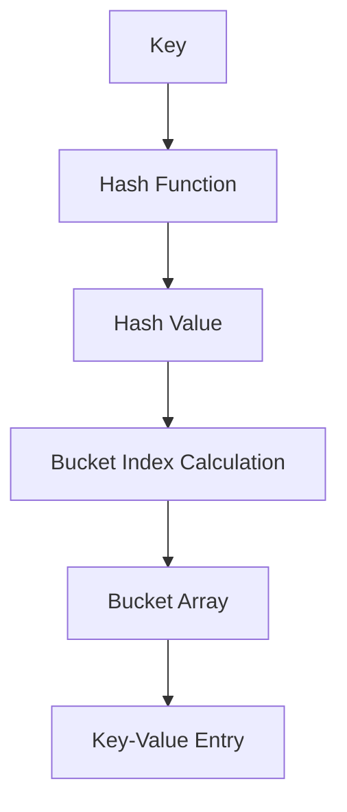

예를 들어 다음 데이터를 저장한다고 가정하자.

```text
Key   = "APPLE"
Value = 100
```

해시 테이블은 Key인 "APPLE"을 해시 함수에 전달한다.

해시 함수는 정수 형태의 해시 값을 계산할 수 있다.

그다음 해시 값을 버킷 배열의 유효한 인덱스로 변환한다.

마지막으로 해당 위치에 Key-Value 데이터를 저장한다.

이를 개념적으로 표현하면 다음과 같다.

```text
"APPLE"
    ↓
hashCode()
    ↓
Hash Value
    ↓
Bucket Index
    ↓
Bucket Array
    ↓
("APPLE", 100)
```

여기서 중요한 사실은 다음과 같다.

**일반적인 해시 테이블에서 Key를 배열 인덱스로 그대로 사용하는 것은 아니다.**

Key에서 해시 값을 계산하고, 해당 해시 값을 배열 크기에 맞는 인덱스로 변환한다.

이 과정이 해시 테이블의 핵심이다.

---

### 해시 함수란 무엇인가?

해시 함수(Hash Function)는 입력 데이터를 받아 해시 값을 계산하는 함수다.

예를 들어 다음과 같은 형태를 생각할 수 있다.

```text
Hash Function("APPLE") → 12345

Hash Function("BANANA") → 67890

Hash Function("ORANGE") → 54321
```

동일한 입력에 대해 일관된 결과를 반환하는 것이 기본적인 특성이다.

예를 들어 Java의 `String` 클래스는 `hashCode()` 메서드를 제공한다.

```java
String key = "APPLE";

int hash = key.hashCode();

System.out.println(hash);
```

`hashCode()`는 정수형 해시 값을 반환한다.

Java에서 `Object.hashCode()`의 반환 타입은 `int`다.

따라서 Java의 일반적인 객체 해시 코드는 32비트 정수로 표현된다.

하지만 여기서 반드시 구분해야 할 개념이 있다.

**HashMap에서 사용하는 해시 함수와 SHA-256 같은 암호학적 해시 함수는 목적이 다르다.**

---

### 해시 함수와 암호학적 해시 함수의 차이

해시 함수를 설명할 때 단방향 암호화 함수라고 표현하는 경우가 있다.

하지만 모든 해시 함수가 암호학적 해시 함수인 것은 아니다.

또 해싱(Hashing)과 암호화(Encryption)는 서로 다른 개념이다.

#### 일반적인 해시 함수

일반적인 해시 함수는 데이터를 빠르게 분류하거나 검색하기 위해 사용한다.

대표적인 사례는 다음과 같다.

- HashMap의 Key 처리
- HashSet의 중복 확인
- 데이터 분산
- 해시 기반 파티셔닝
- 해시 인덱스

이러한 환경에서는 일반적으로 다음 특징이 중요하다.

- 동일한 입력에 대해 일관된 결과
- 빠른 계산
- 적절한 해시 값 분산
- 충돌 발생 가능성 감소

#### 암호학적 해시 함수

암호학적 해시 함수는 보안 목적의 추가적인 성질을 갖도록 설계된다.

대표적인 알고리즘으로 SHA-256이 있다.

암호학적 해시 함수에서는 다음과 같은 특성이 중요하다.

- 원래 입력을 찾기 어렵도록 하는 역상 저항성
- 동일한 해시를 갖는 다른 입력을 찾기 어렵도록 하는 충돌 저항성
- 주어진 입력과 해시가 같은 다른 입력을 찾기 어렵도록 하는 제2역상 저항성

단순히 해시 값이 일정한 길이로 출력된다는 사실만으로 암호학적 안전성이 보장되는 것은 아니다.

두 종류를 비교하면 다음과 같다.

| 구분 | 일반적인 해시 함수 | 암호학적 해시 함수 |
|---|---|---|
| 주요 목적 | 검색과 데이터 분산 | 무결성 검증 등 보안 목적 |
| 대표적인 예 | `String.hashCode()` | SHA-256 |
| 반환 형태 | 구현에 따라 다름 | 고정 길이 다이제스트 등 |
| 중요 요소 | 계산 속도, 분산 품질 | 역상·충돌 저항성 |
| 보안성 보장 | 일반적으로 없음 | 알고리즘 설계의 핵심 요구사항 |
| HashMap에서 일반적으로 사용 | O | X |

HashMap에서 Key를 저장하기 위해 SHA-256을 사용할 필요는 없다.

HashMap은 해시 값을 통해 저장 위치를 계산하는 자료구조이지, Key를 암호화해 비밀로 만드는 자료구조가 아니기 때문이다.

또 HashMap은 실제 Key 객체도 함께 보관한다.

따라서 HashMap의 `hashCode()`를 개인정보를 보호하는 암호화 방식으로 이해해서는 안 된다.

---

### 해시 함수의 주요 특징

해시 테이블에서 사용하는 해시 함수는 다음 성질이 중요하다.

#### 1. 결정성

동일한 입력과 동일한 조건에서는 동일한 결과가 나와야 한다.

예를 들어 다음과 같다.

```java
String key = "HELLO";

int first = key.hashCode();

int second = key.hashCode();

System.out.println(first == second);
```

실행 결과는 다음과 같다.

```text
true
```

동일한 문자열에 대해 동일한 해시 값이 계산된다.

이 특성이 중요한 이유는 저장할 때와 조회할 때 같은 버킷을 찾아야 하기 때문이다.

만약 동일한 Key에서 매번 다른 해시 값이 나온다면 저장된 데이터를 정상적으로 조회하기 어렵다.

#### 2. 적절한 분산

가능하면 서로 다른 Key들이 여러 버킷에 골고루 분산되어야 한다.

해시 값이 특정 버킷에 몰리면 충돌이 증가하기 때문이다.

하지만 모든 해시 함수가 항상 균등한 분포를 보장하는 것은 아니다.

분산 품질은 해시 함수와 입력 데이터의 특성에 따라 달라진다.

#### 3. 빠른 계산

해시 테이블은 조회와 삽입 과정에서 해시 값을 계산한다.

따라서 해시 계산 자체가 지나치게 비싸다면 전체 성능이 떨어질 수 있다.

이러한 이유로 일반적인 HashMap에서는 암호학적 해시 함수보다 빠르게 계산할 수 있는 해시 코드를 활용한다.

---

### Bucket이란 무엇인가?

Bucket은 해시 테이블에서 해시 값에 따라 데이터가 배치되는 논리적인 저장 위치다.

Java HashMap에서는 일반적으로 배열의 각 슬롯을 버킷으로 생각할 수 있다.

예를 들어 다음과 같은 배열이 있다고 가정하자.

```text
Index   Bucket

0       null
1       Entry
2       null
3       Entry
4       null
5       Entry
6       null
7       null
```

버킷 배열의 크기는 8이다.

하지만 Key의 해시 값은 훨씬 큰 범위를 가질 수 있다.

따라서 해시 값을 그대로 배열 인덱스로 사용할 수 없다.

배열의 인덱스는 0부터 7까지만 존재하기 때문이다.

이 문제를 해결하기 위해 해시 값을 배열의 크기에 맞는 인덱스로 변환한다.

---

### 해시 값을 버킷 인덱스로 변환하는 방법

해시 테이블을 단순하게 구현할 때 자주 사용하는 방법은 나머지 연산이다.

예를 들어 다음과 같다.

```java
int index = hash % capacity;
```

다만 Java에서는 음수 해시 값이 나올 수 있기 때문에 실제 구현에서는 음수 인덱스 문제를 고려해야 한다.

개념적인 예제를 위해 양수 해시 값만 사용한다고 가정하자.

버킷 배열의 크기가 3이라면 다음과 같다.

```text
Hash Value = 0
Bucket Size = 3

0 % 3 = 0
```

```text
Hash Value = 1
Bucket Size = 3

1 % 3 = 1
```

```text
Hash Value = 2
Bucket Size = 3

2 % 3 = 2
```

```text
Hash Value = 3
Bucket Size = 3

3 % 3 = 0
```

```text
Hash Value = 4
Bucket Size = 3

4 % 3 = 1
```

이를 표로 정리하면 다음과 같다.

| Hash Value | Bucket Size | Bucket Index |
|---:|---:|---:|
| 0 | 3 | 0 |
| 1 | 3 | 1 |
| 2 | 3 | 2 |
| 3 | 3 | 0 |
| 4 | 3 | 1 |
| 5 | 3 | 2 |

해시 값이 0과 3인 데이터는 모두 0번 버킷으로 이동한다.

해시 값이 1과 4인 데이터는 모두 1번 버킷으로 이동한다.

이처럼 해시 값을 버킷 배열의 크기에 맞게 변환하면 유효한 배열 인덱스를 계산할 수 있다.

하지만 여기서 한 가지 문제가 발생한다.

**서로 다른 해시 값이 동일한 버킷 인덱스를 가질 수 있다.**

이를 해시 충돌이라고 부른다.

---

### 해시 충돌이란 무엇인가?

해시 충돌(Hash Collision)은 서로 다른 Key가 동일한 해시 값이나 동일한 버킷 위치로 매핑되는 현상이다.

예를 들어 다음 두 Key를 생각해 보자.

```text
Key = A

Hash Value = 10
```

```text
Key = B

Hash Value = 18
```

버킷 배열의 크기가 8이라면 다음과 같다.

```text
10 % 8 = 2

18 % 8 = 2
```

두 Key가 모두 2번 버킷으로 매핑된다.

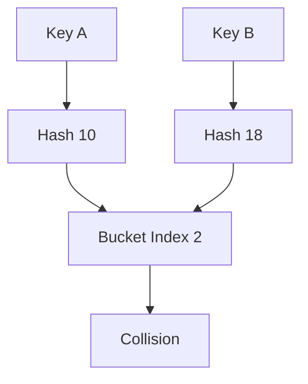

이것이 버킷 충돌이다.

여기서 중요한 점은 두 Key의 해시 값이 반드시 같아야 충돌하는 것은 아니라는 사실이다.

서로 다른 해시 값이라도 버킷 인덱스 계산 결과가 같을 수 있다.

즉 다음 두 상황을 구분해야 한다.

첫 번째는 서로 다른 Key가 동일한 해시 값을 갖는 경우다.

두 번째는 서로 다른 해시 값이 동일한 버킷 인덱스로 매핑되는 경우다.

HashMap은 두 상황 모두 처리할 수 있어야 한다.

---

### 해시 충돌은 왜 피할 수 없을까?

해시 함수의 출력 범위는 제한되어 있다.

반면 가능한 Key의 종류는 훨씬 많을 수 있다.

예를 들어 Java의 `hashCode()`는 `int`를 반환한다.

하지만 문자열은 다양한 길이와 조합을 가질 수 있다.

가능한 문자열의 수는 32비트 정수의 표현 범위보다 훨씬 많다.

따라서 서로 다른 문자열이 동일한 해시 값을 갖는 경우가 존재할 수밖에 없다.

이는 비둘기집 원리(Pigeonhole Principle)로 설명할 수 있다.

비둘기집보다 비둘기 수가 많다면 적어도 하나의 비둘기집에는 두 마리 이상의 비둘기가 들어가야 한다.

해시 함수도 마찬가지다.

서로 다른 입력의 수가 가능한 출력값의 수보다 많다면 적어도 두 입력은 같은 출력값을 가져야 한다.

따라서 해시 충돌을 완전히 제거하는 일반적인 해시 함수를 만드는 것은 불가능하다.

중요한 것은 충돌을 없애는 것이 아니라 **충돌이 발생했을 때 데이터를 정확하고 효율적으로 관리하는 방법을 설계하는 것**이다.

---

### Java에서 실제 해시 충돌 확인하기

Java에서는 서로 다른 문자열이 동일한 해시 값을 가질 수 있다.

대표적인 예가 다음 두 문자열이다.

```java
String first = "Aa";

String second = "BB";
```

두 문자열의 `hashCode()`를 출력해 보자.

```java
public class HashCollisionExample {

    public static void main(String[] args) {

        String first = "Aa";
        String second = "BB";

        System.out.println(first.hashCode());
        System.out.println(second.hashCode());

        System.out.println(first.equals(second));
    }
}
```

실행 결과는 다음과 같다.

```text
2112
2112
false
```

두 문자열의 해시 값은 동일하다.

하지만 두 문자열은 서로 다른 문자열이다.

따라서 `equals()`는 `false`를 반환한다.

이제 HashMap에 저장해 보자.

```java
Map<String, Integer> map = new HashMap<>();

map.put("Aa", 100);
map.put("BB", 200);

System.out.println(map.get("Aa"));
System.out.println(map.get("BB"));
System.out.println(map.size());
```

실행 결과는 다음과 같다.

```text
100
200
2
```

해시 값이 동일해도 두 데이터를 정상적으로 저장하고 조회한다.

어떻게 가능한 것일까?

HashMap은 해시 값만으로 Key의 동일성을 판단하지 않기 때문이다.

이 부분은 뒤에서 `equals()`와 함께 자세히 살펴보겠다.

---

### 해시 충돌을 해결하는 방법

해시 충돌을 처리하는 대표적인 방법은 두 가지다.

첫 번째는 Separate Chaining이다.

두 번째는 Open Addressing이다.

두 방식은 충돌이 발생했을 때 데이터를 저장하는 위치가 다르다.

| 구분 | Separate Chaining | Open Addressing |
|---|---|---|
| 기본 방식 | 같은 버킷에 여러 Entry 연결 | 다른 빈 슬롯 탐색 |
| 주요 저장 구조 | 연결 리스트, 트리 등 | 배열 |
| 충돌 처리 | 같은 버킷의 자료구조 탐색 | Probe Sequence 탐색 |
| 공간 사용 | Entry 및 참조 비용 발생 | 배열 공간 활용 |
| 삭제 | 연결 구조에서 제거 | 삭제 표시 등의 추가 처리 필요 |
| 대표적인 활용 | Java HashMap | 다양한 해시 테이블 구현 |

두 방식 모두 충돌을 해결하기 위한 전략이다.

어떤 방식이 더 적합한지는 메모리 구조와 데이터 특성, 구현 요구사항에 따라 달라진다.

---

### Separate Chaining이란 무엇인가?

Separate Chaining은 같은 버킷에 매핑된 데이터를 별도의 자료구조에 연결해 저장하는 방법이다.

가장 직관적인 구현은 연결 리스트를 사용하는 것이다.

예를 들어 다음 세 Key가 모두 2번 버킷으로 매핑된다고 가정하자.

```text
A → Bucket 2

W → Bucket 2

Z → Bucket 2
```

이때 다음과 같이 저장할 수 있다.

```text
Bucket Array

0 → null

1 → null

2 → A → W → Z

3 → null

4 → null
```

이를 구조로 표현하면 다음과 같다.

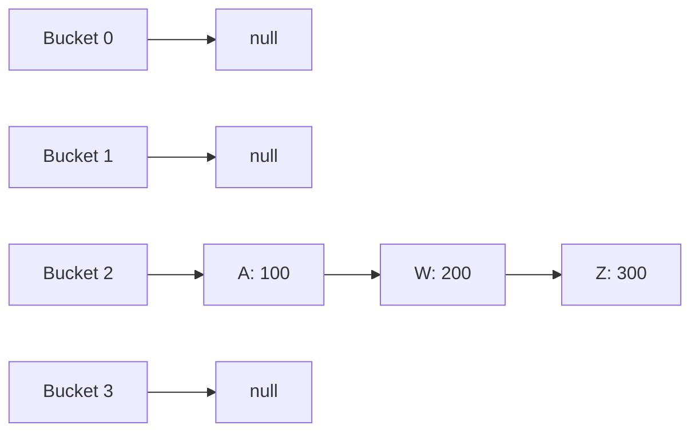

이 구조에서는 버킷 하나에 여러 데이터를 저장할 수 있다.

따라서 새로운 Key가 기존 버킷에 매핑되더라도 데이터를 덮어쓰지 않는다.

기존 Entry와 연결해 저장한다.

---

### Separate Chaining에서 조회는 어떻게 이루어질까?

다음 구조를 생각해 보자.

```text
Bucket 2

A → W → Z
```

Key가 Z인 데이터를 조회하고 싶다.

먼저 Z의 해시 값을 계산한다.

그다음 버킷 인덱스를 계산한다.

결과가 2번이라면 2번 버킷으로 이동한다.

하지만 버킷에는 여러 Entry가 존재한다.

따라서 해당 버킷 안에서 원하는 Key를 찾아야 한다.

```text
A 확인

↓

W 확인

↓

Z 확인

↓

데이터 반환
```

연결 리스트를 사용하는 경우 버킷 안의 데이터 수에 비례하는 탐색이 필요할 수 있다.

따라서 특정 버킷에 데이터가 지나치게 많이 몰리면 성능이 저하될 수 있다.

이러한 문제를 완화하는 방법 중 하나가 Java HashMap의 트리화다.

---

### Open Addressing이란 무엇인가?

Open Addressing은 충돌이 발생했을 때 동일한 배열 안에서 다른 저장 위치를 찾는 방법이다.

Separate Chaining은 같은 버킷에서 여러 Entry를 연결한다.

반면 Open Addressing은 충돌한 Entry를 배열의 다른 슬롯에 저장한다.

예를 들어 다음 구조를 생각해 보자.

```text
Index   Value

0       A
1       null
2       B
3       C
4       null
5       null
```

새로운 Key D의 버킷 인덱스가 2라고 가정하자.

하지만 2번 슬롯에는 이미 B가 존재한다.

따라서 다른 위치를 탐색해야 한다.

어떤 순서로 탐색할 것인지는 조사 함수(Probe Function)에 따라 결정된다.

대표적인 방법은 다음과 같다.

- Linear Probing
- Quadratic Probing
- Double Hashing

---

### Linear Probing이란 무엇인가?

Linear Probing은 충돌이 발생한 위치에서 일정한 간격으로 다음 슬롯을 확인하는 방식이다.

일반적으로 한 칸씩 이동한다.

예를 들어 배열의 크기가 8이라고 가정하자.

새로운 데이터의 초기 인덱스가 2다.

하지만 2번 슬롯은 이미 사용 중이다.

3번도 사용 중이다.

4번도 사용 중이다.

5번은 비어 있다.

그러면 5번에 데이터를 저장한다.

```text
Index   Value

0       null

1       null

2       A

3       B

4       C

5       D

6       null

7       null
```

이 과정을 다음과 같이 표현할 수 있다.

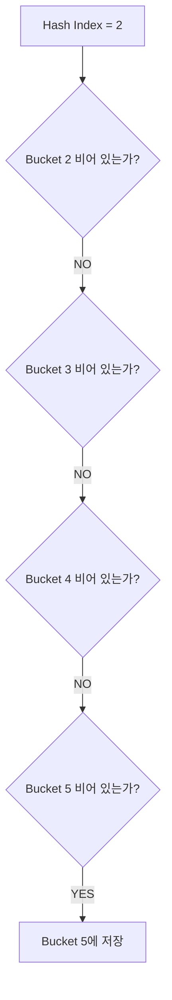

Linear Probing의 장점은 구현이 단순하다는 것이다.

또 데이터가 배열 안에 저장되므로 메모리 지역성 측면에서 유리할 수 있다.

하지만 연속된 슬롯에 데이터가 몰리는 Primary Clustering 문제가 발생할 수 있다.

충돌이 증가하면 조회나 삽입 과정에서 많은 슬롯을 탐색해야 할 수 있다.

---

### Linear Probing의 계산 방식

일반적인 Linear Probing의 인덱스 계산은 다음과 같이 표현할 수 있다.

```text
index = (hash(key) + i) % capacity
```

여기서 `i`는 탐색 횟수다.

처음에는 0이다.

충돌이 발생할 때마다 1씩 증가한다.

예를 들어 다음과 같다.

```text
hash(key) = 2

capacity = 8
```

첫 번째 탐색은 다음과 같다.

```text
(2 + 0) % 8 = 2
```

두 번째 탐색은 다음과 같다.

```text
(2 + 1) % 8 = 3
```

세 번째 탐색은 다음과 같다.

```text
(2 + 2) % 8 = 4
```

이 과정을 반복하며 빈 공간을 찾는다.

다만 배열의 크기와 Probe Sequence 설계에 따라 모든 슬롯을 올바르게 탐색할 수 있도록 구현해야 한다.

---

### Quadratic Probing이란 무엇인가?

Quadratic Probing은 탐색 위치를 일정한 간격으로 이동하는 대신 이차식에 따라 변경하는 방식이다.

개념적으로 다음과 같이 표현할 수 있다.

```text
index = (hash(key) + i²) % capacity
```

예를 들어 초기 인덱스가 2라면 다음과 같은 순서로 탐색할 수 있다.

```text
i = 0 → 2

i = 1 → 3

i = 2 → 6

i = 3 → 11 % capacity
```

Linear Probing처럼 연속된 슬롯만 탐색하지 않으므로 특정 형태의 군집 현상을 완화할 수 있다.

하지만 탐색 수식과 테이블 크기를 잘못 선택하면 아직 빈 슬롯이 존재하는데도 일부 슬롯에 도달하지 못할 수 있다.

따라서 실제 구현에서는 테이블 크기와 Probe Sequence의 성질을 함께 고려해야 한다.

---

### Double Hashing이란 무엇인가?

Double Hashing은 두 개의 해시 함수를 사용해 탐색 위치를 계산하는 방식이다.

개념적인 수식은 다음과 같다.

```text
index = (h1(key) + i × h2(key)) % capacity
```

첫 번째 해시 함수는 초기 위치를 결정한다.

두 번째 해시 함수는 충돌 이후 이동 간격을 결정한다.

따라서 서로 다른 Key가 같은 초기 위치에 매핑되더라도 이동 경로가 달라질 수 있다.

이는 충돌로 인한 군집 현상을 줄이는 데 도움이 될 수 있다.

다만 `h2(key)`가 0이 되지 않도록 하고, 테이블 크기와 서로소 관계 등을 고려해 적절한 탐색 범위를 확보해야 한다.

---

### Separate Chaining과 Open Addressing은 언제 선택할까?

두 방식은 메모리 구조와 충돌 처리 방식에서 차이가 있다.

Separate Chaining은 하나의 버킷에 여러 Entry를 연결할 수 있다.

따라서 배열의 슬롯 수보다 많은 데이터를 저장할 수 있다.

반면 Open Addressing은 일반적으로 하나의 슬롯에 하나의 Entry를 저장한다.

따라서 테이블의 점유율이 높아질수록 빈 슬롯을 찾는 비용이 증가할 수 있다.

또 데이터 삭제에도 차이가 있다.

Separate Chaining에서는 연결 구조에서 해당 Entry를 제거할 수 있다.

반면 Open Addressing에서는 단순히 슬롯을 비우면 탐색 경로가 끊어질 수 있다.

따라서 삭제 표시(Tombstone)나 재배치 등의 처리가 필요할 수 있다.

| 비교 항목 | Separate Chaining | Open Addressing |
|---|---|---|
| 충돌 저장 위치 | 같은 버킷에 연결 | 다른 슬롯 |
| 연결 객체 | 필요할 수 있음 | 일반적으로 별도 연결 노드 불필요 |
| 캐시 지역성 | 상대적으로 불리할 수 있음 | 유리할 수 있음 |
| 높은 점유율 | 여러 Entry를 버킷에 저장 가능 | 탐색 비용 증가 가능 |
| 삭제 구현 | 비교적 직관적 | 추가 처리 필요 |
| Java HashMap | 사용 | 사용하지 않음 |

중요한 것은 각 방식의 성능이 단순히 이론적인 시간 복잡도만으로 결정되지 않는다는 사실이다.

실제 성능은 메모리 배치와 CPU 캐시, Key의 크기, 해시 함수, 충돌 빈도 등에 영향을 받는다.

---

### Load Factor란 무엇인가?

Load Factor는 해시 테이블에 저장된 데이터 수와 버킷 배열의 크기 사이의 비율을 나타내는 개념이다.

일반적으로 다음과 같이 표현한다.

```text
Load Factor = 저장된 Entry 수 / 버킷 배열 크기
```

예를 들어 다음과 같다고 가정하자.

```text
Entry Count = 12

Bucket Capacity = 16
```

로드 팩터는 다음과 같다.

```text
12 / 16 = 0.75
```

즉 버킷 배열 크기에 비해 얼마나 많은 Entry를 저장하고 있는지 나타낸다.

여기서 중요한 점은 **로드 팩터가 실제로 사용 중인 버킷의 비율을 의미하지는 않는다는 사실**이다.

예를 들어 버킷 배열 크기가 16이고 Entry가 12개 있다고 가정하자.

12개 Entry가 모두 서로 다른 버킷에 저장될 수도 있다.

반대로 여러 Entry가 충돌해 일부 버킷에 집중될 수도 있다.

두 상황 모두 로드 팩터는 0.75다.

따라서 로드 팩터만으로 실제 빈 버킷의 개수나 충돌 분포를 정확하게 알 수 있는 것은 아니다.

또 Separate Chaining에서는 Entry 수가 버킷 수보다 많아질 수 있으므로 로드 팩터가 1보다 커질 수도 있다.

---

### Java HashMap의 기본 Load Factor는 왜 0.75일까?

Java HashMap의 기본 로드 팩터는 0.75다.

이는 메모리 사용량과 조회 성능 사이의 균형을 고려한 값이다.

로드 팩터가 지나치게 낮다면 어떨까?

버킷 배열이 상대적으로 커진다.

충돌 가능성을 줄일 수 있지만 메모리 사용량이 증가할 수 있다.

반대로 로드 팩터가 지나치게 높다면 어떨까?

배열 공간을 더 효율적으로 사용할 수 있지만 충돌이 증가할 수 있다.

따라서 다음과 같은 트레이드오프가 발생한다.

| Load Factor | 장점 | 단점 |
|---|---|---|
| 낮음 | 충돌 가능성 감소 | 메모리 사용량 증가 |
| 높음 | 공간 활용도 증가 | 충돌 및 탐색 비용 증가 가능 |
| 0.75 | 시간과 공간의 균형 | 일반적인 절충값 |

Java 공식 문서 역시 기본 로드 팩터 0.75를 시간과 공간 비용 사이의 적절한 균형으로 설명한다.

다만 0.75가 모든 애플리케이션에서 절대적으로 최적이라는 의미는 아니다.

데이터 특성과 조회 패턴에 따라 다른 설정이 유리할 수도 있다.

---

### HashMap의 Capacity란 무엇인가?

Capacity는 내부 버킷 배열의 크기다.

Java HashMap의 일반적인 초기 용량은 16이다.

```java
Map<String, Integer> map = new HashMap<>();
```

기본 설정은 다음과 같다.

```text
Initial Capacity = 16

Load Factor = 0.75
```

단, 현대적인 OpenJDK HashMap은 기본 생성자 호출 시 즉시 길이 16의 배열을 할당하는 방식이 아니라 첫 번째 삽입 시 필요한 배열을 지연 생성할 수 있다.

따라서 기본 초기 용량이 16이라는 설명과 생성자 실행 직후 실제 배열이 할당되어 있다는 설명은 구분해야 한다.

또 HashMap에서 사용하는 Capacity는 일반적으로 2의 거듭제곱 크기로 관리된다.

대표적으로 다음과 같다.

```text
16 → 32 → 64 → 128 → 256
```

이러한 구조는 버킷 인덱스 계산과 리사이징을 효율적으로 수행하는 데 도움이 된다.

---

### HashMap은 언제 리사이징할까?

리사이징(Resizing)은 내부 버킷 배열의 크기를 증가시키는 작업이다.

예를 들어 다음과 같은 HashMap이 있다고 가정하자.

```text
Capacity = 16

Load Factor = 0.75
```

리사이징과 관련된 임계값은 다음과 같이 계산할 수 있다.

```text
Threshold = Capacity × Load Factor
```

따라서 다음과 같다.

```text
Threshold = 16 × 0.75

Threshold = 12
```

저장된 Entry 수가 임계값을 초과하면 HashMap은 배열을 확장한다.

예를 들어 다음과 같다.

```text
Entry Count = 12

Capacity = 16
```

이 상태에서 새로운 Key가 추가되면 Entry 수가 13이 된다.

기존 임계값 12를 초과하므로 배열을 확장할 수 있다.

```text
Before Resize

Capacity = 16
Threshold = 12
```

```text
After Resize

Capacity = 32
Threshold = 24
```

배열의 크기가 두 배로 증가했다.

이에 따라 새로운 버킷 공간이 확보된다.

Java HashMap은 이러한 방식으로 데이터 증가에 대응한다.

---

### 리사이징은 왜 필요할까?

해시 테이블의 배열 크기가 고정되어 있다고 가정하자.

처음에는 다음과 같이 데이터가 적다.

```text
Bucket 0 → A

Bucket 1 → B

Bucket 2 → null

Bucket 3 → C
```

하지만 데이터가 증가하면 하나의 버킷에 여러 Entry가 연결될 수 있다.

```text
Bucket 0 → A → D → G

Bucket 1 → B → E

Bucket 2 → F

Bucket 3 → C → H
```

이러한 상황이 계속되면 조회 과정에서 많은 Entry를 비교해야 할 수 있다.

리사이징은 배열의 크기를 증가시켜 Key들이 더 많은 버킷으로 분산될 기회를 제공한다.

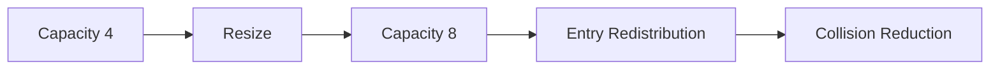

리사이징 이후에는 기존 Entry의 버킷 위치가 달라질 수 있다.

따라서 기존 데이터를 새로운 배열로 이동해야 한다.

---

### 리사이징의 비용은 얼마일까?

리사이징은 공짜로 수행되는 작업이 아니다.

배열의 크기를 증가시키면 새로운 배열이 필요하다.

또 기존 Entry를 새로운 배열에 배치해야 한다.

따라서 일반적인 리사이징 작업은 기존 Entry 수에 비례하는 비용이 발생한다.

즉 O(n)의 작업이 수행될 수 있다.

하지만 HashMap은 삽입할 때마다 리사이징하지 않는다.

일정한 임계값을 초과했을 때 배열을 확장한다.

또 일반적으로 배열 크기를 두 배로 증가시키기 때문에 리사이징의 발생 빈도를 줄일 수 있다.

이러한 구조에서는 여러 삽입 연산에 리사이징 비용을 분산해 생각할 수 있다.

이를 분할 상환 분석(Amortized Analysis)이라고 한다.

HashMap의 삽입 성능이 평균적으로 O(1)이라고 설명되는 이유에는 이러한 리사이징 전략도 관련되어 있다.

다만 특정 삽입 연산 하나가 리사이징을 유발했다면 그 연산은 평소보다 오래 걸릴 수 있다.

---

### Java HashMap의 실제 버킷 인덱스 계산

지금까지는 나머지 연산을 사용해 버킷 인덱스를 계산한다고 설명했다.

하지만 Java HashMap의 구현은 조금 다르다.

Java 17의 OpenJDK HashMap은 일반적으로 2의 거듭제곱 크기를 가진 버킷 배열을 사용한다.

따라서 다음과 같은 비트 연산을 이용해 인덱스를 계산한다.

```java
int index = (capacity - 1) & hash;
```

여기서 `&`는 비트 AND 연산자다.

예를 들어 Capacity가 16이라고 가정하자.

```text
Capacity = 16

Capacity - 1 = 15
```

15를 이진수로 표현하면 다음과 같다.

```text
0000 1111
```

해시 값이 27이라면 이진수로 다음과 같이 표현할 수 있다.

```text
0001 1011
```

AND 연산을 수행한다.

```text
0001 1011
&
0000 1111
-----------
0000 1011
```

결과는 11이다.

따라서 11번 버킷을 사용한다.

```text
Bucket Index = 11
```

2의 거듭제곱 크기에서는 이러한 비트 마스킹을 이용해 효율적으로 버킷 위치를 계산할 수 있다.

하지만 여기서 중요한 문제가 있다.

**비트 마스킹은 해시 값의 일부 비트만 이용한다는 점이다.**

버킷 배열의 크기가 16이라면 인덱스 계산에는 하위 4비트가 사용된다.

따라서 상위 비트에만 차이가 있는 해시 값들은 충돌할 수 있다.

Java HashMap은 이를 완화하기 위해 추가적인 해시 분산 과정을 수행한다.

---

### Java HashMap의 Hash Spreading

Java 17의 OpenJDK HashMap에서는 다음과 같은 방식으로 해시 값을 가공한다.

```java
static final int hash(Object key) {

    int h;

    return (key == null)
            ? 0
            : (h = key.hashCode()) ^ (h >>> 16);
}
```

여기서 핵심은 다음 연산이다.

```java
h ^ (h >>> 16)
```

`>>>`는 부호 없는 오른쪽 시프트 연산자다.

`^`는 XOR 연산자다.

이 연산은 해시 값의 상위 비트를 하위 비트에 일부 반영한다.

왜 이러한 작업이 필요할까?

앞서 살펴본 것처럼 HashMap은 버킷 인덱스를 계산할 때 하위 비트를 이용하기 때문이다.

서로 다른 Key의 해시 값이 상위 비트에서는 차이가 있지만 하위 비트가 비슷하다면 충돌이 증가할 수 있다.

Hash Spreading은 이러한 문제를 완화하기 위한 가벼운 비트 혼합 과정이다.

전체 구조를 정리하면 다음과 같다.

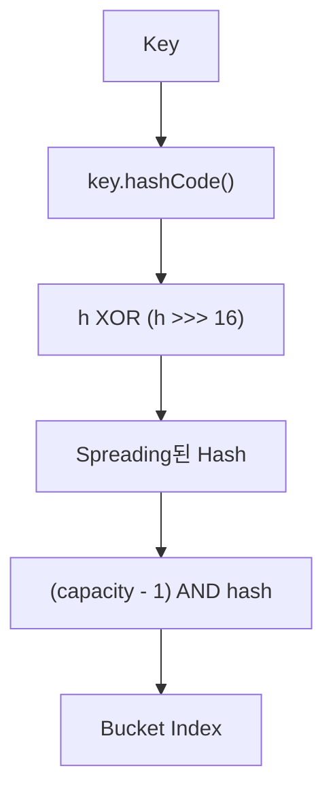

이 구조는 Java 17 OpenJDK의 HashMap 구현에 해당한다.

여기서 Hash Spreading이 모든 충돌을 제거해 주는 것은 아니다.

해시 값의 분산을 개선하기 위한 처리일 뿐이다.

또 Java 구현체와 버전에 따라 내부적인 해시 처리 방식은 달라질 수 있다.

---

### Java HashMap은 충돌을 어떻게 처리할까?

Java HashMap은 일반적으로 Separate Chaining 방식의 구조를 사용한다.

버킷 하나에 여러 Entry가 매핑되면 연결 리스트나 트리 등의 구조를 활용한다.

예를 들어 다음과 같다.

```text
Bucket Array

0 → null

1 → Node A

2 → Node B → Node C → Node D

3 → null

4 → Node E
```

각 Node는 일반적으로 다음과 같은 정보를 가진다.

```java
static class Node<K, V> {

    final int hash;

    final K key;

    V value;

    Node<K, V> next;
}
```

이 구조는 HashMap의 내부 Node 개념을 단순화한 것이다.

각 필드의 의미는 다음과 같다.

| 필드 | 역할 |
|---|---|
| `hash` | 계산된 해시 값 |
| `key` | 실제 Key |
| `value` | Key와 연결된 Value |
| `next` | 다음 Node 참조 |

여기서 중요한 점은 HashMap이 해시 값뿐 아니라 **실제 Key 자체도 저장한다는 사실**이다.

이 구조 덕분에 해시 충돌이 발생해도 정확한 Key를 구분할 수 있다.

---

### HashMap의 put()은 어떻게 동작할까?

다음 코드를 살펴보자.

```java
map.put("APPLE", 100);
```

Java HashMap의 일반적인 삽입 흐름을 단순화하면 다음과 같다.

첫 번째로 Key의 해시 값을 계산한다.

두 번째로 버킷 인덱스를 계산한다.

세 번째로 해당 버킷을 확인한다.

네 번째로 버킷이 비어 있다면 새로운 Node를 저장한다.

다섯 번째로 기존 Node가 존재한다면 Key의 동일성을 확인한다.

여섯 번째로 동일한 Key가 존재하면 Value를 갱신한다.

일곱 번째로 서로 다른 Key라면 충돌 처리 구조에 새로운 Node를 추가한다.

마지막으로 필요하다면 리사이징이나 트리화 등을 수행한다.

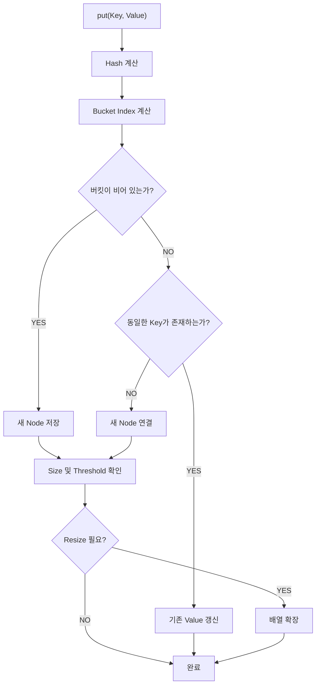

여기서 Value를 갱신하는 것과 새로운 Key를 추가하는 것은 다르다.

이미 존재하는 Key의 Value만 변경했다면 Entry 수는 증가하지 않는다.

따라서 새로운 Entry를 추가했을 때와 동일한 방식으로 리사이징 여부를 판단할 필요는 없다.

---

### HashMap의 get()은 어떻게 동작할까?

다음 코드를 살펴보자.

```java
Integer value = map.get("APPLE");
```

HashMap은 먼저 Key의 해시 값을 계산한다.

그다음 버킷 인덱스를 계산한다.

해당 버킷에 Node가 존재한다면 Key를 비교한다.

일치하는 Key가 발견되면 해당 Value를 반환한다.

충돌로 인해 여러 Node가 존재한다면 연결 구조를 탐색한다.

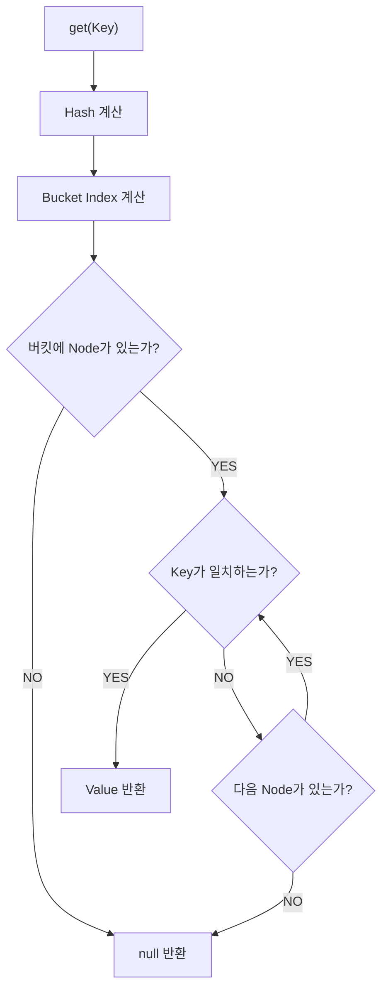

위 구조는 연결 리스트 기반 탐색을 단순화한 것이다.

실제 HashMap에서는 버킷이 트리로 변환된 경우 트리 탐색을 수행할 수도 있다.

---

### HashMap은 왜 hashCode()와 equals()를 모두 사용할까?

HashMap은 객체의 동일성을 판단할 때 `hashCode()`와 `equals()`를 함께 활용한다.

`hashCode()`는 데이터를 찾을 버킷 위치를 좁히는 역할을 한다.

`equals()`는 실제 Key가 같은지 판단하는 역할을 한다.

예를 들어 두 문자열이 있다고 가정하자.

```java
String first = "Aa";

String second = "BB";
```

두 문자열의 해시 값은 같다.

```text
2112
```

하지만 `equals()` 결과는 `false`다.

따라서 HashMap은 두 문자열을 서로 다른 Key로 취급한다.

개념적으로 다음과 같이 동작한다.

```java
if (existingHash == newHash) {

    if (existingKey == newKey
            || existingKey.equals(newKey)) {

        // 동일한 Key로 판단
    }
}
```

실제 구현에서는 null 처리와 여러 최적화가 포함된다.

핵심은 해시 값이 같다는 사실만으로 Key가 동일하다고 판단하지 않는다는 것이다.

반대로 해시 값이 다르면 동일한 Key일 수 없다는 전제는 `hashCode()` 계약이 올바르게 구현되었다는 조건에서 성립한다.

---

### equals()와 hashCode()의 계약

Java에서 사용자 정의 객체를 HashMap의 Key로 사용하려면 `equals()`와 `hashCode()`의 계약을 이해해야 한다.

가장 중요한 규칙은 다음과 같다.

**equals()가 true인 두 객체는 반드시 같은 hashCode()를 반환해야 한다.**

하지만 그 반대는 성립하지 않는다.

두 객체의 hashCode가 같더라도 equals 결과는 false일 수 있다.

이를 정리하면 다음과 같다.

| 조건 | 의미 |
|---|---|
| `a.equals(b) == true` | `a.hashCode() == b.hashCode()`여야 함 |
| `a.hashCode() == b.hashCode()` | `a.equals(b)`가 반드시 true인 것은 아님 |
| `a.hashCode() != b.hashCode()` | 올바른 계약하에서는 서로 동등하지 않음 |
| Key의 동등성 관련 상태 변경 | HashMap 조회가 실패할 수 있음 |

Java의 `Object` API에서도 이러한 계약을 명시하고 있다.

이 규칙이 중요한 이유는 HashMap이 먼저 해시 값을 이용해 버킷을 선택하기 때문이다.

동일하다고 판단해야 하는 객체들이 서로 다른 해시 값을 반환한다면 다른 버킷에 저장될 수 있다.

그러면 논리적으로 동일한 Key를 정상적으로 조회하지 못할 수 있다.

---

### equals()만 재정의하면 어떤 문제가 발생할까?

다음 클래스를 생각해 보자.

```java
public class MemberKey {

    private final Long memberId;

    public MemberKey(Long memberId) {
        this.memberId = memberId;
    }

    @Override
    public boolean equals(Object obj) {

        if (this == obj) {
            return true;
        }

        if (!(obj instanceof MemberKey other)) {
            return false;
        }

        return memberId.equals(other.memberId);
    }
}
```

이 클래스에서는 `equals()`만 재정의했다.

`hashCode()`는 재정의하지 않았다.

이제 다음 코드를 실행한다고 가정하자.

```java
Map<MemberKey, String> map = new HashMap<>();

MemberKey first = new MemberKey(100L);

MemberKey second = new MemberKey(100L);

map.put(first, "홍길동");

System.out.println(first.equals(second));

System.out.println(map.get(second));
```

두 객체는 동일한 memberId를 가지고 있다.

따라서 equals 결과는 true다.

하지만 `hashCode()`를 재정의하지 않았으므로 `Object.hashCode()`의 기본 구현이 사용된다.

두 객체의 해시 값이 달라질 수 있다.

그 결과 `map.get(second)`가 null을 반환할 수 있다.

즉 논리적으로 같은 회원 ID를 가진 객체인데도 HashMap에서 정상적으로 조회되지 않는 문제가 발생한다.

이것이 `equals()`와 `hashCode()`를 함께 재정의해야 하는 이유다.

---

### equals()와 hashCode()를 올바르게 구현하기

다음과 같이 수정할 수 있다.

```java
import java.util.Objects;

public final class MemberKey {

    private final Long memberId;

    public MemberKey(Long memberId) {
        this.memberId =
                Objects.requireNonNull(memberId);
    }

    @Override
    public boolean equals(Object obj) {

        if (this == obj) {
            return true;
        }

        if (!(obj instanceof MemberKey other)) {
            return false;
        }

        return memberId.equals(other.memberId);
    }

    @Override
    public int hashCode() {

        return memberId.hashCode();
    }
}
```

이제 memberId가 동일한 두 객체는 같은 해시 값을 반환한다.

```java
MemberKey first = new MemberKey(100L);

MemberKey second = new MemberKey(100L);

System.out.println(first.equals(second));

System.out.println(
        first.hashCode() == second.hashCode()
);
```

결과는 다음과 같다.

```text
true
true
```

HashMap에서도 정상적으로 사용할 수 있다.

```java
Map<MemberKey, String> map = new HashMap<>();

map.put(first, "홍길동");

System.out.println(map.get(second));
```

결과는 다음과 같다.

```text
홍길동
```

---

### Record를 HashMap Key로 활용하기

Java 17 이상에서는 Record를 활용할 수도 있다.

예를 들어 다음과 같다.

```java
public record MemberKey(Long memberId) {
}
```

Record는 기본적으로 구성 요소를 기반으로 `equals()`와 `hashCode()`를 제공한다.

따라서 다음과 같이 사용할 수 있다.

```java
Map<MemberKey, String> map = new HashMap<>();

map.put(
        new MemberKey(100L),
        "홍길동"
);

String name = map.get(
        new MemberKey(100L)
);

System.out.println(name);
```

결과는 다음과 같다.

```text
홍길동
```

Record는 값 중심의 Key 객체를 표현할 때 유용하다.

하지만 Record의 구성 요소가 참조하는 객체까지 자동으로 깊은 불변성이 보장되는 것은 아니다.

예를 들어 Record 내부에 변경 가능한 List를 저장했다면 해당 List의 내용이 변경될 수 있다.

따라서 HashMap의 Key로 사용할 객체는 **동등성에 영향을 주는 상태가 변경되지 않도록 설계하는 것**이 중요하다.

---

### Mutable Key를 사용하면 왜 위험할까?

HashMap에서 가장 주의해야 하는 문제 중 하나가 변경 가능한 Key다.

다음 예제를 살펴보자.

```java
public class MutableKey {

    private String code;

    public MutableKey(String code) {
        this.code = code;
    }

    public void setCode(String code) {
        this.code = code;
    }

    @Override
    public boolean equals(Object obj) {

        if (this == obj) {
            return true;
        }

        if (!(obj instanceof MutableKey other)) {
            return false;
        }

        return java.util.Objects.equals(
                code,
                other.code
        );
    }

    @Override
    public int hashCode() {

        return java.util.Objects.hashCode(code);
    }
}
```

이제 HashMap에 저장한다.

```java
MutableKey key = new MutableKey("A");

Map<MutableKey, String> map = new HashMap<>();

map.put(key, "DATA");
```

이때 HashMap은 `"A"`를 기준으로 계산된 해시 값으로 버킷을 결정한다.

그런데 이후 Key를 변경한다.

```java
key.setCode("B");
```

이제 다시 조회해 보자.

```java
System.out.println(map.get(key));
```

결과가 null이 될 수 있다.

왜 그럴까?

Key를 저장할 때 사용한 해시 값과 조회할 때 계산한 해시 값이 달라졌기 때문이다.

```text
저장 시점

code = "A"

↓

Hash A

↓

Bucket X
```

```text
조회 시점

code = "B"

↓

Hash B

↓

Bucket Y
```

HashMap은 새로운 해시 값을 기반으로 다른 버킷을 탐색할 수 있다.

하지만 실제 Entry는 기존 버킷에 남아 있다.

따라서 조회가 실패할 수 있다.

이 문제를 방지하려면 Key의 동등성과 해시 계산에 사용되는 값을 변경하지 않는 것이 좋다.

실무에서는 `String`, `Long`, `UUID`, 불변 Value Object 등을 Key로 사용하는 경우가 많다.

---

### Java HashMap은 왜 Red-Black Tree를 사용할까?

Separate Chaining은 충돌한 Entry를 연결 리스트로 관리할 수 있다.

하지만 충돌이 지나치게 많이 발생하면 문제가 생긴다.

예를 들어 다음 구조를 생각해 보자.

```text
Bucket 2

A → B → C → D → E → F → G → H
```

특정 Key가 마지막에 존재한다면 앞의 Entry들을 순차적으로 확인해야 할 수 있다.

연결 리스트에서 n개 Entry를 탐색하는 비용은 O(n)이다.

이 문제를 완화하기 위해 Java 8 이후의 HashMap 구현은 특정 조건에서 버킷 내부 구조를 트리로 변경한다.

이때 사용하는 트리가 Red-Black Tree다.

Red-Black Tree는 균형 이진 탐색 트리의 일종이다.

트리의 높이를 제한하는 규칙을 통해 탐색 비용이 지나치게 증가하는 것을 방지한다.

일반적인 탐색 비용은 O(log n) 수준이다.

따라서 많은 충돌이 발생한 버킷에서 연결 리스트보다 효율적인 탐색이 가능할 수 있다.

---

### HashMap의 Treeification 조건

Java 17 OpenJDK HashMap에는 다음과 같은 상수가 존재한다.

```java
static final int TREEIFY_THRESHOLD = 8;
```

```java
static final int UNTREEIFY_THRESHOLD = 6;
```

```java
static final int MIN_TREEIFY_CAPACITY = 64;
```

각각의 의미는 다음과 같다.

| 상수 | 값 | 의미 |
|---|---:|---|
| TREEIFY_THRESHOLD | 8 | 트리화를 고려하는 버킷 노드 수 기준 |
| UNTREEIFY_THRESHOLD | 6 | 리스트 구조로 되돌리는 판단에 사용하는 기준 |
| MIN_TREEIFY_CAPACITY | 64 | 트리화를 위한 최소 배열 용량 |

여기서 중요한 점은 다음과 같다.

**버킷에 Entry가 8개 존재한다고 무조건 즉시 Red-Black Tree로 변경되는 것은 아니다.**

내부 배열의 용량도 함께 고려한다.

예를 들어 Capacity가 16이고 특정 버킷에 충돌이 많이 발생했다면, HashMap은 트리화보다 리사이징을 먼저 선택할 수 있다.

Capacity가 충분히 큰 상태에서 충돌이 많이 발생하면 트리화를 수행할 수 있다.

이러한 동작은 OpenJDK의 HashMap 구현에 정의되어 있다.

---

### 왜 충돌이 발생하면 바로 Tree로 변경하지 않을까?

연결 리스트보다 트리가 항상 효율적인 것은 아니다.

데이터가 적을 때는 연결 리스트가 더 단순하다.

또 트리 노드는 일반적인 연결 리스트 노드보다 더 많은 정보를 저장해야 할 수 있다.

Red-Black Tree에서는 다음과 같은 정보가 필요할 수 있다.

- 부모 노드
- 왼쪽 자식
- 오른쪽 자식
- 노드 색상
- 균형 유지에 필요한 구조

따라서 트리를 사용하면 메모리 사용량과 구조 관리 비용이 증가할 수 있다.

충돌이 적은 일반적인 버킷에서는 연결 리스트가 충분히 효율적이다.

반면 특정 버킷에 데이터가 많이 몰리는 경우 트리가 유리할 수 있다.

Java HashMap은 이러한 특성을 고려해 연결 리스트와 트리를 상황에 따라 선택한다.

---

### HashMap의 충돌 처리 구조

Java HashMap의 충돌 처리 방식을 정리하면 다음과 같다.

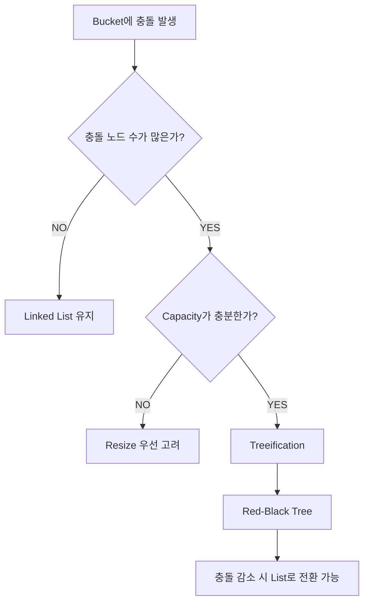

이러한 구조에서는 일반적인 상황에서 연결 리스트의 단순함을 유지할 수 있다.

동시에 특정 버킷에 데이터가 지나치게 집중되는 상황에서는 트리를 이용해 탐색 비용을 개선할 수 있다.

다만 Red-Black Tree가 사용된다고 해서 모든 입력에 대해 HashMap 전체 연산의 최악 시간 복잡도가 항상 O(log n)으로 보장된다고 단정해서는 안 된다.

실제 구현에서는 Key의 비교 가능성과 해시 분포, 트리 내부의 비교 규칙 등이 영향을 준다.

---

### HashMap은 리사이징할 때 모든 해시 값을 다시 계산할까?

Java HashMap은 리사이징 과정에서 기존 Entry의 저장 위치를 다시 결정한다.

하지만 매번 원본 Key의 `hashCode()`를 다시 호출해야 하는 것은 아니다.

HashMap의 Node에는 이미 계산된 해시 값이 저장되어 있다.

```java
final int hash;
```

따라서 기존 해시 값을 활용해 새로운 버킷 위치를 결정할 수 있다.

예를 들어 Capacity가 16에서 32로 증가했다고 가정하자.

기존 버킷 인덱스는 다음과 같이 계산한다.

```java
index = hash & 15;
```

새로운 버킷 인덱스는 다음과 같다.

```java
index = hash & 31;
```

배열이 두 배로 확장되면 기존 Entry는 원래 위치에 남거나 기존 인덱스에 이전 Capacity를 더한 위치로 이동할 수 있다.

이를 이용하면 기존 Entry를 효율적으로 분산시킬 수 있다.

이러한 최적화는 배열의 크기를 2의 거듭제곱으로 관리하는 구조와 관련이 있다.

---

### HashSet은 어떻게 동작할까?

지금까지 HashMap을 중심으로 살펴보았다.

그렇다면 HashSet은 어떤 구조를 사용할까?

HashSet은 중복되지 않는 요소의 집합을 표현하는 자료구조다.

다음과 같이 사용할 수 있다.

```java
Set<String> names = new HashSet<>();

names.add("홍길동");
names.add("김철수");
names.add("홍길동");

System.out.println(names.size());
```

결과는 다음과 같다.

```text
2
```

HashSet은 동일한 요소가 여러 번 추가되더라도 중복 저장하지 않는다.

그런데 HashSet은 내부적으로 HashMap을 사용한다.

Java 공식 API 문서에서도 HashSet이 HashMap을 기반으로 구현된다고 설명한다.

---

### HashSet은 HashMap을 어떻게 사용할까?

HashMap은 Key-Value를 저장한다.

반면 HashSet은 Value처럼 보이는 요소 자체만 저장한다.

이 차이를 어떻게 해결할까?

HashSet에서는 저장하려는 요소를 HashMap의 Key로 사용한다.

그리고 Value에는 공통으로 사용하는 더미 객체를 넣을 수 있다.

개념적으로 다음과 같다.

```java
private transient HashMap<E, Object> map;

private static final Object PRESENT = new Object();
```

요소를 추가할 때는 다음과 유사한 방식으로 동작한다.

```java
public boolean add(E element) {

    return map.put(element, PRESENT) == null;
}
```

즉 다음 코드가 실행되면,

```java
set.add("APPLE");
```

내부적으로는 개념상 다음과 같은 형태가 된다.

```java
map.put("APPLE", PRESENT);
```

다시 같은 요소를 추가하면 기존 Key가 존재하므로 새로운 매핑이 생성되지 않는다.

이렇게 HashSet은 HashMap의 Key 중복 방지 기능을 활용한다.

---

### HashMap과 HashSet의 차이

| 구분 | HashMap | HashSet |
|---|---|---|
| 주요 목적 | Key-Value 저장 | 중복 없는 요소 저장 |
| 인터페이스 | Map | Set |
| 데이터 구조 | Key와 Value | 요소 |
| 내부 기반 | 해시 테이블 | HashMap |
| 중복 Key | 허용하지 않음 | 중복 요소 허용하지 않음 |
| 중복 Value | 허용 | 해당 개념 없음 |
| 평균 조회 | O(1) | O(1) |
| 순서 보장 | 없음 | 없음 |

HashMap은 Key를 통해 Value를 조회할 때 적합하다.

HashSet은 특정 요소가 존재하는지 확인하거나 중복을 제거할 때 적합하다.

---

### 직접 해시 테이블을 구현해 보자

지금까지 살펴본 개념을 실제 코드로 연결해 보자.

이번에는 Java에서 간단한 해시 테이블을 직접 구현한다.

구현할 기능은 다음과 같다.

- Key-Value 저장
- 해시 값 계산
- 버킷 인덱스 계산
- Separate Chaining
- 기존 Key의 Value 변경
- Key 기반 조회
- 로드 팩터 기반 리사이징

복잡한 Treeification이나 동시성 기능은 제외한다.

대신 기본적인 해시 테이블의 구조를 이해하는 데 집중한다.

예제 환경은 Java 17 이상이다.

---

### 해시 테이블 구현 구조

구현할 해시 테이블은 다음과 같은 구조다.

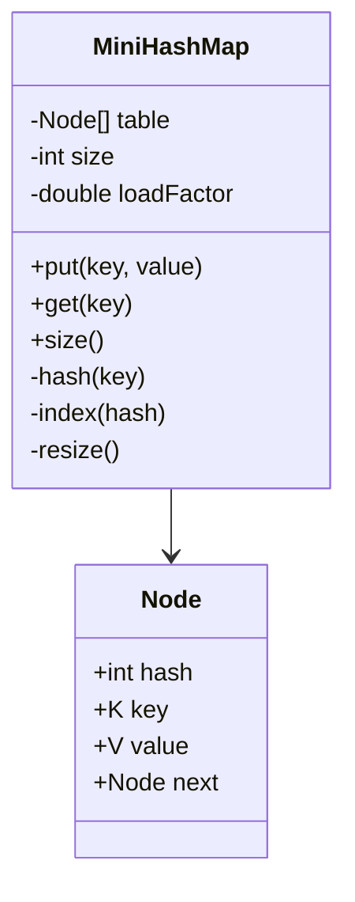

`MiniHashMap`은 버킷 배열을 관리한다.

`Node`는 실제 Key-Value Entry를 표현한다.

충돌이 발생하면 Node를 연결한다.

Entry 수가 임계값을 초과하면 배열을 확장한다.

---

### Java로 구현한 MiniHashMap

다음 코드는 하나의 파일에서 실행할 수 있다.

파일 이름은 `HashTableDemo.java`다.

```java
import java.util.Objects;

public class HashTableDemo {

    public static void main(String[] args) {

        MiniHashMap<String, Integer> map =
                new MiniHashMap<>(4);

        map.put("Aa", 100);
        map.put("BB", 200);
        map.put("C", 300);
        map.put("D", 400);

        System.out.println(
                "Aa = " + map.get("Aa")
        );

        System.out.println(
                "BB = " + map.get("BB")
        );

        System.out.println(
                "Size = " + map.size()
        );

        map.put("Aa", 999);

        System.out.println(
                "Updated Aa = " + map.get("Aa")
        );

        System.out.println(
                "Updated Size = " + map.size()
        );
    }

    static class MiniHashMap<K, V> {

        private static final double LOAD_FACTOR = 0.75;

        private Node<K, V>[] table;

        private int size;

        @SuppressWarnings("unchecked")
        public MiniHashMap(int capacity) {

            if (capacity <= 0) {
                throw new IllegalArgumentException(
                        "Capacity must be positive"
                );
            }

            table = (Node<K, V>[]) new Node[capacity];
        }

        public V put(K key, V value) {

            int hash = hash(key);

            int bucketIndex = index(hash);

            Node<K, V> current = table[bucketIndex];

            while (current != null) {

                if (current.hash == hash
                        && Objects.equals(current.key, key)) {

                    V oldValue = current.value;

                    current.value = value;

                    return oldValue;
                }

                current = current.next;
            }

            if (size + 1 > table.length * LOAD_FACTOR) {

                resize();

                bucketIndex = index(hash);
            }

            Node<K, V> newNode = new Node<>(
                    hash,
                    key,
                    value,
                    table[bucketIndex]
            );

            table[bucketIndex] = newNode;

            size++;

            return null;
        }

        public V get(K key) {

            int hash = hash(key);

            int bucketIndex = index(hash);

            Node<K, V> current = table[bucketIndex];

            while (current != null) {

                if (current.hash == hash
                        && Objects.equals(current.key, key)) {

                    return current.value;
                }

                current = current.next;
            }

            return null;
        }

        public int size() {
            return size;
        }

        private int hash(K key) {

            int h = Objects.hashCode(key);

            return h ^ (h >>> 16);
        }

        private int index(int hash) {

            return (hash & 0x7fffffff) % table.length;
        }

        @SuppressWarnings("unchecked")
        private void resize() {

            Node<K, V>[] oldTable = table;

            int newCapacity = oldTable.length * 2;

            Node<K, V>[] newTable =
                    (Node<K, V>[]) new Node[newCapacity];

            for (Node<K, V> head : oldTable) {

                Node<K, V> current = head;

                while (current != null) {

                    Node<K, V> next = current.next;

                    int newIndex =
                            (current.hash & 0x7fffffff)
                                    % newCapacity;

                    current.next = newTable[newIndex];

                    newTable[newIndex] = current;

                    current = next;
                }
            }

            table = newTable;

            System.out.println(
                    "Resized to capacity " + newCapacity
            );
        }
    }

    static class Node<K, V> {

        final int hash;

        final K key;

        V value;

        Node<K, V> next;

        Node(
                int hash,
                K key,
                V value,
                Node<K, V> next
        ) {

            this.hash = hash;

            this.key = key;

            this.value = value;

            this.next = next;
        }
    }
}
```

이 코드는 해시 테이블의 핵심 원리를 이해하기 위한 단순화된 구현이다.

실제 Java HashMap과 완전히 동일한 구현은 아니다.

특히 버킷 인덱스 계산에 나머지 연산을 사용하고 있으며, 트리화와 동시성 제어, 여러 최적화는 포함하지 않았다.

---

### MiniHashMap의 핵심 코드 분석

#### 1. 버킷 배열 생성

다음 코드를 살펴보자.

```java
table = (Node<K, V>[]) new Node[capacity];
```

버킷 배열을 생성한다.

각 슬롯에는 Node의 참조가 저장된다.

초기에는 모든 슬롯이 null이다.

#### 2. 해시 값 계산

다음 코드를 살펴보자.

```java
private int hash(K key) {

    int h = Objects.hashCode(key);

    return h ^ (h >>> 16);
}
```

Key의 해시 값을 계산한다.

그리고 상위 비트를 하위 비트에 일부 반영한다.

이는 앞서 살펴본 Hash Spreading 개념을 적용한 것이다.

#### 3. 버킷 인덱스 계산

다음 코드를 살펴보자.

```java
private int index(int hash) {

    return (hash & 0x7fffffff) % table.length;
}
```

해시 값을 음수가 아닌 범위로 변환한 뒤 배열 크기로 나머지 연산을 수행한다.

따라서 유효한 버킷 인덱스를 계산할 수 있다.

#### 4. 동일한 Key 확인

다음 코드를 살펴보자.

```java
if (current.hash == hash
        && Objects.equals(current.key, key)) {

    V oldValue = current.value;

    current.value = value;

    return oldValue;
}
```

기존 Entry와 해시 값이 같은지 확인한다.

그리고 실제 Key가 동등한지 확인한다.

동일한 Key라면 Value를 갱신한다.

새로운 Node를 생성하지 않는다.

#### 5. 충돌 처리

다음 코드를 살펴보자.

```java
Node<K, V> newNode = new Node<>(
        hash,
        key,
        value,
        table[bucketIndex]
);

table[bucketIndex] = newNode;
```

새로운 Node를 생성한다.

기존 버킷의 첫 번째 Node를 `next`로 연결한다.

그다음 새로운 Node를 버킷의 첫 번째 Node로 저장한다.

즉 연결 리스트의 앞부분에 새로운 Node를 삽입한다.

#### 6. 리사이징

다음 코드를 살펴보자.

```java
if (size + 1 > table.length * LOAD_FACTOR) {

    resize();

    bucketIndex = index(hash);
}
```

새로운 Entry를 추가했을 때 로드 팩터 임계값을 초과하는지 확인한다.

초과하면 배열의 크기를 두 배로 증가시킨다.

그리고 기존 Entry들을 새로운 배열에 재배치한다.

---

### MiniHashMap 실행 결과

다음 명령어로 컴파일한다.

```bash
javac HashTableDemo.java
```

정상적으로 컴파일되면 다음 명령어로 실행한다.

```bash
java HashTableDemo
```

예상 결과는 다음과 같다.

```text
Resized to capacity 8
Aa = 100
BB = 200
Size = 4
Updated Aa = 999
Updated Size = 4
```

초기 Capacity는 4다.

로드 팩터는 0.75다.

따라서 임계값은 3이다.

네 번째 데이터를 추가할 때 리사이징이 발생한다.

배열 크기는 8로 증가한다.

또 "Aa"와 "BB"는 같은 해시 값을 가지지만 서로 다른 Key이므로 각각의 Value를 저장할 수 있다.

마지막으로 "Aa"의 Value를 변경해도 전체 Entry 수는 증가하지 않는다.

이 예제를 통해 해시 테이블의 삽입과 조회, 충돌 처리, 리사이징 원리를 확인할 수 있다.

---

### HashMap의 시간 복잡도는 항상 O(1)일까?

HashMap은 평균적으로 높은 성능을 제공한다.

하지만 모든 상황에서 동일한 시간 복잡도를 보장하지는 않는다.

대표적인 작업의 시간 복잡도를 정리하면 다음과 같다.

| 작업 | 일반적인 평균 | 주의할 상황 |
|---|---|---|
| `put()` | O(1) | 충돌, 리사이징 |
| `get()` | O(1) | 충돌이 집중된 버킷 |
| `remove()` | O(1) | 충돌이 집중된 버킷 |
| `containsKey()` | O(1) | 충돌이 집중된 버킷 |
| `containsValue()` | O(n) | Value 순차 탐색 |
| 전체 순회 | O(capacity + size) | 버킷 배열 크기 영향 |

특히 주의할 메서드는 다음과 같다.

```java
map.containsValue(value);
```

HashMap은 Key를 기반으로 인덱스를 계산한다.

하지만 Value를 기반으로 저장 위치를 계산하지 않는다.

따라서 특정 Value가 존재하는지 확인하려면 여러 Entry를 탐색해야 한다.

이러한 작업은 O(n)의 비용이 발생할 수 있다.

또 HashMap의 전체 순회는 단순히 Entry 수만의 영향을 받지 않는다.

내부 버킷 배열의 크기도 영향을 줄 수 있다.

따라서 초기 Capacity를 지나치게 크게 설정하는 것이 항상 좋은 것은 아니다.

---

### HashMap과 Hashtable은 무엇이 다를까?

Java에는 `HashMap` 외에도 `Hashtable`이라는 클래스가 존재한다.

이름이 비슷하기 때문에 혼동하기 쉽다.

하지만 `Hashtable`은 오래된 Java 컬렉션 구현체다.

일반적으로 메서드 수준의 동기화를 제공한다는 특징이 있다.

반면 `HashMap`은 기본적으로 스레드 안전성을 보장하지 않는다.

| 구분 | HashMap | Hashtable |
|---|---|---|
| 동기화 | 기본 제공하지 않음 | 주요 메서드 동기화 |
| null Key | 하나 허용 | 허용하지 않음 |
| null Value | 허용 | 허용하지 않음 |
| 주요 활용 | 일반적인 Map | 레거시 호환 |
| 멀티스레드 환경 | 별도 동기화 필요 | 동기화 제공하지만 설계 검토 필요 |

현대적인 Java 백엔드 애플리케이션에서 공유 Map에 동시 접근해야 한다면 일반적으로 `ConcurrentHashMap`을 우선 고려한다.

---

### ConcurrentHashMap은 무엇이 다를까?

`ConcurrentHashMap`은 여러 스레드가 동시에 접근하는 환경을 고려한 Map 구현체다.

다음과 같이 사용할 수 있다.

```java
Map<String, Integer> map =
        new ConcurrentHashMap<>();
```

여러 스레드가 동시에 조회하거나 수정하는 상황에서 사용할 수 있다.

하지만 HashMap을 ConcurrentHashMap으로 교체했다고 모든 복합 작업이 자동으로 원자적이 되는 것은 아니다.

예를 들어 다음 코드를 살펴보자.

```java
Integer count = map.get("COUNT");

map.put("COUNT", count + 1);
```

두 작업 사이에 다른 스레드가 값을 변경할 수 있다.

따라서 여러 스레드가 동시에 실행하면 갱신 손실이 발생할 수 있다.

이러한 경우 `merge()`를 활용할 수 있다.

```java
ConcurrentHashMap<String, Integer> map =
        new ConcurrentHashMap<>();

map.merge(
        "COUNT",
        1,
        Integer::sum
);
```

`merge()`는 Key에 연결된 값을 원자적으로 갱신하는 작업에 활용할 수 있다.

다만 실제 비즈니스 처리가 여러 시스템과 데이터베이스에 걸쳐 있다면 ConcurrentHashMap의 원자성만으로 전체 작업의 일관성을 보장할 수는 없다.

또 ConcurrentHashMap은 null Key와 null Value를 허용하지 않는다.

---

### HashMap에서 null은 어떻게 처리할까?

HashMap은 null Key를 하나 허용한다.

예를 들어 다음과 같다.

```java
Map<String, Integer> map = new HashMap<>();

map.put(null, 100);

System.out.println(map.get(null));
```

결과는 다음과 같다.

```text
100
```

Java HashMap에서는 null Key를 별도로 처리한다.

Java 17 OpenJDK의 해시 계산에서는 null Key에 대해 0을 반환한다.

```java
return (key == null)
        ? 0
        : (h = key.hashCode()) ^ (h >>> 16);
```

따라서 null Key는 0번 버킷으로 매핑된다.

또 HashMap은 null Value도 허용한다.

```java
map.put("A", null);
```

이 경우 다음 코드는 null을 반환한다.

```java
map.get("A");
```

하지만 존재하지 않는 Key를 조회해도 null이 반환된다.

```java
map.get("B");
```

따라서 반환값만으로 Key의 존재 여부를 구분할 수 없다.

필요하다면 다음과 같이 확인해야 한다.

```java
map.containsKey("A");
```

이러한 차이는 캐시나 조회 결과를 Map에 저장할 때 중요하다.

---

### HashMap은 데이터 순서를 보장할까?

HashMap은 요소의 순회 순서를 보장하지 않는다.

예를 들어 다음과 같이 작성했다고 가정하자.

```java
Map<String, Integer> map = new HashMap<>();

map.put("A", 1);
map.put("B", 2);
map.put("C", 3);
```

이후 Entry를 순회한다.

```java
for (Map.Entry<String, Integer> entry
        : map.entrySet()) {

    System.out.println(entry.getKey());
}
```

삽입한 순서대로 출력될 수도 있다.

하지만 그 순서가 API 계약으로 보장되는 것은 아니다.

HashMap의 내부 버킷 배치와 리사이징 등의 영향으로 순회 순서가 달라질 수 있다.

따라서 순서가 필요한 상황에서는 다른 자료구조를 고려해야 한다.

#### LinkedHashMap

일반적으로 삽입 순서를 유지하고 싶을 때 사용한다.

```java
Map<String, Integer> map =
        new LinkedHashMap<>();
```

#### TreeMap

Key의 정렬 순서가 필요할 때 사용한다.

```java
Map<String, Integer> map =
        new TreeMap<>();
```

#### HashMap

순서가 필요하지 않고 Key 기반의 빠른 조회가 중요한 상황에 적합하다.

이처럼 요구사항에 따라 적절한 Map 구현체를 선택하는 것이 중요하다.

---

### 실무에서 해시 테이블을 활용하는 12가지 전략

지금까지 해시 테이블의 내부 구조를 살펴보았다.

이제 실제 백엔드 시스템에서 어떻게 활용할 수 있는지 생각해 보자.

#### 1. 회원 ID 기반 데이터 조회

회원 ID를 Key로 사용하면 특정 회원을 빠르게 찾을 수 있다.

```java
Map<Long, Member> members = new HashMap<>();
```

회원 ID를 기준으로 반복해서 데이터를 조회해야 하는 상황에서 유용하다.

다만 데이터가 지속적으로 증가하는 서비스라면 모든 회원을 애플리케이션 메모리에 저장하는 방식은 적절하지 않을 수 있다.

데이터베이스 조회나 캐시 정책과 함께 설계해야 한다.

#### 2. 중복 데이터 제거

중복된 데이터를 제거해야 한다면 HashSet을 사용할 수 있다.

```java
Set<String> uniqueEmails = new HashSet<>();
```

예를 들어 외부 API에서 회원 이메일 목록을 수집했을 때 중복 제거에 활용할 수 있다.

단, 중복 판단 기준이 문자열의 대소문자를 구분하는지, 공백을 제거해야 하는지 등의 비즈니스 정책은 별도로 정의해야 한다.

#### 3. 데이터 집계

특정 값이 몇 번 등장했는지 집계할 때 HashMap을 사용할 수 있다.

```java
Map<String, Integer> counts = new HashMap<>();

for (String category : categories) {

    counts.merge(
            category,
            1,
            Integer::sum
    );
}
```

예를 들어 다음과 같은 데이터를 처리할 수 있다.

```text
PAYMENT
PAYMENT
SUBSCRIPTION
PAYMENT
SUBSCRIPTION
```

집계 결과는 다음과 같다.

```text
PAYMENT = 3

SUBSCRIPTION = 2
```

이러한 구조는 로그 분석이나 간단한 통계 처리에 활용할 수 있다.

#### 4. 여러 데이터의 빠른 연결

서로 다른 데이터 목록을 특정 ID 기준으로 결합해야 하는 상황을 생각해 보자.

예를 들어 회원 목록과 주문 목록이 있다.

주문에는 회원 ID가 포함되어 있다.

이때 회원 목록을 Map으로 변환하면 주문마다 회원 목록 전체를 순회할 필요가 없다.

```java
Map<Long, Member> memberMap = new HashMap<>();

for (Member member : members) {
    memberMap.put(member.id(), member);
}
```

이후 다음과 같이 조회한다.

```java
Member member = memberMap.get(order.memberId());
```

이는 메모리에서 수행하는 해시 조인과 유사한 접근 방식이다.

대량 데이터를 처리할 때 반복적인 중첩 탐색을 줄이는 데 도움이 될 수 있다.

#### 5. 요청별 중복 처리 방지

결제나 쿠폰 발급 요청에서 동일한 요청이 여러 번 들어오는 상황을 생각해 보자.

단일 프로세스 내부의 중복 확인에는 Set이나 Map을 활용할 수 있다.

하지만 이것만으로 실제 결제 시스템의 멱등성을 보장해서는 안 된다.

서버가 여러 대라면 각 서버는 독립적인 메모리를 가지고 있기 때문이다.

또 서버가 재시작되면 메모리에 저장된 처리 이력이 사라질 수 있다.

따라서 실제 결제 중복 방지에는 데이터베이스의 UNIQUE 제약조건이나 외부 결제사의 멱등성 지원 기능 등을 함께 고려해야 한다.

#### 6. 캐시 저장소 구현

HashMap은 Key 기반으로 빠르게 데이터를 조회할 수 있으므로 캐시 구현에 사용할 수 있다.

```java
Map<String, Product> cache = new HashMap<>();
```

하지만 단순한 HashMap은 만료 시간과 최대 크기, 캐시 축출 정책 등을 자동으로 제공하지 않는다.

데이터를 무제한 저장하면 메모리 사용량이 계속 증가할 수 있다.

실제 서비스에서는 Caffeine 같은 로컬 캐시 라이브러리나 Redis 같은 외부 캐시 저장소를 고려할 수 있다.

#### 7. API 응답 데이터 그룹화

외부 시스템에서 여러 데이터를 조회한 뒤 특정 속성을 기준으로 그룹화할 수 있다.

```java
Map<String, List<Order>> grouped =
        orders.stream()
                .collect(
                        Collectors.groupingBy(
                                Order::status
                        )
                );
```

이렇게 하면 주문 상태를 기준으로 데이터를 분류할 수 있다.

다만 기본 `groupingBy()` 결과의 Map 구현과 순서에 의존해서는 안 된다.

순서가 중요하다면 별도의 Map Supplier를 지정하는 방식을 고려해야 한다.

#### 8. 불변 Key 객체 사용

HashMap의 Key는 가능하면 불변 객체로 설계하는 것이 좋다.

예를 들어 다음과 같다.

```java
public record OrderKey(
        Long orderId,
        String countryCode
) {
}
```

이 구조에서는 주문 ID와 국가 코드를 함께 Key로 사용할 수 있다.

```java
Map<OrderKey, Order> orders = new HashMap<>();
```

단, Key를 구성하는 값이 비즈니스적으로 안정적인 식별자인지 확인해야 한다.

자주 변경되는 상태값을 Key에 포함하면 조회와 관리가 복잡해질 수 있다.

#### 9. 초기 Capacity 최적화

대량의 데이터를 Map에 저장해야 한다면 예상 Entry 수를 고려해 초기 Capacity를 설정할 수 있다.

예를 들어 약 10,000개의 Entry를 저장할 예정이라면 기본 Capacity 16부터 반복해서 확장하는 비용을 줄일 수 있다.

```java
Map<Long, Member> map =
        new HashMap<>(16_384);
```

이 예제에서는 16,384의 초기 용량을 지정했다.

기본 로드 팩터 0.75를 적용하면 임계값은 12,288이므로 약 10,000개의 Entry를 저장하는 동안 리사이징을 줄일 수 있다.

다만 초기 Capacity가 지나치게 크면 메모리 사용량과 전체 순회 비용이 증가할 수 있다.

따라서 실제 데이터 규모를 바탕으로 설정해야 한다.

#### 10. 멀티스레드 환경에서는 적절한 Map 사용

여러 스레드가 하나의 HashMap을 동시에 수정하는 것은 안전하지 않다.

따라서 공유 상태를 관리해야 한다면 ConcurrentHashMap 등을 고려해야 한다.

```java
ConcurrentHashMap<String, LongAdder> counters =
        new ConcurrentHashMap<>();
```

예를 들어 다음과 같이 사용할 수 있다.

```java
counters.computeIfAbsent(
        "PAYMENT",
        key -> new LongAdder()
).increment();
```

이러한 구조는 높은 동시성 환경에서 카운터를 관리하는 데 활용할 수 있다.

하지만 메모리 내 카운터는 서버 재시작이나 다중 인스턴스 환경에서 데이터 유실 및 불일치 문제가 발생할 수 있다.

중요한 비즈니스 데이터라면 영속 저장소를 함께 고려해야 한다.

#### 11. 순서가 필요한 경우 HashMap을 사용하지 않는다

Map을 순회해 API 응답을 생성한다고 가정하자.

클라이언트가 데이터 순서를 기대하는데 HashMap을 사용하면 문제가 발생할 수 있다.

HashMap은 순서를 보장하지 않기 때문이다.

삽입 순서가 필요하다면 LinkedHashMap을 고려할 수 있다.

Key 정렬이 필요하다면 TreeMap을 고려할 수 있다.

즉 빠른 조회만 보고 HashMap을 선택하는 것이 아니라 데이터 순서라는 요구사항도 함께 확인해야 한다.

#### 12. 해시 충돌에 대한 운영 위험을 고려한다

HashMap은 일반적으로 우수한 평균 성능을 제공한다.

하지만 공격자가 많은 충돌을 유발하는 Key를 전달할 수 있는 구조에서는 성능 저하가 발생할 가능성이 있다.

대표적으로 외부 입력을 Key로 사용하는 해시 기반 처리에서 이러한 문제를 고려할 수 있다.

Java HashMap은 트리화 등으로 특정 충돌 상황의 영향을 완화한다.

하지만 모든 환경에서 충돌 문제가 완전히 사라지는 것은 아니다.

따라서 외부 입력의 크기와 개수, 처리 시간, 메모리 사용량 등을 함께 제한하는 것이 좋다.

---

### 해시 테이블을 사용할 때 자주 발생하는 문제

실무에서 해시 테이블을 사용할 때 발생하는 문제를 정리하면 다음과 같다.

| 문제 | 가능한 원인 | 대응 방법 |
|---|---|---|
| Key 조회 실패 | equals/hashCode 계약 위반 | 두 메서드 함께 구현 |
| 저장 후 조회 실패 | Mutable Key 사용 | 불변 Key 사용 |
| 예상보다 느린 조회 | 해시 충돌 집중 | Key와 해시 분포 확인 |
| 높은 메모리 사용량 | 과도한 Capacity | 적절한 초기 용량 설정 |
| 반복적인 성능 저하 | 리사이징 발생 | 예상 데이터 수 기반 용량 설계 |
| 중복 데이터 발생 | 동등성 판단 구현 오류 | equals/hashCode 검증 |
| 순서가 달라짐 | HashMap 순서에 의존 | LinkedHashMap 또는 TreeMap |
| 동시성 오류 | HashMap 공유 수정 | ConcurrentHashMap 등 활용 |
| 카운트 누락 | 복합 연산의 비원자성 | merge, compute 등 활용 |
| null 조회 혼동 | null Value 허용 | containsKey 함께 사용 |
| 캐시 메모리 증가 | 무제한 Entry 저장 | 크기 제한과 만료 정책 |
| 다중 서버 간 불일치 | 프로세스 내부 Map 사용 | 공유 저장소 또는 DB 활용 |

---

### HashMap, HashSet, LinkedHashMap, TreeMap, ConcurrentHashMap 비교

실무에서는 자료구조의 특징에 따라 적절한 구현체를 선택해야 한다.

| 구분 | HashMap | HashSet | LinkedHashMap | TreeMap | ConcurrentHashMap |
|---|---|---|---|---|---|
| 데이터 형태 | Key-Value | 고유 요소 | Key-Value | Key-Value | Key-Value |
| 주요 기반 | 해시 테이블 | HashMap | 해시 테이블 + 연결 구조 | 균형 트리 | 동시성 해시 테이블 |
| 평균 조회 | O(1) | O(1) | O(1) | O(log n) | 일반적으로 O(1) |
| 순서 보장 | X | X | O | Key 정렬 | X |
| null Key | 허용 | null 요소 하나 허용 | 허용 | 일반적으로 허용하지 않음 | 허용하지 않음 |
| null Value | 허용 | 해당 없음 | 허용 | 허용 | 허용하지 않음 |
| 동시성 지원 | X | X | X | X | O |
| 주요 활용 | 빠른 Key 조회 | 중복 제거 | 순서가 필요한 Map | 정렬·범위 조회 | 공유 Map |

이 표를 통해 각 자료구조가 해결하려는 문제가 다르다는 사실을 확인할 수 있다.

빠른 Key 조회가 필요하다면 HashMap이 적합할 수 있다.

중복 제거가 목적이라면 HashSet이 적합하다.

순서가 중요하다면 LinkedHashMap이나 TreeMap을 고려해야 한다.

멀티스레드 환경에서 공유하는 Map이라면 ConcurrentHashMap을 고려할 수 있다.

다만 어떤 자료구조도 모든 요구사항을 동시에 가장 효율적으로 해결하지는 못한다.

따라서 자료구조의 내부 구조와 서비스의 실제 요구사항을 함께 판단해야 한다.

---

### 해시 테이블의 전체 동작 구조

지금까지 살펴본 내용을 하나의 흐름으로 연결해 보자.

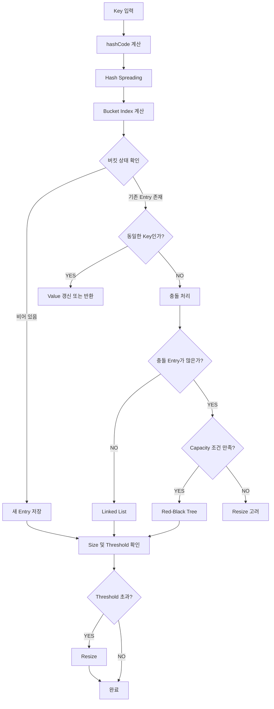

이 구조는 Java HashMap의 주요 처리 개념을 표현한 것이다.

해시 테이블은 해시 값을 계산하는 것만으로 모든 작업이 끝나는 자료구조가 아니다.

해시 값으로 버킷 위치를 찾고, 충돌을 처리하고, Key의 동등성을 검증하며, 필요에 따라 내부 배열을 확장한다.

또 충돌이 집중되면 자료구조를 트리로 변경할 수도 있다.

이러한 여러 메커니즘이 결합되어 평균적으로 빠른 조회와 삽입 성능을 제공한다.

---

### 정리

해시 테이블은 Key를 해시 함수에 전달해 계산한 해시 값을 이용하여 데이터를 저장하고 조회하는 자료구조다.

일반적인 Map 형태에서는 Key-Value 구조를 사용한다.

동일한 Key를 여러 번 삽입하면 새로운 매핑이 추가되는 것이 아니라 기존 Value가 갱신될 수 있다.

반면 서로 다른 Key가 동일한 Value를 가지는 것은 가능하다.

해시 테이블의 중요한 장점은 평균적으로 빠른 데이터 조회와 삽입, 삭제 성능을 제공한다는 것이다.

일반적인 순차 탐색은 O(n)의 비용이 발생할 수 있다.

반면 해시 테이블은 해시 값을 이용해 저장 위치를 좁힐 수 있으므로 평균적으로 O(1)에 가까운 성능을 제공할 수 있다.

하지만 모든 상황에서 O(1)의 성능이 보장되는 것은 아니다.

해시 충돌이 증가하면 추가적인 탐색 비용이 발생할 수 있다.

또 리사이징이 수행되는 특정 삽입에서는 기존 Entry를 재배치하는 비용이 필요하다.

해시 함수는 입력값에서 해시 값을 계산하는 역할을 한다.

해시 테이블에서 사용하는 일반적인 해시 함수는 빠른 계산과 적절한 데이터 분산이 중요하다.

이러한 해시 함수는 SHA-256 같은 암호학적 해시 함수와 목적이 다르다.

따라서 HashMap의 hashCode를 암호화 함수로 이해해서는 안 된다.

버킷은 데이터를 저장하기 위한 논리적인 위치다.

해시 값의 범위가 버킷 배열 크기보다 훨씬 크기 때문에 해시 값을 배열 인덱스로 변환하는 과정이 필요하다.

단순한 해시 테이블에서는 나머지 연산을 사용할 수 있다.

Java HashMap에서는 2의 거듭제곱 크기의 배열과 비트 마스킹을 활용한다.

또 상위 비트의 영향을 하위 비트에 반영하기 위해 Hash Spreading을 수행한다.

해시 충돌은 서로 다른 Key가 동일한 해시 값이나 동일한 버킷 위치로 매핑되는 현상이다.

해시 충돌은 제한된 출력 범위를 사용하는 해시 함수에서 피할 수 없는 현상이다.

따라서 해시 테이블은 충돌 처리 전략을 필요로 한다.

대표적인 충돌 처리 방법은 Separate Chaining과 Open Addressing이다.

Separate Chaining은 같은 버킷에 여러 Entry를 연결하는 방식이다.

Open Addressing은 충돌이 발생했을 때 다른 빈 슬롯을 탐색하는 방식이다.

Open Addressing에는 Linear Probing과 Quadratic Probing, Double Hashing 등의 방법이 존재한다.

Java HashMap은 Separate Chaining 기반의 구조를 사용한다.

일반적인 충돌 상황에서는 연결 리스트를 활용할 수 있다.

하지만 특정 버킷에 충돌이 지나치게 집중되면 Red-Black Tree를 사용할 수 있다.

Java 8 이후에는 이러한 트리화 구조가 도입되었다.

Java 17 OpenJDK HashMap에서는 TREEIFY_THRESHOLD 8, UNTREEIFY_THRESHOLD 6, MIN_TREEIFY_CAPACITY 64 등의 기준을 사용한다.

다만 트리화는 Entry 수와 배열 Capacity 등의 조건을 함께 고려하므로 특정 버킷에 Entry가 8개 있다는 이유만으로 항상 즉시 트리로 변경되는 것은 아니다.

로드 팩터는 저장된 Entry 수와 버킷 배열 크기의 비율을 나타낸다.

Java HashMap의 기본 로드 팩터는 0.75다.

이는 메모리 사용량과 충돌 처리 비용 사이의 균형을 고려한 값이다.

로드 팩터 임계값을 초과하면 HashMap은 리사이징을 수행할 수 있다.

일반적인 리사이징에서는 버킷 배열의 크기를 두 배로 증가시킨다.

리사이징 자체는 O(n)의 비용이 발생할 수 있지만 배열 확장 비용을 여러 삽입 연산에 분산해 생각할 수 있다.

HashMap에서 또 중요한 개념은 `equals()`와 `hashCode()`의 관계다.

`hashCode()`는 Key가 저장될 버킷 위치를 결정하는 데 활용된다.

`equals()`는 실제 Key가 동등한지 확인하는 데 활용된다.

따라서 두 객체가 equals 기준으로 동일하다면 반드시 같은 hashCode를 반환해야 한다.

반면 해시 값이 동일하다고 두 객체가 반드시 같은 것은 아니다.

또 HashMap의 Key는 가능하면 동등성에 영향을 주는 상태가 변경되지 않도록 설계해야 한다.

변경 가능한 Key를 사용하면 저장할 때와 조회할 때 해시 값이 달라져 데이터를 찾지 못하는 문제가 발생할 수 있다.

HashSet은 내부적으로 HashMap을 활용한다.

저장하려는 요소를 HashMap의 Key로 사용하고 공통 더미 객체를 Value로 사용함으로써 중복 없는 집합을 구현할 수 있다.

또 HashMap은 기본적으로 스레드 안전성을 제공하지 않는다.

따라서 멀티스레드 환경에서는 ConcurrentHashMap과 같은 동시성 자료구조를 고려해야 한다.

하지만 ConcurrentHashMap을 사용한다고 모든 복합 비즈니스 작업의 원자성이 자동으로 보장되는 것은 아니다.

특히 여러 서버와 데이터베이스가 함께 참여하는 결제나 쿠폰 발급 시스템에서는 애플리케이션 메모리의 Map만으로 데이터 일관성을 보장할 수 없다.

마지막으로 핵심 개념을 정리하면 다음과 같다.

| 개념 | 핵심 의미 |
|---|---|
| Hash Table | 해시 값을 이용한 데이터 저장 및 조회 |
| Key | 데이터 식별 |
| Value | Key와 연결된 데이터 |
| Hash Function | 입력에서 해시 값 계산 |
| Hash Code | 해시 함수의 결과 |
| Bucket | 해시 값에 따른 저장 위치 |
| Collision | 서로 다른 Key가 같은 해시 값이나 버킷을 공유 |
| Separate Chaining | 같은 버킷에 여러 Entry 연결 |
| Open Addressing | 다른 빈 슬롯을 탐색해 저장 |
| Linear Probing | 순차적으로 다음 슬롯 탐색 |
| Quadratic Probing | 이차식에 따라 탐색 |
| Double Hashing | 두 번째 해시 함수로 탐색 간격 계산 |
| Load Factor | Entry 수와 버킷 Capacity의 비율 |
| Threshold | 리사이징 판단 기준 |
| Resizing | 버킷 배열 확장 및 Entry 재배치 |
| Hash Spreading | 해시 비트 분산 개선 |
| Treeification | 연결 리스트를 트리 구조로 변경 |
| Red-Black Tree | 균형을 유지하는 이진 탐색 트리 |
| hashCode() | Key의 해시 값 계산 |
| equals() | 실제 Key 동등성 비교 |
| HashMap | Key-Value 기반 해시 자료구조 |
| HashSet | 중복 없는 요소 집합 |
| ConcurrentHashMap | 동시성 환경을 고려한 Map |

결국 해시 테이블을 이해한다는 것은 HashMap의 조회 속도가 빠르다는 사실을 아는 것에 그치지 않는다.

**Key가 어떻게 해시 값으로 변환되는지, 그 해시 값이 어떻게 버킷 위치로 연결되는지, 충돌이 발생하면 어떤 구조로 처리하는지, 데이터가 증가할 때 내부 배열이 어떻게 확장되는지까지 이해해야 한다.**

또 이러한 내부 구조를 바탕으로 올바른 Key 객체를 설계하고, 메모리와 성능의 균형을 고려하며, 동시성과 데이터 일관성 문제에 적절히 대응할 수 있어야 한다.

해시 테이블은 단순하면서도 다양한 설계 요소가 결합된 자료구조다.

그 원리를 이해하면 Java 컬렉션을 더 정확하게 사용할 수 있고, 백엔드 애플리케이션에서 발생하는 성능과 데이터 처리 문제를 더욱 체계적으로 분석할 수 있다.

#### 한 줄 요약

**해시 테이블은 Key의 해시 값을 이용해 버킷 위치를 계산하고 데이터를 저장하는 자료구조로, 평균 O(1)의 빠른 조회·삽입·삭제 성능을 제공한다. Java HashMap은 Separate Chaining과 로드 팩터 기반 리사이징, Red-Black Tree를 이용한 충돌 처리 등을 활용하며, 올바른 사용을 위해서는 `hashCode()`와 `equals()`의 계약, 불변 Key, 적절한 Capacity, 동시성 제어까지 함께 이해해야 한다.**
