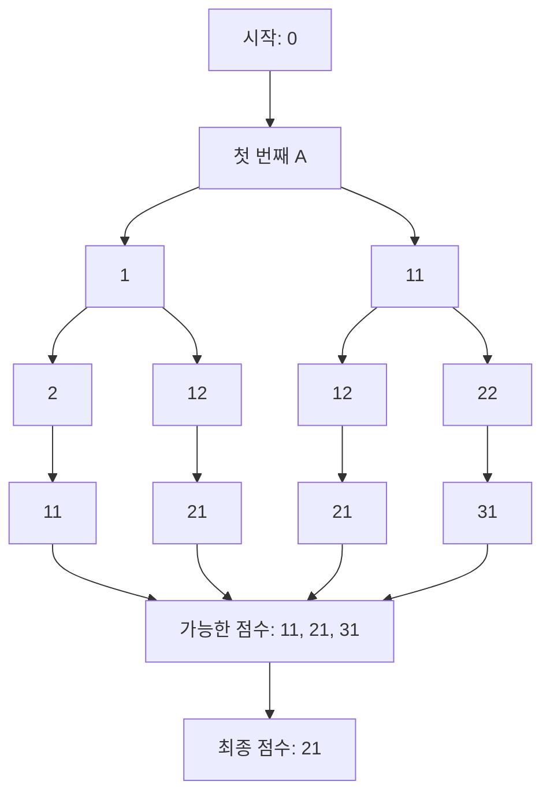
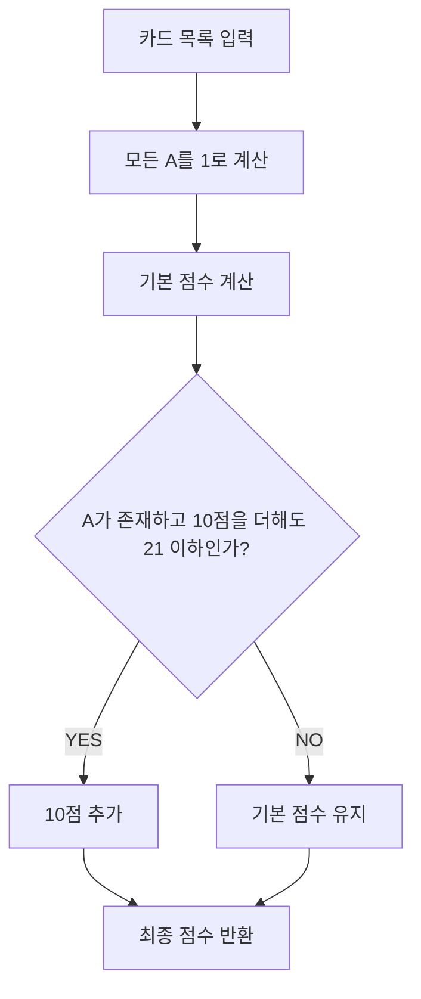
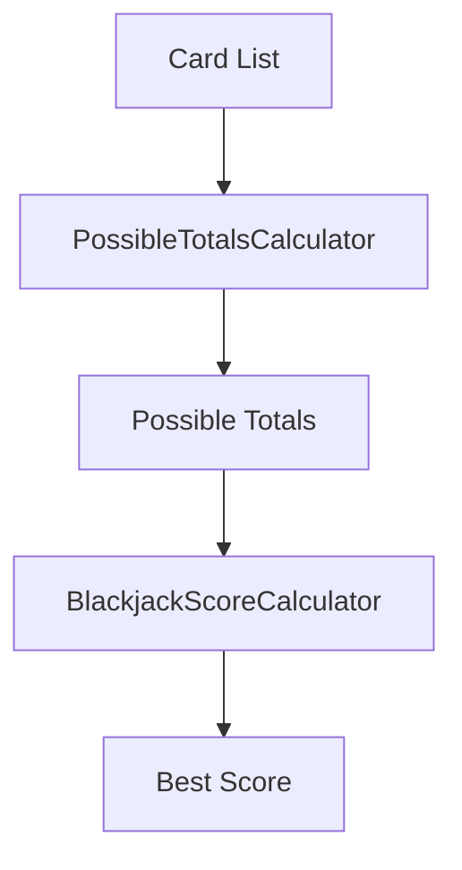
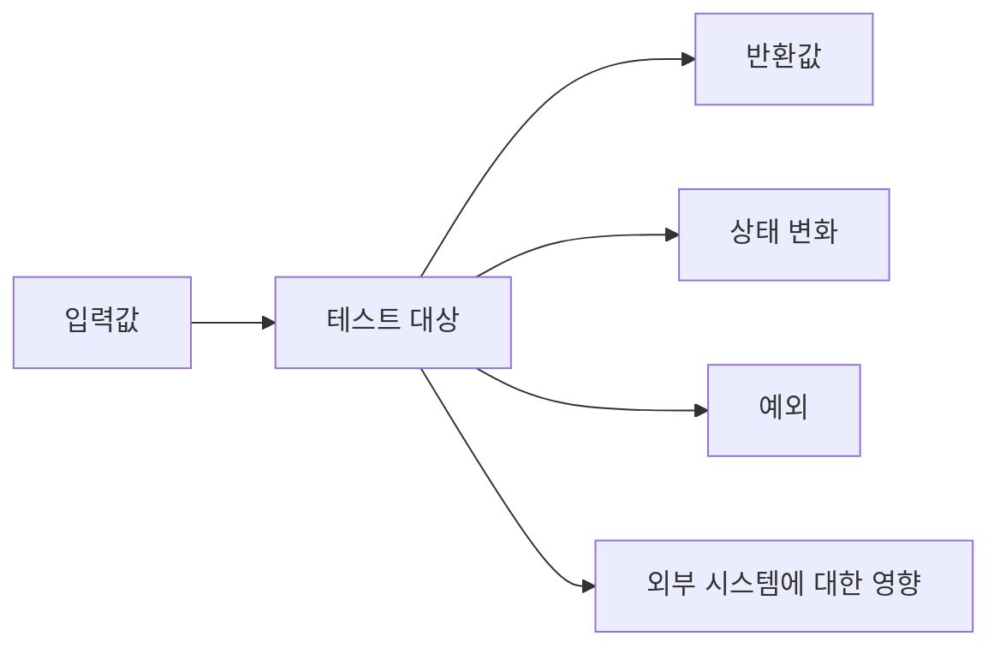
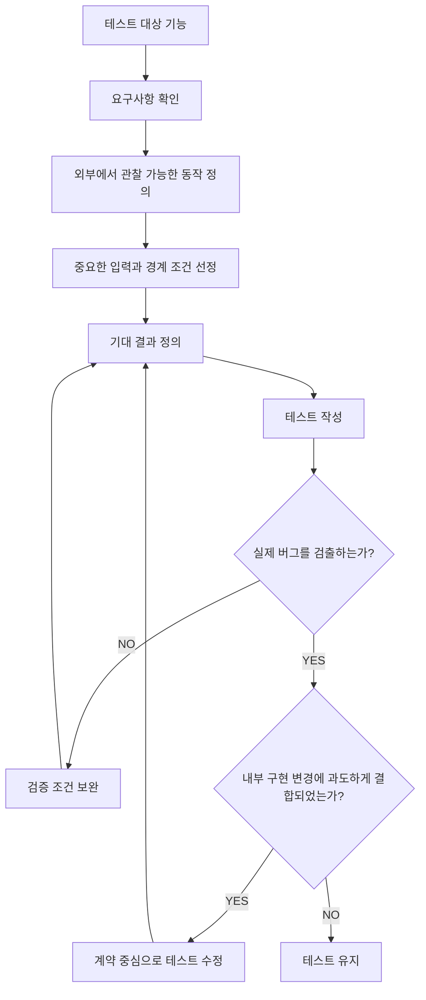

# 돔푸의 좋은 테스트
[https://youtu.be/APpUBvLRFJo?si=gOWnaAE2hp-Au34h](https://youtu.be/APpUBvLRFJo?si=gOWnaAE2hp-Au34h)

# 돔푸의 좋은 테스트
* toc
{:toc}

---

### 좋은 테스트 코드란 무엇인가? 리팩터링 내성, 구현 세부 사항과 외부 동작 검증, JUnit 5와 Spring Boot 실무 테스트 전략

백엔드 애플리케이션을 개발하다 보면 테스트 코드를 작성하는 일이 자연스러워진다.

새로운 API를 구현하면 정상적으로 응답하는지 확인한다.

결제 로직을 구현하면 결제 금액이 올바르게 계산되는지 검증한다.

쿠폰 발급 기능을 구현하면 발급 조건과 중복 발급 여부를 확인한다.

예를 들어 다음과 같은 계산기가 있다고 가정하자.

```java
public class PriceCalculator {

    public int calculate(int price, int quantity) {
        return price * quantity;
    }
}
```

이 코드를 검증하기 위한 테스트를 작성할 수 있다.

```java
import org.junit.jupiter.api.Test;

import static org.junit.jupiter.api.Assertions.assertEquals;

class PriceCalculatorTest {

    @Test
    void 상품_가격과_수량을_곱해_총액을_계산한다() {

        PriceCalculator calculator = new PriceCalculator();

        int result = calculator.calculate(1000, 3);

        assertEquals(3000, result);
    }
}
```

테스트를 실행하면 정상적으로 통과한다.

그렇다면 이 테스트는 좋은 테스트일까?

현재로서는 요구사항 하나를 올바르게 검증하는 테스트라고 볼 수 있다.

하지만 이것만으로 테스트의 품질을 충분히 판단할 수는 없다.

다음과 같은 질문도 필요하다.

**이 테스트는 실제 버그가 발생했을 때 실패할까?**

**내부 구현을 변경해도 결과가 같다면 테스트는 그대로 통과할까?**

**테스트가 실패했을 때 어떤 문제가 발생했는지 쉽게 파악할 수 있을까?**

**테스트를 유지보수하는 비용이 테스트를 통해 얻는 가치보다 크지는 않을까?**

**테스트가 많아질수록 코드를 변경하기 쉬워질까, 오히려 어려워질까?**

좋은 테스트는 단순히 실행했을 때 성공하는 코드가 아니다.

**실제 동작이 잘못되었을 때는 실패하고, 올바른 동작을 유지하는 내부 변경에는 불필요하게 실패하지 않는 테스트**가 중요하다.

이 개념을 이해하는 데 핵심적인 것이 리팩터링 내성이다.

---

### 좋은 테스트란 무엇인가?

좋은 테스트를 정의하는 기준은 하나가 아니다.

테스트 코드의 품질을 이야기할 때 흔히 다음과 같은 요소들이 등장한다.

| 기준 | 의미 |
|---|---|
| 버그 검출 능력 | 잘못된 동작이 발생했을 때 실패하는가? |
| 리팩터링 내성 | 올바른 동작을 유지하는 내부 변경에 불필요하게 실패하지 않는가? |
| 가독성 | 어떤 요구사항을 검증하는지 쉽게 이해할 수 있는가? |
| 실행 속도 | 개발 과정에서 자주 실행할 수 있는가? |
| 유지보수성 | 요구사항 변경에 따른 수정 비용이 적절한가? |
| 결정성 | 동일한 조건에서 일관된 결과를 제공하는가? |
| 독립성 | 다른 테스트의 실행 순서나 상태에 영향을 받지 않는가? |

이 요소들은 서로 영향을 주고받는다.

예를 들어 테스트의 버그 검출 능력을 높이기 위해 모든 내부 메서드와 필드에 대한 검증을 추가했다고 가정하자.

당장은 많은 코드를 확인하는 것처럼 보일 수 있다.

하지만 내부 구현을 수정할 때마다 수십 개의 테스트가 실패한다면 어떨까?

개발자는 내부 구조를 개선하기 위해 테스트 코드까지 대규모로 수정해야 한다.

그 과정에서 테스트 유지보수 비용이 증가한다.

반대로 내부 구조에는 전혀 관심을 두지 않고 정상적인 입력 하나만 검증한다면 어떨까?

테스트는 리팩터링에 강할 수 있지만 중요한 경계 조건이나 예외 상황을 놓칠 수 있다.

따라서 좋은 테스트는 특정 조건 하나만 만족하는 것이 아니라 여러 품질 요소 사이에서 균형을 가져야 한다.

그중에서도 중요한 두 가지를 먼저 살펴보자.

**첫 번째는 버그를 검출하는 능력이다.**

**두 번째는 리팩터링 내성이다.**

이 두 가지는 테스트가 실제 개발 과정에서 지속적인 가치를 제공하는 데 중요한 역할을 한다.

---

### 왜 테스트를 작성하는가?

테스트를 작성하는 이유를 생각해 보자.

가장 직접적인 목적은 프로그램의 동작이 요구사항을 만족하는지 확인하는 것이다.

하지만 장기적인 관점에서는 또 다른 중요한 목적이 있다.

바로 **코드를 안전하게 변경할 수 있다는 확신을 얻는 것**이다.

소프트웨어는 한 번 작성한 뒤 그대로 유지되는 경우가 드물다.

요구사항이 변경되고, 새로운 기능이 추가되며, 성능 개선과 버그 수정이 반복된다.

예를 들어 다음과 같은 상황을 생각해 보자.

```java
public int calculateTotalPrice(
        List<OrderItem> items
) {

    int total = 0;

    for (OrderItem item : items) {
        total += item.getPrice() * item.getQuantity();
    }

    return total;
}
```

이 코드를 Stream API로 변경한다고 가정하자.

```java
public int calculateTotalPrice(
        List<OrderItem> items
) {

    return items.stream()
            .mapToInt(item ->
                    item.getPrice() * item.getQuantity()
            )
            .sum();
}
```

내부 구현은 달라졌다.

하지만 반환되는 총금액은 동일해야 한다.

이러한 변경을 수행할 때 기존 테스트가 정상적으로 통과한다면 개발자는 더 높은 확신을 가지고 코드를 개선할 수 있다.

반면 내부 구현을 조금만 변경해도 테스트가 대량으로 실패한다면 테스트는 안전망이 아니라 변경을 어렵게 만드는 장애물이 될 수 있다.

Martin Fowler 역시 자동화된 테스트가 코드의 안정성을 확인하는 동시에 리팩터링을 가능하게 하는 기반이라는 점을 강조한다.

---

### 리팩터링이란 무엇인가?

리팩터링(Refactoring)은 프로그램의 외부에서 관찰할 수 있는 동작을 유지하면서 내부 구조를 개선하는 작업이다.

대표적인 예는 다음과 같다.

| 리팩터링 작업 | 변경되는 요소 |
|---|---|
| 메서드 추출 | 긴 메서드를 여러 메서드로 분리 |
| 메서드 인라인 | 불필요한 메서드 호출 제거 |
| 클래스 분리 | 하나의 클래스가 가진 책임 분리 |
| 조건문 개선 | if-else를 다형성으로 변경 |
| 자료구조 변경 | List를 Map이나 Set으로 변경 |
| 알고리즘 개선 | 동일한 결과를 더 효율적으로 계산 |
| 의존성 개선 | 구체 클래스 의존을 인터페이스로 변경 |

중요한 것은 다음과 같다.

**리팩터링은 외부 동작을 변경하지 않는다는 전제를 가진다.**

예를 들어 할인율을 10%에서 20%로 변경하는 것은 리팩터링이 아니다.

비즈니스 동작 자체가 달라졌기 때문이다.

반면 할인율 10%를 유지하면서 계산 로직을 별도의 클래스로 분리하는 작업은 리팩터링에 해당할 수 있다.

이 차이를 이해해야 테스트의 실패가 의미 있는지 판단할 수 있다.

---

### 리팩터링 내성이란 무엇인가?

리팩터링 내성(Resistance to Refactoring)은 프로덕션 코드의 외부 동작을 유지하면서 내부 구현을 변경했을 때 테스트가 불필요하게 실패하지 않는 성질을 의미한다.

예를 들어 다음과 같은 상황을 생각해 보자.

```text
기존 코드

입력 A
   ↓
알고리즘 X
   ↓
결과 B
```

이 코드를 다음과 같이 개선했다.

```text
개선된 코드

입력 A
   ↓
알고리즘 Y
   ↓
결과 B
```

알고리즘 X와 Y는 내부 구현이 다르다.

하지만 사용자에게 제공하는 결과 B는 동일하다.

이때 기존 테스트가 그대로 통과한다면 리팩터링 내성이 높은 테스트라고 볼 수 있다.

반면 테스트가 알고리즘 X의 내부 구조를 검증하고 있었다면 어떻게 될까?

알고리즘 Y로 변경하는 순간 테스트가 실패할 수 있다.

그런데 실제 비즈니스 기능에는 문제가 없다.

이러한 상황에서 테스트 실패는 실제 버그를 의미하지 않는다.

**테스트가 내부 구현에 과도하게 결합되어 발생한 거짓 경보(False Positive)**일 수 있다.

---

### 리팩터링 내성이 부족하면 어떤 문제가 발생할까?

리팩터링 내성이 부족한 테스트는 단순히 테스트 코드를 수정해야 하는 번거로움만 발생시키는 것이 아니다.

장기적으로 개발 과정 전체에 영향을 줄 수 있다.

#### 1. 리팩터링 비용이 증가한다

예를 들어 특정 클래스의 내부 자료구조를 변경했다고 가정하자.

기존에는 List를 사용했다.

새로운 구현에서는 Map을 사용한다.

그런데 여러 테스트가 List의 순서나 내부 필드 구조까지 검증하고 있다면 대부분의 테스트를 수정해야 할 수 있다.

외부 기능에는 변화가 없는데도 테스트 유지보수 비용이 발생한다.

#### 2. 개발자가 리팩터링을 회피하게 된다

테스트가 너무 쉽게 실패하면 개발자는 내부 구조를 개선하는 작업을 부담스럽게 느낄 수 있다.

기능을 유지하면서 코드를 개선했는데 수십 개의 테스트를 수정해야 한다면 변경에 필요한 비용이 증가하기 때문이다.

그 결과 코드 개선을 미루게 되고, 기술 부채가 축적될 수 있다.

#### 3. 테스트 실패에 대한 신뢰가 낮아진다

테스트 실패가 실제 버그를 의미하는 경우가 많다면 개발자는 실패 원인을 적극적으로 분석할 것이다.

하지만 테스트가 내부 구현 변경 때문에 반복적으로 실패한다면 어떨까?

테스트 실패를 중요한 문제로 받아들이지 않을 수 있다.

이러한 상황에서는 실제 버그로 인해 테스트가 실패하더라도 단순한 테스트 수정 작업으로 오해할 위험이 있다.

#### 4. 테스트 코드가 프로덕션 코드의 설계를 제약한다

테스트가 특정 메서드 호출 순서나 내부 자료구조에 의존하면 해당 구현을 변경하기 어려워진다.

결과적으로 테스트가 비즈니스 요구사항을 보호하는 것이 아니라 기존 구현 방식을 고정하는 역할을 할 수 있다.

Google Testing Blog에서도 이러한 유형의 테스트를 변경 감지 테스트(Change-Detector Test)라는 관점에서 다루며, 외부 동작에 영향을 주지 않는 변경 때문에 테스트가 실패하는 문제를 지적한다.

---

### 구현 세부 사항과 외부 동작은 무엇이 다를까?

리팩터링 내성을 이해하려면 구현 세부 사항(Implementation Details)과 외부 동작(Observable Behavior)을 구분해야 한다.

예를 들어 다음 계산기를 생각해 보자.

```java
public class DiscountCalculator {

    public int calculate(
            int originalPrice,
            int discountRate
    ) {

        int discountAmount =
                originalPrice * discountRate / 100;

        return originalPrice - discountAmount;
    }
}
```

이 클래스의 외부 동작은 다음과 같다.

```text
원래 가격: 10,000원

할인율: 10%

최종 가격: 9,000원
```

반면 다음 사항들은 일반적으로 내부 구현에 해당한다.

```text
할인 금액을 별도 변수에 저장하는가?

계산을 한 줄로 작성하는가?

별도의 메서드로 추출하는가?

BigDecimal을 사용하는가?

어떤 순서로 중간값을 계산하는가?
```

이러한 구현은 변경될 수 있다.

중요한 것은 외부에 제공하는 계산 결과가 요구사항을 만족하는지 여부다.

따라서 테스트는 다음과 같이 작성할 수 있다.

```java
@Test
void 할인율을_적용한_최종_가격을_계산한다() {

    DiscountCalculator calculator =
            new DiscountCalculator();

    int result = calculator.calculate(
            10000,
            10
    );

    assertEquals(9000, result);
}
```

이 테스트는 계산기의 내부 변수를 확인하지 않는다.

외부에서 호출할 수 있는 메서드의 결과를 검증한다.

따라서 내부 구현을 변경하더라도 결과가 같다면 테스트를 유지할 수 있다.

---

### 외부 동작을 검증한다는 것은 무엇인가?

외부 동작을 검증한다는 말을 단순히 메서드의 반환값만 확인하는 것으로 이해해서는 안 된다.

프로그램의 외부 동작에는 여러 종류가 존재한다.

대표적으로 다음과 같다.

| 외부 동작 | 검증 예시 |
|---|---|
| 반환값 | 할인 금액이 9,000원인가? |
| 예외 | 잘못된 입력에 예외가 발생하는가? |
| 상태 변화 | 주문 상태가 PAID로 변경되는가? |
| 영속화 결과 | 데이터베이스에 주문이 저장되는가? |
| 외부 호출 | 결제 승인 요청이 전송되는가? |
| 이벤트 발행 | 결제 완료 이벤트가 발행되는가? |
| HTTP 응답 | 상태 코드와 응답 본문이 올바른가? |
| 보안 동작 | 권한 없는 요청을 차단하는가? |

예를 들어 결제 서비스에서는 반환값뿐 아니라 실제 결제가 중복 실행되지 않는지도 중요하다.

따라서 외부 결제 시스템에 대한 호출 여부가 비즈니스 계약의 일부라면 해당 호출을 검증하는 테스트도 의미가 있다.

핵심은 다음과 같다.

**사용자나 다른 시스템이 의존하는 동작을 검증하는 것과 내부 알고리즘의 실행 순서를 검증하는 것은 다르다.**

이 차이를 실제 도메인 예제로 살펴보자.

---

### 블랙잭 점수 계산기로 알아보는 테스트의 문제

블랙잭은 카드의 합을 21에 가깝게 만드는 게임이다.

일반적인 규칙에서는 카드마다 다음과 같은 값을 가진다.

| 카드 | 값 |
|---|---:|
| A | 1 또는 11 |
| 2~10 | 숫자와 동일 |
| J, Q, K | 10 |

예를 들어 다음 카드가 있다고 가정하자.

```text
A + K
```

A를 11로 계산하면 다음과 같다.

```text
11 + 10 = 21
```

따라서 블랙잭 점수는 21이다.

하지만 다음 카드라면 어떨까?

```text
A + K + 5
```

A를 11로 계산하면 다음과 같다.

```text
11 + 10 + 5 = 26
```

21을 초과한다.

반면 A를 1로 계산하면 다음과 같다.

```text
1 + 10 + 5 = 16
```

따라서 점수는 16이다.

이처럼 A는 상황에 따라 1 또는 11로 계산해야 한다.

이제 이러한 규칙을 구현하는 계산기를 만들어 보자.

---

### 첫 번째 구현: 가능한 모든 점수를 계산한다

가장 직관적인 방법은 가능한 모든 점수를 계산하는 것이다.

예를 들어 다음 카드를 생각해 보자.

```text
A + A + 9
```

가능한 합은 다음과 같다.

```text
1 + 1 + 9 = 11

1 + 11 + 9 = 21

11 + 1 + 9 = 21

11 + 11 + 9 = 31
```

중복을 제거하면 다음 세 가지다.

```text
11, 21, 31
```

이 중 21을 초과하지 않는 가장 큰 값은 21이다.

이 방식을 구현하려면 가능한 합을 Set으로 관리할 수 있다.

먼저 카드의 종류를 정의한다.

```java
public enum Rank {

    ACE(1),
    TWO(2),
    THREE(3),
    FOUR(4),
    FIVE(5),
    SIX(6),
    SEVEN(7),
    EIGHT(8),
    NINE(9),
    TEN(10),
    JACK(10),
    QUEEN(10),
    KING(10);

    private final int value;

    Rank(int value) {
        this.value = value;
    }

    public int value() {
        return value;
    }
}
```

그리고 카드를 표현하는 Record를 작성한다.

```java
import java.util.Objects;

public record Card(Rank rank) {

    public Card {
        Objects.requireNonNull(rank);
    }
}
```

여기서는 점수 계산에 필요한 카드의 숫자 정보만 모델링했다.

실제 카드 게임에서 문양까지 관리해야 한다면 별도의 Suit를 추가할 수 있다.

---

### 모든 점수를 계산하는 방식

먼저 계산기의 공통 인터페이스를 정의한다.

```java
import java.util.List;

public interface BlackjackScoreCalculator {

    int calculate(List<Card> cards);
}
```

이제 가능한 모든 점수를 계산하는 구현체를 작성한다.

```java
import java.util.HashSet;
import java.util.List;
import java.util.Objects;
import java.util.Set;

public class AllCombinationsScoreCalculator
        implements BlackjackScoreCalculator {

    @Override
    public int calculate(List<Card> cards) {

        Set<Integer> possibleTotals =
                calculatePossibleTotals(cards);

        return possibleTotals.stream()
                .filter(score -> score <= 21)
                .mapToInt(Integer::intValue)
                .max()
                .orElseGet(() ->
                        possibleTotals.stream()
                                .mapToInt(Integer::intValue)
                                .min()
                                .orElseThrow()
                );
    }

    Set<Integer> calculatePossibleTotals(
            List<Card> cards
    ) {

        Objects.requireNonNull(cards);

        if (cards.isEmpty()) {
            throw new IllegalArgumentException(
                    "카드는 최소 한 장 필요합니다."
            );
        }

        Set<Integer> totals = new HashSet<>();

        totals.add(0);

        for (Card card : cards) {

            Objects.requireNonNull(card);

            Set<Integer> nextTotals =
                    new HashSet<>();

            for (int total : totals) {

                nextTotals.add(
                        Math.addExact(
                                total,
                                card.rank().value()
                        )
                );

                if (card.rank() == Rank.ACE) {

                    nextTotals.add(
                            Math.addExact(total, 11)
                    );
                }
            }

            totals = nextTotals;
        }

        return totals;
    }
}
```

이 구현에서는 두 가지 작업을 수행한다.

첫 번째는 가능한 모든 점수를 계산하는 작업이다.

```java
calculatePossibleTotals(cards);
```

두 번째는 최종 블랙잭 점수를 결정하는 작업이다.

```java
return possibleTotals.stream()
        .filter(score -> score <= 21)
        .mapToInt(Integer::intValue)
        .max()
        .orElseGet(() ->
                possibleTotals.stream()
                        .mapToInt(Integer::intValue)
                        .min()
                        .orElseThrow()
        );
```

여기서는 21 이하의 점수가 있다면 가장 큰 값을 선택한다.

모든 점수가 21을 초과한다면 가장 작은 점수를 반환한다.

이 예제에서는 이미 버스트된 패도 실제 합계가 필요하다는 요구사항을 가정했다.

실제 게임에서는 버스트 여부를 별도의 값으로 표현할 수도 있다.

---

### 가능한 모든 점수 계산 과정

다음 카드가 있다고 가정하자.

```text
A, A, 9
```

첫 번째 A를 처리하면 다음과 같다.

```text
1, 11
```

두 번째 A를 처리하면 다음과 같다.

```text
2, 12, 22
```

마지막 9를 처리하면 다음과 같다.

```text
11, 21, 31
```

이를 구조로 표현하면 다음과 같다.



이 방식은 가능한 모든 경우를 계산한다는 점에서 직관적이다.

하지만 점수를 계산하기 위해 중간 상태를 저장하고 여러 조합을 생성해야 한다.

물론 Set을 사용하므로 중복된 합은 제거된다.

그럼에도 실제 블랙잭 점수를 계산하는 데 필요한 작업보다 더 많은 계산을 수행할 수 있다.

---

### 첫 번째 테스트: 최종 결과를 검증한다

이제 계산기를 검증해 보자.

```java
import org.junit.jupiter.api.Test;

import java.util.List;

import static org.junit.jupiter.api.Assertions.assertEquals;

class AllCombinationsScoreCalculatorTest {

    private final BlackjackScoreCalculator calculator =
            new AllCombinationsScoreCalculator();

    @Test
    void 에이스_두_장과_9의_점수는_21이다() {

        List<Card> cards = List.of(
                new Card(Rank.ACE),
                new Card(Rank.ACE),
                new Card(Rank.NINE)
        );

        int score = calculator.calculate(cards);

        assertEquals(21, score);
    }
}
```

이 테스트는 외부에서 호출할 수 있는 `calculate()` 메서드를 검증한다.

입력은 카드 목록이다.

출력은 최종 점수다.

따라서 계산기가 내부적으로 어떤 알고리즘을 사용하는지는 알 필요가 없다.

```text
입력

[A, A, 9]

↓

calculate()

↓

출력

21
```

이것은 계산기의 외부 동작을 검증하는 테스트다.

---

### 두 번째 테스트: 내부 구현을 검증한다

이번에는 가능한 모든 합이 정확하게 계산되는지 확인하고 싶다고 가정하자.

다음 테스트를 작성할 수 있다.

```java
import org.junit.jupiter.api.Test;

import java.util.List;
import java.util.Set;

import static org.junit.jupiter.api.Assertions.assertEquals;

class PossibleTotalsTest {

    private final AllCombinationsScoreCalculator calculator =
            new AllCombinationsScoreCalculator();

    @Test
    void 에이스_두_장과_9의_모든_점수를_계산한다() {

        List<Card> cards = List.of(
                new Card(Rank.ACE),
                new Card(Rank.ACE),
                new Card(Rank.NINE)
        );

        Set<Integer> totals =
                calculator.calculatePossibleTotals(cards);

        assertEquals(
                Set.of(11, 21, 31),
                totals
        );
    }
}
```

이 테스트도 정상적으로 통과한다.

그렇다면 좋은 테스트가 하나 추가된 것일까?

표면적으로는 그렇게 보인다.

하지만 여기에는 중요한 차이가 있다.

첫 번째 테스트는 최종 점수를 검증한다.

두 번째 테스트는 계산기가 내부적으로 사용하는 중간 결과를 검증한다.

두 테스트의 관심사는 다르다.

| 구분 | 첫 번째 테스트 | 두 번째 테스트 |
|---|---|---|
| 입력 | 카드 목록 | 카드 목록 |
| 검증 대상 | 최종 블랙잭 점수 | 가능한 모든 합 |
| 외부 요구사항 | 직접 검증 | 구현 방식에 의존 |
| 알고리즘 변경 영향 | 결과가 같으면 유지 가능 | 내부 계산 방식 변경 시 실패 가능 |
| 리팩터링 내성 | 상대적으로 높음 | 상대적으로 낮음 |

현재 계산기는 가능한 모든 합을 구하는 방식으로 구현되어 있다.

하지만 **가능한 모든 합을 계산하는 것이 외부에 제공해야 하는 기능인지** 생각해 볼 필요가 있다.

사용자가 원하는 것은 최종 블랙잭 점수일 수 있다.

그렇다면 가능한 모든 합은 최종 점수를 계산하기 위한 내부 구현에 해당한다.

이 차이가 리팩터링 과정에서 중요해진다.

---

### 두 번째 구현: 점수를 더 간결하게 계산한다

이제 더 간단한 알고리즘을 생각해 보자.

블랙잭에서 A는 1 또는 11로 계산할 수 있다.

그런데 A를 11로 계산하는 것은 A를 1로 계산하는 것보다 정확히 10점을 추가하는 것과 같다.

따라서 다음과 같은 접근이 가능하다.

먼저 모든 A를 1로 계산한다.

그다음 A가 하나 이상 있고 총점에 10을 더해도 21을 초과하지 않는다면 10을 추가한다.

예를 들어 다음 카드를 생각해 보자.

```text
A + 9
```

먼저 A를 1로 계산한다.

```text
1 + 9 = 10
```

여기서 10을 추가한다.

```text
10 + 10 = 20
```

따라서 최종 점수는 20이다.

다음 카드는 어떨까?

```text
A + K + 5
```

먼저 A를 1로 계산한다.

```text
1 + 10 + 5 = 16
```

여기서 10을 추가하면 다음과 같다.

```text
16 + 10 = 26
```

21을 초과하므로 10을 추가하지 않는다.

최종 점수는 16이다.

이 알고리즘에서는 가능한 모든 합을 별도로 저장할 필요가 없다.

---

### 개선된 블랙잭 점수 계산기

다음과 같이 구현할 수 있다.

```java
import java.util.List;
import java.util.Objects;

public class OptimizedScoreCalculator
        implements BlackjackScoreCalculator {

    @Override
    public int calculate(List<Card> cards) {

        Objects.requireNonNull(cards);

        if (cards.isEmpty()) {
            throw new IllegalArgumentException(
                    "카드는 최소 한 장 필요합니다."
            );
        }

        int total = 0;

        int aceCount = 0;

        for (Card card : cards) {

            Objects.requireNonNull(card);

            total = Math.addExact(
                    total,
                    card.rank().value()
            );

            if (card.rank() == Rank.ACE) {
                aceCount++;
            }
        }

        if (aceCount > 0 && total <= 11) {
            total += 10;
        }

        return total;
    }
}
```

이 구현은 이전보다 단순하다.

가능한 모든 점수 조합을 계산하지 않는다.

Set도 사용하지 않는다.

카드를 한 번 순회하면서 기본 점수를 구한다.

그리고 조건에 따라 10점을 추가한다.



앞서 작성한 구현과 내부 구조는 완전히 다르다.

하지만 최종 결과는 동일하게 유지된다.

단, 이 최적화는 A가 1 또는 11이라는 블랙잭 규칙을 전제로 한다.

모든 A를 1로 계산한 기본 합에 대해, A 하나를 11로 바꾸는 것은 10점을 추가하는 것과 같다.

또 A를 두 장 이상 11로 계산하면 A 두 장만으로도 22점이 되므로 21 이하의 점수에서는 최대 한 장만 11로 계산할 수 있다.

따라서 일반적인 블랙잭 점수 계산에서는 이 방식으로 최적의 합을 구할 수 있다.

---

### 리팩터링 이후 기존 테스트는 어떻게 될까?

기존 테스트를 다시 살펴보자.

```java
@Test
void 에이스_두_장과_9의_점수는_21이다() {

    List<Card> cards = List.of(
            new Card(Rank.ACE),
            new Card(Rank.ACE),
            new Card(Rank.NINE)
    );

    int score = calculator.calculate(cards);

    assertEquals(21, score);
}
```

이 테스트는 새로운 구현에서도 통과한다.

왜 그럴까?

입력과 출력이 동일하기 때문이다.

```text
기존 구현

[A, A, 9]
    ↓
가능한 모든 합 계산
    ↓
21
```

```text
개선된 구현

[A, A, 9]
    ↓
기본 합 계산 후 A 보정
    ↓
21
```

내부 알고리즘은 달라졌다.

하지만 외부 동작은 유지되었다.

따라서 테스트도 유지된다.

반면 다음 테스트는 어떨까?

```java
@Test
void 에이스_두_장과_9의_모든_점수를_계산한다() {

    Set<Integer> totals =
            calculator.calculatePossibleTotals(cards);

    assertEquals(
            Set.of(11, 21, 31),
            totals
    );
}
```

개선된 계산기에는 `calculatePossibleTotals()` 메서드가 없다.

따라서 이 테스트를 그대로 적용할 수 없다.

기존 구현에서만 존재하던 내부 계산 방식에 의존하고 있기 때문이다.

이 상황에서는 테스트를 수정하거나 제거해야 할 수 있다.

하지만 사용자가 원하는 최종 점수는 올바르게 계산된다.

이것이 구현 세부 사항에 결합된 테스트가 리팩터링 내성을 떨어뜨리는 대표적인 사례다.

---

### 리팩터링 내성이 높은 테스트의 핵심

두 구현을 비교하면 다음과 같은 결론을 얻을 수 있다.

**테스트는 현재 코드가 어떤 방식으로 동작하는지를 그대로 복제하기보다, 어떤 결과를 제공해야 하는지를 검증하는 것이 좋다.**

예를 들어 다음 질문은 구현 중심의 질문이다.

> 계산기가 Set에 모든 점수 조합을 저장하는가?

반면 다음 질문은 동작 중심의 질문이다.

> A를 1 또는 11로 계산했을 때 21을 초과하지 않는 가장 높은 점수를 반환하는가?

두 질문은 비슷해 보이지만 다르다.

첫 번째 질문은 특정 알고리즘을 전제로 한다.

두 번째 질문은 비즈니스 요구사항을 검증한다.

좋은 테스트를 작성하려면 이러한 차이를 의식해야 한다.

---

### 내부 구현을 테스트하면 항상 잘못된 것일까?

그렇지는 않다.

내부 구현과 관련된 동작을 검증하는 것이 필요한 경우도 있다.

예를 들어 다음과 같은 요구사항을 생각해 보자.

**사용자가 현재 카드로 만들 수 있는 모든 점수 조합을 조회할 수 있어야 한다.**

이 요구사항이 존재한다면 가능한 모든 합을 계산하는 기능은 더 이상 단순한 내부 구현이 아니다.

사용자에게 제공해야 하는 기능이다.

따라서 이를 검증하는 테스트가 의미를 갖는다.

```java
@Test
void 에이스_두_장과_9로_만들_수_있는_점수를_반환한다() {

    Set<Integer> possibleTotals =
            possibleTotalsCalculator.calculate(
                    List.of(
                            new Card(Rank.ACE),
                            new Card(Rank.ACE),
                            new Card(Rank.NINE)
                    )
            );

    assertEquals(
            Set.of(11, 21, 31),
            possibleTotals
    );
}
```

여기서 중요한 변화는 테스트 대상이다.

이제 가능한 모든 합을 계산하는 기능 자체가 독립적인 책임을 가진다.

즉 외부 계약으로 제공해야 하는 기능이 되었다.

따라서 내부 구현인지 외부 동작인지는 단순히 메서드가 `public`인지 `private`인지로만 판단할 수 없다.

**해당 기능이 다른 객체나 사용자에게 제공해야 하는 계약인지**가 더 중요하다.

---

### 테스트하기 어려운 기능은 객체 분리의 신호일까?

특정 내부 로직을 반드시 검증하고 싶은 상황이 있다고 가정하자.

그런데 해당 로직은 다른 클래스의 내부 메서드로만 존재한다.

이 경우 객체의 책임을 다시 검토할 수 있다.

예를 들어 다음과 같은 구조다.

```text
BlackjackScoreCalculator

├── 가능한 모든 점수 계산
├── 최적 점수 선택
└── 버스트 여부 판단
```

여기서 가능한 모든 점수 계산이 다른 기능에서도 재사용되는 중요한 도메인 규칙이라고 가정하자.

그렇다면 다음과 같이 책임을 분리할 수 있다.

```text
PossibleTotalsCalculator

└── 가능한 점수 조합 계산
```

```text
BlackjackScoreCalculator

├── PossibleTotalsCalculator 활용
└── 최적 점수 결정
```

이제 각 객체의 외부 동작을 독립적으로 검증할 수 있다.



이 구조의 장점은 책임이 명확해진다는 것이다.

PossibleTotalsCalculator는 가능한 점수 조합을 계산한다.

BlackjackScoreCalculator는 최종 점수를 결정한다.

각 객체는 자신의 계약을 검증하는 테스트를 가질 수 있다.

하지만 여기서 주의해야 할 점도 있다.

---

### 테스트를 위해 무조건 클래스를 분리해야 할까?

그렇지 않다.

내부 메서드를 검증하기 어렵다는 이유만으로 모든 메서드를 별도 클래스로 추출하면 오히려 복잡성이 증가할 수 있다.

예를 들어 다음과 같은 구조를 생각해 보자.

```text
ScoreCalculator

├── AceCounter
├── BasicScoreCalculator
├── ScoreAdjuster
├── BestScoreSelector
└── ResultConverter
```

각 클래스가 매우 단순한 작업만 수행하고 별도의 도메인 의미나 독립적인 변경 이유가 없다면 지나친 책임 분리일 수 있다.

클래스가 많아지면 다음과 같은 문제가 발생할 수 있다.

- 객체 간 의존성이 증가한다.
- 코드의 전체 흐름을 파악하기 어려워진다.
- 단순한 수정에도 여러 클래스를 확인해야 한다.
- 테스트를 위한 설정 코드가 증가한다.
- 작은 구현 변경이 객체 간 인터페이스 변경으로 확대될 수 있다.

따라서 객체 분리 여부는 테스트 편의성만으로 결정해서는 안 된다.

다음 질문을 함께 고려해야 한다.

**이 기능이 독립적인 도메인 의미를 가지는가?**

**다른 곳에서도 재사용되는가?**

**독립적으로 변경될 가능성이 있는가?**

**분리하면 객체의 책임이 더 명확해지는가?**

**분리 이후 오히려 불필요한 추상화가 증가하지는 않는가?**

테스트하기 어렵다는 사실은 설계를 재검토해야 한다는 신호일 수 있다.

하지만 반드시 클래스를 분리해야 한다는 결론으로 이어지는 것은 아니다.

---

### 좋은 테스트는 입력과 출력을 중심으로 설계한다

리팩터링 내성을 높이는 가장 실용적인 방법 중 하나는 입력과 출력에 집중하는 것이다.

이를 블랙박스 테스트(Black-Box Testing) 관점으로 이해할 수 있다.

블랙박스 테스트는 내부 구현을 직접 확인하지 않고 외부에 제공되는 동작을 검증한다.

예를 들어 다음과 같다.



여기서 중요한 것은 내부 구현이 완전히 중요하지 않다는 의미가 아니다.

테스트를 설계할 때 관찰 가능한 계약을 기준으로 검증하자는 의미다.

예를 들어 다음과 같은 계산 방식은 자유롭게 변경할 수 있어야 한다.

```text
반복문 → Stream

List → Set

조건문 → 다형성

재귀 → 반복문

전체 조합 계산 → 최적화된 계산
```

외부에서 관찰하는 결과가 동일하다면 이러한 내부 변경 때문에 테스트가 불필요하게 실패하지 않는 것이 바람직하다.

---

### 다양한 입력으로 버그 검출 능력을 높이기

외부 동작을 검증한다고 해서 하나의 정상 입력만 확인하면 충분한 것은 아니다.

블랙잭 계산기를 예로 들어 보자.

다음 테스트만 존재한다고 가정하자.

```java
@Test
void 블랙잭_점수를_계산한다() {

    int score = calculator.calculate(
            List.of(
                    new Card(Rank.TEN),
                    new Card(Rank.SEVEN)
            )
    );

    assertEquals(17, score);
}
```

이 테스트는 일반적인 숫자 카드의 계산을 검증한다.

하지만 A가 포함된 경우는 검증하지 않는다.

계산기에서 A를 항상 1로 처리하는 버그가 발생하더라도 이 테스트는 통과한다.

따라서 버그 검출 능력을 높이려면 다양한 입력 조건을 검증해야 한다.

예를 들어 다음과 같다.

| 카드 | 기대 점수 | 검증 목적 |
|---|---:|---|
| 10, 7 | 17 | 일반 카드 합 |
| A, K | 21 | A를 11로 계산 |
| A, A, 9 | 21 | 여러 A 중 하나를 11로 계산 |
| A, A, K | 12 | 여러 A를 모두 11로 계산하지 않음 |
| A, K, 5 | 16 | 21 초과 방지 |
| A, 5, 5 | 21 | 경계값 21 |
| K, Q, 2 | 22 | 버스트된 점수 |
| A, 9, K | 20 | A를 1로 계산해야 하는 상황 |

이러한 테스트는 내부 알고리즘을 검증하지 않는다.

하지만 비즈니스 규칙의 중요한 분기를 검증한다.

따라서 리팩터링 내성과 버그 검출 능력을 함께 확보하는 데 도움이 된다.

---

### JUnit 5의 ParameterizedTest 활용하기

다양한 입력값을 검증하기 위해 테스트 메서드를 반복해서 작성할 수도 있다.

하지만 동일한 동작을 여러 입력값으로 검증하는 상황에서는 `@ParameterizedTest`가 유용하다.

다음은 JUnit 5의 `@MethodSource`를 활용한 예제다.

```java
import org.junit.jupiter.params.ParameterizedTest;
import org.junit.jupiter.params.provider.Arguments;
import org.junit.jupiter.params.provider.MethodSource;

import java.util.List;
import java.util.stream.Stream;

import static org.junit.jupiter.api.Assertions.assertEquals;

class BlackjackScoreCalculatorTest {

    private final BlackjackScoreCalculator calculator =
            new OptimizedScoreCalculator();

    @ParameterizedTest
    @MethodSource("scoreCases")
    void 카드_조합에_따라_올바른_점수를_계산한다(
            List<Rank> ranks,
            int expectedScore
    ) {

        List<Card> cards = ranks.stream()
                .map(Card::new)
                .toList();

        int actualScore = calculator.calculate(cards);

        assertEquals(
                expectedScore,
                actualScore
        );
    }

    static Stream<Arguments> scoreCases() {

        return Stream.of(

                Arguments.of(
                        List.of(Rank.TEN, Rank.SEVEN),
                        17
                ),

                Arguments.of(
                        List.of(Rank.ACE, Rank.KING),
                        21
                ),

                Arguments.of(
                        List.of(
                                Rank.ACE,
                                Rank.ACE,
                                Rank.NINE
                        ),
                        21
                ),

                Arguments.of(
                        List.of(
                                Rank.ACE,
                                Rank.ACE,
                                Rank.KING
                        ),
                        12
                ),

                Arguments.of(
                        List.of(
                                Rank.ACE,
                                Rank.KING,
                                Rank.FIVE
                        ),
                        16
                ),

                Arguments.of(
                        List.of(
                                Rank.ACE,
                                Rank.FIVE,
                                Rank.FIVE
                        ),
                        21
                ),

                Arguments.of(
                        List.of(
                                Rank.KING,
                                Rank.QUEEN,
                                Rank.TWO
                        ),
                        22
                ),

                Arguments.of(
                        List.of(
                                Rank.ACE,
                                Rank.NINE,
                                Rank.KING
                        ),
                        20
                )
        );
    }
}
```

이 테스트는 다양한 카드 조합을 검증한다.

핵심은 다음과 같다.

```java
int actualScore = calculator.calculate(cards);

assertEquals(expectedScore, actualScore);
```

테스트는 최종 점수만 검증한다.

가능한 점수 조합을 Set으로 관리하는지, A의 개수를 세는지, 어떤 조건문을 사용하는지는 검증하지 않는다.

따라서 내부 알고리즘을 변경해도 동일한 요구사항을 만족한다면 테스트를 유지할 수 있다.

JUnit Jupiter에서는 `@ParameterizedTest`와 `@MethodSource`를 통해 하나의 테스트를 여러 입력값으로 반복 실행할 수 있다.

---

### 리팩터링 전후의 구현을 동일한 테스트로 검증하기

테스트의 리팩터링 내성을 확인하려면 서로 다른 구현체에 동일한 검증을 적용해 볼 수도 있다.

예를 들어 다음 두 구현체가 있다.

```java
BlackjackScoreCalculator first =
        new AllCombinationsScoreCalculator();
```

```java
BlackjackScoreCalculator second =
        new OptimizedScoreCalculator();
```

이 두 객체는 내부 구현이 다르다.

하지만 동일한 인터페이스를 구현한다.

따라서 같은 입력에 대해 동일한 결과를 반환해야 한다.

```java
@Test
void 서로_다른_구현체는_동일한_점수를_반환한다() {

    List<Card> cards = List.of(
            new Card(Rank.ACE),
            new Card(Rank.ACE),
            new Card(Rank.NINE)
    );

    BlackjackScoreCalculator first =
            new AllCombinationsScoreCalculator();

    BlackjackScoreCalculator second =
            new OptimizedScoreCalculator();

    assertEquals(21, first.calculate(cards));

    assertEquals(21, second.calculate(cards));
}
```

이렇게 하면 내부 구현이 달라도 동일한 비즈니스 계약을 만족한다는 사실을 확인할 수 있다.

다만 두 구현체의 결과가 같다는 사실만으로 정답이라고 판단해서는 안 된다.

두 구현체에 동일한 버그가 존재할 수도 있기 때문이다.

따라서 테스트에는 독립적으로 결정한 기대값이 필요하다.

이것이 테스트에서 기대 결과를 만드는 방식이 중요한 이유다.

---

### 테스트의 기대값을 프로덕션 코드로 계산하면 안 되는 이유

다음과 같은 테스트를 생각해 보자.

```java
@Test
void 점수를_계산한다() {

    List<Card> cards = List.of(
            new Card(Rank.ACE),
            new Card(Rank.KING)
    );

    int expected = calculator.calculate(cards);

    int actual = calculator.calculate(cards);

    assertEquals(expected, actual);
}
```

이 테스트는 항상 통과할 가능성이 높다.

하지만 버그를 검출할 수 있을까?

그렇지 않다.

기대값과 실제값을 동일한 계산기로 구하고 있기 때문이다.

프로덕션 코드에 버그가 있다면 두 값 모두 잘못된 결과가 될 수 있다.

따라서 테스트의 기대값은 가능한 한 요구사항에서 독립적으로 도출해야 한다.

```java
assertEquals(21, calculator.calculate(cards));
```

이처럼 명시적인 기대값을 사용하면 테스트가 어떤 요구사항을 검증하는지 쉽게 이해할 수 있다.

Google의 테스트 설계 지침에서도 테스트 내부에서 복잡한 로직으로 기대값을 계산하는 것보다 명시적인 입력과 출력으로 요구사항을 표현하는 접근을 권장한다.

---

### 코드 커버리지가 높으면 좋은 테스트일까?

테스트 품질을 이야기할 때 자주 등장하는 지표가 코드 커버리지(Code Coverage)다.

코드 커버리지는 테스트 실행 과정에서 프로덕션 코드가 얼마나 실행되었는지 측정하는 지표다.

대표적으로 다음과 같은 종류가 있다.

| 커버리지 | 의미 |
|---|---|
| Line Coverage | 실행된 코드 라인의 비율 |
| Branch Coverage | 실행된 분기 경로의 비율 |
| Method Coverage | 실행된 메서드의 비율 |

예를 들어 다음 메서드를 생각해 보자.

```java
public int discount(int price) {

    if (price >= 10000) {
        return price - 1000;
    }

    return price;
}
```

다음 테스트를 작성할 수 있다.

```java
@Test
void 할인_계산을_실행한다() {

    DiscountCalculator calculator =
            new DiscountCalculator();

    calculator.discount(20000);
}
```

이 테스트는 메서드를 실행한다.

하지만 결과를 검증하지 않는다.

할인 금액이 잘못 계산되어도 테스트가 통과할 수 있다.

따라서 코드가 실행되었다는 사실만으로 버그 검출 능력이 보장되는 것은 아니다.

**커버리지는 테스트가 어떤 코드를 실행했는지 보여주지만, 그 코드의 올바른 동작을 충분히 검증했는지는 직접 알려주지 않는다.**

---

### Mutation Testing이란 무엇인가?

테스트의 버그 검출 능력을 확인하기 위한 방법 중 하나가 Mutation Testing이다.

Mutation Testing은 프로덕션 코드에 의도적으로 작은 변경을 가한 뒤 기존 테스트가 해당 변경을 검출하는지 확인하는 방식이다.

예를 들어 다음 코드가 있다고 가정하자.

```java
if (amount >= 10000) {
    return amount - 1000;
}
```

Mutation Testing 도구는 다음과 같이 조건을 변경할 수 있다.

```java
if (amount > 10000) {
    return amount - 1000;
}
```

`>=`를 `>`로 변경한 것이다.

이 경우 정확히 10,000원이 입력되었을 때 동작이 달라진다.

이 변경을 검출하려면 다음과 같은 테스트가 필요하다.

```java
@Test
void 금액이_정확히_10000원이면_할인한다() {

    int result = calculator.discount(10000);

    assertEquals(9000, result);
}
```

이 테스트는 변경된 조건에서 실패한다.

따라서 해당 버그를 검출할 수 있다.

Mutation Testing에서는 의도적으로 변경한 코드를 Mutant라고 부른다.

테스트가 Mutant의 잘못된 동작을 검출하면 Killed Mutant라고 한다.

반대로 테스트가 통과해 버그를 검출하지 못하면 Survived Mutant라고 한다.

Java에서는 PIT와 같은 도구를 활용해 Mutation Testing을 수행할 수 있다.

다만 Mutation Score가 높다고 모든 종류의 버그를 검출할 수 있다는 의미는 아니다.

특히 Mutation Testing에도 실제 동작과 차이가 없는 Equivalent Mutant 문제가 존재할 수 있다.

따라서 코드 커버리지와 Mutation Score는 테스트 품질을 판단하기 위한 보조 지표로 활용하는 것이 좋다.

---

### Mock 객체가 리팩터링 내성을 떨어뜨릴 수 있는 이유

백엔드 개발에서는 Mockito를 이용해 테스트 대상의 의존성을 대체하는 경우가 많다.

예를 들어 다음과 같은 서비스를 생각해 보자.

```java
public class OrderService {

    private final OrderRepository orderRepository;

    private final PaymentGateway paymentGateway;

    public OrderService(
            OrderRepository orderRepository,
            PaymentGateway paymentGateway
    ) {

        this.orderRepository = orderRepository;
        this.paymentGateway = paymentGateway;
    }

    public void pay(Long orderId) {

        Order order = orderRepository.findById(orderId)
                .orElseThrow();

        paymentGateway.pay(order.getAmount());

        order.markPaid();

        orderRepository.save(order);
    }
}
```

이 서비스를 검증할 때 다음과 같이 작성할 수 있다.

```java
@Test
void 주문을_결제한다() {

    OrderRepository repository =
            mock(OrderRepository.class);

    PaymentGateway gateway =
            mock(PaymentGateway.class);

    Order order = new Order(100L, 10000);

    when(repository.findById(100L))
            .thenReturn(Optional.of(order));

    OrderService service =
            new OrderService(repository, gateway);

    service.pay(100L);

    verify(repository).findById(100L);

    verify(gateway).pay(10000);

    verify(repository).save(order);
}
```

이 테스트는 여러 내부 호출을 검증한다.

그런데 다음과 같은 변경이 발생했다고 가정하자.

JPA의 Dirty Checking을 활용하도록 개선하면서 명시적인 `save()` 호출을 제거했다.

```java
@Transactional
public void pay(Long orderId) {

    Order order = orderRepository.findById(orderId)
            .orElseThrow();

    paymentGateway.pay(order.getAmount());

    order.markPaid();
}
```

실제 영속성 컨텍스트에서 관리되는 Entity라면 트랜잭션 커밋 시 변경 사항을 반영할 수 있다.

물론 변경 감지가 정상적으로 동작하려면 Entity가 영속 상태에 있어야 하며 트랜잭션과 Flush 조건도 충족해야 한다.

그런데 기존 테스트는 `save()` 호출 여부를 검증하고 있다.

```java
verify(repository).save(order);
```

따라서 테스트가 실패한다.

하지만 비즈니스 결과는 동일할 수 있다.

주문이 정상적으로 결제되고 상태가 PAID로 저장된다면 외부 동작은 유지된 것이다.

이 경우 `save()` 호출 여부를 검증하는 테스트는 내부 영속화 방식에 과도하게 결합되어 있을 수 있다.

---

### Mock을 사용하면 항상 나쁜 테스트일까?

그렇지는 않다.

Mock 객체는 외부 시스템과의 경계를 검증할 때 유용하다.

예를 들어 결제 시스템에서 다음 요구사항이 있다고 가정하자.

**이미 결제된 주문에 대해서는 외부 결제 승인을 다시 요청하지 않아야 한다.**

이 경우 외부 결제 API 호출 여부는 중요한 비즈니스 동작이다.

따라서 다음과 같은 테스트가 의미를 가진다.

```java
@Test
void 이미_결제된_주문은_외부_결제를_다시_호출하지_않는다() {

    OrderRepository repository =
            mock(OrderRepository.class);

    PaymentGateway gateway =
            mock(PaymentGateway.class);

    Order paidOrder = Order.paid(
            100L,
            10000
    );

    when(repository.findById(100L))
            .thenReturn(Optional.of(paidOrder));

    OrderService service =
            new OrderService(repository, gateway);

    assertThrows(
            AlreadyPaidException.class,
            () -> service.pay(100L)
    );

    verifyNoInteractions(gateway);
}
```

여기서는 어떤 내부 메서드를 호출했는지보다 중요한 것이 있다.

외부 결제 시스템에 중복 요청이 전송되지 않아야 한다는 요구사항이다.

따라서 `verifyNoInteractions(gateway)`는 비즈니스 계약을 검증하는 역할을 한다.

이처럼 Mock 객체의 사용 여부가 테스트의 품질을 결정하지는 않는다.

중요한 것은 **Mock을 이용해 어떤 동작을 검증하는가**이다.

---

### 상태 검증과 행위 검증의 차이

테스트는 크게 상태를 검증하는 방식과 상호작용을 검증하는 방식으로 구분해 생각할 수 있다.

#### 상태 검증(State Verification)

작업을 수행한 뒤 결과나 상태를 검증한다.

```java
@Test
void 결제_후_주문_상태가_PAID가_된다() {

    Order order = new Order(
            100L,
            10000
    );

    order.markPaid();

    assertEquals(
            OrderStatus.PAID,
            order.getStatus()
    );
}
```

상태 검증은 결과에 초점을 맞춘다.

#### 행위 검증(Interaction Verification)

작업 과정에서 다른 객체와 어떤 상호작용이 발생했는지 검증한다.

```java
@Test
void 결제_시_외부_결제_요청을_전송한다() {

    PaymentGateway gateway =
            mock(PaymentGateway.class);

    gateway.pay(10000);

    verify(gateway).pay(10000);
}
```

위 코드는 행위 검증의 문법을 보여주는 단순한 예시다.

실제 테스트에서는 검증 대상 서비스를 실행해 상호작용을 발생시켜야 한다.

두 방식의 특징을 비교하면 다음과 같다.

| 구분 | 상태 검증 | 행위 검증 |
|---|---|---|
| 주요 관심사 | 결과와 상태 | 객체 간 상호작용 |
| 대표적인 검증 | `assertEquals()` | `verify()` |
| 구현 변경 영향 | 상대적으로 적을 수 있음 | 검증 대상에 따라 클 수 있음 |
| 외부 시스템 확인 | 제한적일 수 있음 | 유용할 수 있음 |
| 주요 위험 | 중요한 부수 효과를 놓칠 수 있음 | 호출 순서 등 내부 구현에 결합될 수 있음 |

따라서 모든 테스트를 상태 검증으로 작성해야 한다는 규칙은 적절하지 않다.

외부 결제 승인과 이벤트 발행처럼 중요한 상호작용은 행위 검증이 필요할 수 있다.

반면 객체 내부에서 실행되는 단순한 보조 메서드의 호출 횟수까지 검증하는 것은 불필요할 수 있다.

---

### 테스트에서 verify()를 사용할 때 주의할 점

다음 테스트를 생각해 보자.

```java
verify(validator).validate(request);

verify(mapper).toEntity(request);

verify(repository).save(entity);

verify(eventPublisher).publish(event);
```

이 테스트는 서비스가 수행하는 여러 단계의 호출을 검증한다.

하지만 이 호출들이 모두 비즈니스 계약의 일부인지는 검토할 필요가 있다.

예를 들어 `validator`의 검증 기능을 Service 내부로 이동하면 어떨까?

또 `mapper`를 제거하고 Entity 생성자를 직접 사용하면 어떨까?

외부 동작은 동일할 수 있다.

하지만 기존 테스트는 실패한다.

따라서 모든 내부 상호작용을 검증하는 대신 실제로 중요한 외부 동작을 선택하는 것이 좋다.

예를 들어 다음과 같은 계약은 의미가 있을 수 있다.

```text
결제 완료 후 이벤트가 한 번 발행되어야 한다.

이미 처리된 요청에 대해서는 결제가 재실행되면 안 된다.

실패한 외부 요청은 설정된 정책에 따라 재시도되어야 한다.

권한 없는 사용자의 요청은 저장소 변경으로 이어지면 안 된다.
```

이러한 조건은 구현 방식보다 비즈니스 동작과 직접적으로 연결되어 있다.

---

### Spring Boot에서는 어떤 테스트를 작성해야 할까?

Spring Boot에서는 테스트 대상과 목적에 따라 다양한 테스트 방법을 사용할 수 있다.

예를 들어 다음과 같다.

| 테스트 방식 | 주요 목적 |
|---|---|
| 순수 단위 테스트 | 도메인 규칙과 계산 로직 검증 |
| Mockito 기반 단위 테스트 | 의존성을 분리한 서비스 동작 검증 |
| `@WebMvcTest` | HTTP 요청 매핑과 응답 계약 검증 |
| `@DataJpaTest` | JPA 매핑과 데이터 접근 동작 검증 |
| `@SpringBootTest` | 여러 구성 요소가 결합된 동작 검증 |
| 실제 서버 기반 통합 테스트 | 네트워크와 실행 환경을 포함한 동작 검증 |

여기서 중요한 점은 모든 테스트를 `@SpringBootTest`로 작성할 필요가 없다는 것이다.

단순한 점수 계산 로직을 검증하는 데 Spring ApplicationContext를 실행할 필요는 없다.

반면 실제 트랜잭션 동작이나 JPA의 Dirty Checking을 검증하려면 적절한 통합 테스트가 필요하다.

Spring Boot 공식 문서에서도 테스트 대상에 필요한 구성 요소만 로딩하는 Test Slice와 전체 컨텍스트를 사용하는 테스트 방식을 구분하고 있다.

---

### 순수 단위 테스트는 언제 적합할까?

순수 단위 테스트는 프레임워크나 외부 인프라에 의존하지 않는 도메인 규칙을 검증할 때 유용하다.

예를 들어 다음과 같은 클래스다.

```java
public class CouponDiscountPolicy {

    public int discount(int amount) {

        if (amount >= 100000) {
            return 10000;
        }

        if (amount >= 50000) {
            return 5000;
        }

        return 0;
    }
}
```

이 코드는 Spring Container를 필요로 하지 않는다.

따라서 다음과 같이 검증할 수 있다.

```java
@Test
void 주문_금액에_따라_쿠폰_할인액을_계산한다() {

    CouponDiscountPolicy policy =
            new CouponDiscountPolicy();

    assertAll(
            () -> assertEquals(
                    0,
                    policy.discount(10000)
            ),

            () -> assertEquals(
                    5000,
                    policy.discount(50000)
            ),

            () -> assertEquals(
                    10000,
                    policy.discount(100000)
            )
    );
}
```

이 테스트는 빠르게 실행할 수 있다.

또 외부 데이터베이스나 네트워크 상태의 영향을 받지 않는다.

따라서 리팩터링 과정에서 자주 실행하기에 적합하다.

---

### API 테스트에서는 무엇을 검증해야 할까?

Spring MVC Controller를 검증할 때는 Java 메서드의 내부 호출보다 HTTP 계약을 중심으로 생각할 수 있다.

예를 들어 회원 조회 API가 있다고 가정하자.

```text
GET /api/members/100
```

이 API의 외부 계약은 다음과 같을 수 있다.

```text
HTTP Status: 200

Content-Type: application/json

Response:
{
  "id": 100,
  "name": "홍길동"
}
```

이 계약을 검증하기 위해 MockMvc를 사용할 수 있다.

```java
@Test
void 회원_조회_API는_회원_정보를_반환한다() throws Exception {

    mockMvc.perform(
            get("/api/members/100")
    )
    .andExpect(status().isOk())
    .andExpect(
            jsonPath("$.id").value(100)
    )
    .andExpect(
            jsonPath("$.name").value("홍길동")
    );
}
```

이 테스트는 Controller가 어떤 Service 메서드를 몇 번 호출했는지까지 검증하지 않는다.

HTTP 요청에 대해 올바른 응답이 반환되는지를 확인한다.

따라서 내부 Service의 메서드 이름이나 DTO 변환 방식이 변경되어도 HTTP 계약이 유지된다면 테스트를 유지할 가능성이 높다.

다만 MockMvc 테스트는 설정 방식에 따라 실제 데이터베이스나 외부 시스템까지 포함하지 않을 수 있다.

따라서 전체 시스템의 동작을 보장하려면 테스트 목적에 맞는 추가적인 통합 검증이 필요하다.

---

### 리팩터링 내성과 버그 검출 능력의 균형

좋은 테스트는 리팩터링에 강해야 한다.

하지만 버그를 제대로 검출하지 못한다면 의미가 없다.

반대로 버그를 잘 검출하지만 내부 구현 변경마다 실패한다면 유지보수 비용이 지나치게 증가할 수 있다.

두 가지 특성을 비교해 보자.

| 테스트 유형 | 버그 검출 능력 | 리팩터링 내성 |
|---|---|---|
| 정상 입력 하나만 검증 | 제한적 | 높을 수 있음 |
| 내부 메서드 호출 순서까지 검증 | 특정 변경에 민감 | 낮을 수 있음 |
| 핵심 비즈니스 결과를 다양하게 검증 | 높음 | 높을 수 있음 |
| 결과를 검증하지 않는 실행 중심 테스트 | 낮음 | 판단하기 어려움 |
| 외부 시스템의 중요한 부수 효과 검증 | 높음 | 계약이 안정적이면 높음 |

가장 바람직한 방향은 다음과 같다.

**외부에서 관찰할 수 있는 중요한 동작을 기준으로 다양한 입력과 예외 상황을 검증하는 것**이다.

이렇게 하면 내부 구현의 자유도를 유지하면서도 실제 버그를 검출할 수 있다.

---

### 테스트가 실패했다고 반드시 잘못된 테스트는 아니다

리팩터링 내성을 중요하게 생각하다 보면 다음과 같이 오해할 수 있다.

> 리팩터링 이후 테스트가 실패했다면 그 테스트는 나쁜 테스트다.

하지만 항상 그렇지는 않다.

테스트가 실패한 이유를 구분해야 한다.

예를 들어 다음과 같은 경우가 있다.

#### 실제 버그가 발생한 경우

내부 코드를 개선하는 과정에서 계산 결과가 변경되었다.

```text
기존 결과: 21

변경 결과: 31
```

이 경우 테스트 실패는 올바른 동작이다.

#### 외부 계약이 의도적으로 변경된 경우

비즈니스 요구사항이 변경되었다.

```text
기존 정책: 할인율 10%

변경 정책: 할인율 15%
```

이 경우 기존 테스트의 기대값도 변경해야 할 수 있다.

#### 내부 구현에 결합된 경우

외부 결과는 동일하지만 내부 자료구조가 변경되었다.

```text
기존 구현: Set으로 모든 점수 계산

변경 구현: 합계와 A 개수로 계산
```

이 경우 내부 자료구조를 검증하던 테스트는 불필요하게 실패할 수 있다.

#### 테스트 환경이나 설정이 변경된 경우

테스트 데이터베이스나 Mock 설정, 외부 시스템 상태 때문에 실패할 수도 있다.

따라서 테스트가 실패했다는 사실만으로 결론을 내려서는 안 된다.

중요한 것은 **테스트 실패가 어떤 계약 위반을 의미하는지 확인하는 것**이다.

---

### 리팩터링 내성을 높이기 위한 12가지 실무 전략

지금까지의 내용을 바탕으로 Java와 Spring Boot 백엔드 개발에서 활용할 수 있는 테스트 설계 전략을 정리해 보자.

#### 1. 테스트 이름을 구현 방식이 아니라 요구사항으로 작성한다

다음과 같은 이름을 생각해 보자.

```java
@Test
void Set에_가능한_점수가_세_개_저장된다() {
}
```

이 이름은 내부 자료구조와 계산 방식에 초점을 맞춘다.

반면 다음과 같이 작성할 수 있다.

```java
@Test
void 에이스가_여러_장일_때_21을_넘지_않는_최고_점수를_반환한다() {
}
```

이 테스트는 블랙잭의 비즈니스 규칙을 설명한다.

테스트 이름이 요구사항을 표현하면 구현이 변경되어도 테스트의 의미가 유지되기 쉽다.

#### 2. 외부에서 관찰할 수 있는 결과를 검증한다

계산 로직에서는 반환값을 검증한다.

상태 변경 로직에서는 상태 변화를 검증한다.

API에서는 응답 계약을 검증한다.

외부 결제 호출에서는 중요한 외부 상호작용을 검증한다.

핵심은 테스트 대상의 계약을 확인하는 것이다.

#### 3. 내부 자료구조를 검증하지 않는다

구현에서 List를 사용하는지 Set을 사용하는지 Map을 사용하는지는 대부분 외부 계약이 아니다.

따라서 내부 컬렉션의 크기나 순서 등을 검증할 때는 해당 값이 실제 요구사항인지 먼저 확인해야 한다.

만약 외부 기능에서 필요한 값이라면 정식 계약으로 표현하는 것이 좋다.

#### 4. 중요한 경계값을 검증한다

버그는 경계 조건에서 발생하는 경우가 많다.

예를 들어 할인 정책에서는 다음 입력을 검증할 수 있다.

```text
49,999원

50,000원

50,001원
```

블랙잭에서는 다음 점수를 검증할 수 있다.

```text
20

21

22
```

이러한 테스트는 구현 방식에 결합하지 않으면서도 버그 검출 능력을 높일 수 있다.

#### 5. 정상 흐름뿐 아니라 실패 흐름을 검증한다

실무에서 중요한 것은 정상적인 동작만이 아니다.

예를 들어 결제 시스템에서는 다음 상황을 고려해야 한다.

```text
정상 결제

잔액 부족

결제 승인 실패

중복 요청

이미 처리된 주문

외부 API 응답 지연
```

이러한 조건을 검증하면 다양한 장애 상황에서도 비즈니스 계약이 유지되는지 확인할 수 있다.

#### 6. Mock 객체는 외부 경계에서 활용한다

Mock은 외부 결제 시스템이나 메시지 브로커처럼 실제로 호출하기 어렵거나 비용이 발생하는 의존성을 대체할 때 유용하다.

하지만 단순한 도메인 객체까지 모두 Mock으로 대체하면 실제 로직을 충분히 실행하지 못할 수 있다.

따라서 가능한 한 핵심 도메인 로직은 실제 객체로 검증하고 외부 시스템과의 경계를 적절하게 대체하는 방향을 고려할 수 있다.

#### 7. 내부 메서드의 호출 횟수를 과도하게 검증하지 않는다

다음과 같은 검증을 생각해 보자.

```java
verify(helper, times(3)).calculate();
```

이 호출 횟수가 실제 요구사항이 아니라면 내부 알고리즘 변경에 따라 테스트가 실패할 수 있다.

반면 외부 결제 승인 요청이 정확히 한 번만 전송되어야 한다는 요구사항이라면 호출 횟수 검증은 의미가 있다.

따라서 호출 횟수가 비즈니스 계약인지 먼저 판단해야 한다.

#### 8. 테스트를 위해 불필요한 public 메서드를 추가하지 않는다

내부 메서드를 검증하기 어렵다는 이유로 접근 수준을 public으로 변경하는 것은 신중해야 한다.

이렇게 하면 실제로는 내부 구현인 기능이 외부 API처럼 노출될 수 있다.

나중에 구현을 변경하려고 할 때 해당 메서드를 사용하는 코드와 테스트가 변경을 어렵게 만들 수 있다.

따라서 내부 메서드가 독립적인 책임을 가지는지 먼저 확인해야 한다.

#### 9. 객체 분리는 도메인 책임을 기준으로 수행한다

테스트하기 어려운 로직이 있다면 객체의 책임을 다시 검토할 수 있다.

하지만 모든 내부 메서드를 클래스로 분리할 필요는 없다.

독립적인 도메인 의미와 변경 이유가 존재하는 기능을 중심으로 분리하는 것이 좋다.

#### 10. 테스트 기대값을 독립적으로 정의한다

기대값을 프로덕션 코드의 계산 결과로 만들지 않는다.

가능하면 요구사항에서 직접 도출한 값을 사용한다.

```java
assertEquals(21, actualScore);
```

이렇게 하면 프로덕션 코드에 버그가 발생했을 때 테스트가 동일한 버그를 반복하는 위험을 줄일 수 있다.

#### 11. 테스트 피라미드를 고려한다

모든 시나리오를 전체 통합 테스트로 검증하면 실행 시간이 길어질 수 있다.

반대로 모든 테스트를 Mock 기반 단위 테스트로 작성하면 구성 요소 사이의 실제 통합 문제를 놓칠 수 있다.

따라서 순수 도메인 규칙은 빠른 단위 테스트로 검증하고, 실제 통합이 중요한 경계는 통합 테스트로 검증하는 전략이 유용하다.

#### 12. 테스트 유지보수 비용을 지속적으로 관찰한다

테스트가 많아질수록 단순히 개수를 늘리는 것보다 유지보수 비용을 관리하는 것이 중요해진다.

특히 다음과 같은 현상이 반복된다면 테스트 설계를 검토해야 한다.

```text
사소한 내부 변경에도 수십 개의 테스트가 실패한다.

테스트 실패 원인을 찾는 데 시간이 오래 걸린다.

프로덕션 코드보다 Mock 설정 코드가 더 복잡하다.

테스트를 수정하기 위해 내부 구현을 알아야 한다.

테스트 실행 결과를 신뢰하기 어렵다.
```

이러한 현상은 테스트의 책임과 검증 범위가 적절한지 다시 살펴볼 필요가 있다는 신호일 수 있다.

---

### 좋은 테스트를 작성하기 위한 사고 과정

테스트를 작성하기 전에 다음 순서로 생각해 볼 수 있다.



이 흐름에서 가장 중요한 단계는 요구사항과 외부 동작을 정의하는 부분이다.

테스트의 품질은 어떤 검증 메서드를 사용했는지보다 **무엇을 검증 대상으로 선택했는지**에 더 크게 영향을 받을 수 있다.

---

### 좋은 테스트와 나쁜 테스트 비교

지금까지 살펴본 내용을 비교하면 다음과 같다.

| 구분 | 개선이 필요한 테스트 | 좋은 방향의 테스트 |
|---|---|---|
| 관심사 | 내부 구현 방식 | 외부에서 관찰 가능한 동작 |
| 검증 대상 | 내부 컬렉션, 호출 순서 | 반환값, 상태, 예외, 외부 계약 |
| 기대값 | 프로덕션 코드로 계산 | 요구사항에서 독립적으로 도출 |
| 테스트 이름 | 구현 중심 | 비즈니스 규칙 중심 |
| 리팩터링 영향 | 내부 변경에 쉽게 실패 | 동작 유지 시 통과 |
| Mock 사용 | 모든 의존성을 Mock으로 대체 | 필요한 외부 경계를 선택적으로 대체 |
| 객체 분리 | 테스트 편의를 위해 무조건 분리 | 도메인 책임에 따라 분리 |
| 코드 커버리지 | 높은 수치 자체가 목표 | 중요한 동작과 경계 조건 검증 |
| 유지보수 | 변경할 때마다 대량 수정 | 안정적인 계약을 중심으로 관리 |

여기서 중요한 것은 구현을 검증하는 테스트가 모두 잘못되었다는 의미가 아니라는 점이다.

성능 요구사항이나 캐시 활용 여부처럼 내부 구조와 관련된 특성이 실제 계약인 경우에는 해당 내용을 검증해야 할 수도 있다.

하지만 그 경우에도 단순한 구현 모양이 아니라 **왜 그 구조가 필요한지와 어떤 외부 품질을 보장하는지**를 명확하게 정의하는 것이 좋다.

---

### 정리

좋은 테스트는 단순히 실행했을 때 통과하는 테스트가 아니다.

테스트의 중요한 목적은 프로그램의 동작이 요구사항을 만족하는지 확인하고, 이후 코드를 안전하게 변경할 수 있도록 돕는 것이다.

좋은 테스트를 평가하는 기준에는 버그 검출 능력과 리팩터링 내성, 가독성, 실행 속도, 유지보수성 등이 있다.

이러한 요소들은 서로 영향을 주고받는다.

특히 버그 검출 능력과 리팩터링 내성의 균형이 중요하다.

리팩터링 내성은 외부 동작을 유지하는 내부 변경에 대해 테스트가 불필요하게 실패하지 않는 성질이다.

예를 들어 블랙잭 점수 계산기의 내부 알고리즘을 변경한다고 가정하자.

기존에는 가능한 모든 합을 계산하는 방식으로 구현했다.

개선된 구현에서는 모든 A를 1로 계산한 뒤 조건에 따라 10점을 추가하도록 변경했다.

두 구현은 내부적으로 서로 다른 알고리즘을 사용한다.

하지만 동일한 카드 조합에 대해 같은 최종 점수를 반환한다.

이때 최종 점수를 검증하는 테스트는 그대로 통과할 수 있다.

반면 가능한 모든 합을 저장하는 내부 자료구조를 검증하던 테스트는 실패할 수 있다.

이것은 실제 비즈니스 기능에 문제가 발생했기 때문이 아니라 테스트가 내부 구현 방식에 결합되어 있기 때문일 수 있다.

이러한 테스트는 리팩터링 과정에서 불필요한 수정 비용을 발생시킨다.

또 테스트 실패에 대한 신뢰를 떨어뜨리고 개발자가 리팩터링을 회피하도록 만들 수 있다.

따라서 가능한 한 외부에서 관찰할 수 있는 동작을 중심으로 테스트를 작성하는 것이 좋다.

여기서 외부 동작은 단순한 반환값만 의미하지 않는다.

반환값과 예외, 상태 변화, 데이터베이스 저장 결과, 외부 API 호출, 이벤트 발행, HTTP 응답 등이 모두 포함될 수 있다.

중요한 것은 해당 동작이 실제 요구사항의 일부인지 확인하는 것이다.

또 내부 구현을 검증하는 테스트가 항상 잘못된 것은 아니다.

예를 들어 가능한 모든 블랙잭 점수 조합을 사용자에게 제공해야 한다는 요구사항이 존재한다면 해당 기능은 독립적인 외부 계약이 된다.

이 경우 별도의 객체로 책임을 분리하고 그 객체의 동작을 검증할 수 있다.

하지만 테스트하기 어렵다는 이유만으로 모든 내부 메서드를 별도 클래스로 추출하는 것은 적절하지 않다.

객체 분리는 도메인 책임과 변경 이유, 재사용 가능성 등을 고려해 판단해야 한다.

테스트의 버그 검출 능력을 높이기 위해서는 다양한 입력과 경계 조건을 검증해야 한다.

정상 입력 하나만 검증하는 테스트는 중요한 예외 상황을 놓칠 수 있다.

JUnit 5의 `@ParameterizedTest`를 활용하면 여러 입력값에 대해 동일한 비즈니스 계약을 검증할 수 있다.

또 코드 커버리지가 높다고 좋은 테스트가 되는 것은 아니다.

코드가 실행되었다는 사실과 올바르게 검증되었다는 사실은 다르다.

따라서 중요한 동작에 대한 검증이 존재하는지 확인해야 한다.

필요하다면 Mutation Testing을 활용해 테스트가 실제 코드 변경을 검출하는지도 확인할 수 있다.

Spring Boot에서는 테스트 대상에 따라 적절한 검증 방식을 선택해야 한다.

도메인 계산 로직은 순수 단위 테스트로 검증할 수 있다.

외부 의존성을 가진 서비스는 Mockito 등을 활용할 수 있다.

HTTP 계약은 MockMvc로 검증할 수 있다.

JPA의 실제 영속성 동작이나 트랜잭션 특성은 적절한 통합 테스트를 통해 확인하는 것이 좋다.

Mock 객체를 사용하는 것 자체가 리팩터링 내성을 낮추는 것은 아니다.

다만 내부 메서드의 호출 순서와 횟수를 과도하게 검증하면 구현 변경에 쉽게 실패할 수 있다.

반면 외부 결제가 중복 실행되지 않아야 한다는 요구사항처럼 중요한 상호작용은 Mock을 활용해 검증할 수 있다.

마지막으로 핵심 개념을 정리하면 다음과 같다.

| 개념 | 핵심 의미 |
|---|---|
| 좋은 테스트 | 요구사항을 검증하고 안전한 변경을 지원하는 테스트 |
| 버그 검출 능력 | 잘못된 동작이 발생했을 때 실패하는 성질 |
| 리팩터링 내성 | 올바른 동작을 유지하는 내부 변경에 불필요하게 실패하지 않는 성질 |
| 구현 세부 사항 | 내부 알고리즘과 자료구조, 메서드 호출 방식 |
| 외부 동작 | 반환값, 상태 변화, 예외, 외부 시스템에 대한 영향 |
| 블랙박스 테스트 | 내부 구현보다 외부 동작을 중심으로 검증 |
| 상태 검증 | 작업 결과로 나타나는 상태 확인 |
| 행위 검증 | 다른 객체나 외부 시스템과의 상호작용 확인 |
| Code Coverage | 테스트 실행 과정에서 코드가 실행된 범위 |
| Mutation Testing | 의도적인 코드 변경을 테스트가 검출하는지 확인 |
| Test Double | 테스트에서 의존성을 대체하는 객체 |
| Mock | 상호작용 검증 등에 활용하는 테스트 대역 |
| ParameterizedTest | 여러 입력으로 동일한 규칙을 검증 |
| 단위 테스트 | 작은 단위의 동작을 빠르고 독립적으로 검증 |
| 통합 테스트 | 여러 구성 요소가 결합된 실제 동작 검증 |

결국 좋은 테스트를 작성한다는 것은 단순히 검증 코드를 많이 작성하는 것이 아니다.

**어떤 동작이 반드시 유지되어야 하는지 명확하게 정의하고, 그 계약이 깨졌을 때 테스트가 실패하도록 설계하는 것**이다.

테스트는 내부 구현을 고정하기 위한 장치가 아니다.

프로그램의 올바른 동작을 보호하면서 내부 구조를 자유롭게 개선할 수 있도록 돕는 안전망이다.

따라서 테스트를 작성할 때는 다음 질문을 계속해서 생각하는 것이 중요하다.

**이 테스트가 검증하는 것은 현재의 구현 방식인가, 아니면 반드시 지켜야 할 비즈니스 동작인가?**

이 질문을 기준으로 테스트를 설계하면 리팩터링 내성과 버그 검출 능력을 함께 높일 수 있다.

#### 한 줄 요약

**좋은 테스트는 구현 세부 사항보다 외부에서 관찰 가능한 비즈니스 동작을 검증하며, 실제 버그가 발생했을 때는 실패하고 외부 동작을 유지하는 리팩터링에는 불필요하게 실패하지 않아야 한다. 이를 위해 입력과 출력, 예외와 상태 변화, 중요한 외부 상호작용을 중심으로 테스트를 설계하고, 다양한 경계 조건을 검증하면서도 과도한 Mock 사용과 내부 구현 결합을 피하는 것이 중요하다.**
