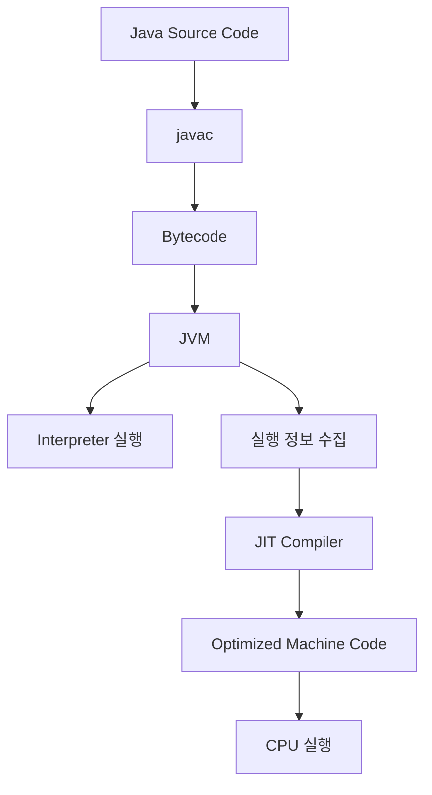
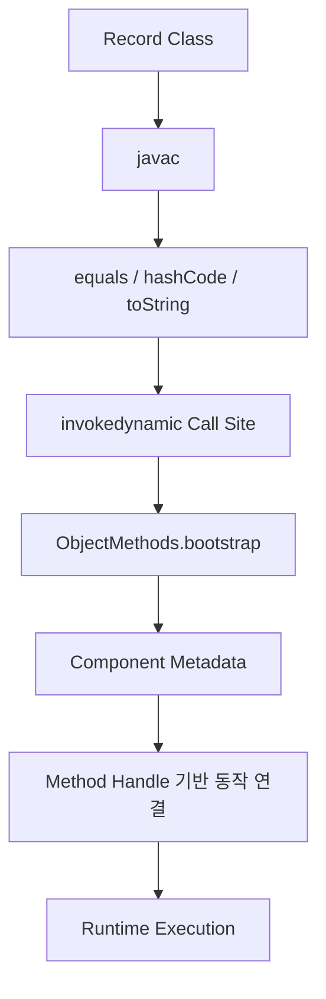
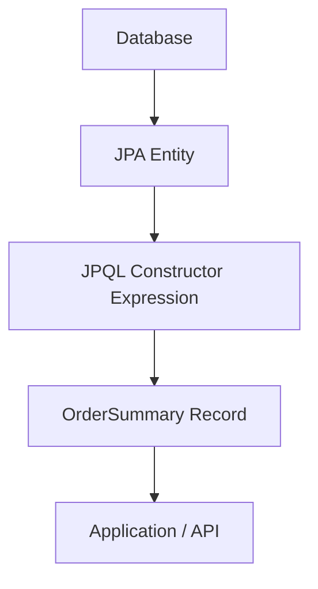
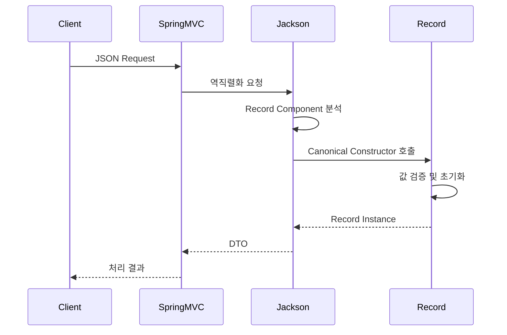
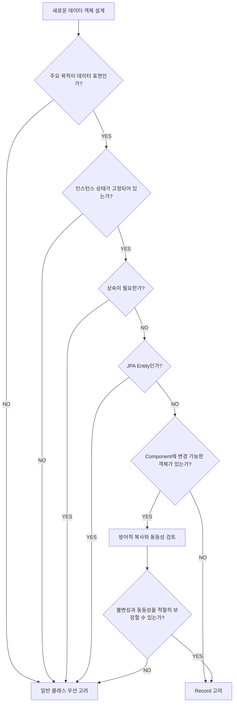
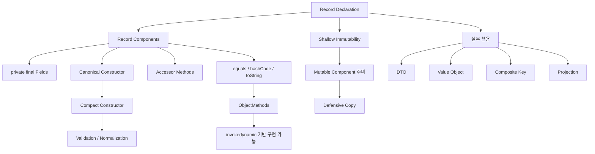

# 대니의 Record 그렇게 쓰는거 아닌데
[https://youtu.be/Ojo-ZVTG4vk?si=6DfnPq7zVm5R22Ye](https://youtu.be/Ojo-ZVTG4vk?si=6DfnPq7zVm5R22Ye)

# 대니의 Record 그렇게 쓰는거 아닌데
* toc
{:toc}

---

### Java Record 완벽 이해: 불변 객체, 생성자, JVM 바이트코드, 성능 최적화와 Spring Boot 실무 활용

Java로 백엔드 애플리케이션을 개발하다 보면 데이터를 전달하거나 저장하기 위한 클래스를 자주 작성하게 된다.

대표적인 예가 DTO(Data Transfer Object)다.

예를 들어 회원 정보를 반환하는 객체를 생각해 보자.

```java
public class MemberResponse {

    private final Long id;

    private final String name;

    private final String email;

    public MemberResponse(
            Long id,
            String name,
            String email
    ) {
        this.id = id;
        this.name = name;
        this.email = email;
    }

    public Long getId() {
        return id;
    }

    public String getName() {
        return name;
    }

    public String getEmail() {
        return email;
    }
}
```

이 클래스는 특별히 복잡한 기능을 수행하지 않는다.

단순히 회원의 ID, 이름, 이메일을 저장하고 외부에 제공한다.

그런데 데이터가 세 개뿐인데도 상당한 양의 코드를 작성해야 한다.

여기에 객체의 동등성을 비교하는 `equals()`, 해시 값을 계산하는 `hashCode()`, 객체 정보를 문자열로 표현하는 `toString()`까지 구현하면 코드가 더 길어진다.

반면 Java의 Record를 사용하면 다음과 같이 표현할 수 있다.

```java
public record MemberResponse(
        Long id,
        String name,
        String email
) {
}
```

단 몇 줄로 동일한 데이터 구조를 정의했다.

별도의 필드 선언도 없다.

생성자도 작성하지 않았다.

Getter도 작성하지 않았다.

`equals()`, `hashCode()`, `toString()`도 작성하지 않았다.

그런데 다음과 같은 코드가 정상적으로 동작한다.

```java
MemberResponse member = new MemberResponse(
        1L,
        "홍길동",
        "user@example.com"
);

System.out.println(member.name());

System.out.println(member);
```

예상 출력은 다음과 같다.

```text
홍길동
MemberResponse[id=1, name=홍길동, email=user@example.com]
```

여기서 여러 가지 궁금증이 생긴다.

**Record는 단순히 Getter와 생성자를 자동으로 만들어 주는 문법일까?**

**Record는 왜 `getName()`이 아니라 `name()`을 사용할까?**

**Record는 `final` 클래스를 간결하게 작성한 것과 완전히 동일할까?**

**Record 내부에 `List`나 배열을 저장해도 불변성이 유지될까?**

**Record의 `equals()`와 `hashCode()`는 JVM에서 어떻게 실행될까?**

**`invokedynamic`을 사용하기 때문에 일반 클래스보다 성능이 좋을까?**

**DTO는 Record로 변경해도 되지만 JPA Entity는 적합하지 않다고 하는 이유는 무엇일까?**

이러한 질문에 답하려면 Record를 단순한 문법적 편의 기능이 아니라 Java 언어가 제공하는 특별한 데이터 모델로 이해해야 한다.

---

### Record란 무엇인가?

Record는 Java에서 고정된 데이터 구성 요소를 간결하게 표현하기 위해 도입된 특별한 종류의 클래스다.

일반적으로 데이터 전달과 값 중심의 모델링에 적합하다.

예를 들어 다음과 같이 선언한다.

```java
public record Point(
        int x,
        int y
) {
}
```

여기서 `Point`는 두 개의 값을 가진다.

- `x`: X 좌표
- `y`: Y 좌표

Record는 이 두 값을 객체의 상태로 표현한다.

일반 클래스와 달리 데이터 구조를 먼저 선언하면 Java 컴파일러가 필요한 구성 요소들을 생성한다.

대표적으로 다음 기능을 제공한다.

| 자동 제공 요소 | 역할 |
|---|---|
| `private final` 필드 | Record Component의 값 저장 |
| Canonical Constructor | 모든 Component 초기화 |
| Accessor Method | Component 값 반환 |
| `equals()` | Component 기반 동등성 비교 |
| `hashCode()` | Component 기반 해시 값 계산 |
| `toString()` | Component 이름과 값 출력 |

Record의 핵심 목적은 단순히 코드 길이를 줄이는 것만이 아니다.

**객체의 상태가 선언된 데이터 구성 요소로 표현된다는 사실을 Java 언어 차원에서 명확하게 드러내는 것**이다.

Java 공식 API 문서에서도 Record를 고정된 값들의 집합을 전달하는 얕은 불변(Shallowly Immutable) 데이터 객체로 정의하고 있다.

---

### Record는 왜 등장했을까?

Record가 등장하기 전에도 Java에서는 불변 객체를 만들 수 있었다.

예를 들어 다음과 같다.

```java
import java.util.Objects;

public final class Point {

    private final int x;

    private final int y;

    public Point(int x, int y) {
        this.x = x;
        this.y = y;
    }

    public int x() {
        return x;
    }

    public int y() {
        return y;
    }

    @Override
    public boolean equals(Object obj) {

        if (this == obj) {
            return true;
        }

        if (!(obj instanceof Point other)) {
            return false;
        }

        return x == other.x
                && y == other.y;
    }

    @Override
    public int hashCode() {
        return Objects.hash(x, y);
    }

    @Override
    public String toString() {
        return "Point[x=" + x + ", y=" + y + "]";
    }
}
```

이 클래스는 두 개의 좌표값을 표현하기 위한 객체다.

하지만 코드는 상당히 길다.

데이터 구성 요소를 선언하는 작업보다 부수적인 메서드를 작성하는 작업이 더 많은 비중을 차지한다.

이러한 반복 코드를 Boilerplate Code라고 부른다.

Boilerplate Code는 기능 구현에 반드시 필요하지만 여러 곳에서 비슷하게 반복되는 코드를 의미한다.

예를 들어 DTO가 50개 있다고 가정하자.

모든 DTO마다 생성자와 Getter, `equals()`, `hashCode()`, `toString()`을 작성해야 한다면 상당한 코드가 반복된다.

또 직접 작성하는 과정에서 실수가 발생할 수 있다.

예를 들어 필드가 하나 추가되었다고 가정하자.

```java
private final int z;
```

개발자는 생성자와 접근자뿐 아니라 동등성 비교와 해시 계산 로직도 수정해야 한다.

그런데 `equals()`에서는 `z`를 비교하지만 `hashCode()`에서는 누락했다면 어떻게 될까?

객체 동등성 계약을 위반하는 문제가 발생할 수 있다.

반대로 Record에서는 다음처럼 선언하면 된다.

```java
public record Point(
        int x,
        int y,
        int z
) {
}
```

Java 컴파일러는 세 Component를 기준으로 필요한 메서드를 생성한다.

따라서 데이터 구조를 수정할 때 관련 메서드를 빠뜨리는 문제를 줄일 수 있다.

이것이 Record가 해결하려는 중요한 문제 중 하나다.

---

### Java 버전별 Record의 발전 과정

Record는 Java 14에서 처음 등장했다.

하지만 처음부터 정식 기능이었던 것은 아니다.

Java 14와 15에서는 Preview Feature로 제공되었다.

이후 Java 16에서 정식 기능으로 확정되었다.

| Java 버전 | Record 지원 |
|---|---|
| Java 8 | 지원하지 않음 |
| Java 11 | 지원하지 않음 |
| Java 14 | Preview |
| Java 15 | 두 번째 Preview |
| Java 16 | 정식 도입 |
| Java 17 | 정식 지원 |
| Java 21 | Record Pattern과 함께 활용 가능 |

따라서 Java 17 이상을 사용하는 프로젝트에서는 별도의 Preview 옵션 없이 Record를 사용할 수 있다.

Java 21에서는 Record의 Component를 직접 분해해 처리할 수 있는 Record Pattern도 정식으로 도입되었다.

Record는 기존 Java의 클래스 모델을 단순히 대체하는 기능이 아니다.

**데이터를 표현하는 클래스에 적합한 별도의 선언 방식을 제공하기 위해 도입된 언어 기능**이다.

---

### Record의 기본 구조

다음 코드를 살펴보자.

```java
public record Member(
        Long id,
        String name,
        String email
) {
}
```

일반 클래스와 다른 부분은 `record` 키워드와 괄호 안의 선언이다.

```java
record Member(...)
```

괄호 안에 선언된 값들을 Record Component라고 부른다.

```java
Long id

String name

String email
```

이 구성 요소들은 Record가 표현하는 데이터의 구조를 정의한다.

Record 선언은 크게 다음과 같이 구분할 수 있다.

```text
Record Declaration

├── Modifier
│   └── public
│
├── Keyword
│   └── record
│
├── Record Name
│   └── Member
│
├── Record Header
│   ├── Long id
│   ├── String name
│   └── String email
│
└── Record Body
    └── { }
```

여기서 Record Header가 중요하다.

Record Header에 정의된 Component를 기반으로 필드와 생성자, 접근자, 동등성 메서드가 결정되기 때문이다.

---

### Record는 일반 클래스와 무엇이 다를까?

Record는 일반적인 인터페이스가 아니다.

또 단순히 Lombok처럼 코드를 자동 생성해 주는 외부 라이브러리도 아니다.

Record는 Java 언어 자체에서 지원하는 특별한 클래스다.

모든 Record 클래스는 `java.lang.Record`를 상속한다.

여기서 `java.lang.Record`는 인터페이스가 아니라 추상 클래스다.

개념적으로 다음과 같다.

```java
public abstract class Record {
    // Record 클래스의 공통 상위 타입
}
```

따라서 다음과 같은 선언은 불가능하다.

```java
public class CustomRecord extends Record {
}
```

일반 클래스가 임의로 `java.lang.Record`를 상속할 수는 없다.

Record 클래스는 반드시 `record` 선언을 통해 정의해야 한다.

```java
public record Point(int x, int y) {
}
```

또 Record는 암묵적으로 `final` 클래스다.

따라서 다른 클래스가 Record를 상속할 수 없다.

```java
public class CustomPoint extends Point {
}
```

이 코드는 컴파일 오류가 발생한다.

반면 Record는 인터페이스를 구현할 수 있다.

```java
public interface Identifiable {

    Long id();
}
```

```java
public record Member(
        Long id,
        String name
) implements Identifiable {
}
```

`Member`는 `Identifiable` 인터페이스를 구현한다.

`id()` 접근자가 자동으로 제공되기 때문에 인터페이스의 메서드 계약도 만족한다.

정리하면 다음과 같다.

| 특성 | 일반 클래스 | Record |
|---|---|---|
| 클래스 선언 | `class` | `record` |
| 상속 | 조건에 따라 가능 | 다른 클래스를 상속할 수 없음 |
| 상위 클래스 | 기본적으로 Object | `java.lang.Record` |
| final 여부 | 선택 가능 | 암묵적으로 final |
| 인터페이스 구현 | 가능 | 가능 |
| 생성자 | 직접 작성 또는 기본 생성자 | Canonical Constructor 제공 |
| Instance Field | 자유롭게 선언 | Component 필드만 허용 |
| Static Field | 가능 | 가능 |
| 메서드 | 가능 | 가능 |
| equals/hashCode | 필요시 직접 구현 | 자동 제공 |

이러한 차이는 Record가 단순한 문법 축약 이상의 의미를 가진다는 사실을 보여준다.

---

### Record가 자동으로 생성하는 코드는 무엇인가?

다음 Record를 생각해 보자.

```java
public record Point(
        int x,
        int y
) {
}
```

Java 컴파일러는 이 선언을 기반으로 필요한 구성 요소를 제공한다.

개념적으로 다음 일반 클래스와 유사하다.

```java
public final class Point extends Record {

    private final int x;

    private final int y;

    public Point(int x, int y) {
        this.x = x;
        this.y = y;
    }

    public int x() {
        return x;
    }

    public int y() {
        return y;
    }

    @Override
    public boolean equals(Object obj) {
        // Component 기반 동등성 비교
    }

    @Override
    public int hashCode() {
        // Component 기반 해시 계산
    }

    @Override
    public String toString() {
        // Component 기반 문자열 생성
    }
}
```

이 코드는 동작 구조를 이해하기 위한 개념적 표현이다.

실제로 일반 클래스에서 `java.lang.Record`를 직접 상속하는 코드를 작성할 수는 없다.

또 컴파일러가 생성한 `equals()`, `hashCode()`, `toString()`의 바이트코드가 반드시 위와 같은 Java 코드 형태로 구성되는 것도 아니다.

특히 이 세 메서드는 JVM의 `invokedynamic`과 연결될 수 있다.

이 부분은 뒤에서 자세히 살펴보자.

---

### Record의 Accessor Method는 왜 get으로 시작하지 않을까?

일반적인 Java DTO에서는 다음과 같은 Getter를 사용한다.

```java
public String getName() {
    return name;
}
```

하지만 Record에서는 다음과 같이 사용한다.

```java
member.name();
```

Record가 자동으로 생성하는 접근자는 Component 이름과 동일하다.

예를 들어 다음 Record를 생각해 보자.

```java
public record Member(
        Long id,
        String name,
        boolean active
) {
}
```

다음 메서드들이 자동으로 제공된다.

```java
id()
```

```java
name()
```

```java
active()
```

`getId()`나 `getName()`, `isActive()`가 자동으로 만들어지는 것은 아니다.

이러한 차이는 JavaBeans 방식과 관련이 있다.

일반적인 JavaBeans 규약에서는 프로퍼티를 다음과 같은 메서드 이름으로 표현한다.

```java
getName()
```

```java
setName()
```

반면 Record는 선언된 Component 자체가 공개적인 데이터 구조를 표현한다.

따라서 접근자도 Component 이름을 그대로 사용한다.

이는 Record가 데이터 중심의 모델이라는 사실을 드러낸다.

다만 Record에서도 다음과 같은 메서드를 직접 추가할 수 있다.

```java
public record Member(
        Long id,
        String name
) {

    public String getName() {
        return name;
    }
}
```

필요하다면 기존 JavaBeans 기반 라이브러리와의 호환성을 위해 사용할 수 있다.

하지만 기본적으로 Record의 Component를 조회할 때는 `name()`과 같은 접근자를 사용하는 것이 자연스럽다.

---

### Record의 Canonical Constructor란 무엇인가?

Record를 선언하면 모든 Component를 초기화할 수 있는 생성자가 제공된다.

이를 Canonical Constructor라고 부른다.

예를 들어 다음과 같다.

```java
public record Member(
        Long id,
        String name
) {
}
```

이 Record는 다음과 같이 생성할 수 있다.

```java
Member member = new Member(
        1L,
        "홍길동"
);
```

컴파일러가 제공하는 생성자의 역할을 개념적으로 표현하면 다음과 같다.

```java
public Member(Long id, String name) {
    this.id = id;
    this.name = name;
}
```

Canonical Constructor의 매개변수는 Record Header의 Component와 일치한다.

이때 매개변수의 타입뿐 아니라 순서와 이름도 중요하다.

예를 들어 다음 Record를 살펴보자.

```java
public record Payment(
        Long id,
        String status,
        long amount
) {
}
```

Canonical Constructor는 다음 순서의 매개변수를 가진다.

```java
Payment(
        Long id,
        String status,
        long amount
)
```

이러한 생성자는 모든 Component를 초기화하는 기준 생성자 역할을 한다.

---

### Compact Constructor란 무엇인가?

Record에서는 Canonical Constructor를 간결하게 작성할 수 있는 특별한 문법을 제공한다.

이를 Compact Constructor라고 부른다.

다음 예제를 살펴보자.

```java
public record Member(
        Long id,
        String name
) {

    public Member {

        if (id == null) {
            throw new IllegalArgumentException(
                    "회원 ID는 필수입니다."
            );
        }

        if (name == null || name.isBlank()) {
            throw new IllegalArgumentException(
                    "회원 이름은 필수입니다."
            );
        }
    }
}
```

일반적인 생성자와 달리 매개변수를 다시 선언하지 않았다.

```java
public Member {
}
```

이것이 Compact Constructor다.

Record Header에 정의된 매개변수들이 자동으로 사용된다.

또 생성자 본문이 정상적으로 완료되면 컴파일러가 Component 필드에 값을 할당한다.

따라서 다음 코드를 직접 작성하지 않아도 된다.

```java
this.id = id;
this.name = name;
```

Compact Constructor는 주로 다음 작업에 적합하다.

- 입력값 검증
- 값 정규화
- 기본적인 데이터 변환
- Component 사이의 불변 조건 검증

Oracle의 Java 명세에서도 Compact Constructor를 값 검증과 정규화에 적합한 생성 방식으로 설명하고 있다.

---

### Compact Constructor에서 값을 변경할 수 있을까?

가능하다.

다만 정확히 구분해야 한다.

Record의 Component 필드는 `final`이다.

따라서 생성 이후에는 변경할 수 없다.

하지만 Compact Constructor 내부에서는 생성자 매개변수 값을 정규화할 수 있다.

예를 들어 다음과 같다.

```java
public record Email(
        String value
) {

    public Email {

        if (value == null || value.isBlank()) {
            throw new IllegalArgumentException(
                    "이메일은 필수입니다."
            );
        }

        value = value.trim();
    }
}
```

이제 다음과 같이 생성한다.

```java
Email email = new Email(
        "  user@example.com  "
);

System.out.println(email.value());
```

결과는 다음과 같다.

```text
user@example.com
```

생성자 내부에서 매개변수 `value`를 변경했다.

그리고 변경된 값이 Record Component에 저장되었다.

하지만 다음 코드는 허용되지 않는다.

```java
public record Email(String value) {

    public Email {

        this.value = value.trim();
    }
}
```

Compact Constructor에서는 Component 필드를 직접 할당할 수 없기 때문이다.

Compact Constructor는 본문 실행 후에 컴파일러가 필드 할당을 수행한다.

따라서 **필드를 직접 변경하는 것과 생성자 매개변수를 정규화하는 것은 다르다**는 점을 이해해야 한다.

---

### Canonical Constructor와 Compact Constructor 비교

두 방식은 모두 Record의 Component를 초기화한다.

하지만 작성 방식에 차이가 있다.

#### Canonical Constructor

```java
public record Price(
        long amount,
        String currency
) {

    public Price(long amount, String currency) {

        if (amount < 0) {
            throw new IllegalArgumentException(
                    "금액은 음수일 수 없습니다."
            );
        }

        this.amount = amount;
        this.currency = currency;
    }
}
```

모든 매개변수와 필드 할당을 명시적으로 작성한다.

#### Compact Constructor

```java
public record Price(
        long amount,
        String currency
) {

    public Price {

        if (amount < 0) {
            throw new IllegalArgumentException(
                    "금액은 음수일 수 없습니다."
            );
        }
    }
}
```

매개변수와 필드 할당을 다시 작성하지 않는다.

| 구분 | Canonical Constructor | Compact Constructor |
|---|---|---|
| 매개변수 선언 | 직접 작성 | 생략 |
| 필드 할당 | 직접 작성 | 컴파일러가 수행 |
| 입력값 검증 | 가능 | 가능 |
| 값 정규화 | 가능 | 가능 |
| 코드 길이 | 상대적으로 길음 | 간결함 |
| 주요 활용 | 명시적인 초기화 | 검증 및 정규화 |

일반적인 Record에서는 Compact Constructor가 더 간결하고 실수를 줄이는 데 도움이 된다.

---

### Record의 생성자를 private으로 만들 수 있을까?

Record는 객체의 데이터 구조를 외부에 명확하게 공개한다는 특징이 있다.

따라서 Canonical Constructor에는 접근 수준에 대한 제약이 존재한다.

예를 들어 다음과 같은 public Record를 생각해 보자.

```java
public record Member(
        Long id,
        String name
) {
}
```

이 Record에서 Canonical Constructor를 private으로 선언할 수는 없다.

```java
public record Member(
        Long id,
        String name
) {

    private Member(Long id, String name) {
        this.id = id;
        this.name = name;
    }
}
```

컴파일 오류가 발생한다.

public Record의 Canonical Constructor는 public이어야 하기 때문이다.

하지만 모든 Record의 생성자가 반드시 public이어야 한다는 의미는 아니다.

Record의 접근 수준에 따라 Canonical Constructor의 접근 수준도 달라질 수 있다.

일반적으로 Canonical Constructor는 Record 클래스 자체보다 접근 범위가 좁아서는 안 된다.

예를 들어 public Record라면 public Canonical Constructor가 필요하다.

이러한 규칙은 Record가 선언한 데이터 구성 요소를 기준으로 객체를 생성할 수 있도록 하기 위한 언어 차원의 제약이다.

---

### Record에서도 정적 팩토리 메서드를 사용할 수 있을까?

가능하다.

예를 들어 주문 금액을 표현하는 Record가 있다고 가정하자.

```java
public record Money(
        long amount,
        String currency
) {

    public Money {

        if (amount < 0) {
            throw new IllegalArgumentException(
                    "금액은 음수일 수 없습니다."
            );
        }

        if (currency == null || currency.isBlank()) {
            throw new IllegalArgumentException(
                    "통화는 필수입니다."
            );
        }
    }

    public static Money krw(long amount) {
        return new Money(amount, "KRW");
    }

    public static Money usd(long amount) {
        return new Money(amount, "USD");
    }
}
```

이제 다음과 같이 사용할 수 있다.

```java
Money koreanMoney = Money.krw(10000);

Money dollarMoney = Money.usd(100);
```

정적 팩토리 메서드는 객체를 생성하는 의도를 명확하게 표현한다.

또 반복적으로 사용되는 기본값을 제공할 수도 있다.

하지만 public Record라면 Canonical Constructor를 private으로 숨길 수 없으므로 정적 팩토리 메서드만을 유일한 생성 경로로 강제하기는 어렵다.

따라서 반드시 정적 팩토리 메서드를 통해서만 객체를 생성하도록 제한해야 하는 설계라면 일반 클래스를 고려하는 편이 적절할 수 있다.

---

### Record에 다른 생성자를 추가할 수 있을까?

Record에도 추가 생성자를 작성할 수 있다.

예를 들어 다음과 같다.

```java
public record Member(
        Long id,
        String name,
        String email
) {

    public Member(Long id, String name) {

        this(
                id,
                name,
                "unknown@example.com"
        );
    }
}
```

이제 다음 두 방식으로 객체를 생성할 수 있다.

```java
Member first = new Member(
        1L,
        "홍길동"
);
```

```java
Member second = new Member(
        2L,
        "김철수",
        "user@example.com"
);
```

하지만 추가 생성자에는 중요한 제약이 있다.

**Canonical Constructor가 아닌 생성자는 다른 생성자를 호출하는 `this(...)`로 연결되어야 한다.**

Record의 모든 Component가 올바르게 초기화되도록 하기 때문이다.

따라서 일반 클래스처럼 각 생성자에서 필드를 자유롭게 초기화하는 구조와는 차이가 있다.

---

### Record에는 어떤 필드를 선언할 수 있을까?

Record는 Header에 정의된 Component를 기반으로 인스턴스 상태를 표현한다.

따라서 일반 클래스처럼 별도의 인스턴스 필드를 추가할 수 없다.

예를 들어 다음 코드는 허용되지 않는다.

```java
public record Member(
        Long id,
        String name
) {

    private int age;
}
```

Record Header에 없는 인스턴스 필드를 선언했기 때문이다.

반면 Static Field는 선언할 수 있다.

```java
public record Member(
        Long id,
        String name
) {

    public static final String DEFAULT_NAME =
            "UNKNOWN";
}
```

Static Method도 선언할 수 있다.

```java
public record Member(
        Long id,
        String name
) {

    public static Member unknown(Long id) {

        return new Member(
                id,
                "UNKNOWN"
        );
    }
}
```

Instance Method도 작성할 수 있다.

```java
public record Member(
        Long id,
        String name
) {

    public boolean hasName() {

        return name != null && !name.isBlank();
    }
}
```

따라서 Record를 단순히 필드와 Getter만 존재하는 클래스라고 생각해서는 안 된다.

Record에서도 자신의 데이터를 사용하는 동작과 검증 로직을 정의할 수 있다.

중요한 제약은 **Record Header에 선언되지 않은 추가적인 인스턴스 상태를 보유할 수 없다는 점**이다.

---

### Record는 정말 불변 객체일까?

Record를 설명할 때 가장 많이 등장하는 특징이 불변성이다.

하지만 여기서 중요한 구분이 필요하다.

**Record는 기본적으로 얕은 불변성(Shallow Immutability)을 제공한다.**

완전한 깊은 불변성(Deep Immutability)을 자동으로 보장하는 것은 아니다.

예를 들어 다음 Record를 생각해 보자.

```java
public record Member(
        Long id,
        String name
) {
}
```

Record의 Component 필드는 `private final`로 선언된다.

따라서 생성 이후에 다음과 같이 Component에 새로운 값을 할당할 수 없다.

```java
Member member = new Member(
        1L,
        "홍길동"
);
```

```java
member.name = "김철수";
```

컴파일 오류가 발생한다.

하지만 다음처럼 참조 타입의 객체를 저장하면 상황이 달라진다.

```java
public record Team(
        String name,
        List<String> members
) {
}
```

`members` 필드는 `final`이다.

하지만 `List` 객체의 내부 상태가 변경되지 않는다는 의미는 아니다.

---

### Record에 List를 저장하면 발생하는 문제

다음 코드를 살펴보자.

```java
import java.util.ArrayList;
import java.util.List;

public class RecordMutableExample {

    public static void main(String[] args) {

        List<String> members = new ArrayList<>();

        members.add("홍길동");

        Team team = new Team(
                "Backend",
                members
        );

        members.add("김철수");

        System.out.println(team.members());
    }

    public record Team(
            String name,
            List<String> members
    ) {
    }
}
```

출력 결과는 다음과 같다.

```text
[홍길동, 김철수]
```

Record를 생성할 때는 회원이 한 명이었다.

하지만 이후 원본 List에 데이터를 추가하자 Record 내부에서 조회되는 List의 내용도 변경되었다.

왜 그럴까?

Record는 List 객체의 참조를 저장했기 때문이다.

```text
Record Team
    │
    └── members ─────┐
                     │
                     ▼
                ArrayList
                ├── 홍길동
                └── 김철수
```

`final`은 필드가 다른 객체를 참조하도록 재할당하는 것을 막는다.

하지만 참조하고 있는 객체의 내부 상태 변경까지 차단하지는 않는다.

따라서 다음 두 개념은 구분해야 한다.

| 개념 | 의미 |
|---|---|
| Final Reference | 참조 대상 재할당 불가 |
| Immutable Object | 객체의 관찰 가능한 상태 변경 불가 |

Record는 기본적으로 Component 필드의 재할당을 막는다.

하지만 Component가 참조하는 객체의 변경 가능성까지 자동으로 제거하지 않는다.

---

### Record에서 List의 불변성을 유지하려면?

이러한 문제를 해결하려면 방어적 복사(Defensive Copy)를 사용할 수 있다.

Java에서는 `List.copyOf()`를 활용할 수 있다.

```java
import java.util.List;
import java.util.Objects;

public record Team(
        String name,
        List<String> members
) {

    public Team {

        Objects.requireNonNull(name);

        members = List.copyOf(members);
    }
}
```

이제 다음 코드를 실행한다.

```java
import java.util.ArrayList;
import java.util.List;

public class Main {

    public static void main(String[] args) {

        List<String> members = new ArrayList<>();

        members.add("홍길동");

        Team team = new Team(
                "Backend",
                members
        );

        members.add("김철수");

        System.out.println(team.members());
    }
}
```

결과는 다음과 같다.

```text
[홍길동]
```

원본 List를 변경해도 Record 내부의 List는 영향을 받지 않는다.

또 다음 코드도 실패한다.

```java
team.members().add("박영희");
```

`List.copyOf()`가 반환한 List는 변경할 수 없기 때문이다.

따라서 외부에서 Record의 List에 직접 요소를 추가하거나 제거하는 작업을 차단할 수 있다.

다만 `List.copyOf()`가 모든 경우에 깊은 불변성을 제공하는 것은 아니다.

---

### List.copyOf()도 완전한 깊은 복사는 아니다

다음 클래스를 생각해 보자.

```java
public class Member {

    private String name;

    public Member(String name) {
        this.name = name;
    }

    public String getName() {
        return name;
    }

    public void changeName(String name) {
        this.name = name;
    }
}
```

이 객체를 Record 내부의 List에 저장한다.

```java
public record Team(
        List<Member> members
) {

    public Team {
        members = List.copyOf(members);
    }
}
```

이제 다음 코드를 실행한다.

```java
Member member = new Member("홍길동");

Team team = new Team(
        List.of(member)
);

member.changeName("김철수");

System.out.println(
        team.members().get(0).getName()
);
```

결과는 다음과 같다.

```text
김철수
```

List 자체는 변경할 수 없다.

하지만 List가 포함하는 Member 객체는 변경할 수 있다.

따라서 Record를 완전히 불변 객체로 설계하려면 내부에 포함된 객체들의 변경 가능성도 고려해야 한다.

예를 들어 Member 자체를 Record로 정의할 수 있다.

```java
public record Member(
        Long id,
        String name
) {
}
```

그리고 변경할 수 없는 List로 저장한다.

```java
public record Team(
        List<Member> members
) {

    public Team {
        members = List.copyOf(members);
    }
}
```

이 경우 Component를 구성하는 객체들도 불변성을 유지하기 쉬워진다.

하지만 Record 내부에 배열이나 변경 가능한 객체가 중첩되어 있다면 추가적인 방어적 복사가 필요할 수 있다.

---

### Record에 배열을 저장할 때 주의할 점

배열은 Record에서 특히 주의해야 하는 자료구조다.

다음 Record를 생각해 보자.

```java
public record Numbers(
        int[] values
) {
}
```

두 Record를 생성한다.

```java
Numbers first = new Numbers(
        new int[]{1, 2, 3}
);

Numbers second = new Numbers(
        new int[]{1, 2, 3}
);
```

두 배열은 동일한 값을 가지고 있다.

하지만 다음 결과는 어떨까?

```java
System.out.println(
        first.equals(second)
);
```

결과는 다음과 같다.

```text
false
```

왜 그럴까?

Record가 자동으로 제공하는 `equals()`는 참조 타입 Component에 대해 일반적인 객체 동등성 규칙을 사용한다.

그런데 Java 배열은 기본적으로 배열 내용 전체를 비교하는 `equals()`를 재정의하지 않는다.

따라서 서로 다른 배열 인스턴스는 같은 값을 가지고 있더라도 동등하지 않다고 판단될 수 있다.

배열 내용을 비교하려면 `Arrays.equals()`를 사용해야 한다.

```java
Arrays.equals(
        first.values(),
        second.values()
);
```

이 경우 결과는 다음과 같다.

```text
true
```

따라서 배열을 Component로 사용하는 Record에서는 동등성 비교와 방어적 복사를 함께 고려해야 한다.

---

### 배열을 안전하게 사용하는 Record 구현

배열의 내용을 값으로 취급해야 한다면 다음과 같이 작성할 수 있다.

```java
import java.util.Arrays;
import java.util.Objects;

public record ByteKey(
        byte[] value
) {

    public ByteKey {

        Objects.requireNonNull(value);

        value = value.clone();
    }

    @Override
    public byte[] value() {
        return value.clone();
    }

    @Override
    public boolean equals(Object obj) {

        if (this == obj) {
            return true;
        }

        if (!(obj instanceof ByteKey other)) {
            return false;
        }

        return Arrays.equals(
                value,
                other.value
        );
    }

    @Override
    public int hashCode() {
        return Arrays.hashCode(value);
    }
}
```

이 구현에는 네 가지 중요한 부분이 있다.

첫 번째는 생성자에서 배열을 복사한다는 것이다.

```java
value = value.clone();
```

외부에서 전달한 배열의 변경이 Record에 영향을 주지 않도록 한다.

두 번째는 Accessor에서도 배열을 복사한다는 것이다.

```java
@Override
public byte[] value() {
    return value.clone();
}
```

외부에서 Record가 보유한 배열을 직접 변경하지 못하도록 한다.

세 번째는 `equals()`에서 배열의 내용을 비교한다는 것이다.

```java
Arrays.equals(value, other.value)
```

네 번째는 `hashCode()`에서도 배열 내용을 기준으로 해시 값을 계산한다는 것이다.

```java
Arrays.hashCode(value)
```

이렇게 하면 같은 바이트 내용을 가진 ByteKey를 값 중심으로 비교할 수 있다.

다만 일반적인 DTO에서 배열을 반드시 Record Component로 사용해야 하는 것은 아니다.

가능하다면 요구사항에 맞는 불변 Value Object나 컬렉션으로 표현하는 것도 고려할 수 있다.

---

### Record의 equals()는 어떻게 동작할까?

Record는 `equals()`를 자동으로 제공한다.

예를 들어 다음 Record를 생각해 보자.

```java
public record Point(
        int x,
        int y
) {
}
```

두 객체를 생성한다.

```java
Point first = new Point(10, 20);

Point second = new Point(10, 20);
```

다음 코드를 실행한다.

```java
System.out.println(
        first == second
);

System.out.println(
        first.equals(second)
);
```

결과는 다음과 같다.

```text
false
true
```

`==`는 두 참조가 동일한 객체를 가리키는지 확인한다.

반면 Record의 기본 `equals()`는 Component 값을 기준으로 동등성을 판단한다.

따라서 서로 다른 객체라도 Component 값이 같으면 동등하다고 판단한다.

Record의 기본 동등성 판단은 일반적으로 다음 조건을 따른다.

1. 두 객체가 같은 Record 타입인가?
2. 각 Component 값이 동등한가?

참조 타입 Component는 해당 타입의 동등성 규칙을 따른다.

원시 타입 Component는 해당 타입의 비교 규칙을 따른다.

Java 공식 API 문서는 Record의 원시 타입 Component 비교를 대응하는 Wrapper 타입의 `compare()` 결과와 연결해 정의한다.

---

### Record의 hashCode()는 어떻게 동작할까?

Record는 Component 값을 기반으로 해시 값을 계산한다.

예를 들어 다음과 같다.

```java
public record MemberKey(
        Long memberId,
        String countryCode
) {
}
```

두 객체를 생성한다.

```java
MemberKey first = new MemberKey(
        100L,
        "KR"
);

MemberKey second = new MemberKey(
        100L,
        "KR"
);
```

다음 결과를 확인해 보자.

```java
System.out.println(
        first.equals(second)
);

System.out.println(
        first.hashCode() == second.hashCode()
);
```

결과는 다음과 같다.

```text
true
true
```

동등한 Record는 동일한 해시 값을 반환해야 한다.

따라서 Record를 HashMap의 Key로 사용할 수 있다.

```java
Map<MemberKey, String> members = new HashMap<>();

members.put(
        new MemberKey(100L, "KR"),
        "홍길동"
);

String name = members.get(
        new MemberKey(100L, "KR")
);

System.out.println(name);
```

결과는 다음과 같다.

```text
홍길동
```

이러한 특징 때문에 Record는 여러 값을 결합한 복합 Key를 표현할 때 유용하다.

다만 Record의 Component에 변경 가능한 객체가 포함되어 있다면 해시 값이 변경될 가능성이 있다.

따라서 HashMap의 Key로 사용하는 Record에서는 Component의 불변성을 특히 중요하게 고려해야 한다.

---

### Record의 toString()은 어떻게 동작할까?

Record는 Component 이름과 값을 포함하는 `toString()`을 제공한다.

예를 들어 다음과 같다.

```java
public record Payment(
        Long id,
        String status,
        long amount
) {
}
```

객체를 생성한다.

```java
Payment payment = new Payment(
        100L,
        "SUCCESS",
        10000L
);
```

다음 코드를 실행한다.

```java
System.out.println(payment);
```

일반적인 출력 형태는 다음과 같다.

```text
Payment[id=100, status=SUCCESS, amount=10000]
```

이는 개발 과정에서 객체 상태를 확인할 때 편리하다.

하지만 `toString()`의 정확한 문자열 형식은 안정적인 데이터 교환 계약으로 사용해서는 안 된다.

또 중요한 보안 문제가 있다.

Record는 기본적으로 모든 Component를 문자열 표현에 포함한다.

예를 들어 다음 Record를 생각해 보자.

```java
public record LoginRequest(
        String email,
        String password
) {
}
```

이 객체를 그대로 로그에 출력하면 어떻게 될까?

```java
log.info("Login request: {}", request);
```

비밀번호가 로그에 노출될 수 있다.

따라서 민감한 정보를 Component로 가지는 Record는 기본 `toString()`을 그대로 사용하지 않도록 주의해야 한다.

필요하다면 다음처럼 재정의할 수 있다.

```java
public record LoginRequest(
        String email,
        String password
) {

    @Override
    public String toString() {

        return "LoginRequest[email="
                + email
                + ", password=***]";
    }
}
```

하지만 비밀번호뿐 아니라 이메일이나 개인 식별 정보도 서비스의 보안 정책에 따라 마스킹이 필요할 수 있다.

**Record의 자동 생성 기능은 편리하지만 로그에 어떤 정보가 노출되는지까지 자동으로 판단해 주지는 않는다.**

---

### Record는 일반 불변 클래스보다 성능이 좋을까?

Record를 사용하면 코드가 짧아진다.

그리고 `equals()`, `hashCode()`, `toString()`도 자동으로 생성된다.

그렇다면 일반 불변 클래스로 작성한 객체보다 실행 속도도 빠를까?

이 질문에 답하기 위해서는 세 가지를 구분해야 한다.

첫 번째는 소스 코드의 크기다.

두 번째는 컴파일된 바이트코드의 구조다.

세 번째는 JVM이 실제 실행 과정에서 생성하는 기계어와 최적화 결과다.

이 세 가지는 서로 관련되어 있지만 동일한 개념은 아니다.

특히 다음 결론을 주의해야 한다.

**Record가 불변 객체이기 때문에 일반 불변 클래스보다 항상 빠르다는 주장은 정확하지 않다.**

일반 클래스도 `final` 필드와 적절한 설계를 통해 불변 객체로 만들 수 있다.

또 JVM의 JIT 컴파일러는 일반 클래스와 Record 모두에 다양한 최적화를 적용할 수 있다.

따라서 실제 성능은 생성된 코드와 실행 환경, 호출 패턴, JIT 최적화 결과에 따라 달라진다.

---

### Record의 바이트코드를 살펴보자

다음 Record를 작성한다.

`Point.java`

```java
public record Point(
        int x,
        int y
) {
}
```

Java 17 이상에서 컴파일한다.

```bash
javac Point.java
```

정상적으로 컴파일되면 다음 파일이 생성된다.

```text
Point.class
```

이제 `javap` 명령어로 컴파일된 클래스의 구조를 확인한다.

```bash
javap -p Point
```

`-p` 옵션은 private 멤버를 포함해 클래스 구조를 출력한다.

예상 출력은 다음과 유사하다.

```text
public final class Point extends java.lang.Record {
  private final int x;
  private final int y;

  public Point(int, int);

  public final java.lang.String toString();
  public final int hashCode();
  public final boolean equals(java.lang.Object);

  public int x();
  public int y();
}
```

여기서 몇 가지 사실을 확인할 수 있다.

첫 번째로 Record는 `final` 클래스다.

두 번째로 `java.lang.Record`를 상속한다.

세 번째로 Component 필드는 `private final`이다.

네 번째로 생성자와 접근자가 존재한다.

다섯 번째로 `equals()`, `hashCode()`, `toString()`이 존재한다.

즉 Record가 제공하는 메서드는 단순히 개발 도구에서만 보이는 가상의 메서드가 아니다.

실제 컴파일된 클래스에도 존재한다.

---

### Accessor Method의 바이트코드

이번에는 바이트코드 명령어를 확인해 보자.

```bash
javap -c -p Point
```

`-c` 옵션은 메서드의 바이트코드를 출력한다.

다음 접근자의 바이트코드를 살펴보자.

```java
public int x() {
    return x;
}
```

컴파일된 바이트코드는 다음과 유사하다.

```text
public int x();
  Code:
     0: aload_0
     1: getfield      #...
     4: ireturn
```

각 명령어의 의미는 다음과 같다.

| 명령어 | 의미 |
|---|---|
| `aload_0` | 현재 객체 참조를 스택에 적재 |
| `getfield` | 인스턴스 필드 값 조회 |
| `ireturn` | int 값 반환 |

일반적인 불변 클래스의 Getter도 이와 유사한 바이트코드를 생성할 수 있다.

예를 들어 다음과 같다.

```java
public int getX() {
    return x;
}
```

이 경우에도 필드 값을 가져와 반환하는 단순한 구조다.

따라서 Record의 Accessor가 특별한 메커니즘으로 실행되기 때문에 일반 Getter보다 반드시 빠르다고 볼 근거는 없다.

실제로 두 메서드는 JVM의 JIT 컴파일러에 의해 인라인될 수 있다.

---

### JIT Compiler란 무엇인가?

JVM은 Java 바이트코드를 실행한다.

이 과정에서 자주 실행되는 코드에 대해 JIT(Just-In-Time) 컴파일러가 기계어를 생성하고 최적화할 수 있다.

단순화하면 다음과 같은 구조다.



여기서 중요한 점은 JVM이 모든 바이트코드를 항상 한 줄씩 해석한 뒤 실행하는 것은 아니라는 것이다.

자주 실행되는 코드에 대해서는 JIT 컴파일을 통해 최적화된 기계어를 사용할 수 있다.

대표적인 최적화에는 다음과 같은 것들이 있다.

- Method Inlining
- Escape Analysis
- Scalar Replacement
- Constant Folding
- Dead Code Elimination
- Devirtualization

이러한 최적화는 Record에만 적용되는 것이 아니다.

일반적인 Java 클래스에도 적용된다.

---

### Method Inlining이란 무엇인가?

Method Inlining은 메서드 호출을 실제 메서드 본문으로 대체하는 최적화 기법이다.

예를 들어 다음 코드를 생각해 보자.

```java
public int calculate(int value) {

    return doubleValue(value) + 10;
}

private int doubleValue(int value) {

    return value * 2;
}
```

일반적인 실행 구조는 다음과 같다.

```text
calculate()

↓

doubleValue()

↓

결과 반환
```

하지만 JIT 컴파일러가 `doubleValue()`를 인라인하면 개념적으로 다음과 비슷하게 최적화할 수 있다.

```java
public int calculate(int value) {

    return value * 2 + 10;
}
```

메서드 호출에 필요한 일부 비용을 제거할 수 있다.

또 호출 경계가 사라지면서 추가적인 최적화가 가능해질 수도 있다.

그러나 모든 메서드가 무조건 인라인되는 것은 아니다.

JIT 컴파일러는 다음 요소들을 고려한다.

- 메서드 크기
- 호출 빈도
- 실제 타입 정보
- 호출 지점의 특성
- 컴파일 예산
- JVM 옵션
- 실행 시점의 프로파일링 정보

따라서 Record의 메서드가 짧다는 사실만으로 실제 기계어에서 언제나 더 효율적이라고 판단할 수는 없다.

---

### Record의 equals()는 왜 invokedynamic을 사용할까?

Record의 내부 구조를 살펴보면 흥미로운 부분이 있다.

바로 자동 생성된 `equals()`, `hashCode()`, `toString()`의 구현 방식이다.

다음 Record를 다시 생각해 보자.

```java
public record Point(
        int x,
        int y
) {
}
```

Java 17의 일반적인 `javac` 구현에서는 이 Record의 기본 `equals()` 메서드가 다음과 유사한 바이트코드를 가질 수 있다.

```text
public final boolean equals(java.lang.Object);
  Code:
     0: aload_0
     1: aload_1
     2: invokedynamic #...
     7: ireturn
```

여기서 핵심은 다음 명령어다.

```text
invokedynamic
```

`invokedynamic`은 JVM이 동적으로 연결되는 호출 지점을 지원하기 위해 제공하는 바이트코드 명령어다.

Java 7에서 도입되었으며, Record뿐 아니라 다양한 Java 기능의 구현에도 활용된다.

Record에서는 자동 생성되는 객체 메서드의 구현을 연결하는 데 사용할 수 있다.

이때 중요한 클래스가 다음과 같다.

```java
java.lang.runtime.ObjectMethods
```

---

### ObjectMethods는 무엇인가?

`java.lang.runtime.ObjectMethods`는 Record와 같은 데이터 중심 객체의 핵심 메서드를 지원하기 위한 JVM 런타임 구성 요소다.

대표적으로 다음 메서드들의 구현과 관련된다.

```java
equals()
```

```java
hashCode()
```

```java
toString()
```

`ObjectMethods`는 Record의 Component 정보를 기반으로 해당 메서드의 동작을 연결할 수 있도록 지원한다.

개념적인 흐름은 다음과 같다.



이 구조에서는 Record의 Component 정보를 기반으로 필요한 동작을 구성할 수 있다.

예를 들어 `Point(int x, int y)`라면 두 Component에 대한 동등성 비교가 필요하다.

반면 `Member(Long id, String name)`이라면 해당 타입과 Component에 맞는 비교가 필요하다.

`ObjectMethods`는 이러한 동작을 지원한다.

Java 공식 API에서도 `ObjectMethods.bootstrap()`이 Record의 `equals()`, `hashCode()`, `toString()` 구현을 위한 Bootstrap Method라는 사실을 명시하고 있다.

---

### invokedynamic을 사용하면 무조건 빠를까?

그렇지는 않다.

`invokedynamic`은 동적으로 호출 대상을 연결할 수 있도록 하는 JVM 기능이다.

그 자체가 모든 상황에서 더 빠른 실행을 보장하는 것은 아니다.

Record의 기본 `equals()`가 짧은 바이트코드로 표현될 수 있는 이유는 실제 비교 로직이 다른 방식으로 연결되기 때문이다.

따라서 다음과 같이 단순하게 비교해서는 안 된다.

```text
일반 클래스 equals()

60 bytes
```

```text
Record equals()

8 bytes
```

그리고 다음과 같이 결론 내리는 것은 정확하지 않다.

```text
Record의 equals()는 바이트코드가 짧으므로
항상 더 빠르다.
```

바이트코드의 크기와 실제 실행 비용은 동일한 개념이 아니다.

Record의 바이트코드에는 짧은 호출 명령어만 존재하더라도 호출 대상에서 Component 비교 작업을 수행해야 한다.

실제로 CPU가 실행하는 기계어에는 필요한 비교와 분기 작업이 존재할 수 있다.

또 JIT 컴파일러가 Method Handle을 인라인할 수도 있고, 특정 호출 구조에서는 충분히 인라인하지 못할 수도 있다.

따라서 **`invokedynamic`을 사용하는 Record가 일반 불변 클래스보다 반드시 빠르다고 보장할 수는 없다.**

Record는 성능을 개선하기 위해 무조건 선택하는 자료형이 아니라, 데이터를 명확하게 모델링하기 위해 선택하는 언어 기능이다.

---

### Record와 일반 클래스의 성능을 정확하게 비교하려면?

성능을 비교하려면 실제 실행 환경에서 벤치마크를 수행해야 한다.

예를 들어 다음 두 클래스를 비교한다고 가정하자.

#### 일반 불변 클래스

```java
public final class ImmutablePoint {

    private final int x;

    private final int y;

    public ImmutablePoint(int x, int y) {
        this.x = x;
        this.y = y;
    }

    public int x() {
        return x;
    }

    public int y() {
        return y;
    }

    @Override
    public boolean equals(Object obj) {

        if (this == obj) {
            return true;
        }

        if (!(obj instanceof ImmutablePoint other)) {
            return false;
        }

        return x == other.x
                && y == other.y;
    }

    @Override
    public int hashCode() {

        return 31 * Integer.hashCode(x)
                + Integer.hashCode(y);
    }
}
```

#### Record

```java
public record RecordPoint(
        int x,
        int y
) {
}
```

두 구현체의 성능을 비교하고 싶다면 다음 항목을 구분하는 것이 좋다.

| 측정 항목 | 확인할 내용 |
|---|---|
| 객체 생성 | 생성자 호출 비용 |
| Accessor | 필드 조회 비용 |
| equals | 동등성 비교 비용 |
| hashCode | 해시 계산 비용 |
| toString | 문자열 생성 비용 |
| 메모리 | 객체 크기와 할당량 |
| GC | 객체 할당과 회수 비용 |

특히 결과가 매우 짧은 시간 단위로 측정되는 경우 단순한 반복문으로 정확하게 비교하기 어렵다.

JIT 컴파일러가 실행되지 않는 코드를 제거하거나, 특정 값을 상수로 최적화할 수도 있기 때문이다.

따라서 JVM 성능 측정에는 JMH(Java Microbenchmark Harness)를 사용하는 것이 적절하다.

---

### JMH로 Record와 일반 클래스 비교하기

JMH는 JVM에서 마이크로벤치마크를 수행하기 위한 도구다.

다음과 같은 형태로 `equals()`의 실행 성능을 비교할 수 있다.

```java
import java.util.concurrent.TimeUnit;

import org.openjdk.jmh.annotations.Benchmark;
import org.openjdk.jmh.annotations.BenchmarkMode;
import org.openjdk.jmh.annotations.Mode;
import org.openjdk.jmh.annotations.OutputTimeUnit;
import org.openjdk.jmh.annotations.Scope;
import org.openjdk.jmh.annotations.State;

@State(Scope.Thread)
@BenchmarkMode(Mode.AverageTime)
@OutputTimeUnit(TimeUnit.NANOSECONDS)
public class RecordBenchmark {

    private final ImmutablePoint immutableFirst =
            new ImmutablePoint(10, 20);

    private final ImmutablePoint immutableSecond =
            new ImmutablePoint(10, 20);

    private final RecordPoint recordFirst =
            new RecordPoint(10, 20);

    private final RecordPoint recordSecond =
            new RecordPoint(10, 20);

    @Benchmark
    public boolean immutableEquals() {

        return immutableFirst.equals(immutableSecond);
    }

    @Benchmark
    public boolean recordEquals() {

        return recordFirst.equals(recordSecond);
    }
}
```

이 코드는 두 방식의 동등성 비교 비용을 측정하기 위한 예제다.

실제 실행에는 JMH 의존성과 벤치마크 실행 환경이 필요하다.

또 최적화로 인해 작업 자체가 제거되거나 결과가 지나치게 단순해지는 상황을 피할 수 있도록 테스트 데이터를 신중하게 구성해야 한다.

성능 비교에서는 다음 사항도 중요하다.

첫 번째로 JVM 워밍업을 충분히 수행해야 한다.

두 번째로 여러 번 측정해야 한다.

세 번째로 동일한 JVM 버전과 하드웨어를 사용해야 한다.

네 번째로 GC와 객체 할당 비용을 함께 확인해야 한다.

다섯 번째로 실제 애플리케이션에서 의미 있는 차이인지 판단해야 한다.

예를 들어 두 구현체 사이의 성능 차이가 존재하더라도 전체 API 응답 시간이 데이터베이스 조회와 외부 API 호출에 의해 결정된다면 해당 차이가 서비스 성능에 미치는 영향은 제한적일 수 있다.

따라서 성능 개선을 목적으로 Record를 적용한다면 실제 병목 구간과 연결된 측정이 필요하다.

---

### Record는 메모리를 더 적게 사용할까?

Record는 일반 클래스보다 코드가 짧다.

하지만 소스 코드가 짧다는 사실이 곧 메모리 사용량이 적다는 의미는 아니다.

예를 들어 다음 두 객체를 생각해 보자.

```java
public final class ImmutablePoint {

    private final int x;

    private final int y;

    public ImmutablePoint(int x, int y) {
        this.x = x;
        this.y = y;
    }
}
```

```java
public record RecordPoint(
        int x,
        int y
) {
}
```

두 객체 모두 `int` 필드 두 개를 가지고 있다.

따라서 Record라는 이유만으로 필드 저장에 필요한 메모리가 사라지는 것은 아니다.

실제 객체의 메모리 크기는 다음 요소에 따라 결정된다.

- 객체 헤더
- 인스턴스 필드
- 필드 정렬
- JVM의 객체 레이아웃
- 압축 참조 설정
- JVM 구현 및 버전

따라서 메모리 차이를 비교하려면 JOL(Java Object Layout) 같은 도구를 활용해 실제 객체 레이아웃을 확인할 수 있다.

Record는 구조적으로 데이터를 간결하게 선언할 수 있게 해주지만, 모든 경우에 일반 불변 클래스보다 작은 객체를 생성하도록 보장하는 기능은 아니다.

---

### Record는 언제 사용하는 것이 좋을까?

Record의 핵심은 데이터 구조를 명확하게 표현하는 것이다.

따라서 Record가 적합한 상황을 이해하는 것이 중요하다.

대표적으로 다음과 같은 경우에 유용하다.

#### 1. DTO

API 요청과 응답에 사용하는 데이터 객체다.

```java
public record MemberResponse(
        Long id,
        String name,
        String email
) {
}
```

DTO는 주로 데이터를 전달하는 역할을 수행한다.

따라서 Record와 잘 어울린다.

#### 2. Value Object

값 자체로 동등성을 판단하는 객체다.

```java
public record Coordinates(
        double latitude,
        double longitude
) {
}
```

두 좌표값이 동일하면 같은 값 객체로 판단할 수 있다.

다만 값의 유효성 검증과 정규화가 필요할 수 있다.

#### 3. 복합 Key

여러 값을 결합한 식별자를 표현할 수 있다.

```java
public record CacheKey(
        Long memberId,
        String countryCode
) {
}
```

HashMap의 Key로 활용하기 적합하다.

#### 4. 데이터 조회 결과

데이터베이스나 외부 API에서 조회한 결과를 표현할 수 있다.

```java
public record OrderSummary(
        Long orderId,
        String status,
        long amount
) {
}
```

#### 5. 이벤트 데이터

이벤트의 속성을 표현하는 데 활용할 수 있다.

```java
public record PaymentCompletedEvent(
        Long paymentId,
        Long memberId,
        long amount
) {
}
```

다만 이벤트를 외부 시스템에 장기간 저장하거나 전달한다면 스키마 버전과 직렬화 계약도 함께 고려해야 한다.

---

### Record에서도 비즈니스 로직을 작성할 수 있을까?

가능하다.

Record는 단순히 데이터를 저장하기 위한 구조이지만 메서드를 정의할 수 없는 것은 아니다.

예를 들어 다음 Record를 생각해 보자.

```java
public record Money(
        long amount,
        String currency
) {

    public Money {

        if (amount < 0) {
            throw new IllegalArgumentException(
                    "금액은 음수일 수 없습니다."
            );
        }

        if (currency == null || currency.isBlank()) {
            throw new IllegalArgumentException(
                    "통화는 필수입니다."
            );
        }
    }

    public Money add(Money other) {

        if (!currency.equals(other.currency())) {
            throw new IllegalArgumentException(
                    "통화가 일치하지 않습니다."
            );
        }

        return new Money(
                Math.addExact(amount, other.amount()),
                currency
        );
    }

    public boolean isZero() {
        return amount == 0;
    }
}
```

이 Record는 단순한 Getter만 제공하지 않는다.

금액을 더하는 비즈니스 로직도 포함한다.

```java
Money first = Money.krw(10000);
```

위 코드를 사용하려면 앞서 설명한 `krw()` 정적 팩토리 메서드를 추가해야 한다.

또는 다음처럼 직접 생성할 수 있다.

```java
Money first = new Money(10000, "KRW");

Money second = new Money(5000, "KRW");

Money result = first.add(second);

System.out.println(result.amount());
```

결과는 다음과 같다.

```text
15000
```

이처럼 Record에서도 자신의 상태에 대한 동작을 정의할 수 있다.

따라서 **Record에는 비즈니스 로직을 작성하면 안 된다**는 규칙은 정확하지 않다.

더 중요한 기준은 객체의 성격이다.

객체가 데이터 구성 요소에 의해 자신의 상태를 완전히 표현할 수 있고, 그 값에 대한 동작을 수행한다면 Record가 적합할 수 있다.

반면 숨겨진 내부 상태가 필요하거나 상태가 지속적으로 변경되는 객체라면 일반 클래스가 더 적합할 수 있다.

---

### Record와 DTO, VO, Entity의 관계

Record가 DTO와 VO에 적합하다고 해서 모든 DTO와 VO를 반드시 Record로 작성해야 하는 것은 아니다.

또 Record가 Entity와 같은 개념인 것도 아니다.

각 객체의 역할은 다르다.

| 구분 | DTO | Value Object | Entity |
|---|---|---|---|
| 주요 목적 | 데이터 전달 | 값과 의미 표현 | 식별성과 생명주기 표현 |
| 동등성 기준 | 설계에 따라 다름 | 일반적으로 값 | 일반적으로 식별성 |
| 상태 변경 | 가능할 수도 있음 | 보통 불변 설계 | 변경 가능성 존재 |
| Record 적합성 | 높음 | 높음 | JPA Entity에는 일반적으로 부적합 |

DTO는 데이터를 전달하는 객체다.

Value Object는 값을 중심으로 동등성을 판단한다.

Entity는 고유한 식별성과 생명주기를 가진다.

Record는 Component 값을 중심으로 객체를 표현한다.

따라서 DTO나 Value Object에 적합한 경우가 많다.

반면 JPA Entity에는 다른 제약이 존재한다.

---

### JPA Entity에 Record를 사용하면 안 되는 이유

다음 Record를 생각해 보자.

```java
@Entity
public record Member(
        @Id Long id,
        String name
) {
}
```

일반적인 Jakarta Persistence Entity로 사용하기에는 문제가 있다.

그 이유는 Record와 JPA Entity의 요구사항이 다르기 때문이다.

JPA Entity는 일반적으로 다음 조건을 필요로 한다.

- 적절한 기본 생성자
- 영속성 상태 관리
- 식별자 관리
- 필드 또는 프로퍼티 접근
- 프록시와 지연 로딩을 위한 구조적 요구사항

반면 Record는 다음 특성을 가진다.

- 암묵적으로 final 클래스
- Component 필드는 private final
- Canonical Constructor 중심의 초기화
- 추가 인스턴스 필드 선언 불가
- 상태 변경을 전제로 하지 않는 데이터 모델

특히 JPA Entity에는 기본 생성자와 클래스 확장 가능성에 대한 요구사항이 존재한다.

따라서 Record를 일반적인 JPA Entity로 사용하는 것은 적절하지 않다.

Hibernate는 일부 Entity 제약에 대해 유연성을 제공하기도 하지만 Record가 가진 구조적 특성 때문에 표준 JPA Entity로 사용하는 방식은 권장되지 않는다.

Hibernate 공식 문서에서도 Entity의 기본 생성자와 final 클래스가 프록시 및 지연 로딩에 미치는 영향을 설명하고 있다.

하지만 Record를 JPA와 함께 사용할 수 없는 것은 아니다.

**Entity 자체가 아니라 조회 결과를 표현하는 DTO로는 유용하게 활용할 수 있다.**

---

### JPA 조회 결과를 Record로 반환하기

다음과 같은 Entity가 있다고 가정하자.

```java
@Entity
public class Order {

    @Id
    @GeneratedValue(strategy = GenerationType.IDENTITY)
    private Long id;

    private String status;

    private long amount;

    protected Order() {
    }

    // 생성자 및 비즈니스 메서드
}
```

이 Entity에서 일부 데이터만 조회하고 싶다고 가정하자.

전체 Entity를 반환할 필요는 없다.

따라서 다음 Record를 정의할 수 있다.

```java
public record OrderSummary(
        Long orderId,
        String status,
        long amount
) {
}
```

그리고 JPQL 생성자 표현식을 사용할 수 있다.

```java
@Query("""
    SELECT new com.example.dto.OrderSummary(
        o.id,
        o.status,
        o.amount
    )
    FROM Order o
    WHERE o.id = :orderId
    """)
Optional<OrderSummary> findSummary(
        @Param("orderId") Long orderId
);
```

이 구조에서는 Entity를 Record로 변경하지 않는다.

Entity는 JPA가 관리한다.

Record는 조회 결과를 전달하는 역할을 수행한다.



이러한 방식은 필요한 필드만 조회하고 불필요한 Entity 노출을 줄이는 데 도움이 될 수 있다.

---

### Spring Boot에서 Record를 DTO로 사용하는 방법

Spring Boot에서는 Record를 HTTP 요청과 응답 DTO로 사용할 수 있다.

다음 환경을 기준으로 생각해 보자.

| 항목 | 환경 |
|---|---|
| Java | 17 이상 |
| Spring Boot | 3.x |
| Spring MVC | 사용 |
| JSON 처리 | Jackson |
| DTO | Record |

Jackson은 2.12부터 Java Record에 대한 지원을 제공한다.

따라서 적절한 버전의 Jackson이 구성되어 있다면 Record의 Component와 Canonical Constructor를 이용해 JSON을 직렬화하고 역직렬화할 수 있다.

예를 들어 다음 DTO를 작성한다.

```java
public record MemberCreateRequest(
        String name,
        String email
) {
}
```

그리고 응답 DTO를 정의한다.

```java
public record MemberResponse(
        Long id,
        String name,
        String email
) {
}
```

Controller에서는 다음과 같이 사용한다.

```java
@RestController
@RequestMapping("/api/members")
public class MemberController {

    @PostMapping
    public MemberResponse create(
            @RequestBody MemberCreateRequest request
    ) {

        return new MemberResponse(
                1L,
                request.name(),
                request.email()
        );
    }
}
```

이제 다음과 같은 HTTP 요청을 전송할 수 있다.

```http
POST /api/members HTTP/1.1
Content-Type: application/json

{
  "name": "홍길동",
  "email": "user@example.com"
}
```

Jackson은 JSON 데이터를 Record Component와 연결해 객체를 생성한다.

Controller는 생성된 Record를 전달받는다.

그리고 반환된 MemberResponse Record는 JSON으로 직렬화된다.

예상 응답은 다음과 같다.

```json
{
  "id": 1,
  "name": "홍길동",
  "email": "user@example.com"
}
```

이처럼 Record는 Spring MVC에서 요청과 응답 데이터를 표현하기에 적합하다.

---

### Record와 Jackson의 역직렬화 구조

일반적인 Java 클래스에서는 기본 생성자와 Setter 등을 이용해 객체를 복원하는 방식을 사용할 수 있다.

하지만 Record에는 일반적인 Setter가 존재하지 않는다.

또 Component 필드는 final이다.

그렇다면 JSON을 어떻게 역직렬화할까?

Jackson은 Record의 Component 정보를 분석하고 Canonical Constructor를 활용해 객체를 생성할 수 있다.

개념적인 흐름은 다음과 같다.



따라서 Record를 JSON DTO로 사용하기 위해 무조건 기본 생성자나 Setter를 만들어야 하는 것은 아니다.

단, 사용하는 Jackson 버전과 설정, Component 타입에 따라 지원 범위가 달라질 수 있다.

---

### Record에서 Bean Validation을 사용하는 방법

실무에서는 요청 데이터를 단순히 객체로 변환하는 것만으로 충분하지 않다.

입력값을 검증해야 한다.

Record에서도 Bean Validation을 사용할 수 있다.

예를 들어 다음과 같다.

```java
import jakarta.validation.constraints.Email;
import jakarta.validation.constraints.NotBlank;

public record MemberCreateRequest(

        @NotBlank
        String name,

        @Email
        @NotBlank
        String email

) {
}
```

Controller에서는 `@Valid`를 사용한다.

```java
@PostMapping
public MemberResponse create(
        @Valid @RequestBody MemberCreateRequest request
) {

    return memberService.create(request);
}
```

Spring Boot에서는 Bean Validation 관련 의존성이 필요하다.

```groovy
dependencies {
    implementation 'org.springframework.boot:spring-boot-starter-validation'
}
```

이제 잘못된 요청을 전달하면 검증 오류를 처리할 수 있다.

예를 들어 다음 JSON을 생각해 보자.

```json
{
  "name": "",
  "email": "invalid-email"
}
```

`name`은 비어 있다.

`email`은 올바른 이메일 형식을 만족하지 않는다.

따라서 Bean Validation에서 오류가 발생할 수 있다.

여기서 주의할 점이 있다.

Bean Validation의 `@Valid`를 이용한 검증과 Record의 Compact Constructor에서 수행하는 검증은 서로 다른 처리 단계에서 동작할 수 있다.

Compact Constructor의 검증은 객체를 생성하는 과정에서 수행된다.

Bean Validation은 생성된 객체에 대해 별도로 수행될 수 있다.

따라서 생성자 검증에서 예외가 발생하면 Bean Validation 단계까지 도달하지 못할 수도 있다.

이러한 차이는 API 예외 응답을 설계할 때 중요하다.

---

### Record와 Lombok은 무엇이 다를까?

Record가 등장하기 전에는 Lombok을 이용해 Boilerplate Code를 줄이는 경우가 많았다.

대표적으로 다음 어노테이션을 사용할 수 있다.

```java
@Getter
@AllArgsConstructor
@EqualsAndHashCode
@ToString
public class MemberResponse {

    private final Long id;

    private final String name;

    private final String email;
}
```

이 코드는 Record와 비슷한 목적을 수행한다.

하지만 두 방식은 차이가 있다.

Record는 Java 언어 자체의 기능이다.

Lombok은 컴파일 과정에 개입해 코드를 생성하는 외부 라이브러리다.

또 Lombok을 사용하는 일반 클래스는 추가 인스턴스 필드와 상속 구조 등을 자유롭게 설계할 수 있다.

반면 Record는 데이터 구성 요소가 Header에 고정되어 있으며 추가 인스턴스 필드를 선언할 수 없다.

| 비교 항목 | Record | Lombok 기반 클래스 |
|---|---|---|
| 제공 주체 | Java 언어 | 외부 라이브러리 |
| 컴파일러 지원 | 기본 제공 | Lombok 처리 필요 |
| 데이터 선언 | Record Header | 일반 필드 |
| 생성자 | Canonical Constructor | 어노테이션에 따라 생성 |
| 접근자 | `name()` | 일반적으로 `getName()` |
| equals/hashCode | 기본 제공 | 어노테이션에 따라 생성 |
| 상속 | 불가능 | 클래스 설계에 따라 가능 |
| 추가 인스턴스 필드 | 불가능 | 가능 |
| 불변성 | 얕은 불변성 | 적용 어노테이션과 필드 설계에 따라 다름 |
| 주요 활용 | 고정된 데이터 모델 | 일반 클래스의 반복 코드 감소 |

Record와 Lombok은 반드시 경쟁 관계로만 볼 필요는 없다.

Record는 데이터 중심 객체에 적합하다.

반면 일반적인 클래스에서 생성자와 Getter 등의 반복 코드를 줄이고 싶다면 Lombok이 유용할 수 있다.

---

### Record와 Lombok @Data는 동일할까?

그렇지 않다.

Lombok의 `@Data`는 Getter와 Setter 등을 함께 생성하는 기능이다.

예를 들어 다음과 같다.

```java
@Data
public class Member {

    private String name;

    private int age;
}
```

이 클래스에서는 일반적으로 Setter를 이용해 상태를 변경할 수 있다.

```java
member.setName("김철수");
```

반면 Record에서는 Component에 대한 Setter가 자동으로 제공되지 않는다.

따라서 일반적인 상태 변경 모델과는 차이가 있다.

Record와 더 비슷한 Lombok 어노테이션은 `@Value`다.

하지만 `@Value` 역시 일반 클래스를 기반으로 작동하며 Record와 완전히 동일한 언어적 의미를 가지는 것은 아니다.

따라서 단순히 Lombok을 제거하기 위해 모든 `@Data` 클래스를 Record로 변환하는 것은 적절하지 않을 수 있다.

먼저 해당 클래스가 변경 가능한 상태를 필요로 하는지 확인해야 한다.

---

### Java 21의 Record Pattern이란 무엇인가?

Java 21에서는 Record의 활용 범위를 넓혀주는 Record Pattern이 정식으로 도입되었다.

Record Pattern은 Record 객체의 Component를 분해해 직접 사용할 수 있도록 하는 기능이다.

예를 들어 다음 Record를 생각해 보자.

```java
public record Point(
        int x,
        int y
) {
}
```

Java 17에서는 다음과 같이 작성할 수 있다.

```java
if (object instanceof Point point) {

    int x = point.x();

    int y = point.y();

    System.out.println(x + ", " + y);
}
```

하지만 Java 21에서는 Record Pattern을 이용해 다음과 같이 표현할 수 있다.

```java
if (object instanceof Point(int x, int y)) {

    System.out.println(x + ", " + y);
}
```

Record의 Component를 직접 분해했다.

이는 Record가 고정된 데이터 구조를 표현한다는 특징을 활용한 기능이다.

Java 21에서는 Record Pattern을 `instanceof`와 `switch` 등의 문맥에서 사용할 수 있다.

---

### Record Pattern과 중첩 구조

Record Pattern은 중첩된 Record에도 활용할 수 있다.

예를 들어 다음과 같다.

```java
public record Address(
        String city,
        String country
) {
}
```

```java
public record Member(
        String name,
        Address address
) {
}
```

객체를 생성한다.

```java
Member member = new Member(
        "홍길동",
        new Address("Seoul", "KR")
);
```

Java 21에서는 다음과 같은 패턴을 사용할 수 있다.

```java
if (member instanceof Member(
        String name,
        Address(String city, String country)
)) {

    System.out.println(name);
    System.out.println(city);
    System.out.println(country);
}
```

중첩된 Address Record까지 분해했다.

예상 결과는 다음과 같다.

```text
홍길동
Seoul
KR
```

이러한 기능은 복잡한 데이터 구조에서 필요한 값을 추출하는 코드를 간결하게 작성하는 데 도움이 된다.

---

### Record와 일반 클래스의 선택 기준

이제 가장 중요한 질문을 생각해 보자.

어떤 클래스를 Record로 바꾸는 것이 좋을까?

단순히 Getter가 많고 Setter가 없다는 이유만으로 Record가 항상 적합한 것은 아니다.

객체의 책임과 상태, 생명주기를 함께 고려해야 한다.

예를 들어 다음 클래스를 생각해 보자.

```java
public class Players {

    private final List<Player> players;

    public Players(List<Player> players) {
        this.players = players;
    }

    public int calculateTotalScore() {

        return players.stream()
                .mapToInt(Player::score)
                .sum();
    }

    public void addPlayer(Player player) {

        players.add(player);
    }
}
```

이 클래스는 단순한 데이터 전달 객체가 아니다.

선수 목록을 관리하고 점수를 계산하며 목록을 변경한다.

특히 `addPlayer()`는 내부 상태를 변경한다.

이러한 객체를 Record로 변경하면 어떤 문제가 발생할까?

Record에서는 Component 필드 자체를 변경할 수 없다.

하지만 List 내부는 변경할 수 있다.

따라서 다음과 같은 Record도 문법적으로 가능하다.

```java
public record Players(
        List<Player> players
) {

    public void addPlayer(Player player) {
        players.add(player);
    }
}
```

문법적으로 가능하다고 해서 좋은 설계인 것은 아니다.

Record는 값을 중심으로 동등성을 비교한다.

그런데 내부 List가 변경된다면 Record의 관찰 가능한 상태도 변경될 수 있다.

또 내부 List를 기반으로 `hashCode()`가 계산되는 경우 상태 변경이 해시 값에 영향을 줄 수 있다.

따라서 이러한 클래스가 실제로 변경 가능한 상태를 관리해야 한다면 일반 클래스로 유지하는 것이 더 적합할 수 있다.

반대로 Players가 선수 목록의 불변 스냅샷을 표현한다면 Record가 적합할 수도 있다.

```java
public record PlayersSnapshot(
        List<PlayerSnapshot> players
) {

    public PlayersSnapshot {
        players = List.copyOf(players);
    }
}
```

핵심은 클래스 이름이나 메서드 개수가 아니라 **객체가 어떤 상태 모델을 표현하는가**이다.

---

### Record를 사용하면 안 되는 상황

다음과 같은 상황에서는 Record보다 일반 클래스가 적합할 수 있다.

#### 1. 상태가 지속적으로 변경되는 객체

예를 들어 주문 상태가 변경되는 Entity다.

```java
order.pay();
order.cancel();
order.complete();
```

이러한 객체는 식별성과 상태 전이를 관리해야 한다.

#### 2. 추가적인 인스턴스 상태가 필요한 객체

Record는 Header에 선언되지 않은 추가 인스턴스 필드를 가질 수 없다.

따라서 내부 캐시나 별도의 상태를 관리해야 한다면 일반 클래스를 고려해야 한다.

#### 3. 클래스 상속이 필요한 객체

Record는 암묵적으로 final이므로 상속할 수 없다.

#### 4. 외부에서 Component를 직접 알 필요가 없는 객체

Record는 데이터 구조를 명시적으로 공개한다.

반면 내부 표현을 감추고 동작 중심의 API만 제공해야 하는 객체라면 일반 클래스가 적절할 수 있다.

#### 5. 프레임워크가 일반 클래스 구조를 요구하는 경우

대표적으로 JPA Entity가 있다.

#### 6. 기본 동등성 규칙이 도메인 요구사항과 크게 다른 경우

Record의 기본 `equals()`는 모든 Component를 기준으로 동등성을 비교한다.

반면 어떤 도메인 객체는 일부 식별자만으로 동일성을 판단해야 할 수 있다.

이러한 경우 일반 클래스를 사용하는 것이 더 명확할 수 있다.

---

### Record를 실무에서 활용하는 12가지 전략

Record는 단순한 DTO를 넘어 다양한 백엔드 설계에 활용할 수 있다.

다만 모든 상황에서 Record가 최선의 선택은 아니다.

중요한 것은 Record의 특성을 실제 요구사항과 연결하는 것이다.

#### 1. API 응답 DTO를 Record로 정의한다

REST API에서는 데이터를 전달하기 위한 응답 객체를 자주 작성한다.

```java
public record OrderResponse(
        Long orderId,
        String status,
        long amount
) {
}
```

이러한 객체는 데이터를 전달하는 역할이 중심이다.

따라서 Record가 적합하다.

불필요한 Getter와 생성자를 줄일 수 있고 응답 구조를 한눈에 파악할 수 있다.

#### 2. API 요청 DTO에 검증 규칙을 선언한다

요청 데이터에는 필수값과 형식 검증이 필요하다.

```java
public record PaymentRequest(

        @NotNull
        Long orderId,

        @Positive
        long amount

) {
}
```

Spring MVC의 Bean Validation과 함께 사용할 수 있다.

다만 생성자에서 수행하는 검증과 Bean Validation의 실행 시점을 구분해야 한다.

#### 3. 복합 Key를 Record로 표현한다

국가와 회원 ID를 함께 사용하는 캐시 Key를 생각해 보자.

```java
public record MemberCacheKey(
        String countryCode,
        Long memberId
) {
}
```

이제 다음과 같이 사용할 수 있다.

```java
Map<MemberCacheKey, MemberResponse> cache =
        new HashMap<>();
```

Record는 Component 기반의 `equals()`와 `hashCode()`를 제공하므로 복합 Key를 표현하기 편리하다.

다만 Component에는 변경 가능성이 낮은 값을 사용하는 것이 좋다.

#### 4. 데이터베이스 Projection에 활용한다

전체 Entity를 조회할 필요가 없다면 Record로 필요한 데이터만 표현할 수 있다.

```java
public record PaymentSummary(
        Long paymentId,
        String status,
        long amount
) {
}
```

JPA의 생성자 표현식이나 Spring Data의 DTO Projection과 연결할 수 있다.

이를 통해 API 계층에 Entity를 직접 노출하는 것을 줄일 수 있다.

#### 5. 도메인 Value Object를 구현한다

Record는 값 중심의 동등성이 필요한 객체에 적합하다.

예를 들어 좌표를 생각해 보자.

```java
public record Coordinates(
        double latitude,
        double longitude
) {

    public Coordinates {

        if (latitude < -90 || latitude > 90) {
            throw new IllegalArgumentException(
                    "위도 범위가 올바르지 않습니다."
            );
        }

        if (longitude < -180 || longitude > 180) {
            throw new IllegalArgumentException(
                    "경도 범위가 올바르지 않습니다."
            );
        }
    }
}
```

이렇게 하면 잘못된 좌표값을 가진 객체의 생성을 차단할 수 있다.

#### 6. 변경 가능한 컬렉션은 방어적 복사를 적용한다

Record에 List를 저장한다면 외부 변경 가능성을 고려해야 한다.

```java
public record Orders(
        List<OrderSummary> values
) {

    public Orders {
        values = List.copyOf(values);
    }
}
```

다만 List 요소 자체도 변경 가능한 객체라면 추가적인 불변성 설계가 필요하다.

#### 7. 배열을 Component로 사용할 때 동등성을 검토한다

배열은 기본적으로 참조 중심의 `equals()`를 사용한다.

따라서 배열의 내용으로 동등성을 비교해야 한다면 별도의 구현이 필요하다.

또 외부에서 배열을 변경하지 못하도록 방어적 복사를 적용해야 한다.

#### 8. Record의 toString()으로 인한 정보 노출을 방지한다

Record는 Component 정보를 자동으로 출력한다.

따라서 비밀번호나 인증 토큰, 개인정보가 포함된 Record를 그대로 로그에 출력하지 않도록 주의해야 한다.

로그 출력 정책을 별도로 정의하거나 필요한 필드만 선택해 기록하는 편이 안전하다.

#### 9. Record를 성능 최적화 목적으로만 도입하지 않는다

Record의 바이트코드 구조가 일반 클래스와 다를 수 있다.

하지만 실제 성능이 반드시 더 좋다는 의미는 아니다.

따라서 단순히 JVM 최적화에 유리할 것이라는 예상만으로 일반 클래스를 Record로 변경하는 것은 적절하지 않다.

Record의 가장 큰 장점은 데이터 구조를 명확하게 표현하고 반복 코드를 줄인다는 것이다.

#### 10. Record와 Entity를 분리한다

JPA Entity는 상태 관리와 영속성 생명주기를 담당한다.

Record는 데이터 전달이나 값 중심의 표현에 적합하다.

따라서 다음처럼 역할을 분리할 수 있다.

```text
JPA Entity

↓

Application Service

↓

Record DTO

↓

HTTP Response
```

이러한 구조는 영속성 모델과 외부 API 모델의 결합을 줄이는 데 도움이 된다.

#### 11. Record의 Component 변경이 API 호환성에 미치는 영향을 고려한다

Record Header는 공개적인 데이터 구조를 표현한다.

예를 들어 다음 Record가 있다고 가정하자.

```java
public record MemberResponse(
        Long id,
        String name
) {
}
```

여기에 새로운 Component를 추가한다.

```java
public record MemberResponse(
        Long id,
        String name,
        String email
) {
}
```

이제 기존 생성자 호출 코드는 컴파일 오류가 발생할 수 있다.

또 JSON으로 직렬화하는 경우 응답 구조가 변경될 수 있다.

따라서 Record Component를 변경할 때는 생성자 호출과 직렬화 계약, API 호환성을 함께 확인해야 한다.

#### 12. IDE의 자동 변환 기능을 그대로 신뢰하지 않는다

개발 도구에서는 일반 클래스를 Record로 변환하는 기능을 제공할 수 있다.

하지만 변환이 가능하다는 사실이 해당 객체를 Record로 사용하는 것이 좋은 설계라는 의미는 아니다.

변환하기 전에 다음 사항을 확인해야 한다.

- 객체가 데이터 중심인가?
- 변경 가능한 상태를 관리하는가?
- 추가 인스턴스 필드가 필요한가?
- 상속 관계가 존재하는가?
- 모든 Component가 동등성 판단에 적합한가?
- Record의 자동 `toString()`이 안전한가?
- 프레임워크와 호환되는가?

이러한 기준을 만족한다면 Record로 변경하는 것이 유지보수성에 도움이 될 수 있다.

---

### Record 사용 여부를 판단하는 의사결정 구조

지금까지 살펴본 내용을 기준으로 Record 사용 여부를 판단하는 흐름을 구성할 수 있다.



이 구조는 절대적인 규칙이 아니다.

하지만 Record가 해결하려는 문제와 객체의 실제 요구사항을 비교하는 데 도움이 된다.

중요한 것은 코드의 길이보다 객체가 표현하려는 모델이다.

---

### Record 관련 자주 발생하는 문제

| 문제 | 원인 | 대응 방법 |
|---|---|---|
| Record 생성 실패 | Canonical Constructor 조건 불일치 | Component 타입과 생성자 확인 |
| private 생성자 오류 | Record 접근 수준 제약 | Canonical Constructor 접근 수준 확인 |
| Getter 호출 실패 | `getName()` 자동 생성되지 않음 | `name()` 사용 |
| List 내용 변경 | 얕은 불변성 | 방어적 복사 |
| 배열 동등성 오류 | 배열의 참조 기반 equals | Arrays.equals 활용 |
| HashMap Key 조회 실패 | 변경 가능한 Component | 불변 Key 사용 |
| JSON 역직렬화 오류 | Jackson 버전 또는 설정 문제 | Record 지원 버전 및 매핑 설정 확인 |
| Bean Validation 미적용 | 검증 처리 누락 | `@Valid` 및 검증 의존성 확인 |
| JPA Entity 매핑 문제 | Record의 구조적 제약 | Entity와 DTO 분리 |
| 로그 정보 노출 | 자동 toString | 민감정보 출력 제한 |
| 성능 차이 예상 실패 | 바이트코드 크기만 비교 | 실제 JMH 측정 |
| API 호환성 문제 | Record Component 변경 | 생성자 및 직렬화 계약 검토 |

---

### Record의 전체 구조

지금까지 살펴본 내용을 하나의 구조로 정리해 보자.



Record는 단순히 Getter를 자동으로 생성하는 기능이 아니다.

컴파일러는 Record Header를 기준으로 객체의 구조를 정의한다.

또 필요한 생성자와 접근자, 동등성 메서드를 제공한다.

런타임에서는 일반적인 Java 객체처럼 사용되지만 `java.lang.Record`를 상속하는 특별한 클래스라는 특성을 가진다.

그리고 일부 자동 생성 메서드에서는 `invokedynamic`과 `ObjectMethods`를 이용하는 구현 방식을 사용할 수 있다.

하지만 이러한 내부 구조가 성능 우위를 무조건 보장하는 것은 아니다.

Record의 본질적인 장점은 데이터 중심 객체를 명확하고 간결하게 표현하는 데 있다.

---

### 정리

Java Record는 고정된 데이터 구성 요소를 간결하게 표현하기 위해 도입된 특별한 종류의 클래스다.

Java 14에서 Preview Feature로 처음 등장했고 Java 16에서 정식 기능으로 확정되었다.

Java 17 이상에서는 별도의 Preview 옵션 없이 사용할 수 있다.

Record를 선언하면 Java 컴파일러가 필요한 구성 요소를 제공한다.

Record Header에 선언한 Component를 기준으로 `private final` 필드가 생성된다.

또 모든 Component를 초기화하는 Canonical Constructor가 제공된다.

각 Component의 값을 반환하는 Accessor Method도 자동으로 생성된다.

Record의 Accessor Method는 일반적인 JavaBeans Getter와 달리 `getName()`이 아니라 `name()`과 같은 형태를 사용한다.

또 Record는 `equals()`, `hashCode()`, `toString()`을 자동으로 제공한다.

이 메서드들은 Record Component를 기반으로 동작한다.

따라서 단순히 값을 전달하거나 저장하기 위한 클래스를 작성할 때 반복되는 코드를 크게 줄일 수 있다.

Record는 `java.lang.Record`를 상속하는 특별한 클래스다.

여기서 `java.lang.Record`는 인터페이스가 아니라 추상 클래스다.

Record는 암묵적으로 final이므로 다른 클래스가 상속할 수 없다.

또 Record Header에 선언하지 않은 추가 인스턴스 필드를 가질 수 없다.

반면 Static Field와 Static Method, Instance Method는 정의할 수 있다.

따라서 Record가 반드시 데이터 저장 외의 메서드를 가질 수 없는 것은 아니다.

Compact Constructor는 Record에서 제공하는 특별한 생성자 문법이다.

Record Header의 매개변수를 다시 선언하지 않고 입력값 검증과 정규화 등을 수행할 수 있다.

Compact Constructor의 본문이 정상적으로 종료되면 컴파일러가 Component 필드에 값을 할당한다.

다만 Compact Constructor 내부에서 Component 필드를 직접 할당할 수는 없다.

Record의 중요한 특징 중 하나는 불변성이다.

하지만 Record는 기본적으로 얕은 불변성을 제공한다.

Record Component는 private final 필드로 저장되므로 생성 이후 새로운 참조를 할당할 수 없다.

그러나 List나 배열 같은 변경 가능한 객체를 Component로 저장하면 해당 객체의 내부 상태가 변경될 수 있다.

따라서 완전한 불변성을 원한다면 방어적 복사를 고려해야 한다.

List의 경우 `List.copyOf()`를 활용할 수 있다.

하지만 List 내부에 변경 가능한 객체가 존재한다면 List 자체를 복사하는 것만으로 깊은 불변성이 보장되지 않는다.

배열 역시 주의해야 한다.

Java 배열은 기본적으로 참조 기반의 동등성 비교를 사용한다.

따라서 배열의 내용을 값으로 비교해야 한다면 `Arrays.equals()`와 `Arrays.hashCode()`를 활용하는 등의 별도 구현이 필요하다.

Record는 JVM 내부 구현에서도 흥미로운 특징을 가진다.

일반적인 Accessor Method는 필드를 읽고 반환하는 단순한 바이트코드로 구성될 수 있다.

이는 일반적인 불변 클래스의 Getter와 크게 다르지 않다.

반면 Record의 자동 생성 `equals()`, `hashCode()`, `toString()`은 `invokedynamic`과 `java.lang.runtime.ObjectMethods`를 활용하는 방식으로 구현될 수 있다.

하지만 `invokedynamic`을 사용한다고 Record가 일반 클래스보다 항상 빠른 것은 아니다.

바이트코드의 크기와 실제 CPU 실행 비용은 동일하지 않다.

JIT 컴파일러는 Record와 일반 클래스 모두에 Method Inlining과 다양한 최적화를 적용할 수 있다.

따라서 성능을 비교하려면 실제 실행 환경에서 측정해야 한다.

Record의 중요한 장점은 성능보다 명확한 데이터 모델링과 코드의 간결성에 있다.

실무에서는 API 요청 및 응답 DTO, Value Object, 복합 Key, 데이터베이스 Projection, 이벤트 데이터 등에 활용할 수 있다.

반면 지속적으로 변경되는 상태를 관리하거나 추가 인스턴스 필드가 필요하고, 상속 구조를 사용해야 하는 객체에는 적합하지 않을 수 있다.

특히 JPA Entity는 Record의 final 특성과 기본 생성자, 상태 관리 등의 제약 때문에 일반적인 Entity 모델로 사용하는 것이 적절하지 않다.

따라서 Entity는 일반 클래스로 유지하고 조회 결과나 API 응답을 Record DTO로 변환하는 구조를 고려할 수 있다.

또 Spring Boot에서는 적절한 버전의 Jackson을 사용해 Record를 JSON 요청과 응답 DTO로 활용할 수 있다.

Record의 Canonical Constructor를 이용해 JSON을 역직렬화할 수 있으므로 일반적인 Setter가 없어도 된다.

Bean Validation을 이용해 요청 데이터를 검증할 수도 있다.

다만 Record의 Compact Constructor에서 수행하는 검증과 Bean Validation의 실행 단계는 구분해야 한다.

마지막으로 핵심 개념을 정리하면 다음과 같다.

| 개념 | 핵심 의미 |
|---|---|
| Record | 고정된 데이터 구조를 표현하는 특별한 클래스 |
| Record Component | Record Header에 선언된 데이터 구성 요소 |
| Canonical Constructor | 모든 Component를 초기화하는 생성자 |
| Compact Constructor | 검증과 정규화를 간결하게 표현하는 생성자 |
| Accessor Method | Component 값을 반환하는 메서드 |
| Shallow Immutability | 참조 재할당은 막지만 내부 객체 변경은 가능할 수 있음 |
| Defensive Copy | 외부 변경으로부터 내부 데이터를 보호하는 복사 |
| equals() | Component 기반 동등성 비교 |
| hashCode() | Component 기반 해시 값 계산 |
| toString() | Component 이름과 값의 문자열 표현 |
| java.lang.Record | 모든 Record 클래스의 공통 추상 상위 클래스 |
| invokedynamic | 동적 호출 지점을 지원하는 JVM 명령어 |
| ObjectMethods | Record의 핵심 객체 메서드 구현을 지원하는 클래스 |
| JIT Compiler | 실행 중 바이트코드를 최적화된 기계어로 컴파일 |
| Method Inlining | 메서드 호출을 본문으로 대체하는 최적화 |
| Record Pattern | Record Component를 분해하는 패턴 매칭 기능 |
| DTO | 데이터 전달 객체 |
| Value Object | 값으로 동등성을 판단하는 객체 |
| JPA Projection | 필요한 데이터만 조회한 결과 객체 |

결국 Record를 잘 사용한다는 것은 일반 클래스를 최대한 짧게 바꾸는 것이 아니다.

**객체가 어떤 데이터를 표현하는지, 그 데이터가 변경되어야 하는지, 동등성을 어떤 기준으로 판단해야 하는지, 외부 시스템과 어떤 계약을 가져야 하는지를 이해한 뒤 적합한 구조를 선택하는 것**이다.

Record는 데이터를 중심으로 설계된 객체에 매우 유용한 언어 기능이다.

하지만 상태 변경과 생명주기를 관리하는 모든 객체를 대체할 수는 없다.

따라서 Record와 일반 클래스를 서로 경쟁하는 기술로 보기보다는 객체의 책임에 따라 선택할 수 있는 서로 다른 설계 수단으로 이해하는 것이 좋다.

#### 한 줄 요약

**Java Record는 Java 16에서 정식 도입된 데이터 중심 클래스로, Record Component를 선언하면 생성자와 접근자, `equals()`, `hashCode()`, `toString()`을 자동으로 제공한다. Compact Constructor를 통해 검증과 정규화를 수행할 수 있으며 DTO, Value Object, 복합 Key 등에 적합하지만, 기본적으로 얕은 불변성만 제공하므로 변경 가능한 컬렉션과 배열에 주의해야 한다. 또한 `invokedynamic` 기반의 내부 구현이 일반 불변 클래스보다 항상 높은 성능을 보장하는 것은 아니며, Record의 가장 큰 가치는 데이터 모델을 명확하고 간결하게 표현하는 데 있다.**
