# 가이온의 Garbage Collection
[https://youtu.be/wWu1lNvctic?si=90FdLy-iBnCq1lMh](https://youtu.be/wWu1lNvctic?si=90FdLy-iBnCq1lMh)

# 가이온의 Garbage Collection
* toc
{:toc}

---

### Java Garbage Collection 완벽 이해: GC 알고리즘, JVM 메모리 구조, Minor GC, Major GC, G1 GC와 ZGC

Java 애플리케이션을 개발하다 보면 객체를 생성하는 코드를 자주 작성한다.

```java
Member member = new Member(
        1L,
        "홍길동"
);
```

이 코드를 실행하면 JVM은 객체를 위한 메모리를 할당한다.

일반적인 Java 객체는 Heap 영역에 생성된다.

하지만 여기서 한 가지 의문이 생긴다.

**생성한 객체를 더 이상 사용하지 않는다면 해당 객체가 차지하는 메모리는 어떻게 될까?**

C나 C++처럼 개발자가 직접 메모리를 관리하는 언어에서는 메모리 할당과 해제를 명시적으로 처리해야 하는 경우가 있다.

반면 Java에서는 일반적으로 객체의 메모리를 직접 해제하지 않는다.

```java
Member member = new Member(
        1L,
        "홍길동"
);

member = null;
```

`member`가 더 이상 기존 객체를 참조하지 않게 되었다.

그렇다고 해당 객체의 메모리가 즉시 해제되는 것은 아니다.

JVM은 객체가 더 이상 사용될 수 없는 상태인지 판단하고, 적절한 시점에 메모리를 회수한다.

이러한 과정을 담당하는 기능이 **Garbage Collection(GC)**이다.

GC는 Java의 중요한 장점 중 하나지만, 애플리케이션 성능에 영향을 주는 요소이기도 하다.

특히 백엔드 서버에서는 다음과 같은 문제가 발생할 수 있다.

- 평소에는 빠르게 응답하던 API의 응답 시간이 갑자기 증가한다.
- 애플리케이션의 CPU 사용량이 주기적으로 높아진다.
- 메모리는 충분해 보이는데 GC가 빈번하게 발생한다.
- 서비스 운영 시간이 길어질수록 Old Generation 사용량이 증가한다.
- Full GC가 반복되면서 서버가 정상적으로 요청을 처리하지 못한다.
- Heap 크기를 증가시켰는데도 OutOfMemoryError가 발생한다.

이러한 문제를 이해하려면 GC가 단순히 사용하지 않는 객체를 제거하는 기능이라는 수준을 넘어, **어떤 기준으로 객체를 회수하고 어떤 알고리즘을 통해 메모리를 관리하는지** 알아야 한다.

---

### GC란 무엇인가?

GC(Garbage Collection)는 프로그램에서 더 이상 접근할 수 없는 객체의 메모리를 자동으로 회수하는 메모리 관리 기법이다.

Java의 일반적인 객체는 JVM이 관리하는 Heap 영역에 할당된다.

객체가 생성되면 메모리를 사용한다.

하지만 객체의 역할이 끝났다고 해서 개발자가 직접 해당 메모리를 해제할 필요는 없다.

JVM의 Garbage Collector가 객체의 접근 가능성을 분석하고 회수할 수 있는 메모리를 찾아낸다.

개념적으로 다음과 같은 과정이다.

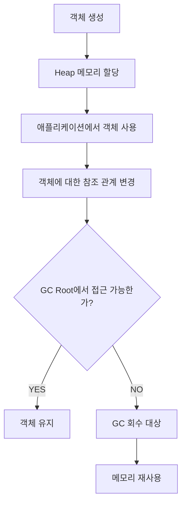

여기서 중요한 점은 GC가 객체의 사용 여부를 개발자의 의도만으로 판단하지 않는다는 것이다.

JVM은 객체에 대한 참조 관계와 GC Root로부터의 접근 가능성 등을 기준으로 판단한다.

또 객체가 회수 대상이 되었다고 해서 반드시 즉시 메모리가 해제되는 것은 아니다.

**GC의 실행 시점과 메모리 회수 과정은 Garbage Collector의 구현과 JVM 상태에 따라 달라진다.**

---

### 왜 GC가 필요할까?

GC가 필요한 이유를 이해하려면 메모리를 직접 관리하는 환경을 먼저 생각해 볼 필요가 있다.

프로그램이 동적으로 메모리를 할당하고 해제하는 상황에서는 여러 문제가 발생할 수 있다.

#### 1. Memory Leak

Memory Leak은 더 이상 필요하지 않은 메모리가 적절하게 회수되지 않아 메모리 사용량이 증가하는 문제다.

수동 메모리 관리 환경에서는 할당한 메모리의 해제를 누락하면 문제가 발생할 수 있다.

개념적으로 다음과 같다.

```text
메모리 할당
    ↓
데이터 사용
    ↓
메모리 해제 누락
    ↓
회수되지 않은 메모리 증가
    ↓
사용 가능한 메모리 감소
```

이러한 문제가 반복되면 메모리 부족으로 프로그램이 정상적으로 동작하지 못할 수 있다.

GC는 접근할 수 없는 객체를 자동으로 회수함으로써 이러한 문제의 일부를 방지한다.

하지만 Java에서도 Memory Leak이 발생할 수 있다.

접근 가능한 객체가 불필요하게 계속 유지된다면 GC가 해당 객체를 회수하지 못하기 때문이다.

이 부분은 뒤에서 자세히 살펴보자.

#### 2. Dangling Pointer

Dangling Pointer는 이미 해제된 메모리를 가리키는 포인터를 의미한다.

수동 메모리 관리 환경에서는 다음과 같은 문제가 발생할 수 있다.

```text
객체 A 생성
    ↓
객체 A 메모리 해제
    ↓
기존 포인터로 객체 A 접근
    ↓
잘못된 메모리 접근
```

이러한 접근은 정의되지 않은 동작이나 프로그램 충돌로 이어질 수 있다.

Java는 일반적인 객체 참조를 JVM이 관리하기 때문에 수동 메모리 해제로 인한 Dangling Pointer 문제를 크게 줄인다.

다만 JNI나 Unsafe, 외부 네이티브 라이브러리를 이용하는 경우에는 별도의 메모리 안전성 문제가 발생할 수 있다.

#### 3. Double Free

Double Free는 이미 해제한 메모리를 다시 해제하려고 하는 문제다.

메모리 관리 상태가 손상될 수 있으며 보안 취약점으로 이어질 수도 있다.

Java에서는 일반적인 객체의 메모리 해제를 개발자가 직접 수행하지 않으므로 이러한 위험을 줄일 수 있다.

#### 4. 개발 생산성 향상

GC를 사용하면 개발자는 객체의 메모리를 언제 해제해야 하는지 직접 관리하는 대신 비즈니스 로직에 집중할 수 있다.

예를 들어 다음 코드에서는 객체를 생성하고 사용하기만 하면 된다.

```java
public MemberResponse findMember(Long memberId) {

    Member member = memberRepository.findById(memberId)
            .orElseThrow();

    return new MemberResponse(
            member.getId(),
            member.getName()
    );
}
```

메서드 실행이 끝난 뒤 더 이상 접근할 수 없는 임시 객체들은 GC의 회수 대상이 될 수 있다.

개발자는 일반적으로 이러한 객체를 직접 해제할 필요가 없다.

---

### GC를 사용하면 모든 메모리 문제가 해결될까?

그렇지는 않다.

GC는 메모리 관리를 자동화하지만 그 과정에서 비용이 발생한다.

대표적으로 다음과 같은 비용이 존재한다.

| 비용 | 설명 |
|---|---|
| 객체 탐색 | 살아 있는 객체를 찾아야 함 |
| 참조 분석 | 객체 사이의 참조 관계를 분석해야 함 |
| 메모리 회수 | 더 이상 접근할 수 없는 객체의 공간을 확보해야 함 |
| 객체 이동 | 일부 알고리즘에서는 살아 있는 객체를 다른 영역으로 복사 |
| 참조 갱신 | 이동한 객체를 가리키는 참조를 수정해야 함 |
| CPU 사용 | GC를 수행하는 스레드가 CPU 자원을 사용 |
| 애플리케이션 일시 중단 | 일부 GC 단계에서 Stop-The-World 발생 |
| 추가 메모리 | GC 메타데이터와 객체 이동을 위한 공간이 필요할 수 있음 |

특히 백엔드 서비스에서는 GC로 인한 일시 중단 시간이 중요하다.

예를 들어 평소 20ms에 응답하는 API가 있다고 가정하자.

그런데 요청 처리 도중 150ms의 Stop-The-World가 발생한다면 어떻게 될까?

```text
평소 API 처리 시간
20ms

GC 일시 중단
150ms

사용자 관점의 응답 시간
약 170ms
```

이는 단순화된 예시지만 GC가 사용자 응답 시간에 영향을 줄 수 있다는 사실을 보여준다.

따라서 GC는 메모리 관리의 편의성과 실행 비용 사이에서 균형을 유지해야 한다.

---

### JVM 메모리 구조부터 이해하기

GC 알고리즘을 살펴보기 전에 JVM의 주요 메모리 영역을 이해할 필요가 있다.

Java 애플리케이션이 사용하는 메모리는 전부 Heap에 존재하는 것이 아니다.

대표적으로 다음과 같은 영역이 있다.

| 영역 | 역할 |
|---|---|
| Heap | 객체와 배열 등의 저장 |
| Java Stack | 메서드 호출 프레임과 지역 변수 등 |
| Metaspace | 클래스 메타데이터 등 |
| Code Cache | JIT 컴파일된 코드 저장 |
| Direct Memory | Heap 외부의 직접 버퍼 등 |
| Native Memory | JVM 내부 구조 및 네이티브 라이브러리 등 |

이를 구조로 표현하면 다음과 같다.

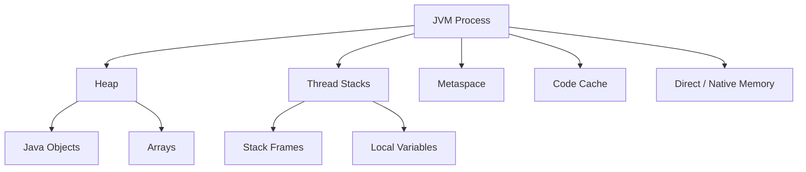

일반적인 Java 객체에 대한 GC는 주로 Heap을 대상으로 수행된다.

하지만 JVM 전체의 메모리 관리는 Heap만으로 설명할 수 없다.

예를 들어 다음 옵션을 설정했다고 가정하자.

```bash
-Xmx2g
```

이는 Java Heap의 최대 크기를 설정하는 옵션이다.

**JVM 프로세스 전체의 메모리 사용량을 2GB로 제한하는 옵션은 아니다.**

Heap 외에도 Metaspace, Stack, Direct Memory, Native Memory 등이 사용된다.

따라서 컨테이너 환경에서 메모리 제한을 설정할 때는 Heap 외부의 메모리 사용량까지 고려해야 한다.

---

### GC는 어떤 객체를 제거해야 하는지 어떻게 판단할까?

GC를 이해하는 데 가장 중요한 질문은 다음과 같다.

**어떤 객체가 더 이상 필요하지 않은 객체인가?**

단순히 객체를 생성한 지 오래되었다는 이유로 제거할 수는 없다.

오래전에 생성했지만 여전히 사용 중인 객체가 존재할 수 있기 때문이다.

반대로 방금 생성한 객체라도 더 이상 접근할 수 없다면 회수 대상이 될 수 있다.

예를 들어 다음 코드를 생각해 보자.

```java
public void process() {

    Member member = new Member(
            1L,
            "홍길동"
    );

    System.out.println(member.getName());
}
```

`process()` 메서드가 실행되는 동안 `member`는 생성된 객체를 참조한다.

메서드 실행이 종료되고 해당 객체를 가리키는 다른 참조가 없다면 객체는 더 이상 접근할 수 없는 상태가 될 수 있다.

GC는 이러한 참조 관계를 분석해야 한다.

이를 위해 등장하는 핵심 개념이 **GC Root**다.

---

### GC Root란 무엇인가?

GC Root는 JVM이 객체의 접근 가능성을 판단할 때 탐색을 시작하는 기준점이다.

GC Root 자체가 별도의 Heap 영역을 의미하는 것은 아니다.

**JVM이 살아 있는 객체를 찾기 위해 사용하는 참조의 출발점**을 의미한다.

대표적인 GC Root에는 다음과 같은 것들이 있다.

- 실행 중인 Java 스레드의 스택 프레임에 존재하는 유효한 객체 참조
- 클래스의 Static Field를 통해 유지되는 객체 참조
- JNI에서 유지하는 객체 참조
- JVM 내부에서 특별한 목적으로 유지하는 참조
- 실행 중인 스레드나 클래스 로더 등과 관련된 JVM 관리 객체

실제 GC Root의 종류와 수집 방식은 JVM 구현에 따라 달라질 수 있다.

예를 들어 다음 코드를 살펴보자.

```java
public class RootExample {

    private static final List<String> CACHE =
            new ArrayList<>();

    public void process() {

        Member member = new Member(
                1L,
                "홍길동"
        );

        CACHE.add(member.getName());
    }
}
```

여기에는 두 종류의 참조가 등장한다.

첫 번째는 메서드 내부의 지역 변수다.

```java
Member member;
```

두 번째는 Static Field다.

```java
private static final List<String> CACHE;
```

지역 변수는 해당 참조가 유효하게 유지되는 동안 객체의 접근 가능성에 영향을 준다.

Static Field가 유지하는 List 역시 클래스가 적절한 경로로 유지되는 동안 객체들을 계속 참조할 수 있다.

따라서 GC는 이러한 참조 관계를 고려해야 한다.

---

### Reachability란 무엇인가?

Reachability는 GC Root에서 특정 객체까지 참조를 따라 도달할 수 있는지를 의미한다.

예를 들어 다음과 같은 객체 관계가 있다고 가정하자.

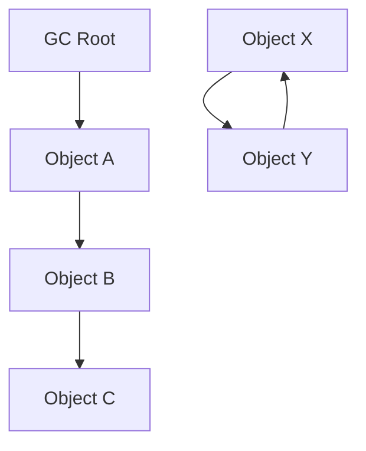

위 구조에서 GC Root는 Object A를 참조한다.

Object A는 Object B를 참조한다.

Object B는 Object C를 참조한다.

따라서 A, B, C는 모두 GC Root에서 접근 가능하다.

반면 Object X와 Y는 서로 참조하고 있지만 GC Root와 연결되어 있지 않다.

이 경우 X와 Y는 접근할 수 없는 객체들이다.

Java의 추적 기반 GC에서는 이러한 객체들을 회수할 수 있다.

**객체가 서로 참조하고 있다는 사실만으로 살아 있는 객체가 되는 것은 아니다.**

중요한 것은 GC Root에서 접근 가능한가이다.

이 개념을 이해하면 GC 알고리즘 사이의 차이도 쉽게 이해할 수 있다.

---

### GC 알고리즘의 종류

GC를 구현하는 방법은 다양하다.

그중 핵심적인 원리를 이해하기 위해 다음 네 가지 알고리즘을 살펴보자.

| 알고리즘 | 핵심 원리 |
|---|---|
| Reference Counting | 객체를 참조하는 횟수 관리 |
| Mark-Sweep | 살아 있는 객체를 표시하고 나머지 회수 |
| Mark-Compact | 살아 있는 객체를 표시한 뒤 한쪽으로 압축 |
| Copying GC | 살아 있는 객체만 다른 공간으로 복사 |

이 알고리즘들은 서로 다른 메모리 관리 문제를 해결한다.

또 실제 JVM Garbage Collector는 하나의 알고리즘만 사용하는 것이 아니라 여러 기법을 조합할 수 있다.

먼저 Reference Counting부터 살펴보자.

---

### Reference Counting이란 무엇인가?

Reference Counting은 객체를 참조하는 횟수를 관리하는 방식이다.

각 객체는 자신을 가리키는 참조의 개수를 나타내는 카운트를 가진다.

새로운 참조가 생기면 카운트가 증가한다.

참조가 제거되면 카운트가 감소한다.

카운트가 0이 되면 더 이상 참조되지 않는 객체라고 판단해 회수할 수 있다.

개념적으로 다음과 같다.

```text
Object A 생성

Reference Count = 1
```

다른 참조가 추가된다.

```text
Reference Count = 2
```

참조 하나가 제거된다.

```text
Reference Count = 1
```

마지막 참조가 제거된다.

```text
Reference Count = 0

→ 회수 가능
```

이 방식의 특징은 객체가 회수 가능한 상태가 되었음을 비교적 빠르게 판단할 수 있다는 점이다.

하지만 중요한 한계가 있다.

---

### Reference Counting의 순환 참조 문제

다음 두 객체가 있다고 가정하자.

```java
class Node {

    Node next;
}
```

그리고 다음과 같이 객체를 연결한다.

```java
Node a = new Node();

Node b = new Node();

a.next = b;

b.next = a;
```

이제 두 객체는 서로를 참조한다.

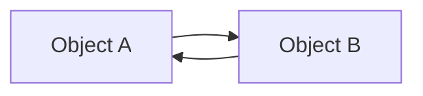

그런데 외부 참조를 제거한다고 가정하자.

```java
a = null;

b = null;
```

이제 애플리케이션에서 두 객체에 접근할 방법이 없다.

하지만 두 객체는 여전히 서로를 참조한다.

순수한 Reference Counting 방식에서는 두 객체의 참조 카운트가 0이 되지 않을 수 있다.

따라서 더 이상 사용할 수 없는 객체임에도 메모리가 회수되지 않는 문제가 발생한다.

이를 순환 참조(Circular Reference) 문제라고 부른다.

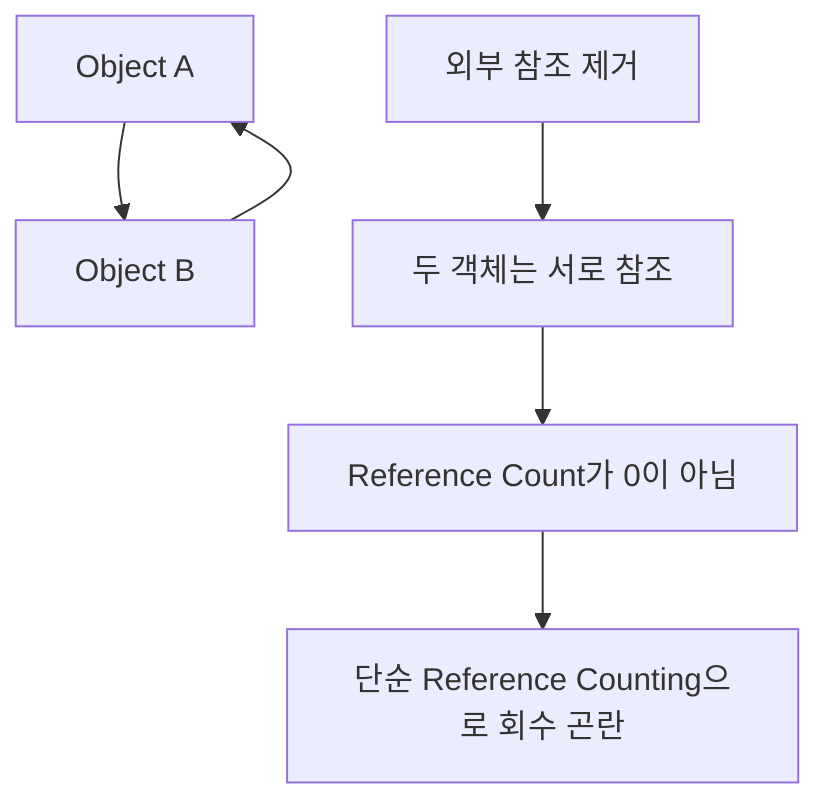

다만 Reference Counting 자체가 모든 환경에서 사용할 수 없는 알고리즘이라는 의미는 아니다.

실제로 참조 카운팅을 사용하는 메모리 관리 시스템도 존재한다.

일부 시스템은 별도의 순환 참조 탐지 알고리즘을 함께 사용한다.

중요한 점은 **순수한 Reference Counting만으로는 순환 참조를 처리하기 어렵다는 것**이다.

Java의 일반적인 HotSpot Garbage Collector는 이러한 Reference Counting을 주된 객체 회수 방식으로 사용하지 않는다.

대신 GC Root로부터의 접근 가능성을 추적하는 방식을 활용한다.

---

### Mark-Sweep 알고리즘이란 무엇인가?

Mark-Sweep은 객체의 참조 횟수가 아니라 GC Root로부터의 접근 가능성을 기준으로 메모리를 회수하는 알고리즘이다.

이름 그대로 두 단계로 구성된다.

첫 번째는 Mark다.

두 번째는 Sweep이다.

#### 1. Mark

GC Root에서 시작해 참조를 따라 이동하면서 접근 가능한 객체를 표시한다.

#### 2. Sweep

표시되지 않은 객체가 차지하는 메모리를 회수한다.

다음 구조를 생각해 보자.


Mark 단계에서는 A, B, C가 표시된다.

X와 Y는 GC Root에서 접근할 수 없으므로 표시되지 않는다.

이후 Sweep 단계에서 X와 Y가 차지하는 공간을 회수할 수 있다.

이를 순서로 표현하면 다음과 같다.

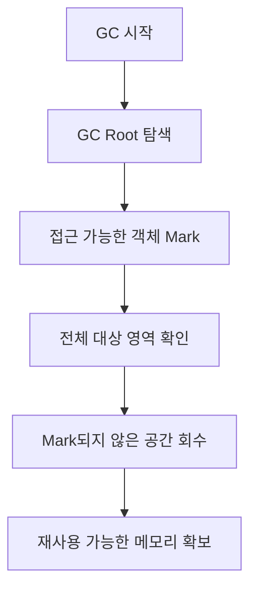

여기서 중요한 사실은 순환 참조 문제를 해결할 수 있다는 것이다.

Object X와 Y가 서로 참조하더라도 GC Root와 연결되어 있지 않다면 둘 다 회수 대상이 될 수 있다.

---

### Mark-Sweep의 장점

Mark-Sweep의 가장 큰 장점은 참조 횟수에 의존하지 않는다는 것이다.

따라서 순환 참조가 존재해도 접근 불가능한 객체를 회수할 수 있다.

또 살아 있는 객체를 반드시 다른 메모리 영역으로 복사할 필요는 없다.

이러한 특성은 살아 있는 객체가 많을 때 유리할 수 있다.

하지만 단점도 존재한다.

대표적인 문제가 **메모리 단편화(Memory Fragmentation)**다.

---

### Memory Fragmentation이란 무엇인가?

메모리 단편화는 사용 가능한 메모리 공간이 여러 곳으로 나뉘어 있는 현상이다.

예를 들어 다음과 같은 메모리 상태를 생각해 보자.

```text
[A][B][C][D][E][F][G][H]
```

여기서 B, D, F 객체가 회수 대상이라고 가정하자.

Mark-Sweep을 수행하면 다음과 같이 될 수 있다.

```text
[A][ ][C][ ][E][ ][G][H]
```

빈 공간이 세 곳 생겼다.

하지만 각 공간은 서로 떨어져 있다.

새로운 객체를 생성하기 위해 연속된 메모리 공간이 필요하다면 문제가 발생할 수 있다.

예를 들어 새 객체가 2칸의 연속된 공간을 필요로 한다고 가정하자.

전체 빈 공간은 3칸이지만 연속된 빈 공간은 1칸씩 존재한다.

따라서 새로운 객체를 할당하기 어려울 수 있다.

이것이 외부 단편화의 대표적인 문제다.

단순한 Mark-Sweep은 살아 있는 객체를 이동시키지 않으므로 이러한 단편화를 남길 수 있다.

이 문제를 해결하기 위해 Mark-Compact 알고리즘을 사용할 수 있다.

---

### Mark-Compact 알고리즘이란 무엇인가?

Mark-Compact는 살아 있는 객체를 표시한 뒤 메모리의 한쪽으로 모으는 알고리즘이다.

Mark-Sweep과 비슷하지만 마지막 처리 방식이 다르다.

Mark-Sweep은 회수 대상의 공간만 비운다.

Mark-Compact는 살아 있는 객체를 이동시켜 연속된 빈 공간을 만든다.

예를 들어 다음 상태를 생각해 보자.

```text
[A][ ][C][ ][E][ ][G][H]
```

Compact를 수행하면 다음과 같이 정리할 수 있다.

```text
[A][C][E][G][H][ ][ ][ ]
```

이제 빈 공간이 연속해서 확보된다.

이를 구조로 표현하면 다음과 같다.

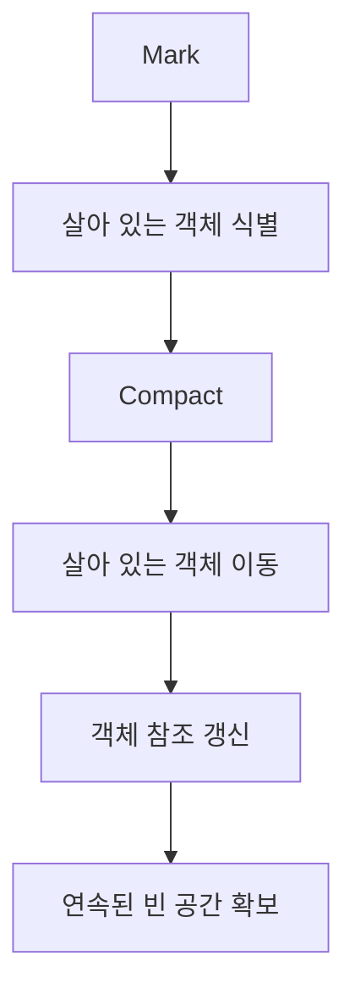

Mark-Compact는 메모리 단편화를 완화할 수 있다.

하지만 살아 있는 객체를 이동시키는 비용이 발생한다.

또 객체가 이동하면 기존 객체를 참조하던 위치도 올바르게 갱신해야 한다.

따라서 살아 있는 객체가 많을수록 객체 이동 비용이 증가할 수 있다.

---

### Mark-Sweep과 Mark-Compact의 차이

| 비교 항목 | Mark-Sweep | Mark-Compact |
|---|---|---|
| 객체 접근 가능성 확인 | Mark | Mark |
| 회수 방식 | 사용하지 않는 공간 회수 | 살아 있는 객체 압축 |
| 객체 이동 | 일반적으로 없음 | 있음 |
| 메모리 단편화 | 남을 수 있음 | 완화 가능 |
| 참조 갱신 | 객체 이동에 따른 갱신 불필요 | 필요 |
| 주요 비용 | Mark 및 Sweep | Mark 및 객체 이동 |

이 두 방식은 하나가 무조건 더 좋다고 평가할 수 없다.

살아 있는 객체의 비율과 메모리 단편화 정도에 따라 적합성이 달라진다.

---

### Copying GC란 무엇인가?

Copying GC는 살아 있는 객체를 다른 메모리 공간으로 복사하는 알고리즘이다.

가장 기본적인 형태는 메모리 공간을 두 영역으로 나누는 방식이다.

각 영역을 From Space와 To Space라고 부른다.

초기에는 From Space에 객체들이 존재한다.

```text
From Space

[A][B][C][D][E]

To Space

[ ][ ][ ][ ][ ]
```

여기서 A, C, E만 살아 있다고 가정하자.

Copying GC는 살아 있는 객체만 To Space로 복사한다.

```text
From Space

[A][B][C][D][E]

To Space

[A][C][E][ ][ ]
```

이후 객체 참조가 새로운 위치를 가리키도록 갱신한다.

그리고 기존 From Space를 다시 사용할 수 있도록 만든다.

```text
From Space

[ ][ ][ ][ ][ ]

To Space

[A][C][E][ ][ ]
```

다음 GC에서는 두 영역의 역할을 교환할 수 있다.

이를 구조로 표현하면 다음과 같다.

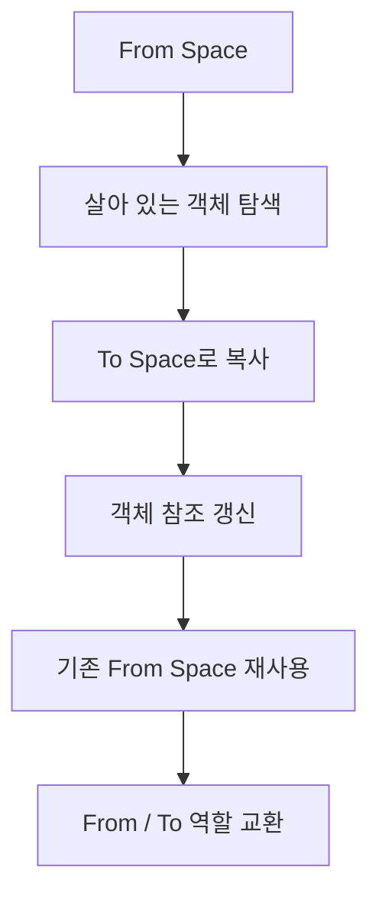

Copying GC에서는 살아 있는 객체만 복사한다.

따라서 죽은 객체를 하나씩 제거하는 대신 기존 영역 전체를 재사용할 수 있다.

이러한 방식은 살아 있는 객체의 비율이 낮을 때 유리할 수 있다.

---

### Copying GC의 장점

#### 1. 살아 있는 객체만 복사한다

예를 들어 객체가 100개 있다고 가정하자.

그중 살아 있는 객체가 10개라면 10개만 복사하면 된다.

나머지 객체가 차지하던 공간은 기존 영역을 비우면서 회수할 수 있다.

따라서 대부분의 객체가 금방 사라지는 환경에서 효율적일 수 있다.

#### 2. 메모리 단편화를 줄일 수 있다

살아 있는 객체들을 새로운 영역에 연속적으로 배치할 수 있다.

따라서 새로운 객체를 할당할 연속된 공간을 확보하기 쉽다.

#### 3. 메모리 할당이 단순해질 수 있다

객체가 연속적으로 배치되는 영역에서는 포인터를 이동시키는 방식으로 메모리를 빠르게 할당할 수 있다.

이러한 방식을 Bump Pointer Allocation이라고 부른다.

개념적으로 다음과 같다.

```text
현재 할당 위치

        ↓
[A][B][C][ ][ ][ ][ ]
```

새 객체 D를 할당한다.

```text
[A][B][C][D][ ][ ][ ]
           ↓
     다음 할당 위치
```

복잡한 빈 공간 탐색 없이 메모리를 할당할 수 있다는 장점이 있다.

다만 실제 JVM에서는 스레드별 할당 영역인 TLAB 등 추가적인 최적화도 사용한다.

---

### Copying GC의 단점

Copying GC에도 단점이 존재한다.

첫 번째는 객체를 복사할 공간이 필요하다는 것이다.

전통적인 Semi-Space 방식에서는 두 영역을 교대로 사용하기 때문에 메모리 공간 사용에 제약이 발생한다.

두 번째는 살아 있는 객체를 복사하는 비용이다.

살아 있는 객체가 많다면 많은 데이터를 이동해야 한다.

세 번째는 객체 참조를 갱신하는 비용이다.

객체가 이동하면 해당 객체를 참조하는 위치들이 새로운 주소를 가리키도록 처리해야 한다.

따라서 Copying GC는 살아 있는 객체가 적은 영역에서 특히 효율적일 수 있다.

---

### GC 알고리즘 비교

지금까지 살펴본 주요 알고리즘을 비교하면 다음과 같다.

| 알고리즘 | 회수 기준 | 주요 장점 | 주요 단점 |
|---|---|---|---|
| Reference Counting | 참조 횟수 | 회수 가능 시점을 빠르게 판단 가능 | 순환 참조 문제 |
| Mark-Sweep | GC Root 접근 가능성 | 순환 참조 처리 가능 | 단편화 발생 가능 |
| Mark-Compact | GC Root 접근 가능성 | 단편화 완화 | 살아 있는 객체 이동 비용 |
| Copying GC | GC Root 접근 가능성 | 회수와 압축을 함께 수행 가능 | 복사 공간 및 이동 비용 |

실제 JVM에서는 이러한 알고리즘을 단독으로 사용하기보다 메모리 영역과 GC 종류에 맞게 조합하는 경우가 많다.

이를 이해하기 위해 다음으로 세대별 GC를 살펴보자.

---

### Generational GC란 무엇인가?

Generational GC는 객체의 생존 특성을 활용해 Heap을 세대별로 관리하는 방식이다.

기본적인 아이디어는 다음과 같다.

**대부분의 객체는 생성된 이후 비교적 짧은 시간 안에 사용되지 않게 된다.**

이러한 관찰을 약한 세대 가설(Weak Generational Hypothesis)이라고 부른다.

또 오래 살아남은 객체는 상대적으로 앞으로도 오래 살아남을 가능성이 있다는 경험적 특성도 활용한다.

예를 들어 웹 애플리케이션에서는 다음과 같은 객체들이 자주 생성된다.

```java
public MemberResponse findMember(Long id) {

    Member member = memberRepository.findById(id)
            .orElseThrow();

    return new MemberResponse(
            member.getId(),
            member.getName()
    );
}
```

HTTP 요청 처리 과정에서 임시 DTO나 컬렉션, 문자열, 중간 계산 객체 등이 생성될 수 있다.

이러한 객체 중 상당수는 요청 처리가 끝나면 더 이상 필요하지 않게 된다.

반면 다음과 같은 객체들은 애플리케이션 실행 동안 오랫동안 유지될 수 있다.

- Spring Singleton Bean
- 애플리케이션 설정 객체
- 장기간 유지되는 캐시
- Connection Pool 관련 객체
- 오랫동안 참조되는 도메인 상태 객체

이처럼 수명이 다른 객체들을 동일한 방식으로 매번 검사하는 것은 비효율적일 수 있다.

따라서 JVM은 객체를 세대별로 나누어 관리하는 전략을 활용한다.

---

### JVM Heap의 세대별 구조

전통적인 세대별 Heap은 크게 두 영역으로 구분할 수 있다.

첫 번째는 Young Generation이다.

두 번째는 Old Generation이다.

Young Generation은 다시 다음 영역으로 나뉘는 모델로 설명할 수 있다.

- Eden
- Survivor 0
- Survivor 1

구조는 다음과 같다.

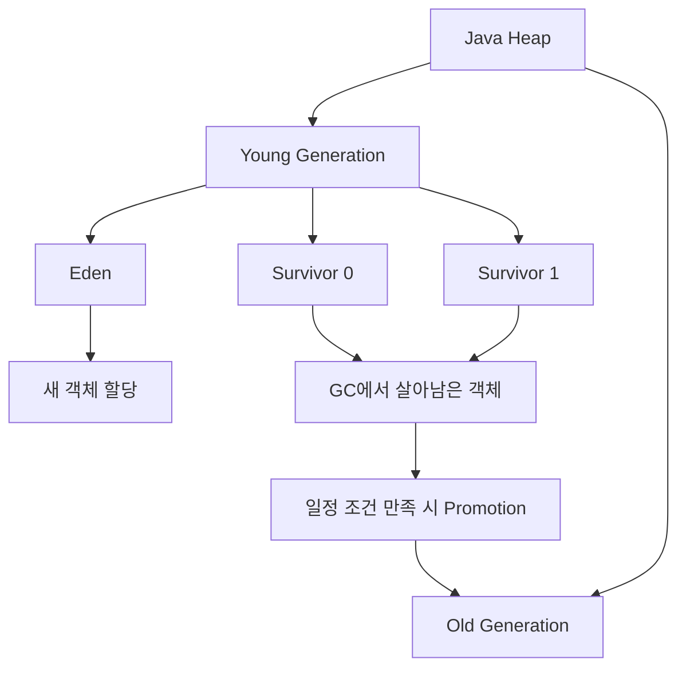

여기서 중요한 점이 있다.

**Eden, Survivor 0, Survivor 1이 항상 고정된 연속 메모리 공간으로 존재하는 것은 아니다.**

이 구조는 전통적인 세대별 GC의 원리를 이해하기 위한 모델이다.

현대적인 G1 GC에서는 Heap을 여러 Region으로 나누고 각 Region에 Eden, Survivor, Old 역할을 동적으로 부여한다.

따라서 실제 Heap의 물리적인 구조는 사용하는 Garbage Collector에 따라 달라질 수 있다.

---

### Young Generation이란 무엇인가?

Young Generation은 주로 새롭게 생성된 객체를 관리하는 영역이다.

일반적인 객체는 처음 생성될 때 Eden에 할당된다.

예를 들어 다음 코드가 실행되었다고 가정하자.

```java
Member member = new Member(
        1L,
        "홍길동"
);
```

일반적인 세대별 GC 환경에서는 새로운 객체가 Eden에 할당될 수 있다.

```text
Young Generation

Eden
[Member][ ][ ][ ]

Survivor 0
[ ][ ][ ]

Survivor 1
[ ][ ][ ]
```

시간이 지나면서 새로운 객체가 계속 생성된다.

```text
Eden
[A][B][C][D][E][F]
```

Eden의 사용 가능한 공간이 부족해지면 Young Generation을 대상으로 GC가 수행될 수 있다.

이를 일반적으로 Minor GC 또는 Young GC라고 부른다.

---

### Minor GC란 무엇인가?

Minor GC는 Young Generation을 중심으로 수행되는 GC를 의미한다.

GC는 접근 가능한 객체를 확인하고 살아남은 객체를 Survivor 영역 등으로 이동시킬 수 있다.

예를 들어 Eden에 A, B, C, D 객체가 있다고 가정하자.

```text
Eden
[A][B][C][D]
```

이 중 A와 C만 살아 있다고 가정한다.

Minor GC가 발생하면 다음과 같이 처리할 수 있다.

```text
Eden
[ ][ ][ ][ ]

Survivor 0
[A][C]
```

실제로는 객체의 크기와 Survivor 공간, 객체의 나이, Collector의 정책 등을 고려해 처리한다.

따라서 살아남은 객체가 반드시 Survivor로 이동하는 것은 아니다.

일부 객체는 Old Generation으로 직접 승격될 수도 있다.

또 Young GC가 발생하면 일반적으로 Stop-The-World가 수행되는 Collector가 많지만, 모든 현대적인 GC가 동일한 방식으로 동작하는 것은 아니다.

---

### Stop-The-World란 무엇인가?

Stop-The-World(STW)는 GC 또는 특정 JVM 작업을 수행하기 위해 애플리케이션 스레드의 실행을 일시 중단하는 과정이다.

여기서 일시 중단되는 대상은 일반적으로 객체를 생성하고 수정하는 애플리케이션 스레드, 즉 Mutator Thread다.

GC 작업을 수행하는 스레드까지 모두 중단한다는 의미는 아니다.

예를 들어 다음과 같은 상황을 생각해 보자.

```text
애플리케이션 실행

Request Thread 1 → 요청 처리
Request Thread 2 → DB 조회
Request Thread 3 → 결제 처리
```

GC가 특정 일시 중단 단계를 수행하면 다음과 같은 상황이 발생할 수 있다.

```text
Stop-The-World

Request Thread 1 → 일시 중단
Request Thread 2 → 일시 중단
Request Thread 3 → 일시 중단

GC Threads → 필요한 GC 작업 수행
```

이후 GC 작업이 종료되면 애플리케이션 스레드의 실행이 재개된다.

```text
GC 완료

Request Thread 1 → 실행 재개
Request Thread 2 → 실행 재개
Request Thread 3 → 실행 재개
```

이러한 일시 중단이 발생하면 요청 처리 시간에 영향을 줄 수 있다.

하지만 **모든 GC 작업이 처음부터 끝까지 Stop-The-World 상태에서 수행되는 것은 아니다.**

현대적인 G1 GC와 ZGC 등은 일부 작업을 애플리케이션과 동시에 수행한다.

이를 Concurrent GC라고 부른다.

GC의 종류에 따라 어떤 단계에서 STW가 필요한지 달라진다.

---

### GC와 Safepoint의 관계

JVM은 애플리케이션 스레드를 아무 시점에나 임의로 중단하는 것이 아니라 안전하게 상태를 확인하고 작업할 수 있는 지점을 활용한다.

이러한 개념이 Safepoint다.

Safepoint에서는 JVM이 스레드의 상태와 객체 참조 등에 대한 필요한 정보를 안정적으로 확인할 수 있다.

GC는 이러한 메커니즘을 이용해 필요한 작업을 수행할 수 있다.

다만 JVM 내부에서는 스레드별 처리와 핸드셰이크 등 다양한 메커니즘이 사용되므로 모든 GC 작업을 하나의 전역 Safepoint 모델로만 설명할 수는 없다.

또 Safepoint는 GC만을 위한 기능도 아니다.

클래스 관련 작업이나 JVM 내부 관리 작업 등에도 사용될 수 있다.

따라서 GC 로그를 분석할 때는 다음 두 가지를 구분할 필요가 있다.

- GC가 수행한 실제 작업 시간
- 애플리케이션 스레드가 중단된 시간

이 둘은 완전히 동일한 개념이 아니다.

---

### Survivor 영역은 왜 필요할까?

Survivor 영역은 Minor GC에서 살아남은 객체들을 관리하기 위한 공간이다.

새로 생성된 객체 중 상당수는 짧은 시간 안에 필요하지 않게 된다.

하지만 모든 객체가 즉시 사라지는 것은 아니다.

일부 객체는 여러 번의 GC에서도 살아남는다.

이러한 객체를 바로 Old Generation으로 이동시키면 Old Generation에 불필요한 객체가 빠르게 증가할 수 있다.

따라서 Survivor 영역을 이용해 객체의 생존 여부를 추가로 관찰할 수 있다.

전통적인 두 Survivor 영역 모델에서는 살아남은 객체가 다음과 같이 이동할 수 있다.

```text
Eden
  ↓
Survivor 0
  ↓
Survivor 1
  ↓
Survivor 0
  ↓
...
```

객체는 이러한 과정을 거치면서 생존 횟수에 해당하는 나이 정보를 가질 수 있다.

여기서 나이와 실제 객체 생성 후 경과한 시간은 다르다.

---

### 객체의 Age란 무엇인가?

객체의 Age는 객체가 Young GC에서 살아남은 횟수와 관련된 정보다.

단순화하면 다음과 같다.

```text
객체 생성

Age = 0
```

첫 번째 Young GC에서 살아남는다.

```text
Age = 1
```

두 번째 Young GC에서 살아남는다.

```text
Age = 2
```

세 번째 Young GC에서도 살아남는다.

```text
Age = 3
```

특정 조건을 만족하면 Old Generation으로 승격될 수 있다.

이를 Promotion이라고 부른다.

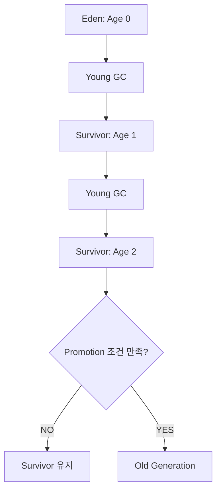

여기서 Promotion 조건은 단순히 특정 횟수만으로 결정되는 것은 아니다.

객체의 나이와 Survivor 공간, GC 정책, Tenuring Threshold 등이 영향을 줄 수 있다.

예를 들어 Survivor 공간이 부족하다면 충분히 오래 살아남지 않은 객체도 Old Generation으로 이동할 수 있다.

따라서 모든 객체가 일정한 Age에 도달한 뒤에만 승격된다고 이해해서는 안 된다.

---

### Promotion이란 무엇인가?

Promotion은 Young Generation에서 살아남은 객체가 Old Generation으로 이동하는 과정이다.

Old Generation은 상대적으로 수명이 긴 객체들을 관리하는 데 사용된다.

예를 들어 애플리케이션에서 오랫동안 유지하는 객체를 생각해 보자.

```java
@Component
public class ProductCache {

    private final Map<Long, Product> products =
            new ConcurrentHashMap<>();
}
```

Spring이 관리하는 `ProductCache` 객체와 내부 Map은 Bean이 유지되는 동안 계속 참조될 수 있다.

이러한 객체들은 여러 번의 Young GC에서 살아남을 가능성이 있다.

따라서 Old Generation으로 이동할 수 있다.

하지만 **Old Generation에 존재한다는 사실이 해당 객체가 영구적으로 살아 있어야 한다는 의미는 아니다.**

Old Generation의 객체도 더 이상 접근할 수 없게 되면 GC 회수 대상이 된다.

---

### Old Generation이란 무엇인가?

Old Generation은 상대적으로 오래 살아남은 객체들을 관리하는 영역이다.

일반적으로 Young Generation보다 살아 있는 객체의 비율이 높은 경우가 많다.

이러한 특성 때문에 Old Generation에서는 Young Generation과 다른 메모리 회수 전략을 사용할 수 있다.

예를 들어 다음과 같은 객체들이 Old Generation에 존재할 수 있다.

- 장기간 유지되는 애플리케이션 객체
- 캐시 데이터
- 오랫동안 참조되는 컬렉션
- Spring Bean과 연결된 객체
- 여러 GC 사이클을 통과한 도메인 객체

Old Generation에서도 객체는 생성되고 회수될 수 있다.

또 GC의 종류에 따라 Old Generation을 관리하는 방식이 달라진다.

전통적인 세대별 Collector에서는 Old Generation을 대상으로 Mark-Sweep 또는 Mark-Compact 계열의 알고리즘을 사용할 수 있다.

하지만 현대적인 G1 GC는 Old Generation의 일부 Region에 있는 살아 있는 객체를 다른 Region으로 복사하는 방식을 사용하기도 한다.

따라서 Old Generation에서는 무조건 Mark-Sweep만 수행한다고 이해해서는 안 된다.

---

### Minor GC, Major GC, Full GC의 차이

GC를 설명할 때 자주 등장하는 용어는 다음 세 가지다.

첫 번째는 Minor GC다.

두 번째는 Major GC다.

세 번째는 Full GC다.

하지만 이 용어들은 모든 JVM 구현과 Garbage Collector에서 동일하게 정의되는 것은 아니다.

일반적인 의미를 정리하면 다음과 같다.

| 구분 | 일반적인 의미 | 주의사항 |
|---|---|---|
| Minor GC | Young Generation 중심의 GC | Young GC라고도 부름 |
| Major GC | Old Generation 관련 GC | Collector마다 의미가 다를 수 있음 |
| Full GC | 전체 Heap을 대상으로 하는 광범위한 수집 | 일반적으로 긴 STW를 동반할 수 있음 |
| Mixed GC | Young과 일부 Old Region을 함께 수집 | G1 GC에서 사용하는 개념 |

특히 **Major GC와 Full GC를 완전히 동일한 용어로 이해해서는 안 된다.**

Collector에 따라 Old Generation의 일부만 수집할 수도 있고, 전체 Heap을 대상으로 수집할 수도 있다.

또 Full GC는 단순히 Old Generation이 꽉 찼을 때만 발생하는 것도 아니다.

할당 실패나 특정 명시적 GC 요청, 메모리 압박 등 다양한 조건과 관련될 수 있다.

운영 환경에서는 용어만으로 판단하기보다 GC 로그에 기록된 실제 수집 종류를 확인해야 한다.

---

### 왜 Young Generation에서는 Copying GC가 유리할까?

Young Generation의 특징은 상대적으로 짧은 수명의 객체가 많다는 것이다.

예를 들어 Young Generation에 1,000개의 객체가 있다고 가정하자.

이 중 900개가 더 이상 접근할 수 없는 객체라고 가정한다.

그러면 살아 있는 객체는 100개다.

Copying GC에서는 살아 있는 100개만 다른 영역으로 이동시키면 된다.

```text
전체 객체: 1,000개

죽은 객체: 900개

살아 있는 객체: 100개
```

즉 전체 객체 중 일부만 복사한다.

따라서 수명이 짧은 객체가 많은 환경에서는 살아 있는 객체를 복사하는 방식이 효율적일 수 있다.

또 객체를 이동시키면서 메모리를 연속적으로 배치할 수 있으므로 단편화 문제도 줄일 수 있다.

이것이 Young Generation에서 Copying 방식이 자주 활용되는 중요한 이유다.

---

### 왜 Old Generation에서는 Copying만 사용하지 않을까?

Old Generation에는 상대적으로 오래 살아남은 객체들이 많다.

따라서 Young Generation보다 살아 있는 객체의 비율이 높을 수 있다.

예를 들어 Old Generation에 1,000개의 객체가 있다고 가정하자.

이 중 900개가 살아 있다면 어떨까?

Copying 방식으로 모든 살아 있는 객체를 이동시키려면 900개를 복사해야 한다.

반면 죽은 객체는 100개뿐이다.

```text
전체 객체: 1,000개

살아 있는 객체: 900개

죽은 객체: 100개
```

이러한 상황에서는 살아 있는 객체 전체를 이동시키는 비용이 클 수 있다.

따라서 전통적인 Collector에서는 Old Generation에 Mark-Sweep이나 Mark-Compact 등의 기법을 활용한다.

하지만 여기서 중요한 점은 다음과 같다.

**Old Generation에서 Copying GC가 사용되지 않는다는 설명은 현대적인 JVM에는 그대로 적용되지 않는다.**

G1 GC는 선택된 Old Region의 살아 있는 객체를 다른 Region으로 이동시키며 공간을 회수할 수 있다.

따라서 Old Generation의 GC 알고리즘은 Collector 구현에 따라 달라진다.

---

### JVM에서는 어떤 Garbage Collector를 사용할까?

지금까지는 GC의 기본적인 알고리즘을 살펴보았다.

하지만 실제 Java 애플리케이션에서는 JVM이 제공하는 Garbage Collector를 사용한다.

대표적으로 다음과 같은 Collector가 있다.

| Collector | 주요 특징 | 적합한 상황 |
|---|---|---|
| Serial GC | 단일 GC 스레드 중심 | 작은 Heap, 제한된 CPU |
| Parallel GC | 여러 GC 스레드로 높은 처리량 추구 | 처리량 중심 작업 |
| G1 GC | Region 기반, 중단 시간 목표 관리 | 일반적인 서버 애플리케이션 |
| ZGC | 대부분의 작업을 애플리케이션과 동시 수행 | 매우 짧은 지연 시간이 중요한 서비스 |
| Shenandoah | 동시 객체 이동 및 짧은 중단 시간 지향 | 지원 JVM 배포판의 저지연 워크로드 |

여기서 중요한 사실은 Garbage Collector마다 목표가 다르다는 것이다.

어떤 Collector는 최대 처리량을 중요하게 생각한다.

어떤 Collector는 GC로 인한 응답 지연을 줄이는 데 집중한다.

또 어떤 Collector는 제한된 메모리와 CPU 환경에서 단순하게 동작하는 것을 우선한다.

따라서 모든 애플리케이션에서 가장 좋은 Garbage Collector가 하나로 정해져 있는 것은 아니다.

---

### Serial GC란 무엇인가?

Serial GC는 GC 작업을 주로 하나의 GC 스레드로 수행하는 Collector다.

GC 작업을 수행하는 동안 애플리케이션 스레드가 중단되는 방식을 사용한다.

구조가 상대적으로 단순하고 여러 GC 스레드 사이의 조정 비용이 적다는 특징이 있다.

Java 17 또는 Java 21의 HotSpot에서 다음 옵션으로 명시적으로 선택할 수 있다.

```bash
java -XX:+UseSerialGC -jar app.jar
```

이 명령어의 의미는 다음과 같다.

| 옵션 | 의미 |
|---|---|
| `-XX:+UseSerialGC` | Serial Garbage Collector 사용 |
| `-jar app.jar` | 애플리케이션 실행 |

Serial GC는 작은 Heap을 사용하는 프로그램이나 CPU 자원이 제한된 환경에서 적합할 수 있다.

하지만 많은 요청을 동시에 처리하는 서버에서는 GC 중단 시간이 문제가 될 수 있다.

따라서 실제 서비스의 Heap 크기와 지연 시간 요구사항을 고려해야 한다.

---

### Parallel GC란 무엇인가?

Parallel GC는 여러 GC 스레드를 활용해 메모리 회수 작업을 병렬로 수행하는 Collector다.

Serial GC와 비교하면 여러 CPU 코어를 활용할 수 있다는 특징이 있다.

다음과 같이 활성화할 수 있다.

```bash
java -XX:+UseParallelGC -jar app.jar
```

Parallel GC의 중요한 목표는 높은 처리량(Throughput)이다.

예를 들어 데이터 처리 배치 작업을 생각해 보자.

사용자 요청에 대해 매우 짧은 응답 시간을 제공해야 하는 서비스가 아니라, 전체 작업을 최대한 빠르게 완료하는 것이 중요한 상황이다.

이러한 환경에서는 GC 일시 중단 시간을 어느 정도 허용하더라도 높은 처리량을 제공하는 Collector가 유리할 수 있다.

하지만 Parallel GC도 주요 GC 작업에서 Stop-The-World를 사용한다.

따라서 전체 처리량이 높더라도 개별 요청의 지연 시간이 길어질 수 있다.

---

### G1 GC란 무엇인가?

G1 GC(Garbage-First Garbage Collector)는 Heap을 여러 Region으로 나누어 관리하는 Garbage Collector다.

Java 9 이후 일반적인 서버 환경에서 기본 Collector로 사용되어 왔으며 Java 17과 Java 21에서도 중요한 기본 선택지다.

G1 GC는 다음 목표를 가진다.

- GC로 인한 일시 중단 시간을 가능한 한 짧게 유지
- 높은 처리량 확보
- Heap 크기에 따른 수집 작업의 효율적인 분산
- 살아 있는 객체의 이동을 통한 메모리 단편화 완화
- 동시 Marking을 통해 STW 부담 감소

G1 GC의 가장 중요한 특징은 **Heap을 Region 단위로 관리한다는 점**이다.

---

### G1 GC의 Region 구조

전통적인 Heap 모델은 다음처럼 설명할 수 있다.

```text
Young Generation

├── Eden
├── Survivor 0
└── Survivor 1

Old Generation
```

반면 G1 GC는 Heap을 여러 Region으로 나눈다.

각 Region은 상황에 따라 Eden, Survivor, Old 등의 역할을 가진다.

개념적으로 다음과 같다.

```text
Java Heap

[Eden] [Old] [Eden] [Survivor]

[Old] [Eden] [Old] [Free]

[Survivor] [Free] [Old] [Free]
```

즉 Eden 영역이 반드시 하나의 연속된 물리적 공간일 필요는 없다.

G1 GC는 여러 Region의 역할을 동적으로 조정할 수 있다.

이러한 구조는 특정 영역의 회수 효율을 계산하고 수집 대상을 선택하는 데 도움이 된다.

---

### G1 GC는 왜 Garbage-First라고 부를까?

G1 GC는 회수할 수 있는 메모리가 많은 Region을 우선적으로 수집하는 전략을 사용한다.

예를 들어 다음과 같은 Old Region이 있다고 가정하자.

| Region | 살아 있는 데이터 | 회수 가능한 공간 |
|---|---:|---:|
| Region A | 90% | 10% |
| Region B | 20% | 80% |
| Region C | 50% | 50% |
| Region D | 10% | 90% |

다른 조건이 동일하다고 가정하면 Region D나 Region B를 수집하는 것이 더 효율적일 수 있다.

살아 있는 객체가 적기 때문에 이동시켜야 하는 데이터도 상대적으로 적다.

반면 회수할 수 있는 공간은 크다.

G1 GC는 이러한 수집 효율과 참조 관계, 예상 중단 시간 등을 고려해 Collection Set을 구성한다.

Collection Set은 특정 GC 사이클에서 수집 대상으로 선택한 Region들의 집합이다.

따라서 G1은 전체 Heap을 매번 한 번에 수집하는 방식이 아니라 여러 번에 걸쳐 필요한 Region을 선택적으로 수집할 수 있다.

---

### G1 GC의 기본 동작 과정

G1 GC의 동작을 이해하려면 Young Collection과 Concurrent Marking, Mixed Collection을 구분해야 한다.

#### 1. Young Collection

Young Generation에 해당하는 Region을 중심으로 수집한다.

살아 있는 객체는 다른 Survivor Region이나 Old Region으로 이동할 수 있다.

#### 2. Concurrent Marking

Old Generation의 객체 중 어떤 객체가 살아 있는지 파악하기 위한 작업을 수행한다.

이 과정의 상당 부분을 애플리케이션과 동시에 실행할 수 있다.

#### 3. Mixed Collection

Young Region과 함께 일부 Old Region을 수집한다.

회수 효율이 좋은 Old Region을 선택해 살아 있는 객체를 이동시키고 공간을 회수한다.

#### 4. Full GC

일반적인 수집만으로 충분한 메모리를 확보하지 못하는 등의 상황에서는 Full GC가 발생할 수 있다.

G1의 Full GC는 일반적으로 긴 Stop-The-World를 유발할 수 있으므로 운영 환경에서 주의해야 한다.

이러한 G1의 동작 방식은 Oracle의 HotSpot GC 문서에서도 Young-Only Phase와 Space-Reclamation Phase로 구분해 설명하고 있다.

---

### G1 GC의 동작 흐름

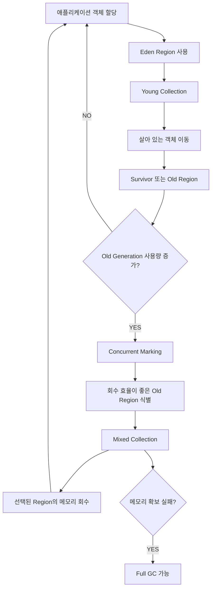

이 구조에서 주목해야 할 부분은 G1 GC가 Old Generation에서도 객체 이동을 수행할 수 있다는 것이다.

따라서 G1 GC를 단순히 Young은 Copying, Old는 Mark-Sweep이라고 설명하는 것은 정확하지 않다.

G1 GC는 Young 및 Mixed Collection에서 Evacuation이라는 객체 이동 방식을 활용한다.

---

### Evacuation이란 무엇인가?

Evacuation은 선택된 Region에서 살아 있는 객체를 다른 Region으로 이동시키는 작업이다.

예를 들어 다음과 같은 Region이 있다고 가정하자.

```text
Region A

[A][ ][B][ ][C][ ]
```

여기서 A, B, C가 살아 있는 객체다.

G1 GC는 살아 있는 객체들을 새로운 Region으로 이동시킬 수 있다.

```text
Region B

[A][B][C][ ][ ][ ]
```

객체 이동이 완료되면 기존 Region A를 재사용할 수 있다.

이 과정에서 객체 참조도 적절하게 갱신해야 한다.

G1 GC는 이러한 방식을 통해 메모리 단편화를 완화한다.

또 모든 Old Region을 매번 이동시키는 것이 아니라 선택된 Region을 대상으로 작업을 수행한다.

---

### G1 GC의 Remembered Set은 무엇인가?

여기서 한 가지 중요한 문제가 발생한다.

Young Region에 있는 객체를 수집한다고 가정하자.

그런데 Old Region에 있는 객체가 Young Region의 객체를 참조하고 있다면 어떻게 될까?

예를 들어 다음과 같다.

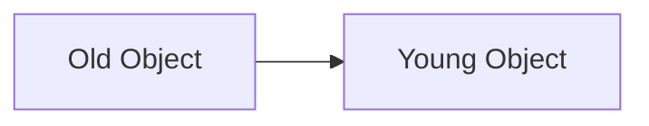

Young GC에서 GC Root와 Young Generation만 단순하게 탐색한다면 Old Object를 통한 참조를 놓칠 수 있다.

하지만 Old Generation 전체를 매번 탐색한다면 Young GC의 효율성이 떨어진다.

이를 해결하기 위해 G1 GC는 Remembered Set 등의 정보를 활용한다.

Remembered Set은 수집 대상 Region 외부에서 내부 객체를 참조하는 위치를 파악하는 데 도움을 주는 자료구조다.

또 JVM은 Write Barrier 등을 활용해 참조 변경과 관련된 정보를 추적한다.

개념적인 흐름은 다음과 같다.

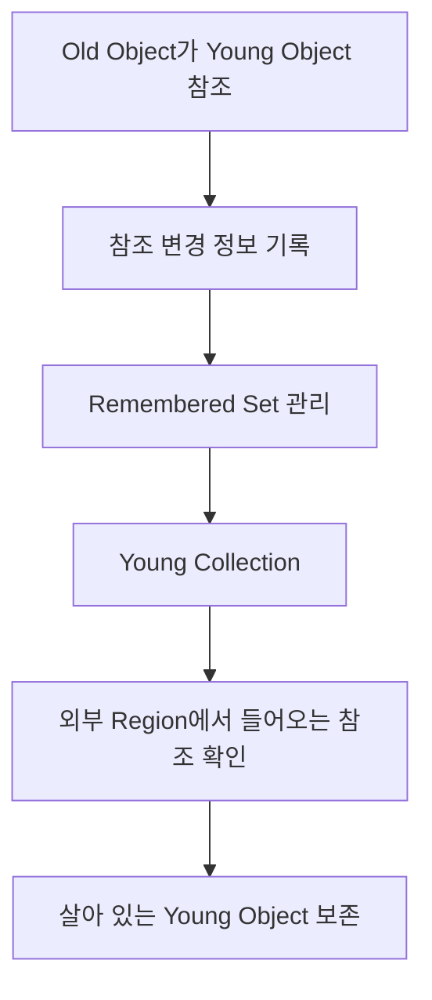

이러한 구조는 G1 GC가 전체 Heap을 매번 탐색하지 않고 선택된 Region을 효율적으로 수집하는 데 중요한 역할을 한다.

다만 Remembered Set을 관리하는 작업에도 CPU와 메모리 비용이 발생한다.

따라서 G1 GC는 GC 중단 시간을 줄이는 대신 일부 동시 작업과 메타데이터 관리 비용을 부담한다.

---

### G1 GC의 Humongous Object란 무엇인가?

G1 GC에서는 크기가 매우 큰 객체를 특별하게 처리한다.

이러한 객체를 Humongous Object라고 부른다.

G1 GC에서 Humongous Object는 일반적으로 Region 크기의 절반 이상인 객체를 의미한다.

예를 들어 Region 크기가 4MB라고 가정하자.

이 경우 약 2MB 이상의 객체는 Humongous Object로 취급될 수 있다.

대표적인 예는 큰 배열이다.

```java
byte[] data = new byte[10 * 1024 * 1024];
```

이 코드는 약 10MB 크기의 바이트 배열을 생성한다.

Region 크기에 따라 Humongous Object로 처리될 수 있다.

Humongous Object는 일반적인 작은 객체와 다른 방식으로 Old Generation에 할당될 수 있다.

이러한 객체가 반복해서 생성되면 다음과 같은 문제가 발생할 수 있다.

- Old Generation 사용량 증가
- Region 내부 공간 낭비
- 메모리 단편화
- 예상보다 빠른 GC 사이클 시작
- 메모리 확보 실패

예를 들어 대용량 파일을 처리하면서 전체 파일을 하나의 `byte[]`로 로딩하는 구조는 이러한 문제와 관련될 수 있다.

따라서 큰 데이터를 다룰 때는 객체 할당 방식 자체를 검토해야 한다.

---

### ZGC란 무엇인가?

ZGC(Z Garbage Collector)는 매우 짧은 GC 중단 시간을 목표로 설계된 Garbage Collector다.

G1 GC가 일시 중단 시간을 관리하면서 처리량과 균형을 추구한다면, ZGC는 GC 작업의 상당 부분을 애플리케이션 실행과 동시에 수행하는 데 더 집중한다.

ZGC의 중요한 특징은 다음과 같다.

- 매우 짧은 Stop-The-World 시간 지향
- 애플리케이션과 동시에 수행되는 GC 작업
- 객체 이동과 참조 처리의 동시성 강화
- 큰 Heap에서도 낮은 지연 시간 유지 추구
- 동시 GC 작업에 따른 CPU 및 메모리 비용 존재

여기서 중요한 것은 ZGC가 모든 상황에서 G1보다 빠르다는 의미는 아니라는 점이다.

ZGC는 GC로 인한 지연 시간을 줄이는 데 유리할 수 있다.

하지만 동시 GC 작업에 필요한 CPU 사용량이나 메모리 여유 공간 등의 비용이 존재한다.

따라서 처리량이 중요한 작업에서는 G1이나 Parallel GC가 더 적합할 수 있다.

---

### Java 버전에 따른 ZGC의 변화

ZGC는 Java 버전에 따라 중요한 변화가 있었다.

특히 Generational ZGC의 도입은 기존의 세대별 GC 개념과도 연결된다.

| Java 버전 | ZGC 관련 주요 변화 |
|---|---|
| Java 17 | ZGC 사용 가능, 비세대별 구조 |
| Java 21 | Generational ZGC 도입, 별도 옵션으로 활성화 |
| Java 23 | Generational ZGC가 ZGC의 기본 모드가 됨 |
| Java 24 | 비세대별 ZGC 모드 제거 |
| Java 25 | 세대별 ZGC 구조 사용 |

Java 21에서 Generational ZGC를 사용하려면 다음과 같은 옵션을 사용한다.

```bash
java \
  -XX:+UseZGC \
  -XX:+ZGenerational \
  -jar app.jar
```

Java 24 이상에서는 비세대별 ZGC 모드가 제거되었으므로 일반적으로 다음과 같이 사용할 수 있다.

```bash
java \
  -XX:+UseZGC \
  -jar app.jar
```

즉 Java 버전에 따라 필요한 JVM 옵션이 달라진다.

이러한 변화는 JDK 21의 Generational ZGC 도입과 JDK 23의 기본 모드 변경, JDK 24의 비세대별 모드 제거에 따른 것이다.

---

### G1 GC와 ZGC는 무엇이 다를까?

두 Garbage Collector는 모두 서버 애플리케이션에서 고려할 수 있지만 목표가 다르다.

| 비교 항목 | G1 GC | ZGC |
|---|---|---|
| 주요 목표 | 처리량과 중단 시간의 균형 | 매우 짧은 중단 시간 |
| Heap 관리 | Region 기반 | ZGC 고유의 Heap 관리 구조 |
| 세대별 관리 | 지원 | 현대 버전에서 지원 |
| 객체 이동 | 주로 수집 일시 중단 중 수행 | 상당 부분 동시 수행 |
| Stop-The-World | Young/Mixed Collection 등에서 발생 | 매우 짧은 중단 시간 지향 |
| CPU 비용 | 동시 처리 및 GC 스레드 비용 | 더 많은 동시 작업 비용이 발생할 수 있음 |
| 일반적인 활용 | 범용 백엔드 서버 | 낮은 지연 시간이 중요한 서비스 |

실무에서는 평균 응답 시간만으로 두 Collector를 비교해서는 안 된다.

예를 들어 다음 지표를 함께 확인해야 한다.

```text
평균 응답 시간

p95 응답 시간

p99 응답 시간

최대 응답 시간

GC Pause Time

CPU 사용량

Heap 사용량

애플리케이션 처리량
```

특히 지연 시간에 민감한 서비스라면 p99와 같은 Tail Latency 지표가 중요할 수 있다.

---

### GC가 발생하면 반드시 애플리케이션이 멈출까?

GC를 처음 이해할 때 흔히 다음과 같이 생각한다.

```text
GC 시작
    ↓
모든 애플리케이션 작업 중단
    ↓
GC 완료
    ↓
애플리케이션 재개
```

이 구조는 일부 GC 알고리즘과 Collector의 특정 수집 단계에서는 적절한 설명이다.

하지만 현대적인 JVM 전체에 적용되는 설명은 아니다.

GC 작업은 크게 다음과 같이 구분할 수 있다.

#### Stop-The-World 작업

애플리케이션 스레드를 일시 중단하고 수행하는 작업이다.

#### Concurrent 작업

애플리케이션 스레드가 실행되는 동안 GC 스레드가 동시에 수행하는 작업이다.

#### Parallel 작업

여러 GC 스레드가 동시에 GC 작업을 수행하는 방식이다.

여기서 Parallel과 Concurrent는 서로 다른 개념이다.

| 구분 | 핵심 의미 |
|---|---|
| Parallel GC 작업 | 여러 GC 스레드가 동시에 작업 |
| Concurrent GC 작업 | 애플리케이션 실행과 GC 작업이 동시에 진행 |
| Stop-The-World | 애플리케이션 스레드 일시 중단 |

예를 들어 Parallel GC는 여러 GC 스레드를 사용하지만 주요 수집 작업에서는 애플리케이션을 중단한다.

반면 G1 GC는 일부 수집 작업을 STW로 수행하면서 Concurrent Marking도 수행한다.

ZGC는 대부분의 GC 작업을 애플리케이션과 동시에 수행하도록 설계되었다.

따라서 **Parallel이라고 해서 반드시 애플리케이션과 동시에 GC를 수행한다는 의미는 아니다.**

---

### GC는 언제 발생할까?

GC의 실행 시점은 Collector와 JVM 상태에 따라 달라진다.

대표적으로 다음과 같은 상황이 관련될 수 있다.

1. 새로운 객체를 할당하기 위한 공간이 부족해지는 경우
2. Young Generation의 사용량이 증가하는 경우
3. Old Generation의 점유율이 특정 조건에 도달하는 경우
4. Collector가 Concurrent Marking을 시작할 필요가 있다고 판단하는 경우
5. 메모리 확보에 실패해 더 강한 수집이 필요한 경우
6. 명시적인 GC 요청이 발생하는 경우

다만 이러한 조건이 항상 특정 종류의 GC를 즉시 발생시키는 것은 아니다.

Collector마다 수집 시점과 수집 대상 선택 방식이 다르다.

예를 들어 G1 GC는 과거의 할당 속도와 GC 비용 등을 고려해 Concurrent Marking을 시작하는 시점을 조정할 수 있다.

따라서 GC를 단순히 Eden이나 Old Generation이 완전히 가득 찼을 때만 실행되는 기능으로 이해해서는 안 된다.

---

### System.gc()를 호출하면 어떻게 될까?

Java에서는 다음 메서드를 호출할 수 있다.

```java
System.gc();
```

하지만 이 메서드가 모든 객체를 즉시 회수한다는 의미는 아니다.

`System.gc()`는 JVM에 GC 수행을 요청하는 기능이다.

실제 동작은 JVM 구현과 설정에 영향을 받는다.

또 명시적인 GC 요청이 애플리케이션의 성능에 불리하게 작용할 수 있다.

따라서 일반적인 비즈니스 로직에서 반복적으로 호출하는 것은 권장되지 않는다.

예를 들어 다음과 같은 코드는 피하는 것이 좋다.

```java
public void process() {

    // 비즈니스 로직

    System.gc();
}
```

GC를 언제 수행할지는 일반적으로 JVM의 Collector에 맡기는 편이 적절하다.

메모리 문제가 발생한다면 `System.gc()` 호출을 추가하기보다 메모리 사용 패턴과 GC 로그를 분석해야 한다.

---

### Java에서 GC가 실제로 발생하는지 확인하기

지금까지 살펴본 GC 동작을 직접 확인할 수 있다.

다음은 객체를 반복해서 생성하는 프로그램이다.

Java 17 이상에서 실행할 수 있다.

`GcDemo.java`

```java
import java.util.ArrayDeque;
import java.util.Deque;

public class GcDemo {

    public static void main(String[] args)
            throws InterruptedException {

        Deque<byte[]> retained = new ArrayDeque<>();

        long checksum = 0;

        for (int i = 0; i < 12_000; i++) {

            byte[] payload = new byte[64 * 1024];

            payload[0] = (byte) i;

            checksum += payload[0];

            if (i % 6 == 0) {

                retained.addLast(payload);

                if (retained.size() > 100) {
                    retained.removeFirst();
                }
            }

            if (i % 3_000 == 0) {

                System.out.printf(
                        "iteration=%d, retained=%d%n",
                        i,
                        retained.size()
                );
            }
        }

        System.out.println(
                "checksum=" + checksum
        );

        System.out.println(
                "retained objects=" + retained.size()
        );

        Thread.sleep(15_000);
    }
}
```

이 프로그램에서는 64KB 크기의 배열을 반복해서 생성한다.

하지만 생성한 배열을 모두 유지하지는 않는다.

일부 배열만 `retained` 컬렉션에 저장한다.

컬렉션에 저장된 배열이 100개를 초과하면 오래된 참조를 제거한다.

따라서 이전에 생성한 배열 중 일부는 GC Root에서 더 이상 접근할 수 없는 상태가 될 수 있다.

이 구조는 다음과 같은 상황을 만든다.

```text
새 배열 생성

↓

일부 배열만 유지

↓

오래된 참조 제거

↓

접근할 수 없는 배열 증가

↓

GC 수행 가능
```

마지막의 `Thread.sleep()`은 프로그램이 종료되기 전에 JVM 상태를 관찰할 시간을 확보하기 위한 것이다.

실제 GC 발생 횟수와 시점은 JVM 및 실행 환경에 따라 달라질 수 있다.

---

### GC 로그를 출력하는 방법

먼저 Java 코드를 컴파일한다.

```bash
javac GcDemo.java
```

정상적으로 컴파일되면 다음 파일이 생성된다.

```text
GcDemo.class
```

이제 G1 GC를 사용하도록 설정하고 실행한다.

```bash
java \
  -Xms128m \
  -Xmx128m \
  -XX:+UseG1GC \
  -Xlog:gc* \
  GcDemo
```

각 옵션의 의미는 다음과 같다.

| 옵션 | 의미 |
|---|---|
| `-Xms128m` | 초기 Heap 크기 128MB |
| `-Xmx128m` | 최대 Heap 크기 128MB |
| `-XX:+UseG1GC` | G1 GC 사용 |
| `-Xlog:gc*` | GC 관련 상세 로그 출력 |
| `GcDemo` | 실행할 Java 클래스 |

이제 프로그램이 실행되면서 GC 관련 로그가 출력될 수 있다.

다음은 출력 형태를 이해하기 위한 예시다.

```text
[0.145s][info][gc] Using G1

[0.312s][info][gc,start] GC(0) Pause Young (Normal) (G1 Evacuation Pause)

[0.317s][info][gc] GC(0) Pause Young (Normal) (G1 Evacuation Pause) 45M->7M(128M) 4.8ms
```

위 수치는 설명을 위한 예시이며 실제 실행 결과는 다를 수 있다.

여기서 다음 부분을 살펴보자.

```text
Pause Young
```

Young Collection이 발생했다는 의미다.

```text
G1 Evacuation Pause
```

G1 GC가 살아 있는 객체를 이동시키는 수집 작업을 수행했다는 의미다.

```text
45M->7M(128M)
```

수집 전후 Heap 사용량과 Heap 용량을 나타낸다.

```text
4.8ms
```

해당 GC 일시 중단에 소요된 시간을 나타낸다.

이러한 로그를 통해 GC의 발생 빈도와 소요 시간, 메모리 회수량 등을 확인할 수 있다.

---

### GC 로그를 파일로 저장하기

운영 환경에서는 GC 로그를 콘솔에만 출력하는 것보다 파일로 저장하는 방식이 유용할 수 있다.

다음과 같이 설정할 수 있다.

```bash
java \
  -Xms512m \
  -Xmx512m \
  -XX:+UseG1GC \
  '-Xlog:gc*,safepoint=info:file=gc.log:time,uptime,level,tags:filecount=5,filesize=10M' \
  -jar app.jar
```

이 설정은 GC와 Safepoint 관련 로그를 파일에 기록한다.

또 로그 파일의 크기와 개수를 제한한다.

| 설정 | 의미 |
|---|---|
| `gc*` | GC 관련 로그 태그 |
| `safepoint=info` | Safepoint 관련 정보 출력 |
| `file=gc.log` | 로그 파일 경로 |
| `time,uptime,level,tags` | 로그에 포함할 메타데이터 |
| `filecount=5` | 로그 파일 회전 개수 |
| `filesize=10M` | 파일 크기 제한 기준 |

운영 환경에서는 로그 파일이 저장되는 디렉터리의 디스크 용량도 관리해야 한다.

GC 로그를 지나치게 상세하게 출력하면 로그 자체의 저장 공간과 처리 비용이 증가할 수 있으므로 필요한 수준으로 설정하는 것이 좋다.

---

### jcmd로 JVM Heap 확인하기

Java에서는 `jcmd`를 이용해 실행 중인 JVM의 정보를 확인할 수 있다.

먼저 실행 중인 Java 프로세스를 확인한다.

```bash
jcmd -l
```

예를 들어 다음과 같은 결과가 출력될 수 있다.

```text
12345 com.example.Application

23456 jdk.jcmd/sun.tools.jcmd.JCmd
```

여기서 `12345`가 애플리케이션의 PID라고 가정하자.

다음 명령어로 Heap 정보를 확인할 수 있다.

```bash
jcmd 12345 GC.heap_info
```

이 명령어는 JVM의 Heap 구성과 사용 정보를 확인하는 데 사용한다.

또 JVM에 적용된 옵션을 확인하려면 다음 명령어를 사용할 수 있다.

```bash
jcmd 12345 VM.flags
```

`jcmd`는 실행 중인 JVM의 상태를 분석하는 데 유용한 도구다.

다만 일부 진단 명령은 애플리케이션에 영향을 줄 수 있으므로 운영 환경에서 실행하기 전에 비용을 확인해야 한다.

---

### jstat으로 GC 사용량 확인하기

`jstat`은 JVM의 GC 관련 통계를 확인하는 도구다.

다음과 같이 사용할 수 있다.

```bash
jstat -gcutil 12345 1000 5
```

각 인자의 의미는 다음과 같다.

| 인자 | 의미 |
|---|---|
| `-gcutil` | GC 영역의 사용률과 수집 통계 출력 |
| `12345` | 대상 JVM의 PID |
| `1000` | 1,000ms 간격 |
| `5` | 5회 출력 |

이 명령어를 통해 Young GC와 Full GC 관련 횟수 및 시간 등의 통계를 확인할 수 있다.

다만 출력 항목은 JDK 버전과 Collector에 따라 다를 수 있다.

따라서 G1 GC나 ZGC를 사용하는 경우 전통적인 Eden, Survivor, Old 관련 지표를 모든 Collector에 동일하게 적용해서 해석해서는 안 된다.

실무에서는 GC 로그와 JVM 메트릭을 함께 확인하는 것이 좋다.

---

### GC가 자주 발생하면 무조건 문제일까?

그렇지는 않다.

GC는 Java 애플리케이션에서 정상적으로 발생하는 작업이다.

특히 Young GC는 객체가 자주 생성되고 회수되는 환경에서 빈번하게 발생할 수 있다.

예를 들어 다음 두 상황을 비교해 보자.

#### 상황 A

```text
Young GC: 자주 발생

평균 GC Pause: 2ms

Old Generation: 안정적

API p99: 안정적
```

이 경우 GC가 자주 발생한다고 해서 반드시 문제가 있는 것은 아니다.

#### 상황 B

```text
Young GC: 자주 발생

Full GC: 반복 발생

Old Generation: 계속 증가

API p99: 급격히 증가
```

이 경우에는 메모리 사용 패턴이나 GC 처리 능력에 문제가 있을 가능성이 있다.

따라서 GC의 발생 횟수만 보는 것은 충분하지 않다.

중요한 것은 다음과 같은 지표를 함께 분석하는 것이다.

- GC 발생 빈도
- GC Pause Time
- GC 이후 Heap 사용량
- Old Generation 증가 추세
- 객체 할당 속도
- Promotion Rate
- 애플리케이션 처리량
- 응답 시간 변화

---

### Java에서도 Memory Leak이 발생할까?

Java는 GC를 제공하지만 Memory Leak이 발생할 수 있다.

여기서 중요한 차이가 있다.

수동 메모리 관리 환경에서는 필요 없는 메모리의 해제를 누락해 문제가 발생할 수 있다.

반면 Java에서는 **필요하지 않은 객체가 계속 참조되고 있기 때문에 메모리가 회수되지 않는 문제**가 자주 발생한다.

예를 들어 다음 코드를 생각해 보자.

```java
public class CacheExample {

    private static final List<byte[]> CACHE =
            new ArrayList<>();

    public static void add() {

        CACHE.add(
                new byte[1024 * 1024]
        );
    }
}
```

`add()`를 호출할 때마다 약 1MB 크기의 배열을 생성한다.

그리고 Static List에 추가한다.

```java
for (int i = 0; i < 1000; i++) {

    CacheExample.add();
}
```

이 경우 많은 배열이 Static List에 유지된다.

GC는 해당 List를 통해 배열에 접근할 수 있으므로 회수하지 못한다.

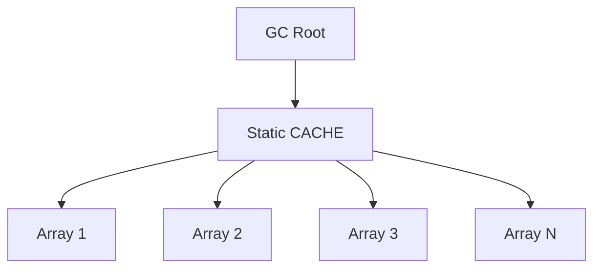

이처럼 객체가 더 이상 비즈니스적으로 필요하지 않더라도 참조가 유지된다면 GC가 회수하지 못할 수 있다.

따라서 Java의 메모리 누수 문제를 분석할 때는 단순히 GC가 정상적으로 동작하는지뿐 아니라 **어떤 객체가 불필요한 참조를 유지하고 있는지** 확인해야 한다.

---

### Old Generation이 계속 증가하면 무엇을 확인해야 할까?

Old Generation 사용량이 증가하는 상황은 여러 원인으로 발생할 수 있다.

대표적으로 다음과 같은 경우가 있다.

#### 1. 장기간 유지되는 캐시 증가

캐시의 최대 크기나 만료 정책이 없다면 객체가 계속 누적될 수 있다.

#### 2. Static Collection 사용

Static Map이나 List에 데이터를 지속적으로 추가하면 애플리케이션 실행 동안 객체가 유지될 수 있다.

#### 3. ThreadLocal 정리 누락

Thread Pool의 스레드는 오랫동안 재사용될 수 있다.

`ThreadLocal`에 저장한 객체를 적절히 정리하지 않으면 장기간 참조가 유지될 수 있다.

#### 4. 이벤트 리스너 등록 해제 누락

이벤트 리스너나 콜백을 등록한 뒤 해제하지 않으면 관련 객체가 예상보다 오래 유지될 수 있다.

#### 5. 대량 데이터의 장기 보관

대용량 조회 결과를 List에 저장한 뒤 오랫동안 참조하면 Old Generation 사용량이 증가할 수 있다.

#### 6. 객체 할당 속도가 GC 처리 능력보다 빠른 경우

실제로 메모리 누수가 없더라도 객체 생성과 Promotion이 지나치게 빠르면 Old Generation에 메모리 압박이 발생할 수 있다.

따라서 Old Generation 사용량이 증가한다는 사실만으로 Memory Leak이라고 단정해서는 안 된다.

**GC 이후에도 살아 있는 객체의 양이 지속적으로 증가하는지** 확인하는 것이 중요하다.

---

### GC 이후 Heap 사용량이 중요한 이유

다음 두 가지 메모리 사용 패턴을 비교해 보자.

#### 정상적인 메모리 사용 패턴

```text
Heap 사용량

20MB → 80MB → GC → 25MB

25MB → 90MB → GC → 28MB

28MB → 85MB → GC → 27MB
```

객체 생성으로 Heap 사용량이 증가한다.

하지만 GC 이후에는 비슷한 수준으로 돌아온다.

이는 회수할 수 있는 객체가 정상적으로 회수되고 있다는 신호일 수 있다.

#### 메모리 누수가 의심되는 패턴

```text
Heap 사용량

20MB → 80MB → GC → 40MB

40MB → 100MB → GC → 65MB

65MB → 120MB → GC → 90MB
```

GC 이후에도 남아 있는 메모리 사용량이 계속 증가한다.

이 경우 살아 있는 객체의 수가 증가하고 있을 가능성이 있다.

다만 캐시 워밍업이나 정상적인 사용자 증가 등으로도 이러한 패턴이 발생할 수 있다.

따라서 비즈니스 트래픽과 캐시 정책 등을 함께 고려해야 한다.

---

### OutOfMemoryError와 GC의 관계

GC가 존재하더라도 JVM은 OutOfMemoryError를 발생시킬 수 있다.

대표적인 예는 다음과 같다.

```text
java.lang.OutOfMemoryError: Java heap space
```

이 오류는 Java Heap에서 객체를 할당하는 데 필요한 메모리를 확보하지 못했을 때 발생할 수 있다.

하지만 OutOfMemoryError가 발생했다고 해서 반드시 GC가 고장 났다는 의미는 아니다.

예를 들어 모든 객체가 여전히 접근 가능한 상태라면 GC를 수행해도 충분한 메모리를 회수할 수 없다.

```text
Heap 사용량 증가

↓

GC 수행

↓

대부분 객체가 살아 있음

↓

회수 가능한 공간 부족

↓

객체 할당 실패

↓

OutOfMemoryError
```

또 Java의 OutOfMemoryError는 Heap 이외의 메모리 문제와도 관련될 수 있다.

대표적으로 다음과 같은 종류가 있다.

| 오류 유형 | 주요 원인 |
|---|---|
| Java heap space | Heap 메모리 부족 |
| Metaspace | 클래스 메타데이터 저장 공간 부족 |
| Direct buffer memory | Direct Buffer 메모리 부족 |
| unable to create native thread | 스레드 생성에 필요한 자원 부족 |
| GC overhead limit exceeded | 과도한 GC 수행에도 충분한 메모리 회수 실패 |

따라서 OutOfMemoryError를 분석할 때는 오류 메시지의 종류부터 구분해야 한다.

Heap 크기만 무조건 증가시키는 것이 올바른 해결 방법은 아니다.

---

### Heap Dump란 무엇인가?

Heap Dump는 특정 시점의 Heap 객체 상태를 분석할 수 있도록 저장한 데이터다.

어떤 객체가 얼마나 많이 존재하는지, 어떤 객체가 다른 객체를 참조하고 있는지 확인하는 데 활용한다.

예를 들어 다음과 같은 상황을 생각해 보자.

```text
HashMap 객체

↓

수백만 개의 Entry

↓

대량의 String 객체

↓

Heap 사용량 증가
```

Heap Dump를 분석하면 어떤 객체가 메모리를 많이 차지하고 있으며 어떤 참조 관계 때문에 회수되지 않는지 파악하는 데 도움이 된다.

Java에서는 OutOfMemoryError가 발생했을 때 Heap Dump를 생성하도록 설정할 수 있다.

```bash
java \
  -Xmx2g \
  -XX:+HeapDumpOnOutOfMemoryError \
  -XX:HeapDumpPath=/var/log/app \
  -jar app.jar
```

각 옵션의 의미는 다음과 같다.

| 옵션 | 의미 |
|---|---|
| `-Xmx2g` | 최대 Heap 크기 2GB |
| `-XX:+HeapDumpOnOutOfMemoryError` | OutOfMemoryError 발생 시 Heap Dump 생성 |
| `-XX:HeapDumpPath` | Dump 저장 경로 지정 |

Heap Dump 파일은 크기가 매우 클 수 있다.

또 사용자 정보와 인증 관련 값 등의 민감한 데이터가 포함될 수 있으므로 접근 권한과 보관 정책을 신중하게 관리해야 한다.

운영 환경에서는 Dump 파일을 생성할 수 있는 충분한 디스크 공간도 필요하다.

---

### GC 성능을 분석할 때 어떤 지표를 봐야 할까?

GC 성능은 하나의 숫자로 평가하기 어렵다.

대표적으로 세 가지 관점이 중요하다.

#### 1. Throughput

전체 실행 시간 중 애플리케이션이 실제 작업을 수행하는 비율과 관련된 지표다.

GC 작업에 많은 시간이 사용되면 애플리케이션 처리량이 감소할 수 있다.

#### 2. Latency

GC로 인해 애플리케이션 작업이 지연되는 정도와 관련된 지표다.

특히 응답 시간이 중요한 웹 서비스에서는 GC 일시 중단 시간이 중요하다.

#### 3. Memory Footprint

애플리케이션이 사용하는 전체 메모리 크기와 관련된 지표다.

Collector에 따라 GC 메타데이터와 객체 이동을 위한 여유 공간이 추가로 필요할 수 있다.

이 세 가지는 서로 트레이드오프 관계를 가질 수 있다.

예를 들어 GC 중단 시간을 줄이기 위해 동시 작업을 증가시키면 CPU 사용량이 증가할 수 있다.

반대로 GC 작업을 단순하게 수행하면 처리량은 높을 수 있지만 일시 중단 시간이 길어질 수 있다.

따라서 애플리케이션의 요구사항에 맞는 균형점을 찾아야 한다.

---

### Spring Boot에서 GC를 고려해야 하는 상황

Spring Boot 애플리케이션에서는 다음과 같은 객체들이 자주 생성된다.

```text
HTTP Request

↓

Request DTO

↓

Validation Object

↓

Service Logic

↓

Repository Result

↓

Response DTO

↓

JSON Serialization
```

이 과정에서 임시 객체와 컬렉션, 문자열 등이 생성될 수 있다.

또 대량 조회 API에서는 많은 데이터를 한 번에 메모리에 올리는 문제가 발생할 수 있다.

예를 들어 다음 코드를 생각해 보자.

```java
public List<OrderResponse> findAllOrders() {

    return orderRepository.findAll()
            .stream()
            .map(OrderResponse::from)
            .toList();
}
```

주문 데이터가 수백만 건이라면 문제가 발생할 수 있다.

데이터베이스에서 조회한 Entity와 응답 DTO가 대량으로 생성될 수 있기 때문이다.

이러한 경우에는 GC 옵션을 변경하기 전에 데이터 조회 방식부터 검토하는 것이 좋다.

대표적인 개선 방법은 다음과 같다.

- Pagination 적용
- 필요한 컬럼만 조회
- DTO Projection 활용
- 대량 데이터의 Streaming 처리
- 불필요한 중간 컬렉션 생성 감소
- 응답 데이터 크기 제한

GC 튜닝은 중요하지만 **객체를 지나치게 많이 생성하는 애플리케이션 구조 자체를 개선하는 것이 더 효과적일 수 있다.**

---

### 백엔드 실무에서 활용할 수 있는 12가지 GC 최적화 전략

GC를 이해한 뒤에는 실제 서비스에서 어떤 방식으로 활용할 수 있는지 생각해 볼 필요가 있다.

#### 1. GC 종류를 변경하기 전에 실제 병목을 확인한다

애플리케이션의 응답 시간이 느려졌다고 해서 반드시 GC가 원인인 것은 아니다.

데이터베이스 쿼리나 외부 API, 락 경합, 스레드 풀 부족 등 다양한 원인이 존재할 수 있다.

따라서 GC 로그와 애플리케이션 메트릭을 함께 분석해야 한다.

특히 GC Pause Time이 API 응답 지연과 같은 시점에 증가하는지 확인하는 것이 중요하다.

#### 2. Full GC 발생 여부를 우선적으로 확인한다

G1 GC 환경에서 Full GC가 반복된다면 메모리 압박이 심각할 수 있다.

예를 들어 GC 로그에 다음과 같은 형태가 나타날 수 있다.

```text
Pause Full (G1 Compaction Pause)
```

이 경우 Full GC 발생 전후의 Heap 사용량과 객체 할당 속도, Concurrent Marking 상태 등을 확인해야 한다.

Full GC가 발생하는 원인을 파악하지 않고 Heap 크기만 증가시키면 문제가 반복될 수 있다.

#### 3. Old Generation의 증가 추세를 관찰한다

Old Generation 사용량이 계속 증가하면 장기간 유지되는 객체가 많아지고 있다는 의미일 수 있다.

하지만 정상적인 캐시 증가일 수도 있으므로 GC 이후의 사용량 추세를 함께 확인해야 한다.

#### 4. 대량 데이터 조회 시 메모리 사용량을 제한한다

한 번에 수백만 건을 조회하는 API나 배치 작업은 대량의 객체를 생성할 수 있다.

이러한 구조는 GC 부담을 증가시킬 수 있다.

따라서 Pagination이나 Chunk Processing을 고려할 수 있다.

Spring Batch를 사용하는 경우에는 Chunk 크기를 적절하게 조정해 메모리 사용량과 트랜잭션 처리량 사이의 균형을 찾는 것이 중요하다.

#### 5. 캐시의 최대 크기와 만료 정책을 설정한다

캐시는 조회 성능을 개선할 수 있다.

하지만 캐시가 무제한 증가하면 GC가 회수할 수 없는 객체가 계속 누적된다.

따라서 캐시를 설계할 때는 다음 요소를 고려해야 한다.

```text
Maximum Size

TTL

Eviction Policy

Cache Hit Ratio

Memory Usage
```

로컬 캐시를 사용한다면 Caffeine과 같은 라이브러리의 크기 제한 및 만료 정책을 활용할 수 있다.

#### 6. ThreadLocal 사용 후 정리한다

Thread Pool에서 사용하는 스레드는 오랫동안 유지될 수 있다.

따라서 ThreadLocal에 저장된 값도 예상보다 오래 참조될 수 있다.

다음과 같은 패턴을 사용할 수 있다.

```java
try {

    REQUEST_CONTEXT.set(context);

    processRequest();

} finally {

    REQUEST_CONTEXT.remove();
}
```

이렇게 하면 요청 처리 이후 ThreadLocal에 남아 있는 참조를 정리할 수 있다.

다만 ThreadLocal의 실제 동작은 스레드의 생명주기와 내부 참조 구조에 따라 달라지므로 필요한 범위에서만 사용하는 것이 좋다.

#### 7. 큰 배열의 반복 생성을 줄인다

대용량 파일이나 이미지, 네트워크 데이터를 처리하는 과정에서 큰 배열을 반복적으로 생성하면 Heap 사용량과 GC 부담이 증가할 수 있다.

특히 G1 GC에서는 Humongous Object의 할당과 회수가 중요한 문제가 될 수 있다.

따라서 데이터를 한 번에 모두 메모리에 올리는 방식 대신 Streaming이나 적절한 버퍼 관리 전략을 고려할 수 있다.

#### 8. 불필요한 객체 생성을 줄인다

객체 생성은 일반적으로 빠르지만 매우 높은 빈도로 반복되면 GC 부담이 증가할 수 있다.

예를 들어 반복문 내부에서 불필요한 중간 컬렉션을 생성하는 구조를 검토할 수 있다.

다만 작은 객체를 무조건 재사용하도록 변경하는 것은 오히려 복잡성을 증가시킬 수 있다.

먼저 프로파일링을 통해 실제 객체 할당이 병목인지 확인해야 한다.

#### 9. JVM Heap 크기를 적절하게 설정한다

Heap 크기가 너무 작으면 GC가 자주 발생할 수 있다.

반대로 지나치게 크면 메모리 사용량이 증가하고 특정 Collector에서는 회수 작업의 비용도 증가할 수 있다.

따라서 다음 요소를 고려해야 한다.

```text
트래픽

객체 할당 속도

살아 있는 객체의 크기

GC 중단 시간

컨테이너 메모리 제한

Heap 외부 메모리 사용량
```

특히 Kubernetes나 Docker 환경에서는 JVM Heap뿐 아니라 프로세스 전체의 메모리 사용량을 고려해야 한다.

#### 10. G1 GC의 기본 설정부터 측정한다

G1 GC는 애플리케이션의 메모리 사용 패턴을 관찰해 여러 설정을 자동으로 조정한다.

따라서 초기부터 많은 JVM 옵션을 수동으로 설정하는 것이 항상 좋은 것은 아니다.

먼저 기본 설정에서 GC 로그와 응답 시간을 측정한 뒤 문제가 확인된 항목을 중심으로 조정하는 것이 좋다.

Oracle의 G1 튜닝 문서에서도 기본 설정을 출발점으로 사용하고 실제 문제가 확인되었을 때 조정하는 접근을 권장한다.

#### 11. 지연 시간이 중요한 서비스에서는 ZGC를 비교한다

결제나 실시간 API처럼 Tail Latency가 중요한 서비스에서는 ZGC를 고려할 수 있다.

하지만 Collector 변경 전후에 다음 지표를 비교해야 한다.

```text
p95 / p99 Latency

GC Pause Time

CPU Usage

Heap Usage

Throughput
```

단순히 GC Pause Time만 줄어들었다고 전체 서비스 성능이 좋아졌다고 판단해서는 안 된다.

#### 12. GC 튜닝과 애플리케이션 구조 개선을 구분한다

GC 성능 문제를 해결하는 방법은 크게 두 가지다.

첫 번째는 JVM 설정을 조정하는 것이다.

두 번째는 애플리케이션이 객체를 생성하고 유지하는 방식을 개선하는 것이다.

예를 들어 캐시가 무제한 증가하는 구조라면 Heap을 증가시키거나 ZGC를 사용하는 것만으로 근본적인 문제가 해결되지 않는다.

캐시의 생명주기와 크기 제한을 개선해야 한다.

따라서 GC 튜닝은 애플리케이션의 메모리 관리 정책과 함께 수행하는 것이 중요하다.

---

### GC 문제를 분석하는 순서

운영 환경에서 메모리 문제가 발생했다면 다음과 같은 순서로 접근할 수 있다.

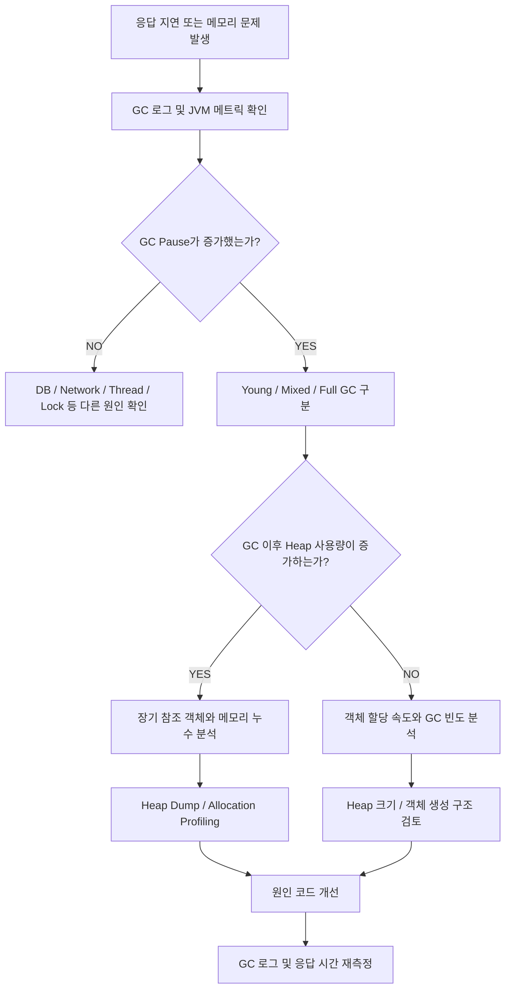

이 과정에서 중요한 것은 원인을 확인하기 전에 JVM 옵션부터 변경하지 않는 것이다.

GC는 애플리케이션의 객체 생성 패턴과 밀접하게 연결되어 있다.

따라서 JVM 메모리 사용량과 실제 코드의 동작을 함께 분석해야 한다.

---

### GC를 이해할 때 자주 혼동하는 개념

| 오해하기 쉬운 설명 | 정확한 이해 |
|---|---|
| GC는 사용하지 않는 객체를 즉시 제거한다 | 접근할 수 없는 객체가 회수 대상이 되며 실제 회수 시점은 JVM이 결정 |
| GC는 모든 Java 메모리를 관리한다 | 주로 관리 Heap을 대상으로 하며 Native Memory 등은 별도 관리가 필요 |
| GC가 있으면 Memory Leak이 발생하지 않는다 | 불필요한 객체가 계속 참조되면 누수가 발생할 수 있음 |
| 객체를 null로 만들면 즉시 GC된다 | 다른 참조가 남아 있을 수 있고 GC도 즉시 실행되지 않음 |
| 참조 카운트가 0이면 Java GC가 제거한다 | HotSpot은 일반적으로 GC Root 기반 추적 방식을 활용 |
| 모든 GC에서 STW가 발생한다 | Collector에 따라 상당 부분을 Concurrent하게 수행할 수 있음 |
| Minor GC는 Eden만 회수한다 | Young Generation의 수집 대상을 함께 처리할 수 있음 |
| 객체는 항상 Survivor를 거쳐 Old로 이동한다 | Survivor 공간 및 GC 정책 등에 따라 직접 Promotion될 수 있음 |
| Old Generation에서는 Copying을 사용하지 않는다 | G1 GC 등은 Old Region에서도 객체 이동을 수행 |
| Major GC와 Full GC는 동일하다 | Collector에 따라 의미가 달라질 수 있음 |
| GC 횟수가 많으면 성능이 나쁘다 | 중단 시간과 처리량, GC 이후 Heap 사용량을 함께 확인해야 함 |
| Heap을 늘리면 모든 OOM이 해결된다 | 누수나 Heap 외부 메모리 문제라면 다른 대응이 필요 |

---

### GC 알고리즘과 JVM Collector의 관계

GC를 이해할 때는 알고리즘과 Collector를 구분하는 것이 중요하다.

알고리즘은 메모리를 어떻게 회수할 것인지에 대한 원리를 의미한다.

Collector는 이러한 원리를 실제 JVM에서 구현한 구성 요소다.

예를 들어 다음과 같다.

```text
GC Algorithms

├── Reference Counting
├── Mark-Sweep
├── Mark-Compact
└── Copying GC
```

반면 실제 JVM의 Collector는 다음과 같다.

```text
Garbage Collectors

├── Serial GC
├── Parallel GC
├── G1 GC
└── ZGC
```

하나의 Collector는 여러 알고리즘을 조합해 사용할 수 있다.

따라서 G1 GC가 Copying GC인지 Mark-Sweep인지 하나만 선택해서 설명하는 것은 적절하지 않다.

G1 GC는 Marking과 Evacuation 등의 기법을 조합한다.

ZGC 역시 동시 Marking과 객체 이동 등 다양한 메커니즘을 활용한다.

즉 알고리즘은 원리이고 Collector는 실제 구현이다.

---

### 전체 GC 동작 구조

지금까지 살펴본 내용을 하나의 흐름으로 정리해 보자.

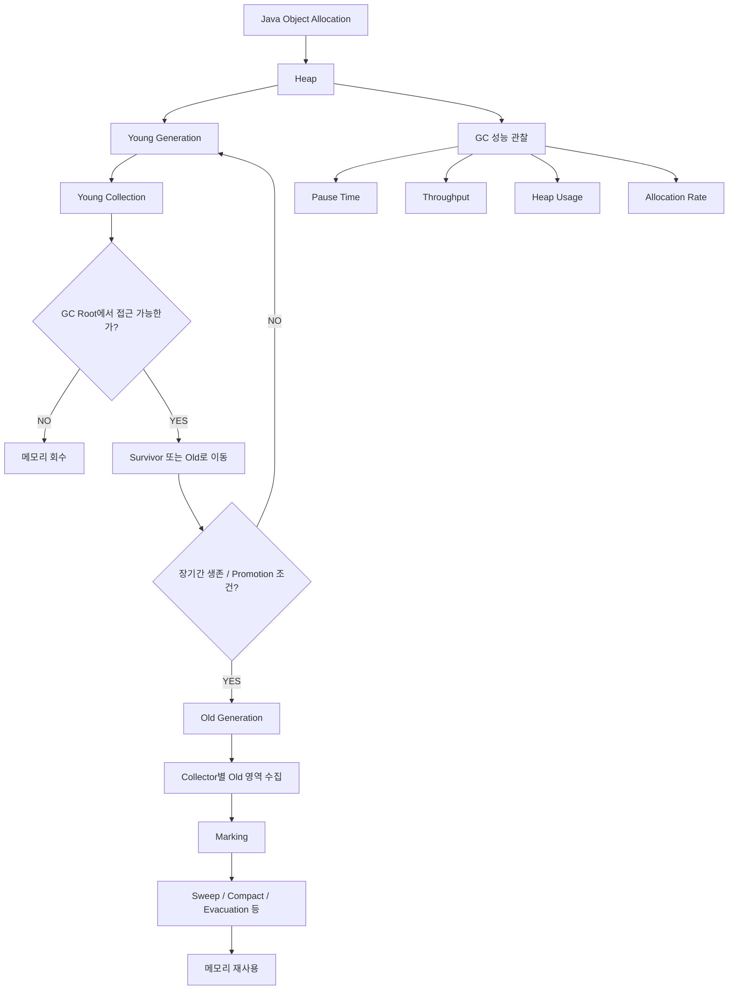

이 구조에서 핵심은 다음과 같다.

첫째, 객체는 Heap에 할당된다.

둘째, GC는 객체의 접근 가능성을 판단한다.

셋째, 회수 대상 객체의 메모리를 확보한다.

넷째, 살아 있는 객체는 Collector의 정책에 따라 이동하거나 유지될 수 있다.

다섯째, 실제 GC 방식은 선택한 Collector에 따라 달라진다.

여섯째, GC가 수행되는 동안 CPU와 메모리 등의 비용이 발생한다.

따라서 GC 성능은 애플리케이션의 객체 생성 패턴과 Collector의 동작 방식이 함께 결정한다.

---

### 정리

Garbage Collection은 프로그램에서 더 이상 접근할 수 없는 객체의 메모리를 자동으로 회수하는 메모리 관리 기법이다.

Java에서는 일반적인 객체의 메모리를 개발자가 직접 해제할 필요가 없다.

JVM이 객체의 접근 가능성을 분석하고 적절한 시점에 메모리를 회수한다.

이러한 방식은 메모리 관리 실수를 줄이고 개발자가 비즈니스 로직에 집중할 수 있도록 돕는다.

하지만 GC는 무료로 수행되는 작업이 아니다.

객체 탐색과 참조 분석, 객체 이동, 메모리 회수 등에 CPU와 메모리 비용이 발생한다.

또 일부 GC 단계에서는 Stop-The-World가 발생할 수 있다.

따라서 GC를 이해하려면 메모리를 회수하는 원리와 성능 비용을 함께 살펴봐야 한다.

GC의 기본 알고리즘 중 하나는 Reference Counting이다.

Reference Counting은 객체를 참조하는 횟수를 관리하고 참조 카운트가 0이 되면 객체를 회수하는 방식이다.

이 방식은 이해하기 쉽지만 순환 참조 문제가 존재한다.

두 객체가 서로 참조하는 경우 외부에서 접근할 수 없더라도 참조 카운트가 0이 되지 않을 수 있다.

Java HotSpot의 일반적인 GC에서는 이러한 문제를 해결하기 위해 GC Root로부터의 접근 가능성을 추적하는 방식을 활용한다.

GC Root는 JVM이 살아 있는 객체를 찾기 위해 탐색을 시작하는 기준점이다.

GC Root에서 참조를 따라 도달할 수 있는 객체는 살아 있는 객체로 판단한다.

반면 GC Root에서 접근할 수 없는 객체는 회수 대상이 될 수 있다.

Mark-Sweep은 이러한 접근 가능성을 이용하는 알고리즘이다.

먼저 살아 있는 객체를 표시하는 Mark 단계를 수행한다.

이후 표시되지 않은 객체의 메모리를 회수하는 Sweep 단계를 수행한다.

이 방식은 순환 참조 문제를 해결할 수 있지만 메모리 단편화가 발생할 수 있다.

Mark-Compact는 살아 있는 객체를 표시한 뒤 한쪽으로 압축해 연속된 빈 공간을 확보하는 방식이다.

메모리 단편화를 완화할 수 있지만 객체 이동과 참조 갱신 비용이 발생한다.

Copying GC는 살아 있는 객체만 다른 공간으로 복사하는 방식이다.

죽은 객체가 많은 상황에서는 복사해야 하는 객체가 적기 때문에 효율적일 수 있다.

또 살아 있는 객체를 연속적으로 배치할 수 있어 단편화 문제를 줄일 수 있다.

하지만 살아 있는 객체가 많다면 객체 복사 비용이 증가할 수 있다.

이러한 알고리즘의 특성을 바탕으로 세대별 GC가 발전했다.

Generational GC는 객체의 수명에 따른 특성을 활용해 Heap을 Young Generation과 Old Generation으로 구분해 관리한다.

Young Generation은 주로 새롭게 생성된 객체를 관리한다.

전통적인 구조에서는 Eden과 Survivor 영역으로 나누어 설명할 수 있다.

새로운 객체는 일반적으로 Eden에 할당된다.

Young GC가 발생하면 살아 있는 객체가 Survivor 영역이나 Old Generation으로 이동할 수 있다.

객체가 Young GC에서 살아남으면 Age가 증가할 수 있다.

일정한 조건을 만족하면 Old Generation으로 Promotion된다.

하지만 모든 객체가 반드시 Survivor 영역을 여러 번 거친 뒤 Old Generation으로 이동하는 것은 아니다.

Promotion은 객체의 Age와 Survivor 공간, Collector 정책 등에 영향을 받는다.

Old Generation은 상대적으로 오래 살아남은 객체를 관리한다.

전통적인 GC에서는 Mark-Sweep 또는 Mark-Compact 등의 알고리즘을 사용할 수 있다.

하지만 현대적인 G1 GC에서는 Old Region의 살아 있는 객체를 다른 Region으로 이동시키는 Evacuation을 수행할 수도 있다.

따라서 Young Generation은 Copying GC, Old Generation은 Mark-Sweep이라고 단순히 구분하는 것은 현대적인 JVM을 설명하기에 충분하지 않다.

또 Minor GC와 Major GC, Full GC는 구분해야 한다.

Minor GC는 일반적으로 Young Generation을 대상으로 수행되는 GC를 의미한다.

Major GC는 Old Generation과 관련된 GC를 의미하지만 Collector마다 용어의 사용이 달라질 수 있다.

Full GC는 일반적으로 전체 Heap을 대상으로 하는 광범위한 수집 작업을 의미한다.

특히 Full GC는 긴 Stop-The-World와 관련될 수 있으므로 운영 환경에서 주의해야 한다.

Java에서는 여러 Garbage Collector를 사용할 수 있다.

Serial GC는 단일 GC 스레드를 중심으로 동작하는 단순한 Collector다.

Parallel GC는 여러 GC 스레드를 활용해 높은 처리량을 추구한다.

G1 GC는 Heap을 Region 단위로 관리하며 수집 효율과 일시 중단 시간을 고려해 수집 대상을 선택한다.

또 Concurrent Marking과 Young/Mixed Collection 등을 활용한다.

ZGC는 매우 짧은 GC 중단 시간을 목표로 설계되었다.

GC 작업의 상당 부분을 애플리케이션과 동시에 수행한다.

Java 21에서는 Generational ZGC가 도입되었다.

Java 23에서는 세대별 모드가 ZGC의 기본값이 되었으며 Java 24에서는 비세대별 모드가 제거되었다.

따라서 ZGC를 사용할 때는 Java 버전에 따른 옵션과 동작 차이를 확인해야 한다.

마지막으로 GC는 자동 메모리 관리 기능이지만 Java에서도 Memory Leak이 발생할 수 있다.

객체가 더 이상 비즈니스적으로 필요하지 않더라도 Static Collection이나 ThreadLocal, 캐시 등의 참조가 유지된다면 GC가 해당 객체를 회수하지 못할 수 있다.

따라서 메모리 문제를 분석할 때는 GC의 동작뿐 아니라 애플리케이션의 객체 참조 구조도 함께 확인해야 한다.

실무에서는 GC 로그와 Heap 사용량, GC 이후 메모리 회수량, Old Generation 증가 추세, 응답 시간 등을 함께 분석해야 한다.

특히 GC를 튜닝하기 전에 실제 객체 생성 및 보관 구조에 문제가 없는지 확인하는 것이 중요하다.

핵심 개념을 정리하면 다음과 같다.

| 개념 | 핵심 의미 |
|---|---|
| GC | 접근할 수 없는 객체의 메모리를 자동 회수 |
| GC Root | 객체 접근 가능성 분석의 출발점 |
| Reachability | GC Root에서 객체까지 도달 가능한지 여부 |
| Reference Counting | 참조 횟수를 이용한 메모리 관리 |
| Circular Reference | 객체들이 서로 참조하는 구조 |
| Mark-Sweep | 살아 있는 객체 표시 후 나머지 회수 |
| Mark-Compact | 살아 있는 객체를 모아 단편화 완화 |
| Copying GC | 살아 있는 객체만 다른 공간으로 복사 |
| Stop-The-World | 애플리케이션 스레드 일시 중단 |
| Concurrent GC | 애플리케이션과 GC 작업을 동시에 수행 |
| Parallel GC 작업 | 여러 GC 스레드가 동시에 작업 |
| Generational GC | 객체 수명에 따라 세대별로 메모리 관리 |
| Young Generation | 상대적으로 새로 생성된 객체 관리 |
| Eden | 일반적인 신규 객체 할당 영역 |
| Survivor | Young GC에서 살아남은 객체 관리 |
| Age | Young GC 생존 횟수와 관련된 정보 |
| Promotion | Young에서 Old로 객체 이동 |
| Old Generation | 상대적으로 오래 살아남은 객체 관리 |
| Minor GC | Young Generation 중심의 수집 |
| Major GC | Old Generation 관련 수집을 가리키는 용어 |
| Full GC | 전체 Heap을 대상으로 하는 광범위한 수집 |
| G1 GC | Region 기반의 범용 Garbage Collector |
| Mixed GC | Young과 일부 Old Region을 함께 수집 |
| Remembered Set | Region 외부에서 내부로 들어오는 참조 추적 지원 |
| Evacuation | 살아 있는 객체를 다른 Region으로 이동 |
| Humongous Object | G1에서 특별하게 관리하는 대형 객체 |
| ZGC | 짧은 GC 중단 시간을 지향하는 Collector |
| Heap Dump | 특정 시점의 Heap 객체 상태 분석 데이터 |
| Memory Leak | 불필요한 객체가 계속 유지되는 등의 메모리 관리 문제 |
| OutOfMemoryError | 필요한 메모리나 자원을 확보하지 못하는 오류 |

결국 GC를 제대로 이해한다는 것은 단순히 JVM이 알아서 메모리를 정리한다는 사실을 아는 것에 그치지 않는다.

**어떤 객체가 회수 대상이 되는지, 어떤 알고리즘으로 메모리를 회수하는지, 살아 있는 객체는 왜 이동하는지, 세대별 관리가 왜 필요한지, GC가 애플리케이션 성능에 어떤 영향을 주는지까지 이해해야 한다.**

또 현대적인 JVM에서는 하나의 GC 알고리즘만 사용하는 것이 아니라 여러 기법을 결합해 메모리 관리 효율과 응답 지연, 처리량 사이의 균형을 맞춘다.

따라서 운영 환경에서는 GC 종류를 변경하거나 Heap 크기를 증가시키기 전에 실제 메모리 사용 패턴과 GC 로그를 분석하는 것이 중요하다.

GC는 Java 개발자가 직접 메모리를 해제하지 않아도 되도록 돕는 기능이지만, 효율적인 메모리 사용과 애플리케이션 성능까지 자동으로 보장하는 것은 아니다.

#### 한 줄 요약

**Java GC는 GC Root로부터의 접근 가능성을 기준으로 불필요한 객체를 찾아 메모리를 회수하며, Mark-Sweep·Mark-Compact·Copying 등의 알고리즘을 활용한다. JVM은 세대별 메모리 관리로 객체의 수명에 맞는 수집 전략을 적용하고, G1 GC와 ZGC 같은 현대적인 Collector를 통해 처리량과 중단 시간을 조절한다. 실무에서는 GC의 발생 횟수보다 실제 Pause Time과 GC 이후 Heap 사용량, 객체 할당 및 참조 구조를 함께 분석하는 것이 중요하다.**
