# 후유의 불변 객체와 final
[https://youtu.be/u4ulaQ4-dw4?si=0_3haiiWhic1bMXw](https://youtu.be/u4ulaQ4-dw4?si=0_3haiiWhic1bMXw)

# 후유의 불변 객체와 final
* toc
{:toc}

---

### Java 불변 객체와 final 완벽 이해: Call by Value, 참조 타입, 방어적 복사와 깊은 불변성

Java에서 객체를 설계할 때 `final` 키워드를 자주 사용한다.

특히 객체의 상태가 변경되지 않도록 만들고 싶을 때 다음과 같이 작성하는 경우가 많다.

```java
public class Person {

    private final int age;

    public Person(int age) {
        this.age = age;
    }

    public int getAge() {
        return age;
    }
}
```

이 클래스에서 `age` 필드는 `final`로 선언되어 있다.

따라서 생성자에서 한 번 초기화한 이후에는 다른 값을 할당할 수 없다.

```java
public void changeAge(int age) {
    this.age = age;
}
```

위 코드는 컴파일 오류가 발생한다.

그렇다면 `final`을 사용한 객체는 모두 불변 객체일까?

다음 코드를 살펴보자.

```java
public class Person {

    private final List<Integer> numbers;

    public Person(List<Integer> numbers) {
        this.numbers = numbers;
    }

    public List<Integer> getNumbers() {
        return numbers;
    }
}
```

이번에도 필드는 `final`이다.

하지만 다음 코드가 실행된다.

```java
List<Integer> numbers = new ArrayList<>();

numbers.add(10);
numbers.add(20);

Person person = new Person(numbers);

numbers.add(30);

System.out.println(person.getNumbers());
```

실행 결과는 다음과 같다.

```text
[10, 20, 30]
```

`Person` 내부의 필드를 직접 변경하지 않았는데도 객체가 보유한 데이터가 변경되었다.

심지어 다음과 같이 Getter를 통해서도 상태를 변경할 수 있다.

```java
person.getNumbers().add(40);

System.out.println(person.getNumbers());
```

실행 결과는 다음과 같다.

```text
[10, 20, 30, 40]
```

`final` 필드인데 어떻게 이런 일이 가능한 것일까?

이 문제를 이해하려면 다음 개념들을 구분해야 한다.

- `final`이 실제로 제한하는 대상
- Java의 Call by Value 동작 방식
- 원시 타입과 참조 타입의 차이
- 객체의 상태와 참조의 차이
- 얕은 불변성과 깊은 불변성
- 방어적 복사가 필요한 이유
- 변경 불가능한 컬렉션과 불변 객체의 차이

핵심은 다음 한 문장으로 정리할 수 있다.

**`final`은 변수의 재할당을 제한하는 키워드이지, 해당 변수가 참조하는 객체의 내부 상태까지 자동으로 불변으로 만들어 주는 기능이 아니다.**

이 차이를 이해하면 Java에서 안전한 불변 객체를 설계하는 방법도 자연스럽게 이해할 수 있다.

---

### 개념

#### 불변 객체란 무엇인가?

불변 객체(Immutable Object)는 생성된 이후 외부에서 관찰할 수 있는 상태가 변경되지 않는 객체를 의미한다.

예를 들어 다음과 같은 객체를 생각해 보자.

```java
public final class Money {

    private final long amount;

    public Money(long amount) {

        if (amount < 0) {
            throw new IllegalArgumentException(
                    "금액은 음수일 수 없습니다."
            );
        }

        this.amount = amount;
    }

    public long getAmount() {
        return amount;
    }
}
```

`Money` 객체를 생성한다.

```java
Money money = new Money(10000);
```

이 객체가 가지고 있는 금액은 10,000원이다.

객체가 생성된 이후에는 금액을 변경하는 메서드가 존재하지 않는다.

또 `amount`는 원시 타입인 `long`이고 `final`로 선언되어 있다.

따라서 일반적인 Java 코드로는 객체의 금액을 변경할 수 없다.

```text
Money 객체 생성

amount = 10000

↓

객체 외부에서 상태 변경 불가
```

이러한 객체를 불변 객체라고 한다.

단, 불변 객체라고 해서 모든 필드가 반드시 원시 타입이어야 하는 것은 아니다.

참조 타입을 사용하더라도 해당 객체의 상태가 변경되지 않도록 설계할 수 있다.

중요한 것은 **객체가 생성된 이후 관찰 가능한 상태가 변경되지 않는다는 사실**이다.

#### 가변 객체란 무엇인가?

가변 객체(Mutable Object)는 생성된 이후 상태를 변경할 수 있는 객체다.

예를 들어 다음과 같다.

```java
public class Money {

    private long amount;

    public Money(long amount) {
        this.amount = amount;
    }

    public void changeAmount(long amount) {
        this.amount = amount;
    }

    public long getAmount() {
        return amount;
    }
}
```

이 객체는 생성 이후에도 금액을 변경할 수 있다.

```java
Money money = new Money(10000);

money.changeAmount(20000);

System.out.println(money.getAmount());
```

실행 결과는 다음과 같다.

```text
20000
```

불변 객체와 가변 객체의 차이를 정리하면 다음과 같다.

| 구분 | 불변 객체 | 가변 객체 |
|---|---|---|
| 생성 이후 상태 변경 | 불가능 | 가능 |
| 상태 변경 메서드 | 기존 객체를 변경하지 않음 | 기존 객체를 변경할 수 있음 |
| 공유 시 상태 변경 위험 | 낮음 | 공유 상태 관리 필요 |
| 동시성 관리 | 상대적으로 단순 | 동기화가 필요할 수 있음 |
| 대표적인 예 | String, LocalDate | ArrayList, HashMap, StringBuilder |
| 주요 활용 | 값 객체, 설정, 스냅샷 | 상태 관리 객체, 컬렉션 |

여기서 주의할 점이 있다.

불변 객체가 언제나 가변 객체보다 우수한 것은 아니다.

상태 변경이 객체의 핵심 책임이라면 가변 객체가 더 자연스러울 수 있다.

반면 값 자체를 표현하거나 여러 곳에서 안전하게 공유해야 하는 객체라면 불변 객체가 유리할 수 있다.

---

### 왜 불변 객체를 사용하는가?

불변 객체를 사용하는 가장 중요한 이유는 객체의 상태 변경으로 인한 복잡성을 줄이기 위해서다.

예를 들어 다음과 같은 상황을 생각해 보자.

```java
Member member = memberService.findMember(100L);
```

`member` 객체를 여러 서비스가 참조한다고 가정하자.

```text
Member 객체
    │
    ├── PaymentService
    │
    ├── CouponService
    │
    └── NotificationService
```

이 객체가 가변 객체라면 한 서비스에서 상태를 변경했을 때 다른 서비스에도 영향을 줄 수 있다.

```java
member.changeEmail("changed@example.com");
```

다른 서비스가 동일한 객체를 참조하고 있다면 변경된 이메일을 관찰할 수 있다.

이러한 공유 상태는 예상하지 못한 부작용을 발생시킬 수 있다.

반면 불변 객체에서는 기존 객체의 상태를 변경할 수 없다.

값을 변경하려면 새로운 객체를 생성해야 한다.

```java
MemberSnapshot updated = new MemberSnapshot(
        member.id(),
        member.name(),
        "changed@example.com"
);
```

기존 객체와 새로운 객체는 서로 다른 상태를 표현한다.

```text
기존 객체
email = original@example.com

새로운 객체
email = changed@example.com
```

기존 객체를 참조하는 다른 코드는 영향을 받지 않는다.

이러한 특성은 다음과 같은 장점을 제공한다.

#### 1. 예상하지 못한 상태 변경을 방지한다

객체를 여러 곳에서 공유하더라도 특정 코드가 갑자기 상태를 변경하는 문제를 줄일 수 있다.

#### 2. 동시성 처리가 단순해진다

완전히 불변인 객체는 여러 스레드가 동시에 읽더라도 내부 상태가 변경되지 않는다.

따라서 읽기 작업을 보호하기 위한 별도의 락이 필요하지 않은 경우가 많다.

#### 3. 디버깅이 쉬워진다

객체의 상태가 변경되지 않기 때문에 특정 시점의 값을 추적하기 쉽다.

#### 4. 값 객체를 안전하게 설계할 수 있다

금액, 좌표, 기간, 복합 식별자처럼 값 자체에 의미가 있는 객체를 표현하기 좋다.

#### 5. 캐시와 이벤트 처리에 유리하다

캐시나 이벤트에 저장한 데이터가 외부 코드에 의해 변경되는 문제를 줄일 수 있다.

하지만 이러한 장점은 단순히 필드에 `final`을 붙인다고 자동으로 얻어지는 것은 아니다.

불변성을 제대로 보장하려면 객체 내부의 참조 관계까지 고려해야 한다.

---

### final 키워드란 무엇인가?

Java에서 `final`은 클래스, 메서드, 변수에 사용할 수 있는 키워드다.

하지만 사용하는 위치에 따라 의미가 달라진다.

| 적용 위치 | 의미 |
|---|---|
| 클래스 | 다른 클래스가 상속할 수 없음 |
| 메서드 | 하위 클래스에서 오버라이딩할 수 없음 |
| 인스턴스 필드 | 초기화 이후 재할당할 수 없음 |
| Static Field | 초기화 이후 재할당할 수 없음 |
| 지역 변수 | 할당 이후 재할당할 수 없음 |
| 매개변수 | 메서드 내부에서 매개변수에 재할당할 수 없음 |

각각의 차이를 살펴보자.

#### final 클래스

클래스에 `final`을 선언하면 다른 클래스가 상속할 수 없다.

```java
public final class Money {

    private final long amount;

    public Money(long amount) {
        this.amount = amount;
    }
}
```

다음과 같이 상속하려고 하면 컴파일 오류가 발생한다.

```java
public class SpecialMoney extends Money {
}
```

하지만 중요한 점이 있다.

**클래스가 `final`이라고 해서 불변 객체가 되는 것은 아니다.**

다음 코드는 `final` 클래스지만 가변 객체다.

```java
public final class Counter {

    private int count;

    public void increment() {
        count++;
    }

    public int getCount() {
        return count;
    }
}
```

상속은 불가능하지만 내부 상태는 변경할 수 있다.

즉 `final class`는 상속을 제한하는 것이지 상태 변경을 금지하는 것이 아니다.

#### final 메서드

메서드에 `final`을 선언하면 하위 클래스에서 오버라이딩할 수 없다.

```java
public class PaymentService {

    public final void validate() {
        System.out.println("결제 검증");
    }
}
```

하위 클래스에서 해당 메서드를 재정의하려고 하면 컴파일 오류가 발생한다.

```java
public class CardPaymentService extends PaymentService {

    @Override
    public void validate() {
        System.out.println("카드 결제 검증");
    }
}
```

하지만 `final` 메서드도 객체의 상태를 변경할 수 있다.

```java
public class Counter {

    private int count;

    public final void increment() {
        count++;
    }
}
```

`increment()`는 오버라이딩할 수 없지만 호출하면 `count`가 증가한다.

#### final 변수

변수에 `final`을 선언하면 초기화 이후 다른 값을 할당할 수 없다.

```java
final int age = 39;
```

다음 코드는 컴파일 오류가 발생한다.

```java
age = 25;
```

하지만 참조 타입에서는 조금 다른 상황이 발생한다.

```java
final StringBuilder builder =
        new StringBuilder("Hello");
```

다음 코드는 컴파일 오류가 발생한다.

```java
builder = new StringBuilder("World");
```

반면 다음 코드는 정상적으로 실행된다.

```java
builder.append(" World");
```

출력 결과는 다음과 같다.

```text
Hello World
```

`builder` 변수는 다른 객체를 참조하도록 변경할 수 없다.

하지만 `StringBuilder` 객체 자체는 변경할 수 있다.

이것이 `final`과 불변 객체를 구분해야 하는 가장 중요한 이유다.

---

### final은 재할당을 막지만 객체 변경을 막지는 않는다

다음 두 코드를 비교해 보자.

#### 원시 타입

```java
final int number = 10;
```

`number`에는 정수 값 10이 저장된다.

다른 값을 할당할 수 없다.

```java
number = 20;
```

컴파일 오류가 발생한다.

#### 참조 타입

```java
final List<Integer> numbers =
        new ArrayList<>();
```

`numbers`에는 List 객체에 대한 참조가 저장된다.

다른 List 객체를 참조하도록 변경할 수 없다.

```java
numbers = new ArrayList<>();
```

컴파일 오류가 발생한다.

하지만 List 내부에 값을 추가할 수 있다.

```java
numbers.add(10);
numbers.add(20);
```

이 과정에서 변경되는 것은 `numbers` 변수가 보유한 참조가 아니다.

해당 참조를 통해 접근한 List 객체의 내부 상태다.

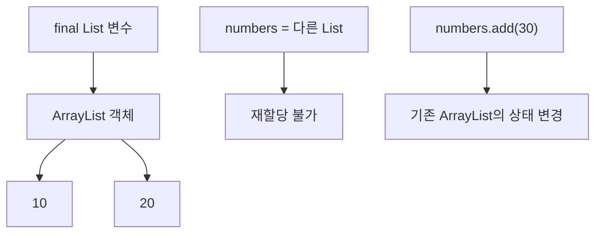

따라서 다음 두 개념을 반드시 구분해야 한다.

**참조의 불변성**은 변수가 다른 객체를 가리킬 수 없다는 의미다.

**객체의 불변성**은 해당 객체의 관찰 가능한 상태가 변경되지 않는다는 의미다.

`final`은 첫 번째를 보장하는 데 사용된다.

두 번째는 참조하는 객체의 설계에 따라 달라진다.

Java 언어 명세에서도 `final` 필드는 초기화 이후 재할당할 수 없도록 정의하지만, 참조 대상 객체의 모든 상태 변경을 금지하는 것으로 정의하지 않는다.

---

### Java는 Call by Value일까, Call by Reference일까?

불변 객체를 이해하려면 Java가 메서드에 인수를 전달하는 방식을 정확하게 알아야 한다.

메서드에 인수를 전달하는 방식에는 대표적으로 다음 두 개념이 존재한다.

#### Call by Value

메서드를 호출할 때 인수의 값을 복사해 매개변수에 전달하는 방식이다.

#### Call by Reference

호출한 쪽의 변수 자체를 참조할 수 있도록 전달하는 방식이다.

두 방식의 핵심적인 차이는 메서드 내부에서 매개변수를 재할당했을 때 호출한 쪽의 변수에 어떤 영향을 미치는가이다.

Java는 **원시 타입과 참조 타입 모두 Call by Value**를 사용한다.

다만 참조 타입에서는 복사되는 값이 객체 자체가 아니라 객체 참조이기 때문에 혼동하기 쉽다.

이 부분을 코드로 살펴보자.

---

### 원시 타입에서의 Call by Value

다음 코드를 생각해 보자.

```java
public class CallByValueExample {

    public static void main(String[] args) {

        int number = 1;

        System.out.println("Before: " + number);

        changeToNine(number);

        System.out.println("After: " + number);
    }

    private static void changeToNine(int arg) {

        arg = 9;
    }
}
```

실행 결과는 다음과 같다.

```text
Before: 1
After: 1
```

왜 `number`는 변경되지 않았을까?

메서드를 호출할 때 정수 값 1이 복사되어 `arg`에 전달되었기 때문이다.

```text
main 메서드

number = 1
```

메서드를 호출한다.

```java
changeToNine(number);
```

메서드 내부에서는 다음과 같은 상태가 된다.

```text
main 메서드

number = 1

changeToNine 메서드

arg = 1
```

여기서 `arg`를 변경한다.

```java
arg = 9;
```

그러면 다음과 같다.

```text
main 메서드

number = 1

changeToNine 메서드

arg = 9
```

`arg`와 `number`는 서로 다른 변수다.

따라서 `arg`의 값을 변경해도 `number`에는 영향을 주지 않는다.

이를 구조로 표현하면 다음과 같다.

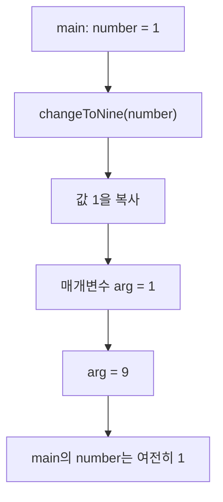

이것이 원시 타입에서의 Call by Value다.

---

### 참조 타입에서도 Call by Value가 적용될까?

참조 타입에서도 동일하게 Call by Value가 적용된다.

하지만 여기서 복사되는 값은 객체에 대한 참조다.

다음 클래스를 생각해 보자.

```java
public class Age {

    private int value;

    public Age(int value) {
        this.value = value;
    }

    public void change(int value) {
        this.value = value;
    }

    public int getValue() {
        return value;
    }
}
```

`Age`는 가변 객체다.

이제 다음 코드를 실행해 보자.

```java
public class ReferenceExample {

    public static void main(String[] args) {

        Age age = new Age(39);

        changeAge(age);

        System.out.println(age.getValue());
    }

    private static void changeAge(Age arg) {

        arg.change(25);
    }
}
```

실행 결과는 다음과 같다.

```text
25
```

원시 타입에서는 메서드 내부에서 값을 변경해도 외부 변수에 영향이 없었다.

하지만 참조 타입에서는 원본 객체의 상태가 변경되었다.

그렇다면 Java는 참조 타입을 Call by Reference로 전달하는 것일까?

그렇지 않다.

참조 타입에서도 복사된 값이 전달된다.

차이는 **복사된 두 참조가 동일한 객체를 가리킨다는 것**이다.

---

### 참조 타입의 메모리 동작

다음 코드를 다시 살펴보자.

```java
Age age = new Age(39);

changeAge(age);
```

먼저 `Age` 객체가 생성된다.

개념적으로 다음과 같은 상태다.

```text
지역 변수

age ──────────┐
              │
              ▼
          Age 객체
          value = 39
```

이제 메서드를 호출한다.

```java
changeAge(age);
```

메서드에 전달되는 값은 `age`가 가지고 있던 참조 값이다.

이 값이 `arg`에 복사된다.

```text
main 메서드

age ──────────┐
              │
              ▼
          Age 객체
          value = 39
              ▲
              │
arg ──────────┘

changeAge 메서드
```

두 변수는 서로 다르다.

하지만 동일한 `Age` 객체를 가리킨다.

이제 다음 코드를 실행한다.

```java
arg.change(25);
```

`arg`가 참조하는 객체의 내부 상태가 변경된다.

```text
main 메서드

age ──────────┐
              │
              ▼
          Age 객체
          value = 25
              ▲
              │
arg ──────────┘

changeAge 메서드
```

따라서 메서드가 종료된 이후에도 `age.getValue()`는 25를 반환한다.

중요한 점은 다음과 같다.

**원본 변수의 참조 값이 변경된 것이 아니라, 두 참조가 공유하는 객체의 내부 상태가 변경된 것이다.**

이 차이가 Call by Value를 이해하는 핵심이다.

---

### 참조 자체를 변경하면 어떻게 될까?

이번에는 메서드 내부에서 참조를 다른 객체로 변경해 보자.

```java
public class ReferenceReassignmentExample {

    public static void main(String[] args) {

        Age age = new Age(39);

        changeReference(age);

        System.out.println(age.getValue());
    }

    private static void changeReference(Age arg) {

        arg = new Age(25);
    }
}
```

실행 결과는 다음과 같다.

```text
39
```

왜 이번에는 변경되지 않았을까?

메서드 내부의 `arg`가 다른 객체를 참조하도록 변경되었기 때문이다.

처음에는 두 변수가 동일한 객체를 참조한다.

```text
age ──┐
      ▼
   Age(39)
      ▲
arg ──┘
```

그런데 다음 코드가 실행된다.

```java
arg = new Age(25);
```

이제 참조 관계가 달라진다.

```text
age ──────> Age(39)

arg ──────> Age(25)
```

메서드 내부의 `arg`만 새로운 객체를 참조한다.

`main` 메서드의 `age` 변수는 여전히 기존 객체를 가리킨다.

따라서 결과는 39다.

이 두 예제를 비교하면 Java가 Call by Value 방식으로 동작한다는 사실을 명확하게 확인할 수 있다.

| 메서드 내부 작업 | 외부 객체에 미치는 영향 |
|---|---|
| 원시 타입 매개변수 재할당 | 원본 변수 영향 없음 |
| 참조 타입 매개변수 재할당 | 원본 변수 영향 없음 |
| 참조를 통한 객체 상태 변경 | 동일 객체를 참조하는 코드에 영향 |
| 새로운 객체 생성 후 매개변수에 할당 | 호출한 쪽의 참조는 변경되지 않음 |

Oracle의 Java 공식 설명에서도 원시 타입과 참조 타입 인수 모두 값으로 전달되며, 참조 타입에서는 같은 객체의 필드를 변경할 수 있다는 점을 명시하고 있다.

---

### Java의 메모리 구조를 어떻게 이해해야 할까?

Call by Value와 불변 객체를 설명할 때 Stack과 Heap을 함께 사용하는 경우가 많다.

일반적인 개념은 다음과 같다.

#### Stack

메서드 실행과 관련된 Stack Frame을 관리한다.

Stack Frame에는 지역 변수와 매개변수 등을 다루기 위한 공간이 존재한다.

#### Heap

일반적인 Java 객체와 배열 등을 관리한다.

다음 코드를 생각해 보자.

```java
int number = 10;

Age age = new Age(39);
```

개념적으로 다음과 같이 표현할 수 있다.

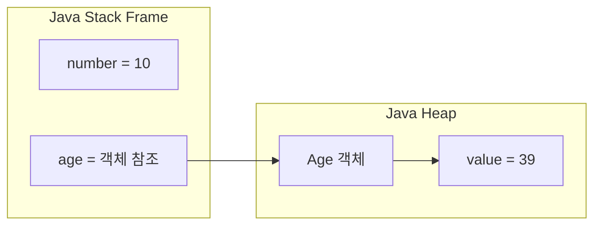

이 구조는 Java 참조의 동작을 이해하기 위한 논리적인 모델이다.

다만 실제 JVM의 물리적 메모리 배치를 항상 이 구조로 단정해서는 안 된다.

JIT 컴파일러는 최적화를 통해 지역 변수 값을 레지스터에서 관리하거나, 특정 객체의 할당을 제거하고 값을 분해해 처리할 수도 있다.

또 `static` 필드는 클래스에 속하는 변수이지 단순히 모든 클래스 변수가 Heap의 일반 객체 내부에 저장된다고 설명할 수는 없다.

따라서 다음과 같이 이해하는 것이 정확하다.

**Stack과 Heap의 개념적인 분리는 참조 관계를 이해하는 데 유용하지만 실제 메모리 배치는 JVM 구현과 최적화 결과에 따라 달라질 수 있다.**

불변 객체를 이해하는 데 가장 중요한 것은 물리적인 주소 자체가 아니다.

어떤 변수가 어떤 객체를 참조하고, 그 객체의 상태를 변경할 수 있는지를 파악하는 것이다.

---

### 원시 타입 필드에 final을 사용하면 불변 객체가 될까?

다음 클래스를 살펴보자.

```java
public final class Person {

    private final int age;

    public Person(int age) {
        this.age = age;
    }

    public int getAge() {
        return age;
    }
}
```

`age`는 원시 타입이다.

생성자에서 한 번 초기화된다.

그 이후 재할당할 수 없다.

또 객체에는 추가적인 변경 가능한 상태가 없다.

따라서 일반적인 Java 코드로는 `Person` 객체의 관찰 가능한 상태를 변경할 수 없다.

이 클래스는 불변 객체로 설계되었다고 볼 수 있다.

하지만 주의할 점이 있다.

다음 클래스는 어떨까?

```java
public final class Person {

    private final int age;

    private String name;

    public Person(int age, String name) {
        this.age = age;
        this.name = name;
    }

    public void changeName(String name) {
        this.name = name;
    }
}
```

`age`는 `final`이지만 `name`은 변경할 수 있다.

따라서 전체 `Person` 객체는 가변 객체다.

결국 객체의 불변성을 판단할 때는 특정 필드 하나만 확인해서는 안 된다.

**객체가 보유한 모든 관찰 가능한 상태가 변경될 수 있는지를 확인해야 한다.**

---

### 참조 타입 필드에 final을 사용하면 어떤 문제가 발생할까?

이번에는 원시 타입 대신 참조 타입을 사용해 보자.

```java
public class Age {

    private int value;

    public Age(int value) {
        this.value = value;
    }

    public void change(int value) {
        this.value = value;
    }

    public int getValue() {
        return value;
    }
}
```

이제 `Person`이 `Age` 객체를 참조하도록 변경한다.

```java
public final class Person {

    private final Age age;

    public Person(Age age) {
        this.age = age;
    }

    public int getAge() {
        return age.getValue();
    }
}
```

`Person`의 `age` 필드는 `final`이다.

또 `Person`에는 Setter가 존재하지 않는다.

그렇다면 불변 객체일까?

다음 코드를 실행해 보자.

```java
Age age = new Age(39);

Person person = new Person(age);

System.out.println(person.getAge());

age.change(25);

System.out.println(person.getAge());
```

실행 결과는 다음과 같다.

```text
39
25
```

`Person` 객체를 직접 수정하지 않았는데도 나이가 변경되었다.

왜 이런 일이 발생할까?

`Person`이 외부에서 전달받은 `Age` 객체를 그대로 참조하기 때문이다.

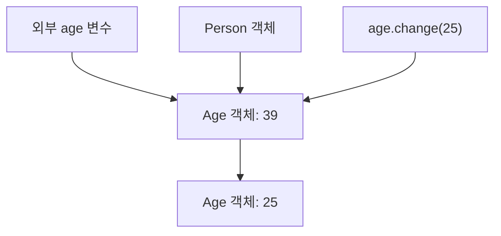

`Person`의 `age` 필드는 다른 객체를 참조하도록 변경되지 않았다.

하지만 해당 필드가 참조하는 `Age` 객체의 상태는 변경되었다.

따라서 `Person`은 불변 객체가 아니다.

---

### 불변 객체를 만드는 첫 번째 방법: 참조하는 객체도 불변으로 만든다

가장 직관적인 해결 방법은 `Age` 자체를 불변 객체로 만드는 것이다.

```java
public final class Age {

    private final int value;

    public Age(int value) {

        if (value < 0) {
            throw new IllegalArgumentException(
                    "나이는 음수일 수 없습니다."
            );
        }

        this.value = value;
    }

    public int getValue() {
        return value;
    }
}
```

이제 `Age` 객체에는 상태를 변경하는 메서드가 존재하지 않는다.

`value` 역시 `final`이다.

따라서 `Age` 객체는 생성된 이후 값을 변경할 수 없다.

이 객체를 `Person` 내부에 저장한다.

```java
public final class Person {

    private final Age age;

    public Person(Age age) {
        this.age = Objects.requireNonNull(age);
    }

    public int getAge() {
        return age.getValue();
    }
}
```

여기서 `Age`는 불변 객체다.

따라서 외부에서 동일한 `Age` 객체를 참조하더라도 상태를 변경할 수 없다.

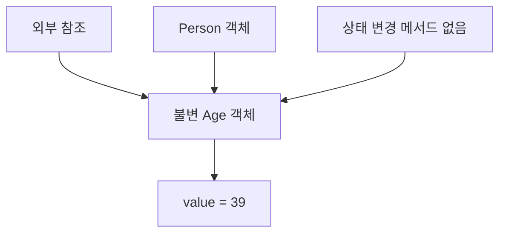

이 구조에서는 외부 참조가 남아 있어도 문제가 되지 않는다.

참조하는 객체 자체가 변경되지 않기 때문이다.

단, 이러한 불변성이 유지되려면 객체의 모든 상태와 내부 참조도 불변성 조건을 충족해야 한다.

---

### 불변 객체를 만드는 두 번째 방법: 방어적 복사

참조하는 객체를 불변으로 만들 수 없는 상황도 존재한다.

예를 들어 외부 라이브러리에서 제공하는 가변 객체를 사용해야 할 수 있다.

이런 경우에는 방어적 복사(Defensive Copy)를 고려할 수 있다.

방어적 복사는 외부에서 전달받은 객체를 그대로 보관하지 않고 별도의 객체를 생성해 저장하는 방식이다.

예를 들어 다음과 같이 작성할 수 있다.

```java
public final class Person {

    private final Age age;

    public Person(Age age) {

        Objects.requireNonNull(age);

        this.age = new Age(age.getValue());
    }

    public int getAge() {
        return age.getValue();
    }
}
```

생성자에서 다음 코드가 실행된다.

```java
this.age = new Age(age.getValue());
```

외부에서 전달받은 `Age` 객체를 그대로 저장하지 않는다.

새로운 `Age` 객체를 생성한다.

따라서 참조 관계는 다음과 같이 달라진다.

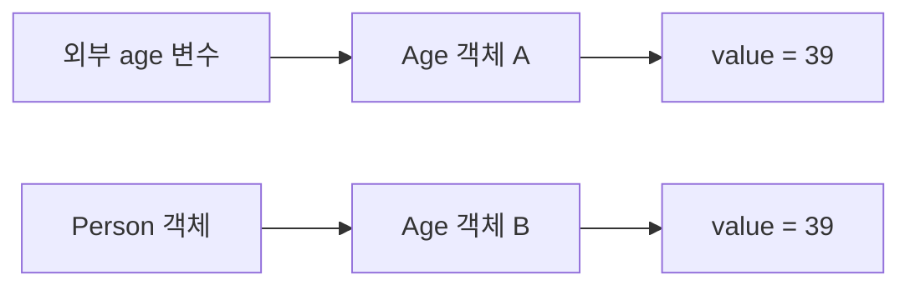

이제 외부 객체를 변경하더라도 `Person` 내부 객체는 영향을 받지 않는다.

```java
Age age = new Age(39);

Person person = new Person(age);

age.change(25);

System.out.println(person.getAge());
```

실행 결과는 다음과 같다.

```text
39
```

외부의 `Age`는 25로 변경되었다.

하지만 `Person` 내부에 저장된 `Age`는 별도로 생성된 객체이므로 여전히 39다.

이것이 방어적 복사의 기본 원리다.

---

### 생성자에서만 방어적 복사를 하면 충분할까?

반드시 그렇지는 않다.

외부에서 객체를 전달받는 시점뿐 아니라 객체를 외부로 반환하는 시점도 고려해야 한다.

예를 들어 다음 코드를 살펴보자.

```java
public final class Person {

    private final Age age;

    public Person(Age age) {

        this.age = new Age(age.getValue());
    }

    public Age getAge() {
        return age;
    }
}
```

생성자에서는 방어적 복사를 수행했다.

따라서 외부에서 전달한 `Age` 객체가 변경되어도 내부 상태는 영향을 받지 않는다.

하지만 Getter에서 내부의 `Age` 객체를 그대로 반환하고 있다.

```java
public Age getAge() {
    return age;
}
```

다음 코드를 실행해 보자.

```java
Age original = new Age(39);

Person person = new Person(original);

Age exposed = person.getAge();

exposed.change(25);
```

이제 `Person` 내부의 `Age` 객체가 변경되었다.

생성자에서 방어적 복사를 수행했지만 Getter를 통해 내부 상태가 노출된 것이다.

따라서 불변 객체를 설계할 때는 다음 두 방향을 모두 고려해야 한다.

**입력 방향:** 외부의 변경 가능한 객체가 내부 상태에 영향을 주지 못하도록 해야 한다.

**출력 방향:** 내부의 변경 가능한 객체가 외부에서 직접 수정되지 않도록 해야 한다.

---

### 생성자와 Getter 모두 방어적 복사하기

다음과 같이 수정할 수 있다.

```java
public final class Person {

    private final Age age;

    public Person(Age age) {

        Objects.requireNonNull(age);

        this.age = new Age(age.getValue());
    }

    public Age getAge() {

        return new Age(age.getValue());
    }
}
```

이제 생성자와 Getter 모두 새로운 객체를 생성한다.

```java
Age original = new Age(39);

Person person = new Person(original);

original.change(25);

Age exposed = person.getAge();

exposed.change(30);

System.out.println(person.getAge().getValue());
```

실행 결과는 다음과 같다.

```text
39
```

외부의 원본 객체를 변경해도 내부 상태는 영향을 받지 않는다.

Getter가 반환한 객체를 변경해도 내부 상태는 영향을 받지 않는다.

이를 구조로 표현하면 다음과 같다.

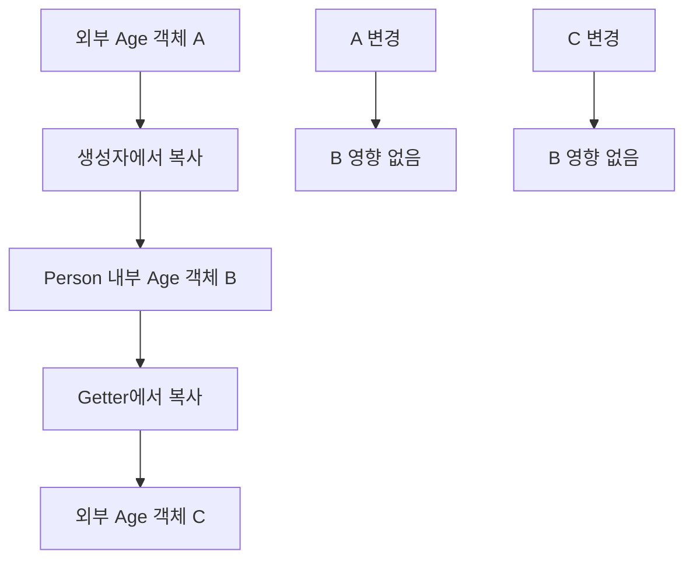

이러한 구조를 사용하면 가변 객체를 내부에 보유하더라도 외부 변경으로부터 상태를 보호할 수 있다.

다만 이 방법에는 한 가지 조건이 있다.

**복사한 객체와 원본 객체가 내부적으로 또 다른 변경 가능한 객체를 공유하지 않아야 한다.**

이 부분은 얕은 복사와 깊은 복사의 차이를 이해해야 정확하게 판단할 수 있다.

---

### 얕은 복사와 깊은 복사의 차이

객체를 복사할 때는 두 가지 개념을 구분해야 한다.

#### 얕은 복사(Shallow Copy)

객체 자체는 새로 생성하지만 내부에서 참조하는 다른 객체들은 공유할 수 있는 방식이다.

#### 깊은 복사(Deep Copy)

객체 내부의 참조 관계까지 필요한 범위에서 복사해 원본과 복사본이 변경 가능한 상태를 공유하지 않도록 만드는 방식이다.

예를 들어 다음과 같은 객체 관계를 생각해 보자.

```text
Person
  │
  └── Address
        │
        └── City
```

`Person` 객체만 새로 생성하고 `Address` 객체는 그대로 공유한다면 얕은 복사다.

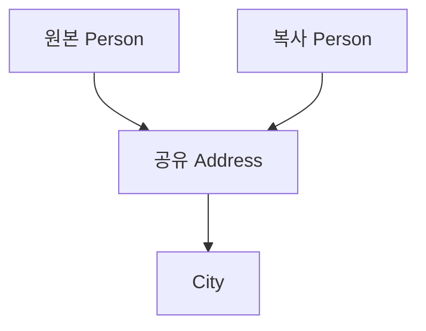

반면 `Address`까지 별도로 복사한다면 다음과 같이 구성할 수 있다.

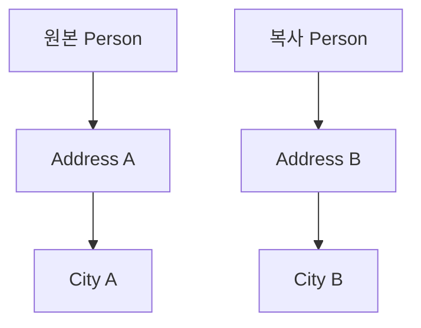

깊은 복사에서는 변경 가능한 참조 대상까지 복사해 상태 공유를 차단한다.

하지만 모든 객체를 무조건 깊은 복사해야 하는 것은 아니다.

`String`, `LocalDate`처럼 불변인 객체는 여러 객체가 공유하더라도 상태 변경 문제가 발생하지 않는다.

따라서 실무에서는 **변경 가능한 상태가 공유되는지**를 기준으로 복사 범위를 결정해야 한다.

---

### 가변 컬렉션에 final을 사용하면 어떻게 될까?

이번에는 Java에서 가장 자주 사용하는 가변 객체 중 하나인 `ArrayList`를 살펴보자.

```java
public final class Person {

    private final List<Integer> numbers;

    public Person(List<Integer> numbers) {
        this.numbers = numbers;
    }

    public List<Integer> getNumbers() {
        return numbers;
    }
}
```

다음과 같이 객체를 생성한다.

```java
List<Integer> numbers = new ArrayList<>();

numbers.add(10);
numbers.add(20);

Person person = new Person(numbers);
```

현재 메모리의 참조 관계는 개념적으로 다음과 같다.

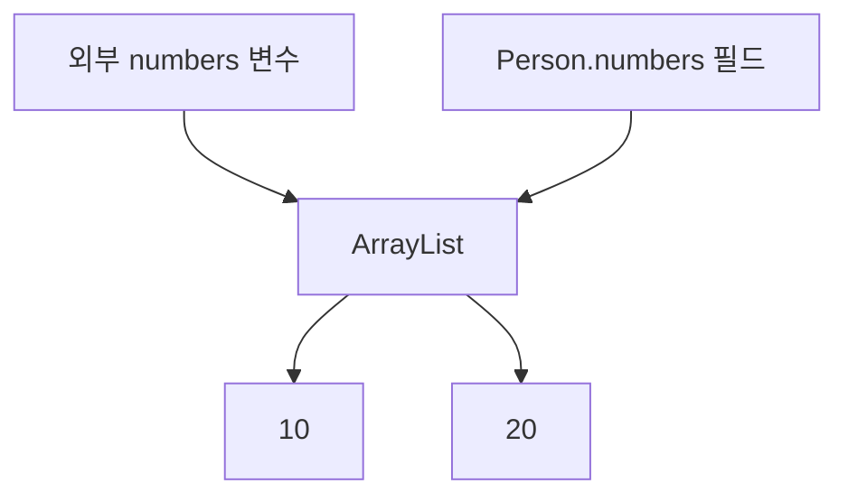

외부 변수와 Person 내부 필드는 같은 ArrayList 객체를 참조한다.

이제 외부에서 데이터를 추가한다.

```java
numbers.add(30);
```

결과는 다음과 같다.

```java
System.out.println(person.getNumbers());
```

```text
[10, 20, 30]
```

`Person`의 상태가 변경되었다.

`final`은 List 객체에 대한 참조의 재할당만 막기 때문이다.

---

### 생성자에서 ArrayList를 복사하면 해결될까?

생성자에서 새로운 ArrayList를 생성해 저장할 수 있다.

```java
public final class Person {

    private final List<Integer> numbers;

    public Person(List<Integer> numbers) {

        this.numbers = new ArrayList<>(numbers);
    }

    public List<Integer> getNumbers() {
        return numbers;
    }
}
```

이제 외부 List와 내부 List는 서로 다른 객체다.

```java
List<Integer> numbers = new ArrayList<>();

numbers.add(10);
numbers.add(20);

Person person = new Person(numbers);

numbers.add(30);

System.out.println(person.getNumbers());
```

실행 결과는 다음과 같다.

```text
[10, 20]
```

외부 List에 30을 추가했지만 내부 List는 영향을 받지 않았다.

하지만 아직 문제가 남아 있다.

```java
person.getNumbers().add(40);
```

Getter에서 내부 List를 그대로 반환하기 때문이다.

따라서 다음 결과가 발생한다.

```text
[10, 20, 40]
```

생성자에서 복사를 수행했지만 반환 과정에서 내부 상태가 노출되었다.

---

### Collections.unmodifiableList()란 무엇인가?

Java에서는 변경할 수 없는 형태의 List를 제공하기 위해 `Collections.unmodifiableList()`를 사용할 수 있다.

예를 들어 다음과 같다.

```java
List<Integer> numbers = new ArrayList<>();

numbers.add(10);
numbers.add(20);

List<Integer> unmodifiable =
        Collections.unmodifiableList(numbers);
```

이제 다음 코드를 실행하면 예외가 발생한다.

```java
unmodifiable.add(30);
```

발생하는 예외는 다음과 같다.

```text
java.lang.UnsupportedOperationException
```

그렇다면 `unmodifiable`은 완전히 불변인 List일까?

그렇지 않다.

다음 코드를 살펴보자.

```java
numbers.add(40);

System.out.println(unmodifiable);
```

실행 결과는 다음과 같다.

```text
[10, 20, 40]
```

왜 이런 일이 발생할까?

`Collections.unmodifiableList()`는 원본 List를 수정할 수 없는 형태로 감싼 **읽기 전용 뷰(Unmodifiable View)**를 제공하기 때문이다.

원본 List를 복사하는 것이 아니다.

따라서 원본 List가 변경되면 변경 불가능한 뷰에서도 그 결과가 관찰될 수 있다.

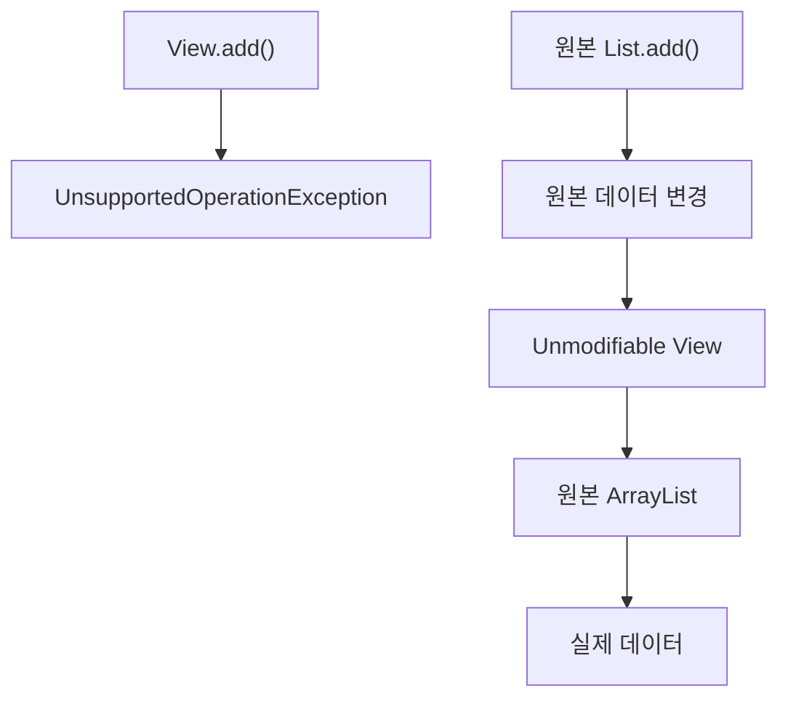

즉 수정 메서드 호출을 막는 것과 원본 데이터로부터 독립된 스냅샷을 만드는 것은 서로 다른 문제다.

Oracle의 컬렉션 설명에서도 `Collections.unmodifiableList()`가 원본 컬렉션의 변경을 반영하는 뷰라는 점을 명시하고 있다.

---

### 방어적 복사와 Unmodifiable View를 함께 사용하기

다음과 같이 작성할 수 있다.

```java
public final class Person {

    private final List<Integer> numbers;

    public Person(List<Integer> numbers) {

        this.numbers = Collections.unmodifiableList(
                new ArrayList<>(numbers)
        );
    }

    public List<Integer> getNumbers() {
        return numbers;
    }
}
```

이 코드에서는 두 가지 작업을 수행한다.

첫 번째는 방어적 복사다.

```java
new ArrayList<>(numbers)
```

외부 List와 독립된 List를 생성한다.

두 번째는 수정 방지다.

```java
Collections.unmodifiableList(...)
```

내부 List의 변경 메서드를 외부에서 호출하지 못하도록 한다.

따라서 다음 코드에서는 원본 List를 변경해도 내부 상태가 변경되지 않는다.

```java
List<Integer> original =
        new ArrayList<>(List.of(10, 20));

Person person = new Person(original);

original.add(30);

System.out.println(person.getNumbers());
```

실행 결과는 다음과 같다.

```text
[10, 20]
```

또 Getter로 반환된 List를 수정하려고 하면 예외가 발생한다.

```java
person.getNumbers().add(40);
```

```text
java.lang.UnsupportedOperationException
```

이 구조는 컬렉션 요소가 불변인 경우에 유용하다.

다만 List 내부에 변경 가능한 객체가 존재한다면 해당 요소의 상태 변경까지 자동으로 막지는 못한다.

---

### List.copyOf()를 사용하면 더 간결해진다

Java 10부터는 `List.copyOf()`를 사용할 수 있다.

```java
public final class Person {

    private final List<Integer> numbers;

    public Person(List<Integer> numbers) {

        this.numbers = List.copyOf(numbers);
    }

    public List<Integer> getNumbers() {
        return numbers;
    }
}
```

이 코드는 앞서 살펴본 방어적 복사와 변경 방지의 목적을 간결하게 표현한다.

`List.copyOf()`가 반환하는 List는 요소 추가, 삭제, 교체 등의 변경 작업을 지원하지 않는다.

또 원본 컬렉션이 이후 변경되더라도 반환된 List의 내용은 영향을 받지 않는다.

예를 들어 다음과 같다.

```java
List<Integer> original =
        new ArrayList<>(List.of(10, 20));

Person person = new Person(original);

original.add(30);

System.out.println(person.getNumbers());
```

실행 결과는 다음과 같다.

```text
[10, 20]
```

Getter로 반환된 List를 직접 변경할 수도 없다.

```java
person.getNumbers().add(40);
```

실행하면 `UnsupportedOperationException`이 발생한다.

따라서 요소가 불변이고 변경 불가능한 목록을 표현하려는 경우 `List.copyOf()`는 좋은 선택이다.

---

### List.copyOf()를 사용할 때 주의할 점

`List.copyOf()`에는 몇 가지 중요한 특징이 있다.

#### 1. null 요소를 허용하지 않는다

다음 코드는 예외가 발생한다.

```java
List<String> names = new ArrayList<>();

names.add("홍길동");
names.add(null);

List<String> copied = List.copyOf(names);
```

발생하는 예외는 다음과 같다.

```text
java.lang.NullPointerException
```

`List.copyOf()`는 원본 컬렉션이 null인 경우에도 예외를 발생시킨다.

#### 2. 항상 새로운 인스턴스를 생성한다고 보장하지 않는다

원본 List가 이미 변경 불가능한 List라면 기존 인스턴스를 재사용할 수 있다.

따라서 다음과 같은 기대를 해서는 안 된다.

```text
List.copyOf()를 호출하면
반드시 서로 다른 참조를 가진 새 객체가 생성된다.
```

`List.copyOf()`의 목적은 참조의 동일성을 없애는 것이 아니다.

반환된 컬렉션의 내용이 원본의 이후 변경으로부터 영향을 받지 않도록 하고, 반환 컬렉션 자체의 변경을 지원하지 않도록 하는 것이다.

#### 3. 내부 요소까지 깊은 복사하지 않는다

다음과 같은 코드에서는 List의 구조는 변경할 수 없지만 요소 객체는 변경될 수 있다.

```java
List<MutableMember> members =
        List.of(new MutableMember("홍길동"));

List<MutableMember> copied =
        List.copyOf(members);
```

`MutableMember`가 가변 객체라면 다음 작업이 가능하다.

```java
copied.get(0).changeName("김철수");
```

List 자체는 변경되지 않았지만 내부 요소의 상태가 변경되었다.

따라서 `List.copyOf()`는 깊은 복사 기능이 아니다.

Java 공식 API에서도 `List.copyOf()`의 변경 불가능한 List가 가변 요소를 포함하면 요소의 상태 변화가 관찰될 수 있다고 설명한다.

---

### List 복사 방식 비교

지금까지 살펴본 컬렉션 처리 방식을 비교하면 다음과 같다.

| 방식 | 새 컬렉션 생성 | 원본 변경의 영향 차단 | 반환 컬렉션 수정 | 내부 요소 깊은 복사 |
|---|---|---|---|---|
| 원본 참조 그대로 저장 | X | X | 가능 | X |
| `new ArrayList<>(list)` | O | O | 가능 | X |
| `Collections.unmodifiableList(list)` | X | X | 불가능 | X |
| `Collections.unmodifiableList(new ArrayList<>(list))` | O | O | 불가능 | X |
| `List.copyOf(list)` | 구현에 따라 재사용 가능 | O | 불가능 | X |

여기서 가장 중요한 구분은 다음과 같다.

**새로운 컬렉션을 만드는 것과 컬렉션을 수정하지 못하게 하는 것은 서로 다른 기능이다.**

또 두 기능을 모두 제공하더라도 내부 요소가 가변 객체라면 깊은 불변성이 자동으로 보장되지 않는다.

따라서 불변 객체의 설계는 컬렉션 자체뿐 아니라 컬렉션에 저장되는 요소의 특성까지 고려해야 한다.

---

### 내부 요소가 가변 객체라면 어떻게 해야 할까?

다음 클래스를 생각해 보자.

```java
public class MutableMember {

    private String name;

    public MutableMember(String name) {
        this.name = name;
    }

    public String getName() {
        return name;
    }

    public void changeName(String name) {
        this.name = name;
    }
}
```

이 객체는 가변 객체다.

이제 다음 Record를 정의한다.

```java
public record Team(
        List<MutableMember> members
) {

    public Team {
        members = List.copyOf(members);
    }
}
```

Record의 Component 필드는 `final`이다.

또 `List.copyOf()`를 사용했다.

그렇다면 불변 객체일까?

다음 코드를 살펴보자.

```java
MutableMember member =
        new MutableMember("홍길동");

Team team = new Team(
        List.of(member)
);

member.changeName("김철수");

System.out.println(
        team.members().get(0).getName()
);
```

실행 결과는 다음과 같다.

```text
김철수
```

List 자체는 변경되지 않았다.

하지만 List 내부의 `MutableMember` 객체는 여전히 외부 참조와 공유되고 있다.

따라서 객체 상태가 변경되었다.

이 문제를 해결하려면 컬렉션의 요소까지 고려해야 한다.

---

### 깊은 불변성을 보장하는 컬렉션 설계

가장 단순한 방법 중 하나는 컬렉션 요소를 불변 객체로 변환하는 것이다.

예를 들어 다음 Record를 정의한다.

```java
public record MemberSnapshot(
        String name
) {
}
```

`String`은 불변 객체다.

따라서 `MemberSnapshot`도 이 구성에서는 변경 가능한 상태를 포함하지 않는다.

이제 Team을 다음과 같이 정의할 수 있다.

```java
import java.util.List;

public record Team(
        List<MemberSnapshot> members
) {

    public Team {
        members = List.copyOf(members);
    }
}
```

이제 외부에서 List를 변경할 수 없다.

또 List 내부의 MemberSnapshot을 변경할 수도 없다.

```java
Team team = new Team(
        List.of(
                new MemberSnapshot("홍길동"),
                new MemberSnapshot("김철수")
        )
);
```

이 구조에서는 다음 두 조건을 만족한다.

첫 번째로 List 자체가 변경 불가능하다.

두 번째로 List 내부의 요소도 불변이다.

따라서 깊은 불변성을 유지하기 쉬운 구조가 된다.

하지만 Record 자체가 모든 상황에서 깊은 불변성을 자동으로 제공하는 것은 아니다.

Record에 `List`, 배열, 변경 가능한 사용자 정의 객체를 저장한다면 동일한 문제를 검토해야 한다.

---

### 배열을 사용하는 경우에도 방어적 복사가 필요하다

배열 역시 변경 가능한 객체다.

다음 Record를 살펴보자.

```java
public record BinaryData(
        byte[] value
) {
}
```

이 Record의 `value` 필드는 `final`이다.

하지만 배열 내부의 요소는 변경할 수 있다.

```java
byte[] bytes = {1, 2, 3};

BinaryData data = new BinaryData(bytes);

bytes[0] = 9;

System.out.println(data.value()[0]);
```

실행 결과는 다음과 같다.

```text
9
```

배열을 그대로 저장했기 때문이다.

또 다음 코드도 내부 상태를 변경한다.

```java
data.value()[0] = 7;
```

이 문제를 해결하려면 생성자와 Accessor에서 방어적 복사를 수행할 수 있다.

```java
import java.util.Objects;

public record BinaryData(
        byte[] value
) {

    public BinaryData {

        Objects.requireNonNull(value);

        value = value.clone();
    }

    @Override
    public byte[] value() {

        return value.clone();
    }
}
```

이제 외부 배열을 변경해도 Record 내부 배열은 영향을 받지 않는다.

또 Accessor에서 반환한 배열을 수정하더라도 내부 배열은 영향을 받지 않는다.

다만 배열의 내용을 기준으로 객체의 동등성을 판단해야 한다면 `equals()`와 `hashCode()`의 구현도 별도로 검토해야 한다.

Java 배열의 기본 `equals()`는 배열 내용 전체를 비교하지 않기 때문이다.

이처럼 불변성은 단순히 필드를 `final`로 선언하는 수준에서 끝나지 않는다.

객체가 외부와 어떤 참조를 공유하는지까지 고려해야 한다.

---

### Java의 불변 객체를 만드는 기본 원칙

지금까지의 내용을 바탕으로 불변 객체의 설계 원칙을 정리할 수 있다.

#### 1. 상태를 변경하는 메서드를 제공하지 않는다

Setter나 상태를 직접 변경하는 메서드를 제공하지 않는다.

#### 2. 필드를 private으로 선언한다

외부에서 필드에 직접 접근하지 못하도록 한다.

#### 3. 가능한 한 final 필드를 사용한다

생성 이후 필드가 다른 값을 참조하지 못하도록 한다.

#### 4. 상속을 제한한다

일반적으로 클래스에 `final`을 선언하거나 생성자를 제한해 하위 클래스에서 불변성 계약을 깨뜨리지 못하도록 한다.

#### 5. 변경 가능한 객체를 그대로 저장하지 않는다

필요한 경우 생성자에서 방어적 복사를 수행한다.

#### 6. 변경 가능한 내부 객체를 그대로 반환하지 않는다

불변 뷰, 스냅샷 또는 방어적 복사를 활용한다.

#### 7. 내부 객체의 불변성까지 고려한다

List 자체가 변경 불가능하더라도 List 요소가 변경 가능한 객체라면 문제가 발생할 수 있다.

#### 8. 생성 과정에서 객체를 외부에 노출하지 않는다

생성자가 완료되기 전에 `this`가 외부로 전달되면 안전한 초기화와 관련된 문제가 발생할 수 있다.

이러한 원칙을 함께 적용해야 객체의 불변성을 안정적으로 유지할 수 있다.

---

### 예제

지금까지 살펴본 내용을 하나의 Java 프로그램으로 확인해 보자.

예제에서는 다음 세 가지 상황을 비교한다.

첫 번째는 참조 타입을 `final`로 선언했지만 객체가 변경되는 경우다.

두 번째는 가변 컬렉션을 그대로 저장해 내부 상태가 변경되는 경우다.

세 번째는 불변 값 객체와 `List.copyOf()`를 활용해 상태 변경을 방지하는 경우다.

Java 17 이상에서 실행할 수 있다.

#### 전체 Java 코드

`ImmutableObjectDemo.java`

```java
import java.util.ArrayList;
import java.util.List;
import java.util.Objects;

public class ImmutableObjectDemo {

    public static void main(String[] args) {

        System.out.println("=== 참조 타입 final ===");

        MutableAge originalAge = new MutableAge(39);

        UnsafePerson unsafePerson =
                new UnsafePerson(originalAge);

        System.out.println(
                "Before: " + unsafePerson.getAge()
        );

        originalAge.change(25);

        System.out.println(
                "After: " + unsafePerson.getAge()
        );

        System.out.println();

        System.out.println("=== 가변 컬렉션 ===");

        List<Integer> originalNumbers =
                new ArrayList<>(List.of(10, 20));

        UnsafeNumbers unsafeNumbers =
                new UnsafeNumbers(originalNumbers);

        originalNumbers.add(30);

        System.out.println(
                "External mutation: "
                        + unsafeNumbers.getNumbers()
        );

        unsafeNumbers.getNumbers().add(40);

        System.out.println(
                "Getter mutation: "
                        + unsafeNumbers.getNumbers()
        );

        System.out.println();

        System.out.println("=== 불변 객체 ===");

        List<Integer> safeInput =
                new ArrayList<>(List.of(10, 20));

        SafeNumbers safeNumbers =
                new SafeNumbers(safeInput);

        safeInput.add(30);

        System.out.println(
                "External mutation: "
                        + safeNumbers.getNumbers()
        );

        try {

            safeNumbers.getNumbers().add(40);

        } catch (UnsupportedOperationException e) {

            System.out.println(
                    "Getter mutation: blocked"
            );
        }

        System.out.println(
                "Final state: "
                        + safeNumbers.getNumbers()
        );
    }

    static final class MutableAge {

        private int value;

        MutableAge(int value) {
            this.value = value;
        }

        void change(int value) {
            this.value = value;
        }

        int getValue() {
            return value;
        }
    }

    static final class UnsafePerson {

        private final MutableAge age;

        UnsafePerson(MutableAge age) {

            this.age = Objects.requireNonNull(age);
        }

        int getAge() {
            return age.getValue();
        }
    }

    static final class UnsafeNumbers {

        private final List<Integer> numbers;

        UnsafeNumbers(List<Integer> numbers) {

            this.numbers = numbers;
        }

        List<Integer> getNumbers() {
            return numbers;
        }
    }

    static final class SafeNumbers {

        private final List<Integer> numbers;

        SafeNumbers(List<Integer> numbers) {

            this.numbers = List.copyOf(numbers);
        }

        List<Integer> getNumbers() {
            return numbers;
        }
    }
}
```

#### 실행 방법

파일을 컴파일한다.

```bash
javac ImmutableObjectDemo.java
```

컴파일에 성공하면 다음 명령어로 실행한다.

```bash
java ImmutableObjectDemo
```

예상 출력 결과는 다음과 같다.

```text
=== 참조 타입 final ===
Before: 39
After: 25

=== 가변 컬렉션 ===
External mutation: [10, 20, 30]
Getter mutation: [10, 20, 30, 40]

=== 불변 객체 ===
External mutation: [10, 20]
Getter mutation: blocked
Final state: [10, 20]
```

첫 번째 예제에서는 `final` 참조를 사용했지만 내부 객체의 상태가 변경되었다.

두 번째 예제에서는 외부 List와 내부 List가 같은 객체를 참조했기 때문에 양방향으로 변경이 발생했다.

세 번째 예제에서는 `List.copyOf()`를 사용해 원본 컬렉션의 변경과 Getter를 통한 변경을 차단했다.

따라서 이 예제에서 가장 중요한 것은 `final` 선언 여부가 아니다.

**객체 내부의 변경 가능한 상태가 외부에 노출되는지를 확인하는 것**이다.

---

### 구조

#### 불변 객체의 참조 구조

불변 객체를 설계할 때는 참조 관계를 다음과 같이 구분할 수 있다.

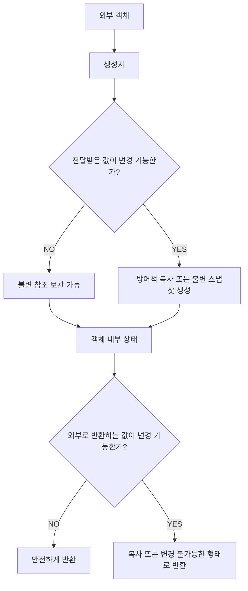

객체의 상태를 보호하려면 입력과 출력 방향을 모두 검토해야 한다.

또 복사한 객체가 내부적으로 변경 가능한 다른 객체를 참조하고 있다면 그 부분까지 검토해야 한다.

#### 변경 가능성에 따른 설계 전략

| 내부 필드의 종류 | 권장 방식 |
|---|---|
| `int`, `long`, `boolean` | `private final` 필드 |
| `String` | 불변 참조를 `final`로 보관 |
| `LocalDate` | 불변 참조를 `final`로 보관 |
| 사용자 정의 불변 객체 | 불변 조건을 확인한 뒤 참조 보관 |
| 사용자 정의 가변 객체 | 방어적 복사 및 노출 제한 |
| `List<String>` | `List.copyOf()` 고려 |
| `List<MutableObject>` | 요소의 불변화 또는 필요한 범위의 깊은 복사 |
| `byte[]` | 생성자와 Getter에서 `clone()` 등 활용 |
| `Map<String, String>` | `Map.copyOf()` 고려 |
| `Map<Key, MutableValue>` | Key·Value의 변경 가능성까지 검토 |

이처럼 필드의 자료형만 보는 것이 아니라 실제 변경 가능성을 기준으로 설계해야 한다.

---

### final과 Java Memory Model의 관계

`final`은 단순히 컴파일 단계에서 재할당을 막는 역할만 수행하는 것은 아니다.

Java Memory Model(JMM)에서도 특별한 의미를 가진다.

특히 여러 스레드가 객체를 공유할 때 중요한 역할을 한다.

예를 들어 다음 클래스를 생각해 보자.

```java
public final class Configuration {

    private final int timeout;

    private final String endpoint;

    public Configuration(
            int timeout,
            String endpoint
    ) {

        this.timeout = timeout;
        this.endpoint = endpoint;
    }

    public int getTimeout() {
        return timeout;
    }

    public String getEndpoint() {
        return endpoint;
    }
}
```

이 클래스의 필드는 모두 `final`이다.

생성자에서 초기화되고 이후 변경되지 않는다.

Java Memory Model은 이러한 `final` 필드에 특별한 초기화 가시성 규칙을 제공한다.

객체가 생성자 완료 전에 외부로 노출되지 않고 정상적으로 생성되었다면, 다른 스레드가 해당 객체에 접근했을 때 `final` 필드의 초기화 값을 올바르게 관찰할 수 있도록 보장하는 규칙이 적용된다.

이러한 동작은 생성자가 종료될 때의 Freeze Action과 관련된다.

Java 언어 명세의 `final Field Semantics`에서 해당 규칙을 정의하고 있다.

하지만 여기서 중요한 점이 있다.

**`final`을 사용했다고 모든 객체가 자동으로 스레드 안전해지는 것은 아니다.**

다음 코드를 살펴보자.

```java
public final class Counter {

    private final AtomicInteger count =
            new AtomicInteger();

    public void increment() {
        count.incrementAndGet();
    }

    public int getCount() {
        return count.get();
    }
}
```

이 클래스는 `final`이다.

또 `count` 필드도 `final`이다.

하지만 `count` 객체의 값은 변경된다.

```java
counter.increment();
```

따라서 이 객체는 불변 객체가 아니다.

여기서 `AtomicInteger` 자체가 동시성 기능을 제공하므로 증가 연산은 안전하게 수행할 수 있지만, 이는 `final` 때문이 아니다.

`AtomicInteger`의 원자적 연산 덕분이다.

즉 다음 개념을 구분해야 한다.

| 개념 | 의미 |
|---|---|
| `final` | 변수나 필드의 재할당 제한 |
| 불변성 | 객체의 관찰 가능한 상태가 변경되지 않음 |
| 가시성(Visibility) | 다른 스레드가 변경 또는 초기화된 값을 올바르게 관찰 |
| 원자성(Atomicity) | 연산이 중간 상태 없이 수행되는 성질 |
| 스레드 안전성 | 여러 스레드가 동시에 접근해도 올바르게 동작 |

이 개념들은 서로 관련되어 있지만 동일하지 않다.

---

### 불변 객체는 왜 멀티스레드 환경에 유리할까?

여러 스레드가 하나의 가변 객체를 공유한다고 가정하자.

```java
public class UserSettings {

    private String theme;

    public void changeTheme(String theme) {
        this.theme = theme;
    }

    public String getTheme() {
        return theme;
    }
}
```

여러 스레드가 동시에 `theme`을 읽고 변경할 수 있다.

이 경우 변경 시점과 가시성을 고려해야 한다.

반면 불변 객체에서는 기존 상태가 변경되지 않는다.

```java
public record UserSettings(
        String theme
) {
}
```

설정을 변경하려면 새로운 객체를 생성해야 한다.

```java
UserSettings updated =
        new UserSettings("DARK");
```

기존 객체는 그대로 유지된다.

```text
기존 객체

theme = LIGHT
```

```text
새 객체

theme = DARK
```

따라서 여러 스레드가 이미 생성된 불변 객체를 읽는 과정에서는 내부 상태 변경으로 인한 경쟁 조건이 발생하지 않는다.

하지만 새로운 객체를 공유 참조에 게시하거나 교체하는 과정은 별도의 동시성 관리가 필요할 수 있다.

예를 들어 `AtomicReference`나 `volatile` 등을 활용할 수 있다.

**불변 객체는 공유 상태의 변경 문제를 줄이지만, 공유 참조를 교체하는 모든 동시성 문제까지 자동으로 해결하지는 않는다.**

---

### Immutable과 Unmodifiable은 무엇이 다를까?

두 용어는 비슷하게 사용되지만 구분할 필요가 있다.

#### Immutable Object

객체의 관찰 가능한 상태가 생성 이후 변경되지 않는다는 의미다.

#### Unmodifiable Collection

해당 컬렉션 인터페이스를 통해 요소를 추가하거나 제거하는 변경 작업을 수행할 수 없다는 의미다.

예를 들어 다음 코드를 생각해 보자.

```java
List<String> original =
        new ArrayList<>();

original.add("A");

List<String> view =
        Collections.unmodifiableList(original);
```

`view`에서는 요소를 추가할 수 없다.

하지만 원본을 변경할 수 있다.

```java
original.add("B");
```

이후 다음과 같이 출력된다.

```java
System.out.println(view);
```

```text
[A, B]
```

따라서 이 뷰는 변경 불가능한 인터페이스를 제공하지만 외부 변경으로 인해 관찰되는 내용은 달라질 수 있다.

반면 불변 객체는 자신의 관찰 가능한 상태가 변경되지 않도록 설계된다.

이 차이는 백엔드에서 API 응답, 캐시, 설정 객체 등을 설계할 때 중요하다.

---

### 불변 객체에서 상태를 변경하려면 어떻게 해야 할까?

불변 객체도 새로운 값을 표현할 필요가 있다.

하지만 기존 객체를 직접 변경하지 않는다.

대신 새로운 객체를 반환한다.

예를 들어 금액을 표현하는 Value Object를 생각해 보자.

```java
public record Money(
        long amount,
        String currency
) {

    public Money {

        if (amount < 0) {
            throw new IllegalArgumentException(
                    "금액은 음수일 수 없습니다."
            );
        }

        Objects.requireNonNull(currency);
    }

    public Money add(Money other) {

        Objects.requireNonNull(other);

        if (!currency.equals(other.currency())) {
            throw new IllegalArgumentException(
                    "통화가 일치하지 않습니다."
            );
        }

        return new Money(
                Math.addExact(
                        amount,
                        other.amount()
                ),
                currency
        );
    }
}
```

이제 다음과 같이 사용할 수 있다.

```java
Money first = new Money(10000, "KRW");

Money second = new Money(5000, "KRW");

Money result = first.add(second);
```

각 객체의 상태는 다음과 같다.

```text
first

amount = 10000
```

```text
second

amount = 5000
```

```text
result

amount = 15000
```

`first`와 `second`는 변경되지 않았다.

새로운 `Money` 객체가 생성되었다.

이것이 불변 객체에서 새로운 상태를 표현하는 일반적인 방법이다.

이러한 방식은 함수형 프로그래밍에서도 자주 활용된다.

---

### 불변 객체를 사용하면 성능이 나빠질까?

불변 객체에서는 상태가 변경될 때 새로운 객체를 생성하는 경우가 많다.

따라서 다음과 같은 비용이 발생할 수 있다.

- 새로운 객체 할당
- 기존 데이터의 복사
- 객체 생성에 따른 GC 부담
- 큰 컬렉션의 복사 비용

예를 들어 다음 코드를 살펴보자.

```java
List<Integer> updated =
        new ArrayList<>(original);
```

원본 List가 매우 크다면 복사 비용도 증가한다.

따라서 모든 상태 변경을 전체 컬렉션의 복사로 처리하는 방식은 비효율적일 수 있다.

하지만 불변 객체가 항상 성능에 불리한 것도 아니다.

불변 객체는 공유 상태의 동기화 비용을 줄일 수 있다.

또 객체의 상태를 추적하기 쉬우므로 프로그램의 복잡성을 낮추는 데 도움이 된다.

JVM의 Escape Analysis와 Scalar Replacement 같은 최적화가 객체 할당 비용을 줄일 수도 있다.

다만 이러한 최적화가 모든 코드에 적용되는 것은 아니다.

따라서 성능을 판단할 때는 다음 두 요소를 함께 고려해야 한다.

**객체를 새로 생성하는 비용**과 **공유된 가변 상태를 관리하는 비용**이다.

불변 객체는 객체 생성 비용을 일부 증가시키는 대신 상태 관리의 복잡성을 줄일 수 있다.

---

### 실무에서의 활용

불변 객체는 단순한 Java 문법 이상의 의미를 가진다.

백엔드 시스템에서는 객체의 상태를 보호하고 예측 가능한 동작을 유지하기 위한 중요한 설계 수단이다.

다음은 실제 서비스에서 활용할 수 있는 대표적인 전략이다.

#### 1. Value Object를 불변으로 설계한다

금액, 좌표, 기간, 국가 코드 등은 값 자체에 의미가 있는 객체다.

예를 들어 다음과 같다.

```java
public record CountryCode(
        String value
) {

    public CountryCode {

        if (value == null || value.length() != 2) {
            throw new IllegalArgumentException(
                    "국가 코드는 두 글자여야 합니다."
            );
        }

        value = value.toUpperCase(
                Locale.ROOT
        );
    }
}
```

이러한 객체는 생성 시 유효성을 검증하고 이후 상태를 변경하지 않는 방식이 적합할 수 있다.

#### 2. API 응답 DTO에 불변 객체를 활용한다

API 응답은 특정 시점의 데이터를 표현한다.

따라서 응답 DTO를 불변 객체로 정의하면 이후 코드에서 응답 데이터가 실수로 변경되는 문제를 줄일 수 있다.

```java
public record MemberResponse(
        Long id,
        String name,
        String email
) {
}
```

다만 Record는 얕은 불변성을 제공한다.

따라서 변경 가능한 컬렉션이나 배열을 Component로 사용한다면 별도의 처리가 필요하다.

#### 3. 캐시 Key를 불변 객체로 설계한다

HashMap이나 ConcurrentHashMap의 Key로 사용하는 객체는 동등성에 영향을 주는 상태가 변경되지 않아야 한다.

예를 들어 다음과 같다.

```java
public record CacheKey(
        Long memberId,
        String countryCode
) {
}
```

이러한 Key는 생성 이후 상태가 변경되지 않으므로 해시 값이 안정적으로 유지되기 쉽다.

반면 변경 가능한 객체를 Key로 사용하면 저장 이후 조회가 실패하는 문제가 발생할 수 있다.

#### 4. 이벤트 메시지를 불변 스냅샷으로 표현한다

이벤트는 특정 시점에 발생한 사실을 표현한다.

예를 들어 결제 완료 이벤트를 생각해 보자.

```java
public record PaymentCompletedEvent(
        Long paymentId,
        Long orderId,
        long amount
) {
}
```

이벤트 객체가 발행된 이후 내부 상태가 변경된다면 소비자가 예상하지 못한 데이터를 처리할 수 있다.

따라서 이벤트 메시지는 불변 스냅샷으로 표현하는 것이 유리할 수 있다.

다만 외부 메시징 시스템으로 전달하는 경우에는 직렬화 계약과 이벤트 버전 관리도 함께 고려해야 한다.

#### 5. 캐시 Value의 변경 가능성을 확인한다

캐시 Key뿐 아니라 Value의 변경 가능성도 중요하다.

예를 들어 다음과 같은 캐시가 있다고 가정하자.

```java
Map<Long, List<Member>> cache =
        new ConcurrentHashMap<>();
```

ConcurrentHashMap은 Map 자체에 대한 동시성 기능을 제공한다.

하지만 Value로 저장한 List와 그 안의 Member 객체까지 자동으로 스레드 안전하게 만들어 주지는 않는다.

따라서 여러 스레드가 캐시 Value를 공유한다면 불변 스냅샷을 저장하는 방식을 고려할 수 있다.

#### 6. 설정 객체를 불변으로 유지한다

애플리케이션 설정은 여러 서비스에서 참조할 수 있다.

설정 객체가 임의로 변경되면 동작을 예측하기 어려워질 수 있다.

예를 들어 다음과 같이 정의할 수 있다.

```java
public record PaymentSettings(
        int timeoutSeconds,
        int maxRetryCount
) {

    public PaymentSettings {

        if (timeoutSeconds <= 0) {
            throw new IllegalArgumentException(
                    "타임아웃은 0보다 커야 합니다."
            );
        }

        if (maxRetryCount < 0) {
            throw new IllegalArgumentException(
                    "재시도 횟수는 음수일 수 없습니다."
            );
        }
    }
}
```

이 객체는 생성된 이후 설정값이 변경되지 않는다.

설정을 갱신하려면 새로운 설정 객체를 생성해야 한다.

이러한 방식은 설정 변경의 시점과 범위를 명확하게 만드는 데 도움이 된다.

#### 7. 동적으로 변경되는 설정은 불변 객체를 교체한다

설정값이 실행 중에 변경되어야 하는 경우도 있다.

이때 하나의 가변 객체를 여러 스레드가 직접 수정하도록 설계하는 대신 새로운 불변 객체를 생성해 교체할 수 있다.

예를 들어 다음과 같다.

```java
public record PricingRules(
        Map<String, Integer> discounts
) {

    public PricingRules {
        discounts = Map.copyOf(discounts);
    }
}
```

공유 참조를 관리한다.

```java
AtomicReference<PricingRules> currentRules =
        new AtomicReference<>(
                new PricingRules(
                        Map.of("VIP", 10)
                )
        );
```

새로운 설정이 필요하다면 객체를 생성해 교체할 수 있다.

```java
currentRules.set(
        new PricingRules(
                Map.of(
                        "VIP", 15,
                        "NORMAL", 5
                )
        )
);
```

읽는 스레드는 다음과 같이 현재 설정을 가져온다.

```java
PricingRules rules = currentRules.get();
```

이 구조에서는 하나의 불변 설정 객체를 여러 스레드가 안전하게 읽을 수 있다.

또 설정 객체의 참조 교체는 원자적으로 수행된다.

단, 기존 설정을 읽고 일부를 수정한 뒤 다시 저장하는 복합 작업에는 `updateAndGet()` 등의 원자적 갱신 방식이 필요할 수 있다.

#### 8. JPA Entity와 Value Object의 책임을 구분한다

JPA Entity는 식별성과 생명주기, 상태 변경을 관리하는 객체다.

따라서 모든 Entity를 불변으로 만드는 것이 항상 적절한 것은 아니다.

예를 들어 주문 상태가 변경되는 경우를 생각해 보자.

```java
order.pay();
order.cancel();
```

이러한 동작은 Entity의 비즈니스 책임일 수 있다.

반면 주문 금액이나 주소처럼 값 자체를 표현하는 객체는 불변 Value Object로 설계할 수 있다.

즉 Entity는 필요한 상태 전이를 관리하고, 내부에서 사용하는 값 객체는 불변으로 설계하는 방식이 유용하다.

#### 9. 컬렉션을 외부에 직접 노출하지 않는다

다음 코드는 주의해야 한다.

```java
public List<OrderItem> getItems() {
    return items;
}
```

외부에서 다음과 같이 변경할 수 있기 때문이다.

```java
order.getItems().clear();
```

주문 항목이 비즈니스 규칙을 거치지 않고 제거될 수 있다.

이를 방지하기 위해 다음과 같은 접근을 고려할 수 있다.

```java
public List<OrderItem> getItems() {

    return List.copyOf(items);
}
```

다만 이 방법은 List의 구조적 변경을 차단할 뿐이다.

`OrderItem` 자체가 가변 객체라면 여전히 요소의 상태 변경이 가능하다.

또 Entity가 실제로 변경 가능한 주문 항목을 관리해야 한다면 외부에 변경 권한을 제공하기보다 도메인 메서드를 통해 변경하도록 설계하는 것이 적절할 수 있다.

#### 10. Date와 배열 같은 가변 객체를 주의한다

Java의 오래된 `Date`는 변경 가능한 객체다.

```java
Date date = new Date();
```

반면 `LocalDate`, `LocalDateTime`, `Instant` 등 `java.time`의 주요 날짜·시간 타입은 불변이다.

따라서 새로운 코드에서는 요구사항에 맞는 불변 날짜·시간 타입을 우선 고려할 수 있다.

다만 날짜·시간 타입을 선택할 때는 타임존과 시간대 정보도 함께 고려해야 한다.

예를 들어 `LocalDateTime`은 시간대 정보를 보유하지 않으므로 모든 시각 표현에 적합한 것은 아니다.

#### 11. 방어적 복사의 비용을 고려한다

매번 List 전체를 복사하면 객체 할당과 데이터 복사 비용이 발생한다.

예를 들어 수십만 개의 요소를 가진 List를 Getter 호출마다 복사하는 구조는 부담이 될 수 있다.

따라서 다음 사항을 검토할 필요가 있다.

- 컬렉션의 크기
- Getter 호출 빈도
- 요소 객체의 변경 가능성
- 복사 비용
- 객체 생명주기
- 동시성 요구사항

이미 완전히 불변인 객체를 다시 복사하는 것은 불필요할 수 있다.

반대로 변경 가능한 객체를 그대로 공유해 발생하는 오류의 비용이 복사 비용보다 훨씬 클 수도 있다.

따라서 불변성을 확보하면서도 필요한 범위에서만 복사하는 설계가 중요하다.

#### 12. 불변성 검증을 자동화한다

불변 객체를 설계했다면 실제로 외부 변경으로부터 상태가 보호되는지 확인해야 한다.

예를 들어 다음 테스트를 작성할 수 있다.

```java
import org.junit.jupiter.api.Test;

import java.util.ArrayList;
import java.util.List;

import static org.junit.jupiter.api.Assertions.*;

class SafeNumbersTest {

    @Test
    void 외부_리스트를_변경해도_내부_상태가_변경되지_않는다() {

        List<Integer> original =
                new ArrayList<>(List.of(10, 20));

        SafeNumbers numbers =
                new SafeNumbers(original);

        original.add(30);

        assertEquals(
                List.of(10, 20),
                numbers.getNumbers()
        );
    }

    @Test
    void 반환된_리스트를_변경할_수_없다() {

        SafeNumbers numbers =
                new SafeNumbers(
                        List.of(10, 20)
                );

        assertThrows(
                UnsupportedOperationException.class,
                () -> numbers.getNumbers().add(30)
        );
    }
}
```

첫 번째 테스트는 외부 원본의 변경이 내부 상태에 영향을 주지 않는지 확인한다.

두 번째 테스트는 내부 컬렉션이 외부에서 직접 변경되지 않는지 확인한다.

이러한 검증은 불변 객체의 계약을 보호하는 데 도움이 된다.

---

### 불변 객체를 설계할 때 자주 발생하는 문제

| 문제 | 원인 | 개선 방법 |
|---|---|---|
| `final`인데 상태가 변경됨 | 참조 대상이 가변 객체 | 내부 객체의 불변성 확인 |
| 생성 이후 값이 변경됨 | 외부 객체 참조 공유 | 생성자 방어적 복사 |
| Getter를 통해 값이 변경됨 | 내부 가변 객체 직접 반환 | 반환값 복사 또는 노출 제한 |
| `unmodifiableList`인데 내용이 변경됨 | 원본 컬렉션을 참조하는 뷰 | 원본과 독립된 복사본 생성 |
| `List.copyOf()` 이후 요소가 변경됨 | 내부 요소가 가변 객체 | 요소 불변화 또는 깊은 복사 |
| Record인데 상태가 변경됨 | 얕은 불변성만 제공 | Component의 변경 가능성 검토 |
| 배열 값이 변경됨 | 배열 참조 노출 | 생성자와 Getter에서 배열 복사 |
| HashMap Key 조회 실패 | Key 상태 변경 | 불변 Key 사용 |
| 동시성 문제 발생 | `final`과 스레드 안전성을 혼동 | 공유 상태와 동기화 정책 검토 |
| 복사 비용 증가 | 불필요한 전체 복사 반복 | 불변 객체 재사용 및 복사 범위 최적화 |
| 설정값이 중간에 변경됨 | 공유 가변 설정 객체 | 불변 설정 객체 교체 |
| 객체 생성 중 상태 노출 | 생성자 완료 전 `this` 노출 | 안전한 생성 및 게시 |

---

### final, 불변 객체, 방어적 복사의 관계

세 가지 개념은 서로 밀접하게 관련되어 있지만 역할이 다르다.

`final`은 재할당을 제한한다.

불변 객체는 상태 변경을 제한한다.

방어적 복사는 변경 가능한 객체의 참조 공유로 인한 영향을 차단한다.

이를 구조로 표현하면 다음과 같다.

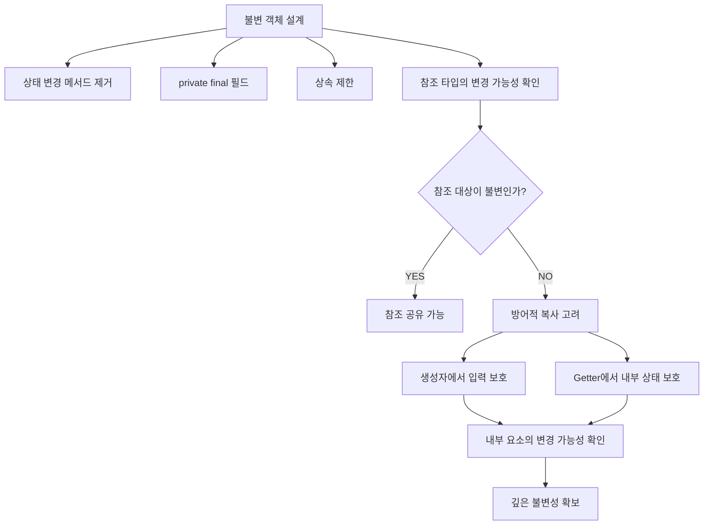

여기서 가장 중요한 부분은 참조 타입의 변경 가능성을 확인하는 단계다.

원시 타입만 사용하는 객체라면 비교적 단순하게 불변성을 확보할 수 있다.

하지만 참조 타입을 포함하는 순간 객체 사이의 공유 관계까지 고려해야 한다.

---

### 불변 객체와 final을 구분하는 핵심 질문

객체를 설계할 때 다음 질문을 생각해 볼 수 있다.

**첫 번째, 해당 필드는 재할당될 수 있는가?**

재할당을 제한해야 한다면 `final`을 고려할 수 있다.

**두 번째, 해당 필드가 참조하는 객체는 변경 가능한가?**

가변 객체라면 `final`만으로 불변성을 보장할 수 없다.

**세 번째, 외부에서 전달받은 객체를 그대로 저장하고 있는가?**

그렇다면 원본 객체의 변경이 내부 상태에 영향을 줄 수 있다.

**네 번째, Getter가 내부 객체를 그대로 반환하고 있는가?**

그렇다면 외부에서 내부 객체를 변경할 수 있다.

**다섯 번째, 컬렉션 내부에 변경 가능한 요소가 존재하는가?**

그렇다면 컬렉션 자체를 변경 불가능하게 만들어도 깊은 불변성이 보장되지 않을 수 있다.

**여섯 번째, 객체를 여러 스레드가 공유하는가?**

그렇다면 불변성뿐 아니라 객체의 안전한 게시와 공유 참조의 변경 방식도 검토해야 한다.

이 질문들은 불변 객체의 설계를 검토할 때 유용하다.

---

### 정리

Java에서 불변 객체는 생성된 이후 관찰 가능한 상태가 변경되지 않는 객체를 의미한다.

불변 객체는 상태 변경으로 인한 부작용을 줄이고, 객체의 동작을 예측하기 쉽게 만든다.

또 여러 스레드가 공유하는 데이터를 다룰 때 상태 변경으로 인한 경쟁 조건을 줄일 수 있다.

하지만 모든 객체를 불변으로 만드는 것이 항상 적절한 것은 아니다.

상태 변경 자체가 객체의 핵심 책임이라면 가변 객체가 더 자연스러울 수 있다.

따라서 객체의 역할에 따라 불변성과 가변성을 선택해야 한다.

Java의 `final` 키워드는 클래스와 메서드, 변수에 사용할 수 있다.

클래스에 사용하면 상속을 제한한다.

메서드에 사용하면 오버라이딩을 제한한다.

변수나 필드에 사용하면 초기화 이후 재할당을 제한한다.

하지만 `final`은 참조 대상 객체의 내부 상태를 변경하지 못하게 만드는 기능이 아니다.

원시 타입에서는 값 자체가 저장되므로 `final`을 사용하면 다른 값을 할당할 수 없다.

반면 참조 타입에서는 객체에 대한 참조 값이 저장된다.

따라서 변수를 다른 객체에 재할당하는 것은 막을 수 있지만 기존 객체의 내부 상태 변경까지 막지는 못한다.

이러한 차이를 이해하려면 Java의 Call by Value 동작 방식을 알아야 한다.

Java는 원시 타입과 참조 타입 모두 Call by Value를 사용한다.

원시 타입에서는 실제 값이 복사되어 전달된다.

참조 타입에서는 객체에 대한 참조 값이 복사되어 전달된다.

따라서 메서드 내부에서 참조 매개변수를 다른 객체로 재할당하더라도 호출한 쪽의 변수는 변경되지 않는다.

하지만 복사된 참조를 통해 동일한 객체의 내부 상태를 변경하면 호출한 쪽에서도 해당 변경을 관찰할 수 있다.

이것은 Call by Reference로 전달되었기 때문이 아니다.

두 참조가 동일한 객체를 가리키기 때문이다.

불변 객체를 만들기 위해서는 이러한 참조 관계를 고려해야 한다.

참조 타입을 필드로 보유하는 경우 해당 객체가 불변이라면 참조를 공유해도 문제가 발생하지 않을 수 있다.

반면 가변 객체를 참조한다면 외부에서 내부 상태가 변경될 수 있다.

이를 해결하기 위한 대표적인 방법이 방어적 복사다.

방어적 복사는 외부에서 전달받은 객체를 그대로 저장하지 않고 별도의 객체를 생성해 저장하는 방식이다.

이렇게 하면 외부 원본의 변경이 내부 상태에 영향을 주는 문제를 방지할 수 있다.

하지만 생성자에서 방어적 복사를 수행하는 것만으로 항상 충분하지는 않다.

Getter가 내부의 가변 객체를 그대로 반환한다면 외부에서 해당 객체의 상태를 변경할 수 있기 때문이다.

따라서 객체의 입력과 출력 방향을 모두 고려해야 한다.

가변 컬렉션에서도 동일한 문제가 발생한다.

`final List`는 List 참조의 재할당을 막지만 List의 요소 추가와 삭제를 막지 않는다.

`Collections.unmodifiableList()`는 해당 List 인터페이스를 통해 변경 작업을 수행하지 못하도록 하지만 원본 컬렉션의 변경까지 차단하는 것은 아니다.

원본 List를 참조하는 변경 불가능한 뷰를 제공하기 때문이다.

따라서 원본의 변경이 영향을 주지 않도록 하려면 별도의 복사본이 필요하다.

Java 10부터 제공되는 `List.copyOf()`는 이러한 요구사항을 간결하게 처리할 수 있다.

원본 컬렉션이 이후 변경되어도 반환된 List의 내용은 영향을 받지 않으며 반환된 List 자체도 변경할 수 없다.

다만 `List.copyOf()`는 내부 요소까지 깊은 복사하지 않는다.

컬렉션 안에 가변 객체가 있다면 해당 객체의 상태는 변경될 수 있다.

따라서 깊은 불변성을 확보하려면 컬렉션 내부 요소의 변경 가능성까지 고려해야 한다.

배열 역시 변경 가능한 객체이므로 생성자와 Getter에서 방어적 복사가 필요할 수 있다.

Record도 동일한 원칙이 적용된다.

Record는 Component 필드를 `final`로 제공하지만 기본적으로 얕은 불변성을 제공한다.

따라서 List나 배열, 가변 객체를 Component로 사용한다면 별도의 불변성 설계가 필요하다.

또 `final`은 Java Memory Model에서도 중요한 의미를 가진다.

정상적으로 생성된 객체의 `final` 필드는 특별한 초기화 가시성 규칙의 적용을 받는다.

하지만 `final`을 사용했다고 모든 객체가 자동으로 스레드 안전해지는 것은 아니다.

특히 `final` 필드가 가변 객체를 참조한다면 해당 객체의 상태 변경에 대한 동시성 문제는 여전히 존재할 수 있다.

실무에서는 불변 객체를 다음과 같은 영역에 활용할 수 있다.

- Value Object
- API 요청 및 응답 DTO
- 캐시 Key
- 이벤트 메시지
- 애플리케이션 설정
- 상태 스냅샷
- 멀티스레드 환경의 공유 읽기 데이터

이러한 객체들은 생성 이후 상태가 변경되지 않도록 설계하면 부작용과 데이터 불일치 가능성을 줄일 수 있다.

하지만 불변 객체의 사용이 항상 성능 향상을 보장하는 것은 아니다.

새로운 객체를 생성하거나 컬렉션을 복사하는 비용이 발생할 수 있기 때문이다.

따라서 실제 시스템에서는 불변성을 통해 얻는 안정성과 복사 및 객체 생성 비용 사이의 균형을 고려해야 한다.

마지막으로 핵심 개념을 정리하면 다음과 같다.

| 개념 | 핵심 의미 |
|---|---|
| Immutable Object | 생성 이후 관찰 가능한 상태가 변경되지 않는 객체 |
| Mutable Object | 생성 이후 상태 변경이 가능한 객체 |
| final Class | 상속을 제한하는 클래스 |
| final Method | 오버라이딩을 제한하는 메서드 |
| final Variable | 초기화 이후 재할당을 제한하는 변수 |
| Call by Value | 인수의 값을 복사해 전달하는 방식 |
| Reference Type | 객체에 대한 참조를 다루는 타입 |
| Primitive Type | 원시 값을 직접 표현하는 타입 |
| Defensive Copy | 외부 변경의 영향을 줄이기 위해 별도 객체를 생성 |
| Shallow Copy | 내부 참조 대상은 공유할 수 있는 복사 |
| Deep Copy | 필요한 범위에서 내부 참조 대상까지 복사 |
| Unmodifiable Collection | 변경 메서드 호출을 지원하지 않는 컬렉션 |
| Unmodifiable View | 원본 컬렉션을 변경 불가능한 인터페이스로 감싼 뷰 |
| List.copyOf() | 원본의 이후 변경에 영향을 받지 않는 변경 불가능한 List 제공 |
| Shallow Immutability | 참조 필드의 재할당은 막지만 내부 객체 변경은 가능할 수 있음 |
| Deep Immutability | 내부에서 도달 가능한 상태까지 변경되지 않도록 보호 |
| Safe Publication | 다른 스레드가 초기화된 객체를 안전하게 관찰하도록 공유 |
| Java Memory Model | 스레드 사이의 메모리 동작과 가시성 규칙 |
| Value Object | 값 자체의 의미와 동등성을 표현하는 객체 |

결국 Java에서 불변 객체를 제대로 설계한다는 것은 모든 필드에 `final`을 붙이는 것이 아니다.

**객체가 외부와 어떤 참조를 공유하는지, 내부 상태를 변경할 수 있는 경로가 존재하는지, 생성자와 Getter를 통해 가변 객체가 노출되는지까지 확인해야 한다.**

`final`은 불변 객체를 만드는 데 중요한 도구지만 불변성을 완성하는 유일한 조건은 아니다.

참조 대상의 불변성, 방어적 복사, 컬렉션의 변경 가능성, 안전한 초기화와 공유 방식까지 함께 고려해야 안정적인 불변 객체를 만들 수 있다.

#### 한 줄 요약

**Java의 `final`은 변수의 재할당을 제한할 뿐 참조하는 객체의 내부 상태 변경까지 막지는 못한다. Java는 원시 타입과 참조 타입 모두 Call by Value로 전달하며, 참조 타입에서는 복사된 참조가 동일한 객체를 가리키기 때문에 객체의 상태가 변경될 수 있다. 따라서 진정한 불변 객체를 만들기 위해서는 `final`뿐 아니라 내부 객체의 불변성, 생성자와 Getter의 방어적 복사, 컬렉션 요소의 변경 가능성까지 함께 고려해야 한다.**
