# 이프의 가용성 - 배포 중에도 우리 서비스가 멈추지 않는 이유
[https://youtu.be/ffHZGrQXvT8?si=Ew95wyipWPLT81Md](https://youtu.be/ffHZGrQXvT8?si=Ew95wyipWPLT81Md)

# 이프의 가용성 - 배포 중에도 우리 서비스가 멈추지 않는 이유
* toc
{:toc}

---

### 무중단 배포 완벽 이해: 가용성, Readiness, Graceful Shutdown, Rolling Update, Blue-Green, 롤백과 Spring Boot 실무

백엔드 애플리케이션을 개발하다 보면 새로운 기능을 배포해야 하는 상황이 반복적으로 발생한다.

예를 들어 주문 서비스에서 새로운 결제 수단을 추가했다고 가정하자.

기존 서비스는 V1이고 새롭게 개발한 서비스는 V2다.

가장 단순한 배포 방식은 다음과 같다.

1. 실행 중인 V1 애플리케이션을 종료한다.
2. 새로운 V2 애플리케이션을 실행한다.
3. V2가 정상적으로 실행되면 사용자 요청을 처리한다.

이 과정은 간단해 보인다.

하지만 중요한 문제가 있다.

**V1이 종료된 시점부터 V2가 요청을 처리할 수 있게 되기까지 서비스가 중단될 수 있다는 것이다.**

예를 들어 Spring Boot 애플리케이션의 실행 시간이 10초라고 가정하자.

기존 서버를 종료한 후 새 서버를 실행한다면 적어도 새 서버가 준비되는 동안에는 요청을 처리할 수 없다.

```text
10:00:00 → V1 종료

10:00:01 → V2 실행 시작

10:00:05 → Spring ApplicationContext 초기화

10:00:08 → 데이터베이스 연결 및 초기화

10:00:10 → V2 요청 처리 준비 완료
```

이 10초 동안 사용자가 주문 API를 호출한다면 어떻게 될까?

요청은 연결 실패나 HTTP 502, 503 등의 오류로 이어질 수 있다.

특히 결제, 주문, 인증처럼 사용자가 지속적으로 요청하는 서비스에서는 짧은 중단 시간도 문제가 된다.

이러한 문제를 해결하기 위한 대표적인 방법이 **무중단 배포(Zero-Downtime Deployment)**다.

하지만 무중단 배포를 이해하려면 단순히 서버 두 대를 실행하는 것에서 더 나아가야 한다.

다음과 같은 질문도 함께 생각해야 한다.

- 새로운 서버가 실제 요청을 처리할 준비가 되었는지 어떻게 판단할까?
- 기존 서버가 처리하던 요청은 어떻게 마무리할까?
- 배포 직후 새로운 버전에서 장애가 발생하면 어떻게 복구할까?
- 기존 버전과 새로운 버전이 동시에 실행될 때 데이터베이스 스키마가 변경된다면 어떻게 될까?
- 서버가 두 대로 늘어나면 세션과 스케줄러는 어떻게 관리해야 할까?
- 모든 배포 요청이 성공했다면 서비스 가용성이 보장되었다고 할 수 있을까?

이러한 문제를 순서대로 살펴보자.

---

### 개념

#### 가용성(Availability)이란 무엇인가?

가용성은 사용자가 서비스를 필요로 할 때 정상적으로 사용할 수 있는 정도를 의미한다.

가장 단순한 형태로 표현하면 다음과 같다.

```text
Availability

= 정상적으로 서비스를 사용할 수 있었던 시간
  / 전체 관측 시간
  × 100
```

예를 들어 한 달 동안 서비스를 운영했다고 가정하자.

한 달을 30일로 계산하면 전체 시간은 43,200분이다.

이 기간에 서비스가 43.2분 중단되었다면 시간 기반 가용성은 약 99.9%다.

가용성 목표를 비교하면 다음과 같다.

| 가용성 목표 | 30일 기준 허용 중단 시간 |
|---|---:|
| 99% | 7시간 12분 |
| 99.5% | 3시간 36분 |
| 99.9% | 43분 12초 |
| 99.95% | 21분 36초 |
| 99.99% | 4분 19.2초 |
| 99.999% | 약 25.9초 |

위 수치는 단순한 시간 비율을 기준으로 계산한 값이다.

실제 운영에서는 **서비스를 사용할 수 있었다는 사실을 어떤 기준으로 정의하느냐**가 더욱 중요하다.

예를 들어 서버 프로세스는 정상적으로 실행되고 있지만 주문 API가 계속 500 오류를 반환한다면 어떨까?

서버는 실행 중이지만 사용자는 정상적으로 주문할 수 없다.

따라서 서비스를 사용할 수 있는 상태라고 보기 어렵다.

반대로 일부 부가 기능에서 장애가 발생했지만 주문과 결제 기능은 정상적으로 사용할 수 있다면 전체 서비스가 완전히 중단되었다고 판단하기 어려울 수도 있다.

이러한 차이 때문에 실제 가용성은 단순히 서버의 실행 시간을 측정하는 것보다 사용자 요청의 성공 여부를 기준으로 측정하는 경우가 많다.

Google SRE에서도 요청 성공률과 사용자에게 정상적으로 제공된 서비스 시간 등을 가용성 측정 지표로 활용한다.

#### 신뢰성(Reliability)이란 무엇인가?

신뢰성은 시스템이 주어진 조건에서 요구된 기능을 올바르게 수행할 수 있는 성질을 의미한다.

가용성과 신뢰성은 밀접하게 관련되어 있지만 동일한 개념은 아니다.

예를 들어 다음과 같은 상황을 생각해 보자.

```text
서비스 A

서버 정상 실행: 99.99%

주문 API 오류율: 5%
```

서버는 거의 항상 실행 중이다.

하지만 주문 요청의 5%가 실패한다면 사용자는 서비스를 신뢰하기 어렵다.

반대로 다음과 같은 서비스는 어떨까?

```text
서비스 B

서버 정상 실행: 99.9%

주문 API 오류율: 0.01%
```

서비스 B는 서버가 실행된 시간만으로 보면 A보다 낮은 가용성을 가질 수 있다.

하지만 실제 사용자 요청의 성공률과 장애 특성까지 함께 고려하면 평가가 달라질 수 있다.

따라서 신뢰할 수 있는 시스템을 설계하려면 가용성 외에도 다음 요소를 고려해야 한다.

| 요소 | 의미 |
|---|---|
| Availability | 사용자가 서비스를 이용할 수 있는 정도 |
| Reliability | 시스템이 요구된 기능을 올바르게 수행하는 정도 |
| Durability | 저장된 데이터가 유실되지 않고 유지되는 성질 |
| Consistency | 데이터가 정해진 일관성 규칙을 만족하는 성질 |
| Fault Tolerance | 일부 장애가 발생해도 기능을 지속하는 능력 |
| Recoverability | 장애 이후 정상 상태로 복구하는 능력 |
| Observability | 시스템 내부 상태를 외부 지표로 이해할 수 있는 능력 |

무중단 배포는 이러한 요소 중 **배포 과정에서 발생하는 가용성 저하를 줄이기 위한 기술**이다.

---

### 왜 무중단 배포가 필요한가?

서비스는 한 번 배포했다고 끝나는 시스템이 아니다.

새로운 기능이 추가되고, 버그가 수정되며, 데이터베이스 구조와 외부 시스템 연동 방식이 변경된다.

특히 지속적으로 배포하는 환경에서는 배포 횟수가 증가한다.

예를 들어 매일 3번 배포한다고 가정하자.

기존 배포 방식에서 배포마다 10초의 서비스 중단이 발생한다면 다음과 같다.

```text
1회 배포 중단 시간 = 10초

일일 배포 횟수 = 3회

일일 중단 시간 = 30초
```

한 달 동안 매일 배포한다면 배포로 인해 약 15분의 중단 시간이 발생할 수 있다.

여기에 서버 장애나 네트워크 장애, 데이터베이스 장애가 추가될 수도 있다.

가용성 목표가 99.99%라면 30일 기준 허용 중단 시간이 약 4분 19초밖에 되지 않는다.

따라서 배포할 때마다 서비스를 중단하는 방식으로는 높은 가용성 목표를 달성하기 어렵다.

무중단 배포는 이러한 문제를 해결하기 위해 **새 버전이 정상적으로 준비된 후에 기존 버전을 종료하는 방식**을 활용한다.

---

### 무중단 배포의 핵심 원리

무중단 배포의 핵심은 생각보다 단순하다.

**기존 서버를 종료하기 전에 새로운 서버가 요청을 처리할 준비를 마치도록 하는 것이다.**

기존 배포 방식은 다음과 같다.

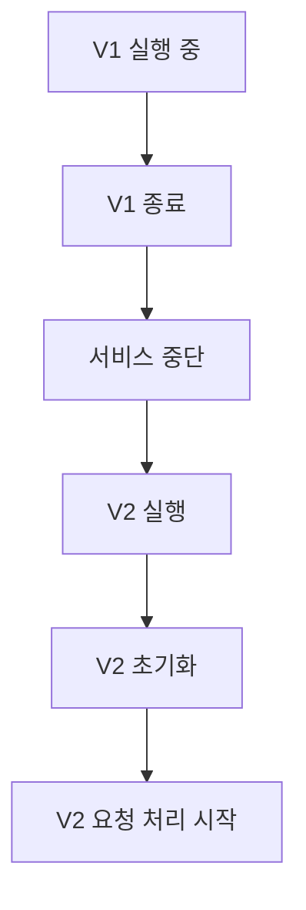

반면 무중단 배포는 다음과 같은 흐름을 가진다.

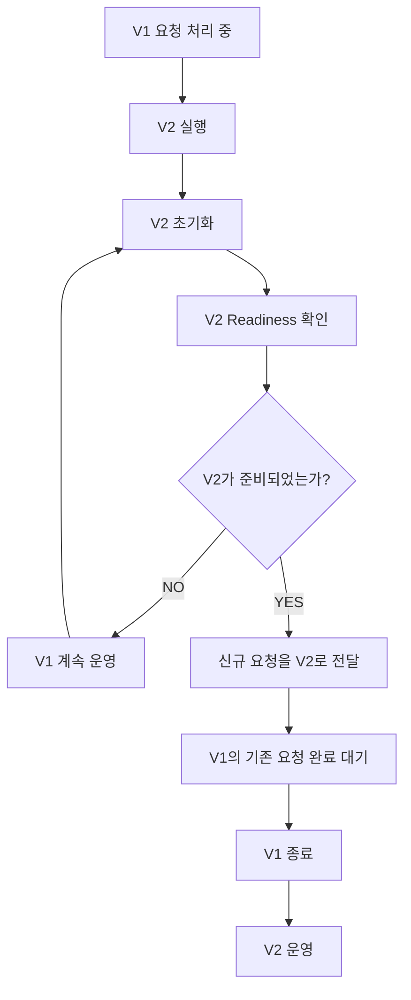

이 과정에서 중요한 요소는 세 가지다.

첫 번째는 Load Balancer다.

두 번째는 Readiness Health Check다.

세 번째는 Graceful Shutdown이다.

세 요소가 서로 협력해야 배포 과정의 요청 실패를 줄일 수 있다.

---

### 주요 특징

#### 1. Load Balancer란 무엇인가?

Load Balancer는 여러 서버에 들어오는 요청을 분산하는 구성 요소다.

예를 들어 애플리케이션 서버가 두 대 있다고 가정하자.

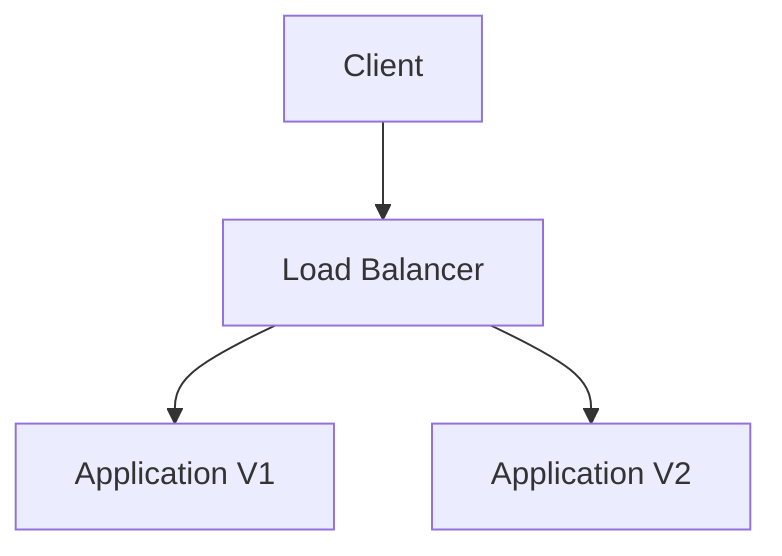

사용자는 개별 애플리케이션 서버의 주소를 직접 알 필요가 없다.

Load Balancer에 요청을 보내면 설정된 정책에 따라 요청이 적절한 서버로 전달된다.

대표적인 Load Balancer에는 다음과 같은 기술이 있다.

- Nginx
- HAProxy
- AWS Application Load Balancer
- AWS Network Load Balancer
- Kubernetes Service
- Kubernetes Ingress Controller 또는 Gateway 구현체

여기서 중요한 기능은 단순한 트래픽 분산이 아니다.

**정상적으로 요청을 처리할 수 있는 서버에만 요청을 전달하는 기능**이 중요하다.

예를 들어 V2가 아직 실행 중인 초기화 작업을 완료하지 못했다고 가정하자.

이때 Load Balancer가 V2에 요청을 전달하면 오류가 발생할 수 있다.

따라서 새로운 서버를 실행했다는 사실만으로 트래픽을 전달해서는 안 된다.

서버가 준비되었는지 확인하는 과정이 필요하다.

이를 Readiness Health Check라고 한다.

---

#### 2. Readiness Health Check란 무엇인가?

Readiness는 애플리케이션이 새로운 요청을 처리할 준비가 되었는지 나타내는 상태다.

예를 들어 Spring Boot 애플리케이션은 다음과 같은 초기화 과정을 거칠 수 있다.

```text
JVM 실행

↓

Spring ApplicationContext 생성

↓

Bean 초기화

↓

외부 시스템 연결 준비

↓

애플리케이션 초기화 작업

↓

요청 처리 준비 완료
```

여기서 중요한 점은 **프로세스가 실행되고 있다는 사실과 실제 요청을 처리할 준비가 되었다는 사실은 다르다**는 것이다.

예를 들어 다음과 같은 상황을 생각해 보자.

```text
JVM 프로세스: 실행 중

Spring Context: 초기화 중

HTTP 요청 처리: 아직 불가능
```

이 상태에서 새로운 서버로 요청을 전달하면 문제가 발생할 수 있다.

따라서 서버가 요청을 처리할 준비가 되었는지 별도로 확인해야 한다.

Spring Boot는 애플리케이션의 Readiness 상태를 제공한다.

대표적인 상태는 다음과 같다.

| 상태 | 의미 |
|---|---|
| `ACCEPTING_TRAFFIC` | 새로운 요청을 처리할 준비가 됨 |
| `REFUSING_TRAFFIC` | 새로운 요청을 받지 않아야 함 |

Spring Boot에서는 Actuator를 이용해 이러한 상태를 HTTP Endpoint로 확인할 수 있다.

```http
GET /actuator/health/readiness
```

정상적인 상태에서는 다음과 같은 응답을 받을 수 있다.

```json
{
  "status": "UP"
}
```

반대로 요청을 처리할 준비가 되지 않은 상태에서는 `OUT_OF_SERVICE` 등의 상태가 나타날 수 있다.

단, 실제 응답은 애플리케이션 상태와 Health Indicator 구성에 따라 달라진다.

이러한 Readiness 정보는 Load Balancer 또는 Kubernetes가 새로운 요청을 어느 서버로 전달할지 판단하는 데 활용할 수 있다.

Spring Boot 공식 문서에서도 애플리케이션 시작과 종료 과정에 따라 Readiness 상태가 변경되는 방식을 설명한다.

---

### Liveness와 Readiness는 무엇이 다를까?

Health Check를 사용할 때 가장 자주 혼동하는 개념이 Liveness와 Readiness다.

두 개념은 서로 다른 질문에 답한다.

**Liveness는 애플리케이션이 정상적으로 살아 있는가?**

**Readiness는 애플리케이션이 새로운 요청을 처리할 준비가 되었는가?**

예를 들어 데이터베이스에 일시적인 장애가 발생했다고 가정하자.

애플리케이션 프로세스 자체는 정상적으로 실행 중이다.

하지만 해당 데이터베이스를 반드시 필요로 하는 요청은 처리할 수 없을 수도 있다.

이러한 상황에서 애플리케이션을 무조건 재시작하는 것이 해결책이 될까?

그렇지 않을 수 있다.

특히 모든 애플리케이션 인스턴스가 동일한 데이터베이스 장애를 경험하고 있다면 전체 인스턴스를 반복적으로 재시작하는 문제가 발생할 수 있다.

따라서 Liveness는 일반적으로 애플리케이션 자체의 정상 동작 여부를 판단하는 데 사용한다.

Readiness는 요청을 처리할 수 있는 상태인지 판단하는 데 사용한다.

| 구분 | Liveness | Readiness |
|---|---|---|
| 핵심 질문 | 프로세스를 재시작해야 하는가? | 새로운 요청을 전달해도 되는가? |
| 정상 상태 | 살아 있음 | 요청 처리 가능 |
| 실패 시 대표적인 동작 | 컨테이너 재시작 | 서비스 라우팅 대상에서 제외 |
| 주요 용도 | 프로세스 복구 | 트래픽 제어 |
| 주의사항 | 외부 시스템 장애와 무분별하게 연결하지 않음 | 실제 요청 처리 가능성을 반영해야 함 |

Kubernetes에서는 Startup Probe도 사용할 수 있다.

Startup Probe는 애플리케이션의 초기 실행 시간이 길 때 초기화가 완료되기 전에 Liveness 실패로 컨테이너가 재시작되는 문제를 방지하는 데 유용하다.

세 가지 Probe를 비교하면 다음과 같다.

| Probe | 주요 목적 |
|---|---|
| Startup Probe | 애플리케이션 초기화 완료 여부 확인 |
| Liveness Probe | 컨테이너 재시작 필요 여부 판단 |
| Readiness Probe | 새로운 트래픽 전달 여부 판단 |

Kubernetes는 Readiness Probe가 실패한 컨테이너를 즉시 재시작하는 것이 아니라, 일반적으로 해당 Pod를 서비스의 정상적인 트래픽 대상에서 제외하도록 처리한다.

---

### 3. Graceful Shutdown이란 무엇인가?

Graceful Shutdown은 애플리케이션을 종료할 때 처리 중인 작업이 가능한 한 정상적으로 완료되도록 기다리는 종료 방식이다.

무중단 배포에서는 V2가 요청을 처리할 준비를 마치면 새로운 요청을 V2로 전달한다.

하지만 V1을 즉시 종료해서는 안 된다.

왜 그럴까?

V1에서 이미 처리하고 있는 요청이 존재할 수 있기 때문이다.

예를 들어 다음과 같은 결제 요청이 실행 중이라고 가정하자.

```text
사용자 결제 요청

↓

주문 정보 확인

↓

결제 승인 API 호출

↓

결제 결과 저장

↓

사용자에게 응답
```

그런데 결제 승인 API를 호출하고 있는 순간 V1이 종료된다면 어떻게 될까?

외부 결제는 성공했지만 내부 DB 반영이 완료되지 않았을 수 있다.

또 사용자는 요청이 실패했다고 판단해 동일한 결제를 재시도할 수도 있다.

이러한 문제를 줄이기 위해 기존 서버가 처리 중인 요청을 마무리할 시간을 제공해야 한다.

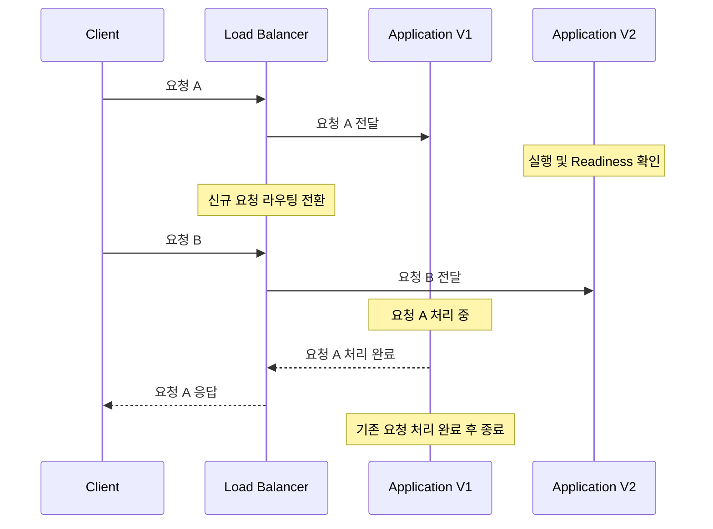

이 과정이 Graceful Shutdown의 핵심이다.

#### Graceful Shutdown의 동작 순서

일반적인 흐름은 다음과 같다.

1. 애플리케이션 종료 요청을 받는다.
2. 새로운 요청을 더 이상 받지 않도록 처리한다.
3. 진행 중인 요청이 완료되기를 기다린다.
4. 설정된 종료 대기 시간 내에 작업을 마무리한다.
5. 애플리케이션 리소스를 정리한다.
6. 프로세스를 종료한다.

하지만 주의할 점이 있다.

**Graceful Shutdown은 처리 중인 모든 작업이 반드시 성공한다는 보장이 아니다.**

설정된 종료 시간이 초과될 수도 있다.

애플리케이션에 장애가 발생해 정상적인 종료 절차를 수행하지 못할 수도 있다.

또 HTTP 요청 이외의 비동기 작업은 별도의 종료 정책이 필요할 수 있다.

따라서 Graceful Shutdown은 요청 유실 가능성을 줄이는 중요한 기법이지만, 모든 작업의 완료를 보장하는 유일한 장치는 아니다.

---

### SIGTERM과 SIGKILL의 차이

Graceful Shutdown을 제대로 이해하려면 운영체제의 종료 신호도 알아야 한다.

Linux 환경에서 자주 사용하는 신호는 SIGTERM과 SIGKILL이다.

#### SIGTERM

프로세스에 정상적인 종료를 요청하는 신호다.

애플리케이션은 종료 절차를 수행할 기회를 가질 수 있다.

예를 들어 다음 명령어를 사용할 수 있다.

```bash
kill -TERM 12345
```

여기서 `12345`는 대상 프로세스의 PID다.

Java 애플리케이션은 정상적인 종료 경로가 실행되면 Spring ApplicationContext를 닫고 필요한 리소스를 정리할 수 있다.

#### SIGKILL

프로세스를 강제로 종료하는 신호다.

```bash
kill -KILL 12345
```

이 경우 애플리케이션이 정상적인 종료 작업을 수행할 기회를 제공하지 않는다.

따라서 처리 중이던 작업이 중단될 수 있다.

두 신호를 비교하면 다음과 같다.

| 구분 | SIGTERM | SIGKILL |
|---|---|---|
| 목적 | 정상적인 종료 요청 | 강제 종료 |
| 애플리케이션 종료 처리 | 수행 가능 | 수행 불가 |
| Graceful Shutdown | 가능 | 불가능 |
| 실행 중인 작업 | 종료 정책에 따라 대기 가능 | 즉시 중단될 수 있음 |
| 활용 | 일반적인 서비스 종료 | 정상 종료 불가능 시 강제 종료 |

Kubernetes에서는 일반적인 Pod 종료 과정에서 TERM 신호를 보내고 설정된 종료 유예 시간이 지나도 프로세스가 종료되지 않으면 강제 종료할 수 있다.

---

### 무중단 배포의 전체 동작 구조

지금까지 살펴본 Load Balancer, Readiness, Graceful Shutdown을 하나의 흐름으로 정리해 보자.

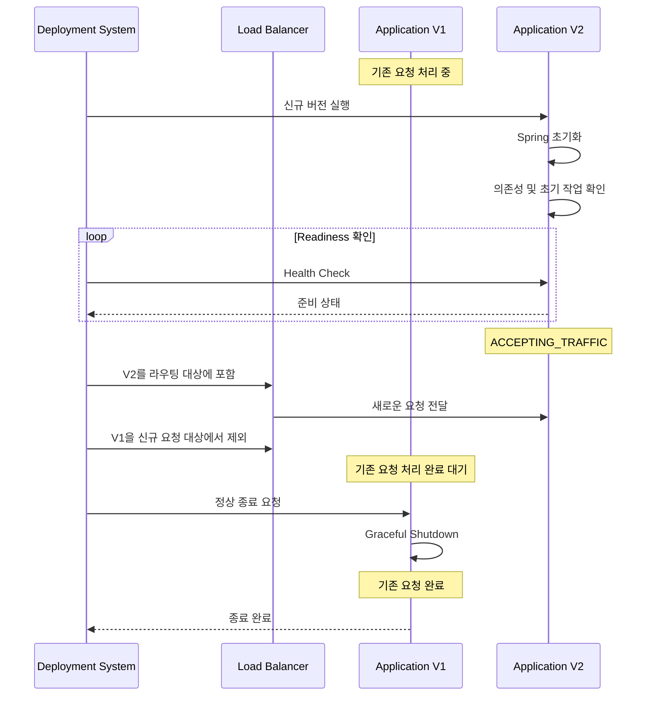

이 구조에서 무중단 배포의 핵심은 다음과 같다.

**새로운 버전이 준비되기 전에는 기존 버전이 계속 요청을 처리하고, 새로운 버전이 준비되면 트래픽을 전환한 뒤 기존 버전의 진행 중인 요청을 안전하게 마무리하는 것이다.**

다만 실제 로드 밸런서의 상태 반영에는 전파 지연이 존재할 수 있다.

또 기존 연결의 유지 방식과 HTTP Keep-Alive, WebSocket 등의 특성에 따라 추가적인 연결 종료 정책이 필요할 수 있다.

따라서 이 구조를 구현했다고 모든 상황에서 요청 실패가 절대 발생하지 않는다고 단정할 수는 없다.

---

### 무중단 배포 방식의 종류

무중단 배포에는 여러 전략이 존재한다.

대표적으로 다음 세 가지가 있다.

1. Rolling Deployment
2. Blue-Green Deployment
3. Canary Deployment

각 방식은 새로운 버전을 배포한다는 공통점이 있지만, 트래픽을 전환하는 방법과 리스크 관리 방식이 다르다.

---

### Rolling Deployment란 무엇인가?

Rolling Deployment는 여러 애플리케이션 인스턴스를 순차적으로 새로운 버전으로 교체하는 방식이다.

예를 들어 V1 서버가 세 대 있다고 가정하자.

```text
Application A → V1

Application B → V1

Application C → V1
```

새로운 V2를 배포한다.

먼저 일부 인스턴스가 V2로 교체된다.

```text
Application A → V2

Application B → V1

Application C → V1
```

다음으로 또 다른 인스턴스를 교체한다.

```text
Application A → V2

Application B → V2

Application C → V1
```

마지막 인스턴스까지 교체한다.

```text
Application A → V2

Application B → V2

Application C → V2
```

이 과정에서 적절한 수의 정상적인 인스턴스가 유지되도록 구성하면 서비스 중단 가능성을 줄일 수 있다.

#### Rolling Deployment의 장점

별도의 전체 서버 그룹을 준비하지 않아도 점진적으로 배포할 수 있다.

또 Kubernetes와 같은 플랫폼에서 기본적으로 지원하는 배포 방식이다.

#### Rolling Deployment의 단점

배포 과정에서 V1과 V2가 동시에 실행된다.

따라서 서로 다른 버전의 애플리케이션이 동일한 DB와 메시지 시스템을 사용하는 상황을 고려해야 한다.

또 새로운 버전에 문제가 발생하면 이미 교체한 인스턴스를 이전 버전으로 되돌려야 한다.

---

### Blue-Green Deployment란 무엇인가?

Blue-Green Deployment는 기존 버전과 새로운 버전을 서로 다른 환경에 실행한 뒤 트래픽을 전환하는 방식이다.

예를 들어 Blue 환경에서 V1을 운영한다고 가정하자.

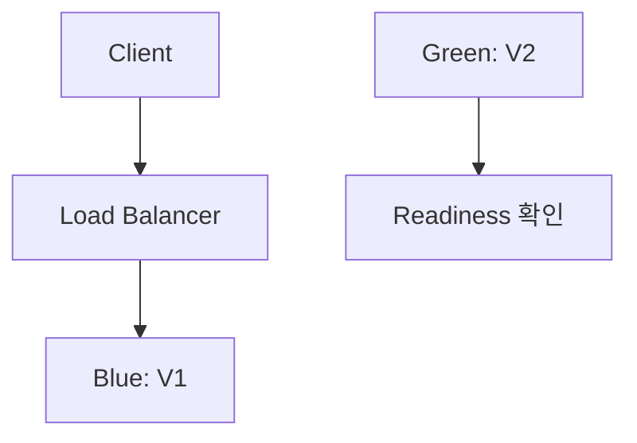

Blue는 실제 사용자 요청을 처리하고 있다.

Green에는 새로운 V2를 배포한다.

Green이 정상적으로 준비되면 트래픽을 Green으로 전환한다.

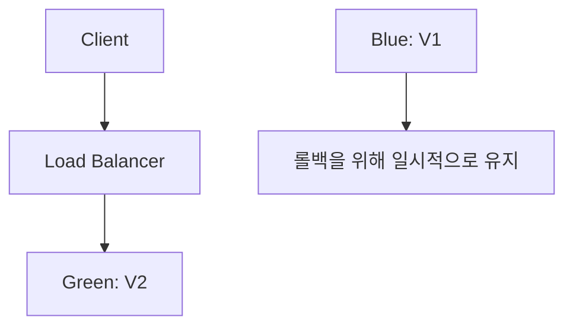

이 방식에서는 이전 버전의 환경을 일정 시간 유지할 수 있다.

따라서 새로운 버전에 문제가 발생했을 때 트래픽을 이전 환경으로 되돌리는 전략을 구성하기 쉽다.

하지만 주의해야 한다.

**이전 버전의 서버가 살아 있다고 해서 데이터까지 자동으로 이전 상태로 되돌아가는 것은 아니다.**

Blue와 Green이 동일한 데이터베이스를 사용하고 있다면 V2가 변경한 데이터는 그대로 남아 있을 수 있다.

따라서 실제 롤백을 위해서는 DB 스키마와 데이터 구조의 하위 호환성이 중요하다.

---

### Canary Deployment란 무엇인가?

Canary Deployment는 새로운 버전에 일부 트래픽만 전달한 뒤 문제가 없는지 확인하면서 점진적으로 비율을 증가시키는 방식이다.

예를 들어 다음과 같이 구성할 수 있다.

```text
V1 → 전체 트래픽의 95%

V2 → 전체 트래픽의 5%
```

문제가 없으면 V2의 트래픽 비율을 높인다.

```text
V1 → 50%

V2 → 50%
```

마지막으로 모든 트래픽을 V2로 전환한다.

```text
V1 → 0%

V2 → 100%
```

이 방식은 새로운 버전의 오류를 일부 사용자에게만 노출하면서 확인할 수 있다는 장점이 있다.

하지만 트래픽 분산과 버전별 모니터링을 구현해야 한다.

특히 다음 지표가 중요하다.

- 버전별 HTTP 오류율
- 버전별 p95 및 p99 응답 시간
- 새로운 버전의 CPU 및 메모리 사용량
- 결제 실패율
- 주요 비즈니스 지표
- 요청량 대비 오류 비율

단순히 V2의 Readiness가 정상이라는 이유만으로 Canary를 성공했다고 판단해서는 안 된다.

실제 트래픽에서만 드러나는 오류가 존재할 수 있기 때문이다.

---

### 배포 전략 비교

| 구분 | Rolling | Blue-Green | Canary |
|---|---|---|---|
| 배포 방식 | 인스턴스 순차 교체 | 두 환경 간 전환 | 일부 트래픽부터 점진적 전환 |
| V1·V2 공존 | 발생 | 발생 | 발생 |
| 추가 인프라 | 설정에 따라 일부 필요 | 상대적으로 많이 필요 | 설정에 따라 다름 |
| 롤백 | 이전 버전 재배포 | 이전 환경으로 라우팅 전환 가능 | 새 버전 트래픽 차단 |
| 장애 영향 범위 | 배포 진행 정도에 따라 다름 | 전환 시점의 영향이 클 수 있음 | 초기에는 일부 트래픽으로 제한 가능 |
| 운영 복잡도 | 상대적으로 낮음 | 중간 | 상대적으로 높음 |
| 대표적인 활용 | 일반적인 서버 배포 | 빠른 트래픽 전환 | 신규 기능의 점진적 검증 |

실무에서 중요한 것은 어떤 방식이 무조건 더 좋다는 결론이 아니다.

서비스의 규모와 장애 허용 범위, 트래픽 특성, 인프라 비용에 따라 적절한 방식을 선택해야 한다.

---

### 예제

### Spring Boot에서 Readiness와 Graceful Shutdown 구현하기

이제 Spring Boot에서 무중단 배포에 필요한 기능을 구성해 보자.

다음 환경을 기준으로 한다.

| 항목 | 환경 |
|---|---|
| Java | 17 |
| Spring Boot | 3.5.x |
| Spring Web | 사용 |
| Spring Boot Actuator | 사용 |
| 배포 환경 | Kubernetes |
| HTTP 서버 | 기본 내장 Tomcat |

먼저 Spring Boot 애플리케이션을 준비한다.

#### Gradle 설정

`build.gradle`

```groovy
plugins {
    id 'java'
    id 'org.springframework.boot' version '3.5.7'
    id 'io.spring.dependency-management' version '1.1.7'
}

group = 'com.example'
version = '1.0.0'

java {
    toolchain {
        languageVersion = JavaLanguageVersion.of(17)
    }
}

repositories {
    mavenCentral()
}

dependencies {
    implementation 'org.springframework.boot:spring-boot-starter-web'

    implementation 'org.springframework.boot:spring-boot-starter-actuator'

    testImplementation 'org.springframework.boot:spring-boot-starter-test'
}

tasks.named('bootJar') {
    archiveFileName = 'availability-demo.jar'
}

tasks.named('test') {
    useJUnitPlatform()
}
```

핵심 의존성은 두 가지다.

`spring-boot-starter-web`은 HTTP 요청을 처리하기 위한 기능을 제공한다.

`spring-boot-starter-actuator`는 애플리케이션의 상태와 운영 정보를 확인할 수 있도록 지원한다.

#### 애플리케이션 설정

`src/main/resources/application.yml`

```yaml
server:
  port: 8080
  shutdown: graceful

spring:
  application:
    name: availability-demo

  lifecycle:
    timeout-per-shutdown-phase: 30s

management:
  endpoints:
    web:
      exposure:
        include:
          - health
          - info

  endpoint:
    health:
      probes:
        enabled: true
        add-additional-paths: true

      show-details: never
```

중요한 설정을 하나씩 살펴보자.

##### server.shutdown

```yaml
server:
  shutdown: graceful
```

Graceful Shutdown을 명시적으로 활성화한다.

Spring Boot 3.5에서는 지원되는 내장 웹 서버의 Graceful Shutdown이 기본적으로 활성화되어 있지만, 설정을 명시하면 의도가 명확해진다.

이전 버전의 Spring Boot에서는 기본값이 다를 수 있으므로 버전에 따른 차이를 확인해야 한다.

##### spring.lifecycle.timeout-per-shutdown-phase

```yaml
spring:
  lifecycle:
    timeout-per-shutdown-phase: 30s
```

Spring의 종료 단계에 적용할 대기 시간을 설정한다.

처리 중인 요청이 완료될 수 있도록 유예 시간을 제공한다.

다만 이 옵션은 전체 Kubernetes Pod 종료 시간을 설정하는 기능이 아니다.

Kubernetes의 종료 유예 시간과 별도로 관리해야 한다.

##### management.endpoint.health.probes.enabled

```yaml
management:
  endpoint:
    health:
      probes:
        enabled: true
```

Liveness와 Readiness Health Group을 사용할 수 있도록 설정한다.

##### management.endpoint.health.probes.add-additional-paths

```yaml
management:
  endpoint:
    health:
      probes:
        add-additional-paths: true
```

이 설정을 사용하면 기본적으로 다음 경로를 애플리케이션의 메인 HTTP 포트에서도 사용할 수 있다.

```http
GET /livez
```

```http
GET /readyz
```

메인 포트에서 Probe를 확인하면 별도 관리 포트는 정상인데 실제 서비스 포트에는 문제가 있는 상황을 일부 방지하는 데 도움이 된다.

Spring Boot 공식 문서에서도 메인 서버 포트의 `/livez`, `/readyz` 경로를 사용할 수 있도록 하는 설정을 제공한다.

---

### Spring Boot 애플리케이션 작성

먼저 애플리케이션의 진입점을 작성한다.

`AvailabilityDemoApplication.java`

```java
package com.example.availability;

import org.springframework.boot.SpringApplication;
import org.springframework.boot.autoconfigure.SpringBootApplication;

@SpringBootApplication
public class AvailabilityDemoApplication {

    public static void main(String[] args) {
        SpringApplication.run(
                AvailabilityDemoApplication.class,
                args
        );
    }
}
```

이제 애플리케이션 버전을 확인할 수 있는 API를 작성한다.

`VersionController.java`

```java
package com.example.availability;

import java.time.Instant;
import java.util.Map;

import org.springframework.beans.factory.annotation.Value;
import org.springframework.web.bind.annotation.GetMapping;
import org.springframework.web.bind.annotation.RequestMapping;
import org.springframework.web.bind.annotation.RestController;

@RestController
@RequestMapping("/api")
public class VersionController {

    private final String applicationVersion;

    public VersionController(
            @Value("${app.version:v1}") String applicationVersion
    ) {
        this.applicationVersion = applicationVersion;
    }

    @GetMapping("/version")
    public Map<String, Object> version() {

        return Map.of(
                "version", applicationVersion,
                "timestamp", Instant.now().toString()
        );
    }
}
```

이 API는 현재 요청을 처리한 애플리케이션의 버전을 반환한다.

```http
GET /api/version
```

예상 응답은 다음과 같다.

```json
{
  "version": "v1",
  "timestamp": "2026-11-10T01:00:00Z"
}
```

이제 요청이 실제로 어떤 버전으로 전달되는지 확인할 수 있다.

---

### 처리 시간이 긴 요청 구현하기

Graceful Shutdown을 확인하기 위해 일정 시간 동안 실행되는 API도 작성해 보자.

`WorkController.java`

```java
package com.example.availability;

import java.util.Map;

import org.springframework.web.bind.annotation.GetMapping;
import org.springframework.web.bind.annotation.RequestMapping;
import org.springframework.web.bind.annotation.RequestParam;
import org.springframework.web.bind.annotation.RestController;

@RestController
@RequestMapping("/api")
public class WorkController {

    @GetMapping("/work")
    public Map<String, Object> work(
            @RequestParam(defaultValue = "3000") long millis
    ) throws InterruptedException {

        if (millis < 0 || millis > 20_000) {
            throw new IllegalArgumentException(
                    "millis는 0~20000 사이여야 합니다."
            );
        }

        Thread.sleep(millis);

        return Map.of(
                "status", "COMPLETED",
                "processingTimeMillis", millis
        );
    }
}
```

다음과 같이 호출할 수 있다.

```bash
curl "http://localhost:8080/api/work?millis=5000"
```

요청이 약 5초 동안 실행된 후 응답을 반환한다.

```json
{
  "status": "COMPLETED",
  "processingTimeMillis": 5000
}
```

이 코드는 종료 대기 동작을 확인하기 위한 단순한 예제다.

실제 서비스에서는 비즈니스 작업을 기다리기 위해 요청 처리 스레드를 무조건 `Thread.sleep()`으로 점유하는 구조를 사용하지 않는다.

---

### Readiness Health Check 확인하기

애플리케이션을 실행한다.

```bash
./gradlew bootRun
```

정상적으로 실행되었다면 다음 명령어를 사용할 수 있다.

```bash
curl -i http://localhost:8080/readyz
```

예상 응답은 다음과 같다.

```http
HTTP/1.1 200 OK
Content-Type: application/vnd.spring-boot.actuator.v3+json
```

```json
{
  "status": "UP"
}
```

Liveness도 확인할 수 있다.

```bash
curl -i http://localhost:8080/livez
```

정상 상태라면 HTTP 200과 `UP` 상태를 확인할 수 있다.

여기서 중요한 점은 Readiness가 단순히 HTTP 서버가 실행 중인지 확인하는 기능보다 넓은 의미를 가진다는 것이다.

애플리케이션이 트래픽을 받을 수 있는 상태인지 판단하는 기준으로 사용된다.

---

### Docker 이미지 생성하기

Kubernetes에 배포하려면 애플리케이션을 컨테이너 이미지로 만들 수 있다.

먼저 JAR 파일을 생성한다.

```bash
./gradlew clean bootJar
```

정상적으로 빌드되면 다음 파일이 생성된다.

```text
build/libs/availability-demo.jar
```

이제 Dockerfile을 작성한다.

`Dockerfile`

```dockerfile
FROM eclipse-temurin:17-jre

WORKDIR /app

COPY build/libs/availability-demo.jar /app/app.jar

EXPOSE 8080

ENTRYPOINT ["java", "-jar", "/app/app.jar"]
```

각 명령어의 의미는 다음과 같다.

| 명령어 | 의미 |
|---|---|
| `FROM` | Java 실행 환경을 가진 기본 이미지 |
| `WORKDIR` | 컨테이너 내부 작업 디렉터리 |
| `COPY` | 애플리케이션 JAR 복사 |
| `EXPOSE` | 애플리케이션 포트 정보 |
| `ENTRYPOINT` | 컨테이너 실행 시 Java 애플리케이션 실행 |

여기서 중요한 부분은 `ENTRYPOINT`다.

```dockerfile
ENTRYPOINT ["java", "-jar", "/app/app.jar"]
```

Exec 형식으로 작성했기 때문에 Java 프로세스가 정상적으로 종료 신호를 받을 수 있는 구조를 구성하기 쉽다.

반면 불필요하게 Shell을 중간에 실행하고 종료 신호를 전달하지 않으면 Graceful Shutdown이 제대로 실행되지 않을 수 있다.

이미지를 빌드한다.

```bash
docker build -t availability-demo:v1 .
```

로컬에서 실행한다.

```bash
docker run \
  --rm \
  -p 8080:8080 \
  -e APP_VERSION=v1 \
  availability-demo:v1
```

정상적으로 실행되면 다음 API를 호출할 수 있다.

```bash
curl http://localhost:8080/api/version
```

예상 응답은 다음과 같다.

```json
{
  "version": "v1",
  "timestamp": "2026-11-10T01:00:00Z"
}
```

실제 Kubernetes 배포에서는 클러스터가 접근할 수 있는 이미지 레지스트리에 이미지를 업로드해야 한다.

---

### Kubernetes에서 Rolling Update 구성하기

Kubernetes는 Deployment를 통해 애플리케이션의 배포 상태를 관리한다.

Deployment는 원하는 개수의 Pod를 유지하고 새로운 버전으로 점진적으로 교체하는 기능을 제공한다.

다음 구성에서는 두 개의 Pod를 운영한다고 가정한다.

```text
Application V1

Pod A
Pod B
```

새 버전을 배포할 때는 가능한 한 정상적인 Pod 수를 유지하면서 교체하도록 설정한다.

#### Kubernetes Deployment 설정

`deployment.yaml`

```yaml
apiVersion: apps/v1
kind: Deployment

metadata:
  name: availability-demo

spec:
  replicas: 2

  revisionHistoryLimit: 5

  minReadySeconds: 5

  progressDeadlineSeconds: 180

  strategy:
    type: RollingUpdate

    rollingUpdate:
      maxUnavailable: 0
      maxSurge: 1

  selector:
    matchLabels:
      app: availability-demo

  template:
    metadata:
      labels:
        app: availability-demo

    spec:
      terminationGracePeriodSeconds: 60

      containers:
        - name: availability-demo

          image: registry.example.com/availability-demo:v1

          imagePullPolicy: IfNotPresent

          env:
            - name: APP_VERSION
              value: "v1"

          ports:
            - name: http
              containerPort: 8080

          startupProbe:
            httpGet:
              path: /livez
              port: http

            periodSeconds: 5
            timeoutSeconds: 2
            failureThreshold: 30

          readinessProbe:
            httpGet:
              path: /readyz
              port: http

            periodSeconds: 3
            timeoutSeconds: 2
            failureThreshold: 2

          livenessProbe:
            httpGet:
              path: /livez
              port: http

            periodSeconds: 10
            timeoutSeconds: 2
            failureThreshold: 3

          lifecycle:
            preStop:
              exec:
                command:
                  - /bin/sh
                  - -c
                  - sleep 10

          resources:
            requests:
              cpu: 250m
              memory: 256Mi

            limits:
              cpu: "1"
              memory: 512Mi
```

이 설정에서 중요한 요소를 하나씩 살펴보자.

---

### replicas란 무엇인가?

```yaml
replicas: 2
```

애플리케이션 Pod를 두 개 유지하도록 설정한다.

이렇게 하면 하나의 Pod가 종료되더라도 다른 Pod가 요청을 처리할 수 있는 구조를 만들 수 있다.

다만 Pod가 두 개라고 해서 고가용성이 자동으로 보장되는 것은 아니다.

두 Pod가 같은 Node에 배치되어 있고 해당 Node에 장애가 발생하면 둘 다 영향을 받을 수 있다.

또 모든 Pod가 동일한 데이터베이스에 의존한다면 데이터베이스 장애로 서비스가 중단될 수 있다.

따라서 Pod 개수와 전체 시스템의 고가용성은 구분해서 생각해야 한다.

---

### maxUnavailable과 maxSurge란 무엇인가?

Rolling Update에서 가장 중요한 옵션 중 하나다.

```yaml
rollingUpdate:
  maxUnavailable: 0
  maxSurge: 1
```

`maxUnavailable`은 배포 중 사용할 수 없는 Pod의 허용 개수를 의미한다.

```yaml
maxUnavailable: 0
```

이 설정은 Rolling Update 과정에서 원하는 수의 가용 Pod를 유지하도록 한다.

현재 `replicas`가 2라면 배포 과정에서도 가용 Pod가 2개 미만으로 감소하지 않도록 Deployment가 교체 순서를 조정한다.

`maxSurge`는 배포 중 추가로 생성할 수 있는 Pod의 개수를 의미한다.

```yaml
maxSurge: 1
```

현재 `replicas`가 2라면 새로운 Pod를 하나 추가로 생성할 수 있다.

개념적으로 다음과 같다.

```text
기존 상태

V1 Pod A
V1 Pod B
```

새로운 Pod를 생성한다.

```text
배포 진행

V1 Pod A
V1 Pod B
V2 Pod C
```

V2 Pod C가 준비되면 기존 Pod 중 하나를 종료한다.

```text
배포 진행

V1 Pod B
V2 Pod C
```

다시 새로운 V2 Pod를 생성한다.

```text
배포 진행

V1 Pod B
V2 Pod C
V2 Pod D
```

마지막으로 남아 있는 V1을 종료한다.

```text
배포 완료

V2 Pod C
V2 Pod D
```

이 방식으로 정상적인 Pod 수를 유지하면서 새로운 버전으로 교체할 수 있다.

다만 `maxUnavailable: 0`이 외부 사용자의 모든 요청 성공을 보장하는 것은 아니다.

Node 장애, 라우팅 정보 전파 지연, 애플리케이션 오류 등의 문제가 별도로 존재할 수 있다.

또 Pod가 종료 중인 동안에도 일정 시간 리소스를 사용할 수 있으므로 실제 CPU와 메모리 사용량은 추가로 고려해야 한다.

Kubernetes 공식 문서에서도 `maxUnavailable`과 `maxSurge`를 Rolling Update의 가용 Pod 수와 추가 생성 Pod 수를 제어하는 설정으로 정의한다.

---

### startupProbe 설정

```yaml
startupProbe:
  httpGet:
    path: /livez
    port: http

  periodSeconds: 5
  timeoutSeconds: 2
  failureThreshold: 30
```

Startup Probe는 애플리케이션이 초기화되는 동안 정상적으로 시작하고 있는지 확인한다.

이 설정에서는 5초 간격으로 Probe를 수행한다.

실패가 연속으로 누적되어 설정된 기준에 도달하면 컨테이너 재시작으로 이어질 수 있다.

즉 애플리케이션의 초기화 시간이 길더라도 바로 Liveness 실패로 재시작하지 않도록 할 수 있다.

특히 Spring Boot 애플리케이션에서는 다음과 같은 작업 때문에 초기화 시간이 길어질 수 있다.

- Bean 생성
- 초기 데이터 로딩
- Connection Pool 초기화
- 설정 검증
- 캐시 사전 적재
- 외부 시스템 연결 준비

이러한 작업이 많은 애플리케이션에서는 Startup Probe가 유용하다.

---

### readinessProbe 설정

```yaml
readinessProbe:
  httpGet:
    path: /readyz
    port: http

  periodSeconds: 3
  timeoutSeconds: 2
  failureThreshold: 2
```

Readiness Probe는 Pod가 요청을 처리할 준비가 되었는지 확인한다.

정상적인 상태라면 Pod가 서비스의 트래픽 대상에 포함될 수 있다.

반면 Readiness Probe가 실패하면 Kubernetes는 해당 Pod를 정상적인 트래픽 대상에서 제외하도록 처리한다.

따라서 초기화가 완료되지 않은 V2 Pod에 요청이 전달되는 문제를 줄일 수 있다.

---

### preStop이란 무엇인가?

Kubernetes에서 Pod가 종료될 때는 즉시 프로세스를 중단하는 대신 종료 절차가 수행될 수 있다.

`preStop`은 컨테이너 종료 전에 수행되는 Lifecycle Hook이다.

```yaml
lifecycle:
  preStop:
    exec:
      command:
        - /bin/sh
        - -c
        - sleep 10
```

이 예제에서는 종료 전에 10초 동안 대기한다.

왜 이런 대기가 필요할까?

Pod가 종료 대상으로 결정되더라도 실제 트래픽 경로에서 제거되는 데 시간이 걸릴 수 있기 때문이다.

예를 들어 Kubernetes EndpointSlice의 변경 정보가 각 Node의 네트워크 구성이나 외부 Load Balancer까지 반영되는 과정에는 지연이 있을 수 있다.

그런데 애플리케이션이 즉시 새로운 연결을 거부하면 아직 이전 라우팅 정보를 사용하는 요청이 실패할 수 있다.

`preStop` 대기를 이용하면 이러한 전파 지연을 완화할 수 있다.

다만 10초라는 값이 모든 환경에 적합한 것은 아니다.

실제 Load Balancer와 네트워크 구성의 전파 시간을 측정해 조정해야 한다.

또 이 예제는 `/bin/sh`가 존재하는 컨테이너 이미지를 전제로 한다.

Distroless 이미지처럼 Shell이 없는 경우에는 다른 Hook 방식을 사용해야 한다.

Kubernetes의 `preStop`은 일반적으로 TERM 신호가 전달되기 전에 실행되며, 종료 유예 시간에는 `preStop` 실행 시간도 포함된다.

---

### terminationGracePeriodSeconds란 무엇인가?

```yaml
terminationGracePeriodSeconds: 60
```

이 옵션은 Pod 종료를 위해 제공하는 전체 유예 시간을 설정한다.

현재 예제에서는 60초다.

종료 과정에서 다음 작업들이 수행될 수 있다.

```text
Pod 종료 시작

↓

preStop 실행

↓

SIGTERM 전달

↓

Spring Boot Graceful Shutdown

↓

애플리케이션 종료
```

현재 설정을 보면 다음과 같다.

```text
Kubernetes 종료 유예 시간 = 60초

preStop 대기 시간 = 10초

Spring Boot 종료 단계 타임아웃 = 30초
```

이 값들은 서로 독립적인 설정이다.

특히 Kubernetes의 종료 유예 시간은 `preStop`과 애플리케이션 종료 시간을 모두 포함해야 한다.

따라서 다음과 같은 설정은 위험할 수 있다.

```text
Kubernetes 종료 유예 시간 = 20초

preStop = 10초

Spring Boot 종료 대기 = 30초
```

전체 유예 시간이 충분하지 않으면 애플리케이션이 정상적인 종료 작업을 마치기 전에 강제 종료될 수 있다.

실무에서는 가장 오래 걸릴 수 있는 요청 처리 시간과 네트워크 전파 지연, 종료 리소스 정리 시간 등을 고려해 값을 결정해야 한다.

---

### Kubernetes Service 설정

Deployment만으로는 외부에서 안정적으로 Pod에 접근하는 경로를 충분히 구성할 수 없다.

여러 Pod를 하나의 논리적인 서비스로 연결하기 위해 Kubernetes Service를 사용할 수 있다.

`service.yaml`

```yaml
apiVersion: v1
kind: Service

metadata:
  name: availability-demo

spec:
  type: ClusterIP

  selector:
    app: availability-demo

  ports:
    - name: http
      port: 80
      targetPort: http
```

이 Service는 다음 구조를 만든다.

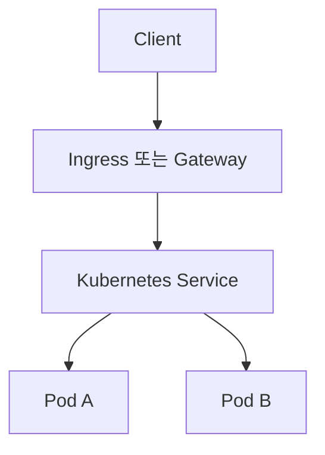

Service는 선택된 Pod들에 접근할 수 있는 논리적인 경로를 제공한다.

Readiness 상태와 Pod 종료 상태에 따라 정상적인 트래픽 전달 대상이 조정된다.

다만 실제 외부 트래픽을 받으려면 Ingress, Gateway API 또는 LoadBalancer 타입 Service 등의 추가 구성이 필요할 수 있다.

---

### Kubernetes 배포 실행하기

앞서 작성한 설정 파일을 배포한다.

```bash
kubectl apply -f deployment.yaml
```

```bash
kubectl apply -f service.yaml
```

이때 `deployment.yaml`의 이미지 주소는 실제 클러스터에서 접근 가능한 이미지 레지스트리 주소로 변경해야 한다.

Pod 상태를 확인한다.

```bash
kubectl get pods -l app=availability-demo
```

정상 상태라면 다음과 같은 결과를 확인할 수 있다.

```text
NAME                                 READY   STATUS    RESTARTS
availability-demo-xxxxxxxxxx-abcde   1/1     Running   0
availability-demo-xxxxxxxxxx-fghij   1/1     Running   0
```

Deployment 상태를 확인한다.

```bash
kubectl get deployment availability-demo
```

예상 결과는 다음과 같다.

```text
NAME                READY   UP-TO-DATE   AVAILABLE
availability-demo   2/2     2            2
```

서비스에 접근할 수 있도록 Port Forwarding을 사용할 수 있다.

```bash
kubectl port-forward service/availability-demo 8080:80
```

다른 터미널에서 요청을 보낸다.

```bash
curl http://localhost:8080/api/version
```

현재 버전이 반환되면 기본 구성이 정상적으로 동작하는 것이다.

---

### Rolling Update 실행하기

이제 V2 이미지를 배포한다고 가정하자.

먼저 새로운 이미지가 레지스트리에 업로드되어 있어야 한다.

이후 다음 명령어로 이미지를 변경한다.

```bash
kubectl set image \
  deployment/availability-demo \
  availability-demo=registry.example.com/availability-demo:v2
```

이 명령어는 Deployment의 컨테이너 이미지를 V2로 변경한다.

Kubernetes는 새로운 ReplicaSet을 생성하고 Rolling Update를 진행한다.

배포 진행 상태를 확인한다.

```bash
kubectl rollout status deployment/availability-demo
```

정상적으로 완료되면 다음과 같은 결과를 볼 수 있다.

```text
deployment "availability-demo" successfully rolled out
```

하지만 이 명령어는 Kubernetes 관점에서 배포가 완료되었다는 의미다.

실제 사용자 요청이 모두 정상적으로 동작한다는 사실까지 보장하지는 않는다.

따라서 배포 이후 API 오류율과 비즈니스 지표를 추가로 확인해야 한다.

또 예제에서는 `APP_VERSION` 환경 변수가 여전히 `v1`일 수 있으므로 V2 배포 시 해당 환경 변수도 함께 변경해야 한다.

예를 들어 다음과 같이 설정할 수 있다.

```bash
kubectl set env \
  deployment/availability-demo \
  APP_VERSION=v2
```

다만 이 명령어는 이미지 변경과 별도로 또 다른 Deployment 변경을 발생시킬 수 있다.

실제 CI/CD에서는 이미지 버전과 환경 변수를 하나의 Deployment 변경으로 묶어 적용하는 것이 좋다.

Kubernetes는 `kubectl rollout status`를 통해 배포 진행 상태를 확인하는 기능을 제공한다.

---

### 무중단 배포가 정상적으로 동작하는지 검증하기

실제 운영 환경에서는 설정만으로 무중단 배포를 보장했다고 판단해서는 안 된다.

배포 과정에서 지속적으로 요청을 보내며 실패 여부를 확인해야 한다.

예를 들어 다음과 같은 Shell 스크립트를 사용할 수 있다.

```bash
#!/bin/bash

while true
do
    curl \
      --silent \
      --output /dev/null \
      --write-out "HTTP %{http_code} | Time %{time_total}s\n" \
      --max-time 5 \
      http://localhost:8080/api/version

    sleep 0.2
done
```

이 스크립트는 약 0.2초 간격으로 요청을 보낸다.

응답 상태 코드와 처리 시간을 출력한다.

예상 결과는 다음과 같다.

```text
HTTP 200 | Time 0.012s
HTTP 200 | Time 0.010s
HTTP 200 | Time 0.011s
HTTP 200 | Time 0.015s
```

이 상태에서 Rolling Update를 실행한다.

이후 결과를 확인한다.

만약 다음과 같은 결과가 발생한다면 요청 실패가 존재하는 것이다.

```text
HTTP 503 | Time 0.005s
```

또 다음과 같이 출력된다면 네트워크 연결이나 요청 처리 문제가 발생했을 수 있다.

```text
HTTP 000 | Time 5.001s
```

다만 위 스크립트는 간단한 확인 방법일 뿐이다.

실제 서비스에서는 다음 지표도 함께 측정해야 한다.

- 배포 전후 요청 성공률
- HTTP 5xx 오류율
- 연결 실패율
- p95 및 p99 응답 시간
- 진행 중이던 요청의 완료율
- Readiness 변화 시점
- Pod 종료 시점
- 배포 이후 비즈니스 오류율

특히 Port Forwarding은 운영 환경의 실제 외부 Load Balancer 경로와 다를 수 있다.

따라서 실제 무중단 여부를 판단할 때는 외부 트래픽 진입 경로를 포함한 검증이 필요하다.

---

### 무중단 배포에서 고려해야 하는 첫 번째 문제: 롤백

무중단 배포에서는 신규 버전이 정상적으로 준비되었는지 확인한 뒤 트래픽을 전달한다.

그렇다면 Readiness가 정상이라면 새로운 버전에도 문제가 없다고 볼 수 있을까?

그렇지 않다.

Readiness는 애플리케이션이 요청을 처리할 준비가 되었는지를 판단하는 지표다.

하지만 모든 비즈니스 기능이 올바르게 동작하는지 검증하는 기능은 아니다.

예를 들어 V2에서 다음과 같은 문제가 발생할 수 있다.

```text
Readiness: 정상

HTTP 서버: 정상

DB 연결: 정상

결제 API: 특정 조건에서 실패
```

이 경우 V2는 요청을 받을 준비가 되어 있지만 실제 결제 처리에는 문제가 존재한다.

따라서 새로운 버전으로 트래픽을 전환한 뒤에도 지속적으로 상태를 확인해야 한다.

문제가 발견되면 이전 버전으로 되돌리는 롤백(Rollback)이 필요하다.

---

### 롤백은 어떻게 수행할까?

Blue-Green Deployment에서는 기존 Blue 환경을 일시적으로 유지할 수 있다.

따라서 Green에 문제가 발생하면 트래픽을 Blue로 되돌릴 수 있다.

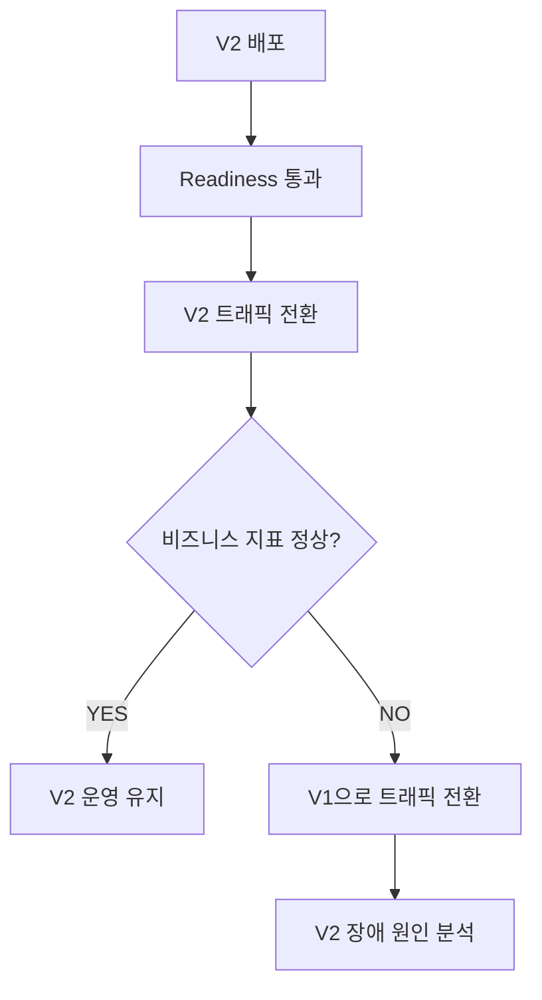

Rolling Deployment에서도 이전 버전으로 되돌릴 수 있다.

Kubernetes에서는 다음 명령어를 사용할 수 있다.

```bash
kubectl rollout undo deployment/availability-demo
```

이 명령어는 이전 Deployment Revision으로 되돌리는 작업을 시작한다.

진행 상태를 확인한다.

```bash
kubectl rollout status deployment/availability-demo
```

하지만 중요한 점이 있다.

**Kubernetes의 롤백은 애플리케이션 배포 상태를 되돌리는 것이지 데이터베이스의 데이터를 자동으로 복원하는 기능이 아니다.**

예를 들어 V2에서 주문 데이터의 구조를 변경했다면 V1이 새로운 데이터를 정상적으로 읽지 못할 수 있다.

따라서 안전한 롤백을 위해서는 애플리케이션과 데이터베이스 사이의 호환성이 필요하다.

또 롤백은 이전 Pod가 이미 종료되었다면 다시 생성하는 시간이 필요할 수 있다.

따라서 반드시 즉시 완료되는 작업은 아니다.

---

### 무중단 배포에서 고려해야 하는 두 번째 문제: 버전 간 호환성

무중단 배포에서는 V1과 V2가 동시에 실행되는 시간이 존재한다.

이때 두 버전은 동일한 데이터베이스를 사용할 수 있다.

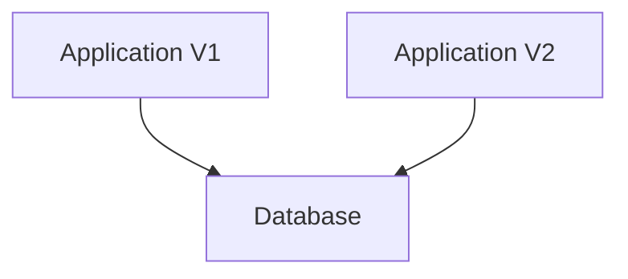

그런데 V2에서 데이터베이스 스키마를 변경했다고 가정하자.

기존에는 다음과 같은 테이블을 사용하고 있었다.

```sql
CREATE TABLE members (
    id BIGINT PRIMARY KEY,
    full_name VARCHAR(100) NOT NULL
);
```

V1은 `full_name` 컬럼을 사용한다.

```sql
SELECT
    id,
    full_name
FROM members;
```

그런데 V2에서 컬럼 이름을 변경한다고 가정하자.

```sql
ALTER TABLE members
RENAME COLUMN full_name TO display_name;
```

이 변경을 실행하면 V1은 어떻게 될까?

V1은 여전히 `full_name` 컬럼을 조회한다.

하지만 데이터베이스에는 해당 컬럼이 존재하지 않는다.

따라서 V1에서 SQL 오류가 발생할 수 있다.

이 문제는 무중단 배포 과정에서 매우 중요하다.

**새로운 버전의 배포 성공 여부뿐 아니라 기존 버전과 새로운 버전이 동일한 데이터 구조를 사용할 수 있는지도 확인해야 한다.**

이러한 문제를 해결하는 대표적인 방법이 Expand-Contract 패턴이다.

---

### Expand-Contract 패턴이란 무엇인가?

Expand-Contract는 기존 애플리케이션과 새로운 애플리케이션이 동시에 동작할 수 있도록 데이터베이스 구조를 단계적으로 변경하는 방식이다.

크게 다음 단계로 이해할 수 있다.

1. Expand
2. Migrate
3. Contract

여기서 중요한 원칙은 기존 구조를 즉시 제거하지 않는다는 것이다.

먼저 새로운 구조를 추가하고, 양쪽 버전이 호환되는 상태를 유지하면서 데이터를 이동한 뒤, 기존 구조가 더 이상 사용되지 않을 때 제거한다.

---

### Expand 단계

먼저 기존 컬럼을 유지하면서 새로운 컬럼을 추가한다.

```sql
ALTER TABLE members
ADD COLUMN display_name VARCHAR(100);
```

현재 테이블은 다음과 같다.

```text
members

id
full_name
display_name
```

V1은 기존의 `full_name`을 계속 사용할 수 있다.

V2는 새로운 `display_name`을 사용할 준비를 할 수 있다.

이 단계에서는 기존 기능을 제거하지 않았기 때문에 하위 호환성을 유지하기 쉽다.

하지만 새로운 컬럼이 추가되었다는 사실만으로 데이터가 자동으로 동기화되는 것은 아니다.

따라서 다음 단계에서 데이터 이전과 애플리케이션의 읽기·쓰기 방식을 조정해야 한다.

---

### Migrate 단계

먼저 기존 데이터를 새로운 컬럼에 복사한다.

```sql
UPDATE members
SET display_name = full_name
WHERE display_name IS NULL;
```

이 SQL은 기존 `full_name` 값을 `display_name`으로 복사한다.

하지만 운영 환경에서는 주의할 점이 있다.

**이 SQL을 한 번 실행했다고 데이터 이전이 완전히 끝난 것은 아닐 수 있다.**

V1이 계속 실행 중이라면 이후에도 `full_name` 컬럼에 새로운 데이터가 기록될 수 있기 때문이다.

또 대용량 테이블에서 전체 UPDATE를 한 번에 실행하면 락과 트랜잭션 로그, 데이터베이스 부하가 증가할 수 있다.

따라서 실제 운영 환경에서는 다음 사항을 고려해야 한다.

- 배치 단위 Backfill
- 기존 컬럼과 신규 컬럼의 동기화
- 신규 버전의 Dual Write
- 이전 버전과 신규 버전의 동시 실행
- 데이터 검증
- 트랜잭션 경계
- 마이그레이션 재실행 가능성

예를 들어 전환 단계의 애플리케이션에서는 두 컬럼에 값을 기록할 수 있다.

```sql
UPDATE members
SET full_name = :name,
    display_name = :name
WHERE id = :id;
```

이와 같은 방식을 Dual Write라고 부른다.

다만 V1이 여전히 기존 컬럼에만 기록한다면 Dual Write를 사용하는 V2만으로 완전한 동기화를 보장할 수 없다.

따라서 기존 버전이 계속 쓰기를 수행하는 동안에는 읽기 호환 로직이나 데이터베이스 수준의 동기화, 반복 Backfill 등을 함께 고려해야 한다.

실무에서는 다음과 같이 여러 배포 단계를 거치는 방식이 안전하다.

```text
1단계

기존 컬럼 유지
신규 컬럼 추가
```

```text
2단계

새 애플리케이션에서 양쪽 컬럼 기록
기존 컬럼을 기준으로 읽기 유지
```

```text
3단계

이전 버전의 쓰기 종료 확인
기존 데이터 Backfill
데이터 검증
```

```text
4단계

새로운 컬럼을 기준으로 읽기 전환
롤백 가능성 확인
```

데이터 변경이 빈번하거나 여러 애플리케이션이 같은 테이블을 사용하는 경우에는 더 세밀한 전환 계획이 필요하다.

---

### Contract 단계

모든 애플리케이션이 새로운 컬럼을 사용하고 데이터 이전이 검증되었다면 기존 컬럼을 제거할 수 있다.

```sql
ALTER TABLE members
DROP COLUMN full_name;
```

하지만 기존 컬럼을 제거하기 전에 반드시 확인해야 한다.

- V1이 완전히 종료되었는가?
- 다른 서비스에서 기존 컬럼을 사용하지 않는가?
- 배치 작업에서 기존 컬럼을 사용하지 않는가?
- 데이터 이전이 완료되었는가?
- 기존 버전으로 롤백할 가능성이 남아 있지 않은가?
- 새로운 컬럼에 필요한 제약조건과 인덱스가 구성되었는가?

기존 컬럼을 제거한 이후에는 V1으로의 애플리케이션 롤백이 어려워질 수 있다.

따라서 Contract는 모든 전환 작업이 완료되었다는 사실을 확인한 뒤 수행해야 한다.

이를 구조로 표현하면 다음과 같다.

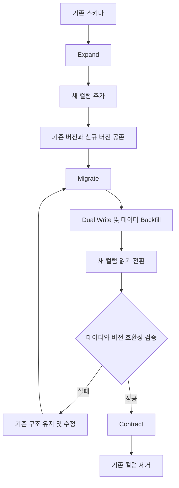

Expand-Contract는 데이터베이스뿐 아니라 API 응답, 이벤트 메시지, 설정값 등을 단계적으로 변경할 때도 적용할 수 있는 설계 방식이다.

Flyway의 데이터베이스 배포 지침에서도 여러 애플리케이션 버전이 공존하는 환경에서 호환성을 유지하기 위한 Expand-Contract 접근을 설명한다.

---

### 무중단 배포에서 고려해야 하는 세 번째 문제: 다중 인스턴스 운영

무중단 배포에서는 일시적으로 기존 버전과 새로운 버전이 동시에 실행된다.

이것은 애플리케이션이 여러 인스턴스로 실행되는 상황과 동일한 문제를 발생시킬 수 있다.

예를 들어 다음 구조를 생각해 보자.

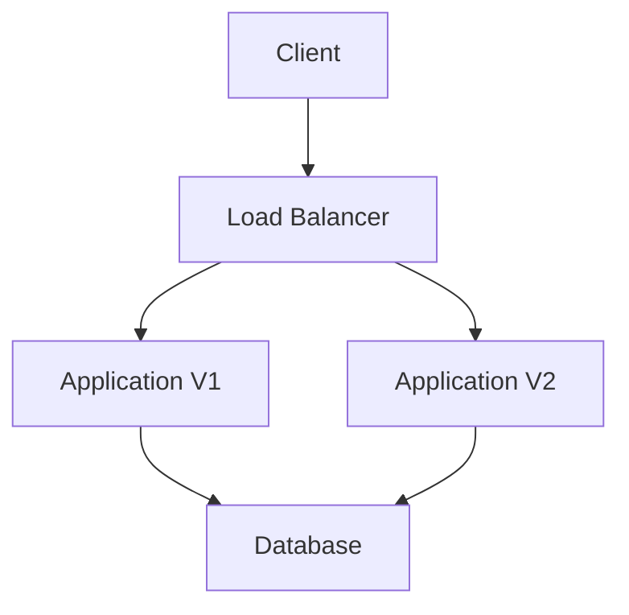

이때 한 대의 서버에서만 동작한다고 가정하고 작성한 기능은 문제가 될 수 있다.

대표적인 예는 다음과 같다.

- 서버 내부 HTTP Session
- 메모리 기반 캐시
- 애플리케이션 내부 상태
- 스케줄러
- 배치 작업
- 이벤트 처리
- 중복 요청 처리
- 파일 저장
- 분산 락

이 중 중요한 문제를 살펴보자.

---

### HTTP Session은 어떻게 관리해야 할까?

서버가 한 대라면 사용자의 Session을 해당 서버의 메모리에 저장할 수 있다.

하지만 서버가 두 대라면 문제가 발생할 수 있다.

예를 들어 사용자가 V1에 로그인했다고 가정하자.

```text
로그인 요청

↓

Application V1

↓

V1 메모리에 Session 저장
```

이후 요청이 V2로 전달된다.

```text
다음 요청

↓

Application V2

↓

V1의 Session 정보 없음
```

이 경우 사용자의 로그인 상태가 유지되지 않을 수 있다.

이를 해결하는 방법에는 여러 가지가 있다.

#### Sticky Session

동일한 사용자의 요청이 가능하면 같은 서버로 전달되도록 하는 방식이다.

하지만 특정 서버에 장애가 발생하면 해당 서버에 저장된 세션을 사용할 수 없다는 문제가 남는다.

#### Shared Session Store

Redis와 같은 외부 저장소에 Session을 저장하는 방식이다.

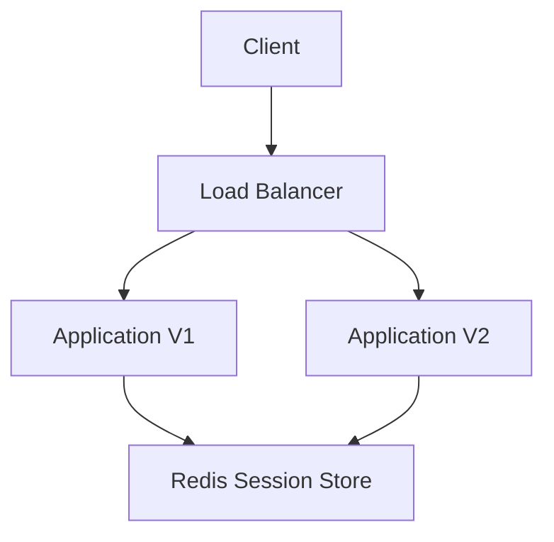

이 구조에서는 서로 다른 애플리케이션 인스턴스가 같은 Session 저장소에 접근할 수 있다.

Spring에서는 Spring Session을 이용해 Redis 기반 Session 저장소를 구성할 수 있다.

다만 외부 Session 저장소를 사용하면 Redis의 가용성과 Session 직렬화 호환성도 고려해야 한다.

특히 V1과 V2가 서로 다른 구조의 객체를 Session에 저장한다면 역직렬화 문제 등이 발생할 수 있다.

---

### 스케줄러는 왜 문제가 될까?

Spring Boot에서는 `@Scheduled`를 이용해 주기적인 작업을 수행할 수 있다.

예를 들어 다음과 같다.

```java
@Component
public class SettlementScheduler {

    @Scheduled(cron = "0 0 1 * * *")
    public void settle() {

        settlementService.execute();
    }
}
```

이 코드는 매일 특정 시각에 정산 작업을 실행한다.

서버가 한 대라면 해당 작업이 한 번 실행될 수 있다.

그런데 서버가 두 대라면 어떻게 될까?

```text
Application V1

01:00 → 정산 실행
```

```text
Application V2

01:00 → 정산 실행
```

두 애플리케이션이 같은 스케줄 작업을 실행할 수 있다.

따라서 정산이 중복 수행될 수 있다.

특히 결제와 정산처럼 중복 실행에 민감한 작업에서는 문제가 된다.

이를 해결하기 위한 방법에는 다음과 같은 것들이 있다.

| 방법 | 특징 |
|---|---|
| Distributed Lock | 특정 작업을 하나의 인스턴스만 실행하도록 조정 |
| ShedLock | Spring Scheduler에서 분산 락을 활용하는 방식 |
| Kubernetes CronJob | 주기적인 작업을 별도 Job으로 실행 |
| Leader Election | 리더로 선택된 인스턴스가 작업 수행 |
| Idempotency | 작업이 중복 실행되어도 결과가 잘못되지 않도록 설계 |

여기서 중요한 점은 분산 락을 사용했다고 중복 실행 가능성이 완전히 사라지는 것은 아니라는 것이다.

락 만료, 네트워크 지연, 작업 중단, 재시도 등으로 인해 중복 실행이 발생할 수 있다.

따라서 중요한 작업에서는 분산 락과 함께 멱등성을 고려해야 한다.

---

### 멱등성(Idempotency)이란 무엇인가?

멱등성은 동일한 작업을 여러 번 수행하더라도 한 번 수행했을 때와 동일한 최종 결과가 유지되는 성질이다.

예를 들어 다음 결제 요청을 생각해 보자.

```http
POST /api/payments
Idempotency-Key: payment-order-100

Content-Type: application/json

{
  "orderId": 100,
  "amount": 10000
}
```

사용자가 이 요청을 보낸 뒤 응답을 받지 못했다고 가정하자.

이때 실제 결제는 성공했을 수도 있다.

하지만 클라이언트가 동일한 요청을 재시도할 수 있다.

멱등성이 없다면 중복 결제가 발생할 수 있다.

반면 멱등성을 구현했다면 동일한 요청 식별자를 이용해 이미 처리된 작업인지 확인할 수 있다.

```text
첫 번째 요청

Idempotency-Key = payment-order-100

↓

결제 처리

↓

결과 저장
```

```text
두 번째 요청

Idempotency-Key = payment-order-100

↓

기존 처리 결과 확인

↓

중복 결제 방지
```

무중단 배포 중에는 트래픽 전환과 연결 종료, 재시도 등으로 동일한 요청이 다시 전달되는 상황이 발생할 수 있다.

따라서 멱등성은 무중단 배포와 함께 고려해야 하는 중요한 설계 요소다.

특히 결제·주문·쿠폰 발급·정산 작업에서는 중복 처리 방지 정책이 중요하다.

---

### 구조

### 단일 장애 지점(SPOF)이란 무엇인가?

무중단 배포는 배포 중 발생하는 중단 시간을 줄일 수 있다.

하지만 무중단 배포만으로 전체 시스템의 고가용성이 보장되는 것은 아니다.

예를 들어 다음 구조를 생각해 보자.

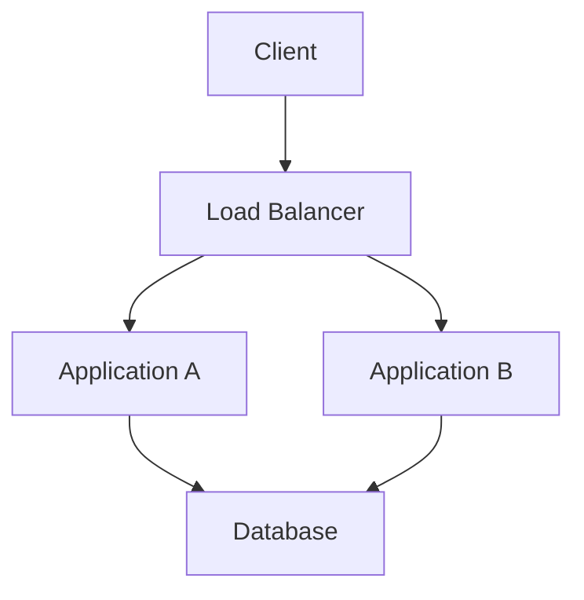

애플리케이션이 두 대이므로 하나의 애플리케이션에 장애가 발생해도 나머지 서버가 요청을 처리할 수 있다.

하지만 Load Balancer가 하나뿐이라면 어떨까?

Load Balancer에 장애가 발생하면 모든 요청이 영향을 받을 수 있다.

또 데이터베이스가 하나뿐이라면 데이터베이스 장애로 전체 서비스가 중단될 수 있다.

이처럼 특정 구성 요소 하나의 장애가 서비스 전체에 심각한 영향을 주는 지점을 **SPOF(Single Point of Failure)**라고 한다.

대표적인 SPOF에는 다음과 같은 구성 요소가 있다.

- 단일 Load Balancer
- 단일 애플리케이션 인스턴스
- 단일 데이터베이스
- 단일 Redis 인스턴스
- 단일 메시지 브로커
- 단일 네트워크 경로
- 단일 가용 영역
- 단일 DNS 또는 인증 의존성

고가용성을 설계하려면 이러한 단일 장애 지점을 식별해야 한다.

---

### 고가용성(High Availability)이란 무엇인가?

고가용성은 일부 구성 요소에 장애가 발생하더라도 서비스가 가능한 한 계속 동작하도록 설계하는 것이다.

대표적인 방법은 중복 구성과 장애 자동 전환이다.

예를 들어 다음 구조를 생각해 보자.

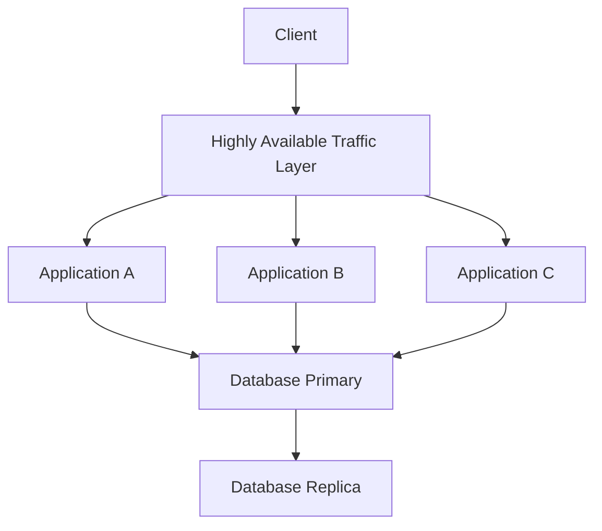

이 구조에서는 애플리케이션을 여러 대로 운영한다.

데이터베이스도 복제본을 구성할 수 있다.

하지만 복제본이 존재한다는 사실만으로 자동 Failover가 보장되는 것은 아니다.

실제 고가용성에는 다음 요소가 필요할 수 있다.

- 장애 감지
- 자동 Failover
- 데이터 복제
- Split-Brain 방지
- 복제 지연 관리
- 트래픽 재분산
- 장애 복구
- 모니터링
- 정기적인 장애 복구 검증

특히 데이터베이스는 애플리케이션보다 상태 관리가 복잡하다.

따라서 단순히 서버를 여러 대 실행하는 것으로 해결할 수 없는 문제가 존재한다.

---

### 가용성 확보와 고가용성 설계의 차이

무중단 배포와 고가용성은 같은 개념으로 사용되기도 하지만 해결하는 문제가 다르다.

| 구분 | 무중단 배포 | 고가용성 |
|---|---|---|
| 주요 목적 | 배포 과정의 중단 최소화 | 장애 상황에서도 서비스 유지 |
| 대표적인 문제 | V1 종료와 V2 시작 사이의 공백 | 서버·DB·네트워크 장애 |
| 핵심 기술 | Readiness, Graceful Shutdown, Rolling Update | Redundancy, Failover, Replication |
| 주요 관심사 | 버전 전환 | 장애 감지와 복구 |
| 공통 요소 | 다중 인스턴스, 트래픽 제어 | 다중 인스턴스, 트래픽 제어 |

무중단 배포는 높은 가용성을 달성하기 위한 중요한 구성 요소다.

하지만 고가용성을 완성하는 유일한 방법은 아니다.

---

### 실무에서의 활용

### 무중단 배포를 설계할 때 고려해야 할 12가지 전략

무중단 배포를 안정적으로 운영하려면 여러 요소를 함께 검토해야 한다.

#### 1. Readiness와 Liveness를 구분한다

단순히 HTTP 200을 반환하는 Endpoint 하나로 모든 상태를 판단하지 않는다.

Readiness는 트래픽 처리 준비 여부를 나타낸다.

Liveness는 애플리케이션의 재시작 필요 여부를 나타낸다.

외부 데이터베이스가 잠시 느려졌다고 모든 Pod의 Liveness를 실패시키면 대규모 재시작이 발생할 수 있다.

따라서 각 Probe의 목적에 맞게 상태를 정의해야 한다.

#### 2. 실제 요청 처리 시간을 기준으로 Graceful Shutdown을 설정한다

예를 들어 일반적인 API는 100ms 이내에 완료되지만 일부 파일 처리 API는 20초 이상 실행될 수 있다고 가정하자.

이 경우 종료 대기 시간이 5초라면 진행 중인 작업이 중단될 수 있다.

따라서 요청 처리 시간의 p95, p99와 최대 처리 시간을 확인해야 한다.

또 장시간 실행되는 작업은 별도 비동기 처리 구조로 분리할 필요가 있을 수 있다.

#### 3. Load Balancer의 연결 종료 동작을 확인한다

애플리케이션이 Readiness를 실패하도록 변경했다고 해서 모든 Load Balancer가 즉시 새로운 연결을 차단하는 것은 아니다.

상태 변경이 실제 라우팅에 반영되는 데 시간이 걸릴 수 있다.

또 HTTP Keep-Alive와 기존 연결 재사용 정책도 영향을 줄 수 있다.

따라서 실제 트래픽 경로에서 연결 종료와 라우팅 전환이 어떻게 동작하는지 확인해야 한다.

#### 4. 배포 중 추가 리소스를 확보한다

`maxSurge: 1`을 설정했다면 기존 Pod 외에 새로운 Pod가 추가로 실행될 수 있다.

따라서 Kubernetes Node에 충분한 CPU와 메모리가 있어야 한다.

리소스가 부족하면 새로운 Pod가 실행되지 못하고 배포가 지연될 수 있다.

무중단 배포를 위해서는 배포 중 발생하는 일시적인 리소스 증가까지 고려해야 한다.

#### 5. 배포 전후의 오류율을 비교한다

새 버전이 정상적으로 실행되었다고 해서 비즈니스 기능까지 정상적인 것은 아니다.

따라서 배포 전후의 오류율을 확인해야 한다.

특히 다음 항목이 중요하다.

```text
HTTP 5xx Error Rate

p95 / p99 Latency

Payment Failure Rate

Order Failure Rate

Database Connection Errors

Timeout Count
```

이러한 지표를 이용하면 배포 이후 문제가 발생했는지 빠르게 판단할 수 있다.

#### 6. 롤백 기준을 미리 정의한다

배포 이후 장애가 발생했을 때 사람이 모든 지표를 확인하고 판단하면 복구가 늦어질 수 있다.

따라서 사전에 롤백 조건을 정의할 수 있다.

예를 들어 다음과 같다.

```text
신규 버전의 5xx 오류율이
일정 시간 이상 허용 기준을 초과한다.

↓

신규 버전의 트래픽 비율 감소

↓

기존 버전으로 롤백
```

실제 자동 롤백 조건은 요청량과 오류율의 통계적 신뢰성을 함께 고려해야 한다.

요청이 적은 서비스에서는 오류 한두 건만으로 비율이 급격히 증가할 수 있기 때문이다.

#### 7. Expand-Contract 패턴으로 스키마를 변경한다

무중단 배포에서는 기존 버전과 새로운 버전이 동일한 데이터베이스를 사용하는 시간이 존재한다.

따라서 DB 컬럼을 즉시 삭제하거나 이름을 변경하는 작업은 위험하다.

새로운 구조를 추가하고, 데이터를 이전한 뒤, 기존 구조를 제거하는 단계적 변경이 필요하다.

특히 롤백 가능성이 남아 있는 동안에는 기존 구조를 유지하는 것이 중요하다.

#### 8. API와 이벤트 메시지의 하위 호환성을 유지한다

데이터베이스뿐 아니라 API 응답과 이벤트 메시지도 호환성을 고려해야 한다.

예를 들어 V2에서 이벤트 메시지 필드를 변경했다고 가정하자.

V1 소비자가 여전히 기존 메시지 구조를 기대하고 있다면 역직렬화 오류가 발생할 수 있다.

따라서 이벤트 필드를 추가할 때는 기존 소비자가 알 수 없는 필드를 처리할 수 있는지 확인해야 한다.

또 필드 삭제와 타입 변경은 소비자 버전의 전환이 완료된 후 수행하는 것이 좋다.

#### 9. 세션과 캐시의 저장 위치를 검토한다

애플리케이션 서버가 여러 대라면 서버 내부 상태가 서로 달라질 수 있다.

예를 들어 한 서버에서 로그인 세션을 저장했지만 다른 서버에서는 해당 세션을 알 수 없을 수 있다.

따라서 공유해야 하는 상태는 외부 저장소로 분리하거나 Stateless 구조로 설계하는 방식을 고려해야 한다.

Local Cache 역시 서버별 데이터 차이를 허용할 수 있는지 검토해야 한다.

#### 10. 스케줄러와 배치 작업의 중복 실행을 방지한다

새 버전과 기존 버전이 동시에 실행되는 동안 스케줄러도 중복 실행될 수 있다.

특히 정산과 쿠폰 발급, 통계 집계 등의 작업은 중복 실행 시 문제가 발생할 수 있다.

따라서 분산 락이나 단일 Job 실행 구조를 고려해야 한다.

또 중복 실행이 발생하더라도 데이터가 잘못 변경되지 않도록 멱등성을 확보하는 것이 중요하다.

#### 11. 종료 중인 작업과 메시지 소비를 분리해 관리한다

Graceful Shutdown은 HTTP 요청 처리에만 한정해서 생각해서는 안 된다.

Spring Boot 애플리케이션에서 Kafka Consumer나 RabbitMQ Consumer, 비동기 작업을 함께 실행할 수 있기 때문이다.

예를 들어 Kafka Consumer가 메시지를 처리하는 중에 종료되었다고 가정하자.

작업이 완료되기 전에 종료되면 메시지가 다시 전달될 수 있다.

따라서 다음 요소를 고려해야 한다.

```text
새로운 메시지 수신 중단

↓

현재 처리 중인 메시지 완료

↓

Offset 또는 Acknowledgement 처리

↓

Consumer 종료
```

하지만 실제 순서는 메시지 브로커와 클라이언트 설정에 따라 달라진다.

중요한 것은 HTTP Graceful Shutdown만 설정했다고 모든 비동기 작업의 안전한 종료가 자동으로 보장되는 것은 아니라는 점이다.

#### 12. 배포 성공과 서비스 정상 상태를 구분한다

Kubernetes에서 다음 결과가 출력되었다고 가정하자.

```text
deployment successfully rolled out
```

이 결과는 배포 관리 시스템의 관점에서 원하는 상태에 도달했다는 의미다.

하지만 실제 사용자가 결제하거나 주문하는 과정에서 오류가 발생할 수도 있다.

따라서 배포 성공 여부를 다음 두 단계로 구분하는 것이 좋다.

```text
1단계: 인프라 관점

Pod Ready

Deployment Available

Readiness 정상
```

```text
2단계: 사용자 관점

요청 성공률 정상

응답 시간 정상

비즈니스 오류율 정상

주요 기능 정상
```

두 단계가 모두 만족되어야 실제 서비스가 안정적으로 배포되었다고 판단할 수 있다.

---

### SRE 관점에서 가용성을 어떻게 측정할까?

무중단 배포를 구현했다면 다음으로는 실제 가용성이 개선되었는지 측정해야 한다.

이 과정에서 중요한 개념이 SLI와 SLO다.

#### SLI란 무엇인가?

SLI(Service Level Indicator)는 서비스 수준을 측정하기 위한 지표다.

예를 들어 다음과 같은 지표가 있다.

```text
요청 성공률

HTTP 5xx 오류율

p99 응답 시간

정상적인 결제 완료율
```

가장 단순한 예는 요청 성공률이다.

```text
요청 성공률

= 정상 처리된 요청 수
  / 전체 요청 수
  × 100
```

예를 들어 한 시간 동안 100,000건의 요청이 발생했고 99,950건이 정상적으로 처리되었다면 요청 성공률은 99.95%다.

이러한 지표를 이용하면 서비스를 실제로 얼마나 안정적으로 제공하고 있는지 측정할 수 있다.

---

### SLO란 무엇인가?

SLO(Service Level Objective)는 SLI에 대해 설정한 목표 수준이다.

예를 들어 다음과 같이 정의할 수 있다.

```text
SLI: HTTP 요청 성공률

SLO: 최근 30일 동안 99.9% 이상
```

또 응답 시간에 대한 SLO를 정의할 수도 있다.

```text
SLI: API 응답 시간

SLO: 전체 요청의 99%가 500ms 이내
```

여기서 중요한 점은 SLO가 측정 가능한 목표라는 것이다.

단순히 서비스를 빠르게 제공하겠다는 목표만으로는 실제 상태를 평가하기 어렵다.

반면 성공률과 응답 시간의 기준을 명시하면 운영 상태를 정량적으로 판단할 수 있다.

---

### Error Budget이란 무엇인가?

Error Budget은 SLO에서 허용하는 실패의 범위를 의미한다.

예를 들어 요청 성공률 목표가 99.9%라면 다음과 같이 생각할 수 있다.

```text
SLO = 99.9%

허용 실패 비율 = 0.1%
```

한 달 동안 1,000,000개의 요청이 발생한다고 가정하자.

그러면 0.1%에 해당하는 1,000개의 실패 요청이 Error Budget에 해당한다.

```text
전체 요청 = 1,000,000

허용 실패 비율 = 0.1%

허용 실패 요청 수 = 1,000
```

물론 실제 Error Budget은 서비스에서 정의한 SLI와 관측 기간에 따라 계산 방식이 달라진다.

Error Budget이 중요한 이유는 배포 속도와 안정성 사이의 균형을 판단할 수 있기 때문이다.

예를 들어 최근 배포로 많은 오류가 발생해 Error Budget이 대부분 소진되었다고 가정하자.

이 경우 새로운 기능 배포보다 안정성 개선에 집중하도록 정책을 정할 수 있다.

반대로 충분한 Error Budget이 남아 있다면 새로운 기능을 점진적으로 배포하는 등의 활동을 진행할 수 있다.

Google SRE에서는 SLO와 Error Budget을 운영 의사결정에 활용하는 접근을 설명한다.

---

### 관측성(Observability)이란 무엇인가?

관측성은 시스템 외부에서 얻을 수 있는 정보를 통해 내부 상태를 이해하고 문제의 원인을 분석할 수 있는 능력을 의미한다.

대표적인 세 가지 요소가 있다.

#### Metrics

시스템의 상태를 숫자로 표현한다.

```text
HTTP Request Count

HTTP Error Rate

Response Latency

CPU Usage

Memory Usage

JVM GC Pause
```

#### Logs

애플리케이션에서 발생한 이벤트를 기록한다.

```text
2026-11-10 10:00:00 INFO Deployment v2 started

2026-11-10 10:00:05 INFO Readiness ACCEPTING_TRAFFIC

2026-11-10 10:01:00 ERROR Payment request failed
```

#### Traces

하나의 요청이 여러 서비스와 구성 요소를 거치는 흐름을 추적한다.

예를 들어 다음과 같다.

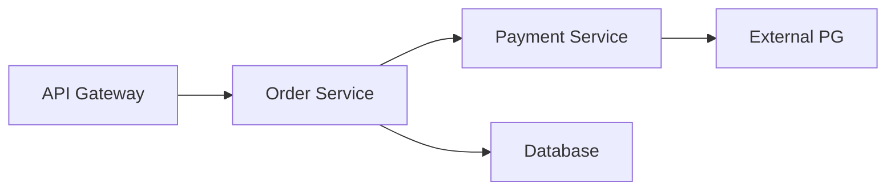

분산 추적을 사용하면 요청이 어느 서비스에서 지연되거나 실패했는지 파악하는 데 도움이 된다.

특히 무중단 배포에서는 버전별 관측성이 중요하다.

V1과 V2가 동시에 요청을 처리하는 동안 오류가 발생한다면 어느 버전에서 문제가 발생했는지 구분할 수 있어야 한다.

따라서 로그와 메트릭에 다음 정보를 포함하는 것이 유용하다.

```text
Application Name

Application Version

Instance ID

Deployment Revision

Request ID

Trace ID
```

이러한 정보를 이용하면 배포 이후 발생한 오류가 특정 버전과 관련되어 있는지 분석할 수 있다.

---

### 무중단 배포가 실패하는 대표적인 상황

무중단 배포를 구성했더라도 실제 요청이 실패하는 경우가 존재한다.

대표적인 상황을 비교해 보자.

| 문제 | 발생 원인 | 대응 방향 |
|---|---|---|
| V2가 준비되기 전에 요청 전달 | Readiness 설정 부재 | Readiness Probe |
| V1 처리 중인 요청 중단 | 즉시 종료 | Graceful Shutdown |
| 종료 대상 Pod로 요청 전달 | 라우팅 정보 전파 지연 | Drain, preStop, LB 설정 |
| V2 배포 후 비즈니스 오류 | Readiness만 확인 | Canary, 비즈니스 지표 모니터링 |
| 롤백 후 V1 오류 | DB 스키마 변경 | Expand-Contract |
| 로그인 세션 유실 | 서버 내부 Session | Shared Session Store |
| 스케줄 작업 중복 실행 | 여러 인스턴스에서 실행 | 분산 락, 멱등성 |
| 메시지 중복 처리 | 종료 및 재시도 | Consumer 종료 정책, 멱등성 |
| 새 Pod 실행 실패 | CPU·메모리 부족 | 충분한 리소스 확보 |
| 서비스 전체 중단 | 단일 DB 또는 LB 장애 | 고가용성 구성 |
| 오류 원인 파악 지연 | 버전별 모니터링 부재 | Metrics, Logs, Traces |
| 롤백 지연 | 이전 버전 준비 부족 | 롤백 전략 및 배포 검증 |

이러한 문제들은 서로 독립적이지 않다.

예를 들어 V2의 Readiness가 정상이어도 DB 스키마가 호환되지 않으면 요청이 실패할 수 있다.

또 Graceful Shutdown이 정상적으로 실행되어도 외부 결제 요청의 중복 처리 문제가 발생할 수 있다.

따라서 안정적인 배포를 위해서는 네트워크, 애플리케이션, 데이터베이스, 비동기 작업을 함께 고려해야 한다.

---

### 무중단 배포와 함께 알아야 할 추가 개념

#### 1. Connection Draining

Connection Draining은 서버를 트래픽 전달 대상에서 제외할 때 기존 연결과 요청을 적절하게 정리하는 과정이다.

Graceful Shutdown이 애플리케이션 내부의 종료 처리에 초점을 맞춘다면 Connection Draining은 Load Balancer와 연결 관리 측면을 강조한다.

특히 HTTP Keep-Alive나 WebSocket처럼 연결이 오래 유지되는 상황에서는 별도의 종료 정책이 필요할 수 있다.

#### 2. Health Check와 Business Check

Health Check는 애플리케이션의 기본적인 상태를 확인한다.

하지만 실제 비즈니스 기능이 올바르게 동작하는지는 별도의 검증이 필요할 수 있다.

예를 들어 결제 승인 요청의 실제 성공 여부는 단순한 `/readyz` 응답만으로 판단하기 어렵다.

따라서 핵심 비즈니스 지표를 배포 검증에 포함하는 것이 중요하다.

#### 3. Feature Flag

Feature Flag는 새로운 기능의 활성화 여부를 배포와 분리해 제어하는 방식이다.

예를 들어 V2를 모든 서버에 배포하더라도 새로운 결제 수단은 일부 사용자에게만 활성화할 수 있다.

이 방식은 배포와 기능 출시를 분리하는 데 도움이 된다.

다만 Feature Flag 자체도 설정 관리와 정합성, 오래된 Flag 제거 등의 운영 비용을 가진다.

#### 4. Progressive Delivery

Progressive Delivery는 새로운 버전이나 기능을 점진적으로 사용자에게 노출하면서 안정성을 검증하는 접근이다.

Canary Deployment와 Feature Flag 등을 조합할 수 있다.

또 자동화된 분석을 통해 오류율이나 응답 시간 기준을 만족하지 못하면 배포를 중단하는 전략도 사용할 수 있다.

#### 5. RTO와 RPO

RTO(Recovery Time Objective)는 장애 이후 서비스를 복구하기까지 허용할 수 있는 목표 시간을 의미한다.

RPO(Recovery Point Objective)는 장애로 인해 허용할 수 있는 데이터 손실 범위를 의미한다.

예를 들어 다음과 같다.

```text
RTO = 5분

RPO = 1분
```

이는 서비스 복구 목표 시간이 5분이고, 허용 데이터 손실 범위가 최대 1분이라는 목표를 의미한다.

무중단 배포는 주로 계획된 배포 과정의 중단을 줄이는 기술이다.

반면 RTO와 RPO는 장애 복구와 데이터 보호 전략을 설계할 때 중요하다.

#### 6. Chaos Engineering

Chaos Engineering은 실제 장애 상황을 가정한 실험을 통해 시스템의 복원력을 확인하는 접근이다.

예를 들어 다음과 같은 상황을 점검할 수 있다.

```text
애플리케이션 Pod 강제 종료

↓

서비스가 계속 동작하는가?
```

```text
Redis 연결 차단

↓

애플리케이션이 허용 가능한 수준으로 동작하는가?
```

```text
데이터베이스 Failover

↓

요청이 정상적으로 복구되는가?
```

무중단 배포 설정이 존재하더라도 실제 장애 상황에서 기대한 대로 동작하는지는 검증해야 한다.

다만 장애 실험은 영향을 통제할 수 있는 환경과 안전장치를 갖춘 상태에서 수행해야 한다.

---

### 무중단 배포와 고가용성 설계의 최종 구조

지금까지 살펴본 내용을 하나의 시스템으로 정리해 보자.

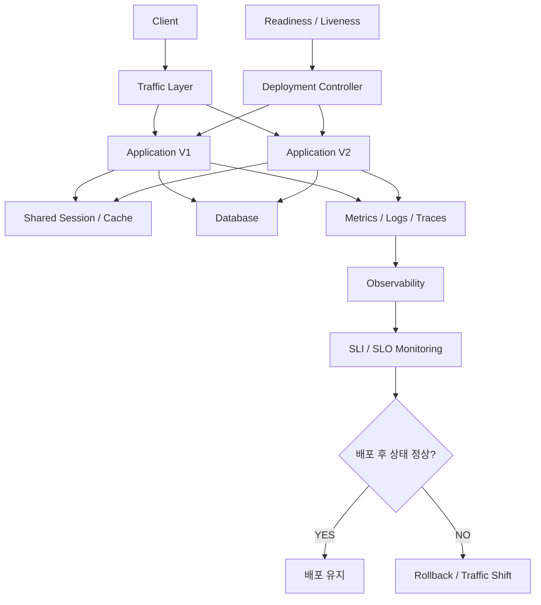

이 구조에서 중요한 것은 각 구성 요소가 별도의 책임을 가진다는 점이다.

Load Balancer는 트래픽 전달을 관리한다.

Readiness는 새로운 요청을 처리할 준비가 되었는지 나타낸다.

Graceful Shutdown은 기존 요청을 가능한 한 정상적으로 마무리하도록 돕는다.

Deployment Controller는 원하는 인스턴스 상태를 유지한다.

Shared Session과 Cache는 여러 인스턴스 사이에서 공유해야 하는 상태를 관리한다.

데이터베이스는 버전 간 호환성을 유지해야 한다.

관측성 시스템은 실제 서비스 상태를 확인할 수 있도록 돕는다.

그리고 SLI와 SLO는 서비스가 목표한 수준으로 정상 동작하고 있는지 판단하는 기준이 된다.

**무중단 배포는 여러 기술을 조합해 배포 과정의 위험을 줄이는 시스템 설계 문제다.**

---

### 정리

가용성은 사용자가 서비스를 필요로 할 때 정상적으로 사용할 수 있는 정도를 의미한다.

서비스의 신뢰성을 높이기 위해서는 가용성뿐 아니라 데이터 정합성과 복구 능력, 관측성 등 다양한 요소를 고려해야 한다.

그중 무중단 배포는 새로운 버전을 배포하는 과정에서 발생하는 서비스 중단을 줄이기 위한 기술이다.

가장 단순한 배포 방식은 기존 서버를 종료한 후 새로운 서버를 실행하는 것이다.

하지만 이 방식에서는 기존 서버가 종료된 시점부터 새로운 서버가 요청을 처리할 준비를 마칠 때까지 Downtime이 발생할 수 있다.

무중단 배포는 이 문제를 해결하기 위해 기존 서버가 요청을 처리하는 동안 새로운 서버를 먼저 실행한다.

새로운 서버가 요청을 처리할 준비를 마치면 트래픽을 전환한다.

그리고 기존 서버가 처리 중인 요청을 완료하도록 기다린 뒤 종료한다.

이 과정에서 중요한 요소가 Load Balancer, Readiness, Graceful Shutdown이다.

Load Balancer는 여러 서버에 요청을 분산하고 정상적인 서버로 요청을 전달하는 역할을 한다.

Readiness는 애플리케이션이 새로운 요청을 처리할 준비가 되었는지 나타낸다.

Liveness는 애플리케이션의 재시작이 필요한 상태인지 판단하는 데 사용한다.

두 개념은 서로 다른 목적을 가지므로 구분해야 한다.

Graceful Shutdown은 애플리케이션을 종료할 때 기존 요청이 가능한 한 정상적으로 완료되도록 기다리는 방식이다.

하지만 Graceful Shutdown이 모든 작업의 완료를 보장하는 것은 아니다.

종료 유예 시간이 초과되거나 강제 종료가 발생할 수 있기 때문이다.

또 HTTP 요청 이외의 메시지 소비와 배치 작업 등에는 별도의 종료 정책이 필요하다.

무중단 배포 방식에는 Rolling, Blue-Green, Canary 등이 있다.

Rolling Deployment는 여러 인스턴스를 순차적으로 교체한다.

Blue-Green Deployment는 기존 환경과 새로운 환경을 각각 준비한 뒤 트래픽을 전환한다.

Canary Deployment는 일부 트래픽부터 새로운 버전에 전달하면서 문제를 확인한다.

각 방식은 인프라 비용과 트래픽 제어, 롤백 방식에서 차이가 있다.

무중단 배포에서는 롤백 전략도 중요하다.

새로운 서버가 Readiness를 통과했다고 모든 비즈니스 기능이 정상적으로 동작하는 것은 아니기 때문이다.

따라서 배포 이후 오류율과 응답 시간, 결제 성공률 등의 지표를 확인해야 한다.

문제가 발생하면 이전 버전으로 되돌리는 전략이 필요하다.

하지만 애플리케이션 롤백이 데이터베이스까지 이전 상태로 복원하는 것은 아니다.

따라서 안전한 롤백을 위해서는 버전 간 데이터베이스 호환성이 중요하다.

이를 해결하기 위한 대표적인 방법이 Expand-Contract 패턴이다.

Expand 단계에서는 기존 구조를 유지하면서 새로운 구조를 추가한다.

Migrate 단계에서는 데이터 이전과 읽기·쓰기 방식의 전환을 수행한다.

Contract 단계에서는 기존 버전이 더 이상 필요하지 않다는 사실을 확인한 뒤 오래된 구조를 제거한다.

이 방식은 데이터베이스뿐 아니라 API와 메시지 구조를 변경할 때도 활용할 수 있다.

또 무중단 배포에서는 V1과 V2가 동시에 실행되기 때문에 다중 인스턴스 운영 문제를 고려해야 한다.

서버 내부 Session을 사용하는 경우 인스턴스 간 세션 공유 문제가 발생할 수 있다.

Local Cache도 서버마다 서로 다른 데이터를 유지할 수 있다.

스케줄러는 여러 인스턴스에서 중복 실행될 수 있다.

따라서 Shared Session Store, 분산 락, 멱등성 등의 설계가 필요하다.

Spring Boot에서는 Actuator를 이용해 Readiness와 Liveness Endpoint를 제공할 수 있다.

또 Graceful Shutdown과 종료 대기 시간을 설정할 수 있다.

Kubernetes에서는 Deployment의 Rolling Update와 Readiness Probe, Liveness Probe, Startup Probe, preStop, terminationGracePeriodSeconds 등을 조합해 배포 중단 가능성을 줄일 수 있다.

하지만 이러한 설정이 존재한다고 서비스의 모든 요청이 반드시 성공하는 것은 아니다.

Load Balancer의 상태 반영 지연과 기존 연결, 리소스 부족, 애플리케이션 오류 등의 문제가 남아 있기 때문이다.

따라서 실제 배포 과정에서 지속적으로 요청을 보내고 오류율과 응답 시간을 확인해야 한다.

또 무중단 배포는 전체 시스템의 고가용성을 완성하는 유일한 방법이 아니다.

애플리케이션 서버가 여러 대여도 데이터베이스가 하나뿐이라면 데이터베이스가 단일 장애 지점이 될 수 있다.

따라서 고가용성을 위해서는 시스템의 SPOF를 식별하고 복제와 Failover, 장애 복구 정책 등을 함께 고려해야 한다.

마지막으로 서비스의 가용성을 높이려면 실제 상태를 측정할 수 있어야 한다.

SLI는 서비스 수준을 측정하는 지표다.

SLO는 해당 지표에 대해 설정한 목표다.

Error Budget은 설정한 목표 안에서 허용할 수 있는 실패의 범위를 의미한다.

또 Metrics와 Logs, Traces를 활용하면 배포 과정에서 발생하는 문제를 파악할 수 있다.

따라서 무중단 배포는 단순히 배포 명령어를 자동화하는 문제가 아니다.

**새로운 버전을 안전하게 준비하고, 트래픽을 전환하며, 기존 요청을 마무리하고, 장애가 발생했을 때 복구할 수 있도록 시스템 전체를 설계하는 과정**이다.

핵심 개념을 정리하면 다음과 같다.

| 개념 | 핵심 의미 |
|---|---|
| Availability | 사용자가 서비스를 이용할 수 있는 정도 |
| Reliability | 요구된 기능을 올바르게 수행하는 성질 |
| Downtime | 서비스를 정상적으로 사용할 수 없는 시간 |
| Zero-Downtime Deployment | 배포 과정의 서비스 중단 최소화 |
| Load Balancer | 여러 서버에 요청 분산 |
| Readiness | 새로운 요청을 처리할 준비 상태 |
| Liveness | 애플리케이션 재시작 필요 여부 판단 |
| Startup Probe | 애플리케이션 초기화 상태 확인 |
| Graceful Shutdown | 처리 중인 작업의 정상적인 완료를 위한 종료 절차 |
| SIGTERM | 정상적인 종료 요청 |
| SIGKILL | 프로세스 강제 종료 |
| Connection Draining | 기존 연결을 정리하면서 트래픽 전달 중단 |
| Rolling Deployment | 인스턴스를 순차적으로 새로운 버전으로 교체 |
| Blue-Green Deployment | 두 환경을 준비한 뒤 트래픽 전환 |
| Canary Deployment | 일부 트래픽부터 점진적으로 전환 |
| Rollback | 문제가 발생한 배포를 이전 버전으로 되돌림 |
| Expand-Contract | 호환성을 유지하며 데이터 구조를 단계적으로 변경 |
| Dual Write | 기존 구조와 새로운 구조에 데이터를 함께 기록 |
| Idempotency | 동일한 작업을 반복해도 최종 결과 유지 |
| Distributed Lock | 여러 인스턴스의 작업 실행을 조정 |
| SPOF | 단일 구성 요소 장애가 전체 시스템에 영향을 주는 지점 |
| High Availability | 일부 장애에도 서비스 지속을 목표로 하는 설계 |
| SLI | 서비스 수준 측정 지표 |
| SLO | 서비스 수준 목표 |
| Error Budget | 목표에서 허용하는 실패 범위 |
| Observability | 외부 지표를 통해 시스템 내부 상태를 이해하는 능력 |
| RTO | 장애 이후 서비스 복구 목표 시간 |
| RPO | 장애로 인해 허용할 수 있는 데이터 손실 범위 |
| Feature Flag | 배포와 기능 활성화를 분리하는 방식 |
| Progressive Delivery | 점진적으로 새로운 버전이나 기능을 제공하는 방식 |

결국 무중단 배포에서 가장 중요한 원칙은 하나다.

**새로운 버전이 요청을 처리할 준비가 되기 전에는 기존 버전을 종료하지 않고, 트래픽이 전환된 이후에도 기존 요청과 데이터 호환성, 장애 복구 가능성을 함께 고려해야 한다.**

또한 무중단 배포는 가용성을 확보하기 위한 시작점일 뿐이다.

신뢰할 수 있는 백엔드 시스템을 만들기 위해서는 고가용성 아키텍처와 데이터 정합성, 멱등성, 장애 복구, 관측성을 함께 설계해야 한다.

#### 한 줄 요약

**무중단 배포는 기존 애플리케이션을 운영하면서 새로운 버전을 먼저 실행하고, Readiness를 통해 요청 처리 가능 여부를 확인한 뒤 트래픽을 전환하고, Graceful Shutdown으로 기존 요청을 마무리하는 배포 방식이다. 하지만 실제 가용성을 확보하려면 롤백, Expand-Contract 기반의 버전 간 호환성, 다중 인스턴스의 세션 및 중복 작업 처리, SPOF 제거, SLI·SLO 기반의 관측성까지 함께 고려해야 한다.**
