# 어셔의 Cache
[https://youtu.be/_K7VCEIwZvU?si=jBVWPBwHuB2s3AmF](https://youtu.be/_K7VCEIwZvU?si=jBVWPBwHuB2s3AmF)

# 어셔의 Cache
* toc
{:toc}

---

### 캐시(Cache) 완벽 이해: Local Cache와 Redis, Cache-Aside, Write-Through, TTL, 캐시 정합성과 장애 대응 전략

백엔드 애플리케이션을 개발하다 보면 데이터베이스에서 같은 데이터를 반복적으로 조회하는 상황을 자주 경험한다.

예를 들어 다음과 같은 API가 있다고 가정하자.

```http
GET /api/products/100 HTTP/1.1
```

해당 API는 상품 정보를 조회한다.

서버에서는 다음과 같은 SQL을 실행할 수 있다.

```sql
SELECT
    id,
    name,
    price,
    status
FROM products
WHERE id = 100;
```

사용자 한 명이 상품을 조회하는 상황에서는 큰 문제가 없을 수 있다.

하지만 동일한 상품을 수천 명의 사용자가 반복적으로 조회한다면 어떻게 될까?

```text
사용자 A → 상품 100 조회 → DB 조회
사용자 B → 상품 100 조회 → DB 조회
사용자 C → 상품 100 조회 → DB 조회
사용자 D → 상품 100 조회 → DB 조회
...
사용자 N → 상품 100 조회 → DB 조회
```

모든 요청이 동일한 상품을 조회한다.

상품 데이터도 변경되지 않았다.

그런데 데이터베이스에서는 같은 데이터를 반복해서 읽는다.

조회 요청이 많아질수록 다음과 같은 문제가 발생할 수 있다.

- 데이터베이스 CPU 사용량 증가
- 반복적인 쿼리 실행
- DB Connection Pool 사용량 증가
- 애플리케이션 응답 시간 증가
- 데이터베이스 확장 비용 증가
- 특정 인기 데이터에 대한 요청 집중

여기서 한 가지 질문이 생긴다.

**이미 조회한 데이터를 데이터베이스에서 매번 다시 가져와야 할까?**

데이터가 변경되지 않았다면 이전에 조회한 결과를 재사용할 수 있다.

이러한 문제를 해결하기 위해 사용하는 대표적인 기술이 캐시(Cache)다.

하지만 캐시를 도입하면 새로운 문제도 발생한다.

**캐시에 저장된 데이터가 데이터베이스와 다르면 어떻게 해야 할까?**

**서버가 여러 대라면 각 서버의 캐시를 어떻게 관리해야 할까?**

**캐시 서버에 장애가 발생하면 애플리케이션도 중단될까?**

**캐시의 데이터는 언제 삭제하거나 갱신해야 할까?**

**같은 캐시 데이터가 만료되는 순간 수천 개의 요청이 들어오면 어떻게 될까?**

이러한 질문에 답하려면 캐시를 단순한 성능 최적화 수단이 아니라 데이터 관리 시스템의 일부로 이해해야 한다.

---

### 캐시란 무엇인가?

캐시(Cache)는 자주 사용하거나 다시 계산하는 비용이 높은 데이터를 빠르게 접근할 수 있는 저장 공간에 보관해 재사용하는 기술이다.

일반적으로 원본 데이터보다 빠르게 접근할 수 있는 위치에 복사본 또는 계산 결과를 저장한다.

예를 들어 데이터베이스에 저장된 상품 정보를 Redis에 캐싱할 수 있다.

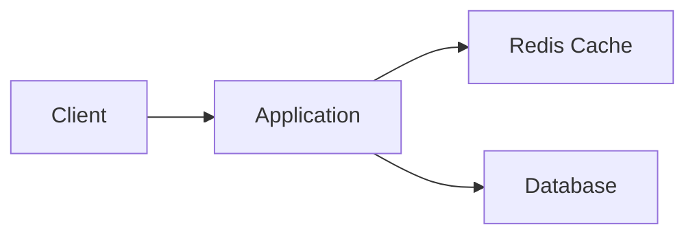

캐시가 없다면 다음과 같은 구조다.

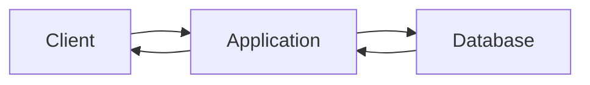

모든 요청이 데이터베이스에 접근한다.

반면 캐시를 도입하면 애플리케이션은 캐시에서 데이터를 먼저 확인할 수 있다.

캐시에 데이터가 존재하면 데이터베이스를 조회하지 않고 결과를 반환한다.

이처럼 캐시는 데이터베이스에 대한 반복적인 접근을 줄이는 데 활용할 수 있다.

#### 캐시는 데이터베이스에서만 사용하는 기술일까?

그렇지 않다.

캐시는 컴퓨터 시스템의 다양한 계층에서 사용된다.

| 캐시 종류 | 위치 | 주요 목적 |
|---|---|---|
| CPU Cache | CPU 내부 | 메모리 접근 비용 감소 |
| Browser Cache | 사용자 브라우저 | 정적 리소스 재사용 |
| CDN Cache | 사용자와 가까운 Edge 서버 | 네트워크 지연 감소 |
| Application Local Cache | 애플리케이션 프로세스 내부 | 반복적인 계산과 조회 감소 |
| Distributed Cache | 애플리케이션 외부의 공유 저장소 | 여러 서버에서 데이터 재사용 |
| Database Buffer Cache | 데이터베이스 내부 | 디스크 접근 감소 |
| OS Page Cache | 운영체제 메모리 | 파일 및 디스크 I/O 감소 |

모든 캐시의 목적이 완전히 같지는 않다.

하지만 공통적인 특징이 존재한다.

**상대적으로 느리거나 비용이 높은 작업을 반복하지 않도록 이전 결과를 재사용한다는 것이다.**

백엔드 애플리케이션에서는 주로 Local Cache와 Distributed Cache를 활용한다.

---

### 캐시의 기본 동작: Cache Hit과 Cache Miss

캐시의 기본적인 조회 결과는 두 가지로 구분할 수 있다.

첫 번째는 Cache Hit이다.

두 번째는 Cache Miss이다.

#### Cache Hit

Cache Hit은 요청한 데이터가 캐시에 존재하는 상황이다.

예를 들어 Redis에 다음 데이터가 저장되어 있다고 가정하자.

```text
Key: product:100

Value:
{
  "id": 100,
  "name": "Keyboard",
  "price": 50000
}
```

사용자가 상품 100을 조회하면 애플리케이션은 Redis에서 데이터를 읽는다.

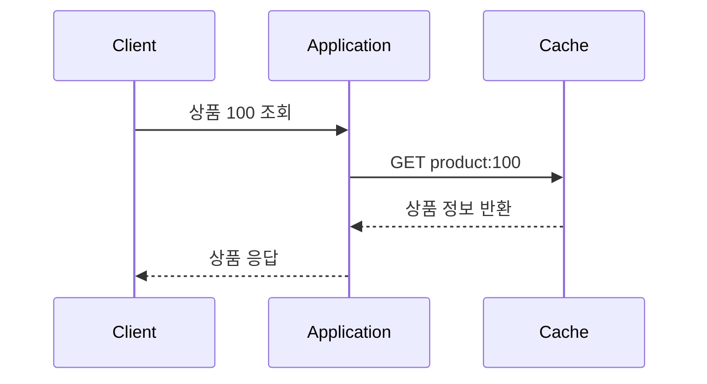

이 과정에서는 데이터베이스를 조회하지 않는다.

따라서 DB 조회 비용을 줄일 수 있다.

#### Cache Miss

Cache Miss는 요청한 데이터가 캐시에 존재하지 않는 상황이다.

예를 들어 처음으로 상품 200을 조회한다고 가정하자.

Redis에 해당 데이터가 없다.

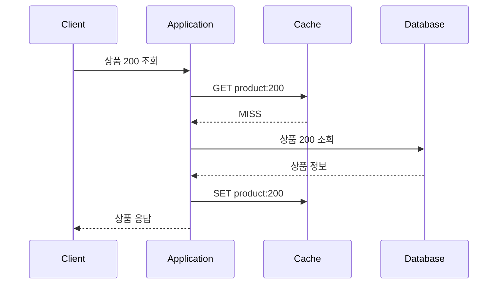

캐시에 데이터가 없으므로 원본 데이터베이스에서 조회한다.

이후 조회한 데이터를 캐시에 저장하면 다음 요청부터 재사용할 수 있다.

이것이 가장 기본적인 Cache-Aside 흐름이다.

---

### 왜 캐시를 사용하는가?

캐시를 사용하는 가장 큰 이유는 반복적인 작업의 비용을 줄이기 위해서다.

하지만 모든 데이터를 캐싱해야 하는 것은 아니다.

캐시가 실제로 효과를 발휘하려면 데이터의 접근 패턴과 변경 특성을 이해해야 한다.

#### 파레토 법칙과 데이터 접근 패턴

파레토 법칙(Pareto Principle)은 특정 결과의 상당 부분이 상대적으로 적은 원인에서 발생할 수 있다는 경험적 개념이다.

흔히 80:20 법칙이라고 표현한다.

이를 백엔드 시스템에 적용해 생각해 보자.

전체 상품이 10만 개 있다고 가정하자.

그런데 사용자의 조회 요청 대부분이 인기 상품 1,000개에 집중될 수 있다.

```text
전체 상품: 100,000개

조회 요청이 집중되는 상품: 1,000개

나머지 상품: 99,000개
```

이 경우 모든 상품을 캐싱하지 않아도 인기 상품을 중심으로 캐시를 구성하면 상당한 DB 부하를 줄일 수 있다.

이러한 데이터 접근 특성을 Hotspot 또는 Skewed Access Pattern이라고 부르기도 한다.

다만 모든 서비스에서 정확히 20%의 데이터가 80%의 요청을 발생시키는 것은 아니다.

**캐시 도입 여부는 파레토 법칙을 가정하는 것보다 실제 트래픽 분포를 측정해 판단하는 것이 정확하다.**

예를 들어 다음과 같은 지표를 확인할 수 있다.

- 상위 1% 상품이 전체 조회에서 차지하는 비율
- 동일한 API 요청이 반복되는 빈도
- 상품별 조회 횟수
- 특정 시간대의 요청 집중도
- 반복적으로 실행되는 고비용 SQL
- 데이터 변경 빈도

이러한 지표를 통해 캐시의 효과를 예상할 수 있다.

---

### 캐싱하기 좋은 데이터의 조건

모든 데이터를 캐싱하면 성능이 좋아질까?

반드시 그렇지는 않다.

캐시에도 메모리와 네트워크 비용이 발생한다.

또 데이터가 변경되면 캐시를 갱신하거나 삭제해야 한다.

따라서 어떤 데이터를 캐싱할지 선택해야 한다.

#### 1. 읽기 요청이 쓰기 요청보다 많은 데이터

가장 대표적인 조건이다.

예를 들어 상품 카테고리 정보를 생각해 보자.

카테고리는 자주 조회되지만 변경 빈도는 상대적으로 낮을 수 있다.

```text
카테고리 조회: 초당 1,000회

카테고리 변경: 하루 1회
```

이러한 데이터는 캐시에 저장했을 때 효율이 높을 수 있다.

반면 매초 값이 변경되고 매초 조회되는 데이터라면 캐시 갱신 비용이 커질 수 있다.

하지만 쓰기가 많다고 캐시가 반드시 부적합한 것은 아니다.

쓰기 빈도가 높더라도 특정 데이터의 읽기 요청이 훨씬 많거나, 실시간 갱신 전략을 효율적으로 구성할 수 있다면 캐싱이 유용할 수 있다.

#### 2. 같은 조건에서 동일한 결과를 반환하는 데이터

캐시는 특정 요청의 결과를 재사용한다.

따라서 캐시 Key가 같은 요청은 동일한 결과를 재사용해도 되는지 확인해야 한다.

예를 들어 다음 API를 생각해 보자.

```http
GET /api/products/100
```

상품 정보가 변경되지 않았다면 결과를 재사용할 수 있다.

하지만 다음 API는 어떨까?

```http
GET /api/products/100?country=KR
```

```http
GET /api/products/100?country=US
```

국가에 따라 상품 가격이나 판매 가능 여부가 달라질 수 있다.

그런데 캐시 Key를 다음과 같이 구성한다면 문제가 발생한다.

```text
product:100
```

한국 사용자와 미국 사용자가 동일한 캐시를 사용하게 된다.

따라서 캐시 Key에는 결과에 영향을 주는 조건을 포함해야 한다.

```text
product:100:KR

product:100:US
```

즉 **같은 요청이 같은 결과를 반환한다는 조건은 캐시 Key가 모든 의미 있는 입력을 반영한다는 전제에서 성립한다.**

#### 3. 생성 비용이 높은 데이터

캐싱은 단순한 DB 조회뿐 아니라 계산 결과를 재사용하는 데에도 적합하다.

예를 들어 다음과 같은 데이터를 생각해 보자.

- 여러 테이블을 조인한 통계
- 월별 매출 집계
- 복잡한 검색 결과
- 외부 API 호출 결과
- 추천 결과
- 대량 데이터를 가공한 응답
- 반복적인 계산 결과

이러한 데이터는 생성 비용이 높기 때문에 캐시에 저장했을 때 효과가 클 수 있다.

#### 4. 일정 수준의 오래된 데이터를 허용할 수 있는 데이터

캐시에 저장된 데이터는 원본과 항상 같은 시점의 값을 가지지는 않는다.

예를 들어 상품 조회수나 관리자 통계를 생각해 보자.

몇 초 또는 몇 분 이전의 데이터가 표시되어도 괜찮을 수 있다.

반면 결제 잔액이나 재고 차감처럼 데이터의 정확성이 중요한 작업에서는 오래된 데이터가 심각한 문제를 발생시킬 수 있다.

따라서 캐시 도입 전에 다음 질문을 해야 한다.

**이 데이터는 최대 얼마 동안 오래된 값을 반환해도 괜찮은가?**

이 질문에 대한 답이 캐시의 TTL과 갱신 전략을 결정하는 중요한 기준이 된다.

---

### 캐시를 도입하면 얼마나 성능이 개선될까?

캐시의 성능 개선 효과는 Cache Hit Rate에 크게 영향을 받는다.

Cache Hit Rate는 전체 캐시 조회 중 실제로 데이터가 존재한 비율이다.

다음과 같이 계산한다.

```text
Cache Hit Rate

= Cache Hit 수 / 전체 캐시 조회 수 × 100
```

예를 들어 10,000번의 요청 중 9,000번이 Cache Hit이었다고 가정하자.

```text
전체 요청: 10,000회

Cache Hit: 9,000회

Cache Miss: 1,000회

Cache Hit Rate: 90%
```

Cache Miss에서만 DB를 조회하는 구조라면, 다른 조건이 동일할 때 DB 조회 횟수를 상당히 줄일 수 있다.

하지만 Hit Rate가 높다고 무조건 좋은 캐시라고 할 수는 없다.

예를 들어 DB에서 조회하는 데 1ms밖에 걸리지 않는 데이터가 있다고 가정하자.

반면 Redis에 접근하는 데 네트워크와 직렬화 비용을 포함해 비슷한 시간이 걸릴 수도 있다.

이 경우 캐시를 도입해도 응답 시간 개선 효과가 크지 않을 수 있다.

따라서 다음 지표를 함께 고려해야 한다.

| 지표 | 확인할 내용 |
|---|---|
| Cache Hit Rate | 캐시가 얼마나 자주 사용되는가? |
| Cache Miss Rate | 원본 조회가 얼마나 발생하는가? |
| Cache Latency | 캐시 조회 비용은 얼마인가? |
| DB Query Latency | 원본 데이터 생성 비용은 얼마인가? |
| Cache Memory Usage | 메모리 비용은 적절한가? |
| Cache Eviction Rate | 데이터가 자주 축출되는가? |
| Stale Data Rate | 오래된 데이터가 얼마나 반환되는가? |

캐시는 단순히 Hit Rate를 높이는 것이 목적이 아니다.

**전체 시스템의 비용과 응답 시간을 줄이면서 데이터의 정확성 요구사항을 만족시키는 것이 목적이다.**

---

### 캐시를 어디에 둘 것인가?

캐시는 저장 위치에 따라 크게 두 가지 형태로 구분할 수 있다.

첫 번째는 Local Cache다.

두 번째는 Global Cache 또는 Distributed Cache다.

두 방식은 속도와 운영 방식, 데이터 정합성 측면에서 차이가 있다.

---

### Local Cache란 무엇인가?

Local Cache는 애플리케이션 프로세스 내부에 캐시를 저장하는 방식이다.

Java 애플리케이션에서는 일반적으로 JVM Heap에 데이터를 저장한다.

대표적으로 다음과 같은 방식을 사용할 수 있다.

- ConcurrentHashMap
- Caffeine
- Guava Cache
- 애플리케이션 내부의 사용자 정의 캐시

예를 들어 다음과 같이 구성할 수 있다.

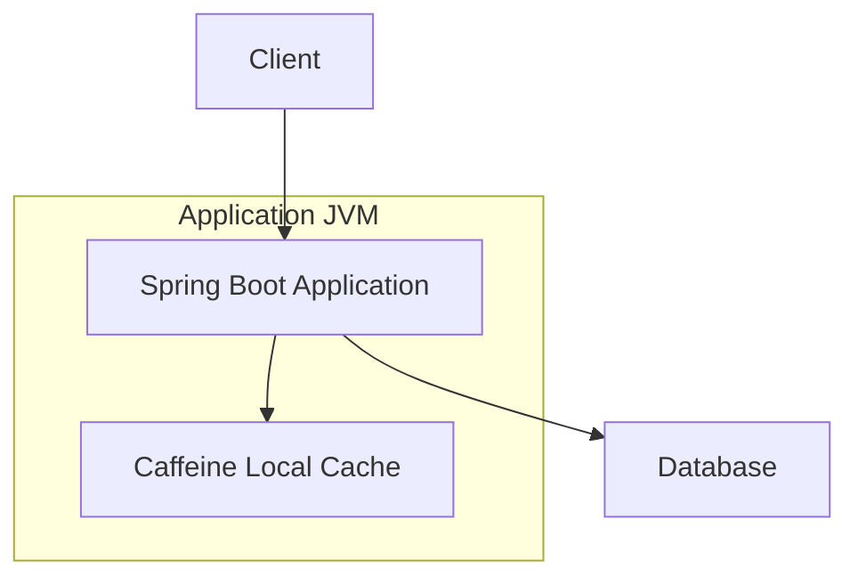

애플리케이션과 캐시가 같은 프로세스에 존재한다.

따라서 별도의 네트워크 요청이 필요하지 않다.

이는 Local Cache의 가장 큰 장점이다.

#### Local Cache의 장점

첫 번째로 접근 속도가 빠르다.

같은 JVM 내부에서 데이터를 읽기 때문에 네트워크 왕복 비용이 없다.

두 번째로 구조가 상대적으로 단순하다.

별도의 Redis 서버나 네트워크 구성을 준비하지 않아도 된다.

세 번째로 외부 캐시 서버 장애의 영향을 받지 않는다.

Local Cache는 애플리케이션 프로세스 내부에서 동작하기 때문이다.

#### Local Cache의 단점

가장 큰 문제는 서버가 여러 대로 확장되었을 때 발생한다.

예를 들어 다음과 같은 구조를 생각해 보자.

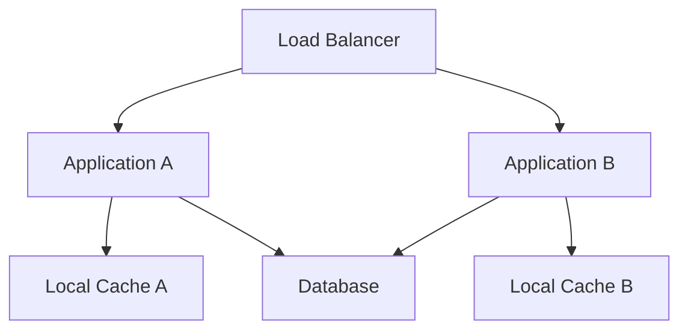

Application A와 B는 각각 독립적인 캐시를 가진다.

예를 들어 Application A에서는 상품 가격을 50,000원으로 저장하고 있다.

```text
Application A

product:100 = 50000
```

그런데 상품 가격이 변경된 이후 Application B는 새로운 가격을 조회했다고 가정하자.

```text
Application B

product:100 = 45000
```

이제 어떤 서버가 요청을 처리하는지에 따라 서로 다른 가격이 반환될 수 있다.

```text
Application A → 50,000원

Application B → 45,000원
```

이러한 상황은 캐시의 정합성 문제를 발생시킨다.

Local Cache를 사용하면 반드시 이런 문제가 발생한다는 의미는 아니다.

TTL을 짧게 설정하거나 서버 간 캐시 무효화 이벤트를 전파하는 방식으로 완화할 수 있다.

하지만 서버 수가 증가할수록 캐시 상태를 관리해야 하는 복잡성이 증가할 수 있다.

---

### Caffeine으로 Local Cache 구현하기

Java와 Spring Boot에서 Local Cache를 구성할 때 자주 사용하는 라이브러리 중 하나가 Caffeine이다.

Caffeine은 메모리 기반 캐시 라이브러리로, 크기 제한과 만료 정책 등을 지원한다.

예를 들어 다음과 같이 구성할 수 있다.

```java
import com.github.benmanes.caffeine.cache.Cache;
import com.github.benmanes.caffeine.cache.Caffeine;

import java.time.Duration;

public class ProductLocalCache {

    private final Cache<Long, ProductResponse> cache =
            Caffeine.newBuilder()
                    .maximumSize(10_000)
                    .expireAfterWrite(Duration.ofMinutes(10))
                    .recordStats()
                    .build();

    public ProductResponse get(Long productId) {
        return cache.getIfPresent(productId);
    }

    public void put(Long productId, ProductResponse product) {
        cache.put(productId, product);
    }

    public void evict(Long productId) {
        cache.invalidate(productId);
    }
}
```

여기서 중요한 설정을 살펴보자.

| 설정 | 의미 |
|---|---|
| `maximumSize(10_000)` | 캐시의 최대 엔트리 수 제한 |
| `expireAfterWrite(10분)` | 저장 또는 갱신 후 10분이 지나면 만료 |
| `recordStats()` | Hit, Miss 등의 통계 기록 |
| `getIfPresent()` | 캐시 조회 |
| `put()` | 캐시 데이터 저장 |
| `invalidate()` | 특정 캐시 제거 |

Local Cache를 사용할 때는 반드시 메모리 사용량을 고려해야 한다.

캐시가 JVM Heap에 저장되므로 캐시 크기가 증가하면 애플리케이션의 GC 부담도 증가할 수 있기 때문이다.

Caffeine은 크기 기반 Eviction과 시간 기반 Expiration 등의 기능을 제공한다.

---

### Global Cache란 무엇인가?

Global Cache는 여러 애플리케이션 서버가 공유하는 외부 캐시를 의미한다.

일반적으로 Distributed Cache라고도 부른다.

대표적인 기술은 다음과 같다.

- Redis
- Memcached
- Hazelcast
- Infinispan

이 중 Redis는 Spring Boot 환경에서 자주 사용되는 캐시 저장소다.

예를 들어 다음과 같은 구조를 생각해 보자.

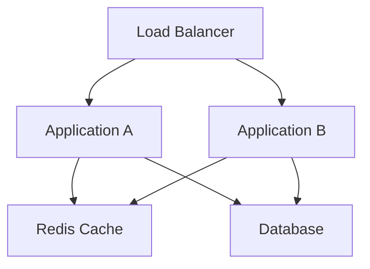

Application A와 B는 동일한 Redis를 사용한다.

따라서 캐시 데이터를 한곳에서 관리할 수 있다.

#### Global Cache의 장점

첫 번째로 여러 서버가 동일한 캐시 데이터를 공유할 수 있다.

두 번째로 애플리케이션 프로세스가 재시작되어도 외부 캐시 서버가 계속 실행 중이라면 캐시 데이터를 유지할 수 있다.

세 번째로 애플리케이션 인스턴스별 캐시 상태 관리 부담을 줄일 수 있다.

네 번째로 애플리케이션 Heap과 캐시 메모리를 분리할 수 있다.

#### Global Cache의 단점

첫 번째는 네트워크 비용이다.

Redis가 메모리 기반 저장소라고 해도 네트워크 왕복 비용이 발생한다.

또 데이터의 직렬화와 역직렬화 비용이 존재한다.

두 번째는 외부 인프라 의존성이 증가한다는 것이다.

Redis에 장애가 발생하면 캐시 조회가 실패할 수 있다.

세 번째는 운영 비용이다.

Redis의 메모리 사용량과 고가용성, 네트워크 보안, 장애 대응 등을 관리해야 한다.

네 번째는 데이터 정합성이다.

여러 서버가 동일한 Redis를 사용한다고 해서 Redis와 데이터베이스 사이의 정합성이 자동으로 보장되는 것은 아니다.

**Global Cache는 여러 애플리케이션 사이의 캐시 공유 문제를 줄일 수 있지만, 원본 데이터와 캐시 사이의 일관성까지 자동으로 해결하지는 않는다.**

또 Redis 자체가 재시작되는 경우에는 Persistence 설정과 장애 복구 구성에 따라 캐시 데이터가 유실될 수 있다.

따라서 외부 캐시를 사용한다고 데이터가 항상 유지된다고 가정해서는 안 된다.

---

### Local Cache와 Global Cache 비교

| 구분 | Local Cache | Global Cache |
|---|---|---|
| 저장 위치 | 애플리케이션 내부 | 외부 캐시 서버 |
| 대표 기술 | Caffeine, ConcurrentHashMap | Redis, Memcached |
| 조회 속도 | 일반적으로 매우 빠름 | 네트워크 비용 존재 |
| 네트워크 요청 | 불필요 | 필요 |
| 서버 간 공유 | 기본적으로 불가능 | 가능 |
| 서버 재시작 | 해당 서버의 캐시 소멸 | 캐시 서버 상태에 따라 유지 |
| 메모리 사용 | JVM Heap 등 | 외부 캐시 서버 메모리 |
| 데이터 동기화 | 별도 고려 필요 | 원본 DB와의 정합성 관리 필요 |
| 장애 대응 | 앱 프로세스와 운명을 공유 | 외부 캐시 장애 대응 필요 |
| 운영 복잡도 | 상대적으로 낮음 | 상대적으로 높음 |

따라서 캐시의 위치를 결정할 때는 다음 질문이 중요하다.

**캐시 데이터가 여러 서버 사이에서 공유되어야 하는가?**

서버별로 조금 다른 캐시를 사용해도 문제가 없다면 Local Cache가 적합할 수 있다.

반면 여러 서버가 동일한 캐시를 사용해야 하고 데이터의 갱신 시점을 통일해야 한다면 Global Cache가 더 적합할 수 있다.

다만 실제 성능은 네트워크 환경과 데이터 크기, Hit Rate 등을 측정해 판단해야 한다.

---

### 캐싱 전략이란 무엇인가?

캐시를 어디에 저장할지 결정했다면 다음으로는 캐시를 어떻게 관리할지 결정해야 한다.

이를 캐싱 전략(Caching Strategy)이라고 한다.

캐싱 전략은 크게 두 가지 관점으로 구분할 수 있다.

**첫 번째는 읽기 전략이다.**

캐시에 데이터가 없을 때 어떻게 데이터를 가져올 것인지 결정한다.

**두 번째는 쓰기 전략이다.**

원본 데이터가 변경되었을 때 캐시를 어떻게 처리할 것인지 결정한다.

| 구분 | 핵심 질문 |
|---|---|
| 읽기 전략 | 캐시가 비어 있으면 누가 원본 데이터를 조회하는가? |
| 쓰기 전략 | 원본 데이터가 변경되면 캐시를 언제, 어떻게 갱신하는가? |

이 두 가지는 독립적으로 조합할 수 있다.

예를 들어 Cache-Aside와 Write-Around를 함께 사용할 수 있다.

또 Read-Through와 Write-Through를 조합할 수도 있다.

하지만 읽기와 쓰기를 따로 선택했다고 해서 데이터 정합성이 자동으로 보장되는 것은 아니다.

두 전략 사이에서 발생할 수 있는 동시성 문제까지 고려해야 한다.

---

### 읽기 전략 1. Cache-Aside

Cache-Aside는 애플리케이션이 캐시와 데이터베이스를 직접 관리하는 읽기 전략이다.

Lazy Loading이라고도 부른다.

가장 일반적으로 사용되는 캐싱 전략 중 하나다.

#### Cache-Aside의 동작 과정

1. 애플리케이션이 캐시에 데이터를 요청한다.
2. Cache Hit이면 캐시 데이터를 반환한다.
3. Cache Miss이면 데이터베이스를 조회한다.
4. 조회한 결과를 캐시에 저장한다.
5. 결과를 반환한다.

구조는 다음과 같다.

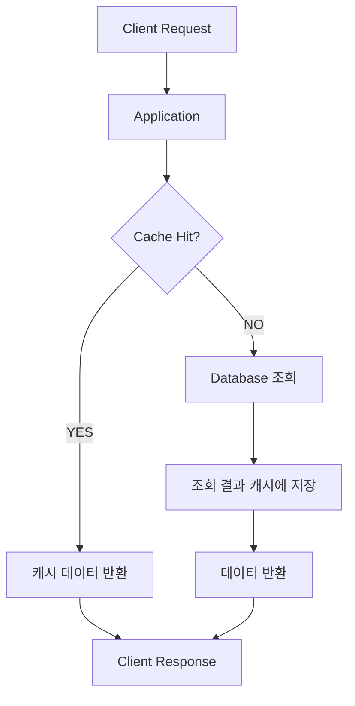

Java 코드로 표현하면 다음과 같다.

```java
public ProductResponse getProduct(Long productId) {

    ProductResponse cached =
            cache.get(productId);

    if (cached != null) {
        return cached;
    }

    ProductResponse product =
            productRepository.findResponseById(productId);

    cache.put(productId, product);

    return product;
}
```

이 코드는 Cache-Aside의 기본 흐름을 나타낸다.

캐시에 데이터가 존재하면 즉시 반환한다.

없으면 DB에서 조회한 뒤 캐시에 저장한다.

#### Cache-Aside의 장점

가장 큰 장점은 실제로 조회된 데이터만 캐싱한다는 것이다.

모든 데이터를 미리 적재할 필요가 없다.

또 애플리케이션이 데이터베이스에 직접 접근할 수 있기 때문에 캐시 장애 시 DB 조회로 전환하는 구조를 설계하기 쉽다.

하지만 캐시 장애 시 자동으로 안전하게 동작하는 것은 아니다.

캐시 접근에서 발생하는 예외를 처리하고 DB로 우회하는 로직이 필요하다.

#### Cache-Aside의 단점

첫 번째 요청에서는 Cache Miss가 발생할 수 있다.

또 캐시가 만료되거나 제거되면 DB를 다시 조회해야 한다.

그리고 캐시 데이터를 채우고 무효화하는 책임이 애플리케이션에 존재한다.

따라서 개발자는 다음 내용을 관리해야 한다.

- Cache Key 설계
- TTL
- 캐시 갱신
- 캐시 삭제
- 동시 Cache Miss
- Redis 장애 시 대체 경로

Redis 공식 문서에서도 Cache-Aside를 반복적인 읽기 요청에서 DB 부하를 줄이기 위한 대표적인 전략으로 설명한다.

---

### 읽기 전략 2. Read-Through

Read-Through는 애플리케이션이 캐시 계층을 통해 데이터를 조회하는 전략이다.

Cache-Aside와 가장 큰 차이는 **Cache Miss가 발생했을 때 원본 데이터를 누가 조회하는가**이다.

Cache-Aside에서는 애플리케이션이 DB를 조회한다.

Read-Through에서는 캐시 계층이 등록된 데이터 로더 등을 이용해 원본 데이터를 조회한다.

#### Read-Through의 동작 과정

1. 애플리케이션이 캐시에 데이터를 요청한다.
2. Cache Hit이면 캐시 데이터를 반환한다.
3. Cache Miss이면 캐시 계층이 데이터 로더를 실행한다.
4. 데이터 로더가 원본 저장소에서 조회한다.
5. 캐시 계층이 결과를 저장한다.
6. 애플리케이션에 결과를 반환한다.

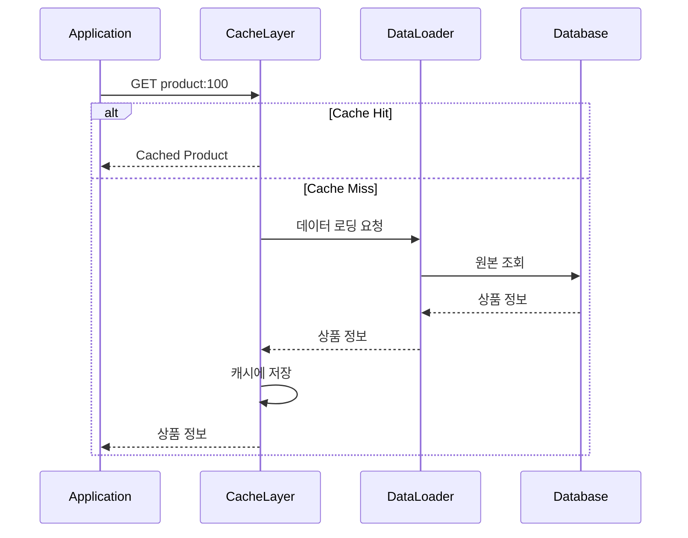

이 구조에서는 캐시 조회와 데이터 로딩 로직을 하나의 추상화로 제공할 수 있다.

#### Read-Through의 장점

애플리케이션에서는 캐시 조회 인터페이스만 사용하면 된다.

캐시가 비어 있을 때 데이터를 로딩하는 과정이 캐시 계층에 캡슐화된다.

따라서 여러 애플리케이션에서 동일한 로딩 정책을 사용할 수 있다.

#### Read-Through의 단점

캐시 계층이 원본 데이터를 로딩하는 방법을 알아야 한다.

따라서 데이터 로더와 원본 저장소 사이의 의존성을 관리해야 한다.

또 캐시 계층 자체에 장애가 발생했을 때 어떻게 우회할지 별도의 설계가 필요하다.

여기서 중요한 점은 다음과 같다.

**일반적인 Redis는 Cache Miss가 발생했다고 자동으로 데이터베이스를 조회하지 않는다.**

Redis는 기본적으로 Key-Value 저장소다.

Read-Through를 구현하려면 별도의 데이터 로더 또는 Read-Through 기능을 제공하는 계층이 필요하다.

---

### Cache-Aside와 Read-Through 비교

| 구분 | Cache-Aside | Read-Through |
|---|---|---|
| 캐시 조회 | 애플리케이션 | 애플리케이션 |
| Cache Miss 처리 | 애플리케이션 | 캐시 계층 |
| DB 조회 책임 | 애플리케이션 | 데이터 로더 |
| 캐시 저장 책임 | 애플리케이션 | 캐시 계층 |
| 구현 유연성 | 높음 | 로딩 정책 통일에 유리 |
| 대표적인 활용 | Redis와 일반적인 서비스 로직 | Loading Cache, 캐시 추상화 |
| 장애 시 우회 | 직접 구현 가능 | 캐시 계층 설계에 따라 다름 |

두 전략의 핵심적인 차이는 원본 조회 책임이 어디에 위치하는가이다.

---

### 쓰기 전략 1. Write-Around

Write-Around는 원본 데이터를 변경할 때 캐시를 직접 갱신하지 않고 데이터베이스에 기록하는 전략이다.

캐시에 데이터를 미리 저장하는 대신 이후 읽기 요청이 발생했을 때 필요한 데이터를 캐싱한다.

#### Write-Around의 동작 과정

예를 들어 상품 가격이 변경되었다고 가정하자.

```text
기존 가격: 50,000원

변경 가격: 45,000원
```

Write-Around에서는 데이터베이스에 새로운 가격을 기록한다.

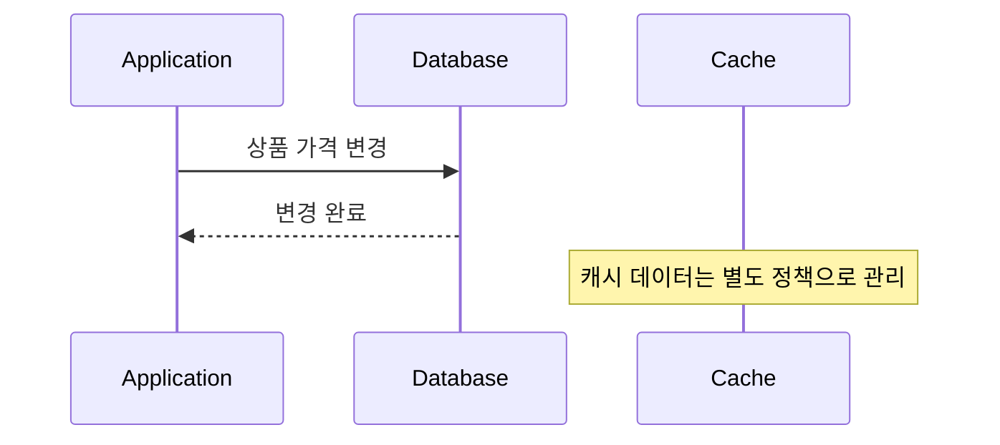

중요한 점은 Write-Around 자체가 캐시 갱신을 보장하지 않는다는 것이다.

따라서 기존 캐시에는 여전히 오래된 값이 존재할 수 있다.

```text
Database

product:100 = 45000
```

```text
Cache

product:100 = 50000
```

이러한 상태를 Stale Cache라고 부른다.

#### Write-Around의 장점

쓰기 요청마다 캐시까지 갱신하지 않아도 된다.

또 실제로 조회되지 않는 데이터까지 캐싱할 필요가 없다.

따라서 데이터 변경이 빈번하지만 일부 데이터만 자주 조회되는 시스템에 적합할 수 있다.

#### Write-Around의 단점

가장 중요한 문제는 오래된 데이터가 반환될 수 있다는 점이다.

따라서 Write-Around를 사용할 때는 다음과 같은 정책을 함께 고려해야 한다.

- 쓰기 완료 후 캐시 삭제
- TTL에 의한 만료
- 캐시 Key 버전 변경
- 캐시 갱신 이벤트 발행
- 일정 주기의 캐시 재생성

실무에서는 **Write-Around와 Cache-Aside를 조합하면서 데이터 변경 후 해당 캐시를 무효화하는 방식**을 많이 고려한다.

단순히 DB에만 쓰고 캐시를 방치하면 데이터 정합성 문제가 발생할 수 있기 때문이다.

---

### 쓰기 전략 2. Write-Through

Write-Through는 데이터 변경 시 캐시와 원본 저장소 모두에 변경 사항을 반영하는 전략이다.

개념적인 흐름은 다음과 같다.

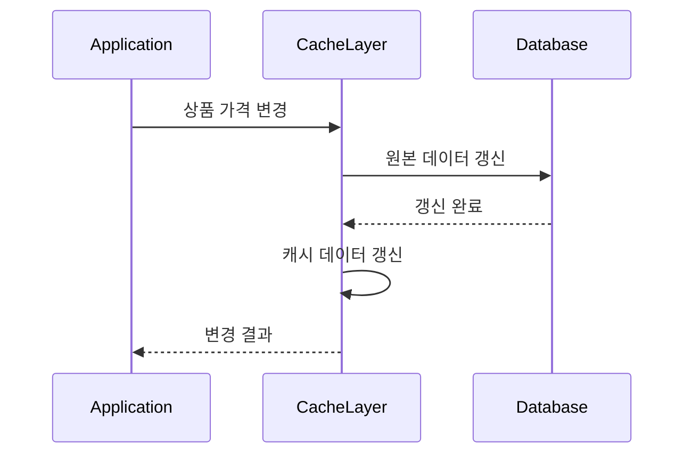

Write-Through의 목적은 캐시와 원본 데이터 사이의 불일치 시간을 줄이는 것이다.

#### Write-Through의 장점

데이터 변경 시 캐시에도 새로운 값을 기록하므로 이후 조회에서 새로운 데이터를 반환할 가능성이 높다.

따라서 캐시 적중률을 유지하면서 원본 변경을 반영해야 하는 상황에 활용할 수 있다.

#### Write-Through의 단점

쓰기 작업마다 두 저장소를 처리해야 한다.

따라서 추가적인 네트워크 및 저장 비용이 발생할 수 있다.

또 중요한 문제가 있다.

**데이터베이스와 Redis에 순서대로 기록한다고 해서 두 작업이 하나의 원자적 트랜잭션이 되는 것은 아니다.**

예를 들어 DB 업데이트는 성공했지만 Redis 업데이트가 실패할 수 있다.

```text
DB 업데이트 성공

↓

Redis 업데이트 실패

↓

DB와 캐시 데이터 불일치
```

반대 순서로 처리하더라도 문제가 발생할 수 있다.

따라서 Write-Through를 적용할 때는 다음 사항을 고려해야 한다.

- 쓰기 순서
- 부분 실패 처리
- 재시도 정책
- 멱등성
- 캐시 무효화
- 트랜잭션 완료 시점
- 동시 업데이트 순서

Write-Through는 정합성 유지에 유리한 전략이지만 **별도 조정 없이 강한 일관성을 자동으로 보장하는 방식은 아니다.**

---

### 쓰기 전략 3. Write-Behind

Write-Behind는 먼저 캐시에 데이터를 기록하고 이후 비동기적으로 원본 저장소에 반영하는 방식이다.

Write-Back이라고도 부른다.

#### Write-Behind의 동작 과정

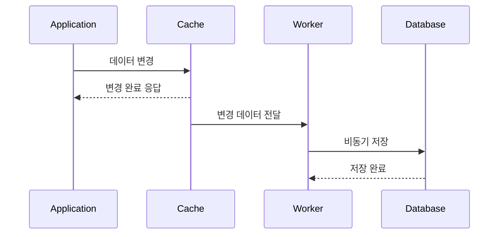

이 구조에서는 애플리케이션이 DB 저장 완료를 기다리지 않을 수 있다.

따라서 쓰기 응답 시간을 줄이는 데 유리할 수 있다.

또 여러 변경 작업을 모아서 Batch로 처리할 수도 있다.

예를 들어 실시간 조회수 시스템을 생각해 보자.

```text
조회수 증가

1 → 2 → 3 → 4 → 5
```

모든 증가 연산을 즉시 DB에 기록하는 대신 Redis에서 누적한 뒤 일정 주기로 DB에 반영할 수 있다.

이러한 방식은 DB 쓰기 부하를 줄이는 데 도움이 될 수 있다.

하지만 위험도 존재한다.

#### Write-Behind의 데이터 유실 위험

다음 상황을 생각해 보자.

```text
Redis에 데이터 기록 성공

↓

애플리케이션에 성공 응답

↓

DB 반영 전 Redis 장애

↓

변경 데이터 유실 가능
```

애플리케이션에서는 성공으로 처리했지만 실제 DB에는 변경 사항이 기록되지 않았을 수 있다.

따라서 Write-Behind에서는 다음 요소가 중요하다.

- 변경 이벤트의 내구성
- 재시도 가능한 저장 구조
- 중복 처리 방지
- 장애 복구
- 저장 순서 보장
- 최종 일관성
- 실패한 데이터의 재처리

중요한 데이터라면 단순히 Redis에 기록한 뒤 비동기로 DB에 저장하는 구조만으로 충분하지 않을 수 있다.

내구성 있는 메시지 큐나 로그를 활용하고, 장애 복구 및 재처리 정책을 함께 설계해야 한다.

---

### 쓰기 전략 비교

| 구분 | Write-Around | Write-Through | Write-Behind |
|---|---|---|---|
| 데이터 기록 위치 | DB 중심 | 캐시 + DB | 캐시 우선 |
| 캐시 갱신 | 즉시 갱신하지 않음 | 쓰기 시 갱신 | 먼저 갱신 |
| DB 반영 | 동기 | 일반적으로 동기 | 비동기 |
| 쓰기 지연 | 상대적으로 단순 | 추가 저장 비용 발생 | 빠른 응답 가능 |
| 오래된 캐시 위험 | 존재 | 실패나 경쟁 상황에서 존재 | DB와 불일치 가능 |
| 데이터 유실 위험 | DB 내구성에 좌우 | 부분 실패 처리 필요 | 비동기 반영 전 유실 위험 |
| 적합한 상황 | 읽기 중심 시스템 | 변경 후 캐시 최신화가 중요한 시스템 | 대량 쓰기 및 지연 반영 허용 시스템 |

여기서 중요한 것은 전략의 이름이 아니라 데이터 변경 후 어떤 상태를 허용할 수 있는가이다.

특히 금융 데이터나 결제 처리에서는 최종 데이터의 정확성과 내구성이 중요하다.

따라서 Write-Behind를 단순히 쓰기 속도가 빠르다는 이유로 선택해서는 안 된다.

---

### 읽기 전략과 쓰기 전략을 어떻게 조합할까?

읽기 전략과 쓰기 전략은 서비스의 특성에 따라 조합할 수 있다.

대표적인 예는 다음과 같다.

| 읽기 전략 | 쓰기 전략 | 특징 |
|---|---|---|
| Cache-Aside | Write-Around | 필요할 때 캐싱, 쓰기 시 무효화 정책 필요 |
| Cache-Aside | Write-Through | 읽기는 지연 적재, 변경 시 캐시 반영 |
| Read-Through | Write-Through | 캐시 계층이 읽기와 쓰기 관리 |
| Read-Through | Write-Behind | 캐시 계층 중심, DB 비동기 반영 |

예를 들어 상품 상세 페이지는 다음 조합이 적합할 수 있다.

```text
읽기: Cache-Aside

쓰기: Write-Around + Invalidation
```

상품 정보를 조회할 때 캐시를 먼저 확인한다.

상품 정보가 변경되면 DB를 갱신하고 해당 캐시를 삭제한다.

이후 첫 조회에서 새로운 값을 캐시에 저장한다.

반면 실시간 조회수 집계는 다음과 같은 구조를 고려할 수 있다.

```text
읽기: 캐시 중심

쓰기: Redis 누적

DB 반영: 비동기 Batch
```

다만 조회수 데이터의 유실 허용 범위와 복구 요구사항에 따라 내구성 설계가 필요하다.

---

### 캐시 도입 예제: 관리자 매출 통계 대시보드

이제 실제 백엔드 서비스에서 캐시 도입을 어떻게 판단하는지 살펴보자.

가상의 배달 플랫폼이 있다고 가정하자.

이 플랫폼에서는 관리자를 위한 매출 통계 대시보드를 제공한다.

대시보드에는 다음과 같은 정보가 표시된다.

- 전체 주문 수
- 총매출
- 결제 완료 주문 수
- 취소 주문 수
- 국가별 매출
- 시간대별 주문량

기존 구조는 다음과 같다.

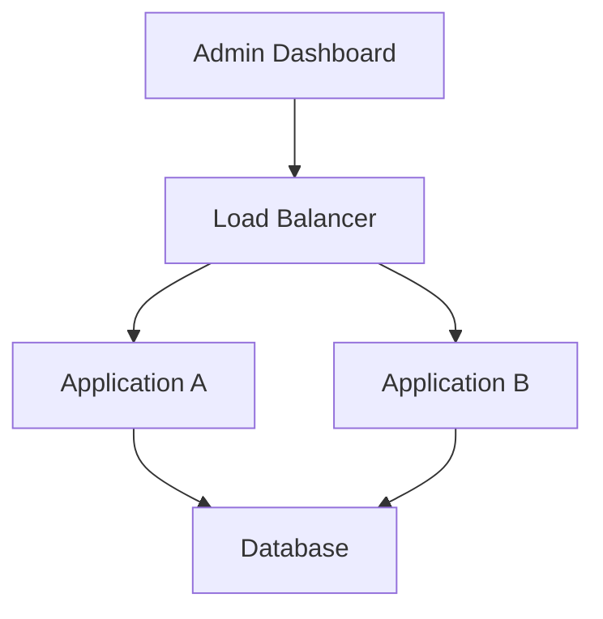

대시보드를 조회할 때마다 DB에서 통계를 계산한다.

그런데 통계 쿼리가 매우 복잡하다고 가정하자.

```sql
SELECT
    COUNT(*) AS order_count,
    SUM(o.total_amount) AS total_sales
FROM orders o
JOIN payments p
    ON p.order_id = o.id
JOIN stores s
    ON s.id = o.store_id
WHERE p.status = 'SUCCESS'
  AND o.created_at >= :startTime
  AND o.created_at < :endTime;
```

위 SQL은 구조를 단순화한 예시다.

실제 대시보드에서는 여러 테이블의 조인과 그룹화, 집계 연산이 추가될 수 있다.

여기서 다음과 같은 상황을 가정해 보자.

| 항목 | 조건 |
|---|---|
| 애플리케이션 서버 | 2대 |
| 대시보드 조회 | 초당 80회 |
| 통계 쿼리 실행 시간 | 약 1초 |
| 원본 주문 데이터 | 지속적으로 변경 |
| 대시보드 최신화 요구사항 | 1시간 단위 |
| 데이터베이스 | 1개 |

이 상황에서는 대시보드를 조회할 때마다 복잡한 집계 쿼리를 실행하고 있다.

초당 80회의 조회 요청이 발생하므로 데이터베이스에 상당한 부하가 발생할 수 있다.

단순 계산으로 한 시간 동안의 대시보드 요청은 다음과 같다.

```text
80 requests/second × 3,600 seconds

= 288,000 requests/hour
```

한 시간에 288,000번의 통계 조회 요청이 발생하는 셈이다.

물론 실제 DB 부하는 쿼리 실행 계획과 CPU 사용량, 동시 실행 수, 인덱스, 캐시 상태 등에 따라 달라진다.

하지만 동일한 집계 결과를 반복해서 계산하는 비용은 상당할 수 있다.

여기서 캐시 도입 조건을 확인해 보자.

#### 1. 읽기 요청이 많은가?

초당 80번 조회한다.

읽기 요청이 매우 많다.

#### 2. 데이터 생성 비용이 높은가?

하나의 통계 쿼리에 약 1초가 걸린다.

집계 결과를 생성하는 비용이 높은 편이다.

#### 3. 동일한 조건에서 결과를 재사용할 수 있는가?

대시보드가 특정 시간 구간의 집계를 보여준다면 동일한 시간 구간과 필터 조건에 대해 같은 결과를 재사용할 수 있다.

#### 4. 오래된 데이터를 허용할 수 있는가?

요구사항에서 1시간 단위의 갱신을 허용한다.

따라서 실시간 주문 상태를 매 요청마다 반영할 필요가 없다.

이러한 조건을 보면 통계 결과는 캐싱하기 좋은 대상이다.

---

### 관리자 대시보드에는 Local Cache와 Global Cache 중 무엇이 적합할까?

현재 서버는 2대다.

Local Cache를 사용하면 다음과 같은 구조가 된다.

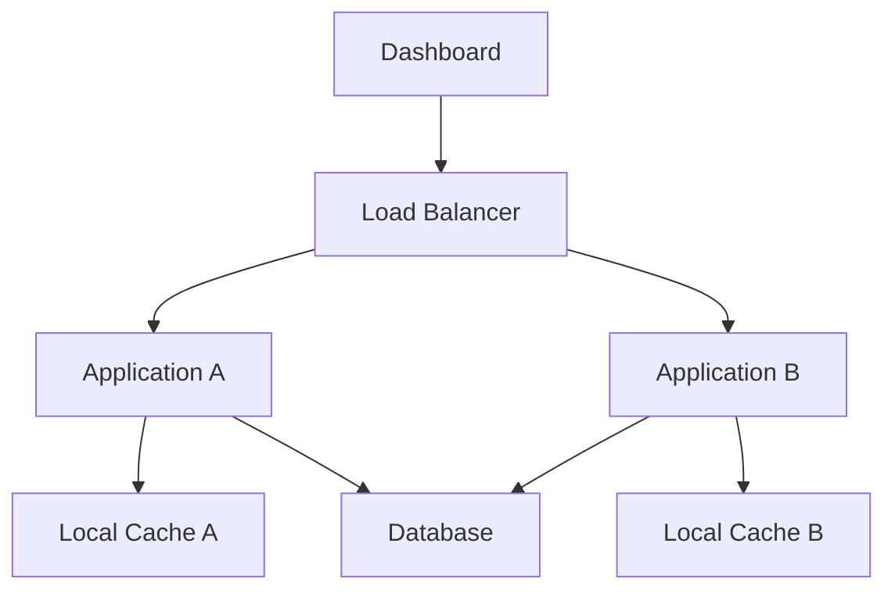

Application A와 B는 서로 다른 시점에 통계를 계산할 수 있다.

예를 들어 다음과 같은 상황이 발생할 수 있다.

```text
Application A

통계 생성 시각: 10:00

총매출: 1,000만 원
```

```text
Application B

통계 생성 시각: 10:30

총매출: 1,200만 원
```

사용자가 새로고침할 때마다 다른 서버로 연결된다면 통계가 변경되어 보일 수 있다.

물론 Local Cache에서도 시간 구간을 고정하고 동일한 스냅샷을 조회하도록 설계하면 이러한 문제를 완화할 수 있다.

하지만 여러 서버에서 동일한 캐시 상태를 공유해야 한다면 Global Cache가 더 단순한 선택이 될 수 있다.

따라서 Redis를 도입한다고 가정하자.

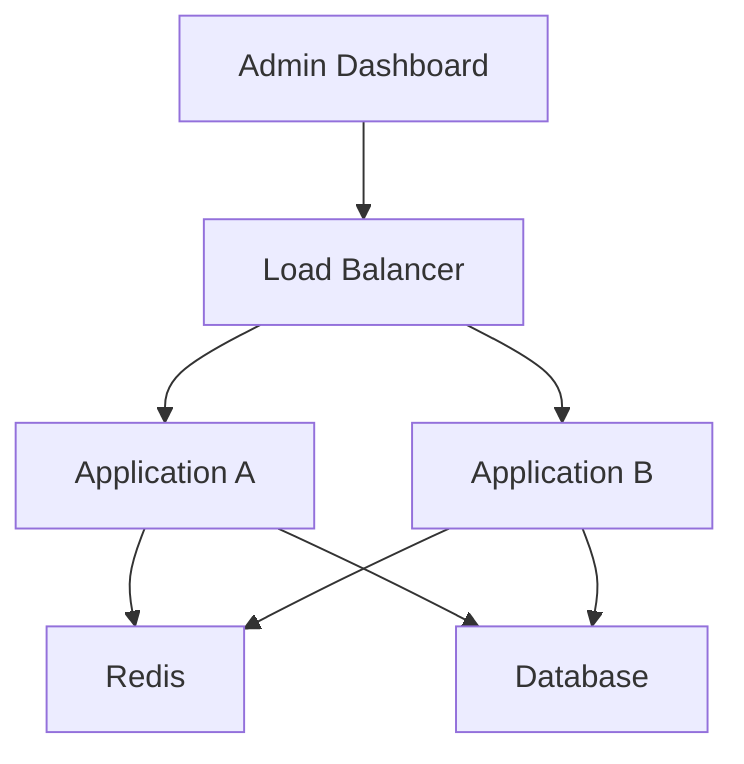

이제 두 애플리케이션은 동일한 Redis Key에서 통계 데이터를 조회한다.

---

### 관리자 대시보드의 읽기 전략 선택

읽기 전략에는 Cache-Aside와 Read-Through가 있다.

이 시스템에서는 Cache-Aside를 선택한다고 가정하자.

그 이유는 애플리케이션이 통계 계산 로직을 직접 관리하고 있고, 캐시 데이터가 없어도 데이터베이스에서 통계를 생성할 수 있기 때문이다.

흐름은 다음과 같다.

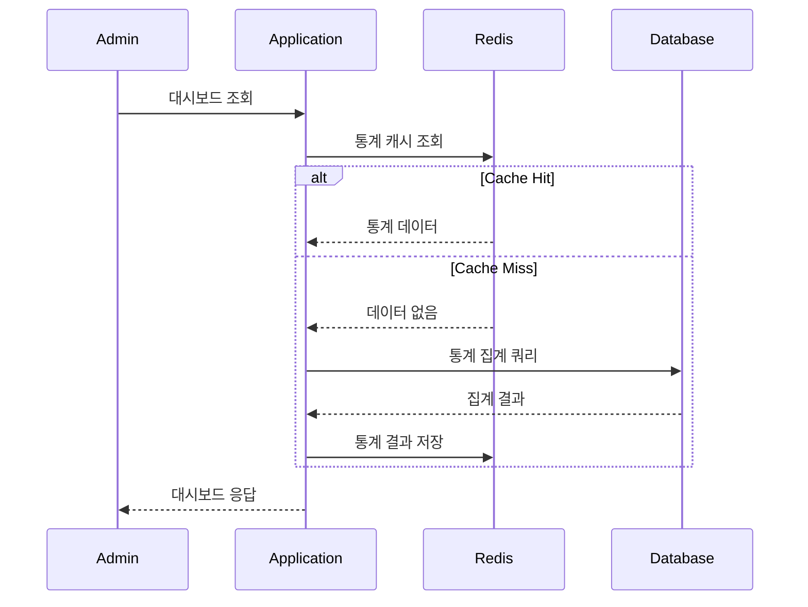

이제 동일한 통계에 대한 반복 조회에서는 데이터베이스 집계 쿼리를 실행할 필요가 없다.

하지만 실제 운영 환경에서는 두 가지를 더 고려해야 한다.

첫 번째는 Redis 장애 시 DB로 우회하는 로직이다.

두 번째는 Cache Miss가 동시에 발생할 때 여러 요청이 같은 통계 쿼리를 실행하는 문제다.

이 두 가지는 캐시 도입의 중요한 운영 문제다.

---

### 관리자 대시보드의 쓰기 전략 선택

주문 데이터는 지속적으로 변경된다.

하지만 대시보드의 통계는 1시간 단위로 갱신하면 된다고 가정했다.

따라서 주문이 생성될 때마다 Redis의 통계 데이터를 갱신할 필요는 없다.

이 경우 Write-Around와 Cache-Aside를 조합할 수 있다.

```text
주문 발생

↓

Database에 주문 저장

↓

대시보드 캐시는 즉시 갱신하지 않음

↓

정해진 갱신 시점에 새 통계 생성

↓

이후 조회에서 새로운 데이터 사용
```

여기서 중요한 것은 **1시간 단위로 갱신한다는 요구사항을 어떻게 정의하는가**이다.

예를 들어 다음 두 조건은 다르다.

**조건 A: 최대 1시간 이전의 데이터가 표시되어도 괜찮다.**

이 경우 TTL 1시간을 사용할 수 있다.

**조건 B: 매시 정각에 통계가 갱신되어야 한다.**

이 경우 단순히 TTL을 1시간으로 설정하는 것만으로는 충분하지 않다.

캐시가 생성된 시점을 기준으로 1시간 뒤에 만료되기 때문이다.

예를 들어 오전 10시 37분에 캐시가 생성되었다면 일반적인 1시간 TTL은 오전 11시 37분에 만료된다.

따라서 정각 갱신 요구사항을 충족하려면 시간 구간별 Cache Key, 스케줄 기반 갱신, 스냅샷 테이블 등을 고려해야 한다.

---

### TTL이란 무엇인가?

TTL(Time To Live)은 캐시 데이터가 유효하게 유지되는 시간을 의미한다.

예를 들어 Redis에 다음 데이터를 저장했다고 가정하자.

```bash
SET product:100 '{"name":"Keyboard","price":50000}' EX 3600
```

여기서 `EX 3600`은 3,600초 동안 Key의 유효 기간을 설정한다는 의미다.

다음 명령어로 값을 조회할 수 있다.

```bash
GET product:100
```

예상 결과는 다음과 같다.

```text
"{\"name\":\"Keyboard\",\"price\":50000}"
```

TTL을 확인하려면 다음 명령어를 사용한다.

```bash
TTL product:100
```

예를 들어 다음과 같은 결과가 반환될 수 있다.

```text
(integer) 3542
```

이는 해당 Key의 만료까지 약 3,542초가 남았다는 의미다.

Redis의 `TTL` 명령은 Key가 존재하지 않으면 `-2`, 만료 시간이 설정되지 않은 Key에는 `-1`을 반환한다.

#### TTL을 길게 설정하면 무조건 좋을까?

TTL이 길어지면 Cache Hit Rate가 높아질 수 있다.

하지만 오래된 데이터가 유지되는 시간도 증가할 수 있다.

반대로 TTL이 짧으면 최신 데이터를 반영하는 데 유리할 수 있다.

하지만 Cache Miss가 증가해 DB 부하가 커질 수 있다.

따라서 TTL은 다음 조건 사이의 균형을 고려해 설정해야 한다.

```text
TTL 증가

→ Cache Hit 증가 가능
→ DB 조회 감소 가능
→ 오래된 데이터 유지 시간 증가 가능
```

```text
TTL 감소

→ 데이터 최신화에 유리
→ Cache Miss 증가 가능
→ DB 조회 증가 가능
```

또 TTL과 메모리 부족으로 인한 Eviction은 서로 다른 개념이다.

TTL이 남아 있어도 Redis의 메모리 정책에 따라 데이터가 제거될 수 있다.

이 차이는 이후 추가 키워드에서 자세히 살펴보자.

---

### Spring Boot에서 Redis 캐시 구현하기

이제 Spring Boot를 이용해 실제로 Cache-Aside 전략을 구현해 보자.

여기서는 다음 환경을 기준으로 한다.

| 항목 | 환경 |
|---|---|
| Java | 17 이상 |
| Spring Boot | 3.2 이상 |
| Spring Cache | 사용 |
| Spring Data Redis | 사용 |
| Redis | Redis 7 이상 |
| 데이터 접근 | Spring JDBC |
| 데이터베이스 | PostgreSQL |

예제에서는 특정 국가와 시간 구간에 대한 주문 통계를 조회한다고 가정한다.

기본적인 흐름은 다음과 같다.

```text
HTTP Request
    ↓
DashboardController
    ↓
DashboardService
    ↓
Spring Cache
    ↓
Redis
    ↓
Cache Miss
    ↓
DashboardQueryRepository
    ↓
PostgreSQL
```

---

### Gradle 의존성 설정

Spring Boot에서 Redis 캐시를 사용하려면 필요한 의존성을 추가한다.

`build.gradle`

```groovy
dependencies {
    implementation 'org.springframework.boot:spring-boot-starter-web'

    implementation 'org.springframework.boot:spring-boot-starter-cache'

    implementation 'org.springframework.boot:spring-boot-starter-data-redis'

    implementation 'org.springframework.boot:spring-boot-starter-jdbc'

    implementation 'org.springframework.boot:spring-boot-starter-actuator'

    runtimeOnly 'org.postgresql:postgresql'

    testImplementation 'org.springframework.boot:spring-boot-starter-test'
}
```

주요 의존성의 역할은 다음과 같다.

| 의존성 | 역할 |
|---|---|
| `starter-web` | REST API |
| `starter-cache` | Spring Cache 추상화 |
| `starter-data-redis` | Redis 연결 및 데이터 접근 |
| `starter-jdbc` | JDBC 기반 SQL 실행 |
| `starter-actuator` | 애플리케이션 운영 지표 |
| PostgreSQL Driver | PostgreSQL 연결 |

Spring Cache는 자체적으로 캐시 저장소를 구현하는 기술이 아니다.

`CacheManager`라는 추상화를 통해 Redis, Caffeine 등의 저장소를 사용할 수 있도록 지원한다.

---

### Redis 연결 설정

`application.yml`

```yaml
spring:
  data:
    redis:
      host: localhost
      port: 6379
      timeout: 2s

  cache:
    type: redis
    cache-names:
      - dashboardStats
```

여기서 `spring.data.redis`는 Redis 연결 정보를 설정한다.

`spring.cache.type`은 Spring Cache가 사용할 캐시 공급자를 지정한다.

현재는 Redis를 사용하도록 설정했다.

실제 운영 환경에서는 Redis의 인증 정보와 TLS, Connection Pool, 장애 복구 구성을 함께 고려해야 한다.

---

### RedisCacheManager 설정

캐시의 TTL을 명시적으로 설정할 수 있다.

```java
import java.time.Duration;

import org.springframework.cache.annotation.EnableCaching;
import org.springframework.context.annotation.Bean;
import org.springframework.context.annotation.Configuration;

import org.springframework.data.redis.cache.RedisCacheConfiguration;
import org.springframework.data.redis.cache.RedisCacheManager;
import org.springframework.data.redis.connection.RedisConnectionFactory;

@Configuration
@EnableCaching
public class CacheConfig {

    @Bean
    public RedisCacheManager cacheManager(
            RedisConnectionFactory connectionFactory
    ) {

        RedisCacheConfiguration configuration =
                RedisCacheConfiguration.defaultCacheConfig()
                        .entryTtl(Duration.ofHours(1))
                        .disableCachingNullValues();

        return RedisCacheManager.builder(connectionFactory)
                .cacheDefaults(configuration)
                .build();
    }
}
```

여기서 중요한 설정을 살펴보자.

#### @EnableCaching

Spring Cache 어노테이션 기반 기능을 활성화한다.

#### entryTtl()

캐시 데이터의 TTL을 설정한다.

```java
.entryTtl(Duration.ofHours(1))
```

현재 설정은 캐시가 기록된 후 1시간 동안 유효하도록 한다.

#### disableCachingNullValues()

`null` 결과가 캐시에 저장되지 않도록 설정한다.

캐시에 없는 값이나 데이터베이스에서 조회되지 않은 값을 어떤 방식으로 처리할지에 따라 이 설정을 선택할 수 있다.

다만 반복적으로 존재하지 않는 데이터를 조회하는 상황에서는 Negative Caching 전략을 별도로 고려할 수 있다.

Spring Data Redis는 `RedisCacheManager`를 통해 TTL과 Key Prefix, 직렬화 방식 등을 설정할 수 있다.

---

### 캐시 데이터 객체 정의

다음과 같은 통계 응답 객체를 정의한다.

```java
import java.io.Serializable;
import java.math.BigDecimal;
import java.time.Instant;

public record DashboardStats(
        String countryCode,
        Instant startTime,
        Instant endTime,
        long orderCount,
        BigDecimal totalSales
) implements Serializable {
}
```

여기서 `Serializable`을 구현한 이유는 앞선 RedisCacheManager 설정이 기본적으로 JDK 직렬화 방식을 사용하기 때문이다.

하지만 운영 환경에서는 직렬화 형식을 명시적으로 관리하는 것이 좋다.

JDK 직렬화는 클래스 구조 변경에 민감할 수 있고, 신뢰할 수 없는 직렬화 데이터의 역직렬화에는 보안상 주의가 필요하다.

JSON이나 명시적인 스키마 기반 직렬화 방식을 선택하면 데이터 호환성과 운영 측면에서 유리할 수 있다.

이때는 사용하는 Spring Data Redis 버전에 맞는 Serializer를 설정해야 한다.

---

### DashboardQueryRepository 구현

데이터베이스에서 통계를 조회하는 Repository를 작성한다.

```java
import java.sql.Timestamp;
import java.time.Instant;

import org.springframework.jdbc.core.simple.JdbcClient;
import org.springframework.stereotype.Repository;

@Repository
public class DashboardQueryRepository {

    private final JdbcClient jdbcClient;

    public DashboardQueryRepository(
            JdbcClient jdbcClient
    ) {
        this.jdbcClient = jdbcClient;
    }

    public DashboardStats aggregate(
            String countryCode,
            Instant startTime,
            Instant endTime
    ) {

        return jdbcClient.sql("""
                SELECT
                    COUNT(*) AS order_count,
                    COALESCE(
                        SUM(total_amount),
                        0
                    ) AS total_sales
                FROM orders
                WHERE country_code = :countryCode
                  AND created_at >= :startTime
                  AND created_at < :endTime
                """)
                .param("countryCode", countryCode)
                .param("startTime", Timestamp.from(startTime))
                .param("endTime", Timestamp.from(endTime))
                .query((rs, rowNum) ->
                        new DashboardStats(
                                countryCode,
                                startTime,
                                endTime,
                                rs.getLong("order_count"),
                                rs.getBigDecimal("total_sales")
                        )
                )
                .single();
    }
}
```

이 코드는 지정된 국가와 시간 구간에 대한 주문 수와 총매출을 계산한다.

실제 프로젝트에서는 데이터베이스의 시간대 저장 규칙과 주문 상태, 취소 및 환불 반영 기준을 추가로 정의해야 한다.

여기서 중요한 것은 SQL의 복잡성이 아니다.

**비용이 높은 통계 계산 결과를 캐시에 저장해 반복적인 집계 작업을 줄이는 구조**다.

---

### @Cacheable을 활용한 Cache-Aside

Spring Cache에서는 `@Cacheable`을 사용해 메서드의 반환값을 캐싱할 수 있다.

```java
import java.time.Instant;

import org.springframework.cache.annotation.Cacheable;
import org.springframework.stereotype.Service;

@Service
public class DashboardService {

    private final DashboardQueryRepository repository;

    public DashboardService(
            DashboardQueryRepository repository
    ) {
        this.repository = repository;
    }

    @Cacheable(
            cacheNames = "dashboardStats",
            key = "#countryCode + ':' + #startTime.toString()"
    )
    public DashboardStats getStats(
            String countryCode,
            Instant startTime,
            Instant endTime
    ) {

        return repository.aggregate(
                countryCode,
                startTime,
                endTime
        );
    }
}
```

이 구조에서는 메서드 실행 전에 Spring Cache가 캐시를 확인한다.

Cache Hit이면 기존 값을 반환한다.

Cache Miss이면 `getStats()`를 실행한다.

이후 반환값을 캐시에 저장한다.

따라서 개발자가 직접 다음 코드를 작성하지 않아도 된다.

```java
cache.get(key);

repository.find(...);

cache.put(key, value);
```

Spring Cache가 해당 흐름을 처리한다.

다만 캐시 Key를 설계할 때 주의해야 한다.

위 예제에서는 `countryCode`와 `startTime`을 사용했다.

이는 해당 서비스에서 `endTime`이 항상 `startTime + 1시간`으로 결정된다는 전제에서만 안전하다.

`endTime`이 임의의 값으로 전달될 수 있다면 캐시 Key에 포함해야 한다.

예를 들어 다음과 같이 작성할 수 있다.

```java
@Cacheable(
        cacheNames = "dashboardStats",
        key = "#countryCode + ':' + #startTime.toString() + ':' + #endTime.toString()"
)
```

**캐시 Key에는 결과를 결정하는 모든 입력값이 반영되어야 한다.**

---

### Controller에서 시간 구간을 고정하기

대시보드는 1시간 단위로 통계를 보여준다고 가정하자.

이때 현재 시각을 기준으로 가장 최근에 완료된 1시간을 조회할 수 있다.

```java
import java.time.Clock;
import java.time.Instant;
import java.time.temporal.ChronoUnit;

import org.springframework.web.bind.annotation.GetMapping;
import org.springframework.web.bind.annotation.RequestMapping;
import org.springframework.web.bind.annotation.RequestParam;
import org.springframework.web.bind.annotation.RestController;

@RestController
@RequestMapping("/api/admin/dashboard")
public class DashboardController {

    private final DashboardService dashboardService;

    private final Clock clock;

    public DashboardController(
            DashboardService dashboardService
    ) {
        this.dashboardService = dashboardService;
        this.clock = Clock.systemUTC();
    }

    @GetMapping
    public DashboardStats getDashboard(
            @RequestParam String countryCode
    ) {

        Instant endTime = clock.instant()
                .truncatedTo(ChronoUnit.HOURS);

        Instant startTime =
                endTime.minus(1, ChronoUnit.HOURS);

        return dashboardService.getStats(
                countryCode,
                startTime,
                endTime
        );
    }
}
```

예를 들어 현재 시각이 10시 30분이라면 다음 시간 구간을 조회한다.

```text
startTime = 09:00

endTime = 10:00
```

10시 50분에 다시 요청해도 동일한 시간 구간을 조회한다.

따라서 동일한 Cache Key를 사용할 수 있다.

11시가 되면 다음 시간 구간으로 변경된다.

```text
startTime = 10:00

endTime = 11:00
```

그러면 새로운 Cache Key로 조회한다.

이 방식은 캐시의 TTL만으로 정각 갱신을 구현하는 것보다 시간 구간의 의미를 명확하게 표현한다.

다만 주문 데이터가 지연 도착하거나 과거 주문이 수정되는 경우에는 이미 완료된 시간 구간의 통계도 변경될 수 있다.

따라서 **시간 구간을 고정하는 것과 통계값이 절대 변경되지 않는다는 것은 다른 문제**다.

데이터의 지연 반영이나 정정 가능성까지 고려해야 한다.

---

### @Cacheable 사용 시 주의할 점

`@Cacheable`은 매우 편리하지만 몇 가지 주의사항이 존재한다.

#### 1. 같은 클래스 내부 호출은 캐시가 적용되지 않을 수 있다

Spring Cache는 기본적으로 Proxy 기반 AOP를 사용한다.

예를 들어 다음 코드를 생각해 보자.

```java
@Service
public class ProductService {

    public ProductResponse find(Long id) {
        return findCached(id);
    }

    @Cacheable("products")
    public ProductResponse findCached(Long id) {
        return loadFromDatabase(id);
    }
}
```

같은 객체 내부에서 `findCached()`를 호출한다.

이 경우 기본적인 Proxy 방식에서는 캐시 기능이 적용되지 않을 수 있다.

왜냐하면 호출이 Spring Proxy를 거치지 않기 때문이다.

따라서 캐시 기능이 적용되는 메서드는 외부 Bean에서 Proxy를 통해 호출되도록 구성하는 것이 일반적이다.

#### 2. Redis 장애 시 자동으로 DB로 우회하지 않는다

Spring Cache의 기본 오류 처리 방식에서는 캐시 접근 예외가 호출자에게 전달될 수 있다.

따라서 Redis가 장애 상태라고 해서 자동으로 DB를 조회하는 것은 아니다.

캐시 장애를 허용하는 서비스라면 별도의 `CacheErrorHandler` 또는 명시적인 Cache-Aside 구현을 고려해야 한다.

#### 3. Cache Miss가 동시에 발생할 수 있다

동일한 Key에 대해 여러 요청이 동시에 Cache Miss를 경험할 수 있다.

그 결과 데이터베이스에서 같은 쿼리가 여러 번 실행될 수 있다.

이것이 Cache Stampede 문제다.

#### 4. 캐시 갱신 시점과 DB 트랜잭션을 고려해야 한다

DB 데이터가 변경되는 도중 캐시를 삭제하거나 갱신하면 트랜잭션 완료 시점과 불일치 문제가 발생할 수 있다.

따라서 캐시 무효화는 트랜잭션과의 관계를 고려해 설계해야 한다.

Spring 공식 문서에서도 Cache 어노테이션의 Proxy 동작과 Self-Invocation 제한을 설명한다.

---

### Redis 장애 시 Cache-Aside는 어떻게 동작해야 할까?

Cache-Aside가 캐시 장애 대응에 유리하다는 것은 애플리케이션이 DB에 직접 접근할 수 있다는 의미다.

하지만 실제 장애 대응 코드는 별도로 구현해야 한다.

개념적으로 다음과 같은 구조를 사용할 수 있다.

```java
public ProductResponse getProduct(Long productId) {

    String key = "product:" + productId;

    try {

        ProductResponse cached = cache.get(key);

        if (cached != null) {
            return cached;
        }

    } catch (CacheAccessException e) {

        log.warn(
                "Cache read failed. productId={}",
                productId,
                e
        );
    }

    ProductResponse product =
            productRepository.findResponseById(productId);

    try {

        cache.put(
                key,
                product,
                Duration.ofMinutes(10)
        );

    } catch (CacheAccessException e) {

        log.warn(
                "Cache write failed. productId={}",
                productId,
                e
        );
    }

    return product;
}
```

여기서 `cache`는 서비스의 캐시 저장소를 감싼 추상화이며, `CacheAccessException`은 캐시 접근 실패를 표현하는 예시 예외다.

핵심은 다음과 같다.

```text
Redis 조회 성공

→ 캐시 데이터 반환
```

```text
Redis 조회 실패

→ DB 조회

→ 정상 응답 시도
```

이러한 방식을 Fail-Open이라고 부르기도 한다.

하지만 무조건 Redis 장애를 무시하고 DB로 우회하는 것이 좋은 것은 아니다.

예를 들어 원래 초당 80회의 복잡한 통계 쿼리를 Redis가 처리하고 있었다고 가정하자.

Redis가 장애 상태가 되면 모든 요청이 DB로 전달될 수 있다.

```text
Redis 장애

↓

모든 요청 Cache Miss 또는 Bypass

↓

DB에 대량 쿼리 발생

↓

DB Connection Pool 고갈

↓

서비스 전체 장애 가능
```

따라서 Redis 장애 대응에서는 다음 요소도 필요하다.

- DB 조회 동시성 제한
- Timeout
- Circuit Breaker
- Rate Limiting
- 오래된 캐시 결과 반환
- 사전 계산된 통계 스냅샷
- 서비스 일부 기능 제한

**캐시가 없어도 기능적으로 동작할 수 있다는 것과, 캐시 장애 상황의 전체 트래픽을 DB가 감당할 수 있다는 것은 다른 문제다.**

---

### Cache-Aside에서 데이터 정합성은 어떻게 유지할까?

캐시를 사용하면 데이터베이스와 캐시라는 두 개의 데이터 저장 위치가 생긴다.

따라서 데이터가 불일치할 가능성이 존재한다.

예를 들어 다음과 같은 상황을 생각해 보자.

```text
Database

product:100 = 50000
```

```text
Redis

product:100 = 50000
```

이제 관리자가 상품 가격을 변경한다.

```text
Database

product:100 = 45000
```

그런데 Redis에는 기존 가격이 남아 있다.

```text
Redis

product:100 = 50000
```

이 경우 Cache Hit이 발생하면 오래된 가격이 반환된다.

이를 해결하기 위한 대표적인 방법이 Cache Invalidation이다.

---

### Cache Invalidation이란 무엇인가?

Cache Invalidation은 캐시 데이터가 더 이상 유효하지 않다고 판단했을 때 해당 데이터를 제거하거나 무효화하는 작업이다.

예를 들어 상품 가격을 변경한 뒤 해당 상품의 캐시를 삭제할 수 있다.

```java
@Transactional
public void updatePrice(
        Long productId,
        long newPrice
) {

    Product product =
            productRepository.findById(productId)
                    .orElseThrow();

    product.changePrice(newPrice);
}
```

데이터베이스 트랜잭션이 정상적으로 커밋된 이후 캐시를 삭제하도록 구성할 수 있다.

개념적으로 다음과 같다.

```text
상품 가격 변경

↓

DB Transaction Commit

↓

Redis Cache 삭제

↓

다음 조회에서 DB 조회

↓

새로운 캐시 생성
```

이 방식은 캐시를 직접 갱신하지 않고 다음 조회에서 최신 데이터를 적재하게 한다.

하지만 여기에도 주의할 점이 있다.

**DB 업데이트와 캐시 삭제는 서로 다른 저장소에서 실행되므로 원자적으로 처리되지 않는다.**

예를 들어 DB 커밋은 성공했지만 Redis 삭제가 실패할 수 있다.

또 다른 요청이 오래된 데이터를 DB에서 읽은 뒤, 쓰기 트랜잭션의 캐시 삭제 이후에 다시 캐시에 기록할 수도 있다.

따라서 단순한 Cache Invalidation만으로 모든 경쟁 조건이 해결되는 것은 아니다.

정합성이 중요한 데이터라면 버전 기반 캐시나 더 강한 동기화 전략을 고려해야 한다.

---

### 캐시 데이터는 언제 갱신해야 할까?

캐시 갱신 방식에는 여러 선택지가 있다.

| 방식 | 특징 | 주요 고려사항 |
|---|---|---|
| TTL 만료 | 일정 시간이 지나면 새로 조회 | 오래된 데이터 허용 범위 |
| Cache Eviction | 데이터 변경 시 캐시 삭제 | 삭제 실패 및 경쟁 조건 |
| Cache Update | 변경된 값을 캐시에 즉시 반영 | 부분 실패와 쓰기 순서 |
| Scheduled Refresh | 정해진 시간마다 재생성 | 갱신 작업 실패 |
| Event-Driven Invalidation | 데이터 변경 이벤트로 무효화 | 이벤트 전달 보장 |
| Versioned Cache Key | 데이터 버전별 Key 사용 | 버전 관리와 이전 Key 정리 |

어떤 방식이 적합한지는 데이터의 성격에 따라 달라진다.

예를 들어 상품 상세 정보는 데이터 변경 시 캐시를 삭제하는 방식이 적합할 수 있다.

반면 관리자 통계는 일정 주기로 미리 계산한 결과를 저장하는 방식이 적합할 수 있다.

또 사용자별 권한 정보는 오래된 캐시가 보안 문제를 발생시킬 수 있으므로 더욱 신중한 갱신 정책이 필요하다.

---

### 실무에서 캐시를 도입하는 순서

캐시 도입은 다음 순서로 접근하는 것이 좋다.

#### 1. 실제 병목을 측정한다

먼저 느린 작업이 무엇인지 확인한다.

```text
API 응답 시간

DB Query Time

DB CPU Usage

DB Connection Pool Usage

외부 API 호출 시간
```

캐시 도입 전에 DB 인덱스나 실행 계획을 개선하는 것이 더 효과적일 수도 있다.

#### 2. 캐싱 대상을 선정한다

조회 빈도와 변경 빈도, 데이터 생성 비용을 확인한다.

또 오래된 데이터를 얼마나 허용할 수 있는지 정의한다.

#### 3. 캐시 위치를 결정한다

Local Cache와 Global Cache를 비교한다.

서버 수와 데이터 공유 요구사항을 고려한다.

#### 4. 읽기 전략을 결정한다

Cache-Aside 또는 Read-Through를 선택한다.

Cache Miss가 발생했을 때 데이터 로딩 책임이 어디에 있는지 명확히 한다.

#### 5. 쓰기 전략을 결정한다

Write-Around, Write-Through, Write-Behind 등을 비교한다.

데이터의 내구성과 정합성 요구사항을 고려한다.

#### 6. TTL과 무효화 정책을 결정한다

TTL만으로 충분한지 확인한다.

원본 데이터 변경 시 명시적인 캐시 삭제가 필요한지도 판단한다.

#### 7. 장애 대응을 설계한다

캐시가 사용할 수 없는 상황에서 어떤 동작을 제공할지 결정한다.

DB로 직접 우회할지, 오래된 데이터를 반환할지, 일부 기능을 제한할지 검토한다.

#### 8. 실제 효과를 측정한다

캐시 도입 전후의 성능을 비교한다.

```text
Before

API p95: 1,200ms

DB Query QPS: 80
```

```text
After

API p95: 측정 필요

DB Query QPS: 측정 필요

Cache Hit Rate: 측정 필요
```

실제 성능 개선 정도는 데이터 크기와 캐시 적중률, 네트워크, DB 부하 등에 따라 달라진다.

따라서 특정한 성능 개선 수치를 미리 보장할 수는 없다.

---

### 캐시의 전체 구조

지금까지 살펴본 내용을 하나의 구조로 정리해 보자.

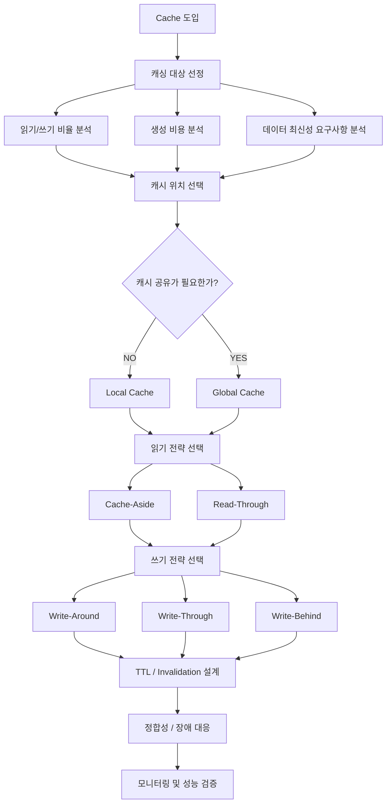

이 구조에서 중요한 것은 캐시를 저장하는 기술보다 캐시가 수행해야 할 역할을 먼저 정의하는 것이다.

Redis를 사용한다고 해서 모든 조회가 빨라지는 것은 아니다.

또 캐시를 공유한다고 해서 데이터 정합성이 자동으로 보장되는 것도 아니다.

캐시의 효율성과 안정성은 데이터의 특성과 갱신 전략, 장애 대응 정책에 의해 결정된다.

---

### 정리

캐시는 반복적인 데이터 조회나 계산 작업의 결과를 빠르게 재사용하기 위해 사용하는 기술이다.

일반적으로 데이터베이스보다 빠르게 접근할 수 있는 위치에 데이터를 저장한다.

캐시의 기본적인 조회 결과는 Cache Hit과 Cache Miss로 구분된다.

Cache Hit은 요청한 데이터가 캐시에 존재하는 상황이다.

Cache Miss는 데이터가 존재하지 않아 원본 저장소에서 조회해야 하는 상황이다.

캐시를 효과적으로 사용하려면 데이터의 접근 패턴을 이해해야 한다.

읽기 요청이 많고, 데이터 생성 비용이 높으며, 일정 수준의 오래된 데이터를 허용할 수 있는 경우 캐싱에 적합할 수 있다.

또 캐시 Key에는 결과를 결정하는 모든 입력 조건이 포함되어야 한다.

캐시의 위치는 크게 Local Cache와 Global Cache로 구분할 수 있다.

Local Cache는 애플리케이션 내부에 저장되므로 접근 속도가 빠르고 별도 네트워크 비용이 없다.

하지만 여러 서버에서 서로 다른 캐시가 유지될 수 있으므로 데이터 동기화 문제를 고려해야 한다.

Global Cache는 Redis와 같은 외부 저장소를 여러 서버가 공유하는 방식이다.

여러 서버에서 동일한 캐시 데이터를 사용할 수 있지만 네트워크 비용과 외부 인프라 장애, 운영 비용이 발생한다.

캐시의 읽기 전략에는 Cache-Aside와 Read-Through가 있다.

Cache-Aside는 애플리케이션이 캐시와 데이터베이스를 직접 관리한다.

Read-Through는 캐시 계층이 Cache Miss 시 원본 데이터를 로딩하는 역할을 맡는다.

쓰기 전략에는 Write-Around, Write-Through, Write-Behind가 있다.

Write-Around는 원본 저장소에 데이터를 기록하고 캐시는 별도 정책으로 관리한다.

Write-Through는 캐시와 원본 저장소에 변경 사항을 반영한다.

Write-Behind는 캐시에 먼저 기록하고 이후 비동기적으로 원본 저장소에 반영한다.

각 전략은 데이터 최신성과 쓰기 지연, 장애 대응, 데이터 유실 위험 사이에서 서로 다른 특성을 가진다.

따라서 캐싱 전략을 선택할 때는 성능뿐 아니라 데이터의 정합성과 내구성을 고려해야 한다.

Spring Boot에서는 Spring Cache와 Redis를 활용해 캐시를 구현할 수 있다.

`@Cacheable`은 메서드 반환값을 캐시에 저장하고 재사용할 수 있도록 지원한다.

`@CacheEvict`는 캐시를 제거하는 데 사용한다.

`RedisCacheManager`에서는 TTL과 Key Prefix, 직렬화 방식 등을 설정할 수 있다.

하지만 캐시 어노테이션을 사용한다고 모든 장애와 동시성 문제가 해결되는 것은 아니다.

동일한 Key에서 Cache Miss가 동시에 발생할 수 있고, Redis 장애 시 예외가 발생할 수 있다.

또 데이터베이스 변경과 캐시 갱신 사이에 정합성 문제가 발생할 수 있다.

따라서 운영 환경에서는 캐시를 하나의 독립적인 시스템 구성 요소로 관리해야 한다.

핵심 개념을 정리하면 다음과 같다.

| 개념 | 핵심 의미 |
|---|---|
| Cache | 반복적인 데이터 조회 및 계산 결과를 재사용하는 저장 공간 |
| Cache Hit | 캐시에 요청한 데이터가 존재 |
| Cache Miss | 캐시에 요청한 데이터가 존재하지 않음 |
| Hit Rate | 전체 캐시 조회 중 Hit 비율 |
| Local Cache | 애플리케이션 내부의 캐시 |
| Global Cache | 여러 서버가 공유하는 캐시 |
| Cache-Aside | 애플리케이션이 Cache Miss 시 원본 데이터 조회 |
| Read-Through | 캐시 계층이 원본 데이터 로딩 |
| Write-Around | 원본 저장소에 기록하고 캐시 갱신은 별도 관리 |
| Write-Through | 캐시와 원본 저장소에 변경 반영 |
| Write-Behind | 캐시에 먼저 기록하고 원본은 비동기로 갱신 |
| TTL | 캐시 데이터의 유효 시간 |
| Cache Invalidation | 유효하지 않은 캐시 데이터 제거 |
| Stale Cache | 원본보다 오래된 캐시 데이터 |
| Cache Key | 캐시 데이터를 식별하는 고유한 Key |
| Redis | 메모리 기반 데이터 저장소 |
| Caffeine | Java 애플리케이션용 Local Cache 라이브러리 |

결국 캐시를 잘 활용한다는 것은 단순히 데이터베이스 조회 앞에 Redis를 추가하는 것이 아니다.

**어떤 데이터를 재사용할지, 어디에 저장할지, 언제 갱신할지, 어떤 수준의 데이터 불일치를 허용할지, 캐시가 실패했을 때 어떻게 동작할지까지 설계하는 것**이다.

---

### 추가 키워드 심화: 실무에서 반드시 알아야 할 캐시 문제와 해결 전략

캐시의 기본 구조와 읽기·쓰기 전략을 이해했다면 다음으로는 실제 운영 환경에서 발생할 수 있는 문제를 알아야 한다.

캐시를 도입하는 것보다 어려운 작업은 캐시를 안정적으로 유지하는 것이다.

특히 트래픽이 증가하고 애플리케이션이 여러 대로 확장되면 새로운 문제가 발생할 수 있다.

대표적인 키워드를 하나씩 살펴보자.

---

#### 1. Cache Stampede: 동시에 캐시가 만료되면 어떻게 될까?

Cache Stampede는 특정 캐시 데이터가 만료되거나 존재하지 않을 때 다수의 요청이 동시에 원본 저장소를 조회하는 현상이다.

Thundering Herd 문제와 관련이 있다.

예를 들어 인기 상품의 캐시가 만료되었다고 가정하자.

```text
product:100

TTL 만료
```

그런데 동시에 1,000개의 요청이 들어온다.

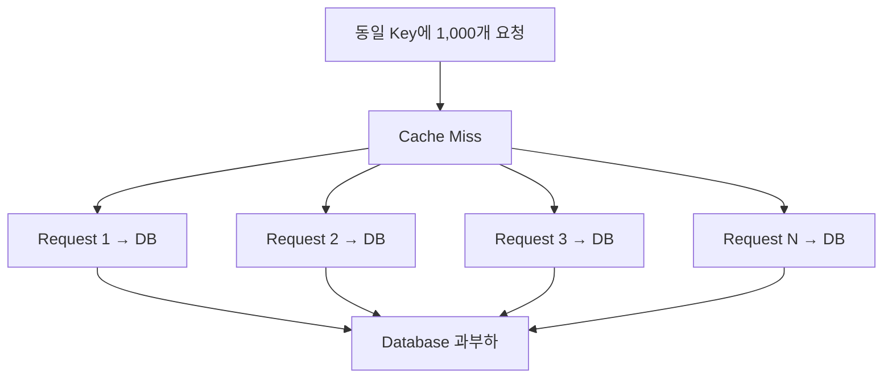

원래 캐시는 DB 부하를 줄이기 위해 도입했다.

하지만 캐시가 만료되는 순간 오히려 DB에 대량의 요청이 집중된다.

이것이 Cache Stampede다.

##### 해결 방법 1. Single Flight

동일한 Key에 대해 여러 요청이 발생하더라도 한 요청만 원본 데이터를 로딩하도록 하는 방법이다.

```text
Request A → DB 조회 수행

Request B → A의 결과 대기

Request C → A의 결과 대기

Request D → A의 결과 대기
```

DB 조회가 완료되면 여러 요청이 같은 결과를 사용한다.

Caffeine의 Loading Cache는 동일한 Key의 계산을 조정하는 기능을 제공하므로 Local Cache에서 유용할 수 있다.

다만 서버가 여러 대라면 각 JVM에서 별도로 조회가 발생할 수 있다.

따라서 전체 서버 사이에서 하나의 로딩 작업만 수행하려면 추가적인 분산 조정이 필요하다.

##### 해결 방법 2. Distributed Lock

Redis의 분산 락 등을 활용해 특정 Key에 대해 하나의 요청만 캐시를 재생성하도록 할 수 있다.

```text
Cache Miss

↓

Lock 획득 시도

↓

Lock 획득 성공

→ DB 조회
→ 캐시 저장
→ Lock 해제
```

```text
Lock 획득 실패

→ 잠시 대기
→ 캐시 재조회
```

하지만 분산 락에도 다음 사항을 고려해야 한다.

- Lock TTL
- Lock 획득 실패
- Lock 보유 중 장애
- Lock 해제 시 소유권 검증
- 대기 요청의 Timeout
- 캐시 재생성 실패

또 Redis 분산 락을 사용한다고 모든 경쟁 조건이 자동으로 해결되는 것은 아니다.

특히 오래된 작업이 늦게 완료되어 새로운 데이터를 덮어쓰는 상황까지 고려해야 한다.

##### 해결 방법 3. Stale-While-Revalidate

기존 데이터를 잠시 반환하면서 백그라운드에서 새로운 값을 계산하는 방식이다.

이 방법은 뒤에서 자세히 살펴본다.

---

#### 2. Cache Penetration: 존재하지 않는 데이터를 반복 조회하면 어떻게 될까?

Cache Penetration은 캐시에 존재하지 않고 원본 저장소에도 존재하지 않는 데이터에 대한 요청이 반복되면서 DB에 부하가 발생하는 문제다.

예를 들어 다음과 같은 요청이 반복된다고 가정하자.

```http
GET /api/products/999999999
```

상품 999999999는 존재하지 않는다.

따라서 Cache-Aside에서는 다음과 같이 동작할 수 있다.

```text
Cache Miss

↓

DB 조회

↓

데이터 없음

↓

캐시에 저장하지 않음
```

다음 요청이 발생한다.

```text
Cache Miss

↓

DB 조회

↓

데이터 없음
```

요청이 반복될 때마다 DB를 조회한다.

특히 악의적인 요청이 대량으로 발생한다면 DB에 상당한 부하가 발생할 수 있다.

##### 해결 방법 1. Negative Caching

존재하지 않는 데이터도 짧은 시간 동안 캐싱하는 방식이다.

예를 들어 다음과 같이 저장할 수 있다.

```text
Key: product:999999999

Value: NOT_FOUND

TTL: 30초
```

이후 같은 요청이 들어오면 DB를 조회하지 않고 데이터가 없다는 결과를 반환할 수 있다.

다만 Negative Caching에는 주의할 점이 있다.

존재하지 않던 데이터가 새로 생성될 수 있기 때문이다.

따라서 존재하지 않는 결과는 일반 데이터보다 짧은 TTL을 적용하거나 데이터 생성 시 해당 캐시를 무효화하는 방식을 고려할 수 있다.

##### 해결 방법 2. 입력값 검증

명백히 유효하지 않은 Key는 DB 조회 이전에 차단한다.

예를 들어 상품 ID의 허용 범위나 형식을 검증할 수 있다.

##### 해결 방법 3. Rate Limiting

동일 사용자나 IP에서 비정상적인 조회가 반복되는 경우 요청량을 제한할 수 있다.

##### 해결 방법 4. Bloom Filter

Bloom Filter는 특정 값이 집합에 존재할 가능성을 판단하는 확률적 자료구조다.

존재하지 않는 Key를 빠르게 걸러내는 데 활용할 수 있다.

하지만 Bloom Filter에는 False Positive가 발생할 수 있다.

즉 실제로 존재하지 않는 값인데 존재할 가능성이 있다고 판단할 수 있다.

따라서 Bloom Filter는 DB 조회를 완전히 대체하는 기능이 아니라 불필요한 조회를 줄이기 위한 보조 수단으로 이해해야 한다.

---

#### 3. Cache Avalanche: 대량의 캐시가 동시에 만료되면?

Cache Avalanche는 많은 캐시 데이터가 비슷한 시점에 만료되거나 캐시 서버 장애로 대량의 요청이 원본 저장소에 집중되는 현상이다.

Cache Stampede와 비슷하지만 관점이 다르다.

Cache Stampede는 일반적으로 특정 인기 Key에 대한 동시 Cache Miss를 강조한다.

반면 Cache Avalanche는 여러 Key가 동시에 만료되거나 캐시 계층 전체가 사용할 수 없게 되는 상황을 포함한다.

예를 들어 다음과 같은 캐시 데이터가 있다고 가정하자.

```text
product:100 → TTL 1시간

product:101 → TTL 1시간

product:102 → TTL 1시간

product:103 → TTL 1시간
```

모든 Key가 비슷한 시점에 생성되었다면 만료 시점도 비슷할 수 있다.

```text
12:00 캐시 생성

↓

13:00 대량 만료

↓

DB 조회 급증
```

이 문제를 해결하려면 만료 시점을 분산시키는 방법이 유용하다.

대표적인 방법이 TTL Jitter다.

---

#### 4. TTL Jitter: 만료 시간을 왜 무작위로 설정할까?

TTL Jitter는 캐시 Key마다 만료 시간을 조금씩 다르게 설정하는 기법이다.

예를 들어 모든 캐시에 60분의 TTL을 설정하는 대신 다음과 같이 설정할 수 있다.

```text
product:100 → 61분

product:101 → 67분

product:102 → 63분

product:103 → 69분
```

이렇게 하면 캐시가 동일한 시점에 대량으로 만료되는 문제를 완화할 수 있다.

Java에서는 다음과 같이 표현할 수 있다.

```java
import java.time.Duration;
import java.util.concurrent.ThreadLocalRandom;

public class CacheTtlPolicy {

    public Duration ttlWithJitter() {

        long baseSeconds = 3600;

        long jitterSeconds =
                ThreadLocalRandom.current()
                        .nextLong(0, 601);

        return Duration.ofSeconds(
                baseSeconds + jitterSeconds
        );
    }
}
```

이 코드는 기본 TTL 3,600초에 0~600초의 무작위 시간을 추가한다.

```text
최소 TTL: 60분

최대 TTL: 70분
```

다만 TTL Jitter를 적용할 때도 데이터의 최신성 요구사항을 고려해야 한다.

예를 들어 최대 60분 이전의 데이터만 허용한다면 TTL을 70분까지 늘리는 것은 요구사항을 위반할 수 있다.

이 경우 기본 TTL을 더 짧게 설정하고 그 범위 안에서 무작위 값을 적용하는 것이 적절하다.

**TTL Jitter의 목적은 만료 시점을 분산시키는 것이지 데이터 최신성 요구사항을 완화하는 것이 아니다.**

---

#### 5. Cache Warming: 캐시를 미리 채워두면 어떤 장점이 있을까?

Cache Warming은 실제 요청이 들어오기 전에 자주 사용될 데이터를 캐시에 미리 적재하는 방식이다.

일반적인 Cache-Aside에서는 첫 번째 요청이 Cache Miss가 된다.

하지만 특정 데이터는 요청이 집중될 것을 미리 예상할 수 있다.

예를 들어 다음과 같은 상황이다.

- 오전 9시에 관리자 대시보드 사용 증가
- 특정 시간에 시작하는 할인 행사
- 인기 상품 상세 페이지
- 자주 조회하는 공통 코드
- 서버 배포 이후 캐시 초기화

이러한 경우 캐시를 미리 생성할 수 있다.

```text
08:55

통계 계산

↓

Redis에 저장

↓

09:00

관리자 조회 시작

↓

Cache Hit
```

이 방식은 첫 요청의 지연 시간을 줄이는 데 도움이 된다.

다만 모든 데이터를 무조건 미리 캐싱하면 메모리 사용량이 증가할 수 있다.

따라서 실제로 많이 조회되는 데이터 중심으로 적용하는 것이 좋다.

또 캐시 갱신 작업이 실패했을 때 이전 데이터를 사용할지, 원본을 조회할지에 대한 정책도 필요하다.

---

#### 6. Stale-While-Revalidate: 오래된 데이터를 먼저 반환해도 될까?

Stale-While-Revalidate(SWR)는 캐시 데이터가 오래되었더라도 일정 시간 동안 기존 값을 반환하면서 새로운 데이터를 비동기적으로 갱신하는 전략이다.

예를 들어 다음과 같은 상황을 생각해 보자.

```text
캐시 데이터 생성

10:00
```

캐시의 일반적인 유효 기간은 5분이라고 가정하자.

10시 6분에 사용자가 조회한다.

이때 데이터를 완전히 만료 처리하면 DB 조회가 완료될 때까지 기다려야 한다.

반면 SWR에서는 다음과 같이 처리할 수 있다.

```text
10:06 요청

↓

기존 캐시 반환

↓

비동기 갱신 시작

↓

새로운 데이터 생성

↓

캐시 교체
```

구조는 다음과 같다.

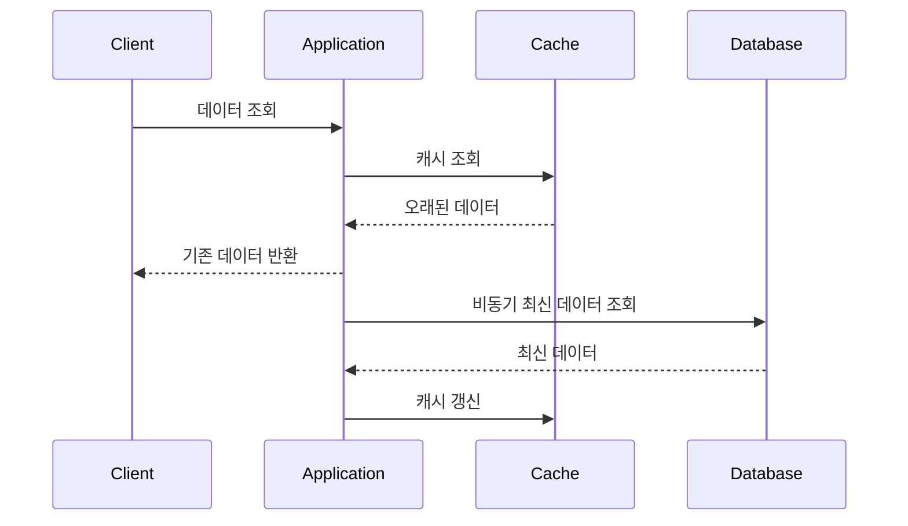

이러한 방식은 관리자 통계나 추천 결과처럼 약간 오래된 데이터를 허용할 수 있는 서비스에 유용하다.

하지만 모든 데이터에 적용할 수 있는 것은 아니다.

예를 들어 결제 잔액이나 접근 권한처럼 최신성이 중요한 데이터에서는 오래된 값을 반환하면 문제가 발생할 수 있다.

또 비동기 갱신이 실패했을 때 기존 값을 얼마나 오래 유지할지 결정해야 한다.

Caffeine은 `refreshAfterWrite()`와 같은 갱신 정책을 제공한다. 다만 갱신 가능 시간이 지났다고 즉시 백그라운드 갱신이 시작되는 것은 아니며, 일반적으로 해당 엔트리에 대한 조회가 발생해야 갱신이 트리거된다.

---

#### 7. Hot Key: 특정 Key에 요청이 집중되면?

Hot Key는 특정 캐시 Key에 조회 요청이 집중되는 현상이다.

예를 들어 다음과 같은 상품이 있다고 가정하자.

```text
product:100
```

이 상품이 매우 인기가 높아 초당 수만 건의 조회 요청이 발생한다고 가정하자.

Redis는 빠른 저장소지만 특정 Key에 대한 요청이 집중되면 네트워크와 CPU, 특정 샤드에 병목이 발생할 수 있다.

이를 Hot Key 문제라고 한다.

대표적인 대응 방법은 다음과 같다.

- Local Cache를 추가해 Redis 조회 횟수 감소
- 인기 Key의 사전 갱신
- 요청량 제한
- 캐시 데이터 복제 및 읽기 분산
- 데이터 접근 구조 개선

예를 들어 다음과 같은 2단계 캐시를 구성할 수 있다.

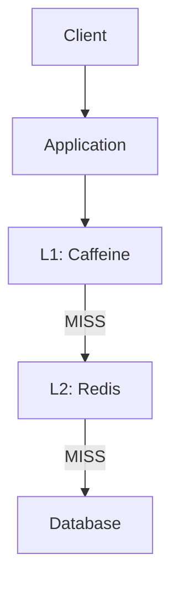

이 구조에서는 자주 조회하는 데이터를 Local Cache에서 처리할 수 있다.

따라서 Redis에 도달하는 요청 수를 줄일 수 있다.

하지만 Local Cache가 추가되면서 캐시 무효화 문제가 더 복잡해진다.

즉 성능 개선과 정합성 관리 비용 사이의 균형을 고려해야 한다.

---

#### 8. Multi-Level Cache: 캐시를 여러 단계로 구성하면?

Multi-Level Cache는 캐시를 여러 계층으로 구성하는 방식이다.

대표적으로 L1과 L2 캐시를 사용한다.

```text
L1 Cache = Caffeine

L2 Cache = Redis

Origin = Database
```

조회 흐름은 다음과 같다.

```mermaid
flowchart TD
    A["Application Request"] --> B{"L1 Cache Hit?"}

    B -->|YES| C["L1 데이터 반환"]

    B -->|NO| D{"L2 Cache Hit?"}

    D -->|YES| E["L1에 데이터 저장"]

    D -->|NO| F["Database 조회"]

    F --> G["L2에 데이터 저장"]
    G --> E

    E --> H["데이터 반환"]
    C --> H
```

이 구조는 캐시 조회 비용을 단계적으로 줄일 수 있다.

하지만 다음 문제가 발생할 수 있다.

```text
L1 Cache = 오래된 데이터

L2 Cache = 최신 데이터

Database = 최신 데이터
```

L1에서 Cache Hit이 발생하면 L2에 최신 데이터가 존재하더라도 조회하지 않는다.

따라서 L1의 TTL을 짧게 설정하거나 캐시 무효화 이벤트를 모든 서버에 전파하는 방식이 필요할 수 있다.

Multi-Level Cache는 성능을 높이는 강력한 방식이지만 정합성 관리가 더 어려워질 수 있다는 점을 고려해야 한다.

---

#### 9. Cache Consistency: 캐시 정합성은 어느 수준까지 보장해야 할까?

Cache Consistency는 캐시 데이터와 원본 데이터 사이의 일관성을 의미한다.

예를 들어 상품 가격이 변경되었다고 가정하자.

```text
Database = 45000

Cache = 50000
```

이 상태에서는 두 저장소의 값이 다르다.

하지만 모든 서비스에서 이러한 불일치가 반드시 치명적인 것은 아니다.

예를 들어 관리자 통계는 몇 분 이전 데이터를 반환해도 괜찮을 수 있다.

반면 주문 결제 금액은 실제 결제 시점의 유효한 가격 정책과 일치해야 한다.

따라서 다음과 같이 데이터별 정합성 요구사항을 정의할 수 있다.

| 데이터 | 요구사항 | 캐싱 고려사항 |
|---|---|---|
| 상품 상세 정보 | 짧은 지연 허용 가능 | TTL 및 Invalidation |
| 관리자 통계 | 일정 시간 지연 허용 | 주기적 갱신 |
| 상품 조회수 | 지연 허용 가능 | 비동기 집계 |
| 재고 수량 | 동시성 중요 | 원본 기준 최종 검증 |
| 결제 금액 | 정확성 중요 | 거래 시점의 원본 규칙 검증 |
| 사용자 권한 | 보안 중요 | 변경 시 즉시 무효화 또는 강한 검증 |

여기서 중요한 원칙은 다음과 같다.

**캐시에 저장되어 있다는 이유만으로 해당 데이터를 최종적인 진실의 원천(Source of Truth)으로 사용해서는 안 된다.**

어떤 데이터가 최종 기준인지 명확하게 정의해야 한다.

---

#### 10. Cache Invalidation Race Condition: 삭제했는데 오래된 값이 다시 저장되는 이유

Cache-Aside에서는 다음과 같은 경쟁 조건이 발생할 수 있다.

초기 데이터는 다음과 같다고 가정하자.

```text
DB = 100

Cache = 없음
```

이제 두 요청이 동시에 실행된다.

첫 번째는 조회 요청이다.

두 번째는 수정 요청이다.

```mermaid
sequenceDiagram
    participant Reader
    participant Database
    participant Writer
    participant Cache

    Reader->>Cache: GET key
    Cache-->>Reader: MISS

    Reader->>Database: SELECT
    Database-->>Reader: 100

    Writer->>Database: UPDATE value = 200
    Database-->>Writer: COMMIT

    Writer->>Cache: DEL key

    Reader->>Cache: SET key = 100

    Note over Cache: 오래된 값 100이 다시 저장됨
```

이 상황에서 Writer는 정상적으로 DB를 변경하고 캐시를 삭제했다.

하지만 Reader가 이전에 조회한 값을 나중에 캐시에 저장했다.

그 결과 다음과 같은 상태가 된다.

```text
DB = 200

Cache = 100
```

이는 단순히 쓰기 완료 후 캐시를 삭제하는 방식만으로 모든 경쟁 조건을 해결할 수 없다는 사실을 보여준다.

해결 방법으로는 다음과 같은 전략을 고려할 수 있다.

- 짧은 TTL
- 버전 기반 캐시
- 캐시 재생성 시 버전 검증
- Key 단위 동기화
- 데이터 변경 이벤트 기반 무효화
- 중요한 데이터의 캐시 사용 제한

이러한 전략을 적용할 때는 구현 복잡성과 정합성 요구사항 사이의 균형을 고려해야 한다.

---

#### 11. Cache Eviction과 Expiration은 무엇이 다를까?

두 용어는 비슷하지만 의미가 다르다.

Expiration은 캐시 데이터의 유효 시간이 지나 제거 대상이 되는 것을 의미한다.

예를 들어 다음과 같다.

```text
TTL = 10분

10분 경과

→ Expiration
```

반면 Eviction은 캐시의 메모리 사용량이나 정책에 따라 데이터를 제거하는 것을 의미한다.

예를 들어 Redis가 메모리 제한에 도달했을 때 일부 Key를 제거할 수 있다.

대표적인 정책은 다음과 같다.

| 정책 | 의미 |
|---|---|
| LRU | 최근에 사용되지 않은 데이터를 우선 제거 |
| LFU | 사용 빈도가 낮은 데이터를 우선 제거 |
| Random | 무작위 제거 |
| TTL 기반 정책 | 만료 시간이 설정된 Key를 대상으로 제거 |
| No Eviction | 메모리 부족 시 일부 쓰기 명령에 오류 반환 |

Redis는 `maxmemory`와 `maxmemory-policy` 설정을 통해 메모리 제한과 Eviction 정책을 관리할 수 있다.

예를 들어 다음과 같다.

```bash
CONFIG SET maxmemory 1gb
```

```bash
CONFIG SET maxmemory-policy allkeys-lru
```

첫 번째 명령어는 Redis의 메모리 제한을 설정한다.

두 번째 명령어는 메모리 제한을 초과했을 때 LRU 계열 정책으로 Key를 제거하도록 설정한다.

다만 Redis의 LRU는 일반적으로 샘플링 기반 근사 방식을 사용하며, `maxmemory`가 프로세스 전체의 실제 메모리 사용량을 정확히 제한하는 것은 아니다.

또 운영 환경에서는 `CONFIG SET`으로 변경한 설정이 영구적으로 유지되는지 배포 및 설정 관리 방식도 확인해야 한다.

Redis의 Eviction 정책은 공식 문서에서 확인할 수 있다.

---

#### 12. Redis SPOF와 High Availability: 캐시 서버가 죽으면 어떻게 될까?

SPOF(Single Point of Failure)는 하나의 구성 요소에 장애가 발생했을 때 전체 서비스에 영향을 줄 수 있는 단일 장애 지점을 의미한다.

예를 들어 다음과 같은 구조를 생각해 보자.

```mermaid
flowchart TD
    A["Application A"] --> C["Redis"]
    B["Application B"] --> C
```

모든 서버가 하나의 Redis에 의존한다.

Redis에 장애가 발생하면 캐시 기능이 중단될 수 있다.

이를 해결하기 위해 다음과 같은 방법을 고려할 수 있다.

##### Redis Replication

Redis의 데이터를 다른 인스턴스에 복제하는 방식이다.

복제본을 이용해 읽기 부하를 분산하거나 장애 복구 구조를 구성할 수 있다.

다만 Redis 복제는 기본적으로 비동기적 특성을 가지므로 장애 상황에서 일부 데이터가 유실될 가능성을 고려해야 한다.

##### Redis Sentinel

Redis 인스턴스를 감시하고 장애가 발생했을 때 새로운 Primary를 선출하는 등의 기능을 제공한다.

고가용성 구성을 지원하지만 Failover 과정에서 일시적인 서비스 중단이 발생할 수 있다.

##### Redis Cluster

데이터를 여러 Shard로 분산하는 구조다.

수평 확장과 일부 장애 대응을 지원한다.

하지만 Redis Cluster를 사용한다고 모든 장애가 자동으로 해결되는 것은 아니다.

노드 수와 Replica 구성, 네트워크 분리 상황, Failover 조건 등을 고려해야 한다.

또 캐시 데이터가 유실되어도 원본에서 복구할 수 있는지 확인해야 한다.

**캐시는 일반적으로 원본 데이터를 재생성할 수 있어야 하지만, 캐시 장애 시 전체 서비스가 정상적으로 동작하려면 별도의 용량과 장애 대응 설계가 필요하다.**

---

#### 13. Cache Key Design: 캐시 Key를 잘못 설계하면 어떤 문제가 발생할까?

캐시 Key는 캐시 데이터를 식별하는 값이다.

단순히 문자열을 연결하는 것처럼 보이지만 실제로는 데이터 정합성과 관련된 중요한 설계 요소다.

예를 들어 다음 Key를 생각해 보자.

```text
product:100
```

상품 ID만 포함한다.

하지만 상품 응답이 국가와 사용자 등급에 따라 달라진다면 문제가 발생할 수 있다.

```text
product:100:KR:VIP

product:100:KR:NORMAL

product:100:US:VIP
```

결과에 영향을 주는 조건을 포함해야 한다.

또 서비스가 여러 개라면 Key 충돌을 방지하기 위해 Namespace를 사용할 수 있다.

```text
catalog:v1:product:100:KR

payment:v1:transaction:100

dashboard:v2:sales:KR:2026-11-10T09
```

여기서 `v1`, `v2`는 캐시 스키마 버전을 표현한다.

이러한 버전은 객체 구조나 직렬화 형식이 변경될 때 유용할 수 있다.

캐시 Key를 설계할 때는 다음 사항을 고려해야 한다.

- 서비스 구분
- 데이터 종류
- 식별자
- 국가 또는 테넌트
- 사용자별 접근 권한
- 시간 구간
- 조회 필터
- 정렬 및 페이지 조건
- 데이터 구조 버전

특히 사용자별 개인정보나 권한에 따라 응답이 달라지는 경우에는 캐시 Key와 접근 제어를 함께 검토해야 한다.

잘못된 Cache Key로 인해 다른 사용자의 데이터를 반환하는 문제는 단순한 정합성 오류를 넘어 보안 사고로 이어질 수 있다.

---

#### 14. Cache Monitoring: 캐시를 도입했다면 무엇을 모니터링해야 할까?

캐시를 도입한 이후에는 실제로 효과가 있는지 측정해야 한다.

대표적인 지표는 다음과 같다.

| 지표 | 의미 | 확인 목적 |
|---|---|---|
| Cache Hit Rate | 캐시 적중률 | 캐시 효율 |
| Cache Miss Rate | 캐시 미스 비율 | 원본 조회 부담 |
| Cache Latency | 캐시 응답 시간 | 네트워크 및 서버 병목 |
| Eviction Count | 메모리 정책에 따른 제거 수 | 메모리 압박 |
| Expired Keys | TTL 만료 Key 수 | 만료 패턴 |
| Redis Used Memory | Redis 메모리 사용량 | 용량 관리 |
| Redis Connected Clients | 연결된 클라이언트 수 | 연결 관리 |
| DB Query QPS | DB 초당 조회 수 | 캐시 도입 효과 |
| DB Connection Pool Usage | DB 연결 사용량 | 장애 전파 위험 |
| Application p95/p99 | 응답 시간 분포 | 사용자 경험 |
| Cache Refresh Failures | 갱신 실패 횟수 | 오래된 데이터 위험 |

Redis에서는 다음 명령어로 주요 통계를 확인할 수 있다.

```bash
INFO stats
```

이 명령어는 Keyspace Hit, Miss, Eviction 등 다양한 통계 정보를 제공한다.

또 메모리 정보를 확인하려면 다음 명령어를 사용할 수 있다.

```bash
INFO memory
```

특정 Key의 TTL을 확인할 수도 있다.

```bash
TTL dashboardStats::KR
```

단, 실제 Spring Cache의 Key는 Cache Name과 Key 생성 방식에 따라 달라질 수 있다.

따라서 실제 저장된 Key를 기준으로 확인해야 한다.

운영 환경에서는 Redis 자체의 지표뿐 아니라 애플리케이션의 Cache Hit Rate와 DB 부하를 함께 관찰하는 것이 좋다.

특히 다음 질문이 중요하다.

**캐시를 도입한 이후 실제 데이터베이스 부하가 감소했는가?**

**사용자 응답 시간이 개선되었는가?**

**캐시 장애 상황에서도 서비스가 허용 가능한 수준으로 동작하는가?**

이러한 지표가 개선되지 않았다면 캐시가 오히려 불필요한 운영 비용을 증가시키고 있을 수 있다.

---

#### 15. 캐시를 도입하지 않는 것이 더 좋은 경우

캐시는 강력한 성능 개선 수단이지만 모든 문제에 대한 정답은 아니다.

예를 들어 다음과 같은 상황에서는 캐시가 오히려 복잡성을 증가시킬 수 있다.

##### 데이터 변경 빈도가 매우 높은 경우

캐시 갱신과 무효화가 빈번하게 발생하면 성능 이점이 줄어들 수 있다.

##### 요청마다 결과가 크게 달라지는 경우

캐시 Key가 지나치게 다양해져 Hit Rate가 낮아질 수 있다.

##### DB 조회 비용이 이미 매우 낮은 경우

캐시 접근 비용이 DB 조회 비용과 비슷하거나 더 클 수 있다.

##### 강한 정합성이 필요한 경우

잘못된 캐시 데이터가 결제나 재고, 권한 처리에 영향을 줄 수 있다면 신중한 설계가 필요하다.

##### 데이터 크기가 매우 큰 경우

캐시 메모리 비용이 과도하게 증가할 수 있다.

##### 원본 쿼리가 비효율적인 경우

캐시를 도입하기 전에 SQL 실행 계획과 인덱스를 개선하는 것이 더 효과적일 수 있다.

예를 들어 다음과 같은 상황을 생각해 보자.

```text
기존 SQL 실행 시간: 1,000ms
```

인덱스를 개선한 뒤 다음과 같이 변경되었다고 가정하자.

```text
개선된 SQL 실행 시간: 10ms
```

이 경우 별도의 Redis 인프라 없이도 상당한 성능 개선을 얻을 수 있다.

따라서 캐시 도입 전에 먼저 원본 시스템의 병목을 분석해야 한다.

**캐시는 비효율적인 구조를 감추기 위한 수단이 아니라, 반복적으로 수행되는 비용 높은 작업을 줄이기 위한 수단으로 사용하는 것이 바람직하다.**

---

#### 추가 키워드 요약

| 키워드 | 핵심 의미 | 대표적인 대응 전략 |
|---|---|---|
| Cache Stampede | 특정 Key 만료 시 동시 원본 조회 급증 | Single Flight, Lock, SWR |
| Cache Penetration | 존재하지 않는 데이터 반복 조회 | Negative Caching, Bloom Filter |
| Cache Avalanche | 대량 Key 만료 또는 캐시 장애로 DB 부하 집중 | TTL Jitter, 사전 갱신, 장애 격리 |
| TTL Jitter | Key마다 만료 시간을 분산 | 무작위 TTL |
| Cache Warming | 요청 전에 캐시 미리 적재 | 사전 계산, 스케줄 갱신 |
| Stale-While-Revalidate | 오래된 데이터 반환과 비동기 갱신 | Background Refresh |
| Hot Key | 특정 Key로 요청 집중 | L1 Cache, 복제, 분산 |
| Multi-Level Cache | 여러 계층의 캐시 활용 | Caffeine + Redis |
| Cache Consistency | 원본과 캐시 데이터 일관성 | Invalidation, Versioning |
| Cache Invalidation Race | 캐시 삭제 후 오래된 값 재저장 | 버전 검증, 동기화 |
| Cache Eviction | 메모리 정책에 따른 캐시 제거 | LRU, LFU |
| Cache Expiration | 유효 시간 경과에 따른 만료 | TTL |
| Redis SPOF | Redis 장애가 전체 서비스에 영향 | Sentinel, Cluster, Failover |
| Cache Key Design | 요청 결과를 구분하는 Key 구조 | Namespace, Versioning |
| Cache Monitoring | 캐시 성능과 안정성 관찰 | Hit Rate, Latency, Eviction |

#### 한 줄 요약

**캐시는 자주 조회하거나 생성 비용이 높은 데이터를 재사용해 응답 시간과 원본 저장소의 부하를 줄이는 기술이다. Local Cache와 Global Cache의 특성을 이해하고, Cache-Aside·Read-Through·Write-Around·Write-Through·Write-Behind 전략을 데이터의 특성에 맞게 조합해야 한다. 또한 TTL과 Cache Invalidation만으로 모든 문제가 해결되는 것은 아니므로 Cache Stampede, Cache Penetration, Cache Avalanche, 데이터 정합성, Redis 장애 대응, Hot Key와 메모리 관리까지 함께 고려해야 안정적인 캐싱 시스템을 설계할 수 있다.**
